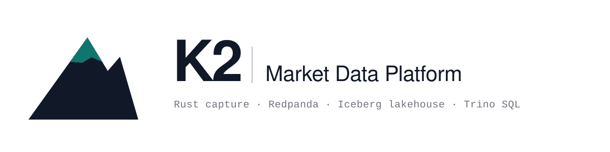
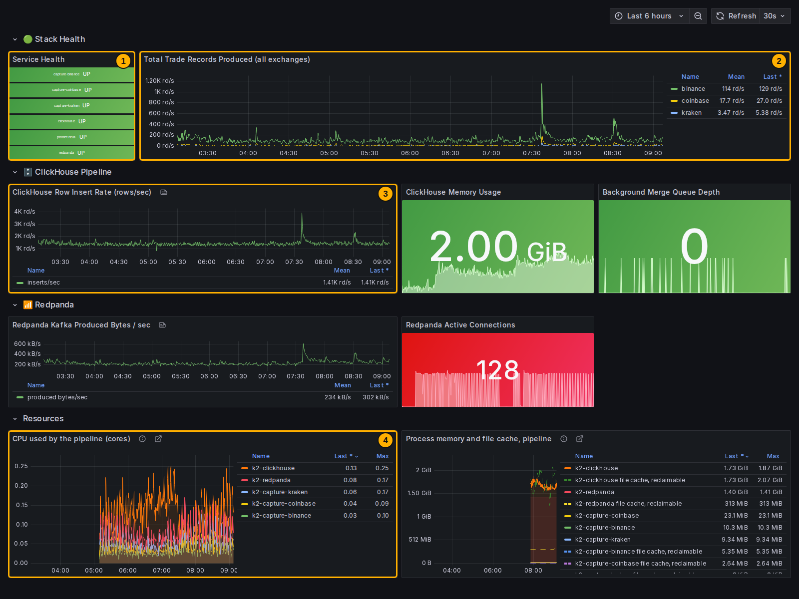
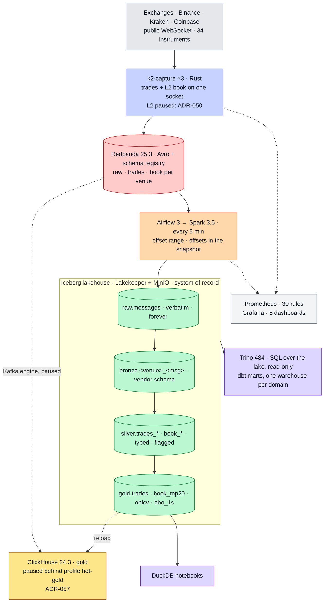

<p align="center">
  <picture>
    <source media="(prefers-color-scheme: dark)" srcset="docs/assets/banner-dark.svg">
    
  </picture>
</p>

# K2 Market Data Platform

A market data platform for quantitative research. Three crypto exchanges are captured
verbatim over public WebSocket feeds, archived to an Iceberg lakehouse that is the system of
record, with Trino for SQL over the lake; the ClickHouse hot tier that served it is paused
while the platform is built ([ADR-057](./docs/adr/ADR-057-clickhouse-hot-tier-paused-during-platform-build.md)). One host, inside a 25 CPU / 48 GiB ceiling. Not a trading path.

[](https://github.com/rjdscott/k2-market-data-platform/actions/workflows/ci.yml)
[](./LICENSE)
[](https://www.rust-lang.org/)
[](https://clickhouse.com/)

## What this is, and data terms

K2 is a platform you run on your own machine for research and quant workflows. It is a
reference implementation, not a hosted service. It is not a market data distribution
service and not for production trading, and it is not affiliated with or endorsed by
Binance, Kraken, Coinbase, any other venue, or the European Central Bank.

The repository ships code and contracts; every venue-format fixture in it is synthetic
([`NOTICE`](./NOTICE)). Market data is fetched by your own stack from public endpoints,
stays on your machine, and is subject to each provider's terms:
[Binance](https://www.binance.com/en/terms), [Kraken](https://www.kraken.com/legal),
[Coinbase](https://www.coinbase.com/legal/user_agreement). Complying with them is your
responsibility.

The one named exception is pictures. Images under `docs/images/` are screenshots of a live
run (`make screenshots` takes the current set): they show venue-derived figures as they stood
at the moment of capture, are for illustration only, and are not a data set
([`NOTICE`](./NOTICE), "Screenshots").

## Where this is going

K2 is being rebuilt from one crypto pipeline into a **domain-agnostic data product platform**:
any dataset is defined once in a contract, brought in by its own connector, stored in layers,
listed in one catalog, and served through one SQL endpoint and a REST API under the same
permissions. Market data is the first tenant; the value is in joining products across domains.

| Read | For |
|---|---|
| [Chapter 20, the target platform](docs/architecture/20-target-data-product-platform.md) | The design, its ethos and twelve diagrams |
| [ADR-056](docs/adr/ADR-056-unified-data-product-platform.md) | The decision, its alternatives and its costs |
| [The plan to the demo tag](docs/plans/2026-11-26-unified-product-platform/README.md) and [to release](docs/plans/2026-11-26-unified-product-platform-to-release/README.md) | The phases, each with an exit a command proves |
| [The research note](docs/research/2026-11-26-unified-platform-architecture.md) | How the design was chosen: three competing designs, a judge, adversarial reviews, spikes |

Everything below this section, and chapters 04 to 19 of the architecture book, describe **what
runs today**. Each phase of the plan updates them in the pull request that makes a change real.

## Overview

| Property | How |
|---|---|
| Complete | One Rust process per venue holds a single socket carrying trades and L2 book, stamps `recv_ts_ns` before parsing, verifies Kraken's CRC32 on every update, tracks each venue's sequence numbers, and publishes every frame verbatim. The L2 book is paused on every venue while the platform is built, by a per-venue switch; its tables stay readable up to the pause ([ADR-050](./docs/adr/ADR-050-order-book-capture-paused-during-platform-build.md)). |
| Reproducible | Every 5 minutes Spark reads Redpanda by offset range into Iceberg: `raw` (never expired) to `bronze` (per venue, vendor schema) to `silver` (typed, flagged) to `gold` (one row per trade, OHLCV, BBO). Consumed offsets are committed in the same snapshot as the rows; any layer rebuilds from the one above. |
| Disposable serving | ClickHouse `gold`, fed live from the topics and reloaded from the lake, is paused behind the compose profile `hot-gold` while the platform is built, its DDL still tested by `make test-clickhouse` ([ADR-057](./docs/adr/ADR-057-clickhouse-hot-tier-paused-during-platform-build.md)). Dedup is a `ReplacingMergeTree` key; candles are computed on read, so a replay cannot corrupt one. |
| Proven | Nightly audits per layer, OHLCV parity at a pinned snapshot (its ClickHouse leg skipped while the tier is paused), 30 alert rules as code, chaos scripts with measured recovery, a fresh-clone release check before every tag. |

[](docs/operations/dashboards.md)

The pipeline overview on a live run; its figures are venue-derived and for illustration only.
Every other screen, in the order the data moves through them, with what to read from each and
the runbook it leads to: [dashboards and consoles](docs/operations/dashboards.md).

## Architecture



18 long-running services and 5 one-shot init containers, 15.30 CPU / 27.312 GiB of declared
limits at steady state and 17.30 CPU / 29.812 GiB at the bootstrap peak, under a 25 CPU / 48 GiB
ceiling ([ADR-045](./docs/adr/ADR-045-ceiling-25-cpu-48-gib.md); [how the numbers are produced](./docs/operations/docker-resources.md#how-these-numbers-are-produced)).
The scheduler Airflow replaced is archived in [`legacy/prefect/`](./legacy/prefect/README.md), with no rollback path in the compose file.

**Read the book.** [`docs/architecture/`](./docs/architecture/README.md) is written as numbered
chapters: what the platform is and is not, the market data and data engineering concepts it
rests on, then one chapter per component with the problem, the options, the decision, how it
works, and the practices that enforce it.

## Key decisions

| ADR | Decision | Why |
|---|---|---|
| [018](./docs/adr/ADR-018-v3-lake-first-rust-capture.md) | The lake is the system of record; everything else is derived | v2's lake was a JDBC copy of the serving database and inherited its TTL and dropped columns |
| [019](./docs/adr/ADR-019-rust-capture-tier.md) | One Rust process per venue replaces three JVM handlers | Trades and book on one connection, `recv_ts` before parse, retired on a measured parity gate |
| [020](./docs/adr/ADR-020-avro-fixed-point-contracts.md) | Avro with registry, `int64` at 1e-8, `BACKWARD_TRANSITIVE` | v2 stored prices as strings and never read its own Avro topic |
| [022](./docs/adr/ADR-022-exactly-once-via-snapshot-offsets.md) | Kafka offsets committed inside the Iceberg snapshot | One atomic commit replaces a watermark table and its failure modes |
| [026](./docs/adr/ADR-026-four-layer-lake-and-gold-served-from-clickhouse.md) | Four lake layers; ClickHouse serves gold with no TTL | Venue fields survive to silver; candles on read fix v2's per-block open/close bug |
| [027](./docs/adr/ADR-027-book-snapshot-and-sequencing.md) | Top-20 snapshots at 1 Hz; per-venue sequencing and resync | Raw keeps the deltas; the product is what research joins against |
| [008](./docs/adr/ADR-008-eliminate-prefect-orchestration.md) | Remove the orchestrator: reversed | A wrong call kept on the record with its outcome |

All 44 ADRs: [`docs/adr/`](./docs/adr/README.md).

## Measured

From [`docs/benchmarks/2026-08-27.md`](./docs/benchmarks/2026-08-27.md), a 6.5 h capture
window; every row there carries the command that produced it. Counts of captured data stay
in that dated snapshot and are not repeated here (NOTICE).

| | Binance | Kraken | Coinbase |
|---|---:|---:|---:|
| Exchange to receive, p50 / p99 (ms) | 42 / 207 | 177 / 459 | 184 / see note |
| Sequence gaps | 0 | 0 | 0 |
| Checksum failures | n/a | 0, every book frame verified | n/a |
| Produce errors | 0 | 0 | 0 |

Coinbase's p99 was the venue's on-subscribe trade snapshot, not transit; the capture now
excludes it from the histogram.

| Operation | Result |
|---|---|
| Lake bronze rebuild from raw | the whole archive, 3,326,927,766 B of raw frames into six tables, in 520 s |
| Per-venue bronze vs raw archive | 0.59× |
| Lake growth | about 9.8 GB/day |
| ClickHouse pull of gold trades from the lake | the whole lake table in 4.4 s |
| Chaos: lake ingest killed / MinIO stopped / Lakekeeper stopped | 42 s / 38 s / 37 s |
| Chaos: ClickHouse stopped 150 s | alert at 160 s, healthy 7 s after restart |
| Chaos: corrupt feed record | isolated in 4 s |

Detail per failure: [failure modes](./docs/architecture/16-failure-modes.md).

## Quick start

Requires a Docker engine with at least 30 GiB of memory so every declared limit is honoured,
the 29.812 GiB bootstrap peak included ([setup](./docs/development/setup.md)); measured usage is
far lower. On Docker Desktop the VM grows to its whole memory setting, so the host needs more
RAM than that setting plus everything else it runs
([sizing](./docs/runbooks/docker-vm-oom-kill.md#2-size-the-vm-so-the-host-keeps-enough-memory)).

Two lines of `.env` are host-specific and are the whole first-run gotcha:
`K2_CAPTURE_CPUSET` and `K2_HEAVY_CPUSET` ship empty (no CPU pinning, starts anywhere) —
uncomment the 15-core layout in `.env.example` only on a host that has those cores, or seven
containers fail at start with `invalid argument`. `K2_AIRFLOW_PORT` (default 8090, loopback
only) is Airflow's host port, and it moves the UI's own base URL with it; `K2_DOCKER_GID` is
the group that owns the Docker socket, 0 on Docker Desktop.

```bash
git clone https://github.com/rjdscott/k2-market-data-platform.git && cd k2-market-data-platform
cp .env.example .env            # set every change-me value: openssl rand -hex 24 each;
                                # LAKEKEEPER_ENCRYPTION_KEY: openssl rand -base64 32
set -a && . ./.env && set +a
make up                         # refuses a placeholder secret (scripts/check-env.py), then
                                # docker compose up -d; first run builds the capture, airflow,
                                # lake-metrics and spark images
make health                     # every service healthy, a message on every venue in the last
                                # 2 min, and a lake that is still committing
docker exec k2-redpanda rpk topic consume market.crypto.v3.trades.binance --num 1
```

Step by step, with a command that fills every secret: the
[operator guide](./docs/operations/README.md), which also covers health, the consoles,
stopping, restarting one service and rolling out a change. The measured timeline of a fresh
install: [fresh install](./docs/runbooks/fresh-install.md).

Every lake layer is populated within five minutes of a fresh clone (release check, 2026-08-27).
To write the first query, start at the
[data catalog](./docs/operations/data-catalog.md): every table's grain, time columns,
symbol conventions and a runnable example.

Grafana is on http://localhost:3000 and Airflow on http://localhost:8090. Every console, its
URL, what it is for and which `.env` variable holds its login is one table:
[consoles and endpoints](./docs/operations/README.md#4-consoles-and-endpoints).
Every port listens on `127.0.0.1` only, which keeps other machines out but not other users
of the host; reach a console from elsewhere through an SSH tunnel, never an open port.
[SECURITY.md](./SECURITY.md) says what is and is not protected.

Research: `make notebooks` starts JupyterLab with DuckDB over the lake
([`notebooks/`](./notebooks/README.md)).

## Tests and CI

Counted 2026-11-24 by the command in each row's footnote, not by hand (on 2026-09-03 a
hand-kept version of this table read 60 / 229 / 9 against a reality of 68 / 287 / 10).

| Suite | Run |
|---|---|
| Rust capture: 68 tests [^rust], 56 unit plus 12 replay over synthetic sessions; `make record-fixtures` replays real ones locally | `make test-rust` |
| Python: 708 tests [^py] over contracts, wire format, offsets, decoders, book replay, parity, the gates themselves | `make test-python` |
| ClickHouse schema: 10 assertions [^ch], including the v2 OHLCV regression | `make test-clickhouse` |
| Notebook helpers: `k2lake.trades()` / `completeness()` / `bars()` on synthetic tables, no stack | `make test-notebooks` |
| Trino: the real `docker/trino/etc` starts, catalog `lake` refuses every commit and table procedure, only a domain's writer changes its tables with SQL statements (table procedures are not fenced per user, ADR-044); 134 checks [^trino], no stack | `make test-trino` |
| dbt: sqlfluff, compile, a manifest check (only staging reads a source; every mart tested unique on its contract grain), then a build on empty sources with 10 unit tests and 22 data tests [^dbt], every test's result recorded in its domain's own catalog, a failing one included, and shown in the governance view, each domain's snapshot maintenance, and a project with no marts still parsing; no stack | `make test-dbt` |
| Prometheus rule unit tests (24 of 30 alerts) and 11 documentation gates | `bash scripts/check-docs.sh` |
| Live stack: per-layer parity, OHLCV parity (its ClickHouse leg skipped while the tier is paused), event-bar parity, chaos | `make lake-verify`, `make parity-ohlcv`, `make parity-bars`, `make chaos` |

[^rust]: `grep -rc '#\[test\]' services/capture-rust/src services/capture-rust/tests --include='*.rs' | awk -F: '{s+=$2} END {print s}'`
[^py]: the last line `make test-python` prints, `708 passed` (2026-11-26, branch fix/guardrail-gates after merging #229)
[^ch]: the count `scripts/clickhouse-schema-test.sh` itself asserts (`[ "$n" -eq 10 ]`)
[^trino]: `make test-trino | grep -c '^ok '` (2026-11-25, five domains)
[^dbt]: `dbt build`'s own summary in `make test-dbt`: `Found 9 models, 1 operation, 22 data tests, 3 sources, ... 10 unit tests` (2026-11-25)

CI ([`ci.yml`](./.github/workflows/ci.yml)) runs rust (fmt, clippy `-D warnings`, test),
python (Ruff, pytest), contracts (k2gen drift, tests, Ruff, mypy), clickhouse-schema, trino
(`make test-trino`), dbt (`make test-dbt`), a docker build matrix, compose validation with the resource-budget and
pin checks, the documentation gates and Trivy on every pull request.

## Repository layout

```
services/capture-rust/     k2-capture: one binary, three exchanges
docker/airflow/            the three lake DAGs, dbt_marts, and their image
docker/lake/               Spark ingest, layer builders, audits, DDL
docker/clickhouse/ddl/     gold contract (CI-tested) and Kafka feeds; the tier is paused (ADR-057)
docker/trino/              Trino config: catalog lake (read-only), one generated catalog per domain, access rules
docker/prometheus/rules/   30 alert rules with unit tests
schemas/avro/              raw-message, trade, book-snapshot-l2
config/instruments.yaml    instrument registry, the single source of truth
contracts/                 a descriptor per data product, an ODCS v3 contract per lake table, five domains
platform/k2gen/            k2gen, the contract validator
dbt/                       dbt on Trino: the domain marts; sources and selectors generated from contracts/
scripts/chaos/             failure injection, timed
notebooks/                 DuckDB research notebooks
docs/                      the architecture book, ADRs, runbooks, benchmarks, plans
legacy/                    v1, v2 Kotlin handlers, v2 ClickHouse DDL, v2 offload: archived (v1 has had dependency pins bumped since; see legacy/v1/README.md)
```

## Not built

No query API. No replication or failover: one broker, one host. No
Alertmanager routing. No load test above 1×. A pcap sidecar and a cross-venue security
master are designed ([ADR-026](./docs/adr/ADR-026-four-layer-lake-and-gold-served-from-clickhouse.md),
[data strategy](./docs/architecture/12-data-strategy.md)) and not started.

## Documentation

- [`docs/`](./docs/README.md): the map — which surface answers which kind of question
- [`docs/operations/data-catalog.md`](./docs/operations/data-catalog.md): every table,
  its grain, its clocks, and which engine is authoritative. Start here to query the data
- [`docs/operations/`](./docs/operations/README.md): the operator guide, start to roll-out, then inspecting and recovering the stack
- [`docs/architecture/`](./docs/architecture/README.md): the book, start at chapter 00
- [`docs/adr/`](./docs/adr/README.md): why, one decision per file, never edited once accepted
- [`docs/runbooks/`](./docs/runbooks/README.md): how, one per alert family, with measured recovery
- [`docs/benchmarks/`](./docs/benchmarks/README.md): every published number and its command
- [`docs/MIGRATION-JOURNEY.md`](./docs/MIGRATION-JOURNEY.md): v1 to v2 to v3, with what each phase measured

## License

MIT, see [`LICENSE`](./LICENSE). © Rob Scott.
