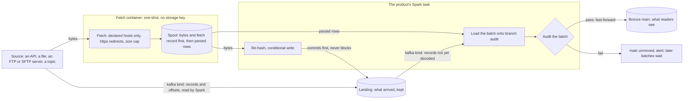

# ADR-036: Connectors land source data verbatim, then publish bronze after an audit

**Status:** Accepted
**Date:** 2026-11-26
**Author:** Platform
**Category:** Ingestion / Data quality
**Decided by:** the owner on 2026-11-26, with [ADR-056](ADR-056-unified-data-product-platform.md)
and [`DECISIONS-FINAL.md`](../research/2026-11-26-unified-platform-architecture/DECISIONS-FINAL.md);
revised from the Proposed draft of pull request #239, closed unmerged ([History](#history)). The
number was reserved by [ADR-031](ADR-031-governed-self-serve-platform.md).
**Built in:** the run spine, phase `002` (the fetch container and `https-file`); the Kraken phase,
`004` (`kafka`, `public-api`); the remaining connector kinds, phase `000` of the plan to release
(`s3-file`, `sftp`, `ftp`). Accepted, not yet implemented.

---

## In plain words

Data reaches the platform from Kafka or Redpanda topics, public web APIs, files on web servers or
object stores, and FTP or SFTP servers, and each kind needs code that reads it safely: a connector.
We will give every product exactly one connector, configured in its product file and run by Airflow
on a schedule, which first keeps exactly what arrived in the product's own landing and only then
publishes the first typed table, bronze, after checking it where readers cannot see it. Files and
API responses are fetched by a short-lived container that may connect only to the hosts the
product declares, follows redirects only to those hosts over HTTPS, caps the size, records a
checksum and never runs what it downloads. The cost is a container and a Spark session per run,
and a bad batch that holds up its table's later batches until a person looks. How long landed data
is kept is decided separately, in the Kraken phase. The owner decided the rest on 2026-11-26, so
nothing here is left for the reader to decide.

---

## Context

Each term is explained where it first appears; the [glossary](glossary.md) has each one too.

### What a connector is for

[ADR-056](ADR-056-unified-data-product-platform.md) part 3 makes the platform start at the topic,
the file or the API: each product owns its [connector](glossary.md#connector), the code that reads
one kind of source, and its **landing**, the verbatim copy of what arrived. The owner named four
kinds of source to define products on end to end: Kafka or Redpanda topics, public APIs, FTP and
SFTP servers, and files over HTTP or S3. The framework that runs them is to be Airflow-backed and
config-driven: connectors are configured from each product's documents through generated
configuration, and Airflow schedules and runs them
([`ADDENDUM-1.md`](../research/2026-11-26-unified-platform-architecture/ADDENDUM-1.md) B to D).
Runs are scheduled micro-batches now, and a second run mode, an always-on consumer, is reserved
for a later product that needs seconds
([`ADDENDUM-2.md`](../research/2026-11-26-unified-platform-architecture/ADDENDUM-2.md) F). The
Rust captures that publish the venue topics are producers outside the platform
([ADR-055](ADR-055-products-defined-once-in-odps-and-odcs-documents.md) part 3).

### A topic forgets; a publisher keeps its file

- **A topic deletes on its own schedule.** Redpanda's raw topics keep 48 hours or 2 GiB per
  partition (`docker/redpanda/init.sh`). A reader that holds a batch back to check it holds its
  offsets while retention deletes unread records, which is why a topic's reader commits what it
  read first and checks it after ([ADR-047](ADR-047-ingest-batch-audit-after-publish.md)).
- **A publisher keeps its file.** A web server, an API or an FTP server serves the same data
  again tomorrow, and yesterday's file is needed only by the next day's products, so a file that
  fails a check can wait, unpublished, for as long as a person takes to look.

Both kinds need a verbatim record, so any load can be repeated and any value traced to what
arrived. Neither may show readers a batch before it has passed its checks.

### The Iceberg mechanisms used here

An Iceberg table is a sequence of [snapshots](glossary.md#snapshot), each commit a complete new
version. **`main`** is the reference every reader sees; a **branch** is another named line of
snapshots, invisible to `main` readers ([branch and main](glossary.md#branch-and-main)). To
[fast-forward](glossary.md#fast-forward) `main` to a branch is to move it to the branch's newest
snapshot in one atomic catalog update, keeping each snapshot's summary properties. Together these
give [write-audit-publish](glossary.md#write-audit-publish): write where readers cannot see,
audit there, and publish only if the audit passed.

### What #239 built and measured

The draft of this ADR and its code, pull request #239 (branch `feat/file-source-pattern`), built a
file source for the old pipeline as four tasks of a generated DAG: fetch, load, audit, publish. It
was run on the live stack on 2026-11-26, in scratch buckets and namespaces only; the commands and
their output are in #239.

| Question | Result |
|---|---|
| Does MinIO (`RELEASE.2025-09-07T16-13-09Z`, the version pinned today) refuse a conditional write to an existing name? | Yes. A PUT with `If-None-Match: *` to a new key returned 200; to an existing key, with the same bytes or different ones, 412 Precondition Failed, and the object kept its first bytes |
| Does a versioned bucket with object lock (GOVERNANCE mode, one day) refuse an overwrite? | **No.** A plain PUT to an existing key returned 200 and a GET then returned the new bytes. Versioning keeps the old bytes as an older version and the lock protects each version from deletion; neither stops the current content of a key changing |
| Can a table with no snapshot be written on a branch and its `main`, which does not exist yet, fast-forwarded to it? | Yes, on Spark 3.5.5 with Iceberg 1.8.1 and Lakekeeper (the Spark image is now 3.5.9 with the same Iceberg) |
| Does an empty append to a branch make a commit? | Yes, a snapshot with no records, so a load appends only when it has rows |
| Is a publish bound to what its audit read? | Yes: a branch loaded again after its audit was refused until audited again |
| Is a landed object changed outside this path detected? | Yes: its bytes no longer hashed to its name, and the load refused it |
| Does the whole path work on a synthetic source? | Yes: a good file published; the same file again wrote nothing; a file changing a published value failed its audit and `main` kept its snapshot; a truncated file failed to parse; the bundled XML parser refused a nested-entity file |

### What the two reviews found

An independent review of #239
([`PR239-REVIEW.md`](../research/2026-11-26-unified-platform-architecture/PR239-REVIEW.md)) found
one HIGH: the fetch followed redirects. Python's default opener follows an HTTP 30x answer to any
address. A redirect from the declared `https` URL to plain `http` would let anyone on the network
path substitute the file, and forged rows would pass every generic audit and be published. A
redirect to a host inside the platform (MinIO or Lakekeeper on the compose network) would make the
fetch a **server-side request forgery** (SSRF: a server made to request an address an outsider
chose), and the internal service's answer would land in the landing bucket. The review found the
rest sound: the publish guard, content hashing, the size cap and timeouts, TLS verification and
the XML parser's safety. Any container on this host can reach host ports through
`host.docker.internal`
([`ARCHITECTURE-V2.md`](../research/2026-11-26-unified-platform-architecture/ARCHITECTURE-V2.md)
section 4.4), so the check inside the fetching process is the real guard, not the network.

The plan review
([`FULL-PLAN-REVIEW.md`](../research/2026-11-26-unified-platform-architecture/FULL-PLAN-REVIEW.md)
F19) found that #239 follows the old model: one landed-files table shared by every source, a
`fileSource` block in the old contract schema, fetch and parse inside the Spark container (which
holds the storage key), and the global writer lock. Merging it and then reshaping it would build it
twice, so it closes unmerged and its sound parts are ported.

---

## Decision

**We will give every source-aligned product one connector, configured in its product file and run
by the product's own generated Airflow DAG as scheduled micro-batches, which commits exactly what
arrived to the product's own landing before anything parses or checks it, and publishes bronze only
by write-audit-publish on an audit branch, because a landing that never blocks loses nothing a
source may delete, and a bronze that waits for its audit shows readers nothing unchecked.** Scope:
every connector kind of ADR-056 part 3. The `kafka` kind's own design, a landing per product in
place of the shared archive of [ADR-021](ADR-021-raw-first-archive-and-lineage.md), is its own ADR
in the Kraken phase; this ADR fixes what it shares with the other kinds.

*Reading guide.* Every arrow carries data or a step's outcome. For a file or API kind the **fetch
container** fetches under the rules of part 3 and writes the bytes and a fetch record to the run's
**spool** before it parses them. The product's **Spark task** checks the bytes against the record,
writes them to the **landing** with a write the store refuses if the name exists, and loads the
parsed rows onto the table's **audit branch**. For the `kafka` kind Spark reads the topic itself,
commits the records and their offsets to the landing, and decodes the new ones onto the branch.
The **audit** then decides: a pass fast-forwards **bronze `main`**; a failure leaves `main` where
it was, alerts, and holds the table's later batches.

### 1. Kinds, configured from documents, run by Airflow

| Kind | Source | Runs in | Lands as | Built in |
|---|---|---|---|---|
| `kafka` | a Kafka or Redpanda topic | Spark, reading the product's own topic at its own position | table `lake.<fence>.landing`: the records its filter keeps, byte for byte, with end offsets in the same commit ([ADR-022](ADR-022-exactly-once-via-snapshot-offsets.md)) | `004` |
| `public-api` | a public web API answering JSON, paged | fetch container | one object per changed response, named by its sha256; a response unchanged apart from declared volatile fields lands nothing | `004` |
| `https-file` | a file on a web server | fetch container | `s3://k2-landing/<domain>/<product>/<YYYY-MM-DD>/<sha256>.<ext>` | `002` |
| `s3-file` | an object in an S3-compatible store | fetch container | the same | plan to release, `000` |
| `sftp`, `ftp` | a file on an SFTP or FTP server | fetch container | the same | plan to release, `000` |

`<fence>` is the product's name as a SQL identifier, hyphens as underscores (`ecb-fx-rates` is
`ecb_fx_rates`). Every landing table and bronze table is in warehouse `k2`, namespace `<fence>`, written
only by connectors and read by Trino through its read-only catalog `lake`
([read-only connector](glossary.md#read-only-connector)).

**Configured, not coded.** A product's connector is the `connector` custom property of its ODPS
product file ([ADR-055](ADR-055-products-defined-once-in-odps-and-odcs-documents.md)): a kind and
that kind's fields, for a file its URL templated by run date, `allowHosts`, format, parser and
publishing calendar. `k2gen release` compiles it into the product's pipeline configuration;
secrets are named by environment variable in the documents and never compiled into a release. The
only code a new source of a known kind needs is its **parser**: a module under
`domains/<domain>/parsers/` exposing `parse(data: bytes) -> list[dict]`, plus one function per
declared audit, from rows to a list of problems. A new kind is platform code, written once.

**Run by Airflow.** Each product has one DAG, generated from the release: it resolves the release
once and pins every task to it, then fetches, lands and loads, audits, publishes, builds, expires,
writes a run record on every outcome, and runs a daily maintenance task
([plan `002`](../plans/2026-11-26-unified-product-platform/002-run-spine-through-ecb-fx.md)). A
product's runs never overlap (one active run per DAG), which replaces the old global
[writer lock](glossary.md#writer-lock-and-exit-75); Airflow pools, one slot for Spark tasks and
one for fetches, bound what the host runs at once.

**Micro-batches, with room for continuous.** A run reads what arrived since its committed position,
or fetches once, and ends, so data is as fresh as the schedule. A topic product must run well
inside its topic's retention, and one that falls behind the oldest record fails loudly until an
operator records an accept-data-loss run (ADR-056 part 3). A later product that needs seconds gets
a second run mode, an always-on consumer: a long-running task writing the same landing in the same
way, so nothing downstream changes. It is reserved, not built.

### 2. The fetch keeps the bytes before anything parses them

File and API kinds run in the **fetch container**
([glossary](glossary.md#fetch-container-and-host-allow-list)): a one-shot container started for one task, with
its arguments passed as a list, holding no storage key and unable to reach MinIO or Lakekeeper. It
works in the run's **spool**, a directory per run (`/spool/<dagId>/<run id>/`):

1. it fetches under the rules of part 3 and writes the bytes exactly as they arrived (`raw.<ext>`)
   and a **fetch record** (`fetch.json`: the URL, the final URL after redirects, the sha256, the
   size, the time, the status) before anything parses them;
2. then it parses them with the product's registered parser, in the same container and never in
   Spark, writing the rows (`rows.jsonl`).

Each fetch ends in one of four outcomes: landed, unchanged (the same bytes, or an API response
unchanged apart from its volatile fields), refused (part 3), or parse failed, with the bytes kept.
The sha256 is a 64-character fingerprint of the bytes that changes if any byte does.

### 3. The redirect fix, and the rule that follows from it

**The fix**, commit `9b7d664` on #239's branch: the fetch went through an opener whose redirect
handler follows at most five redirects, each only to `https` on a host whose every resolved address
is global (not loopback, private, link-local or reserved); the source URL itself got the same
check; a refusal failed the task naming only the target's scheme and host, never its credentials,
path or query; the size cap, the timeout and TLS verification were unchanged. Its tests are in
`tests/test_lake_file_source.py` on that branch. Its own comment named the gap it left: the name
was resolved once for the check and again by the library to connect, so a host answering a public
address and then a private one would pass.

**The rule**, for every kind that fetches:

- **Declared hosts only.** A fetch connects only to the hosts the product's documents list in
  `allowHosts`, and only to the addresses it resolved from them and checked, refusing private,
  loopback, link-local and unique-local IPv4 and IPv6 ranges; a name that answers differently a
  moment later cannot move the connection.
- **Redirects only to declared hosts.** A redirect is followed only over `https`, only to a host on
  the same list, at most five times, each hop under the same address check. A redirect to plain
  `http`, to a host off the list or to a private address fails the task, and the refusal names only
  scheme and host.
- **Size and checksum verified.** The download stops at a 64 MiB cap. The fetch record holds the
  bytes' sha256; the Spark task recomputes it from the spool and refuses a mismatch, and the landed
  object is named by it, so a later change to the object is detected when it is read.
- **Content is never executed.** What a source sends is data: parsed by the product's registered
  parser, never run, imported or evaluated, and the XML parser refuses entity expansion. TLS is
  verified; FTP requires TLS unless the data is anonymous and public; SFTP trusts only the host
  key the product declares.

A source whose hosts cannot be listed in advance waits for a forward proxy, which is not built.
These proofs land with the connector, not later (`DECISIONS-FINAL.md` section 3, item 7):
`make test-connectors` runs a redirect to plain `http`, an off-list host and a private address, with
no network, and each must fail.

### 4. The landing commits first and never blocks

For a fetch kind, the product's Spark task recomputes the spooled bytes' sha256 against the fetch
record, then writes the object to `s3://k2-landing/<domain>/<product>/<YYYY-MM-DD>/<sha256>.<ext>`
with a **conditional write** ([glossary](glossary.md#conditional-write)): an S3 PUT carrying `If-None-Match: *`, which asks the store to write
only if no object of that name exists and to answer 412 otherwise. Because the name holds the
fingerprint, an existing name means the same bytes already landed that day, so the refusal is a
no-op; no write through this path ever replaces a landed object. Each landed object gets one row in
the product's own `lake.<fence>.landing_files`, and no landing table is shared between products. A
file that does not parse still lands, and its batch fails at bronze. For the `kafka` kind the
landing is one commit of the kept records and their end offsets, audited for continuity after the
commit: a finding alerts and never blocks, for ADR-047's reason.

### 5. Bronze is write-audit-publish, in order

The Spark task loads the batch's rows onto the bronze table's one fixed branch, `audit`, and audits
the batch there: rows on the branch against rows parsed, parse errors, the generic checks carried
over from #239 (keys unique, values within their declared patterns) and the product's declared
audits. Every result, pass or fail, goes to the product's own `lake.<fence>.audit_checks`. Only if
the newest audit of that batch, at the branch's current snapshot, passed does the task fast-forward
`main` to the branch; a branch changed after its audit is refused until audited again. A branch
reaches `main` by fast-forward only, because a cherry-pick writes a copy that drops the snapshot's
summary properties, which name the run, the release, the batch and, for a file, its sha256.

Bronze publishes **in order**: a load refuses a new batch while `audit` holds an unpublished one,
so a failed batch blocks the table's later batches until an operator acts, and never blocks the
landing. A table built from bronze reads past the last batch it saw, so it never skips one. Audits
are scoped to the batch, since a whole-branch uniqueness check grew from 0.47 s to 4.40 s on a
larger synthetic table
([`SPIKE-RUNCOST.md`](../research/2026-11-26-unified-platform-architecture/SPIKE-RUNCOST.md));
whole-table checks run in maintenance. Bronze needs no [tested-data marker](glossary.md#tested-data-marker):
its `main` moves only after its audit.

### 6. Landing retention is decided elsewhere

How long a product's landing is kept is not decided here. It is planned as a rolling 14 days per
product in the lab, decided in its own short ADR in the Kraken phase (`004`), because it reverses
the recorded rule that a landing is never expired (the open decisions of the
[plan README](../plans/2026-11-26-unified-product-platform/README.md)). Until that ADR lands,
nothing expires a landed object, and the backup set compiled from the contracts lists every landing
([plan `002`](../plans/2026-11-26-unified-product-platform/002-run-spine-through-ecb-fx.md)).

---

## Rationale

- **Bytes before parse.** A parser bug, a format change or a corrupt file leaves the evidence, and
  any load can be repeated from exactly what arrived.
- **A name that is the hash, written conditionally,** lets the store decide "the same file": one
  request gives both the no-op re-fetch and the refusal to overwrite, and the load can prove the
  bytes it reads are the bytes that landed. Versioning and object lock were tested and do not.
- **An audit branch** makes "not visible yet" a property of the table, so the audit reads exactly
  what a publish would expose, and the publish is one atomic move whose failure leaves `main` alone.
- **In order,** so a later batch cannot overtake a failed one, and readers by position lose nothing.
- **Fetching apart from the storage key.** The fetch talks to the internet and holds nothing; the
  Spark task holds the key and talks to nothing outside. A hostile response or a parser bug in the
  fetch container has no storage, catalog or credential within reach.
- **An allow-list, not "any public host".** The reviewed documents name the hosts a product trusts;
  a hop to a host nobody declared fetches content no reviewer approved, and the same list bounds
  the container's traffic.
- **One connector and one DAG per product**, so one source's fault stops only its own product, the
  failure ADR-056 was written to end.

---

## Alternatives Considered

| Option | Why not |
|--------|---------|
| **#239 as written**: fetch, parse and load in the Spark container, a shared `bronze.source_files` and `lake.audit.checks`, `fileSource` on the table contract, a branch per file, the global writer lock | The old model (plan review F19): merging then reshaping builds it twice. The Spark container holds the storage key, which makes its fetch the best target for a forged redirect, and one lock serialises every product's runs |
| **A versioned, object-locked landing bucket as the guarantee** | Tested on 2026-11-26: it accepts an overwrite of the current object and only keeps older versions for the lock's retention, which GOVERNANCE mode lets a privileged user bypass. Kept as a second line at most, never as the guarantee |
| **Publish bronze straight to `main` and audit after**, as a topic's landing must | Readers would see a bad file until someone repaired it. Retention, the topic's reason for not waiting, ends at the landing |
| **Follow redirects to any public `https` host**, as the fix on #239 does | It stops plain `http` and internal hosts, but a hop to a host the documents never named fetches content no reviewer approved, and nothing bounds where the container may go |
| **An off-the-shelf ingestion tool**: Airbyte, dlt, Redpanda Connect | Each adds a service or a maturity risk for what one connector per kind does: Redpanda Connect's Iceberg output needs an Enterprise licence, and dlt was borderline on the research's two-year rule (ADR-056, Alternatives) |

---

## Consequences

**Easier:** a new source of a known kind is documents, a parser and its tests; a bad batch is
stopped before any reader sees it, and the evidence stays (the bytes, the fetch record, the branch,
the audit rows); one product's failure holds only its own bronze; every bronze row can be traced to
the landed object or offsets it came from.

**Harder:** each run starts a fetch container and a Spark session, which takes about 3.5 to 4 s to
start ([`REVIEW.md`](../research/2026-11-26-unified-platform-architecture/REVIEW.md)); a small Spark
run with a branch, an append, two audits and a fast-forward took a median 6.51 s (SPIKE-RUNCOST).
A failed batch holds its table's later batches until an operator acts. A publisher that moves to a
new host fails the fetch until a pull request adds the host to `allowHosts`. Landings grow until
the retention ADR.

**Committed to:** the six kinds and where each runs; the landing key layout and bucket; the
conditional write by content hash; bytes kept before any parse; parsing in the fetch container,
never in Spark; the redirect rule; one `audit` branch per bronze table, published in order and by
fast-forward only; a fetch container with no storage key that cannot reach the catalog or the
store; one connector and one DAG per product.

**Risks:** Spark's storage key can still delete an object version, and only the hash check when an
object is read notices a changed one. A bug in the address check is an SSRF, since containers can
reach host ports; the tests with no network and the removal of MinIO and Lakekeeper from host ports
in phase `002` are the two lines. A parser that hangs or exhausts memory fails its run only, inside
the fetch container's limits.

**What is not yet verified:**

- That the fetch container enforces the allow-list in-process and connects only to the addresses
  it checked: the first pull requests of phase `002`, proven by `make test-connectors` with no
  network.
- That Airflow can start one-shot containers through the Docker socket, with `on_kill`, inside its
  four LocalExecutor slots: a riskiest unknown of phase `002`.
- That a corrupt file lands, never reaches bronze `main`, and a later file waits behind it
  (`scripts/chaos/fx-bad-file.sh`), and that the same bytes again add no row
  (`scripts/verify/fx-idempotent.sh`): phase `002`'s exit.
- The conditional write and the branch behaviours on today's images: measured through #239 on
  2026-11-26 on Spark 3.5.5, and re-proven by the port's tests in phase `002`.
- Every kind but `https-file`: `kafka` and `public-api` in phase `004`; `s3-file`, `sftp` and
  `ftp` in the plan to release, where a kind whose shape differs from part 1 gets an Outcome here.

**Revisit when:**

- the first source whose hosts cannot be listed in advance, which makes a forward proxy the guard;
- the first product whose readers need data fresher than its schedule allows, which builds the
  always-on consumer run mode;
- the remaining connector kinds phase finds a kind's shape differs from part 1 (an Outcome);
- the object store changes from MinIO `RELEASE.2025-09-07T16-13-09Z`, whose conditional write is
  what was tested.

---

## History

The draft in #239 (Proposed, 2026-11-26) was a file source for the old pipeline: a `fileSource`
custom property on the table's contract; fetch, load, audit and publish as four Spark subcommands
under a generated DAG, with the fetch and the parse inside the Spark container; one shared
`bronze.source_files` and `lake.audit.checks`; a branch per file, `wap_<first 16 of the sha256>`;
and the global writer lock, its tasks exiting 75 (Spark's "lock held, retry") when another job held
it. Its HIGH review finding was fixed on the branch at `9b7d664` (part 3). The plan review (F19) and
the owner's decisions (`DECISIONS-FINAL.md`, which wins) changed the rest: the connector is
configured in the ODPS product file as `connector: {kind: https-file, ...}`; each product has its
own landing and audit tables; fetch and parse move to a fetch container with no storage key; each
bronze table has one fixed `audit` branch, published in landing order; there is no global lock; the
file pattern becomes one of six connector kinds; and the redirect rule adds the host allow-list.
Kept: the content-hash landing key and the conditional write, the publish bound to the audited
snapshot, fast-forward only, the generic stage, check and publish half of the loader, and the
measurements above. #239 closed unmerged, and phase `002` ports its sound parts, so this ADR is
Accepted and not yet implemented.

---

## References

- [ADR-056](ADR-056-unified-data-product-platform.md) parts 3 and 4;
  [ADR-055](ADR-055-products-defined-once-in-odps-and-odcs-documents.md): the product file that
  configures a connector.
- [ADR-047](ADR-047-ingest-batch-audit-after-publish.md): why a topic's landing audits after
  committing; [ADR-022](ADR-022-exactly-once-via-snapshot-offsets.md): offsets in the same commit;
  [ADR-021](ADR-021-raw-first-archive-and-lineage.md): the shared archive the `kafka` kind's own
  ADR replaces.
- Plans: [`002-run-spine-through-ecb-fx.md`](../plans/2026-11-26-unified-product-platform/002-run-spine-through-ecb-fx.md),
  [`004-kraken-trades-instruments-security-master.md`](../plans/2026-11-26-unified-product-platform/004-kraken-trades-instruments-security-master.md),
  [`000-remaining-connector-kinds.md`](../plans/2026-11-26-unified-product-platform-to-release/000-remaining-connector-kinds.md).
- [`IMPLEMENTATION-N0-N1.md`](../research/2026-11-26-unified-platform-architecture/IMPLEMENTATION-N0-N1.md)
  section A: A4 (the compiled connector configuration and the parser interface) and A5 (landing,
  spool and bronze names), as this phase's interfaces pull request freezes them; A13 (the fetch
  container).
- [`PR239-REVIEW.md`](../research/2026-11-26-unified-platform-architecture/PR239-REVIEW.md);
  [`FULL-PLAN-REVIEW.md`](../research/2026-11-26-unified-platform-architecture/FULL-PLAN-REVIEW.md)
  F19; [`ARCHITECTURE-V2.md`](../research/2026-11-26-unified-platform-architecture/ARCHITECTURE-V2.md)
  section 4.4.
- Pull request #239 and commit `9b7d664` (the redirect fix) on branch `feat/file-source-pattern`.
- Amazon S3 conditional writes, `If-None-Match`:
  <https://docs.aws.amazon.com/AmazonS3/latest/userguide/conditional-writes.html>.

---

## Outcome (2026-11-27, phase 002: `https-file` as built)

The `https-file` kind is built (`docker/fetch/fetch.py`, `docker/lake/connector.py`,
`docker/airflow/dags/factory.py`) and the design held. Where it moved from the text above:

- **Address pinning is in the process, with full TLS.** The guard runs on the source URL and on each of at
  most five redirects, followed by hand: `https` on port 443, no user information, no control character,
  the host IDNA-normalised and exactly one of `allowHosts`. The name is resolved once; any address in the
  answer that is not public unicast refuses the fetch, and so do CGNAT and every IPv6 form that carries an
  IPv4 address (NAT64, 6to4, Teredo; v4-mapped is unwrapped). The socket then opens to an address from
  that one answer while SNI, the certificate's name check and the `Host` header use the host name, so the
  gap #239's fix named is closed. TLS is the default context, with no way to turn verification off; no
  proxy variable is read. `make test-connectors` proves each refusal with no network (every lookup and
  socket faked).
- **A real deadline.** 10 s to connect, 30 s per read and 300 s for the whole download, each read taking
  only what has arrived (`read1`) under a timeout cut to the time left, so a host trickling bytes cannot
  hold a read past the deadline; the fetch task's Airflow `execution_timeout` is 10 minutes when the
  pipeline sets none (`FETCH_TIMEOUT`).
- **The parser's audits run in fetch too.** Part 5's "the product's declared audits" are product code,
  so they run in the fetch container beside the parser, never in Spark beside a storage key: each is a
  function in the parser module, and the results go to `audits.json` in the spool, which the Spark audit
  task records in `audit_checks`. A missing `audits.json` fails the audit closed. The fetch exits are 0
  fetched and parsed, 10 unchanged, 20 refused, 30 parse failed (bytes and fetch record kept), 1 any other
  error.
- **Strict XML decoding.** The two parsers (`domains/fx-reference/parsers/ecb_fx.py`,
  `domains/reference-data/parsers/iso4217.py`) accept UTF-8 only, with no DOCTYPE or entity declaration as
  expat itself reports them: a refusal by searching the raw bytes passed a UTF-16 document whose internal
  entities expat then expanded.
- **fetch is alone on an egress-only network.** "Unable to reach MinIO or Lakekeeper" (part 2) did not hold
  for the first build: fetch was on `k2-net`, from which a parser could reach Redpanda, Alertmanager,
  Postgres, MinIO and every other service there, none of which a parser needs. fetch now joins only
  `k2-egress`, a network no other service joins, and the scheduler's one-shot operator refuses any other
  network for it. The fence rows `fetch -> lakekeeper:8181` and `fetch -> minio:9000` of
  `tests/access/expectations.yaml` expect `refused` (`scripts/verify/catalog-fence.sh`). MinIO publishes no
  host port either, so the host gateway reaches no object store.
- **A spool per DAG.** Every fetch had mounted the whole spool volume read-write as one user, so one
  product's parser could rewrite another's raw bytes, rows or audits, which the Spark connector trusts. A
  fetch now mounts only its DAG's directory, `<project>_k2-spool` subpath `<dagId>` at `/spool/<dagId>`,
  made first by a helper container with no network that runs no product code
  (`docker/airflow/dags/oneshot.py`).
- **Landings expire after 14 days.** Part 6 left retention to phase 004; the owner's decision of
  2026-11-26 (14 days per product, `docs/research/2026-11-26-decisions-addendum.md`) was built here
  instead, since this phase builds the landings: the daily `maintain` task (`docker/lake/maintain.py`)
  deletes a product's landed objects whose key's day is more than 14 days old, keeping any whose batch has
  no rows published on `main`, any not in `landing_files`, and any key that does not parse. It runs with the
  maintenance key, which may delete landings and write nothing ([ADR-054](ADR-054-a-storage-key-per-engine-with-catalog-signing-off.md)).

**What a parser can still reach.** The allow-list guards the fetch's own download, not the parser, which
runs in the same process with ordinary sockets: from `k2-egress` it can reach any internet host on any
port, and the host's published ports through `host.docker.internal` (Context), which were not re-probed
from `k2-egress`. It can read and write its own DAG's spool, earlier runs included, and read the releases
root (every release's documents and compiled files; no release holds a secret). It holds no storage key,
no secret file and no Docker socket, under a read-only root, a 64 MiB `noexec` `/tmp`, no capability, no
new privileges, 256 processes and 0.5 CPU / 512 MiB. A parser is reviewed product code; running it in a
second container with `--network none`, fed the spooled bytes, would close the internet path and is not
built.

**Revisit when**, besides the triggers above: a product's parser comes from someone outside the owner's
team (then the parser moves to a container with no network).
