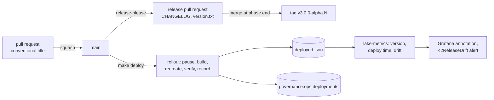

# ADR-042: One platform version, a release manifest and recorded rollouts

**Status:** Proposed
**Date:** 2026-11-26
**Author:** Platform
**Category:** Release engineering
**Decided by:** the owner on 2026-11-26 ([decision record](#the-owners-decisions-2026-11-26)); this
ADR records the design that carries those decisions out, and moves to Accepted after review
**Number:** reserved by [ADR-031](ADR-031-governed-self-serve-platform.md) for phase P6; it lands
earlier, before phase P4 ([why](#why-now-and-not-in-p6))

---

## In plain words

Nobody can say today which version of K2 is running: every component claims version 0.1.0,
locally built image names are reused, and a deploy is a `git pull` that nothing records. We will
give the platform one version number, cut by a release tool from the commit messages, that names
one tested set of components written down in a generated release manifest. Only what people
outside the platform team program against, today the data contracts, keeps a version of its own;
every other component is stamped with the platform version and the commit it was built from. One
command performs every rollout and records who, when, from what and to what, and `make health`, a
metric and an alert report any difference between what the manifest names and what runs. The
decisions are the owner's of 2026-11-26; the cost is a release step per phase, a stricter merge
path and seven pull requests of tooling, and five questions are left at the end.

---

## Context

Terms are explained where they first appear; the [glossary](glossary.md#releases-versions-and-rollouts)
has each one too.

### What a version means here

A **semantic version** ([glossary](glossary.md#semantic-version-and-pre-release)) is three numbers,
`MAJOR.MINOR.PATCH`: a consumer may take any new MINOR or PATCH without changing anything, and must
read the notes before taking a new MAJOR. A **pre-release** adds a suffix, `3.0.0-alpha.1`, which
sorts before `3.0.0` itself; anything after a `+` is build metadata and does not affect ordering.
A **git tag** is a name fixed to one commit. `git describe` names any commit relative to the
nearest tag: `v2.1.0-111-gf14aae6` reads "111 commits after tag `v2.1.0`, at commit `f14aae6`".
A **conventional commit** ([glossary](glossary.md#conventional-commit)) is a commit message whose
first line says what kind of change it is: `feat(lake): ...` adds something, `fix(capture): ...`
repairs something, `docs: ...` changes only documentation, and a `!` after the type
(`feat(lake)!: ...`) marks a change that breaks a consumer.

### What exists today

Measured 2026-11-26, read-only:

| Fact | Value | Command |
|---|---|---|
| Version tags | `v0.1.0`, `v1.0.0`, `v1.1.0`, `v2.0.0`, `v2.1.0`, then `v3-phase-b` to `v3-phase-e`; nothing since 2026-08-27 | `git tag -l --sort=creatordate` |
| The commit, named by a strict tag pattern | `v2.1.0-111-gf14aae6` | `git describe --match 'v[0-9]*.[0-9]*.[0-9]*'` |
| The same, by any tag | `v3-phase-e-81-gf14aae6` | `git describe` |
| Version fields in the tree | `0.1.0` in `services/capture-rust/Cargo.toml`, `dbt/pyproject.toml`, `notebooks/pyproject.toml`, `platform/k2gen/pyproject.toml` and `dbt/dbt_project.yml`, never bumped; `1.0.0` in all 26 table contracts under `contracts/` | `git grep -n '^version'` |
| The one build-info metric | `k2_capture_build_info{version="0.1.0", git_sha="v3-phase-e-26-g9932f42"}` on all three captures, built 2026-09-03 | Prometheus, `k2_capture_build_info` |
| Other version labels | the compose file's header says `Version: 2.0.0-consolidated`; every container carries a label `com.k2.version` of `v2` or `v3` | `docker-compose.yml`; `docker inspect` |
| Reused image names | `k2-capture:v3` serves three services, `k2-airflow:3.3.2` four, `k2-spark-iceberg:3.5.5_1.8.1` two | `docker-compose.yml` |
| What runs is not what the name says | the three Airflow containers run image `sha256:2cb77bd56eb6...`; the name `k2-airflow:3.3.2` now points at `sha256:f38f39ad27b9...`, built 2026-11-25 19:21:33 UTC, 2 h 23 min after those containers were created | `docker inspect -f '{{.Image}}' k2-airflow-scheduler`; `docker image inspect -f '{{.Id}} {{.Created}}' k2-airflow:3.3.2` |
| Changelog | none | |
| Commits since `v2.1.0` | 111; 46 of them `feat`, `fix` or `deps`; none marked breaking; 26 subjects contain an em-dash | `git log v2.1.0..HEAD --format=%s` |
| Merge path | `main` requires 13 named CI checks, no review; administrators are exempt (`enforce_admins` off); merge commits, rebases and squashes all allowed; a squash takes its title from the commit when the pull request has one commit, and its body from the commits | `gh api repos/{owner}/{repo}/branches/main/protection`, `gh api repos/{owner}/{repo}` |

**How a change reaches the running stack.** A deploy is a `git pull` in the live checkout,
followed by recreating whichever services the operator judges changed. Much of the platform's
code reaches its containers through **bind mounts** ([glossary](glossary.md#bind-mount)), a
directory or file of the checkout mapped into a container: the lake jobs (`docker/lake`, into
`spark-iceberg`), the DAGs and the dbt project (into the Airflow scheduler), Trino's settings,
the Prometheus rules and the Grafana dashboards. A pull therefore changes what the next lake run
or dbt run executes, with no container recreated and nothing recorded. `scripts/dev-up.sh` step
(d) recreates the holders of changed mounts, but it diffs `HEAD~1..HEAD` only, so a pull of two
commits escapes it, and its list of paths and services is kept by hand. A file-level bind mount
also keeps pointing at the old file after `git pull` replaces it (`spark-iceberg` mounts
`config/instruments.yaml` and `config/bars.yaml` that way; CLAUDE.md, the bind-mount gotcha).

So the questions an incident starts with have no recorded answer: what was running at 22:33 UTC,
what changed since yesterday, and does the running stack match any commit at all.

### Why now and not in P6

[ADR-031](ADR-031-governed-self-serve-platform.md) reserved this number for "Release engineering:
contract semver and a changelog", to be built in phase P6, the controls phase
([glossary](glossary.md#p0-to-p7)); its plan, P6's pull request 3, was a contract compatibility
check, a `CHANGELOG.md` kept from then on, and a release workflow. The owner moved it before P4 on
2026-11-26, for three reasons:

- From P4 on, every phase changes contracts and services on a live stack: P4 adds the first file
  source, the FX domain and its first product. A change made without a version cannot be named
  in an incident, an SLO report or a note to a consumer.
- The incidents of 2026-11-25 were reconstructed from container ages and log searches: the VM
  killed for memory (runbook [`docker-vm-oom-kill.md`](../runbooks/docker-vm-oom-kill.md)), and
  a DAG folder left empty for 35 minutes by a checkout switch (CLAUDE.md). The Airflow image
  measured above is a third, found only while writing this.
- The work is cheapest before the next phase adds more components to stamp.

The scope is wider than the reserved title: one platform version, a manifest, immutable image
tags, build information everywhere, a recorded rollout and a drift check. The contract
compatibility check stays in this ADR's plan ([pull request 7](#pull-request-7-contract-compatibility-may-be-built-in-p6))
and may be built in P6 beside the controls.

### Constraints

- **One maintainer.** A release must take minutes per phase, not a process per component.
- **Restarting capture loses data.** The venues' public feeds do not replay, and each capture
  restart loses a few seconds of trades for that venue (ADR-050, proposed in pull request #223).
  A scheme that recreates every service on every rollout costs data on every rollout.
- **Local builds are not reproducible.** Building the same commit twice gives a different image
  **digest** (the `sha256:` content hash that identifies an image exactly; the **tag**, such as
  `:3.3.2`, is only a movable name; [glossary](glossary.md#image-tag-and-digest)), because of build
  timestamps and base images such as `rust:1-bookworm` that move. A digest can be recorded after a
  build, never predicted before it.
- **A commit cannot hold its own hash**, and a squash merge gives the merged change a new hash, so
  a file in the repository can name content and earlier commits, never the commit it is in.

---

## The owner's decisions (2026-11-26)

1. Semantic versions, and a changelog generated from conventional commits.
2. Do it now, before phase P4.
3. Immutable image tags: a tag, once built, always names the same image.
4. Build information on every component.
5. A deployment log.
6. The running version shown by `make health`.
7. The first tag `3.0.0-alpha.1` now, one pre-release per phase, `3.0.0` at the P7 release gate.
8. Green CI required to merge (set on `main` the same day).
9. Component versioning as the design tournament below decided it.

### How component versioning was decided

Three designs were argued by separate authors and scored by an independent judge on six criteria,
1 to 5; the owner accepted the verdict.

- **A, one version for everything, no manifest.** The lowest cost, but it says nothing about
  whether what runs matches what was tagged, and gives outside consumers no signal about what
  changed for them.
- **B, an independent semantic version per component, with a compatibility file** declaring which
  component versions work together. The best fit once there are many teams; for one maintainer it
  is several release processes, and declared compatibility ranges would claim combinations CI
  never ran.
- **C, one platform version that names a tested set, recorded in a generated release manifest; own
  versions only for interfaces outsiders program against.** Chosen.

| Criterion | A | B | C |
|---|---|---|---|
| Operator clarity | 4 | 2 | **5** |
| One-maintainer cost | **5** | 2 | 4 |
| Fit as teams multiply | 2 | **5** | 3 |
| Upgrade and rollback safety | 3 | 3 | **4** |
| Signal to outside consumers | 2 | **4** | **4** |
| Honesty | 3 | 2 | **5** |
| Total | 19 | 18 | **25** |

**The dissent, rejected.** B's author argued that capture's blast radius, lost market data, earns it
its own version now. The answer: capture's images are tagged by what they contain and kept, and
the drift report shows a mixed state, so one service can already be rolled back alone and the
difference stays visible ([section 7](#7-one-rollout-command-and-the-deployment-log)); a separate
version number adds a release process without adding that safety.

**The judge's corrections, carried here.** Locally built image digests are not reproducible, so
the committed manifest holds what can be known in a commit (third-party images pinned by digest,
contract versions, and identities of what each built image contains) and the digests actually
built go to the deployment log. The version comes from `git describe` with the strict pattern, not
the looser one the capture stamps today. release-please is configured as a single package now,
so that splitting into several packages later is a configuration change.

One correction of the corrections: the judge wrote that the manifest holds commits. It cannot hold
the commit it is part of, nor predict the hash a squash merge will give it (Constraints), so it
holds **content ids** ([section 4](#4-the-release-manifest)): a hash of exactly the files each
image is built from or each container mounts. A content id is known inside the pull request,
survives the squash unchanged, and names exactly one content. The commit is stamped into each
image when it is built and into the deployment log when it is rolled out.

---

## Decision

**We will release K2 as one semantic platform version, cut per phase by release-please from
conventional commits, that names one tested set recorded in a generated release manifest; give
locally built images tags that name their content; stamp every component with the platform
version and commit; perform every rollout with one command that records it; and keep separate
versions only for interfaces outsiders program against, today the data contracts, because
nothing today can say what runs, what changed or what a consumer may rely on.** Scope: the single
host and this repository. A second host, or a split into teams that release on their own, is
a [revisit trigger](#consequences), not part of this decision.



### 1. One platform version

The platform version names a tested set: a tagged commit on `main` whose required checks passed,
and the [manifest](#4-the-release-manifest) at that commit. It is derived, never typed:

```
git describe --tags --match 'v[0-9]*.[0-9]*.[0-9]*' --dirty
  v3.0.0-alpha.1                    ->  3.0.0-alpha.1                  (exactly at the tag)
  v3.0.0-alpha.1-5-g1a2b3c4         ->  3.0.0-alpha.1+5.g1a2b3c4       (5 commits after it)
  v3.0.0-alpha.1-5-g1a2b3c4-dirty   ->  3.0.0-alpha.1+5.g1a2b3c4.dirty (uncommitted changes)
```

`--tags` because a tag made through GitHub's release API may be lightweight (not yet verified,
[below](#consequences)), and plain `git describe` ignores those; the strict pattern because the
`v3-phase-*` tags are milestones, not versions. The conversion puts everything after the tag into
build metadata, which is what it is: the release plus unreleased commits. `version.txt` at the
repository root holds the last released version and changes only in a release pull request.

**Pre-releases, one per phase.** `3.0.0-alpha.1` is cut now, naming the platform at the close of
P0 with P1 to P3 landed. `3.0.0-alpha.2` closes P4, `alpha.3` P5, `alpha.4` P6, and `3.0.0` is cut
when P7's release gate passes. While the version is a 3.0.0 pre-release, release-please's
prerelease strategy increments the `alpha` number whatever the change: `3.0.0` is already the
major that the v3 rebuild earned against `2.1.0`. The [bump rule](#2-the-bump-rule) still
classifies every change in that window (breaking markers, migration lines), so the notes for
`3.0.0` say what a `2.1.0` user must change. From `3.0.0` on, the bump rule decides the number.

### 2. The bump rule

The platform's **public surface** is what an operator or consumer depends on without reading the
code: the contracted tables and topics, the configuration keys (`.env.example`,
`config/*.yaml`), the `make` targets, the published ports, the alert names, and the upgrade
procedure (`make deploy`, which is a pull plus recreating what changed).

| Bump | When |
|---|---|
| **MAJOR** | a contract's major version moves; a migration that cannot be reversed, or needs a rebuild or a backfill; an upgrade that needs more than pull plus recreate; a configuration key, `make` target, published port or alert removed or renamed; a third-party upgrade with no downgrade path (a database's on-disk format, `airflow db migrate`) |
| **MINOR** | an addition: a product, a venue, a nullable column, a configuration key with a default, a `make` target, an alert; a reversible automatic migration; restated data, with the affected partitions listed; a deprecation notice |
| **PATCH** | a fix that touches none of the above |
| none | documentation, `chore`, `ci`, `test`, `refactor`, `style` and `build` commits release nothing |

In commit terms: a breaking change is `type!:` or a `BREAKING CHANGE:` footer, `feat` is MINOR,
`fix` and `deps` are PATCH. Those three are the only types release-please counts as releasable
(its README); a `perf` commit rides with the next release. Dependabot's runtime updates (Cargo and
Docker) are therefore titled `fix(deps): ...` instead of today's `build(deps): ...`, so a security
fix in the capture's dependencies cuts a patch; GitHub Actions updates stay `ci(deps)` and release
nothing.

### 3. What carries a version of its own

**The data contracts.** Each table contract under `contracts/` keeps its `version`, a semantic
version of the table's shape: MAJOR for a removed, renamed or retyped column, a changed grain
(the columns that identify a row) or a shorter retention; MINOR for a new nullable column; PATCH
for descriptions. A contract MAJOR is a platform MAJOR. Topic contracts are the Avro schemas
under `schemas/avro/`: the schema registry already refuses an incompatible change
(`BACKWARD_TRANSITIVE`, `docker/redpanda/init.sh`), so a breaking wire change is a new subject
prefix, `market.crypto.v4.*`, and that is their major.

**Later, each when it gains a consumer outside the platform team:** the serving API, the
ingestion framework's public interface (the file-source pattern of P4), and the generator's
command line (`k2gen`). Until then they are internal.

**Everything else is internal and carries no version of its own:** capture, the lake jobs, the
DAGs, the dbt project, the generator, the `lake-metrics` exporter and the notebooks helper. Their
manifests are pinned to the placeholder `0.0.0` (`Cargo.toml`, the three `pyproject.toml` files,
`dbt/dbt_project.yml`), and CI keeps them there, so no number can drift from the platform's.

### 4. The release manifest

`release/manifest.json` is the bill of materials, generated by `make generate` from the tree and
committed; CI's existing drift gate (`make generate`, then no difference) fails a pull request
that changes a component without regenerating it. It holds, for every service in the default and
`legacy` profiles:

| Field | For | Source |
|---|---|---|
| `image` | every service: a locally built image's [content-id tag](#5-immutable-image-tags), or a third-party image as `tag@sha256:digest` | `docker compose config` |
| `mounts` | every service with a bind mount from the checkout: the content id of what it mounts | the compose bind mounts |
| `contracts` | every table contract: its `version` | `contracts/**/*.odcs.yaml` |
| `schemas` | every Avro schema: its content id | `schemas/avro/*.avsc` |

A **content id** ([glossary](glossary.md#content-id)) is the first 12 hex digits of a SHA-256 over
a sorted list of (path, file bytes), for exactly the files an image is built from (the Dockerfile
and every path its `COPY` lines name, so `services/capture-rust/src` but not its `README.md`) or
a container mounts. It is computed from the working tree with the standard library, so it is the
same on a laptop and in CI, known before the commit exists, and unchanged by a squash. The
`release/` directory itself is never hashed, though `lake-metrics` mounts it
([section 8](#8-drift)): it holds the manifest, which cannot contain its own hash. The
manifest carries no version number and no commit: the version is `version.txt` at the tagged
commit, and the commit is the tag's.

### 5. Immutable image tags

A locally built image is tagged by its content: `k2-airflow:3.3.2-<content id>`,
`k2-spark-iceberg:3.5.5_1.8.1-<content id>`, `k2-lake-metrics:3.15.1-<content id>`,
`k2-capture:<content id>`; the upstream version stays in front where there is one, for the reader.
`make generate` writes these tags into the `image:` lines of `docker-compose.yml`, so a bare
`docker compose up -d` on a fresh clone still works. Two rules make the tags immutable:

- **Build only what is missing.** A tag that exists locally is never rebuilt, because a rebuild
  would give it a different digest. `scripts/dev-up.sh`'s `docker compose up -d --build` becomes
  a build of missing tags only.
- **Third-party images are pinned by digest** in `docker-compose.yml`, `tag@sha256:...`, as the
  Spark Dockerfile's base already is; `scripts/check-budget.py` fails a third-party image without
  one, and a locally built image whose tag is not the generated content id.

Why the content and not the commit: a commit tag changes on every commit, so every rollout would
recreate every built service, the three captures included, each losing seconds of trades. A
content tag changes only when the image's own files do, so an unchanged capture is not touched.
The images of the last three rollouts are kept for rollback and older `k2-*` tags are pruned
after a successful rollout (images share their layers, so a kept tag costs only what differs).

### 6. Build information on every component

Every locally built image carries the labels `org.opencontainers.image.version` (the platform
version), `org.opencontainers.image.revision` (the commit), `org.opencontainers.image.source` and
`io.k2.content-id`, set by build arguments `K2_VERSION` and `K2_COMMIT` in the last layer, so
they cost no rebuild of earlier layers. A container shows its image's labels
(`docker inspect -f '{{json .Config.Labels}}'`, checked on `k2-grafana`, 2026-11-26), so every
container of a built image names its version and commit.

| Component | Reports | Where |
|---|---|---|
| Capture | `k2_capture_build_info{version, git_sha}`: platform version and commit instead of `0.1.0` and the loose describe | Prometheus; JSON logs ([ADR-051](ADR-051-central-structured-logs-run-id-and-host-metrics.md)) |
| Lake jobs | `k2.version` and `k2.commit` on every commit they make, beside the existing `k2.*` properties ([glossary](glossary.md#snapshot-summary-and-k2-properties)) | each table's snapshot summary |
| DAGs, dbt | `K2_VERSION` and `K2_COMMIT` in the Airflow services' environment, set at rollout; dbt's recorded test results gain a `platform_version` column | Airflow task logs; `<catalog>.dq.dbt_test_results` |
| `lake-metrics` | `k2_release_info{version, commit}` from the last rollout, and its own build labels | Prometheus |
| `k2gen`, notebooks helper | `k2gen --version` and `k2lake.platform_version()` print the version of the checkout they run from | the command line, a notebook |
| Third-party services | their image tag and digest | the manifest, the deployment log |

The lake jobs, DAGs and dbt run from bind mounts, so their stamp is the commit of the last
rollout. That is true only while drift is zero, and [section 8](#8-drift) makes drift an alert.

### 7. One rollout command and the deployment log

`make deploy` (`scripts/deploy.sh`) is the only way a change reaches the live stack:

```
make deploy                      # to origin/main
make deploy REF=v3.0.0-alpha.2   # to a tag, forward or back
make deploy PLAN=1               # print what it would recreate, change nothing
```

1. **Preflight.** The checkout is clean, `REF` resolves to a commit reachable from `origin/main`,
   and the previous rollout is read from `release/deployed.json`. Going back across a commit
   whose message carries `Migration: irreversible` is refused unless `ACCEPT_IRREVERSIBLE=1`.
2. **Plan.** The services to recreate are those whose compose definition changed (the
   container's `com.docker.compose.config-hash` label against `docker compose config --hash`,
   which covers a new image tag) or whose mounted content id changed against the last rollout,
   plus a [one-shot](glossary.md#bootstrap-peak) (a set-up service that runs once and exits) whose inputs changed (`lake-ddl` for the lake DDL, `redpanda-init` for the
   schemas). This replaces `dev-up.sh` step (d)'s hand-kept list and its `HEAD~1` diff.
3. **Move the checkout** with `git switch --detach <commit>`. The live checkout stays detached
   at the deployed commit, which makes a bare `git pull` fail ("not currently on a branch") and
   leaves feature work to worktrees.
4. **Build** the missing tags, one image at a time (one heavy Docker job at once).
5. **Pause and wait for idle** when the plan touches a lake writer or anything it depends on
   (Spark, Airflow, Lakekeeper, MinIO, PostgreSQL, Redpanda, Trino): `pause_lake_ingest` from
   `scripts/chaos/lib.sh` pauses `lake_ingest` and `lake_maintenance` and waits for in-flight
   tasks; `dbt_marts` is paused too when Trino or Airflow is in the plan. A maintenance run in
   flight stops the rollout with a message rather than waiting for hours.
6. **Recreate** in tiers, `docker compose up -d --no-deps --force-recreate <service>`: storage and
   catalog, then engines, then orchestration, then observability, then the captures one venue at
   a time, each healthy with a fresh `k2_capture_last_message_ts_seconds` before the next.
7. **Verify** with `make health`, which now includes the drift step ([section 8](#8-drift)).
8. **Resume** the paused DAGs, on a pass only. On a failure they stay paused, the command prints
   the rollback command, and `LakeIngestFailed` fires after 30 minutes if nobody acts.
9. **Record**, pass or fail: one row into the Trino table `governance.ops.deployments`, and the
   same row as `release/deployed.json` (the last rollout) and a line of
   `release/deployments.jsonl` (all of them), both git-ignored.

| Column | Example |
|---|---|
| `deployed_at` | `2026-12-01 03:10:42 UTC` |
| `operator` | `git config user.name` of the checkout |
| `ref`, `from_commit`, `to_commit` | `v3.0.0-alpha.2`, `f14aae6...`, `1a2b3c4...` (full hashes) |
| `from_version`, `to_version` | `3.0.0-alpha.1+3.g9e8d7c6`, `3.0.0-alpha.2` |
| `services_recreated` | `['lake-metrics', 'spark-iceberg']` |
| `images` | service to image digest, as `docker inspect` read them after the recreate |
| `result`, `duration_s` | `success`, `verify_failed` or `partial`; seconds |

The table lives in the governance domain's warehouse ([ADR-046](ADR-046-governance-domain-and-quality-results.md)),
created if absent and appended through Trino as that domain's writer `dbt_governance`
([glossary](glossary.md#domain-writer)), as the dbt test results already are: platform plumbing
of the platform team's own domain, readable by everyone through Trino and joinable with the
quality results by time. The **Grafana annotation** (a marker line across every time panel) needs
no write to Grafana and no Grafana credential: `lake-metrics` exports the time of the last rollout
from `deployed.json`, and each provisioned dashboard gains one annotation query that marks every
change of it, titled with the version.

Exit codes: 0 deployed and recorded; 1 refused before changing anything; 2 deployed but
verification failed (recorded as `verify_failed`); 3 deployed but not recorded, with the command
that records it (`make deploy-record`).

**Rollback** is a rollout to the previous tag or commit: `make deploy REF=<previous>`; the kept
images make it a recreate, not a rebuild. **One service** can be rolled back alone
(`make deploy REF=<commit> ONLY=capture-binance`), recorded as `partial`; drift then stays raised
until a full rollout reconciles it, which is the honest state.

### 8. Drift

**Drift** ([glossary](glossary.md#drift)) is any difference between what the checkout's manifest
names, what the last rollout recorded, and what the containers run. Two checks, the same rules:

- **`make health`** gains a first step, `(0) release`: the checkout's version and whether it is
  dirty; the last rollout (version, time, operator); and per service, the running image (by
  `docker inspect`) and mounted content against the manifest. A dirty checkout, a service that
  differs, or a checkout ahead of the last rollout prints FAIL and exits non-zero.
- **A metric and an alert.** `lake-metrics` mounts the `release/` directory read-only (a
  directory mount, so it sees `git pull` and `make deploy` replace files) and exports
  `k2_release_drift{service, reason}`: `not_deployed` when the manifest's content for a service
  differs from the last rollout's (a bare pull), and `k2_release_expected_image{name, image}` from
  the last rollout. `K2ReleaseDrift` (warning, `for: 15m` so a rollout in progress does not fire
  it) fires on either reason, or when a container's running image in cAdvisor's `image` label
  matches no expected image. Its runbook is `docs/runbooks/deploy-and-rollback.md`.

### 9. The changelog, the release pull request and the notes

release-please runs as **one package at the repository root** (`release-please-config.json`):
release type `simple` (it maintains `version.txt` and `CHANGELOG.md`), versioning `prerelease`
with `prerelease: true` and `prerelease-type: alpha` until `3.0.0`, tags `v<version>` without a
component name, the history starting at `v2.1.0`'s commit (`bootstrap-sha`), and documentation,
chores, CI, tests and refactors hidden from the changelog. The first release pull request is
steered to `3.0.0-alpha.1` by a `Release-As: 3.0.0-alpha.1` footer, the method its README gives
(the config key `release-as` is deprecated). Adding a package later is an entry in that file and
in `.release-please-manifest.json`.

release-please keeps one **release pull request** open, updated as work merges: its diff is the
next `CHANGELOG.md` section and the new `version.txt`. Merging it at the end of a phase tags the
commit and creates the GitHub release. That pull request must pass the same 13 checks, and a pull
request opened with Actions' own token starts no workflows (release-please-action README), so it
is opened either from the maintainer's machine with the maintainer's token (`make release-pr`,
the default here) or by a workflow holding a narrowly scoped token. That is
[question 1](#questions-for-the-owner).

**Release notes per audience.** `CHANGELOG.md`, generated, is the maintainers' record.
`UPGRADING.md`, written in the release pull request, holds per release what operators must do
beyond `make deploy` and what data consumers must know: contract changes, restated partitions,
deprecations with their removal version.

### 10. Guards that are checks, not discipline

| Guard | Where |
|---|---|
| Pull request titles are conventional commits, and a squash uses the title and body | a stdlib `pr-title` job in CI, required; repository settings (question 2) |
| The bump rule: a removed `make` target, alert, published port, `.env.example` key or compose service, or a contract major bump, requires `!` in the title | `scripts/check-release-class.py`, base against head, in the same job |
| A change to DDL (`docker/lake/ddl/`, `docker/clickhouse/ddl/`, `schemas/avro/`) carries `Migration: reversible` or `Migration: irreversible`; irreversible requires `!` | the same script, reading the pull request body |
| A third-party image change carries `Downgrade: possible` or `Downgrade: none`; none requires `!` | the same script |
| The manifest and the image tags match the tree | the existing `make generate` drift gate |
| Locally built images carry their content-id tag; third-party images a digest | `scripts/check-budget.py` |
| Internal versions stay `0.0.0` | `tests/test_release.py` |
| What runs matches the manifest | `make health` step (0); `K2ReleaseDrift` |
| A contract changed incompatibly without a major bump | `k2gen check-compat` ([pull request 7](#pull-request-7-contract-compatibility-may-be-built-in-p6)) |

### 11. For whoever manages the platform

- Incidents, SLO reports and support answers cite a platform version, read from `make health` or
  `governance.ops.deployments` for the time in question.
- Fixes go forward on the latest minor; there are no maintenance branches. A bad release is
  rolled back by deploying the previous tag, then fixed in the next patch.
- A deprecation is announced in a minor that names the version that removes it, with at least
  one minor between.
- Release notes are written per audience: operators, data consumers, maintainers.

---

## Rationale

- **One version, because there is one release process.** The platform is tested as a whole, by
  one CI run and one set of gates; a version per component would claim independence that no test
  checks (option B's weakness, scored 2 for honesty).
- **A manifest, because a version alone proves nothing about what runs.** The measured Airflow
  image shows a name and a running image disagreeing for 7 hours unnoticed (19:21 UTC on
  2026-11-25 to the measurement at 02:30 UTC). Option A has no answer
  to that; the manifest plus the drift check does.
- **Content ids, because restarting capture costs data.** Commit tags would recreate all three
  captures on every rollout; content tags recreate them only when their code or configuration
  changed.
- **A command, because a convention is not a record.** `git pull` plus judgment is what produced
  the `HEAD~1` gap in `dev-up.sh`; a command that plans from the recorded previous rollout cannot
  skip a commit, and its record is written by the same code that did the work.
- **release-please, because it reads what the repository already writes.** 111 commits since
  `v2.1.0` are already conventional enough to generate notes from; one package now and several
  later is a configuration change, not a migration of tools.

---

## Alternatives Considered

| Option | Why not |
|---|---|
| A: one version, no manifest | Cheapest, but cannot say whether what runs is what was tagged; no consumer signal (tournament) |
| B: a version per component with a compatibility file | Several release processes for one maintainer; declared ranges claim untested combinations (tournament) |
| Capture versioned separately now (B's dissent) | Content tags and drift already allow a one-service rollback with the mixed state visible; a version adds process, not safety |
| Tag images by commit | Every rollout recreates every built service, each capture restart losing trades |
| semantic-release | Releases on every merge to `main`; K2 releases per phase, which a standing release pull request expresses directly |
| changesets | A file per change written by hand: more discipline for one maintainer, and built around JavaScript packages |
| A hand-kept changelog | Rots; the commit titles already hold the information once the title is checked |
| Keep `git pull` plus `dev-up.sh` and add only a log line | Leaves the `HEAD~1` gap, the hand list of mounts, and a record the operator must remember to write |
| Deployment log in PostgreSQL | Not reachable through Trino, so not joinable with quality results, and outside every domain |
| Grafana annotation by its HTTP API | Needs an admin credential in a script; the annotation from the exported rollout time needs none |

---

## Consequences

**Easier:** naming what ran at any time (`governance.ops.deployments`); seeing a bare pull or a
hand-recreated container within 15 minutes; rolling back by tag; telling consumers what changed
for them; release notes written by the tool from titles CI already checks.

**Harder:** every pull request needs a conventional title and, for DDL or a third-party image, a
`Migration:` or `Downgrade:` line; the live checkout is detached and no longer takes a bare
`git pull`; a phase ends with a release pull request; `make generate` rewrites image lines in
`docker-compose.yml`.

**Committed to:** semantic versioning of the platform and of the contracts; release-please's
configuration format; `make deploy` as the only path to the live stack; content-id tags; the
`0.0.0` placeholders; `governance.ops.deployments` as a lasting table.

**Risks:** the content id misses an input an image depends on (a base image that moves under the
same tag, `rust:1-bookworm`), so two images with one tag could differ if a tag were ever rebuilt;
build-if-missing and the digest in the deployment log are the guard. A rollout that fails half way
leaves DAGs paused, on purpose; the 48-hour raw retention bounds how long that may last. The
release pull request needs a token decision before it can pass CI.

**What is not yet verified:**

- that tags created by release-please are lightweight, the reason for `--tags`
  (verify on the first release: `git cat-file -t v3.0.0-alpha.1`);
- that the prerelease strategy steps `3.0.0-alpha.1` to `3.0.0-alpha.2` on a `feat` and on a
  breaking change alike (verify on the release pull request P4 opens);
- that `docker compose config --hash` matches the running containers' `config-hash` label on
  Compose as installed (verify with `make deploy PLAN=1` on an unchanged stack: nothing to do);
- that cAdvisor's `image` label carries the compose `image:` string exactly, digest included,
  which the drift alert compares (verify with one PromQL query after pull request 5);
- that Trino accepts the deployment row from `docker exec k2-trino trino --user dbt_governance`
  (verify in pull request 6 on the live stack);
- the claim that the history from `bootstrap-sha` gives a usable `3.0.0-alpha.1` changelog
  (verify on the first release pull request's diff).

**Revisit when** any of these holds, each measured:

- `.github/CODEOWNERS` names a second owner, and at least half of a quarter's releases change
  paths of both owners (`git diff --name-only <previous tag>..<tag>` against CODEOWNERS): then
  the second owner's components move to their own versions (option B, for that split);
- someone outside the platform team imports the serving API, the ingestion framework or the
  `k2gen` command line, or holds a credential for one of them: that interface gets its own
  semantic version;
- the host and an AWS deployment run different versions of one component for more than 14 days
  (their two deployment logs): that component gets its own version;
- a fix is held more than 24 hours by a failing gate unrelated to it, twice in a quarter (pull
  request timelines, `gh pr view --json`): release trains split.

---

## Questions for the owner

1. **The release pull request's token.** Actions' own token opens a release pull request that runs
   no CI, so it cannot pass the 13 required checks. Either the maintainer runs `make release-pr`
   with their own token (the default here: no stored secret, a minute per phase), or a workflow
   holds a fine-grained token limited to this repository's contents and pull requests. Which?
2. **Repository settings.** For release-please to read every merged change: squash merges only,
   the squash title from the pull request title and its body from the pull request body
   (`gh api -X PATCH repos/{owner}/{repo} -f squash_merge_commit_title=PR_TITLE -f squash_merge_commit_message=PR_BODY -F allow_merge_commit=false -F allow_rebase_merge=false`),
   and the `pr-title` check added to the required list. Agree?
3. **The deployment log's writer.** It is written as `dbt_governance`, the governance domain's
   writer, which can change any table in that domain. A dedicated writer limited to
   `governance.ops` is a `k2gen` change to the generated access rules. Is the domain writer
   enough?
4. **A detached live checkout.** It stops bare pulls but changes a habit; the alternative is a
   branch the command fast-forwards, where a bare pull still works and only the drift alert
   catches it. Detached?
5. **`3.0.0-alpha.1` before the manifest exists.** Cutting it now (pull request 2) names P0's
   close but carries no manifest; cutting it after pull request 5 names a manifest but delays the
   tag by about four pull requests. Now, as decided, or after?

---

## References

- [ADR-031](ADR-031-governed-self-serve-platform.md), the reservation; P6's plan,
  [`006-controls-slos-release.md`](../plans/2026-11-24-governed-self-serve-platform/006-controls-slos-release.md),
  pull request 3
- [ADR-032](ADR-032-odcs-contracts-and-k2gen.md) (contracts and `k2gen`), [ADR-044](ADR-044-producer-lake-and-domain-mart-warehouses.md)
  (domain writers), [ADR-046](ADR-046-governance-domain-and-quality-results.md) (the governance domain)
- [ADR-051](ADR-051-central-structured-logs-run-id-and-host-metrics.md), which carries the version
  and commit into every log line
- release-please: [README](https://github.com/googleapis/release-please),
  [manifest releaser](https://github.com/googleapis/release-please/blob/main/docs/manifest-releaser.md),
  [config schema](https://github.com/googleapis/release-please/blob/main/schemas/config.json);
  [release-please-action](https://github.com/googleapis/release-please-action) (tokens, permissions)
- [Semantic Versioning 2.0.0](https://semver.org/), [Conventional Commits 1.0.0](https://www.conventionalcommits.org/en/v1.0.0/),
  [OCI image annotations](https://github.com/opencontainers/image-spec/blob/main/annotations.md)

---

## Implementation plan

Seven pull requests, smallest and safest first. The first three touch only CI and the repository;
the stack changes from pull request 4. Every rollout on the live stack follows the same pattern:
pause the lake DAGs, wait for idle, recreate one tier at a time, verify, resume
(`scripts/chaos/lib.sh` has `pause_lake_ingest` and `resume_lake_ingest`). Each pull request runs
`make test`, `make lint` and `make check-docs`, plus the commands named in it.

### Pull request 1: conventional titles, enforced

- **Files:** `.github/workflows/ci.yml` (job `pr-title`: on `pull_request` types opened, edited,
  synchronize, reopened; a stdlib Python step reads the title from the event, never from a shell
  interpolation, and checks `^(feat|fix|deps|perf|revert|docs|chore|ci|build|refactor|test|style)(\([a-z0-9-]+\))?!?: \S`);
  `.github/pull_request_template.md` (the `Migration:` and `Downgrade:` lines);
  `.github/dependabot.yml` (Cargo and Docker `prefix: "fix"`, GitHub Actions `prefix: "ci"`);
  `CONTRIBUTING.md` (the bump rule, one paragraph).
- **Tests:** the regex in `tests/test_release.py` against every title since `v2.1.0` that should
  pass and a list that should fail.
- **Owner:** question 2's repository settings; `pr-title` added to the required checks.
- **Stack:** nothing. **Rollback:** revert the pull request.

### Pull request 2: release-please and `3.0.0-alpha.1`

- **Files:** `release-please-config.json` and `.release-please-manifest.json` (`{".": "2.1.0"}`);
  `version.txt` (`2.1.0`); `Makefile` targets `release-pr` and `release` running a pinned
  release-please command line in a `node` container with the maintainer's token from
  `gh auth token`, passed by name, never on the command line; `scripts/check-docs.sh` gate (h), which
  fails an added line holding an em-dash, skips `CHANGELOG.md`, which is generated from commit subjects that predate the rule (26 carry
  an em-dash). The pull request body carries `Release-As: 3.0.0-alpha.1`.
- **Then:** `make release-pr` opens the release pull request; its diff is read (the changelog from
  `v2.1.0`), it passes CI, it is merged, and `make release` tags `v3.0.0-alpha.1` and creates the
  GitHub release, marked pre-release.
- **Verify:** `git describe --tags --match 'v[0-9]*.[0-9]*.[0-9]*'` prints `v3.0.0-alpha.1`;
  `git cat-file -t v3.0.0-alpha.1` settles the lightweight question.
- **Stack:** nothing. **Rollback:** delete the release and the tag; revert.

### Pull request 3: the bump rule as a check

- **Files:** `scripts/check-release-class.py` (stdlib; base and head from the event): removed
  `make` targets (`^[a-z-]+:` in `Makefile`), alert names (`- alert:` under
  `docker/prometheus/rules/`), published ports and services (`docker compose config` at both),
  `.env.example` keys, contract major bumps; DDL paths needing `Migration:`; third-party image
  changes needing `Downgrade:`. Run by the `pr-title` job.
- **Tests:** `tests/test_release_class.py` with base and head fixtures for each rule, each made
  to fail once.
- **Stack:** nothing. **Rollback:** revert.

### Pull request 4: one version string, placeholders and build information

- **Files:** `scripts/release.py` (stdlib): `version` (the describe conversion of section 1) and
  `content-id <image or service>`; `0.0.0` in `services/capture-rust/Cargo.toml` (and its own
  entry in `Cargo.lock`), `dbt/pyproject.toml`, `notebooks/pyproject.toml`,
  `platform/k2gen/pyproject.toml` (each `uv.lock` re-locked for its own entry only) and
  `dbt/dbt_project.yml`; the four Dockerfiles take `K2_VERSION` and `K2_COMMIT` as their last
  build arguments and set the four labels; capture's `metrics.rs` reports the platform version
  instead of `CARGO_PKG_VERSION`; the lake jobs add `k2.version` and `k2.commit` to every commit
  (constants in `docker/lake/offsets.py`); compose passes `K2_VERSION` and `K2_COMMIT` to
  `spark-iceberg` and the Airflow services, and `dbt_marts` passes them to dbt, whose
  `record_test_results` hook writes `platform_version` (added with `ADD COLUMN IF NOT EXISTS`);
  the `com.k2.version` labels are removed;
  `k2gen --version`; `Makefile`, `dev-up.sh` and CI export `K2_VERSION` and `K2_COMMIT` instead of
  `K2_GIT_SHA`.
- **Tests:** `tests/test_release.py`: the describe conversion on the four forms; the placeholders;
  the content id unchanged by a file outside the `COPY` paths and changed by one inside. A Rust
  unit test that the build-info labels carry the build arguments. `tests/test_lake_offsets.py`
  for the two new properties.
- **Stack:** the next rebuild carries the labels; no recreate in this pull request.
  **Rollback:** revert; the properties are additive and nothing reads them yet.

### Pull request 5: content-id tags, digests and the manifest

- **Files:** `make generate` calls `scripts/release.py manifest`, which writes
  `release/manifest.json` and the `image:` lines of the locally built services in
  `docker-compose.yml`; every third-party `image:` gains its `@sha256:` digest (read once with
  `docker buildx imagetools inspect`, then kept by Dependabot); `scripts/check-budget.py` enforces
  both; `scripts/dev-up.sh` builds missing tags only.
- **Tests:** `tests/test_check_budget.py` cases for an untagged local image and an undigested
  third-party one; the CI drift gate covers the manifest.
- **Rollout, the one big recreate.** Every locally built service gets a new tag, so all are
  recreated once: pause, wait for idle, build the four images one at a time, recreate
  `spark-iceberg`, `lake-metrics`, then the Airflow services, verify `make health`, resume; then
  the captures one venue at a time. **Do this together with ADR-050's capture recreate** if that
  lands first, so the captures restart once, not twice.
- **Measure:** `docker inspect -f '{{.Config.Image}}'` of every container equals the manifest;
  the cAdvisor `image` label query of the unverified list.
- **Rollback:** the old tags still exist locally: revert the pull request and recreate the same
  services (the last rollout done by hand).

### Pull request 6: `make deploy`, the deployment log and drift

- **Files:** `scripts/deploy.sh` (steps 1 to 9; sources `scripts/chaos/lib.sh`); `Makefile`
  targets `deploy` and `deploy-record`; `.gitignore` for `release/deployed.json` and
  `release/deployments.jsonl`; `scripts/health.sh` step (0); `docker/lake/metrics.py` reads
  `release/` and exports `k2_release_info`, `k2_release_deployed_timestamp_seconds`,
  `k2_release_drift` and `k2_release_expected_image`; compose mounts `./release` read-only into
  `lake-metrics`; `docker/prometheus/rules/release-alerts.yml` (`K2ReleaseDrift`) with promtool
  cases in `docker/prometheus/rules/tests/release-alerts_test.yml`; the annotation query in all
  six dashboards; `docs/runbooks/deploy-and-rollback.md` (with `/runbook`), measured on its first
  run; `docs/operations/observability.md` alert table; CLAUDE.md's deploy wording (owner).
- **Tests:** `tests/test_deploy_plan.py` for the planner (a mount change recreates its holders;
  an unchanged capture is not recreated; a rollback across `Migration: irreversible` is refused);
  `metrics.py --self-check` for the drift gauges; `tests/test_health.py` for step (0); promtool
  for the alert firing on a bare pull and not during a 10-minute rollout.
- **Rollout:** the first `make deploy` deploys this change itself (it recreates `lake-metrics`,
  Prometheus for the rules and Grafana for the dashboards), with `PLAN=1` first.
- **Measure:** the rollout's duration, the row in `governance.ops.deployments`, the annotation
  on the K2 Lake dashboard; then, at the next real change, the checkout moved by hand first
  (`git switch --detach <next commit>`), `K2ReleaseDrift` seen firing within 16 minutes, and
  clearing after the `make deploy` that follows.
- **Rollback:** revert; `dev-up.sh` still works.

### Pull request 7: contract compatibility (may be built in P6)

- **Files:** `k2gen check-compat --base origin/main` in `platform/k2gen/`: for each changed
  contract, a removed, renamed or retyped column, a changed grain or identifier, or a shorter
  retention without a major bump fails; a new column without at least a minor bump fails; a
  version that went down fails. Run by CI's `contracts` job.
- **Tests:** in `platform/k2gen/tests/`, one fixture pair per rule, each made to fail.
- **Stack:** nothing. **Rollback:** revert.

The P4 release (`3.0.0-alpha.2`) is the first cut with the whole chain: a release pull request
from conventional titles, a manifest at the tag, and a rollout recorded by `make deploy`.
