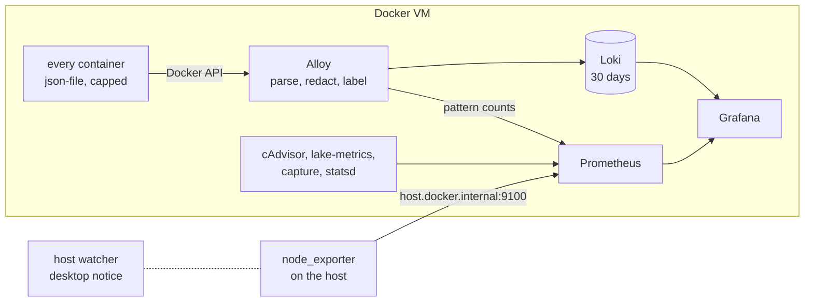
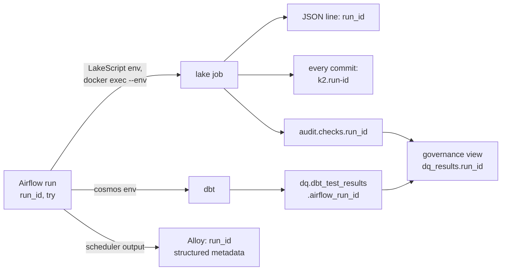

# ADR-051: Central structured logs, one run id, and host metrics

**Status:** Proposed
**Date:** 2026-11-26
**Author:** Platform
**Category:** Observability
**Decided by:** the owner on 2026-11-26 ([decision record](#the-owners-decisions-2026-11-26)); this
ADR records the design that carries those decisions out, and moves to Accepted after review
**Depends on:** [ADR-042](ADR-042-one-platform-version-manifest-and-recorded-rollouts.md) for the
version and commit stamped on every component; the first two pull requests here do not

---

## In plain words

Container logs today grow without limit on the Docker VM's disk (the catalog alone writes 9.3 GiB
a day of access records about an anonymous user), are deleted whenever a container is recreated,
and cannot be searched across services; and nothing inside the VM could see the host running out
of memory before it killed the VM on 2026-11-25. We will cap every container's local log now, then
collect every log into Loki, Grafana's log store, through Grafana Alloy, with our own components
writing JSON lines that share one set of fields, the Airflow run id carried into every lake
commit and dbt result, and a metrics exporter installed on the host itself. Data product health
gets one dashboard, built from what the platform already records. It adds two services, 0.75 CPU
and 1 GiB of declared limits (22.05 CPU / 38.812 GiB at the bootstrap peak, against 25 / 48), and
one install on the host that the owner runs. Traces, a long-term metrics store and most log-based
alerting are deliberately not built, each with a trigger. The decisions are the owner's of
2026-11-26; four questions are left at the end.

---

## Context

Terms are explained where they first appear; the [glossary](glossary.md#logs-and-telemetry) has
each one too.

### What is observed today

Prometheus scrapes every tier, 36 alert rules carry runbooks and unit tests, and six Grafana
dashboards ship from the repository ([chapter 11](../architecture/11-observability.md)). Alerts are
evaluated and shown, never routed: there is no Alertmanager, because one operator has no rotation
to page. cAdvisor reports each container's CPU and memory against its limit. Metrics, in short,
are in good shape. Logs, correlation and the host are not.

### Logs: where they go, how big, what shape

Every container logs through Docker's `json-file` driver, which writes each line a process prints
to a file inside the Docker VM, and every one of them has no options set
(`docker inspect -f '{{.HostConfig.LogConfig.Type}} {{json .HostConfig.LogConfig.Config}}'` prints
`json-file {}` for all 19). The driver's `max-size` defaults to "-1 (unlimited)" (Docker's
`json-file` documentation), so every log grows until its container is removed, and then it is
deleted with it. Measured 2026-11-26 from `docker logs <container> 2>&1 | wc -c` over each
container's age since `docker inspect -f '{{.Created}}'`:

| Container | Age | Log bytes | Per day |
|---|---|---|---|
| `k2-lakekeeper` | 27.8 h | 11,315,192,929 (9,641,837 lines) | **9.3 GiB** |
| `k2-airflow-scheduler` | 9.5 h | 35,240,339 | 85 MiB |
| `k2-redpanda` | 2.5 h | 1,013,896 | 9 MiB (start-up lines inflate a short window) |
| `k2-airflow-dag-processor` | 9.5 h | 3,360,316 | 8 MiB |
| `k2-trino` | 2.6 h | 565,038 | 5 MiB |
| `k2-airflow-api-server` | 9.5 h | 1,413,146 | 3 MiB |
| the other 13 | 2.6 to 27.9 h | | under 0.2 MiB each |

Of Lakekeeper's last 20,000 lines (`docker logs --tail 20000 k2-lakekeeper`), 19,908 were
`Authorization succeeded event` and 92 `Authorization failed event`: the catalog's access audit,
one record per catalog call, at about 270 lines a second during an ingest run. Every one names the
actor `anonymous`, because the catalog runs without authentication, so the records say nothing
about who did anything. Everything else together writes about 110 MiB a day.

**The VM's disk is filling.** `lake-metrics` measures the filesystem under `/minio-data`, the VM's
one data disk, where the container logs also live (both are under the VM's `/var/lib/docker`;
assumed, [not yet verified](#consequences)). In Prometheus, `k2_lake_disk_free_bytes` read
148.34 GiB a day ago and 116.88 GiB now, 54.7% used, and
`deriv(k2_lake_disk_free_bytes[6h]) * 86400` is -8.79 GiB a day: roughly Lakekeeper's log rate.
The disk is about 258 GiB, so at that rate `LakeDiskUsageHigh` (80%, 65 GiB more) is about seven
days away and the disk full in about thirteen.

**Formats differ.** The capture prints coloured text (ANSI escape codes in `docker logs`); the lake
jobs `print` plain lines; Airflow 3 writes its own console format, a time, a level, a message and
trailing `key=value` pairs; Lakekeeper, Redpanda, Trino and the rest write their own formats.

**The lake jobs' output is in Airflow, not in Spark's log.** The lake DAGs run each job with
`docker exec` into `k2-spark-iceberg`, and `docker exec` output goes back to whoever ran it, not
into the container's log. Airflow's `LakeScript` operator reads it line by line into the task's
log. With Airflow's LocalExecutor, which runs every task as a process inside the scheduler
container, that log is a file under `/opt/airflow/logs` in the scheduler
container, and the scheduler also prints each line to its own output with the run appended
(`dag_id=lake_ingest ... run_id=scheduled__2026-11-26T02:26:00+00:00 task_id=ingest ...
try_number=1`, from `docker logs --tail 12 k2-airflow-scheduler`). `/opt/airflow/logs` has no
volume, so recreating the scheduler deletes every task log; the out-of-memory runbook reads a
retried run's two attempts from exactly there (step 6). Of the scheduler's last 4,000 lines, 1,718
were blank lines and about 250 Spark's console progress bars, forwarded from the jobs.

**Nothing correlates.** Airflow's **run id** ([glossary](glossary.md#run-id-and-trace)), the name of
one scheduled run, exists only in Airflow. A lake commit carries `k2.job` and offsets but no run id
([glossary](glossary.md#snapshot-summary-and-k2-properties)); a dbt test result carries dbt's own
`invocation_id`; an `audit.checks` row carries a time and a job. There is no tracing. Going from
"run 02:26 failed" to the commit it made and the checks it filed is a search by timestamp.

### The host

On Docker Desktop for Linux every container runs inside one virtual machine
([glossary](glossary.md#docker-vm-and-its-memory-setting)), so `/proc`, `/sys` and the host
namespaces a container is given are the VM's: cAdvisor's `/sys` mount reads the VM's cgroups. At
22:33:43 UTC on 2026-11-25 the host's out-of-memory killer killed the VM
([glossary](glossary.md#host-out-of-memory-kill)): its swap was full, and 5 min 35 s passed before
anyone started it again, because nothing inside the VM could see the host and nothing outside it
was watching ([runbook](../runbooks/docker-vm-oom-kill.md)). The host now, read with `free -b` and
`df -B1 /` (2026-11-26, 02:30 UTC): 62.6 GiB of RAM, 16.7 GiB available, 1.28 of 8 GiB swap in
use; the root filesystem 31% free (300.7 GiB), holding the VM's disk image, `Docker.raw`, at
254.6 GiB allocated of its 264 GiB size. The host is Ubuntu 24.04.5, whose archive carries
`prometheus-node-exporter` 1.7.0 (`apt-cache policy prometheus-node-exporter`). SECURITY.md
records that a container reached a port published on the host's loopback address through the name
`host.docker.internal` (2026-11-26).

### Secrets in logs

Until 2026-11-26 Trino printed the object store's access key once per catalog per start; it was
fixed at the source, with a log setting and a test that starts Trino with a canary key and fails
if the log prints it (`docker/trino/README.md`). Lakekeeper's own settings include database URLs
that carry a password. A central log store keeps whatever leaks for its whole retention and makes
it searchable.

### Resources

The declared limits sum to 21.30 CPU / 37.812 GiB at the bootstrap peak across 24 services
(`python3 scripts/check-budget.py`), under the 25 CPU / 48 GiB ceiling
([glossary](glossary.md#the-ceiling)). Measured use inside the VM: 11.17 GiB of process memory now,
17.97 GiB and 5.42 cores at the 6-hour peak (`sum(container_memory_rss{job="cadvisor"})` and the
CPU rate, in Prometheus). The VM's setting is 50.5 GiB and it occupies all of it on the host
whatever the containers use, leaving 12.1 GiB for the desktop and everything else
([ADR-045](ADR-045-ceiling-25-cpu-48-gib.md)'s Outcome). ADR-050, proposed in pull request #223,
pauses order-book capture and retunes limits after one measured trades-only day.

---

## The owner's decisions (2026-11-26)

1. Central logs in Grafana, through Loki.
2. Structured JSON logs for K2's own components, with shared fields: time, level, component,
   version, commit, run id, table or topic, message. Third-party services keep their native
   format.
3. Correlation ids everywhere rather than tracing now: one run id, the Airflow run, carried into
   every log line, lake commit property and dbt invocation. Traces are reconsidered when an API
   serving layer exists.
4. Telemetry must answer four things: what is running and what changed; cost and capacity per
   component and per data product over time; data product health in one view (freshness, volume,
   quality results, last successful build, owner); and host health (host memory, disk, the Docker
   VM), which containers cannot see. Plus whatever is best practice.

---

## Decision

**We will cap every container's local log now; collect every container's log into one Loki
through Grafana Alloy, with run ids and tables as structured metadata rather than labels; make
K2's own components write JSON lines with one shared set of fields; carry the Airflow run id into
every lake commit and dbt result; and watch the host with an exporter installed on the host
itself, because today logs fill the VM's disk, vanish on recreate and cannot be searched or
joined, and the host memory that killed the VM on 2026-11-25 is invisible from inside it.**
Scope: the single host. Logs off the host, traces and routing are [not built](#15-what-is-deliberately-not-built).



### 1. Bounded local logs, now

Every service gets the same `logging:` block, from one YAML anchor in `docker-compose.yml`:

```yaml
x-logging: &logging
  driver: json-file
  options:
    max-size: "50m"     # rotate at 50 MiB
    max-file: "5"       # keep five files: at most 250 MiB per container
    compress: "true"    # rotated files are gzipped; docker logs still reads them
# and in every service:
#   logging: *logging
```

Twenty-six services at 250 MiB is at most 6.5 GiB on the VM's disk, against today's unbounded
growth; the scheduler at 85 MiB a day keeps about three days locally, enough for Alloy to catch up
after an outage. **It applies only when a container is created:** Docker reads a container's log
settings at creation, a restart keeps the old ones, and changing them is a change to every
service's definition. So after this lands a bare `docker compose up -d` would recreate every
service at once, the captures (losing trades) and Spark mid-run included; the rollout recreates one
service at a time instead ([pull request 1](#pull-request-1-bounded-local-logs)).
`scripts/check-budget.py` fails a service without the block.

Two sources are fixed at the root in the same change:

- **Lakekeeper's access audit is turned off**, `LAKEKEEPER__AUDIT__TRACING__ENABLED=false`
  (Lakekeeper 0.13 logging documentation). Every record names `anonymous`, so it audits nothing,
  and it is 9.3 GiB a day. Recreating `lakekeeper` also deletes its 11 GB log file. It is turned
  back on when the catalog authenticates its callers (the entitlements phase, P5), as its own log
  stream with its own retention.
- **Spark's console progress bars are turned off** (`spark.ui.showConsoleProgress=false` in
  `docker/lake/spark_conf.py`); they are terminal animation, not information, in a log.

### 2. One log store: Loki, single binary

**Loki** ([glossary](glossary.md#loki-streams-and-labels)) stores log lines compressed in chunks
and indexes only a few labels per stream, which is what makes it cheap enough for one host. It
runs as one process (`-target=all`, its default) with its files on a named volume, `loki-data`,
pinned to the newest 3.7 release (3.7.10, 2026-11-13; 4.0 is still a release candidate) by digest.
The settings that matter here:

| Setting | Value | Why |
|---|---|---|
| `auth_enabled` | `false` | one tenant; safe only because Loki has no published port ([section 13](#13-secrets-and-ports)) |
| `schema_config` | `tsdb`, schema `v13` | required for structured metadata |
| `limits_config.retention_period` | `720h` (30 days) | the same window as Prometheus (`--storage.tsdb.retention.time=30d`), so an incident has logs and metrics for the same days |
| `compactor.retention_enabled` | `true`, with `delete_request_store: filesystem` | without it "the logs sent to Loki live forever" (Loki's retention documentation) |
| `limits_config.max_query_parallelism` | `4` | bounds a 30-day search's memory |
| results cache | embedded, 32 MB | the default is larger than this host needs |
| `analytics.reporting_enabled` | `false` | Loki reports usage statistics by default; cosmos and dbt telemetry are already off |

**Disk arithmetic.** With Lakekeeper's audit off, about 110 MiB a day arrives (the table above).
Loki compresses chunks; at a conservative 4 to 1, 30 days is about 0.8 GiB, and with no
compression at all 3.3 GiB, against 116.88 GiB free on the VM's disk. Ninety days would be at most
10 GiB ([question 1](#questions-for-the-owner)). Loki has no size cap, so the guard is the
existing VM disk alerts (80% and 90%) plus an ingest-rate panel per service.

### 3. One collector: Grafana Alloy

**Grafana Alloy** ([glossary](glossary.md#grafana-alloy)) is Grafana's collector; it replaces
Promtail, which is "end of life (EOL) as of March 2, 2026" (Loki's Promtail page). Its
`loki.source.docker` component reads each container's log from the Docker daemon (`host =
"unix:///var/run/docker.sock"`), finds containers through `discovery.docker`, and keeps a positions
file so a restart resumes where it stopped (Alloy's component reference). Pinned to v1.22.0
(2026-11-13) by digest, with `--disable-reporting`, its data path on a volume, `alloy-data`, so a
recreate keeps its positions. The pipeline, in `docker/alloy/config.alloy`:

1. Discover the containers carrying the label `com.k2.service` (every K2 service has one) and set
   the label `service` from `com.docker.compose.service`.
2. Redact secrets ([section 13](#13-secrets-and-ports)) from every line, first.
3. Parse: JSON lines with `stage.json`; the Airflow scheduler's trailing `key=value` pairs with
   `stage.logfmt` (`run_id`, `dag_id`, `task_id`, `try_number`); a lake job's JSON line inside an
   Airflow line with `stage.regex` then `stage.json`.
4. Attach structured metadata: `component`, `version` and `commit` from the container's labels (a
   container carries its image's labels, and ADR-042 stamps `org.opencontainers.image.version` and
   `.revision` on every built image), then whatever the line carried: `run_id`, `table`, `topic`,
   `exchange`, `conn_id`.
5. Count three patterns as metrics ([section 12](#12-a-few-log-patterns-as-alerts)).
6. Drop blank lines.
7. Push to `http://loki:3100/loki/api/v1/push`.

Third-party lines are parsed where that is free (Airflow's pairs) and otherwise stored as written:
their format is not changed.

### 4. Labels and structured metadata: why the run id is not a label

Loki groups lines into **streams**, one per distinct set of label values, and indexes nothing but
those labels. Each active stream holds an open chunk in memory, and each chunk is its own entry in
the index; a query first picks streams by label, then reads their chunks. A label whose value is
new every run multiplies streams: `lake_ingest` alone runs 288 times a day, each with its own run
id, plus every dbt task, so a `run_id` label would make thousands of streams a day, each a few
lines long. That is many small, poorly compressed chunks, a growing index, more memory per open
stream, and searches that open thousands of chunks. This is what "cardinality" means and why it
matters: the cost follows the number of distinct label combinations, not the volume of logs.

So the labels are only `service` (26 values) and `level` (at most 5, where a line has one): at
most about 130 streams. Everything that changes per run or per row is **structured metadata**
([glossary](glossary.md#structured-metadata)), stored beside each line inside its chunk and not
indexed ("high cardinality metadata that should not be used as a label", Loki's documentation;
it needs schema `v13` and the `tsdb` index). A search narrows by label, then filters:

```
{service="airflow-scheduler"} | run_id="scheduled__2026-11-26T02:26:00+00:00"
```

which reads one service's day, about 85 MiB, not the whole store.

### 5. Structured logs: the shared fields

K2's own components write one JSON object per line. The keys:

| Key | Meaning | Written by |
|---|---|---|
| `timestamp` | UTC, RFC 3339, microseconds | the process |
| `level` | `DEBUG`, `INFO`, `WARN`, `ERROR` | the process |
| `message` | the human sentence, unchanged from today's text | the process |
| `component` | `capture`, `lake.ingest`, `lake.maintenance`, `lake-metrics`, ... | the lake jobs; Alloy for the others |
| `version`, `commit` | the platform version and commit ([ADR-042](ADR-042-one-platform-version-manifest-and-recorded-rollouts.md)) | the lake jobs; Alloy for the others |
| `run_id` | the Airflow run, or `manual__<UTC time>` outside Airflow | the lake jobs |
| `table`, `topic` | the table or topic a line is about | the process, when it has one |
| `exchange`, `conn_id` | the venue and the WebSocket connection | the capture |
| `error` | the exception and its trace | the process, when there is one |

`timestamp`, `level` and `message` are the keys Rust's `tracing` JSON output and Lakekeeper
already write, so one parser reads all three. `component`, `version` and `commit` are facts about
the container, so Alloy adds them from its labels for every container, ours and third-party alike.
The lake jobs write them in the line themselves, because their lines reach Loki through the
Airflow scheduler's output, whose labels are Airflow's.

**Rust (capture).** `tracing-subscriber` gains its `json` feature (the JSON formatter needs `fmt`,
`json` and `std`; docs.rs, 0.3.23), and `main.rs` chooses
`.json().flatten_event(true).with_current_span(false).with_span_list(false)`, which puts each
event's fields at the top level. The 34 log calls are reviewed so the venue, connection and topic
are fields, not text in the message.

**Python (the lake jobs and `lake-metrics`).** One module, `docker/lake/k2log.py`, standard
library `logging` and `json` only, no new dependency: `setup(component)` returns a logger whose
formatter writes the keys above, maps Python's `WARNING` to `WARN`, reads `K2_RUN_ID`,
`K2_VERSION` and `K2_COMMIT` from the environment, and takes `table` and `topic` from a call's
`extra=`. The 84 `print` calls become logger calls with their messages unchanged, because the
chaos scripts and `scripts/lake-verify.sh` search the output for `stage 1: committing` and
`stage 1: no new records`.

**A flag for people.** Both write human-readable console lines instead when standard error is a
terminal, and `K2_LOG_FORMAT=json` or `K2_LOG_FORMAT=console` overrides either way. A person
running `docker exec -it` or `cargo run` reads text; everything Airflow or Docker collects is
JSON. The cost: the Airflow UI shows a lake run's lines as JSON; Grafana shows them parsed.

### 6. One run id, end to end



| Hop | How |
|---|---|
| Airflow to a lake job | `LakeScript`'s templated `env` gains `K2_RUN_ID: "{{ run_id }}"` and `K2_TRY: "{{ ti.try_number }}"`, passed by the `docker exec --env` it already builds |
| Lake job to its log | `k2log` writes `run_id` on every line; a run outside Airflow (`make lake-rebuild`, a runbook command) gets `manual__<UTC time>` |
| Lake job to the lake | every commit carries `k2.run-id` beside `k2.job`, through the same `snapshot-property` option the offsets use |
| Lake job to its checks | `audit.checks` gains a nullable `run_id` column (contract 1.0.0 to 1.1.0, a minor: an added nullable column, `Migration: reversible`) |
| Airflow to dbt | `dbt_marts`' [cosmos](glossary.md#airflow-dag-and-cosmos) `env` gains `K2_RUN_ID`; the on-run-end hook writes it as `airflow_run_id` into each domain's `dq.dbt_test_results`, adding the column where it is missing |
| dbt to the governance view | `governance.quality_results.dq_results` exposes `run_id` for both sources |
| Airflow to Loki | the scheduler's forwarded lines already carry `run_id=`; Alloy parses it into structured metadata |
| Capture | not an Airflow run: its id is `conn_id`, the connection, already a lineage column on every lake row ([glossary](glossary.md#lineage-columns)), so a capture log line joins to the rows it produced |

From one run id, then: its log in Grafana (the query above); its commits,
`SELECT snapshot_id, committed_at FROM lake.raw."messages$snapshots" WHERE summary['k2.run-id'] = '<run id>'`
in Trino; its checks and test results,
`SELECT * FROM governance.quality_results.dq_results WHERE run_id = '<run id>'`.

### 7. Airflow task logs survive a recreate

A named volume, `airflow-logs`, is mounted at `/opt/airflow/logs` in `airflow-scheduler`, where
the LocalExecutor writes task logs and from where the scheduler's log server hands them to the UI.
Airflow deletes no task log by itself, so a new DAG, `airflow_housekeeping`, deletes files older
than 30 days once a day, the same window as Loki. The scheduler's own output already holds the
same lines, so Loki keeps them as well; the volume is what keeps the Airflow UI's log view after a
recreate.

### 8. The host

**What a container cannot do here.** node_exporter, Prometheus's host exporter, needs the host's
`/proc`, `/sys` and namespaces; its README runs it in a container with `--net=host`,
`--pid=host`, `-v /:/host:ro,rslave` and `--path.rootfs=/host`. Under Docker Desktop each of
those is the VM's, so a containerised node_exporter would report the VM, which cAdvisor already
does, and `network_mode: host` is refused by `scripts/check-budget.py` in any case. The host's
memory can only be read on the host.

**What the owner installs on the host** (the runbook carries each command, run and pasted):

1. `sudo apt install --no-install-recommends prometheus-node-exporter` (Ubuntu's 1.7.0, patched
   under Ubuntu's extended security maintenance; [question 2](#questions-for-the-owner)).
2. In `/etc/default/prometheus-node-exporter`,
   `ARGS="--web.listen-address=127.0.0.1:9100"`, then `sudo systemctl restart
   prometheus-node-exporter`, and check `ss -ltn | grep 9100` shows `127.0.0.1:9100` only.
   node_exporter's default address is `:9100`, every interface, and the package starts it at
   install, so this step follows straight away.
3. The reachability check, from a throwaway container as SECURITY.md's was:
   `docker run --rm curlimages/curl:8.14.1 -s http://host.docker.internal:9100/metrics | head -3`.
   If it fails, node_exporter listens on the address the VM's connections arrive from instead,
   with the firewall (`ufw`) refusing every other source.
4. Optionally, the host watcher ([below](#the-host-watcher-detection-from-outside-the-vm)).

**Inside the stack.** Prometheus gains a job `host` scraping `host.docker.internal:9100`
(`extra_hosts: ["host.docker.internal:host-gateway"]` on the Prometheus service, so the name
resolves on a plain Docker engine too). cAdvisor's keep rule also keeps the root cgroup
(`id="/"`) and `machine_memory_bytes`, which together are the VM's own memory as the VM sees it,
for the K2 Resources dashboard.

**Alerts**, in `docker/prometheus/rules/host-alerts.yml`, each with a runbook and promtool cases.
The numbers come from 2026-11-25: host RAM 62.6 GiB usable, the VM at its 50.5 GiB setting,
12.1 GiB for everything else, and at the kill about 13 GiB resident outside the VM and swap
8 GiB with none free.

| Alert | Severity | Fires when | Why that number |
|---|---|---|---|
| `HostMemoryLow` | warning | `node_memory_MemAvailable_bytes` below 4 GiB for 5 m | two thirds of the 12.1 GiB the desktop has is gone: close something |
| `HostMemoryCritical` | critical | below 2 GiB for 2 m | the next large allocation reaches swap |
| `HostSwapFilling` | warning | swap more than 50% used (4 of 8 GiB) for 10 m | swap filling came before the 2026-11-25 kill |
| `HostSwapNearlyFull` | critical | more than 80% used for 2 m | at the kill it was 100% |
| `HostOomKill` | warning | `increase(node_vmstat_oom_kill[1h]) > 0` | the host killed something; after a VM kill it fires once the VM is back, naming the cause |
| `HostDiskSpaceLow` | warning | the host's root filesystem under 10% free for 15 m | it holds `Docker.raw`; 31% free today |
| `HostDiskSpaceCritical` | critical | under 5% free for 5 m | |
| `HostExporterDown` | warning | `up{job="host"} == 0` for 10 m | no host exporter is the blind state of 2026-11-25 |
| `StackMemorySustainedHigh` | warning | `min_over_time(sum(container_memory_rss{job="cadvisor"})[1h:1m])` above 32 GiB | [ADR-045](ADR-045-ceiling-25-cpu-48-gib.md)'s measured-use trigger, now evaluated instead of remembered |

The VM's disk is already watched: `LakeDiskUsageHigh` and `LakeDiskUsageCritical` read the same
filesystem.

#### The host watcher: detection from outside the VM

These alerts are shown, not routed, and the one person they matter to is at the desktop, which
is also what fills the host's memory. Prometheus also dies with the VM. So two small host units
watch from outside the failure domain, installed by the owner from `scripts/host/`:

- `k2-host-watch.timer` runs a short shell script every minute that reads `/proc/meminfo` and
  sends a desktop notice (`notify-send -u critical`) at `HostMemoryCritical`'s and
  `HostSwapNearlyFull`'s thresholds; a test asserts the script and the rules carry the same
  numbers.
- A drop-in for Docker Desktop's user unit, `OnFailure=k2-vm-down.service`, sends a notice the
  moment the VM dies: the 5 min 35 s of 2026-11-25 becomes seconds. It notifies only; restarting
  the VM before memory is freed would be killed again (the runbook's step 2).

### 9. The four questions, answered

| Question | Signals | Where |
|---|---|---|
| What is running and what changed | the platform version and commit on every log line and image ([ADR-042](ADR-042-one-platform-version-manifest-and-recorded-rollouts.md)); `K2ReleaseDrift`; a rollout annotation on every dashboard; `governance.ops.deployments` | Grafana, `make health`, Trino |
| Cost and capacity per component and product, over time | per container CPU and memory against limits (cAdvisor, exists); daily CPU-hours and memory 95th percentile per service; log bytes per service per day (Loki); storage, files and rows per product | K2 Resources; K2 Data Products |
| Data product health in one view | freshness, volume, quality results, last successful build, owner, per product | K2 Data Products ([section 10](#10-data-product-health-in-one-view)) |
| Host health | host memory, swap, disk, OOM kills; the VM's own memory | host alerts; the host watcher; a host row on K2 Resources |
| Best practice beyond the four | bounded local logs; secrets redacted at the collector with an alert when one is found; usage reporting off; each Go service given `GOMEMLIMIT` under its limit; images pinned by digest; detection from outside the failure domain | this ADR |

### 10. Data product health in one view

One Grafana dashboard, **K2 Data Products**, one row per product, built from what is already
recorded:

| Column | Source |
|---|---|
| Owner, domain, lifecycle | recording rules `k2_product_info{domain, product, owner, lifecycle}` and `k2_product_table_info{product, table}`, generated by `k2gen` from `contracts/` into `docker/prometheus/rules/products.yml`, so the drift gate keeps them current |
| Freshness against its target | the age of the newest commit that wrote data to any of the product's tables, against `k2_product_freshness_target_seconds` from the contract's `slaProperties` freshness; a new gauge, `k2_lake_last_write_ts_seconds{table}`, because today's `k2_lake_last_commit_ts_seconds` counts compaction and expiry commits too |
| Volume | rows added in the last 24 hours, `k2_lake_rows_total - k2_lake_rows_total offset 1d` |
| Quality results | passes, failures, warnings and errors in the last 24 hours from `governance.quality_results.dq_results`, which `lake-metrics` reads through Trino every 5 minutes; **no result in 24 hours shows grey, not green**, because a test that never ran leaves no row ([ADR-046](ADR-046-governance-domain-and-quality-results.md)) |
| Last successful build | the same write gauge per output table: lake tables from the producer lake, marts from their domain warehouses, which `lake-metrics` reads too (the warehouses listed in `docker/lake/generated/warehouses.txt`) |

Every panel stays on Prometheus, as all six dashboards are today; `lake-metrics` keeps its one job
(read what the platform recorded, export it), with a standard-library Trino reader beside its
catalog reader. It uses 23.8 MiB of its 128 MiB limit at its 6-hour peak (cAdvisor). P6 planned a
quality dashboard "showing status by product and day"; this is it, and P6 builds on it.

### 11. Cost and capacity

Per component, cAdvisor's series already exist; K2 Resources gains panels over its 30 days:
CPU-hours a day per service (`increase(container_cpu_usage_seconds_total[1d]) / 3600`), memory's
daily 95th percentile per service, and log bytes a day per service from Loki. Per data product:
storage, files and rows, from `k2_lake_bytes_total`, `k2_lake_files_total` and
`k2_lake_rows_total` summed through `k2_product_table_info`. Compute per product is not built: one
ingest run builds every product ([section 15](#15-what-is-deliberately-not-built)). Beyond 30 days,
the dated benchmark reports are the long record.

### 12. A few log patterns as alerts

Alloy's `stage.metrics` counts lines that match three patterns, Prometheus scrapes Alloy, and the
alerts live with the others, with runbooks and promtool tests. No Loki ruler and no Alertmanager.

| Alert | Severity | Pattern | Why |
|---|---|---|---|
| `LogSecretRedacted` | warning | any redaction rule matched, per service, in 15 m | a source is leaking a credential: fix it at the source, rotate the credential, purge the lines |
| `LogJvmOutOfMemory` | critical | `java.lang.OutOfMemoryError` in Spark (through the scheduler) or Trino | names the cause minutes before `LakeIngestFailed`'s 30 |
| `LogDefaultCredentials` | critical | MinIO's `Detected default credentials` | MinIO prints it only for its built-in default pair (SECURITY.md) |

`LokiDown` and `AlloyDown` (`up == 0` for 5 m, warning) cover the pipeline itself.

### 13. Secrets and ports

- **At the source first**, as Trino's fix was: K2's components do not log secrets, and each
  component's tests feed it a canary credential where it handles one.
- **At the collector second.** `docker/alloy/redact.alloy`, one module imported by the live
  configuration and by its test, replaces before anything is stored: credentials in a URL
  (`scheme://user:password@`), the value after a secret-like key in JSON or `key=value` (password,
  secret, token, api key, access key, secret key, authorization, credential), bearer tokens, JSON
  Web Tokens, and AWS-style access key ids. Each replacement increments a counter behind
  `LogSecretRedacted`. `make test-alloy`, a CI job, runs the pinned Alloy offline over a file of
  canary lines and fails if a canary survives or an ordinary line changes.
- **A leaked secret** is rotated first (the secret is the problem, not the line), then deleted from
  Loki with its delete API (enabled by `delete_request_store` and the deletion mode
  `filter-and-delete`), and from the local log by recreating the container.
- **Ports.** Loki (3100) and Alloy (12345) publish none; Grafana, already on 127.0.0.1:3000, is the
  only reader. Loki without authentication is safe only unpublished: even a loopback port would
  give every process on the host every log. SECURITY.md says so.
- **The Docker socket.** Alloy reads logs through it, which is control of the Docker engine, the
  privilege cAdvisor and `airflow-scheduler` already hold. Alloy runs with a read-only root
  filesystem, every capability dropped, `no-new-privileges` and no published port. A socket proxy
  that allows only container listing and log reads is deferred
  ([section 15](#15-what-is-deliberately-not-built)).

### 14. The resource budget, and when to add it

| Service | CPU limit | Memory limit | Basis |
|---|---|---|---|
| `loki` | 0.5 | 768M | one process, about 110 MiB a day in; `GOMEMLIMIT=640MiB` so Go collects garbage before the limit; lowered to 512M if the 7-day peak stays under 300 MiB |
| `alloy` | 0.25 | 256M | one source, one pipeline; `GOMEMLIMIT=200MiB`; the same rule |
| node_exporter | | | on the host, outside the VM and the ceiling; a few tens of MiB of the desktop's 12.1 GiB, measured at install |

| | Services | CPU | GiB |
|---|---|---|---|
| Bootstrap peak today | 24 | 21.30 | 37.812 |
| Bootstrap peak with Loki and Alloy (gated) | 26 | **22.05** | **38.812** |
| Steady state with them | 21 | 20.05 | 36.312 |
| Ceiling ([ADR-045](ADR-045-ceiling-25-cpu-48-gib.md)) | | 25.00 | 48.000 |
| ADR-045's 95% trigger | | 23.75 | 45.600 |

Headroom after them: 2.95 CPU and 9.188 GiB. The VM's floor (the declared peak plus about 1 GiB for
its own kernel, ADR-045's Outcome) becomes about 39.8 GiB, under the 50.5 GiB setting. The host is
unchanged: the VM already occupies its whole setting whatever runs inside it, and measured use
inside it peaked at 17.97 GiB of 49.5.

**Sequencing with ADR-050.** Loki does not need to wait for the retune: it fits now by every
figure above. Two timing rules instead. The bounded logs and Lakekeeper's audit change go first
and now, because of the VM's disk, and before Loki, whose first read would otherwise send
Lakekeeper's whole log. And nothing is rolled out during ADR-050's measured trades-only UTC day,
because any recreate confounds that measurement: Loki lands before the switch is flipped or after
the measured day, and the retune then includes Loki's and Alloy's first measured week. The capture
recreate that JSON logging needs is folded into ADR-050's own capture recreate where the two
coincide, so each venue restarts once.

### 15. What is deliberately not built

| Not built | Why not now | Trigger |
|---|---|---|
| Distributed tracing (OpenTelemetry with a trace store) | batch runs and one stream; a run id joins everything one run touches, and no request crosses services synchronously | an API serving layer exists, or one request path crosses three services synchronously |
| A long-term metrics store | 30 days answers incidents; the benchmark reports keep the long record | a question needs more than 30 days of metrics twice in a quarter, or `prometheus_tsdb_storage_blocks_bytes` passes 5 GiB (0.53 GiB today) |
| Log-based alerting beyond three patterns; Loki's ruler | alerts stay in Prometheus, tested; most failures already have a metric | a failure reaches the stack twice that only a log line showed |
| Alert routing (Alertmanager) | one operator, no rotation ([chapter 11](../architecture/11-observability.md)); the host watcher covers the desk | a second operator, or an alert unseen for more than an hour twice |
| Compute cost per data product | one ingest run builds every product; attribution needs per-stage timings | a chargeback question, or a second domain's job competes for the Spark slot |
| Lakekeeper's access audit | every actor is `anonymous` | the catalog authenticates callers (P5) |
| A socket proxy for Alloy and cAdvisor | one operator on one host; the privilege is already held twice | a second operator, or any service reachable from outside the host |
| Logs off the host | single host by design ([ADR-028](ADR-028-non-goals-and-honest-limits.md)) | an AWS deployment |

---

## Rationale

- **Bounded logs first, because the disk is the nearest failure.** At the measured rate the VM's
  disk reaches its first alert in about seven days, and rotation plus one setting removes almost all
  of it, before any new service exists.
- **Loki over a full-text index, because the host is short of memory and the questions are
  narrow.** Searches here start from a service and a time, or a run id; Loki answers those from
  a few labels and compressed chunks, where a full-text engine keeps a large index in memory.
- **Alloy over the alternatives, by fit.** Promtail has reached end of life. Vector is active and
  capable, but a second vendor's configuration language for one Grafana stack. Alloy reads the
  Docker API, writes Loki, and could later carry metrics or traces if their triggers fire. Its
  memory is inside the VM, where 30 GiB is unused, not on the host, which is what is short.
- **A run id over tracing, because the work is batches.** Every lake and dbt task already belongs
  to exactly one Airflow run, so one id written in four places joins them completely; tracing
  would add an SDK to every component to learn what the run id already says.
- **The host from the host, because nothing else can see it.** The VM's view of `/proc` is the VM;
  the only signals that would have warned of 2026-11-25 are host memory and swap, read on the host.

---

## Alternatives Considered

| Option | Why not |
|---|---|
| Promtail | End of life since 2026-03-02 (Loki's documentation) |
| Vector (0.62.0, 2026-11-16) | Active and capable; a second configuration language beside Grafana's, for no capability Alloy lacks here |
| Fluent Bit | Smaller in memory, but memory inside the VM is not the constraint; one more vendor |
| Loki's Docker logging driver plugin | Installed into the engine; ties container logging to Loki's availability; one more thing to reinstall after a VM rebuild |
| Elasticsearch or OpenSearch | A JVM and a full-text index, gigabytes of heap at rest, for searches that start from a label |
| Logs into ClickHouse | No new store, but ClickHouse serves gold; diagnosing it would depend on it |
| Rotation alone, no central store | Bounds the disk; still no search across services and nothing after a recreate |
| `run_id` and `table` as Loki labels | Thousands of tiny streams a day ([section 4](#4-labels-and-structured-metadata-why-the-run-id-is-not-a-label)) |
| Tracing now | No synchronous request path; the run id already correlates every batch hop |
| node_exporter in a container | Reports the VM, not the host, under Docker Desktop; needs host networking, which the port gate refuses |
| Version and commit written by every process | Alloy adds them from labels for every container, third-party included; only the lake jobs need them in the line |
| Docker's `local` log driver | Rotates by default and is compact, but `json-file` with options keeps the plain format every existing command reads |

---

## Consequences

**Easier:** finding every line of one run across Airflow, Spark and dbt; keeping task logs through
a recreate; reading any service's log from Grafana; knowing the host is short of memory before it
kills the VM; one view of every product's health.

**Harder:** two more services to pin and patch; a host install outside the repository's reach; the
Airflow UI shows lake lines as JSON; every log change in our code keeps to the shared keys.

**Committed to:** Loki and Alloy as the log path; the shared JSON keys; the run id in four
places, including the `audit.checks` contract and every domain's test results table; a host
exporter on any host this runs on, or `HostExporterDown` firing.

**Risks:** Alloy holds the Docker socket. A secret in a format no rule matches reaches Loki and
stays for up to 30 days; the source fix and the canary tests are the guard, the delete API the
repair. `max-size` applies only to recreated containers, so until every service has been recreated
once, the old ones stay unbounded. A bare `docker compose up -d` right after the logging change
recreates everything at once.

**What is not yet verified:**

- that container logs share the VM filesystem `lake-metrics` measures (verify: the free bytes rise
  by about 11 GB when `lakekeeper` is recreated in pull request 1);
- that `host.docker.internal` reaches a service bound to the host's loopback address, rather than
  only ports Docker Desktop publishes there (the install's step 3);
- that Ubuntu's node_exporter 1.7.0 exports `node_vmstat_oom_kill` by default (one `curl | grep`
  after install);
- that cAdvisor with `--docker_only=true` still exports the root cgroup (one PromQL query after the
  keep-rule change);
- that cosmos renders a templated `env` value such as `{{ run_id }}` (a DAG test in pull request 5;
  the fallback is `AIRFLOW_CTX_DAG_RUN_ID`, which Airflow sets in a task's environment, also to be
  checked on Airflow 3.3.2);
- that the `airflow-logs` volume keeps the image's ownership of `/opt/airflow/logs` on first mount
  (the scheduler writes a task log after the recreate);
- Alloy's `--disable-reporting`, `loki.echo` for the offline test, and Loki's
  `analytics.reporting_enabled` and `deletion_mode` as named here, from each project's reference
  at pinning time;
- Loki's and Alloy's memory: the limits above are estimates until a week is measured;
- the 4 to 1 compression assumed in the disk arithmetic (Loki's own chunk metrics after a week).

**Revisit when:** Loki's 7-day memory peak passes 80% of its limit, or its volume passes 5 GiB; the
VM's disk passes 75% used with every container recreated under the cap
(`k2_lake_disk_used_ratio > 0.75`, 54.7% today); a trigger in [section 15](#15-what-is-deliberately-not-built)
fires; or the host's out-of-memory killer kills the VM again with these alerts in place, which
means their thresholds were wrong.

---

## Questions for the owner

1. **Retention.** 30 days, matching Prometheus (about 0.8 GiB, at most 3.3 GiB), or 90 (at most
   10 GiB)?
2. **The host exporter's source.** Ubuntu's package (1.7.0, security-patched by Ubuntu, updated with
   the system) or the upstream release binary with a hand-written unit (current, updated by hand)?
3. **Desktop notices.** The host watcher interrupts the desktop at the critical thresholds and when
   the VM dies. Wanted, or the Prometheus alerts only?
4. **Lakekeeper's access audit.** Off at the source (recommended: it names no one and is 9.3 GiB a
   day), or kept in the capped local log and dropped by Alloy, so the last few minutes of access
   records stay readable with `docker logs`?

---

## References

- [Chapter 11, observability](../architecture/11-observability.md);
  [`docs/operations/observability.md`](../operations/observability.md)
- [ADR-045](ADR-045-ceiling-25-cpu-48-gib.md) and its 2026-11-26 Outcome; the runbook
  [`docker-vm-oom-kill.md`](../runbooks/docker-vm-oom-kill.md)
- [ADR-042](ADR-042-one-platform-version-manifest-and-recorded-rollouts.md) (version and commit);
  [ADR-046](ADR-046-governance-domain-and-quality-results.md) (quality results); ADR-050, proposed
  in pull request #223 (order-book pause and the retune)
- Loki: [retention](https://grafana.com/docs/loki/latest/operations/storage/retention/),
  [structured metadata](https://grafana.com/docs/loki/latest/get-started/labels/structured-metadata/),
  [Promtail end of life](https://grafana.com/docs/loki/latest/send-data/promtail/),
  [releases](https://github.com/grafana/loki/releases)
- Alloy: [`loki.source.docker`](https://grafana.com/docs/alloy/latest/reference/components/loki/loki.source.docker/),
  [`loki.process`](https://grafana.com/docs/alloy/latest/reference/components/loki/loki.process/),
  [releases](https://github.com/grafana/alloy/releases)
- [Docker `json-file` driver](https://docs.docker.com/engine/logging/drivers/json-file/);
  [node_exporter](https://github.com/prometheus/node_exporter);
  [Lakekeeper 0.13 logging](https://docs.lakekeeper.io/docs/0.13.x/logging/);
  [`tracing-subscriber` JSON](https://docs.rs/tracing-subscriber/latest/tracing_subscriber/fmt/format/struct.Json.html);
  [Vector releases](https://github.com/vectordotdev/vector/releases)

---

## Implementation plan

Seven pull requests, smallest and safest first; the first two add no service. Rollouts on the live
stack follow one pattern: pause the lake DAGs, wait for idle, recreate one service or tier,
verify with `make health`, resume (`pause_lake_ingest` and `resume_lake_ingest` in
`scripts/chaos/lib.sh`, or `make deploy` once [ADR-042](ADR-042-one-platform-version-manifest-and-recorded-rollouts.md)'s
pull request 6 exists). Never more than one heavy Docker job at once. Each pull request runs
`make test`, `make lint`, `make check-docs` and `make check-alerts`.

### Pull request 1: bounded local logs

- **Files:** `docker-compose.yml` (the `x-logging` anchor on all 26 services;
  `LAKEKEEPER__AUDIT__TRACING__ENABLED: "false"`; the summary comment);
  `docker/lake/spark_conf.py` (`spark.ui.showConsoleProgress=false`); `scripts/check-budget.py`
  fails a service with no `logging` options, a `max-size` over 100m or a `max-file` over 10;
  `docs/operations/docker-resources.md`, one paragraph.
- **Tests:** `tests/test_check_budget.py`: a service without the block fails, one with it passes.
- **Rollout:** `lakekeeper` now: pause, wait for idle, `docker compose up -d --no-deps
  --force-recreate lakekeeper`, verify, resume. Every other service takes the setting at its next
  recreate, one at a time and never by a bare `docker compose up -d`; the captures with ADR-050's
  recreate or ADR-042's pull request 5, whichever comes first.
- **Measure:** `k2_lake_disk_free_bytes` before and an hour after (expect about 11 GB back);
  `docker logs k2-lakekeeper 2>&1 | wc -c` an hour apart (expect kilobytes);
  `docker inspect -f '{{json .HostConfig.LogConfig}}'` on each recreated container.
- **Rollback:** revert and recreate `lakekeeper`.

### Pull request 2: the host exporter and host alerts

- **Before merge, the owner:** install steps 1 to 3 of [section 8](#8-the-host); the pull request
  merges only after step 3 passes or its fallback is chosen.
- **Files:** `docker/prometheus/prometheus.yml` (job `host`; cAdvisor keeps `id="/"` and
  `machine_memory_bytes`); compose `extra_hosts` on Prometheus;
  `docker/prometheus/rules/host-alerts.yml` and `rules/tests/host-alerts_test.yml`;
  `scripts/host/k2-host-watch.sh`, `k2-host-watch.service`, `k2-host-watch.timer`,
  `k2-vm-down.service` and the Docker Desktop drop-in; a host row on
  `docker/grafana/dashboards/k2-resources.json`; the runbook `docker-vm-oom-kill.md` gains the
  install, its detection section the new alerts (with `/runbook`); `docs/operations/observability.md`.
- **Tests:** promtool cases, fire and must-not-fire, for each alert at the thresholds above;
  `tests/test_host_watch.py` asserts the script's thresholds equal the rules'.
- **Rollout:** `docker compose up -d --no-deps --force-recreate prometheus` (no pause: no lake job
  depends on Prometheus); then the owner installs the timer and the drop-in.
- **Measure:** every host alert inactive at today's values (16.7 GiB available, 16% swap, 31%
  disk free); node_exporter's resident memory on the host; one desktop notice from a test run of
  the watcher with its threshold raised for a minute.
- **Rollback:** revert and recreate Prometheus; `sudo apt remove prometheus-node-exporter`; disable
  the timer.

### Pull request 3: Airflow task logs survive a recreate

- **First:** `docker exec k2-airflow-scheduler du -s /opt/airflow/logs` twice, 24 hours apart, for
  the daily growth (85 MiB a day of scheduler output is the upper bound).
- **Files:** compose volume `airflow-logs` on `airflow-scheduler`;
  `docker/airflow/dags/housekeeping.py` (`airflow_housekeeping`, daily at 04:30 UTC, one task:
  `find /opt/airflow/logs -type f -mtime +30 -delete`, then empty directories); the airflow
  runbook.
- **Tests:** a DAG test in `docker/airflow/tests/` for the schedule and the command.
- **Rollout:** pause, wait for idle, recreate `airflow-scheduler` (the logs before it are lost a
  last time), verify a new run's log in the UI, recreate it again and verify the log is still
  there, resume.
- **Rollback:** revert; the volume stays until `docker volume rm`.

### Pull request 4: structured logs in K2's components

- **Files:** `services/capture-rust/Cargo.toml` (`tracing-subscriber` features `env-filter`,
  `json`; `Cargo.lock` gains `tracing-serde`), `src/main.rs` (the format choice) and the 34 log
  calls; `docker/lake/k2log.py`; the 84 `print` calls in `docker/lake/`, messages unchanged;
  `docker/lake/metrics.py` uses `k2log`; `docs/operations/observability.md`.
- **Tests:** a Rust test that one event renders as one JSON line with the keys and fields expected;
  `tests/test_k2log.py` (the keys, `WARNING` to `WARN`, console mode on a terminal and by the
  variable, `extra=` fields, an exception); a test that the strings the chaos scripts and
  `lake-verify.sh` search for still occur in the lake modules.
- **Rollout:** the lake jobs take it at their next run, through the bind mount; `lake-metrics`
  recreated; the captures one venue at a time, folded into ADR-050's recreate if it is near.
- **Measure:** `docker logs --tail 3 k2-capture-kraken` prints JSON without escape codes; a lake
  run's lines in the Airflow log are JSON.
- **Rollback:** `K2_LOG_FORMAT=console` in compose switches back without a revert; or revert.

### Pull request 5: the run id end to end

- **Files:** `docker/airflow/dags/lake.py` (`K2_RUN_ID`, `K2_TRY`); `docker/lake/offsets.py`
  (`RUN_ID = "k2.run-id"`) and every commit's properties; `audit.checks` gains `run_id` through
  `/schema-change` (`docker/lake/ddl/lake.sql`, `contracts/market-capture/lake-audit/audit.checks.odcs.yaml`
  to 1.1.0, `make generate`), the pull request body carrying `Migration: reversible`;
  `docker/airflow/dags/dbt_marts.py` (`K2_RUN_ID` in cosmos's `env`);
  `dbt/macros/record_test_results.sql` (`airflow_run_id`, added with `ADD COLUMN IF NOT EXISTS`);
  the governance view's `run_id`.
- **Tests:** DAG tests assert the rendered environment of both DAGs; `tests/test_lake_offsets.py`
  for the property; `make test-dbt` reads a recorded row back with the column; k2gen's tests for
  the contract.
- **Rollout:** pause, wait for idle, run `lake-ddl` once for the column, verify it in Trino, resume;
  the DAG change is parsed by the dag-processor; dbt takes it at its next hourly run.
- **Measure:** one run id from the Airflow UI found in a commit summary, in `dq_results`, and (after
  pull request 6) in Loki.
- **Rollback:** revert the code; the nullable column stays harmless, or is dropped (reversible).

### Pull request 6: Loki and Alloy

- **Files:** compose services `loki` and `alloy` (images by digest, volumes `loki-data` and
  `alloy-data`, no ports, the limits and `GOMEMLIMIT` above, health checks, Alloy hardened as in
  [section 13](#13-secrets-and-ports)); `docker/loki/config.yaml`; `docker/alloy/config.alloy` and
  `docker/alloy/redact.alloy`; `docker/grafana/provisioning/datasources/loki.yml`; Prometheus jobs
  `loki` and `alloy`; `docker/prometheus/rules/log-alerts.yml` and its tests; the runbook
  `docs/runbooks/logs.md` (with `/runbook`); the budget in `scripts/check-budget.py`'s output, the
  ADR-010 Outcome and the compose summary comment (CLAUDE.md); `SECURITY.md`; chapter 11 and
  `docs/operations/observability.md`.
- **Tests:** `make test-alloy` as a CI job (the canary file through the redaction module, offline;
  Alloy's own configuration check); Loki's configuration check in the same job; promtool cases for
  the five alerts.
- **Rollout:** `docker compose up -d --no-deps loki`, then `alloy`; nothing else is recreated and
  nothing depends on them. Alloy's first read sends each container's local log, at most 250 MiB
  each once pull request 1 has reached it.
- **Verify:** `count by (service) (count_over_time({service=~".+"}[5m]))` in Grafana lists every
  running service; a throwaway container labelled `com.k2.service=canary` printing a fake
  `password=` line arrives redacted and moves the redaction counter.
- **Measure, for 7 days:** Loki's and Alloy's memory peaks (cAdvisor), bytes received per day, the
  `loki-data` volume's size, and the time of a 24-hour run id search; then set the limits and
  record them in the ADR-010 Outcome.
- **Rollback:** `docker compose stop alloy loki`, revert; the volumes can be deleted.

### Pull request 7: data product health and capacity

- **Files:** `k2gen` emits `docker/prometheus/rules/products.yml` (`k2_product_info`,
  `k2_product_table_info`, `k2_product_freshness_target_seconds`); `docker/lake/metrics.py` adds
  `k2_lake_last_write_ts_seconds`, reads the domain warehouses, and reads the quality view through
  Trino; dashboards
  `docker/grafana/dashboards/k2-data-products.json` and the capacity panels on K2 Resources;
  `docs/operations/dashboards.md`.
- **Tests:** k2gen tests for the emitted rules; `metrics.py --self-check` with a recorded Trino
  response; `promtool check rules` covers the generated file.
- **Rollout:** recreate `lake-metrics` (it only reads; no pause), `docker kill -s HUP k2-prometheus`
  for the rules, Grafana loads the dashboard from its provisioning folder.
- **Measure:** `lake-metrics`' memory against its 128 MiB limit after a day (raise it in this pull
  request, with the budget updates, if it passes 80%); the dashboard against one product checked
  by hand in Trino.
- **Rollback:** revert.
