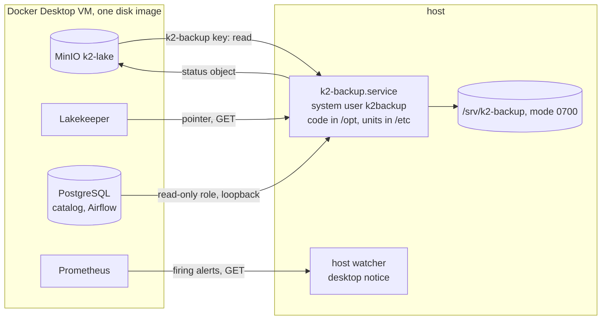

# ADR-052: Back up the irreplaceable tables and the catalog, and prove the restore

**Status:** Proposed
**Date:** 2026-11-26
**Author:** Platform
**Category:** Storage / Recovery
**Decided by:** the owner on 2026-11-26, in outline: security and guard fixes come before
phase P4; the raw archive gets a second copy outside Docker, on the same disk, which the owner
accepts for now; each design gets an independent review before acceptance. The review of
2026-11-26 split the first draft into this ADR and two more, [ADR-053](ADR-053-recoverable-deletes-and-guards.md)
(recoverable deletes and guards) and [ADR-054](ADR-054-scoped-storage-credentials.md) (scoped
storage credentials), and its changes are in this text. It moves to Accepted when the owner
accepts it.
**Evidence:** [research note](../research/2026-11-26-storage-credentials-least-privilege.md);
the P0 audit `docs/audits/2026-11-26-p0-prerequisites-guardrails.md` (branch
`docs/audit-p0-phase`, not merged), whose one BLOCKER this answers first; and the read-only reads
in Context, each with its command.

---

## In plain words

The raw archive of everything the venues sent, and a few smaller tables of history, cannot be
rebuilt from anything, and each exists once inside the Docker engine's disk image. We will copy
them every six hours, as the table files themselves with everything needed to read them, plus an
hourly dump of the catalog database, into a directory owned by a dedicated system account on the
host, check each copy, raise a desktop notice when a copy fails, and restore it on a scratch stack
before calling this done and every quarter after. It costs about 14 GiB of host disk to start,
then about 8 GiB a day at full capture or under 1 GiB a day once order-book capture is paused, a
few `sudo` commands for the owner, and two small timers. It does not protect against the disk itself failing, and while the owner's account is in
the `docker` group, any program running as the owner can delete both copies. The owner must decide
that last point, and the questions at the end.

**The cheapest loss nobody can restore**, found by the review: one anonymous call to the catalog
(deactivating the warehouse, removing its storage key, or committing forged ingest positions)
stops the lake from reading Redpanda; nothing is deleted and no key is needed, and about 13 hours
later Redpanda evicts records the lake never read, on its busiest partition at full capture (48
hours once order-book capture is paused). No backup holds records that never arrived. What closes
it is a person told in time: this ADR's desktop notice, ADR-053's ingest refusing forged positions,
and the order-book pause. It is acceptable only with routed alerts and the pause in effect.

---

## Context

Terms are explained where they first appear; the [glossary](glossary.md) has each one too.

### What cannot be rebuilt, and where it lives

The lake has four layers, raw, bronze, silver and gold, and every layer below raw is a function of
raw, so losing it costs a rebuild ([glossary](glossary.md#raw-bronze-silver-gold)). Five tables
are not functions of anything, and these ADRs call them the **irreplaceable tables**
([glossary](glossary.md#irreplaceable-tables)):

| Table | Why it cannot be rebuilt | Current snapshot |
|---|---|---|
| `lake.raw.messages` | every Kafka record from Redpanda byte for byte, the system of record ([ADR-021](ADR-021-raw-first-archive-and-lineage.md)); the venues' public feeds do not replay | 13.49 GiB, 4,006 data files |
| `lake.audit.checks` | append-only history of findings, operator rows included (a recorded outage, a deliberate purge) | small |
| `lake.gold.dim_instrument`, `lake.gold.dim_venue` | type-2 history of instruments and venues ([SCD2](glossary.md#scd2-security-master)); `docker/lake/ddl/lake.sql` says no source exists for lost history | small |
| `<domain>.dq.dbt_test_results`, one per data domain | append-only dbt test history ([ADR-046](ADR-046-governance-domain-and-quality-results.md)) | small |

Sizes: Trino, `SELECT sum(file_size_in_bytes), count(*) FROM lake.raw."messages$files"`,
2026-11-26 02:56 UTC.

They are Apache Iceberg tables. An Iceberg table on storage is a chain of files: a
`metadata.json` listing every **snapshot** (one version of the table), each snapshot's manifest
list, the manifests it names, and the data files the manifests list, each data file with its
record count. Every path in them is absolute. The catalog, Lakekeeper, holds only a pointer per
table to its current `metadata.json`, in a PostgreSQL database; **the pointer is the table**:
move it and every reader sees another version, lose it and the files are unreadable until it is
recreated ([glossary](glossary.md#registering-a-table-and-the-metadata-chain)). The files live in
MinIO, an S3-compatible object store, in one Docker volume inside the Docker Desktop VM's single
disk image. The catalog database is 28 MB (`pg_database_size('lakekeeper')`, read-only, 2026-11-26)
and Airflow's 13 MB. The engine's volumes were lost once already, on 2026-08-28.

### How long Redpanda holds what the lake has not read

Each Redpanda partition keeps 48 hours or 2 GiB, whichever comes first, then evicts its oldest
records ([glossary](glossary.md#raw-retention-and-eviction)). Measured read-only on 2026-11-26 at
03:45 UTC, by `rpk topic describe <topic> -p` for each partition's first held offset in
`k2-redpanda`, joined to that offset's `kafka_ts` in `lake.raw.messages` through Trino, and `du -sb`
of each partition's directory:

| Measure | Value |
|---|---|
| Raw-topic partitions at the 2 GiB cap | 4 of 36 (2.02 to 2.11 GiB each) |
| Hours held by the shortest, `market.crypto.v3.raw.kraken` partition 0 | **13.2** |
| Next shortest | 40.7, then 45.3 |
| Every other partition | 45 hours or more |

So at full capture a record the lake has not read is gone about 13 hours later on the busiest
partition. Order-book frames are 99.6% of that venue's bytes (ADR-050's measurement), so with
[ADR-050](ADR-050-order-book-capture-paused-during-platform-build.md)'s order-book pause in effect
(Accepted, its switch being built) the 2 GiB cap stops binding and 48 hours holds everywhere, an
estimate from those shares.

### The disk

- Host: 299 GiB free (`df -B1G /`, 2026-11-26 03:50 UTC).
- The VM's disk image, `~/.docker/desktop/vms/0/data/Docker.raw`: 264 GiB apparent and 258 GiB
  already allocated on the host (`du --apparent-size` and `du`). Docker Desktop attaches it
  without `discard`, so space freed inside the VM returns to the host only after a manual trim
  ([docker-desktop-disk](../runbooks/docker-desktop-disk.md)). The image can grow about 6 GiB
  more, so nearly all of the host's 299 GiB is available to a copy outside it.
- Inside the VM: 0.610 of 258.6 GiB used after the nightly compaction (`k2_lake_disk_used_ratio`,
  Prometheus, 03:50 UTC; 0.551 at 02:56 before it), about 101 GiB free.

### Nobody is told

Prometheus evaluates the lake's alerts, and nothing routes them: there is no Alertmanager, so an
alert is a red row in a page someone must be looking at ([ADR-028](ADR-028-non-goals-and-honest-limits.md)
section 10). Every recovery window in these three ADRs is measured in hours, so without a notice
that reaches a person they are theory. [ADR-051](https://github.com/rjdscott/k2-market-data-platform/pull/225)
(Proposed, open pull request) proposes a host watcher that sends desktop notices for host memory
and for the VM dying, and nothing for the lake.

### Who can reach a copy on this host

Read on 2026-11-26: two Docker engines run. Docker Desktop's, which runs K2, and the native
Docker Engine (`systemctl is-active docker`: `active`; `/var/run/docker.sock` owned
`root:docker`), and the owner's account is in group `docker` (`id -nG`). Membership of `docker` on
a native engine is root on the host: any process running as the owner can start a container that
mounts `/` and write anything, with no password. Docker Desktop shares the owner's home directory
with its VM, so anything holding Desktop's socket (the Airflow scheduler mounts it, and cAdvisor)
can start a container that rewrites files under the home directory, the checkout and the owner's
systemd user units included, which then run as the owner. A copy whose code, units or directory a
container or an ordinary owner process can rewrite is not a second copy of anything.

---

## Decision

**We will keep a second copy of the irreplaceable tables and of the catalog database outside the
Docker engine, taken every six hours as each table's own Iceberg files and metadata chain with
records counted from its manifests, plus an hourly dump of the catalog database, written by a
dedicated system account from root-owned code into a directory no account but it and root can write,
verified on every run, reported through a routed desktop notice, and restored on a scratch stack
before it is called done and every quarter after, because these tables cannot be re-fetched and
today each exists exactly once.** Scope: this single host, until it gains a second user or machine
or the platform moves to AWS. Deletion recovery inside MinIO is [ADR-053](ADR-053-recoverable-deletes-and-guards.md);
per-engine keys are [ADR-054](ADR-054-scoped-storage-credentials.md).

### 1. What is copied, and what a restore point is

For each irreplaceable table: the current `metadata.json`, the manifest list of every snapshot it
lists, every manifest those name, every other file it names (statistics files, if any), and the
data files of the current snapshot. Files of older snapshots that compaction replaced (the nightly
rewrite of many small files into few large ones) are not copied; the whole metadata chain is, so a
restored table can be maintained and appended to like any other. Iceberg files are immutable and
uniquely named, so a run fetches only names it does not hold: the copy is incremental by snapshot.

Each run writes one **restore point** per table ([glossary](glossary.md#host-copy-and-restore-point)):
the `metadata.json` to register, the snapshot id and its commit time, the table's UUID and location,
every object with its size and SHA-256, and the record count **summed from the data-file entries
of the snapshot's manifests**, not read from the snapshot summary. The summary is a map of strings
any caller of the catalog can write in a commit; a manifest is a file, which needs a storage key.

The job never trusts the catalog's answer. Before copying, it compares each table's UUID and
location with **pins**: an append-only file of each irreplaceable table's UUID and location,
written once by `make pin-irreplaceable` from the catalog in this ADR's landing step, changed only by
the owner by hand after review ([glossary](glossary.md#pinned-table-identity)), and used by
ADR-053's guards and ADR-054's storage refusal too. The job reads its own copy,
`/etc/k2-backup/irreplaceable.lock`, which the owner installs with `sudo`. And
every object key from a manifest must start with `s3://k2-lake/warehouse/`, contain no `..` and
resolve inside the copy root; anything else stops the run, because an unauthenticated commit can
write any path into a manifest it reuses.

**Consistency.** The job reads each pointer first, then copies what that metadata names. Every file
a committed metadata names existed before the commit, and snapshot expiry never deletes a file the
current snapshot references. A maintenance run that overruns into a copy can expire an old snapshot
between the read and the copy; on a missing object the job re-reads the pointer once and starts that
table again, and a file still missing is a failure.

### 2. Cadence and the recovery point, both ways

A copy runs at 04:30, 10:30, 16:30 and 22:30 UTC (after the 03:00 UTC maintenance), and the
catalog dump every hour. The recovery point, how old the newest copy can be when MinIO is lost, is
six hours plus a run, stated as **7 hours**. The **lossless restore window** is how long after a
restore point a restore must finish for Redpanda still to hold every record since it: Redpanda's
holding time on the tightest partition, less the restore point's age.

| | Copy every 6 hours (this decision) | Copy once a night |
|---|---|---|
| Full capture, tightest partition 13.2 h | about 6 hours to restore with no record lost | **not lossless**: up to about 13 hours lost on that partition (26 less 13.2) |
| Order-book capture paused, 48 h | about 41 hours | about 22 hours |
| The VM disk image lost, so Redpanda too | up to 7 hours of every topic lost | up to 26 hours lost |

Every six hours costs more copied small files, which compaction later replaces; section 5 removes
them after two days.

### 3. Who runs it, and where it writes

- **A system user**, `k2backup`, created by the owner (`sudo useradd --system --no-create-home
  --shell /usr/sbin/nologin k2backup`), in no group but its own, so not in `docker`.
- **Root-owned code** in `/opt/k2-backup/`: the job, and a virtual environment with its two
  dependencies (`boto3` at a version pinned and hash-checked at implementation, `fastavro==1.12.2`,
  the version the tests already pin), installed by `sudo make install-backup` from a reviewed
  commit. The job never reads the checkout. Its units are system units in `/etc/systemd/system/`:
  `k2-backup.service` and `.timer`, `k2-catalog-dump.service` and `.timer`, each with
  `User=k2backup`, `ProtectHome=yes` (the job cannot even read a home directory),
  `ProtectSystem=strict`, `ReadWritePaths=/srv/k2-backup`, `NoNewPrivileges=yes`, an empty
  capability set, `Persistent=true` (a run missed while the machine was off runs at the next
  start), `Nice=10` and idle I/O priority.
- **Secrets** in `/etc/k2-backup/env`, root-owned, mode 0600, read by systemd before it drops to
  `k2backup`: the MinIO `k2-backup` key (read the lake, write one status object) and the
  PostgreSQL `k2_backup` role's password.
- **The copy** in `/srv/k2-backup/`, owned by `k2backup`, mode 0700: `objects/k2-lake/<key>` (each
  object once, written to a temporary name and renamed, mode 0444; a name already held with a
  different size stops the run, since an Iceberg file never changes), `restore-points/<UTC
  time>/<table>.json`, `catalog/<UTC time>/{lakekeeper,airflow}.dump`.
- **The catalog dump** by the host's own `pg_dump` (16.15) over loopback, `127.0.0.1:15432`, as
  `k2_backup`, a login role with PostgreSQL's built-in `pg_read_all_data` and nothing else, so it
  can read every table and change none, and the job needs no Docker access. `pg_dump` reads servers
  older than itself; the server is 15.
- **The MinIO user and the status bucket** are made by `lake-init` (the one-shot that holds the
  MinIO root credential, the identity that can do everything) on its next run: user `k2-backup`,
  bucket `k2-ops`. Adding them changes nothing that runs.

What this protects and what it does not, plainly: Docker Desktop shares only the home directory
with its VM by default, so no container on the K2 engine can mount `/srv/k2-backup` or `/opt`
(proof below); no ordinary process of the owner's can write them either, **unless it uses the
native Docker Engine**, which the owner's `docker` group membership allows without a password. Until
the owner leaves that group or stops that engine (question 1), any program running as the owner
can delete both copies.

### 4. Verification on every run

Per table: every object of the restore point present with its size; the record count summed from
the manifests not below the previous restore point's (every irreplaceable table only grows) and
equal to the snapshot summary's `total-records` (a difference means a forged summary and fails the
run); UUID and location equal to the pins; the snapshot's commit time at most 7 hours old. The dump
is checked by `pg_restore --list` reading it back. A failing run writes no restore point, says why,
and the status says so. Monthly, a `--deep` run re-hashes every held object against its SHA-256.

### 5. Retention, pruning and the disk guard

Restore points of the 04:30 UTC run are kept indefinitely: the archive is kept forever (ADR-028
section 12), so its copy is too. The other three runs' restore points are kept two days. After
each run, an object that no kept restore point names is removed, and the run refuses to remove
more than 5% of the held bytes at once (it alerts instead, for a person to look). Catalog dumps:
hourly ones kept 48 hours, the 04:30 one kept 30 days. These are the only deletions the job makes.
Before copying, the job refuses to start when the host would have less than 50 GiB free after the
run, and alerts.

| | Full capture (2026-11-25) | Order-book capture paused (estimate) |
|---|---|---|
| First copy | 13.5 GiB | 13.5 GiB |
| Raw added per day | 6.87 GiB (Trino, `lake.raw."messages$partitions"`, that day, which includes a 343 s outage) | about 0.7 GiB |
| Long-run growth, about 1.2 times raw for files copied before their second compaction (estimate) | about 8.2 GiB a day | about 0.85 GiB a day |
| Extra small files held for two days (estimate) | about 14 GiB | about 1.4 GiB |
| Catalog dumps held | under 2 GiB (28 and 13 MB databases, 78 dumps) | same |
| Days until 100 GiB, the review trigger | about 9 | about 100 |

### 6. How a failure reaches a person

The job writes `status.json` into bucket `k2-ops` with its own key; anyone may read it without a
key (an anonymous read policy on that one prefix, in a bucket holding nothing else, so the lake
bucket keeps no anonymous access). The `lake-metrics` exporter, which already reads the catalog over
plain HTTP, reads it and exports `k2_backup_snapshot_timestamp_seconds{table}` (the newest verified
restore point's commit time), `k2_backup_verified{table}`,
`k2_backup_catalog_dump_timestamp_seconds{database}` and `k2_backup_last_drill_timestamp_seconds`.
Alerts, each with a runbook and a `promtool` test, age timestamps rather than read a flag, so a job
that stops running fires like one that fails: `LakeBackupStale` (restore point older than 7 hours,
or absent), `LakeCatalogDumpStale` (older than 2 hours), `LakeBackupFailed` (verified 0), and
`LakeBackupDrillOverdue` (no drill for 100 days). Two alternatives lost: a text file in a read-only
bind mount, because a Docker Desktop directory mount serves the old file after a write-then-rename
save while any container holds it ([`docker/README.md`](../../docker/README.md)), and a push to a
loopback port, which any container could forge.

**The routing these windows depend on.** A host unit, one minute apart, reads Prometheus's firing
alerts (`GET 127.0.0.1:9090/api/v1/alerts`) and sends a desktop notice (`notify-send -u critical`)
for each alert labelled `notify: desktop`, and one when Prometheus does not answer, which is also
what the VM dying looks like from the host. Labelled from this ADR: the four above, and the alerts
that mean the lake has stopped reading (`LakeIngestFailed`, `LakeIngestLagHigh`,
`LakeCommitAgeHigh`); ADR-053 adds its guards' alerts. It is ADR-051's host watcher with one more
check; if ADR-051 does not land, this ADR ships the same unit alone. A desktop notice reaches a
person at the desk, so a 6-hour window at full capture can still pass unseen overnight: that is
why the pause matters.

### 7. Restore, designed before the copy

From the copy, when MinIO's objects or the VM's disk image are gone:

1. Choose a restore point: the newest verified one, unless the damage is older.
2. `k2-backup restore` (`sudo -u k2backup`, with the MinIO root credential passed for this run)
   uploads each object it names into bucket `k2-lake` at its own key, skipping objects present
   with the same size. Same bucket name and keys, because every Iceberg path is absolute.
3. Before any `docker compose up`: `lake-ddl` runs on every `up` and would create an empty table
   of the same name, which the ingest would then start filling from Redpanda's oldest record. If it
   has, drop that empty table first. If the catalog lists the table at a broken pointer, drop it
   (`force`). Create the namespace if it is gone; then register the table:
   `POST /catalog/v1/{prefix}/namespaces/{ns}/register` with its name and the restore point's
   `metadata.json`, which recreates the pointer to the same files and history.
4. Verify: records summed from manifests equal the restore point's; per Kafka topic and partition,
   the count and the first and last offset; the snapshot's `k2.kafka-offsets` (the position the
   ingest resumes from) equals the restore point's.
5. Resume: the ingest re-reads from Redpanda what it still holds
   ([exactly-once](glossary.md#exactly-once-via-snapshot-offsets)); what it has evicted is recorded
   as `offset_gap` rows through the documented `--accept-data-loss` path. Rebuild the derived layers
   (`make lake-rebuild LAYER=bronze`, then silver, gold and books), because they recorded raw
   snapshot ids the restored table may not have.

From the catalog dump, when the PostgreSQL volume or the catalog database is gone but MinIO is not:

1. `pg_restore --no-owner --role=lakekeeper` into an empty `lakekeeper` database (and `airflow`
   likewise). Lakekeeper 0.13.9 reads it; a newer release runs `migrate` forward. The stored
   storage credentials are encrypted with `LAKEKEEPER_ENCRYPTION_KEY` from `.env`; without it,
   `lake-init` posts each warehouse's credential again.
2. **Re-point every table to its newest committed metadata in storage**, because the dump's pointers
   are up to an hour old and a table's metadata log keeps only its last 100 entries (raw's current
   file is version 00593 with a 100-entry log, read 2026-11-26). `k2-backup repoint` walks forward
   from the dump's pointer: a file follows another when its metadata log ends with that one; where
   a failed commit left two successors, it takes the one that has a successor itself; where two
   remain at the head, either is a whole and consistent table, and it takes the later. It then
   registers that file with `"overwrite": true` (a field of Lakekeeper 0.13.9's register request).
   Nothing committed is lost.

**Recovery time, pass or fail.** From the decision to restore to `raw.messages` readable and the
ingest resumed: **60 minutes at up to 20 GiB**, measured in each drill. A drill slower than that
fails, and the design is revisited before the next landing step. Rebuilding the derived layers is
timed and reported, not gated.

### 8. The drill, the rehearsal stack, and how often

The drill never touches the live catalog: a second warehouse over `warehouse/k2` would overlap the
live one, and Lakekeeper refuses that. It runs on a **rehearsal stack**: a throwaway compose
project (`docker compose -p k2-rehearsal -f scripts/rehearsal/docker-compose.yml`), because
`docker-compose.yml` fixes every `container_name` and a second project from it would collide. It
has its own bridge network (never `k2-net`), its own volumes, ports on `127.0.0.1` away from the
live ones (S3 29000, Lakekeeper 28181, Trino 28088), and memory limits chosen because the host is
short of memory: MinIO 512 MiB, PostgreSQL 256 MiB, Lakekeeper 256 MiB, the init one-shot
128 MiB, a Spark one-off 3 GiB (driver 1 GiB), Trino 2 GiB with a 1 GiB heap; Spark and Trino never
run together, so at most about 4.1 GiB is declared at once, inside the VM, whose memory the host
already gives it in full ([glossary](glossary.md#docker-vm-and-its-memory-setting)). It starts only
with 8 GiB available in the VM and is removed with `down -v`.

- **D1** restore `raw.messages` from the newest restore point into the rehearsal's `k2-lake` under a
  warehouse with key prefix `warehouse/k2`; per topic and partition, count, first and last offset
  and Trino's order-insensitive `checksum()` of the payload equal the live table's
  `FOR VERSION AS OF <restore point's snapshot id>`; `offsets.latest_summary` from a rehearsal
  Spark reads the restore point's offsets.
- **D2** restore the newest catalog dump into the rehearsal PostgreSQL, start a rehearsal Lakekeeper
  on it with the live encryption key: six warehouses listed; then `repoint`, against the restored
  objects, lands on the newest metadata file; a deliberately planted second head file is resolved
  by the rule above.
- **D3** the copy root: `docker run --rm -v /srv/k2-backup:/x alpine ls /x` on the K2 engine is
  refused; as the owner, outside `sudo`, writing under `/srv/k2-backup` and `/opt/k2-backup` is
  refused; the `k2-backup` key's put and delete in `k2-lake` answer 403.
- **D4** the time from step 1 to the ingest resumed is under 60 minutes.

Before this ADR's implementation is called done, D1 to D4 pass and their output is in the runbook
`lake-backup-restore.md`. After that: the monthly `--deep` run (a timer), and a restore drill every
quarter, run by the owner, which records its date and result
(`sudo -u k2backup k2-backup record-drill`); `LakeBackupDrillOverdue` fires at 100 days.

**Rollback.** Stop and disable the timers; remove the `k2-backup` MinIO user, the `k2-ops` bucket
and the `k2_backup` role. The copy is left in place.

### 9. The landing order across ADR-052, ADR-053 and ADR-054

| Step | What | ADR |
|---|---|---|
| 1 | Read-only inventory of MinIO as root: users, access keys, policies, anonymous access, lifecycle rules, buckets. The bucket `scratch-p4-landing` is from a spike on 2026-11-25 and awaits the owner's approval to delete | ADR-054 |
| 2 | Hourly catalog dump, the six-hourly copy as `k2backup`, its alerts and the desktop notice; drill D1 to D4 | **this ADR** |
| 3 | PostgreSQL superuser rotated, Lakekeeper's own role, the backup role converged, the legacy Prefect profile retired; `check-env.py` widened | ADR-053 |
| 4 | Bucket versioning (2 days now, 14 once ADR-050's pause is in) and table protection | ADR-053 |
| 5 | Maintenance and ingest guards, and the pinned identities | ADR-053 |
| 6 | Soft deletion in the catalog | ADR-053 |
| 7 | The Spark container: master, Thrift server and notebook server off | ADR-053 |
| 8 | Scoped keys, signing off, the pinned `Deny` | ADR-054 |
| 9 | Root rotation | ADR-054 |

Each live step uses the documented pattern: pause the four DAGs, wait for idle, change, verify,
unpause ([operations guide, section 6](../operations/README.md#the-pattern-pause-wait-for-idle-recreate-verify-unpause)).
Step 2 changes no running service except a `lake-init` run and a recreate of `lake-metrics`, and
needs no pause.

**Step 2, by the owner** (each needs `sudo` or is a host action): create the system user; create
`/srv/k2-backup` (`sudo install -d -m 0700 -o k2backup -g k2backup /srv/k2-backup`) and
`/etc/k2-backup`; `sudo make install-backup`; write `/etc/k2-backup/env` and copy the pins; create
the `k2_backup` role once (`docker/postgres/backup-role.sql`, sent on standard input to
`docker exec -i k2-prefect-db psql`, so the password is never on a command line); enable the timers;
run `make pin-irreplaceable` and install its output; install the host watcher as a user unit; run
the first copy by hand (13.5 GiB); run the drill.

---

## Rationale

The copy is the table as Iceberg stores it, because that is what restores fastest and most
faithfully: registering one `metadata.json` brings back the rows, the history and the ingest's
resume position, which an export would lose. Copying the current snapshot's data and the whole
metadata chain, not the bucket, keeps it near the table's size. Counting records from manifests
makes the floor something a catalog caller cannot forge. Every six hours because the busiest
partition holds 13.2 hours at full capture; a nightly copy cannot be lossless there. A system user
with root-owned code because every other place on this host can be rewritten by a container or by
the native engine. And the drill, because a copy nobody has restored is a hypothesis.

---

## Alternatives Considered

| Option | Why not |
|--------|---------|
| A copy into the owner's home directory, run by a user timer (this ADR's first draft) | Docker Desktop shares the home directory with its VM, so the scheduler and cAdvisor can rewrite the code, the units and the copy (review finding B3) |
| `mc mirror` of the whole bucket | copies every superseded file and every derived table each night, and leaves no restore point to register |
| An export of rows (Parquet or Avro) | loses the snapshot history, `k2.kafka-offsets` and the table's identity; restoring it is a rewrite |
| `docker exec ... pg_dump` | needs Docker access, which is root on this host; a read-only role over loopback needs none |
| A nightly copy | loses up to about 13 hours on the busiest partition at full capture (section 2) |
| Cloud object storage | survives a disk failure, which this does not; declined by the owner for now |

---

## Consequences

**Easier:** the archive has a second copy, checked every six hours and restored before this is
done; a lost catalog database is a restore and a re-point; a copy failure, a stopped ingest and an
overdue drill reach the desk.

**Harder:** the backup's code is installed by `sudo` from a reviewed commit, so a change to it is a
deliberate act; the owner runs a drill each quarter; two more host units.

**Committed to:** the restore-point format (also the format of a later off-disk copy); the 60-minute
recovery time; the drill schedule; the irreplaceable-tables list and its pins (ADR-053).

**Risks:** the copy shares the physical disk; while the owner is in `docker`, any program running
as the owner can delete it; at full capture the copy grows about 8 GiB a day.

**What is not yet verified:** every drill line D1 to D4; the restore time; that Docker Desktop shares
only the home directory by default; that the host's `pg_dump` 16 and `pg_restore` 16 round-trip a
15 server's databases; Lakekeeper's `register` with `overwrite`; the growth figures, estimated from
one day of full capture and ADR-050's shares; the 48-hour holding time with the pause, an estimate.

**Revisit when:** the first drill fails, or a drill exceeds 60 minutes (before the next landing
step); the copy passes 100 GiB or host free space falls under 150 GiB (build a longer prune, or
move the copy); order-book capture resumes (recompute section 2 and 5); a second person or machine
gets access, or the platform moves to AWS; **2027-02-26**, ADR-050's 90-day date: the off-disk copy.

---

## Questions for the owner

1. **The `docker` group.** While your account is in group `docker` on a native engine, any program
   you run can delete both copies with no password. Leave the group (the native engine's other
   projects then need `sudo docker`), or stop and disable the native engine, or accept it, and this
   ADR says so in its first screen.
2. Is the machine usually on at 04:30, 10:30, 16:30 and 22:30 UTC? A missed run runs at the next
   start, and the recovery point grows by the time it was off.
3. Is a desktop notice enough, given that a night away is longer than the 6-hour window at full
   capture?
4. The off-disk copy, adopting the review's answer: a removable disk holding the same restore-point
   format, refreshed by hand. By 2027-02-26?
5. May `scratch-p4-landing` be deleted (step 1)?

---

## Implementation plan

| PR | Change | Test | Attacker-side proof |
|---|---|---|---|
| A | These three ADRs, their glossary terms and index rows | `make check-docs`, `make lint` | n/a |
| D1 | `scripts/backup/` (copy, verify, prune, restore, repoint, record-drill), `make install-backup`, the system units, `docker/postgres/backup-role.sql`, `k2-backup` and `k2-ops` in `lake-init`, the `lake-metrics` gauges, four alerts, the host watcher unit, runbook `lake-backup-restore.md` | `tests/test_backup.py` over a fake S3 and synthetic Iceberg metadata written with fastavro: a second run copies nothing; a changed size, an escaping key, a pin mismatch, a missing file, a falling or forged record count each stop it; the prune never removes a kept restore point's object and refuses above 5%; the re-point rule on planted forks; `promtool` tests | D1 to D4 |

---

## References

- [Research note](../research/2026-11-26-storage-credentials-least-privilege.md); the P0 audit (branch
  `docs/audit-p0-phase`).
- [ADR-021](ADR-021-raw-first-archive-and-lineage.md), [ADR-022](ADR-022-exactly-once-via-snapshot-offsets.md),
  [ADR-028](ADR-028-non-goals-and-honest-limits.md), [ADR-046](ADR-046-governance-domain-and-quality-results.md),
  [ADR-050](ADR-050-order-book-capture-paused-during-platform-build.md), ADR-051 (pull request #225),
  [ADR-053](ADR-053-recoverable-deletes-and-guards.md), [ADR-054](ADR-054-scoped-storage-credentials.md).
- Runbooks: [lake-recovery](../runbooks/lake-recovery.md), [lake-ingest-lag](../runbooks/lake-ingest-lag.md),
  [docker-desktop-disk](../runbooks/docker-desktop-disk.md); [chapter 17](../architecture/17-scale-out-path.md)
  section 7, where the AWS design recovers to a snapshot the same way.
- Lakekeeper 0.13.9's catalog OpenAPI at `/api-docs/catalog/v1/openapi.json` (`RegisterTableRequest`).
