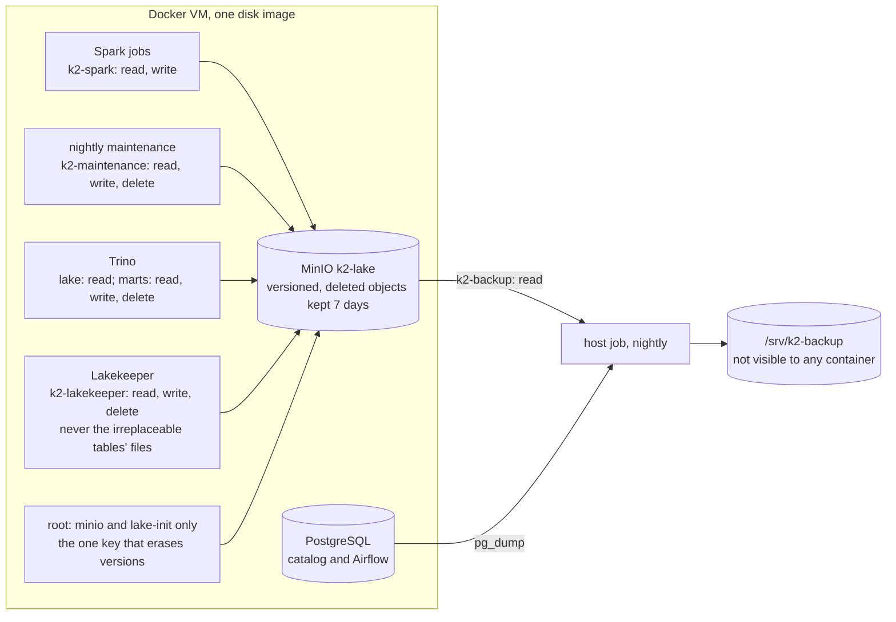

# ADR-052: Scoped keys, recoverable deletes and a nightly copy of the archive

**Status:** Proposed
**Date:** 2026-11-26
**Author:** Platform
**Category:** Security / Storage
**Decided by:** the owner on 2026-11-26, in outline: security and guard fixes come before
phase P4; the raw archive gets a second copy, nightly, in a host directory outside Docker, on
the same disk, which the owner accepts for now; an independent review comes before acceptance.
This ADR is how. It moves to Accepted when the owner accepts it after that review.
**Evidence:** [research note](../research/2026-11-26-storage-credentials-least-privilege.md)
("note §n"); the P0 audit `docs/audits/2026-11-26-p0-prerequisites-guardrails.md` (branch
`docs/audit-p0-phase`) and the P3 audit `docs/audits/2026-11-26-p3-trino-dbt-marts.md` (branch
`docs/audit-p3-phase`, pull request #216), neither merged yet; and the read-only reads listed in
Context.

---

## In plain words

The raw archive of everything the venues sent cannot be rebuilt, exists once, and anything on
this machine can delete it in one step, through a catalog that asks for no password or with a
factory-default master key that every engine holds. We will give each engine its own storage
key that can do only its job, so that only the master key can erase a deleted file for good.
Storage will keep every deleted file for 7 days, and a nightly host job will copy the archive
and the pointers needed to read it outside Docker and check that the copy restores. It costs eight new
secrets, about 8 GiB of kept deleted files and under 1 GiB of copy a day once order-book
capture is paused (far more if not), a few minutes of restarts, and one `sudo` command. Nothing
here protects against the machine's own administrator or a failing disk. The owner must accept
the 7-day window, the order of the steps and the questions at the end.

---

## Context

Terms are explained where they first appear; the [glossary](glossary.md) has each one too.

### What cannot be rebuilt

The lake is four layers ([glossary](glossary.md#raw-bronze-silver-gold)). Bronze, silver and
gold are functions of raw, so losing them costs a rebuild. Four kinds of table are not, and this
ADR calls them the **irreplaceable tables** ([glossary](glossary.md#irreplaceable-tables)):

| Table | Why it cannot be rebuilt | Size, current snapshot |
|---|---|---|
| `lake.raw.messages` | every Kafka record byte for byte, the system of record ([ADR-021](ADR-021-raw-first-archive-and-lineage.md)); the public feeds do not replay, and Redpanda keeps 48 hours ([glossary](glossary.md#raw-retention-and-eviction)) | 13.49 GiB, 4,006 data files |
| `lake.audit.checks` | append-only history of findings, operator rows included (a recorded outage, a deliberate purge) | small |
| `lake.gold.dim_instrument`, `lake.gold.dim_venue` | the [SCD2](glossary.md#scd2-security-master) history has no upstream source; `rebuild.py` leaves them alone (`docker/lake/ddl/lake.sql`, above `dim_instrument`) | small |
| `<domain>.dq.dbt_test_results`, five | append-only dbt test history ([ADR-046](ADR-046-governance-domain-and-quality-results.md)), not a mart | small |

Sizes: Trino, `SELECT sum(file_size_in_bytes), count(*) FROM lake.raw."messages$files"`,
2026-11-26 02:56 UTC.

Each exists once, as objects in the MinIO volume inside the
[Docker VM's](glossary.md#docker-vm-and-its-memory-setting) disk image, with its table pointers
in one PostgreSQL database. The engine's volumes were lost once already, on 2026-08-28.

### How it can be destroyed today, in one step, from this host

Since 2026-11-25 every published port listens on `127.0.0.1` only ([SECURITY.md](../../SECURITY.md)).
That closed the local network. It did not close this host: any process on it, and any container
on the engine (19 run, most of them third-party images), still reaches every service.

| Path | What it takes | Read on 2026-11-26 |
|---|---|---|
| **The catalog.** [Lakekeeper](glossary.md#lakekeeper-and-minio) answers anyone: its authorization backend is `allow-all`, so every caller is an anonymous administrator. Every warehouse has `delete-profile` `hard`, so a dropped table is gone at once, and Lakekeeper then deletes its files ("purges") with its own stored key | one HTTP `DELETE`, no credential | `GET /management/v1/info`: `"authz-backend":"allow-all"`; `GET /management/v1/warehouse?project-id=...`: all six warehouses `{'type': 'hard'}`, `protected: False` |
| **The master key.** MinIO's root credential (the one identity that can do everything, including erase history and change bucket settings) is MinIO's factory-default pair, and the same pair sits in the environment of `minio`, `lake-init`, `spark-iceberg`, `lake-ddl` and `trino` (all six Trino catalogs), and in every warehouse's stored storage credential | the pair, which was reachable from the local network until 2026-11-25 and is printed in MinIO's own startup warning | `docker inspect` compared in-process, booleans only: root user equals root password, true; Trino's and Spark's keys equal root, true |
| **Remote signing.** Spark does not use its own key for table files: Lakekeeper signs each of Spark's S3 requests with its stored root copy ("remote signing", [glossary](glossary.md#storage-credential-and-remote-signing)), for any caller that asks, and MinIO does not check every part of a signed request (note §1) | a call to Lakekeeper's signer, no credential | the warehouse profile reads `remote-signing-enabled: True`; `raw.messages`' table config carries `s3.remote-signing-enabled: true` and a signer URL |
| **The catalog database.** The PostgreSQL superuser, which Lakekeeper connects as, has a password equal to its user name, and every container on `k2-net` can log in with it over the network | the guessable password | in-process, booleans only: `POSTGRES_USER == POSTGRES_PASSWORD` true; Lakekeeper's connection user equals the superuser, true |
| **Code execution beside the keys.** The Spark image's entrypoint (`/opt/spark/entrypoint.sh`) starts a standalone Spark master on 7077, a worker, a Thrift SQL server and a Jupyter server with no token, all as root, in the container that holds the root key and drives every lake write. Any container on `k2-net` can submit code to the master or the notebook | a TCP connection from any container | `docker top k2-spark-iceberg`: `Master --port 7077`, `Worker`, `HiveThriftServer2`, `jupyter-notebook --ip=* --NotebookApp.token= --allow-root` |

The research note covers who holds the MinIO key (note §1) and what each pinned product supports
(note §2). The P0 audit's one BLOCKER is the first two rows together; its fix list asks for a
copy of `raw` outside the engine and soft deletes first, then the scoped keys.

### Forces

- **No identity provider.** Lakekeeper 0.13.9 authenticates only through an OpenID Connect
  provider or Kubernetes service-account tokens, and "does not issue API-Keys or
  Client-Credentials itself" ([Lakekeeper, Authentication](https://docs.lakekeeper.io/docs/latest/authentication/)).
  Without one, its only usable authorization backend is `allow-all`: the other, OpenFGA, decides
  by the authenticated user, and with no authentication there is none. Trino's identity is the
  unchecked `X-Trino-User` header ([ADR-044](ADR-044-producer-lake-and-domain-mart-warehouses.md)).
  So every refusal that has to hold against a deliberate caller has to come from a layer that
  checks a secret: MinIO's keys and PostgreSQL's passwords.
- **One disk, already busy.** The Docker VM's disk had 116.1 GiB free (`k2_lake_disk_free_bytes`
  124,670,066,688, ratio used 0.551, Prometheus, 2026-11-26); the host had 301 GiB free
  (`df -h /`), part of which the VM's disk image can still grow into. On 2026-11-25, a day of
  full capture, the lake's commits added 15.19 GiB of new files and their compactions and
  overwrites removed 11.62 GiB of older ones (Trino, the sum of `added-files-size` and
  `removed-files-size` over every lake table's `$snapshots`, grouped by day and operation).
  Removed files are deleted for real seven days later, by
  [snapshot expiry](glossary.md#snapshot-expiry-and-the-retention-floor). Keeping deleted files
  costs that rate times the days kept.
- **Order-book capture is being paused** ([ADR-050](https://github.com/rjdscott/k2-market-data-platform/pull/223),
  Proposed, decided by the owner). Raw topics were 90.9% of the archive's bytes on 2026-11-25,
  mostly book frames, and book tables take 10.3 times the lake space of trade tables (ADR-050's
  table). With it paused, both rates above fall by roughly 90%, an estimate from those shares.
- **Memory is short on the host** ([operations, read this first](../operations/README.md#read-this-first-the-state-of-this-host)),
  so nothing here may add a long-running heavy service.
- **Proportionate.** A single-host research stack with one maintainer: no vault, no mutual TLS,
  no identity provider. A local user with Docker access is root on this machine, and nothing
  here pretends otherwise.

---

## Decision

**We will make destroying the lake's irreplaceable tables recoverable by mechanism: each engine
gets a MinIO key scoped to its job and no key but root can erase an object version, the lake
bucket keeps every deleted object for 7 days, Lakekeeper soft-deletes producer-lake tables and
its own key cannot delete the irreplaceable tables' files, and a host job copies those tables
outside the Docker engine every night and checks the copy is restorable, because the catalog
cannot authenticate anyone without an identity provider, and storage is the one layer whose
refusal does not depend on who claims to be asking.** Scope: this single host, until a second
person or machine has access to it or the platform moves to AWS (the revisit triggers).

Parts 1 to 5 each say what exists, what changes, how it is proven from the attacker's side,
and how it is rolled back; part 6 is what stays open, part 7 the order on the live stack, part 8
what ADR-044's Outcome will record.

### 1. Storage keys: one MinIO user per job

**What exists.** One credential, root, held by every engine (Context). Warehouse locations are
`s3://k2-lake/warehouse/<warehouse>/<table uuid>/`, one prefix per warehouse (note §3).

**What changes.** MinIO lets root create **users**, each with a **policy**: a JSON list of S3
actions it may take on named bucket paths, everything else refused ([glossary](glossary.md#minio-users-policies-and-the-root-credential)).
The research note probed the shapes used here against the pinned MinIO (note §2). The permission
table, which corrects the research note's in two places (a separate maintenance key; the
backup key) and keeps its one-key-for-all-marts staging:

| Identity (access key) | Held by | Can read | Can write | Can delete (leaves a delete marker) | Can erase a version |
|---|---|---|---|---|---|
| root | `minio`, `lake-init`; the owner's admin runbooks | everything | everything | everything | **yes, the only one** |
| `k2-lakekeeper` | every warehouse's stored storage credential | `warehouse/*` | `warehouse/*` (Lakekeeper writes each table's `metadata.json` itself) | `warehouse/*` **except the irreplaceable tables' prefixes**: validation probes, and purges after a drop | no |
| `k2-spark` | `spark-iceberg`, `lake-ddl`: ingest, decode, DDL, rebuild | `warehouse/k2/*` | `warehouse/k2/*` | **nothing** | no |
| `k2-maintenance` | `airflow-scheduler`'s environment, passed into `spark-iceberg` for the nightly maintenance run only | `warehouse/k2/*` | `warehouse/k2/*` (compaction output) | `warehouse/k2/*` (expiry, orphan removal) | no |
| `k2-trino-lake` | `trino`, catalog `lake` | `warehouse/k2/*` | **nothing**: ADR-044's read-only `lake` now enforced by storage too | nothing | no |
| `k2-trino-marts` | `trino`, the five domain catalogs | the five domain prefixes from `docker/lake/generated/warehouses.txt` | same | same (Trino's own snapshot expiry and orphan removal of marts) | no |
| `k2-reader` | notebooks, parity and replay scripts, the ClickHouse rebuild runbook, `make screenshots` | `warehouse/k2/*` | nothing | nothing | no |
| `k2-backup` | the host job only | `warehouse/*` | one object, `k2-ops/backup/status.json` | nothing | no |
| `lake-metrics` | (no key) | the status object above, anonymously; Lakekeeper's REST API | nothing | nothing | no |

"Delete" here means a plain S3 `DeleteObject`, which in a versioned bucket only hides the object
behind a **delete marker** (part 3). Erasing a version is `DeleteObjectVersion`, a separate
permission no policy above grants. Changing versioning, lifecycle rules or bucket policies is
likewise granted to no one but root.

**Why maintenance gets its own key.** Compaction never deletes: it writes new files and commits
a snapshot that no longer lists the old ones. Files are deleted only by snapshot expiry and
orphan removal ([glossary](glossary.md#orphan-files)), both in `docker/lake/maintenance.py`, once
a night, under the [writer lock](glossary.md#writer-lock-and-exit-75). The ingest path deletes
nothing in normal operation: its data files are new and uniquely named, its copy-on-write
rewrites leave the old files to expiry ([glossary](glossary.md#copy-on-write-merge)), and each
`metadata.json` is written by Lakekeeper, not by Spark. Its only deletes are clean-ups after a
failed write, and a denied clean-up leaves orphans that maintenance removes. So the key the
always-on Spark container holds can be denied every delete. The maintenance key is passed into
the container per run with
`docker exec --env K2_S3_MAINTENANCE_SECRET` (the variable's name only, so the value comes from
the scheduler's environment and never appears on a command line or in a task log), so
`docker inspect k2-spark-iceberg` does not show it. A process that persists inside the
container through the nightly run can still read it; part 3 is what makes such a delete
recoverable anyway. The scheduler already holds the Docker socket, so carrying the key adds
nothing to what it can do.

**Why one key for all five domain catalogs, not one each.** The research note staged this, and
it stands: one Trino process loads every catalog file and every key in them, and identity is an
unchecked header, so a key per domain separates nothing a person can reach. A misconfigured
catalog cannot write into another warehouse either: Lakekeeper refuses a table location outside
the catalog's warehouse (ADR-044, measured). Per-domain keys come with Trino authentication in
the entitlements phase, P5 ([plan labels](glossary.md#p0-to-p7)), and k2gen would generate them
this way: a line per domain in a generated users file beside `warehouses.txt`, which `lake-init`
turns into users and policies; `s3.aws-access-key=k2-trino-<domain>` and
`s3.aws-secret-key=${ENV:K2_S3_TRINO_<DOMAIN>_SECRET}` in each generated catalog; and, because
`docker-compose.yml` is not generated, a [`make test-k2gen`](glossary.md#k2gen-make-generate-and-the-drift-gate)
check that fails until the `trino` service's `environment:` and `.env.example` name every
generated variable, the pattern `contracts/` already uses for partitioning. Today the same
generator writes the shared marts key into `_CATALOG_REST` in
`platform/k2gen/k2gen/generate.py`, and `lake-init` builds that key's policy from
`warehouses.txt`, so a new domain is covered on the next `lake-init` run.

**Remote signing off, on every warehouse.** While Lakekeeper signs Spark's requests, Spark's own
key is never used and scoping it changes nothing (note §1). Each warehouse's storage profile
gets `remote-signing-enabled: false` through `POST /management/v1/warehouse/{id}/storage`, the
one call that changes the profile; it must carry the credential too, because "the existing
credential is not re-used" (Lakekeeper 0.13.9's own OpenAPI, `UpdateWarehouseStorageRequest`).
With signing and STS (temporary keys Lakekeeper would hand out, `sts-enabled` false here) both
off, the table config carries no signer and Iceberg's S3 client uses the static key Spark
configures, as Trino already does: the research note found no Lakekeeper `read_data` or
`write_data` authorization on any domain warehouse during a dbt run (note §1).

**Where keys are generated and stored, so a fresh clone is still one command.** Access keys are
fixed names in `docker-compose.yml` (they are not secrets). Each secret is one `.env` line:
`K2_S3_LAKEKEEPER_SECRET`, `K2_S3_SPARK_SECRET`, `K2_S3_MAINTENANCE_SECRET`,
`K2_S3_TRINO_LAKE_SECRET`, `K2_S3_TRINO_MARTS_SECRET`, `K2_S3_READER_SECRET`,
`K2_S3_BACKUP_SECRET`, plus `LAKEKEEPER_DB_PASSWORD` (part 5). They are pre-generated, never by a
container, because compose reads `environment:` before any one-shot runs (note §3). `make env`
writes `.env` from `.env.example`, replacing every placeholder with a random value, and refuses
to overwrite an existing `.env`; `make up` runs it when `.env` is missing. A fresh clone is then
`make up`. On every `up`, the `lake-init` one-shot converges MinIO and Lakekeeper to `.env`:
creates or replaces each policy and user (both idempotent, probed, note §2), then posts each
warehouse's credential. Rotation of one key is an edit of its line, `docker compose up -d
--no-deps lake-init`, and a recreate of its holder.

**Open questions of the research note, resolved as far as read-only inspection allows:**

| Question | Answer | Source |
|---|---|---|
| Does Spark work with signing off and its own key? | Expected yes: Iceberg 1.8.1's S3 client follows a signer only when the table config names one, and Trino works this way today. Not run: rehearsal line R3 | read (note §2), the live table config |
| What does Lakekeeper 0.13.9 check when a warehouse's credential changes? | `POST .../storage-credential` "updates only the storage credential", and a body without one removes it. That it validates the new key (write, read back, delete a probe) is stated only in Lakekeeper's current docs: rehearsal line R2 | the live OpenAPI at `/api-docs/management/v1/openapi.json` |
| Where are keys generated, and is a fresh clone still one command? | `.env`, by `make env`; converged by `lake-init`; yes | above |
| How does k2gen generate per-domain keys? | Designed above, deferred to P5 | above |

**Attacker-side proof.** For each key, a delete of a key name that does not exist answers 204
when the policy allows it and 403 when it does not, which tests a policy on the live bucket
without touching an object. The matrix (every key against every prefix, for get, put, delete
and version erase) is printed by a script and must match the table above; a put probe uses a
`_probe/` key name and is removed by root after. Lakekeeper refuses, on `storage-credential`,
a key that cannot write. With signing off, `raw.messages`' table config has no
`s3.remote-signing-enabled`, and Lakekeeper's log shows no `read_data` or `write_data`
authorization during an ingest. The old root pair is refused after rotation
(`InvalidAccessKeyId`), and `docker inspect` of every container finds root only in `minio` and
`lake-init`.

**Rollback.** Each warehouse's credential back to root (valid until root rotates), signing back
on with the same `POST .../storage`, the previous compose environment, recreate. After root
rotation the old pair is compromised: put it back only to restore service.

### 2. Catalog deletes: soft deletion, protection, and what allow-all leaves open

**What exists.** Hard deletes on all six warehouses, nothing protected, `allow-all`.

**What Lakekeeper 0.13.9 offers** (its management OpenAPI, read by GET, and its
[Concepts](https://docs.lakekeeper.io/docs/latest/concepts/) page, current version):

- **Soft deletion** ([glossary](glossary.md#soft-deletion-undrop-protection-and-force)): a
  warehouse's `delete-profile` becomes `{"type": "soft",
  "expiration-seconds": N}` (`POST /management/v1/warehouse/{id}/delete-profile`). A dropped
  table is then "marked as deleted and scheduled for cleanup", listed by
  `GET .../deleted-tabulars` with its `deleted-at` and `expiration-date`, and brought back by
  `POST .../deleted-tabulars/undrop` with its id. "The expiration delay is fixed at the time of
  dropping", so changing the profile affects only later drops. When the delay ends, a
  `tabular_expiration` task removes it for good and a `tabular_purge` task deletes its files.
  The setting applies to existing warehouses directly; nothing is migrated.
- **Protection**: `POST .../table/{id}/protection`, `.../namespace/{id}/protection` and
  `.../warehouse/{id}/protection` with `{"protected": true}` make a delete fail "unless `force`
  is used".
- **Force bypasses both.** A recursive namespace drop "needs `force`" in a soft-delete
  warehouse, and then "every table, view and namespace will be gone as soon as this call
  returns" (0.13.9's OpenAPI); the current docs add that a table drop with `force=true`
  "deletes ... at once, also in warehouses with soft deletion", gated by a permission which
  `allow-all` grants to everyone. And `POST .../task/control` with `run-now` runs a pending
  expiration at once.

So without authentication, soft deletion and protection stop mistakes (an engine's `DROP TABLE`,
a dbt bug, a wrong command typed by hand), not a deliberate caller. Lakekeeper's authorization
cannot be anything but `allow-all` without an identity provider (Context). **What compensates
is part 3**: whatever the catalog does, the key it purges with, `k2-lakekeeper`, cannot delete
the irreplaceable tables' files, and every other file it deletes is kept by versioning for 7
days.

**What changes.**

- Warehouse `k2`: `delete-profile` soft, `expiration-seconds` 604800 (7 days). The five domain
  warehouses stay hard: `dbt_marts` replaces every mart hourly, which would park a copy of each
  mart for 7 days, and every mart is rebuilt from the lake anyway.
- Protected: warehouse `k2`; namespaces `raw` and `audit`; the four irreplaceable lake tables;
  each `<domain>.dq.dbt_test_results`. Nothing in K2 drops any of them in normal operation
  (`rebuild.py` drops only derived layers and leaves the dimensions alone).
- **A trap, avoided on purpose.** Every warehouse's profile already reads
  `push-s3-delete-disabled: True`, which "has no effect if Soft-Deletion is disabled". Once soft
  deletion is on, it sends `s3.delete-enabled=false` to clients, and that "affects other Spark
  operations that require file deletion, such as removing snapshots" (0.13.9's OpenAPI): the
  nightly expiry and orphan removal would report success and delete nothing, and the disk would
  fill. So `push-s3-delete-disabled` goes to `false` in the same `POST .../storage` call, before
  soft deletion is turned on. Spark's own `DROP TABLE ... PURGE` path, which that flag exists to
  stop, is already harmless here: `rebuild.py` records that Spark's second load fails after
  Lakekeeper has dropped the table, and `k2-spark` cannot delete in any case.
- **Choosing 7 days.** It equals the snapshot-retention floor, so the lake's own time-travel
  window and the delete-recovery window are one number. It covers an owner away for a week, with
  alerts unrouted (ADR-028 section 10: no Alertmanager). And it is what the disk affords (part 3).
  A `rebuild.py` drop of a derived layer now keeps the old layer for 7 days, and its files 7 more
  as deleted objects; the runbook says how to purge early (`run-now` on its expiration task).

**What a dropped table looks like, and how it comes back.** Under soft deletion it disappears
from every engine's listings and appears in `deleted-tabulars`; `undrop` restores it with the
same id and metadata. Lakekeeper adds: "Until then, its metadata file cannot be registered
again; restore the table instead." After a hard or forced drop, the table is brought back by
**registering** it: `POST /catalog/v1/{prefix}/namespaces/{ns}/register` with its name and the
location of its newest `metadata.json`, which re-creates the catalog pointer to the same files
and history ([glossary](glossary.md#registering-a-table-and-the-metadata-chain)). For an
irreplaceable table those files are still there, because Lakekeeper's purge was refused.

**Attacker-side proof**, on a scratch table in `k2`, never on an irreplaceable one: protected,
a drop without `force` is refused; unprotected, a drop puts it in `deleted-tabulars` and
`undrop` brings it back; with `force`, it goes at once. That a forced drop of a table whose
prefix is denied leaves its files current is shown on the rehearsal stack (R5), never on a live
irreplaceable table. One nightly maintenance run then shows that expiry still deletes: a file it
reports deleted is a noncurrent version afterwards (part 3).

**Rollback.** `delete-profile` back to hard, protection off (each a POST); soft-deleted tables
keep their own expiration dates.

### 3. Deletion at the storage layer: who may delete, and keeping what is deleted

**Which identity can delete raw's files after part 1.** Only `k2-maintenance` (nightly, through
expiry and orphan removal, which remove only files no kept snapshot references, so never a row
of the current snapshot) and root. `k2-lakekeeper` gets an explicit `Deny` on `s3:DeleteObject`
for each irreplaceable table's prefix, `warehouse/<warehouse>/<table uuid>/*`, which `lake-init`
reads from the catalog (each table's `location` in `GET /catalog/v1/{prefix}/namespaces/{ns}/tables/{t}`;
for `raw.messages` it is `s3://k2-lake/warehouse/k2/01a04789-be39-7953-95cb-8266b73e35ec`). A
table that does not exist yet, such as a domain's results table before its first dbt run, is
covered on the next `lake-init` run. Lakekeeper never deletes inside a live table's prefix in
normal operation: the table property that would make it delete old `metadata.json` files after
each commit, `write.metadata.delete-after-commit.enabled`, is off by default and no K2 table
sets it (`git grep` over `docker/lake`, `dbt` and `platform`), so it deletes there only to purge
a dropped table.

**Bucket versioning.** With versioning on, MinIO keeps every version of every object: a
`DeleteObject` adds a delete marker and the data becomes a **noncurrent version**, still on disk
and restorable; a `PutObject` over an existing name keeps the old one the same way
([glossary](glossary.md#bucket-versioning-delete-markers-and-noncurrent-versions)). Only
`DeleteObjectVersion` erases one, and only root has it. A **lifecycle rule** run by MinIO itself
erases noncurrent versions 7 days after they become noncurrent, and removes delete markers left
with nothing behind them (`mc ilm rule add --noncurrent-expire-days 7 --expire-delete-marker
k2/k2-lake`). Iceberg never overwrites a file, so versioning costs only what is deleted: about
**81 GiB** at full capture (11.62 GiB removed a day, Context, times 7), 70% of the VM's free
disk and enough to fire `LakeDiskUsageHigh` at 0.80; about **8 GiB** with order-book capture
paused (the estimate in Context). So versioning at 7 days needs ADR-050's pause in effect. If it
is not, the lifecycle rule starts at 2 days (about 23 GiB) until it is.

**Why not object lock.** Object lock (WORM, "write once, read many") forbids erasing a version
until a retain-until date, in one of two modes ([glossary](glossary.md#object-lock)). A
compacted table rewrites every recent byte every night and must eventually delete the files it
replaced, so a lock of R days would hold R days of every superseded file, the same cost as
versioning, with no way to free it early. In compliance mode not even root can shorten it, so a
mistaken retention on a single disk with 116 GiB free is a disk-full outage nobody can undo; in
governance mode root can bypass it, and against every other key it adds nothing that versioning
plus a withheld `DeleteObjectVersion` does not already give. Object lock fits a landing zone that
is never compacted, which is where the P4 plan puts it ([glossary](glossary.md#landing-zone)).

**The combination, and what it recovers.** For every one-step event reachable from this host
without root:

| Event | What keeps the data | Recovery | For how long |
|---|---|---|---|
| `DROP TABLE` of an irreplaceable table, any engine or a REST call, no `force` | protection refuses it | nothing to do | always |
| a drop of an irreplaceable table with `force`, a recursive namespace drop, an expiration run early, a warehouse delete | the catalog row goes; Lakekeeper's purge is refused by storage, so every file stays current | register the newest `metadata.json`: no history lost | indefinitely for the files; no record lost if done before Redpanda evicts what the stopped ingest did not read (48 hours, sooner if a partition's 2 GiB cap binds) |
| a drop of a derived table | soft deletion (in `k2`), then versioning | `undrop`, or a rebuild from raw | 7 days, then 7 more |
| a file deleted with `k2-maintenance` or `k2-trino-marts` | a delete marker; the version is kept | root removes the marker (`mc undo`) | 7 days |
| a file overwritten with any write key | the previous version is kept | root restores it | 7 days |
| an unauthenticated commit that rolls a table back or removes snapshots (no file is deleted by the commit itself) | the files stay until orphan removal, then 7 days as noncurrent; the host copy | point the table back, or register an earlier `metadata.json`; the host job's check that records never decrease (part 4) finds it within a day | 1 day plus 7, then the copy |
| the catalog database dropped (part 5 makes this need a strong password) | the nightly `pg_dump` | `pg_restore`, then re-read from Redpanda what the pointers lost | dumps kept 30 days |
| the root key used, the MinIO volume or the VM disk image lost | the host copy | upload, register, rebuild the derived layers | the copy is kept; it is at most 26 hours old |
| the physical disk fails, or the machine is stolen, or the owner's account is used | nothing | lost | the owner's accepted risk (part 6) |

**Attacker-side proof.** With `k2-maintenance`, delete a scratch object: `mc ls --versions`
shows the marker and the noncurrent version, and root's `mc undo` restores it; the same key's
`mc rm --version-id` answers 403. With `k2-lakekeeper`, a delete of a nonexistent key under
raw's prefix answers 403, and under a derived table's prefix 204. `mc version info k2/k2-lake`
reads enabled and `mc ilm rule ls k2/k2-lake` shows the rule.

**Rollback.** Suspending versioning keeps the versions already made; the lifecycle rule then
erases them in 7 days. Remove the `Deny` statement by re-running `lake-init` on the previous
commit.

### 4. The second copy: files, metadata chain and catalog, outside the engine

**What is copied.** For each irreplaceable table, the table as Iceberg stores it, not an
export: its current `metadata.json`, the manifest list of every snapshot that metadata lists,
every manifest those name, every other file the metadata names (statistics files, if any), and
the data files of the current snapshot ([glossary](glossary.md#registering-a-table-and-the-metadata-chain)).
Files of older snapshots that compaction replaced are not copied, which is what keeps the copy
near the table's own size; the whole chain of manifests is, so a restored table can be expired,
compacted and appended to like any other. Iceberg files are immutable and uniquely named, so the
copy is **incremental by snapshot**: each night it fetches only names it does not hold. Plus a
`pg_dump` of the `lakekeeper` and `airflow` databases.

**Consistency.** The job first reads each table's `metadata-location` from Lakekeeper, then
copies what that metadata names. Every file a committed metadata names existed before that
commit, and expiry never deletes a file the current snapshot references, so the set is
complete unless a file is missing from MinIO. A maintenance run that overruns into the copy can
expire an old snapshot between the read and the copy, so on a missing object the job re-reads
the metadata once and starts that table again; a file still missing is a failure. The result is
a **restore point** ([glossary](glossary.md#host-copy-and-restore-point)): one JSON file per
table per night naming the `metadata.json`, the snapshot id, its commit time, the snapshot
summary's `total-data-files`, `total-files-size` and `total-records`, and every object with its
size and SHA-256. A restore recovers to a snapshot, not to a wall-clock moment, which is the
rule [chapter 17](../architecture/17-scale-out-path.md#72-the-rest-of-the-tiers) sets for the
AWS design too.

**How.** `scripts/backup/k2_backup.py`, run on the host as the owner's user by
`uv run --no-project --with boto3==<pinned at implementation> --with fastavro==1.12.2 python3 -I`,
reading MinIO at `127.0.0.1:9000` with `k2-backup` (read only) and Lakekeeper at
`127.0.0.1:18181`. It writes:

- `/srv/k2-backup/objects/k2-lake/<object key>`: each object once, written to a temporary name
  and renamed, mode 0444. A name already held with a different size stops the run: an
  Iceberg file never changes, so that is tampering or a bug, never an update.
- `/srv/k2-backup/restore-points/<UTC date>/<table>.json`.
- `/srv/k2-backup/catalog/<UTC date>/{lakekeeper,airflow}.dump`:
  `docker exec k2-prefect-db pg_dump -Fc`, streamed to the host, so the dump's client version
  matches the server and no database password is needed (inside its own container the database
  trusts local connections, `pg_hba.conf` read 2026-11-26). Kept 30 days; deleting old dumps is
  the only deletion the job does.

It never runs code from the stack, and it treats what it reads as hostile: every object key from
a manifest must start with `s3://k2-lake/warehouse/`, contain no `..` and resolve inside the copy
root, or the run stops, because an unauthenticated commit can write any path into a manifest.
It refuses to start if any running container mounts a path under the copy root (`docker
inspect` of every container's mounts).

**Where, and why there.** `/srv/k2-backup`, created once by the owner with
`sudo install -d -m 0700 -o "$USER" -g "$USER" /srv/k2-backup`. Not a bind mount, and outside
the owner's home directory, which is what Docker Desktop shares with its VM by default: a path
the VM cannot see cannot be mounted by any container, whoever starts it, without a change to
Docker Desktop's settings on the host. Proof: `docker run --rm -v /srv/k2-backup:/x alpine ls /x`
is refused. The job's code lives in `scripts/backup/` of the checkout, which no container mounts;
part 5 makes `spark-iceberg`'s one writable mount of the checkout read-only.

**Schedule.** A systemd user timer, `k2-backup.timer`: `OnCalendar=*-*-* 04:30:00 UTC`,
`Persistent=true` (a run missed while the machine was off runs at the next start), with the
service `Nice=10` and `IOSchedulingClass=idle`. 04:30 UTC is after the 03:00 UTC maintenance
(23.6 minutes on 2026-11-25), so the night's compaction output is copied in place of the small
files it replaced, and it falls in the owner's working afternoon. The owner must: create
`/srv/k2-backup` (the one `sudo`); copy the two unit files from `scripts/backup/systemd/` to
`~/.config/systemd/user/` with the checkout's path; run `systemctl --user daemon-reload` and
`systemctl --user enable --now k2-backup.timer`. Lingering, which runs user timers without a
login session, is already on for this user (`loginctl show-user`: `Linger=yes`). Nothing to
install: `uv`, `python3` and the Docker CLI are on the host.

**Retention and disk arithmetic.** The copy is append-only and kept: the archive is kept
forever ([ADR-028](ADR-028-non-goals-and-honest-limits.md) section 12), so its copy is too.

| | Full capture, 2026-11-25 | Order-book capture paused (ADR-050) |
|---|---|---|
| First copy | 13.5 GiB | 13.5 GiB |
| Raw added per day | 6.87 GiB (Trino, `lake.raw."messages$partitions"`, that day; it includes a 343 s outage) | about 0.7 GiB (estimate) |
| Copy growth per day, at about 1.2 times raw for files copied between their first and second compaction (estimate) | about 8.2 GiB | about 0.85 GiB |
| Room on the host: 301 GiB free less the 116 GiB the VM image can still claim | about 185 GiB | about 185 GiB |
| Days until the copy reaches 100 GiB, the prune trigger | about 11 | about 100 |
| Catalog dumps, 30 kept | unmeasured; expected in megabytes | same |

So without the pause the copy needs a prune within two weeks. With it, the prune (keep the
restore points of the last 30 nights and every object they name; erase the rest) is built before
the copy reaches 100 GiB or host free space falls under 150 GiB, and before order-book capture
resumes, whichever is first.

**Verification, nightly, per table.** Every object in the restore point is present with its
size; the data files' count and bytes equal the snapshot summary's `total-data-files` and
`total-files-size`; `total-records` is not below the previous night's, because every
irreplaceable table only grows; the snapshot's commit time is at most 26 hours old (24 plus a
late run). A run that fails any of them writes no new restore point and says why. `--deep`
re-hashes every object against its recorded SHA-256 and is run in the restore drill.

**How the result reaches Prometheus**, given that no container can see the host directory. The
job puts `status.json` into a separate bucket, `k2-ops/backup/status.json`, which only `k2-backup`
may write and anyone may read without a key (an anonymous `GetObject` policy on that one prefix,
in a bucket that holds nothing else, so `k2-lake` keeps no anonymous access at all). The
`lake-metrics` exporter, which already polls over plain HTTP, GETs it each cycle and exports
`k2_backup_snapshot_timestamp_seconds{table}` (the newest verified restore point's commit
time), `k2_backup_verified{table}` and `k2_backup_catalog_dump_timestamp_seconds{database}`. Two
alerts in `lake-alerts.yml`, each with a runbook and a `promtool` test, age timestamps rather than
read a flag, so a job that stops running fires as surely as one that fails:
`LakeBackupStale` (`time() - k2_backup_snapshot_timestamp_seconds > 93600`, or absent, for 30
minutes) and `LakeBackupFailed` (`k2_backup_verified == 0`), with the dump age in the first.
Two alternatives lost: a text file in a read-only bind mount, because a directory mount on this
Docker Desktop serves the old file after a write-then-rename save for as long as any container
holds it ([`docker/README.md`](../../docker/README.md), "A bind-mounted script runs its old
contents"); and a push to a loopback statsd or Pushgateway port, because any container on
`k2-net` could then report a backup that never ran.

**Restore, designed before the copy.** A restore needs the data files, the metadata chain and a
catalog pointer, at the same bucket name and keys, because every path inside Iceberg metadata
is absolute ([chapter 17](../architecture/17-scale-out-path.md#71-the-problem-is-icebergs-paths-not-s3s-replication)).

1. Choose a restore point (the newest verified one, unless the damage is older).
2. `k2_backup.py restore` uploads each object it names into `k2-lake` at its own key, as root,
   skipping objects already present with the same size.
3. If the catalog still lists the table at a broken pointer, drop it (`force`); create the
   namespace if it is gone; register the table with the restore point's `metadata.json`. Do
   this before any `docker compose up`: `lake-ddl` runs on every `up` and would create an empty
   table of the same name, which the ingest would then fill from Redpanda's oldest record; if it
   already has, drop that empty table first.
4. Verify: row count equals `total-records`; per Kafka topic and partition, the count and the
   first and last offset; the snapshot's `k2.kafka-offsets` equals the restore point's.
5. Resume: the ingest reads the restored snapshot's `k2.kafka-offsets` and re-reads from
   Redpanda what it still holds ([exactly-once](glossary.md#exactly-once-via-snapshot-offsets));
   what Redpanda has evicted since is recorded as `offset_gap` rows by the documented
   `--accept-data-loss` path. The derived layers recorded raw snapshot ids the restored table
   may not have, so rebuild them (`make lake-rebuild LAYER=bronze`, then silver, gold, books).
6. The catalog database: `pg_restore --no-owner --role=lakekeeper` into an empty `lakekeeper`
   database. It needs PostgreSQL 15 or newer, Lakekeeper 0.13.9 (a newer one runs `migrate`
   forward), the same `LAKEKEEPER_ENCRYPTION_KEY` (it decrypts the stored storage credentials;
   without it, post each warehouse's credential again), and the objects its pointers name.
   Every table then points at its metadata as of the dump, at most a day old, and step 5
   applies to each.

**The restore drill**, run before the implementation is called done, on the rehearsal stack of
part 7, never on the live catalog (a second warehouse over `warehouse/k2` would overlap the
live one, and Lakekeeper refuses that). From the first full copy: restore `raw.messages` into
the rehearsal's bucket `k2-lake` under a warehouse with key prefix `warehouse/k2`; compare, per
topic and partition, count, first and last offset and Trino's order-insensitive `checksum()` of
the payload, rehearsal against live `FOR VERSION AS OF <restore point's snapshot id>`: the
difference must be empty; read the restored `k2.kafka-offsets` with `offsets.latest_summary`
from a rehearsal Spark: it must equal the restore point's. Then `pg_restore` the night's
`lakekeeper` dump into the rehearsal PostgreSQL and start a rehearsal Lakekeeper on it: it must
list the six warehouses and return the dump's `metadata-location` for `raw.messages`. Time each
step; the runbook carries the output and the measured restore time.

**Rollback.** Disable the timer; remove the `k2-backup` user and the `k2-ops` bucket with root.
The copy itself is left in place.

### 5. Other secrets, and the code that runs beside the keys

**`scripts/check-env.py`** today refuses only placeholders, empty values and a MinIO user equal to
its password, and only when started through `make up` or `make dev-up` (the P0 audit's HIGH).
It will refuse, for every credential the compose file takes:

- a password equal, ignoring case, to its user: each `*_PASSWORD` or `*_SECRET` is paired with
  its user, a variable (`MINIO_ROOT_USER`, `PREFECT_DB_USER`) or the fixed name compose uses
  (`default` for ClickHouse, `quant`, `admin` for Grafana, `airflow`, `lakekeeper`, each
  `k2-*` access key);
- a value shorter than 16 characters (32 for `AIRFLOW_JWT_SECRET`, `AIRFLOW_API_SECRET_KEY` and
  `LAKEKEEPER_ENCRYPTION_KEY`);
- a known default, ignoring case: MinIO's factory pair, `postgres`, `prefect`, `airflow`,
  `admin`, `password`, `changeme`, `secret`, the placeholder, and the user names above, for the
  password and, for MinIO, for the root user too.

A test reads every `${NAME}` in `docker-compose.yml` whose name ends in `PASSWORD`, `SECRET` or
`KEY` and fails if `check-env.py` has no rule for it, so a new credential cannot arrive
unchecked. And because a bare `docker compose up` skips `check-env.py`, the one-shots that set a
credential refuse a weak one themselves: `lake-init` holds the MinIO root pair and every S3
secret it sets, and `db-init` (below) holds the PostgreSQL superuser and the role passwords it
sets. Each fails closed, which holds back what depends on it.

**PostgreSQL.** One server, `prefect-db`, holds the `lakekeeper` and `airflow` databases.
Lakekeeper connects as the cluster superuser, whose password equals its user name (Context).
Airflow already has its own role and uses the superuser only in its one-shot `airflow-migrate`.

- Lakekeeper gets its own role, `lakekeeper`: login, not superuser, no role or database
  creation, owner of database `lakekeeper` and of every object in it, password
  `LAKEKEEPER_DB_PASSWORD`. A new one-shot `db-init` on the `postgres:15-alpine` image the server
  already uses (no new pull; 0.25 CPU and 128 MiB at the [bootstrap peak](glossary.md#bootstrap-peak),
  inside the 3.70 CPU / 10.19 GiB headroom, recorded in ADR-010's Outcome and the compose
  footer as `CLAUDE.md` requires) creates it idempotently and transfers ownership. It does not
  use `REASSIGN OWNED`, which would also hand over every database the superuser owns.
  `lakekeeper-migrate` and `lakekeeper` then connect as `lakekeeper`. Whether `lakekeeper
  migrate` needs an extension a non-superuser cannot create is rehearsal line R6; if so,
  `db-init` creates it first, as superuser.
- **Rotating the superuser**, in one paused window once `db-init` is merged, all DAGs paused
  and idle, in this order: write the new value into `.env` (`PREFECT_DB_PASSWORD`, by `make env`'s generator); set it with
  `ALTER ROLE ... PASSWORD` sent on standard input to
  `docker exec -i k2-prefect-db psql -U "$PREFECT_DB_USER" -d postgres`, which works without
  the old password because the container trusts its own local connections, and keeps the value
  off every command line (`log_statement` is unset, so the default `none`, and the statement is
  not logged); then `docker compose up -d --no-deps db-init`, recreate `lakekeeper-migrate` and
  `lakekeeper` with the `lakekeeper` role (catalog unavailable for about 15 to 30 s), and recreate
  `prefect-db` itself (about 15 s; Lakekeeper and Airflow reconnect), so its environment no
  longer carries the old value. Between `ALTER ROLE` and Lakekeeper's recreate, any new
  connection Lakekeeper opens as the superuser fails; existing ones stay, and the gap is the
  minute or two the next commands take. Attacker-side: from the host, the old password is refused
  (`password authentication failed`); as `lakekeeper`, `COPY ... FROM PROGRAM` is refused
  (`permission denied`), and `rolsuper` is false. Rollback: `ALTER ROLE` back and the old `.env`
  line, only to restore service. The legacy Prefect services, stopped behind
  `--profile legacy`, still log in as the superuser; they read the new value from `.env`.

**The Spark container.** Nothing in K2 uses the image's master, worker, Thrift server or
Jupyter: every lake job runs as a local driver (no `CoarseGrainedExecutorBackend` process during
an ingest, `docker top`; the [operations guide](../operations/README.md#4-consoles-and-endpoints)
calls the master "mostly empty by design"), the only references to the Thrift server and
Jupyter are the idle-process filter in the operations guide, and K2's notebooks run on the host
with `make notebooks` on port 8889. Overriding `command:` alone is not enough, because the
image's entrypoint starts the master, worker and Thrift server before it reads its argument.
`spark-iceberg` gets `entrypoint: ["bash", "-c", "/opt/spark/sbin/start-history-server.sh &&
exec sleep infinity"]` with `init: true`, so a small init process reaps what `docker exec`
leaves behind. The History Server stays, because `docker/lake/spark_conf.py` reads it to find
failed stages; it is a read-only view of past jobs, and Spark redacts properties matching
`secret` from it (rehearsal line R9 reads its environment page). Host port 18080 then serves
the History Server instead of the empty master UI. `./docker/lake` becomes a read-only mount, so
code in the container cannot rewrite the scripts that later run with the maintenance key; the
writer lock is in `/tmp`, and `lake-ddl` already mounts the directory read-only. Attacker-side:
from a throwaway container on `k2-net`, TCP to `spark-iceberg` on 7077, 8888 and 10000 is
refused, and `docker top` lists the History Server alone. Rollback: the previous compose block.
The idle baseline, 633 MiB with all five daemons (`docker/lake/spark_conf.py`), should fall; by
how much is measured, not claimed.

### 6. What stays open, as stated non-goals

None of this makes the stack secure. Each limit below stays a non-goal under
[ADR-028](ADR-028-non-goals-and-honest-limits.md) section 8, whose trigger (a second person, a
port off localhost) is unchanged:

- **A local user with Docker access is root on this machine.** Whoever can reach the Docker
  socket (the owner's account, the Airflow scheduler, cAdvisor) can read every secret with
  `docker inspect`, run any container, and mount anything, so they can destroy the lake and the
  copy alike. Nothing here defends against the machine's own administrator, or against a
  program running as the owner. The goal is narrower and it is met: no single unauthenticated
  call and no leaked key other than root destroys an irreplaceable table, and every destruction
  reachable without root is recoverable for at least 7 days by mechanism, and from a copy at
  most 26 hours old after that.
- Lakekeeper authorizes everyone; Trino's identity is an unauthenticated header, so its rules,
  like Lakekeeper's protection, stop mistakes, not a person.
- No TLS anywhere.
- Secrets in plain text in `.env` and in each container's environment.
- The copy shares the disk with the lake: a disk failure, a theft or a lost machine loses both.
  The owner accepted that on 2026-11-26; the revisit triggers give it a date.
- Root: whoever holds it can erase versions, lifecycle rules and buckets. It lives in `.env`,
  `minio` and `lake-init` only, and the copy is what survives its misuse.
- MinIO audit logging (note §8) is not part of this decision: it needs its byte cap measured on
  the stack first, and the proof above uses `mc admin trace`, which shows each request's key live.

### 7. Migration on the live stack

**The rehearsal first.** A throwaway compose project, `docker compose -p k2-rehearsal -f
scripts/rehearsal/docker-compose.yml`, because `docker-compose.yml` fixes every `container_name`
and a second project from it would collide: its own bridge network (never `k2-net`), no
`container_name`, its own volumes, every port on `127.0.0.1` and away from the live ones (S3
29000, Lakekeeper 28181, Trino 28088), the pinned images and the branch's `lake-init`. Memory
limits, chosen because the host is short of memory: MinIO 512 MiB, PostgreSQL 256 MiB, Lakekeeper
256 MiB, `lake-init` 128 MiB, a Spark one-off 3 GiB (driver 1 GiB), Trino 2 GiB with a 1 GiB heap
in a rehearsal `jvm.config`; Spark and Trino never run together, so at most about 4.1 GiB is
declared at once. These containers run inside the Docker VM, whose memory the host already gives
it in full ([glossary](glossary.md#docker-vm-and-its-memory-setting)), so the check is inside
the VM: start only when `docker info` and `docker stats` leave at least 8 GiB available. Torn
down with `down -v`. Each line must pass before any live step that depends on it:

- **R1** the permission matrix of part 1, printed, equals the table.
- **R2** Lakekeeper refuses a credential that cannot write, keeps the old one, then accepts
  `k2-lakekeeper`.
- **R3** signing off: no signer in the table config; synthetic Spark appends and commits with
  `k2-spark`; a write killed mid-way fails on its own error, not on a denied clean-up, and leaves
  orphans; the real `maintenance.py` compacts, expires and removes those orphans with
  `k2-maintenance`, and each file it reports deleted is a noncurrent version afterwards.
- **R4** with soft deletion on and `push-s3-delete-disabled` false, expiry still deletes; with
  the flag true, it does not (the trap, demonstrated once).
- **R5** soft drop, `undrop`, protection, `force`; `rebuild.py`'s drop and recreate of the same
  name works under soft deletion; Lakekeeper's purge of a denied prefix fails and leaves the files.
- **R6** `lakekeeper migrate` as the `lakekeeper` role, on a fresh database and on a restore of
  the live dump; then part 5's superuser rotation, in its order, with Lakekeeper serving
  throughout except for its own recreate.
- **R7** Trino: `dbt build` and `expire_mart_snapshots` on a domain catalog with `k2-trino-marts`;
  a writable test catalog over `k2` with `k2-trino-lake` gets `Access Denied` from MinIO.
- **R8** root rotated mid-rehearsal: R3, R5 and R7 still pass, and the old pair is refused.
- **R9** the History-Server-only Spark container runs ingest-shaped jobs and maintenance with the
  read-only mount; 7077, 8888 and 10000 refuse; the History Server's environment page redacts the
  secret.
- **R10** a fresh `up` on empty volumes converges to the same state, `make test-trino` passes,
  and each rollback below restores the state before its step.
- **R11** the restore drill of part 4.

**The live steps**, each inside the documented pattern
([operations guide, section 6](../operations/README.md#the-pattern-pause-wait-for-idle-recreate-verify-unpause)):
pause the four DAGs, wait for idle, change, verify, unpause. Pausing costs ingest lag, not data,
because Redpanda keeps 48 hours. The capture tier and the ClickHouse hot tier read neither MinIO,
Lakekeeper nor PostgreSQL, so they are not interrupted at any step. **Owner** marks a step that
needs `sudo`, a host install, or the owner's judgment.

| # | Step | What breaks, for how long | Verify (attacker's side where it applies) | Roll back |
|---|---|---|---|---|
| M0 | **Owner**: the rehearsal lines that gate the next step pass | nothing live | their output, kept for the runbook | n/a |
| M1 | Read-only inventory as root: users, service accounts, policies, anonymous access, lifecycle rules, events, buckets. **Owner** explains anything unexpected, `scratch-p4-landing` and the console's STS identity first (note §7) | nothing | anything unexplained stops the migration: a root holder could have left a key that rotating root does not remove | n/a |
| M2 | Spark container: History Server only, read-only mount (PR B) | seconds, paused | `docker top`; 7077, 8888, 10000 refused from a throwaway container on `k2-net`; one manual `lake_ingest` | previous compose block |
| M3 | The copy (PR D). **Owner**: `sudo install -d ... /srv/k2-backup`, units installed, timer enabled. `lake-init` adds `k2-backup` and `k2-ops`; recreate `lake-metrics`; first run by hand (13.5 GiB); drill R11 | nothing: additive | status verified, gauges present, alerts quiet; the `/srv` mount refused; `k2-backup` delete and put answer 403 | disable the timer |
| M4 | Versioning, lifecycle, `push-s3-delete-disabled` false, soft deletion on `k2`, protection (PR E). **Owner** confirms ADR-050's pause is in effect, else the 2-day rule | nothing: no restart | part 2's and part 3's probes on a scratch table; the next nightly maintenance leaves noncurrent versions | part 2 and 3 rollbacks |
| M5 | PostgreSQL: superuser rotated, `db-init`, Lakekeeper on its own role, `prefect-db` recreated (PR F). **Owner** generates and enters the new values | catalog about 30 s; PostgreSQL about 15 s | old superuser password refused from the host; `lakekeeper` not superuser | part 5 rollback |
| M6 | MinIO users and policies; every warehouse's credential to `k2-lakekeeper` (PR G) | nothing if R1 and R2 held | the matrix on the live bucket (nonexistent-key deletes, `_probe/` puts); `mc admin trace` shows `k2-lakekeeper` on signed requests; one manual `lake_ingest` and `dbt_marts` run | post root back to each warehouse |
| M7 | Engines on their own keys, signing off, the `Deny` for the irreplaceable prefixes, the maintenance key per run (PR H); recreate `spark-iceberg`, `trino`, `airflow-scheduler` | Trino about 1 minute, Spark seconds, the scheduler about a minute with nothing running; if `k2-spark` were wrong, every Spark write fails until rolled back | no signer in the table config; manual `lake_ingest`, `lake_maintenance` and `dbt_marts` succeed; Lakekeeper logs no `read_data` or `write_data`; the 403s of part 1 and 3 | signing back on, previous environment, recreate |
| M8 | Root rotated, user and password; `lake-init`'s guard (PR I). **Owner** generates the pair | S3 about 15 s | old pair `InvalidAccessKeyId`; every user still works; root found only in `minio` and `lake-init`; `check-env.py` prints PASS, so `make up` works again | old pair back, only to restore service |
| M9 | Unpause; `make health`; a day's watch | nothing | the next nightly copy verified, the next maintenance passes its audits, parity unchanged | n/a |

Total interruption: about three to four minutes of restarts in all (MinIO 15 s, Lakekeeper about
30 s, PostgreSQL about 15 s, Trino about a minute, the scheduler about a minute, Spark seconds),
inside six paused windows (M2 and M4 to M8) of 30 to 45 minutes each, on different days if the
owner prefers, with no data lost: each window is lag that the ingest then reads back from
Redpanda. M3 is additive and needs no pause; PR C changes no running service.

### 8. For ADR-044's Outcome, appended when this is implemented

- ADR-044's "today Trino holds the root keys" is no longer true. Trino holds two keys: `lake`'s,
  which can only read `warehouse/k2`, and one shared by the five domain catalogs, which can reach
  no prefix but theirs.
- `lake` is read-only twice: at the connector (`iceberg.security=read_only`) and at storage, where
  MinIO refuses any write with its key, whatever Trino is told. The rehearsal's writable test
  catalog over `k2` is the proof (R7).
- "The storage-level second layer ... comes with the entitlements phase" is pulled forward for
  Trino as a whole; a key per domain identity stays with P5, because until Trino authenticates
  its users one JVM holds every key. The k2gen design is in part 1.
- Lakekeeper is on the record as `allow-all` (the P3 audit's MED), with protection and soft
  deletion as guards against mistakes and part 3 as the fence that holds.
- The table-procedure gap is unchanged: any Trino user can still `rollback_to_snapshot` a domain
  table, `dq.dbt_test_results` included (the P3 audit's HIGH). What changes is that files deleted
  at the 7-day floor are kept 7 more days, and the results tables are in the nightly copy.

ADR-028 gets one Outcome line too: section 1's "it has one copy" becomes two copies on one disk,
and section 1 still holds, because nothing survives a dead disk.

---

## Rationale

The tension is that every service that could refuse a destructive call either cannot tell
callers apart (Lakekeeper, Trino) or hands one master key to everything (MinIO). Fixing the
catalog first would need an identity provider, a new long-running service, which the host's
memory and the project's proportion both argue against, and it would still leave the master key
in every engine. Fixing storage first needs no new service: MinIO already checks a secret on
every request, already supports scoped users (probed, note §2) and versioning, and its refusal
holds against any caller, whatever the catalog or Trino believe.

Versioning plus a withheld `DeleteObjectVersion` is the cheapest mechanism that turns every
delete without root into a delay: it costs only what is deleted, and it needs no change to any
engine. The `Deny` on the irreplaceable prefixes closes the one path that needs no key at all,
the catalog's purge, for the tables where a delay is not enough. Soft deletion and protection
add an instant undo for mistakes. The copy covers what none of those can: root, and the loss of
the volume or the VM's disk image.

The copy is the table as Iceberg stores it because that is what restores fastest and most
faithfully: registering a `metadata.json` brings back the rows, the history and the
`k2.kafka-offsets` the ingest resumes from, which an export would lose. Copying the current
snapshot's data and the whole metadata chain, not the bucket, keeps it near the table's size.

The order is the safest first: remove the code-execution surfaces beside the master key (no data
path changes), make the gate honest, take the copy (the safety net for everything after), make
deletes recoverable, then move each holder off the master key, and only then rotate it.

---

## Alternatives Considered

| Option | Why not |
|--------|---------|
| Keep one key and rely on loopback | Loopback stops other machines, not this host's processes or any container (SECURITY.md); the key is MinIO's public default, was on the network until 2026-11-25, and must be treated as compromised |
| Object lock on the lake bucket | A compacted table must delete what it replaced; compliance mode makes a mistaken retention an undoable disk-full outage on one disk, and governance mode adds nothing over versioning without `DeleteObjectVersion` (part 3) |
| A secrets vault (OpenBao, Vault) issuing short-lived keys | A new always-on service and an unseal secret stored on the same disk, on a host short of memory, for a stack where the Docker socket already reads every container's environment: more moving parts, no new refusal |
| An identity provider for Lakekeeper and Trino now | Real authentication, and the right end state, but a new service with its own state and the P5 scope; it would not remove the master key from the engines, which is the larger hole |
| Cloud object storage for the copy | Off the disk, so it survives a disk failure, which this design does not; declined by the owner for now (2026-11-26); a revisit trigger below |
| `mc mirror` of the whole bucket to the host | Copies every superseded file and every derived table, about the lake's whole churn each night, and gives no restore point to register |
| An export (Parquet or Avro dump of rows) | Loses snapshot history, `k2.kafka-offsets` and the table's identity; restoring it is a rewrite, not a register |
| Versioning only, no host copy | Root, a lost volume or a lost VM disk image would still destroy the archive |

---

## Consequences

**Easier:** a key that leaks now exposes one job, not the lake; a dropped or deleted irreplaceable
table comes back by a documented command; `make up` works again on this host once root rotates; a
fresh clone is `make up`; the copy gives the archive a second copy at last, with a restore point
that is checked every night and restored once before this is called done.

**Harder:** eight more secrets in `.env` (generated by `make env`); every new consumer of the lake
needs its own key and a policy line; a derived layer's rebuild keeps the old layer's files for up
to 14 days; restoring a deleted object needs root; per-run key passing for maintenance; a host job
outside the compose project, which the owner installs and which CI cannot see.

**Committed to:** MinIO users and policies as the fence that holds; versioning with a 7-day
noncurrent window on `k2-lake`; soft deletion on `k2` with `push-s3-delete-disabled` false; the
irreplaceable-tables list (`docker/lake/irreplaceable.txt`), with a test that every table in
`lake.sql` is either rebuilt by `rebuild.py` or listed there; the nightly copy, its alerts and its
drill.

**Risks:** versioning and the copy grow far faster at full capture: the day order-book capture
resumes without the prune and a recomputed window, the VM disk and then the host disk fill. A
mistake in a policy stops a writer (caught by the rehearsal, rolled back by one call). A soft
window that expires a dropped derived table while nobody looks. The copy's job is code on the
host that reads hostile input from an unauthenticated catalog; its path checks are what keep it
inside its directory.

**What is not yet verified:**

- every rehearsal line, R1 to R11: nothing in this ADR has been run against a stack;
- Lakekeeper 0.13.9's validation of a changed credential (current docs only), its handling of
  `force` on a single table under soft deletion, a same-name recreate after a soft drop, and its
  purge task when storage refuses the delete;
- that Iceberg 1.8.1 uses Spark's static key on every path with signing off, and that a denied
  clean-up delete does not fail a write;
- that `s3.delete-enabled=false` silently skips expiry deletes (from Lakekeeper's description,
  R4);
- MinIO's `Deny` statement inside an allow-list policy, and anonymous read on one prefix, on the
  pinned release;
- that Docker Desktop shares only the home directory by default, so `/srv` cannot be mounted;
- the bytes removed per day at steady state: the lake's snapshots go back only to 2026-11-24,
  and the 7-day figure is one day's removals times seven; the paused-capture figures are
  estimates from ADR-050's shares;
- the size of the catalog dumps, and the Spark container's memory after its daemons go;
- the inventory of M1, which needs root.

**Revisit when:**

- a second person gets an account on this host, or a second machine joins it: authentication on
  Lakekeeper and Trino first, then per-domain keys (P5);
- the platform moves to AWS: S3 versioning and lifecycle carry over, cross-region copies follow
  [chapter 17](../architecture/17-scale-out-path.md) section 7, and the host copy is replaced;
- the first restore drill fails: this ADR is not done, and the design is reopened before any
  live step after M3;
- order-book capture resumes: recompute the noncurrent window so that the window's days times the
  measured bytes removed per day stay under 20% of the VM disk, and build the copy's prune first;
- the copy exceeds 100 GiB, or the host's free space falls under 150 GiB: build the prune;
- `k2_lake_disk_used_ratio` passes 0.70 with noncurrent versions over a fifth of the bucket:
  shorten the window;
- a Lakekeeper release authenticates without an external identity provider, or Iceberg 2.0 changes
  Spark's `DROP TABLE ... PURGE`;
- **2027-02-26**, ADR-050's 90-day date: the owner decides whether the copy moves off this disk.

---

## Questions for the owner

1. The 7-day window for deleted objects and soft-deleted tables: accept, or 14 (about 16 GiB
   with capture paused, not affordable at full capture)?
2. `/srv/k2-backup` needs one `sudo` to create. A directory under your home would not, but
   Docker Desktop shares the home directory with its VM, so a container could be given it.
   Accept `/srv`?
3. The copy is kept with no prune until 100 GiB or until order-book capture resumes. Accept?
4. Versioning at 7 days lands only with ADR-050's pause in effect, otherwise at 2 days. Confirm
   the pause lands first.
5. One Trino key for all domain catalogs until Trino authenticates its users. Accept?
6. `scratch-p4-landing` and the console's STS identity of 2026-11-25 (note §7): are both yours?
7. 04:30 UTC: is the machine usually on then? A missed run catches up at the next start.
8. The legacy Prefect services keep the superuser login while they exist. Retire the `legacy`
   profile, or accept?
9. An off-disk copy (a USB disk, a second machine or cloud): which, if any, by 2027-02-26?

---

## Implementation plan

Each pull request is one logical change, safest first. Each ships its tests, its docs
(SECURITY.md, the operations guide, the runbooks it touches) and the attacker-side proof that
its migration step pastes into the runbook.

| PR | Change | Test | Attacker-side proof |
|---|---|---|---|
| A | This ADR, its glossary terms and index rows | `make check-docs`, `make lint` | n/a |
| B | `spark-iceberg`: History Server only, `init: true`, read-only `./docker/lake`, port 18080 to the History Server; the operations guide's idle filter | a compose test that the resolved service has neither the image's entrypoint nor a writable `docker/lake` mount; R9 | 7077, 8888, 10000 refused from a container on `k2-net` (M2) |
| C | `check-env.py` widened; `make env`; `make up` creates `.env` when missing | `tests/test_check_env.py`: equal pairs, short values, defaults, case, and completeness over the compose file | the live `.env` fails, naming `MINIO_ROOT_*` and `PREFECT_DB_*` only |
| D | The host copy: `scripts/backup/`, its units, `docker/lake/irreplaceable.txt`, `k2-backup` and `k2-ops` in `lake-init`, the `lake-metrics` gauges, two alerts, runbook `lake-backup-restore.md` with the drill's output | `tests/test_backup.py` with a fake S3 and synthetic Iceberg metadata written with fastavro: a second run copies nothing, a changed size stops it, an escaping key stops it, a missing file and a falling record count fail it; the classification test; `promtool` tests | the `/srv` mount refused; `k2-backup` cannot delete or write the lake; R11 passes (M3) |
| E | Versioning, lifecycle, soft deletion on `k2`, `push-s3-delete-disabled` false, protection | R4, R5; a `lake-init` re-run is a no-op | part 2's and part 3's probes (M4) |
| F | `db-init`, Lakekeeper's own role, the superuser rotation in the runbook, the creation guard; ADR-010 Outcome and compose footer | R6; `scripts/check-budget.py` | old password refused; `COPY ... FROM PROGRAM` refused (M5) |
| G | MinIO users and policies; warehouse credentials to `k2-lakekeeper` | R1, R2; the matrix script's own test of its expected table | the matrix on the live bucket (M6) |
| H | Engines on their keys; signing off; the `Deny`; maintenance key per run; readers; k2gen's template; `make test-trino`'s variables | `make test-trino` (canary key not in the log), the DAG test that `--env` carries a name and no value, `maintenance.py` refuses to expire without its key, the k2gen drift gate, R3, R7 | no signer; the 403s; Lakekeeper logs no data authorization (M7) |
| I | Root rotation; `lake-init`'s root guard; SECURITY.md; the operations guide's "read this first" ends; ADR-044 and ADR-028 Outcomes | R8, R10; `check-env.py` PASS on the live host | old pair refused; root only in `minio` and `lake-init` (M8) |

---

## References

- [Research note, 2026-11-26](../research/2026-11-26-storage-credentials-least-privilege.md):
  who holds the key, the probed MinIO policies, the first migration and rehearsal lists.
- The phase audits of 2026-11-26, not yet merged: P0,
  `docs/audits/2026-11-26-p0-prerequisites-guardrails.md` on branch `docs/audit-p0-phase` (the
  BLOCKER, `check-env.py`, PostgreSQL, Jupyter), and P3, `docs/audits/2026-11-26-p3-trino-dbt-marts.md`
  on branch `docs/audit-p3-phase` (MinIO on the network, `allow-all`, the table-procedure gap).
- [ADR-021](ADR-021-raw-first-archive-and-lineage.md), [ADR-022](ADR-022-exactly-once-via-snapshot-offsets.md),
  [ADR-028](ADR-028-non-goals-and-honest-limits.md), [ADR-044](ADR-044-producer-lake-and-domain-mart-warehouses.md),
  [ADR-046](ADR-046-governance-domain-and-quality-results.md), ADR-050 (pull request #223).
- Runbooks: [lake-recovery](../runbooks/lake-recovery.md), [failure-recovery](../runbooks/failure-recovery.md),
  [clickhouse-rebuild-from-lake](../runbooks/clickhouse-rebuild-from-lake.md),
  [fresh-install](../runbooks/fresh-install.md); the [operations guide](../operations/README.md).
- [Chapter 17](../architecture/17-scale-out-path.md), sections 6 and 7: the AWS lifecycle and
  disaster-recovery design this mirrors on one host.
- Lakekeeper 0.13.9: the management and catalog OpenAPI documents served at
  `/api-docs/management/v1/openapi.json` and `/api-docs/catalog/v1/openapi.json`;
  [Concepts](https://docs.lakekeeper.io/docs/latest/concepts/) and
  [Authentication](https://docs.lakekeeper.io/docs/latest/authentication/), current version.
