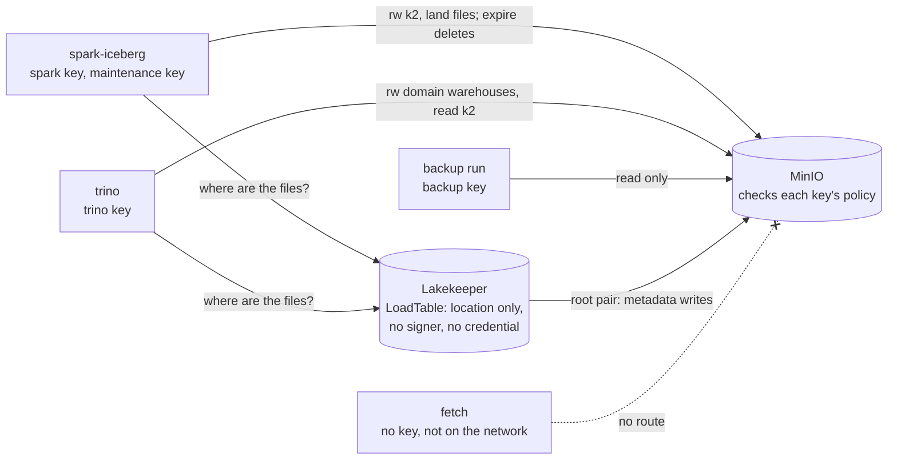

# ADR-054: Each engine holds its own storage key, and the catalog signs nothing

**Status:** Accepted
**Date:** 2026-11-27
**Author:** Platform
**Category:** Security / Storage
**Decided by:** the owner on 2026-11-27 (a storage key per engine, generated by `make engine-keys`),
as [plan 002](../plans/2026-11-26-unified-product-platform/002-run-spine-through-ecb-fx.md) asks;
finished from the Proposed draft of pull request #227, whose design predates the release platform and
which had no part on remote signing.
**Evidence:** [`scripts/verify/storage-keys.sh`](../../scripts/verify/storage-keys.sh) on a throwaway
lake made by the real `lake-init` (42 PASS, 0 FAIL on 2026-11-27); experiment (b) of
[`2026-11-26-release-spine-spikes.md`](../research/2026-11-26-release-spine-spikes.md).

---

## In plain words

Until this phase every engine that read or wrote the lake's files used the object store's master key,
and the catalog signed every engine's requests with its own copy of that key, so no engine's own key
was ever checked. We turn the catalog's signing off on every warehouse and give each engine its own key
that can do only its job, so the object store itself refuses an engine that steps outside its part of
the lake. The cost: every engine must now hold a key, so a container that holds two keys (Spark's)
leaks two; the master key stays with the object store, the bootstrap job, the catalog's stored
credential and the operator's drop tool. Nothing is left for the owner to decide but the master key's
rotation, which is the owner's.

---

## Context

### The parts

**MinIO** is the object store: one bucket, `k2-lake`, holds every Iceberg table's files under
`warehouse/<warehouse>/`, and a second, `k2-landing`, holds what connectors landed verbatim
([ADR-036](ADR-036-connectors-land-verbatim-then-publish-bronze-after-audit.md)). Every request to MinIO
carries an **access key** (a name) and is signed with its **secret key**; the pair is a credential. The
**root pair** (`MINIO_ROOT_USER`, `MINIO_ROOT_PASSWORD`) may do everything. A MinIO **user** is another
pair that root creates, and a **policy** attached to it lists the S3 actions it may take on named bucket
paths; anything not listed is refused with `403 AccessDenied`.

**Lakekeeper** is the Iceberg REST catalog: it knows where each table's current metadata file is, and
nothing else about the data ([ADR-023](ADR-023-lakekeeper-rest-catalog.md)). Each **warehouse** in it
(one for the producer lake, `k2`, and one per data domain) has a **storage profile** (bucket, prefix,
endpoint) and a stored **storage credential**, the pair Lakekeeper itself uses to write metadata files
and to check that the warehouse's storage works. An engine (Spark, Trino) asks Lakekeeper to **load a
table** (`LoadTable`) and is told where its files are; then it reads and writes them in MinIO itself.

### Remote signing, from first principles

An S3 request is authorised by a signature: the client computes an HMAC over the request (method, path,
headers, a timestamp) with the secret key, and MinIO recomputes it with the secret it holds for that
access key. Whoever can compute the signature is, to MinIO, the owner of that key. **Remote signing**
moves that computation out of the engine: the catalog's `LoadTable` answer names a **signer** endpoint
(`POST /catalog/v1/signer/<warehouse>/...`), and the engine's S3 client sends each request it is about
to make to that endpoint, which signs it with the warehouse's stored credential and hands the signature
back. The engine never needs a key of its own.

So with signing on, every engine's request reaches MinIO signed with the warehouse credential, which
`lake-init` set to the root pair. An engine's own key is never used, and scoping it changes nothing.
That was measured: experiment (b) gave a Spark job a key with no permission at all on the table's
prefix, and on a warehouse with signing on it still expired snapshots and deleted their files; on a
warehouse with signing off the same key was refused with `S3Exception: Forbidden` (the experiment's
results table, Spark 3.5.9, Iceberg 1.8.1, Lakekeeper v0.13.9). Lakekeeper answered with a signer
whatever the client asked for in `X-Iceberg-Access-Delegation`. A third mode, **vended credentials**,
has the catalog mint a short-lived key per table through MinIO's security token service (STS); every
warehouse here has `sts-enabled: false`.

Lakekeeper has no authentication ([ADR-059](ADR-059-access-rules-compiled-default-deny-over-two-catalogs-per-domain.md)
part 7): anything on its network may call the signer for any table. Signing on therefore made the root
pair usable by every container on `k2-catalog`.

### What phase 001 left

Spark, Trino and `lake-init` held the root pair, and every warehouse signed. The release before phase
002 shipped Trino's pair as the root pair in `.env.example`.

---

## Decision

**We will create every warehouse with remote signing and STS off, switch signing off in place on any
warehouse that has it, and give each engine a MinIO user whose policy allows only its job, because a
scoped key means something only when it is the key MinIO checks, and the store is the one layer whose
refusal holds whatever the unauthenticated catalog is told.** Scope: this single host; per-domain and
per-principal storage keys are not built.

### 1. Signing off, everywhere, checked

`docker/lake/init-lake.sh` writes every warehouse's storage profile with `"sts-enabled": false` and
`"remote-signing-enabled": false`. A warehouse that already exists with signing on (a profile without
the field signs: Lakekeeper's S3 profile defaults it to true) is updated in place through
`POST /management/v1/warehouse/<id>/storage` (Lakekeeper v0.13.9), which keeps the warehouse id,
bucket and prefix; the update must carry the credential, since one without it leaves the warehouse
with none. Every warehouse is then read back, and `lake-init` exits 1 if any still signs. With both off,
`LoadTable` hands out neither a signer nor a credential, and Iceberg's S3 client uses the key the engine
configured.

### 2. Five engines, five policies

One policy file per engine under `docker/lake/minio/policies/`, its name the engine's.
`lake-init` renders each with this lake's names (`@LAKE@` the bucket, `@LANDING@` the release storage
plan's landing bucket, `@K2@` the producer warehouse, `@DOMAIN@` once per domain warehouse of the plan,
so a new domain is covered on the next run) and makes one user per engine holding exactly that policy.

| Engine | Read | Write | Delete | Never |
|---|---|---|---|---|
| `spark` | `warehouse/k2/*`, `k2-landing/*` | `warehouse/k2/*`, `k2-landing/*` | `warehouse/k2/*` | a domain warehouse; deleting a landing |
| `trino` | every domain warehouse, `warehouse/k2/*` | every domain warehouse | every domain warehouse | writing `warehouse/k2`; any landing |
| `maintenance` | `warehouse/k2/*`, every domain warehouse | nothing | `warehouse/k2/*`, every domain warehouse, `k2-landing/*` | any `PutObject` |
| `backup` | `warehouse/k2/*`, every domain warehouse, `k2-landing/*` | nothing | nothing | any write |
| `tools` | as `backup` | nothing | nothing | any write |

Each also lists its prefixes (`s3:ListBucket` conditioned on them) and reads bucket locations; nothing
else. Spark writes the producer lake (landing tables, bronze) and lands files; Trino builds every domain
warehouse through dbt and reads bronze; maintenance expires snapshots and, later, landings (it reads
what it expires, deletes, never puts); backup copies. The `tools` user exists so a read-only step in the
tools container has a key of its own when one needs it; no step passes it today. **fetch has no key
and must never get one**: it talks to the internet and runs product parsers.

### 3. Where each pair lives

Each pair is two `.env` names, `K2_<ENGINE>_S3_ACCESS_KEY` and `_SECRET_KEY`, which compose requires
(`${...:?}`), so a service never starts on a missing key.

| Holder (`docker-compose.yml`) | Pairs | Why |
|---|---|---|
| `spark-iceberg` | `spark`; `maintenance` | Spark's catalogs (`docker/lake/spark_conf.py`) and the connector's landing writes; the maintenance pair only for `expire` (`docker/lake/expire.py`). It lives here, not in the scheduler, so the scheduler holds no storage key |
| `trino` | `trino` | every catalog of the compiled etc |
| `lake-init` | all five, and root | it makes the users |
| `scripts/backup-lake.sh` | `backup` | passed by name (`-e K2_BACKUP_S3_ACCESS_KEY`) to its own `docker run`, for that run only |
| the live access suite in `tools` | each engine's, by name, for that run only | its storage-key rows sign as each engine (`scripts/deploy.py`, `access_live`) |

**The root pair stays with three holders and one tool.** `minio` (it is the root); `lake-init`, which
creates buckets, users and policies, which only root may do; and each warehouse's stored credential in
Lakekeeper, which `init-lake.sh` still sets to the root pair, because Lakekeeper writes every table's
metadata files with it and checks the storage on every profile change. `make drop`
(`scripts/drop.sh`) also uses root for its copy-then-drop container, since a drop deletes in every
warehouse and landing. With signing off, the stored credential signs nothing for any engine: it is used
by Lakekeeper's own process only.

### 4. Making and rotating keys

`make engine-keys` (`scripts/engine-keys.py`) writes every pair that is missing, empty, still the
`.env.example` placeholder, or equal to either half of the root pair (which the release before this
phase shipped for Trino). An access key is `k2-<engine>-<8 hex>`, distinct from every other and from
root; a secret is 40 characters of `secrets.token_urlsafe`. It copies the file to `.env.bak-<UTC time>`
at mode 600 first, writes the new file at mode 600 and renames it into place, and prints names, never a
value.

`make engine-keys ROTATE=<engine>[,<engine>]` replaces only the secret, under the same access key, in
`.env` alone. A deploy runs `lake-init` only when its release changes `lake-init` (Consequences), so a
rotation is followed by `make lake-init RECREATE="<service> ..."`, which does the other two steps in
order: it runs `lake-init` on the live release as deploy runs it (the release's compose, script,
policies and storage plan), which sets that user's secret with `mc admin user add` so the old one stops
working; then it recreates the holders through the release so they read the new value: `trino` for
Trino's pair, `spark-iceberg` for Spark's and maintenance's, none for backup's and the tools one's,
which are passed per run. Until `lake-init` reruns, MinIO keeps the old secret, and a holder recreated
first is refused. A new access key would instead leave the old user, its policy and its secret valid.

`lake-init` and `scripts/check-env.py` refuse the same things before anything changes: a pair unset, a
half equal to root, two engines sharing one access key. A user found holding any policy but its own is
refused, not trimmed: someone widened it by hand.

### 5. What the access suite proves

[`tests/access/expectations.yaml`](../../tests/access/expectations.yaml) holds 21 hand-written
`storageKey` rows, each an engine, a target and an operation with `allowed` or `refused`: for example
Spark writes `warehouse/k2` and is refused `warehouse/governance`, Trino reads `warehouse/k2` and is
refused writing it and refused any landing, maintenance is refused every write, backup and tools write
nowhere. `scripts/access_verify.py` signs each request as that engine's own key and passes only on the
outcome the row names. The rows mean something only because signing is off: with it on, every row would
pass for the wrong reason. `storage-keys.sh` runs them on a throwaway lake made by the real `lake-init`,
and adds what the rows cannot show: one user per engine holding only its policy; a warehouse made the
old way, with no signing field, switched off in place by `lake-init`, and two more runs changing no
user, policy or warehouse id; Spark writing a table whose `LoadTable` answer carries no signer and no
credential; the maintenance key expiring that table's snapshots by id and refused a write to it; Trino's
key reading that table's metadata file and refused a write under its location; Trino building a table
in a domain warehouse through Lakekeeper. On the live stack the same rows run from `tools` at every
`release-verify`, from the catalog's network, since MinIO has no host port.

*Reading guide.* Each engine asks the catalog only where a table is, then signs its own requests;
MinIO decides by the key's policy. The crossed line is a refusal by network, not by key.

---

## Rationale

- **A key is only a key if it is checked.** Signing on made every engine root, whatever key it held
  (experiment (b)); scoping keys without turning it off would have been policy files nobody reads.
- **The store is where a refusal holds.** Lakekeeper has no login and Trino's rules bind only clients
  that come through Trino. MinIO checks every signature, whoever is asking, so a refusal there holds
  against a container on the catalog network, a forged catalog answer, or a bug in an engine.
- **One key per engine, not per table or domain.** Trino is one process loading every catalog file; a
  key per domain would sit in that one process, so it separates nothing until Trino itself is split.

---

## Alternatives Considered

| Option | Why not |
|--------|---------|
| Vended credentials (STS): Lakekeeper mints a short-lived key per table | Needs MinIO's token service and a Lakekeeper that authenticates its callers; with no authentication it would hand a table-scoped key to anyone on the catalog network. Not tested against MinIO here |
| Signing on, with the signer reachable only on trusted paths | The signer is Lakekeeper's own REST endpoint on the same port as the catalog; every engine must reach the catalog, so every engine reaches the signer, and it signs with the root pair for any table |
| One shared non-root key for every engine | Better than root, but Spark could then write domain warehouses and Trino the producer lake and the landings; the access rows that hold each engine to its part would have nothing to measure |
| A key per domain for Trino | No separation inside one Trino process that loads every catalog (Rationale) |
| Rotation by a new access key | Leaves the old user, its policy and its secret working until someone removes them by hand |

---

## Consequences

**Easier:** a leaked engine key exposes that engine's part of the lake and no more; Trino cannot write
the producer lake or see a landing whatever a catalog file or table location says; a policy edit is a
reviewed file in the release, applied by `lake-init` from the release itself.

**Harder:** `LoadTable` gives no credential, so every engine that touches files must hold a key of its
own, and every new consumer of storage needs a policy file and a pair. A wrong policy stops its engine
until fixed, at the first write.

**Committed to:** signing and STS off on every warehouse, checked by `lake-init` on every run; one user
per policy file; rotation by secret under the same access key.

**Risks:**

- **A compromised Spark container holds two pairs.** `spark-iceberg` keeps the maintenance pair beside
  Spark's, and `docker exec` gives every task in it the container's whole environment, so a load, audit
  or publish task can delete in every warehouse and the landings. `.env.example`'s "never delete one"
  for Spark's key holds for the key, not for code running in that container.
- **The root pair is still live in Lakekeeper.** A process that can read Lakekeeper's database or
  environment has root. Lakekeeper is on `k2-catalog` alone with no host port (ADR-059 part 7).
- **Anything holding the Docker socket** reads every container's environment, and with it every pair
  (ADR-059's Outcome of 2026-11-27).

**What is not yet verified:** the root pair's rotation, which is the owner's and has not been done; that
a MinIO user cannot mint its own access keys or temporary credentials that would outlive a rotation (no
probe has run); a release that changes only a policy file reaches MinIO only when `lake-init` next runs,
and deploy runs `lake-init` only when the plan names it, so such a release does not apply its policies
until another change reruns it.

**Revisit when:** Lakekeeper authenticates its callers (vended credentials then become an option, and
the stored root credential can be replaced by a scoped one); Trino is split into more than one process
or cluster (keys per domain); a second host or a cloud object store (IAM roles replace static pairs);
the owner rotates the root pair, which must be followed by `docker compose up -d --force-recreate
lake-init` and a `release-verify`.

---

## References

- Code: [`docker/lake/init-lake.sh`](../../docker/lake/init-lake.sh),
  [`docker/lake/minio/policies/`](../../docker/lake/minio/policies/),
  [`scripts/engine-keys.py`](../../scripts/engine-keys.py), [`scripts/check-env.py`](../../scripts/check-env.py),
  `.env.example` (the table of what each key may do).
- Proof: [`scripts/verify/storage-keys.sh`](../../scripts/verify/storage-keys.sh),
  [`scripts/access_verify.py`](../../scripts/access_verify.py), `tests/test_init_lake.py`,
  `tests/test_check_env.py`.
- [ADR-023](ADR-023-lakekeeper-rest-catalog.md) (the catalog),
  [ADR-036](ADR-036-connectors-land-verbatim-then-publish-bronze-after-audit.md) (fetch holds no key),
  [ADR-059](ADR-059-access-rules-compiled-default-deny-over-two-catalogs-per-domain.md) (the catalog fence).
- Lakekeeper v0.13.9's management API, `POST /management/v1/warehouse/{id}/storage`.
