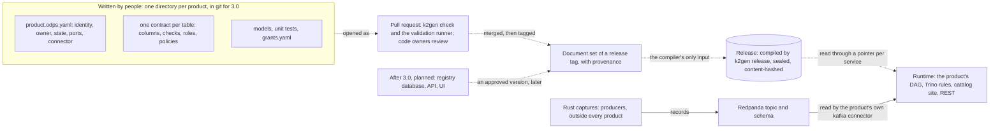

# ADR-055: A product is defined once, in ODPS and ODCS documents

**Status:** Accepted
**Date:** 2026-11-26
**Author:** Platform
**Category:** Data products / Contracts
**Decided by:** the owner on 2026-11-26, with [ADR-056](ADR-056-unified-data-product-platform.md)
and [`DECISIONS-FINAL.md`](../research/2026-11-26-unified-platform-architecture/DECISIONS-FINAL.md);
revised from the Proposed draft of pull request #240 ([History](#history))
**Supersedes, as the release and rules spine lands:** in part,
[ADR-032](ADR-032-odcs-contracts-and-k2gen.md): its K2 descriptor format (`product.yaml`, checked
against `contracts/schema/k2.schema.json`) and its generated files committed to git. ADR-032's ODCS
contracts and its rule that k2gen checks them stand.

---

## In plain words

A data product needs one definition that says what it is, who owns it, where its data comes
from, what each of its tables promises and who may read it; K2 had a format of its own for half
of that, which described the old pipeline without driving it. We will define every product as a set of
documents in git written to two open standards, one product file (ODPS) and one contract per
table (ODCS), with the product's SQL, tests, grants and named access policies beside them. A
compiler turns an approved, tagged set of those documents into a sealed release, and the running
system reads only releases. The cost is two standards to learn, K2 extensions to each, and a
release step between a merged change and the running system. Where the documents are stored is a
seam: git now, a definition registry with a database, an API and a UI after 3.0; the owner decided
all of this on 2026-11-26, so nothing is left for the reader to decide.

---

## Context

Each term is explained where it first appears; the [glossary](glossary.md) has each one too.

### What a product definition has to carry

[ADR-056](ADR-056-unified-data-product-platform.md) makes the
[data product](glossary.md#data-domain-and-data-product) the unit of the platform: an owned,
versioned unit of data with one lifecycle state, one pipeline and one namespace (a folder of
tables in the catalog). Everything the platform does for a product follows from its definition:
the connector that brings its data in and when it runs; each table it publishes, with columns,
keys, quality checks and freshness targets; the tables of other products it reads, which are also
the only inputs its writer may read; who may read which table, and under which policy; its state
and why it last changed; its owner, description and licence terms for the catalog. The checks,
the compiler, Trino's access rules, the Airflow pipelines, the catalog site and the REST routes
all act on that definition.

When two parts of a platform read two different sources for the same fact, they disagree, and the
part nobody told fails. That happened on 2026-11-26: pausing the order books
([ADR-050](ADR-050-order-book-capture-paused-during-platform-build.md)) lived in four places (a
switch in the instrument file the captures read, marks on nine contracts, conditions on two alert
rules, a table hard-coded in the nightly job), the ingest knew none of them, and its first run after
the pause failed until pull request #238.

### What K2 had

[ADR-032](ADR-032-odcs-contracts-and-k2gen.md) defined a product as a directory
`contracts/<domain>/<product>/` holding a **descriptor**, `product.yaml`, in a format of K2's own
checked against `contracts/schema/k2.schema.json`, and one ODCS contract per table. **k2gen**,
K2's contract tool ([glossary](glossary.md#k2gen-make-generate-and-the-drift-gate)), validated
them, and `make generate` wrote the files they implied (DDL, Trino catalogs and rules, dbt sources,
product pages) into the working tree, where CI failed on any difference. The contracts described
the pipeline but did not drive it (ADR-056, Context), and nothing outside K2 reads the descriptor's
format. The old pipeline's products retired with it in phase 000: `contracts/` now holds
`domains.yaml` and the schemas only, so the format can change without migrating a live product.

### What the two standards offer

Both are YAML documents with published JSON Schemas, from the Bitol project of the Linux
Foundation ([glossary](glossary.md#odcs-and-odps)):

- **ODCS**, the Open Data Contract Standard, v3.2.0, already vendored in `contracts/schema/`,
  describes one dataset: its schema, quality rules, service levels and owner. Its own `dataProduct`
  field is deprecated since v3.1.0, in favour of a separate product standard
  ([`ARCHITECTURE-V2.md`](../research/2026-11-26-unified-platform-architecture/ARCHITECTURE-V2.md)
  section 4.3).
- **ODPS**, the Open Data Product Standard, v1.1.0, is that product standard: identity, owner,
  status, and **ports**. An input port names a table the product reads and the contract describing
  it; an output port names a table it publishes.

Neither standard has a field for a connector, a schedule, licence terms or an access policy. Both
allow **custom properties** (`customProperties`, a list of key and value pairs beyond the
standard's own fields), which is where ADR-032 already put K2's extensions. ODPS is young: v1.0.0
shipped on 2025-09-24, short of the research's criterion of about two years since a first stable
release, and is kept for its Linux Foundation backing with a K2 descriptor as the fallback
(ADR-056, Risks).

### Constraints

- **Captures are outside the platform.** The Rust captures are standalone producers that publish to
  Redpanda topics; the platform does not generate, configure or switch them through product
  documents, and the boundary between producer and platform is the topic and its schema
  ([`ADDENDUM-1.md`](../research/2026-11-26-unified-platform-architecture/ADDENDUM-1.md) A,
  [`ADDENDUM-2.md`](../research/2026-11-26-unified-platform-architecture/ADDENDUM-2.md) I).
- **The runtime reads only a release** ([ADR-056](ADR-056-unified-data-product-platform.md) part 6):
  no container reads `contracts/` or a working tree. A checkout switch on 2026-11-25 left Airflow
  with no DAGs for 35 minutes (`CLAUDE.md`), which is what reading a working tree costs.
- **Approval is a reviewed pull request for 3.0**, by the owners `.github/CODEOWNERS` names per
  domain directory.
- **A registry later.** The owner's end state is a definition registry: a database, controlled
  through an API, with a UI on top, as the source of truth with validation, versions, approval and
  history; designed as a seam now, built after 3.0
  ([`REQUIREMENTS-V2.md`](../research/2026-11-26-unified-platform-architecture/REQUIREMENTS-V2.md)
  B.3, `DECISIONS-FINAL.md` section 3).
- **Owner decisions** (`DECISIONS-FINAL.md` section 2): at most one role per principal per product;
  a product has only the layers that add a distinct guarantee; no off-the-shelf catalog tool.

---

## Decision

**We will define every data product as a set of documents in git, one ODPS v1.1.0 product file and
one ODCS v3.2.0 contract per table, with its SQL, tests, grants and named access policies, and
compile an approved, tagged set into an immutable release with `k2gen release`, because one
definition that every part of the platform reads is what stops two parts disagreeing, and open
standards make that definition readable outside K2.** Scope: every product on the platform, to
`v3.0.0`; the store then moves to a registry (part 7). Captures are not products and stay outside.

*Reading guide.* A solid arrow carries data, a dashed one documents or configuration. People write
the **documents** of a product (the product file, a contract per table, its SQL, tests and grants)
and open a **pull request**, on which CI runs the checks and the owners review. A merge and a
release tag become a **document set**; after 3.0 the **registry** hands the same set an approved
version instead. The set is the only input of the compiler, which writes a sealed **release**, and
the **runtime** reads only releases. The **captures** publish to a **topic** and are in no document;
a product reads the topic through its own connector.

### 1. What a product is made of

A product is one directory, `contracts/<domain>/<product>/`:

| File | Standard | What it says |
|---|---|---|
| `product.odps.yaml` | ODPS v1.1.0 | identity (`id` is `<domain>.<product>`; a Semantic Versioning `version`), domain, type (source-aligned, aggregate or consumer-aligned), description, owner, `status` (part 4), input and output ports; K2 custom properties `connector`, `schedule`, `terms` (licence and attribution), `lifecycleChange`, and per port `serves`, `required`, `maxLagMinutes` |
| `<table>.odcs.yaml`, one per table | ODCS v3.2.0 | columns inline (names, types, keys, nullability, a description each), which are the table's definition of record; quality checks; freshness targets; the roles the table offers; relationships to another product's keys (with `asOf`, [valid or knowledge time](glossary.md#valid-time-and-knowledge-time), when the target keeps history); K2 custom properties `layer`, `partitioning`, `sort`, `retention`, `build` (part 2), `policies` (part 5), `backup`, and per column `unit` and `time` |
| `models/*.sql`, `unit_tests.yml` | dbt-core | the SQL that builds the product's silver, gold or mart tables, and its unit tests |
| `grants.yaml` | K2 | which principal holds which role on this product (part 5) |
| `seeds/`, `fixtures/` | none | optional small hand-written tables and test inputs |

Shared by all products: `contracts/domains.yaml`, which exists, and `contracts/access/`, which
declares the roles and the **principals** (whoever calls: a service, or a person under a
pseudonymous id). No document holds a credential or a hash of one; where credentials live is the
identity decision of this phase, ADR-060. Domain code that a product names, a parser or a
[registered code transform](glossary.md#registered-code-transform), lives under `domains/<domain>/`
with its owner in `CODEOWNERS`. Every K2 custom property is defined once, in a K2 profile schema
beside the two vendored standards in `contracts/schema/`, with the reason no standard field fits.
Lineage at product level is the ports; the table contract's old `upstreams`, `schedule` and
`entitlement` properties go, replaced by ports, the product's `schedule`, and policies with
grants. The field-by-field table is
[`ARCHITECTURE-V2.md`](../research/2026-11-26-unified-platform-architecture/ARCHITECTURE-V2.md)
section 4.3.

### 2. Only the layers that add a guarantee, and one pipeline per product

The layers a product's data can pass through are those of ADR-056 part 2
([medallion layers](glossary.md#medallion-layers-of-a-product)): **landing** (exactly what the
source sent), **bronze** (the source's shape, typed), **silver** (cleaned and keyed), **gold**
(business grain) and **mart** (shaped for one consumer). A product declares only the layers that
each add a distinct guarantee; a layer that would only copy its parent is left out. Each table's
`build` names what writes it, from a closed set: `connector` (its landing and bronze, in warehouse
`k2`, [ADR-036](ADR-036-connectors-land-verbatim-then-publish-bronze-after-audit.md)), `dbt` (a
model in the product's directory, run on Trino) or `code: <name>@<major>` (a registered code
transform on Spark). Documents hold no code of their own.

**One product, one pipeline.** Each product gets one Airflow DAG (a scheduled pipeline of
tasks, [glossary](glossary.md#airflow-dag-and-cosmos)), generated from its release and holding its connector, builds,
audits, publish and run records, so each product runs, fails, pauses and is permissioned on its own
([`ADDENDUM-3.md`](../research/2026-11-26-unified-platform-architecture/ADDENDUM-3.md) L). A
product built from others reads them only through its input ports, at their
[tested-data markers](glossary.md#tested-data-marker).

### 3. Captures are outside; each product owns its connector and landing

The captures are producers, not products: same repository, their own area, configured by
`config/instruments.yaml`, named in no product document. The platform starts at the topic. A
product on a topic declares a `kafka` connector and lands what it reads in its own landing; pausing
the product stops the platform consuming, and whether the producer keeps publishing is its owner's
business, so ADR-050's book switch stays the capture's own. A source-aligned product has exactly
one connector, and no landing is shared between products. How connectors run is
[ADR-036](ADR-036-connectors-land-verbatim-then-publish-bronze-after-audit.md).

### 4. One lifecycle state per product

A product has one [lifecycle state](glossary.md#lifecycle-state-and-operator-hold), its ODPS
`status`, and every table of the product shares it. ODPS defines
the field; K2 allows four values, of which `paused` is a declared deviation from the standard's own
list, since one field has to carry one state. Every state but `active` carries the custom property
`lifecycleChange`: since when, why, the decision behind it, and as the state requires a successor,
a sunset date or a resume point.

| State | What the platform does |
|---|---|
| `active` | the DAG is scheduled and the connector consumes |
| `paused` | released but consuming nothing; rows stay readable and the catalog says they are stale by design; on resume the connector starts from what the source still holds, and the gap is recorded |
| `deprecated` | still runs; readers are shown the sunset date and the successor; no new reader may be declared |
| `retired` | not built; rows kept, since no row is deleted ([ADR-028](ADR-028-non-goals-and-honest-limits.md) section 12), readable by the owner and the platform only |

`k2gen check` holds each change against the previous release: a new product enters `active` or
`paused`; `active` and `paused` move both ways; either can become `deprecated`; `deprecated` can
return to `active` when the notice is withdrawn, or become `retired` after its sunset with no
declared reader and no query for 30 days; `retired` is final; and no product retires while another
declares it as an input. Two things are not states: **proposed**, a pull request or registry draft
that is in no release, and an **operator hold** (`make hold`), which stops a product's runs for an
incident without a release and is recorded. The history of a product's state is the sequence of
deployed release manifests, each with its deploy time and approver
([`ARCHITECTURE-V2.md`](../research/2026-11-26-unified-platform-architecture/ARCHITECTURE-V2.md)
section 4.5).

### 5. Grants and named policies are documents too

A **grant** in `grants.yaml` gives one principal one **role** (`full_reader`, `delayed_reader` or
`public_reader`) on one product, at most one role per principal per product. A table contract's
`policies` say what each role sees, in the three
[named policies](glossary.md#named-access-policy) of ADR-056 part 5: `delay` (only rows older than
N minutes), `mask` (named columns as typed nulls) and `rowScope` (only listed values of a column),
never a free-form filter. The compiler turns grants and policies into Trino's access rules;
hand-written access expectations prove them. A grant to anyone but the product's owner needs its
`terms` recorded first.

### 6. Checked, compiled, released

- **`k2gen check`** is the checks library: pure functions of a document set and the previous
  release's, never of git, so the same code runs in CI now and inside a registry later. It enforces
  both schemas and the platform's rules: unique product names, one producer per table, every
  column described, allowed state changes, a dropped, retyped, renamed or re-keyed column as a major
  version, no retirement while an input, grants naming declared roles and principals, no output
  policy weaker than an input's, every policy covered by an expectation, and a lint of product SQL
  ([plan `001`](../plans/2026-11-26-unified-product-platform/001-release-and-rules-spine.md)).
- **The document set** is the `git archive` of a release tag's `contracts/` and `domains/`,
  byte-identical on a re-run, with a **provenance record**
  ([glossary](glossary.md#document-set-and-provenance)): source, tag, commit, tagger, a hash of
  the whole set and of each document, and each document's last commit and pull request.
- **`k2gen release`**, the compiler, takes the document set, the previous release and the image
  digests, and nothing else. It writes a content-hashed directory, sealed read-only before it
  becomes visible: Trino catalogs and rules, table DDL and the storage plan, each product's
  pipeline configuration, the dbt project, the catalog JSON, the backup set
  ([release](glossary.md#release)). Generated files leave git and exist only in releases.
- **The runtime** reads a release through one pointer per service, which `make deploy` moves (the
  deploy decision of this phase, ADR-058). Every run writes the release it ran into its run record,
  so each table's history traces back to the documents that defined it.

The precise shapes are section A of
[`IMPLEMENTATION-N0-N1.md`](../research/2026-11-26-unified-platform-architecture/IMPLEMENTATION-N0-N1.md):
A2 the document set and provenance, A3 the compiler and checks, A4 a product's compiled connector
configuration, A5 landing and bronze names, A6 the run-record table. This phase's interfaces pull
request freezes them as schemas, with the changes the spikes of
[`2026-11-26-release-spine-spikes.md`](../research/2026-11-26-release-spine-spikes.md) forced.

### 7. The seam: git now, a registry after 3.0

In 3.0 the store is git. Approval is a pull request reviewed by the owners `CODEOWNERS` names,
with CI running the validation runner (the checks, a trial compile and its difference against the
newest release, dbt parse and unit tests, the access test); a release tag by the platform owner
names the approved set. After 3.0 a **definition registry** is planned as the store: a database
of document versions, an API that runs the same runner and records who approved, then a UI, with
an export to git for audit ([registry and the seam](glossary.md#registry-and-the-seam)). It is not
built, and nothing in 3.0 depends on it. What makes the move cheap is that only one piece changes
with the store, the adapter that produces a document set (`git archive` of a tag now, the
registry's approved version later); the formats, the checks, the provenance record, the compiler,
releases and the runtime do not.

---

## Rationale

- **One definition, every reader.** The compiler derives every part's view from the same documents,
  so a part that was not told shows up as a failing check or a preflight, not as a failed run.
- **Standards before a private format.** ODCS is already in use here (ADR-032), and ODPS is the
  product half ODCS deprecated its own field for. A tool outside K2 can read both; K2's extensions
  sit in custom properties, each with its reason, in one profile schema.
- **Documents in a pull request.** Review by code owners, CI on every change and `git log` as the
  history come free with git, and a fresh clone can define a product with nothing running.
- **Releases, not live reads.** A bad definition stops at the compile or the preflight, a rollback
  moves a pointer back, and each run is pinned to the release it started with (ADR-056 part 6).
- **One state per product.** A product has one pipeline, so one state is what the pipeline obeys;
  a finer switch means a finer product, not a state per table.
- **Layers by guarantee.** Each layer costs storage, a step and a test; a layer that copies its
  parent adds those costs and no promise.

---

## Alternatives Considered

| Option | Why not |
|--------|---------|
| **The old K2-specific contract format, extended**: ADR-032's descriptor, plus a source binding, a state and a state change on each table's contract (the draft of #240) | Nothing outside K2 reads the descriptor, and the standard's product half now exists. A state per table contradicts one state per product. Kept as the fallback if ODPS stalls (ADR-056, Risks) |
| **An off-the-shelf catalog tool as the source of truth**, products defined in OpenMetadata or DataHub and exported to the platform | The owner decided no off-the-shelf catalog tool (`DECISIONS-FINAL.md` O1b). It is one more heavy, always-on service inside the 25 CPU / 48 GiB ceiling ([ADR-045](ADR-045-ceiling-25-cpu-48-gib.md)); the definitions would live in its database, losing code-owner review, CI and git history; and a fresh clone could not define a product without it running |
| **A database registry now** | Tournament entry B: Trino's rules would hang on a live service, so a registry failure at night could stop all SQL, and it scored 2 of 5 on easy to manage ([`VERDICT.md`](../research/2026-11-26-unified-platform-architecture/VERDICT.md) 7.1; ADR-056, Alternatives). Kept for after 3.0, behind the seam, with the runtime still reading only releases |

---

## Consequences

**Easier:** a product of a known connector kind is documents and a pull request; any tool that
reads ODPS or ODCS can read K2's products; a mistake in a definition fails CI or the preflight,
not a run; undoing a definition is deploying the previous release; moving to a registry changes
one adapter.

**Harder:** two standards and K2's extensions to learn; a merged change reaches the stack only
after a tag, a compile and a deploy, minutes rather than seconds; everything that read generated
files from the working tree (DDL, rules, dbt sources) reads a release instead; `paused` deviates
from the ODPS value list; a pause or resume is a pull request and a release, and only an operator
hold acts at once.

**Committed to:** ODPS 1.1.0 and ODCS 3.2.0 (ADR-056); one directory per product with the files of
part 1; K2's custom properties in one profile schema; four states and their transitions; one state,
one pipeline and, for a source-aligned product, one connector; captures outside the documents; no
credential in any document; releases as the runtime's only input.

**Risks:** ODPS may stall or break compatibility, being young; the fallback is a K2 descriptor with
ports and status mapped one to one, a format change and not a redesign. A tool outside K2 shows a
product without its connector, schedule or policies, since those are custom properties. A
standard field may later appear for something K2 holds in a custom property, which would be a
migration of every product file.

**What is not yet verified:**

- That ODPS v1.1.0's published schema, once vendored, accepts K2's product files as part 1
  describes them, `paused` in `status` included; the interfaces pull request of this phase
  vendors it and runs fixtures through it (`make test-k2gen`).
- That the document set of one tag is byte-identical on a re-run (`diff -r` of two runs) and that
  two compiles of one set give one release id with a read-only tree: proofs of this phase's
  document-model and compiler steps.
- That each check of part 6 fails its own bad fixture: `make test-k2gen`, in this phase's check
  steps.
- The seam: no registry exists, so "only the adapter changes" is a design claim until a product
  entered in the registry compiles byte-identical to the same documents from git, the registry
  project's exit (ADR-056, Revisit).
- The 30-day rule for retirement needs usage records, which phase `006` builds; until then only
  declared readers are checked.

**Revisit when:**

- the `v3.0.0` tag is placed: the registry project starts, and its exit is a product entered in
  its UI compiling byte-identical to the same documents from git;
- an ODPS release breaks a K2 product file, or the standard goes six months without a release (the
  research's test of an active project, criterion 5 of
  [`JUDGING-CRITERIA.md`](../research/2026-11-26-unified-platform-architecture/JUDGING-CRITERIA.md)),
  either of which reopens the fallback to a K2 descriptor;
- a source-aligned product needs two sources, which reopens one connector per product.

---

## History

The draft in #240 (Proposed, 2026-11-26) kept K2's descriptor for the product and put on each
table's ODCS contract a source binding (one of five pipeline patterns), a state with a dated
`statusChange`, and `lookups`; it derived an effective state per table across the declared graph,
generated what each Rust capture subscribes to, and recorded state history in a type-2 table,
`audit.product_state`. The owner's decisions the same day, which win, changed it: the product file
is ODPS, not K2's format; a product has one state, in ODPS `status`, because it has one pipeline,
so the per-table state, its derivation and `statusChange` go (the dated record is
`lifecycleChange` on the product); the five patterns become a product's connector
([ADR-036](ADR-036-connectors-land-verbatim-then-publish-bronze-after-audit.md)) and each table's
`build`; captures are outside product documents, so nothing generates their subscriptions and
ADR-050's switch stays the producer's; state history comes from deployed release manifests and
run records; generated files leave git for releases. What carried over: one definition that every
part reads, standard fields before custom ones, documents in a pull request reviewed by code
owners, and a closed set of named ways to build a table.

---

## References

- [ADR-056](ADR-056-unified-data-product-platform.md), parts 1, 2, 3, 5 and 6: the platform this
  definition serves.
- [ADR-032](ADR-032-odcs-contracts-and-k2gen.md): the descriptor and contracts this partly
  supersedes; [ADR-050](ADR-050-order-book-capture-paused-during-platform-build.md): the pause
  that showed the cost of state kept in four places.
- [ADR-036](ADR-036-connectors-land-verbatim-then-publish-bronze-after-audit.md): how a product's
  connector runs.
- Plans: [`001-release-and-rules-spine.md`](../plans/2026-11-26-unified-product-platform/001-release-and-rules-spine.md)
  builds the document model, checks and compiler; the [plan README](../plans/2026-11-26-unified-product-platform/README.md).
- [`DECISIONS-FINAL.md`](../research/2026-11-26-unified-platform-architecture/DECISIONS-FINAL.md),
  [`ARCHITECTURE-V2.md`](../research/2026-11-26-unified-platform-architecture/ARCHITECTURE-V2.md)
  sections 4.3 and 4.5, and [`IMPLEMENTATION-N0-N1.md`](../research/2026-11-26-unified-platform-architecture/IMPLEMENTATION-N0-N1.md)
  section A.
- Target chapter: [`20-target-data-product-platform.md`](../architecture/20-target-data-product-platform.md)
  sections 4.3 and 4.5.
- [`contracts/schema/README.md`](../../contracts/schema/README.md): the vendored ODCS schema.

## Outcome (2026-11-28, phase 004: terms checked transitively over inputs)

The decision stands. Built on branch `phase/004-005-kraken-and-enriched`; **not yet in a deployed release**. `docs.terms-missing` now holds a grant outside the owning team to recorded
terms on the product and on every product upstream of it through input ports, directly or through
others, since a derived product passes its inputs' data on. An upstream product is exempt only when
everything it holds was written on the platform (no connector, no input port, every table built by
dbt from synthetic seeds or SQL alone), as `calendars` is. No phase 004 product grants anyone yet: a
grant on `candles` outside its team is refused until `canonical-trades`, `kraken-trades`,
`security-master`, `kraken-instruments`, `currency-master` and `candles` record terms. Provenance:
`platform/k2gen/k2gen/checks/docs.py` and `platform/k2gen/tests/test_repository_documents.py`, the failing case in
`platform/k2gen/tests/fixtures/v2/bad/docs/cases.yaml`.
