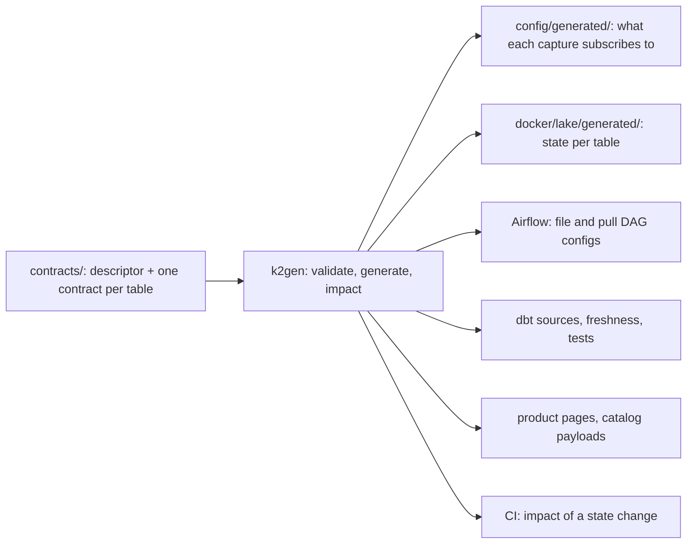
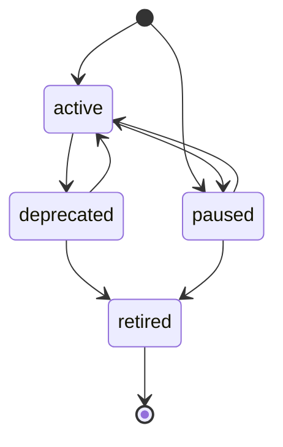
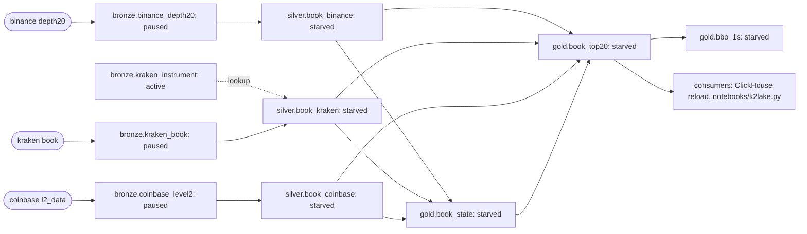

# ADR-055: Each product's source, state and inputs live in its contracts

**Status:** Proposed
**Date:** 2026-11-26
**Author:** Platform
**Category:** Data products / Contracts
**Fixed inputs:** four decisions the owner made on 2026-11-26, quoted in
[What the owner asked and decided](#what-the-owner-asked-and-decided)
**Generalises:** [ADR-050](ADR-050-order-book-capture-paused-during-platform-build.md)'s order-book
switch, and ADR-036 (the file-source pattern, Proposed, in build on phase P4's first pull request)

---

## In plain words

Pausing the order book on 2026-11-26 touched four places that do not know about each other: a
switch in the instrument file the captures read, a mark on nine table contracts, a condition on
two alerts and a table hard-coded in the nightly job; the ingest knew none of it, and its first
run after the pause failed. We will make each table's contract the one place that says where its
data comes from, which of five standard pipelines brings it in, whether it is running (active,
paused, deprecated or retired) and what it reads. The generator turns that into the files each
component reads, and CI lists, before a merge, every product a change of state touches. A new
source of a known kind is then a contract plus, for a new file format, one parser function; a new
venue still needs Rust. It is built inside phases P4 and P5 and the hardening sprint after P5, and
the owner decides whether to accept it.

---

## Context

Terms are explained where they first appear; the [glossary](glossary.md) has each one too.

### How a product is defined today

A **data product** is one owned unit of data inside a domain, such as the 1-minute candles
([glossary](glossary.md#data-domain-and-data-product)). In K2 it is a directory,
`contracts/<domain>/<product>/`, holding two kinds of file
([ADR-032](ADR-032-odcs-contracts-and-k2gen.md)):

- **The descriptor**, `product.yaml`: the product as a whole, in K2's own format, checked against
  [`contracts/schema/k2.schema.json`](../../contracts/schema/k2.schema.json). Its fields are
  `name`, `domain`, `owner`, `purpose`, `kind`, `lifecycle`, `inputs`, `outputs`, `consumers` and,
  for a product built by dbt, `marts`. `lifecycle` is maturity: `draft`, `published` or
  `deprecated`, and phase P6 will let a product say `published` only once its readiness scorecard
  (a generated checklist: owner set, columns described, quality rules and access points declared)
  passes. All thirteen descriptors say `draft` today (`grep -h ^lifecycle contracts/*/*/product.yaml`).
- **The contracts**, one `<table>.odcs.yaml` per lake table the product writes, twenty-six in all.
  They follow **ODCS**, the Open Data Contract Standard: a published, vendor-neutral YAML format for
  describing one dataset (its schema, quality rules, service levels and owner), with a JSON Schema
  that K2 vendors at version v3.2.0 ([`contracts/schema/README.md`](../../contracts/schema/README.md)).
  What the standard has no field for goes in its `customProperties`, a list of free key and value
  pairs: K2's are `layer`, `format`, `partitioning`, `sort`, `classification`, `entitlement`,
  `retention`, `upstreams`, `schedule` and `paused`.

Two fields form the **declared graph**: each contract's `upstreams` names what its table is
computed from, and each descriptor's `inputs` names the tables, or the external sources, the
product reads. **k2gen**, K2's contract tool, checks every file (`k2gen validate`) and writes the
files the contracts imply (`make generate`): product pages under [`docs/products/`](../../docs/products/README.md)
with a lineage diagram each (**lineage** is the chain of sources and tables a table is computed
from), generated DDL, retention, Trino catalogs and access rules, dbt sources
and selectors, and the table shapes the nightly `contract_schema` audit holds the live tables to.
CI regenerates and fails on any difference, so a generated file cannot drift
([glossary](glossary.md#k2gen-make-generate-and-the-drift-gate)). `make new-product` scaffolds a
descriptor and a contract that validate.

What no contract says is where external data comes from, or how. The venue feeds appear once, as
the external input `redpanda:market.crypto.v3` of the `raw-archive` product. Which channels a
capture subscribes to is Rust (`services/capture-rust/src/exchanges/`), and which bronze table each
channel's frames land in is a Python tuple, `VENUE_TABLES` in
[`docker/lake/bronze.py`](../../docker/lake/bronze.py).

### Where the order-book pause lives today

[ADR-050](ADR-050-order-book-capture-paused-during-platform-build.md) stopped order-book capture on
every venue on 2026-11-26 (pull requests #230 and #232). Its pieces:

| Piece | Where it is | What reads it |
|---|---|---|
| `book_capture`, true or false per venue | `config/instruments.yaml` | each capture at start (`services/capture-rust/src/config.rs`); the nightly maintenance job (`book_capture` in `docker/lake/instruments.py`); `scripts/health.sh` |
| `k2_capture_book_capture{exchange}`, what each capture read | the capture's metrics | two alert rules, each conditioned with `unless on (exchange) (k2_capture_book_capture == 0)` (`docker/prometheus/rules/capture-alerts.yml`); a Grafana panel; `scripts/health.sh` |
| `paused: {since, adr}` on nine contracts | `contracts/market-capture/`, `contracts/market-analytics/` | k2gen: the Status row on product pages, and the refusal of a latency target; one test |
| which book tables a venue's switch governs | `BOOK_SCOPES` in [`docker/lake/maintenance.py`](../../docker/lake/maintenance.py) | the nightly audit skip |

Three things went wrong or stayed undone:

- **The ingest knew none of it.** It kept running its book steps on input that was now empty, as
  ADR-050 intended, and the first run after Binance's book stopped failed at
  [stage 2e](glossary.md#stage-2e): a symbol map built from no entries had no type. Pull request
  #238 fixed it, with `tests/test_lake_empty_batch.py`.
- **One rule is written three times.** "A venue's bronze and silver book tables are paused exactly
  when its switch is false; the shared gold ones when all three are" is coded in `BOOK_SCOPES`,
  restated as `BOOK_TABLES` in [`tests/test_contracts.py`](../../tests/test_contracts.py), whose
  test holds the nine marks to the switch, and spelled out a third time by which contracts carry
  the mark. Nothing holds `BOOK_SCOPES` to the other two (`git grep -n BOOK_SCOPES` finds it in
  `maintenance.py` only).
- **ADR-050 section 4 is not built**: `gold.dim_venue` has no `book_capture` column
  (`docker/lake/ddl/lake.sql`), so no table records when the switch changed.

Every further kind of source, a file, an API, a database, would add its own switch, its own skip
table and its own mark.

### What the owner asked and decided

The ask, condensed from the owner's words: make the books and their ingestion a product that can
be catalogued with any form of catalog data product, with its ingestion pipelines associated to
it; think about the upstream and downstream impact of switching L2 off, and make that scalable and
abstract; and treat the platform as an aggregator of unified ingestion, cataloguing and serving,
where end users can easily define, create and serve data sets from various sources.

Decided by the owner on 2026-11-26, and fixed inputs here:

1. **Design now, build where it lands in the plan**: sources in P4, the catalog in P5 (the
   [governed self-serve platform plan](../plans/2026-11-24-governed-self-serve-platform/README.md),
   phases [P0 to P7](glossary.md#p0-to-p7)), not as a detour.
2. **Source kinds a user can declare a product on without writing pipeline code**, scope kept
   open: scheduled files over HTTP, S3, SFTP and FTP; public APIs; live venue streams, as the Rust
   capture takes them; API or database pulls; internal platform sources (lake tables and marts);
   and derived products defined as SQL.
3. **The interface is a YAML contract in a pull request**, as today (`make new-product`, the
   generator, CI). A catalog shows every product with its source, pipeline, state and lineage, read
   only. No form or app writes contracts.
4. **One first-class state field in the contract** (for example active, paused, deprecated,
   retired) **that every layer obeys**: the capture subscribes or not, the ingest skips, audits and
   alerts stand down, the catalog page shows it, and downstream products are flagged.

### What ODCS v3.2.0 already offers

Read from the vendored schema, `contracts/schema/odcs-json-schema-v3.2.0-20261117.json`:

- **`status`**, a top-level string, "Current status of the dataset", with the examples `proposed`,
  `draft`, `active`, `deprecated` and `retired`. No enum, no date, no reason. ADR-050 rejected it for
  the pause on exactly those grounds.
- **`servers`**, "List of servers where the datasets reside": typed entries (`api`, `kafka`, `s3`,
  `sftp`, `iceberg`, `trino`, `custom` and others; no `ftp` and no plain HTTP file). It says where a
  dataset is read from, which is how plan P5 uses it (the access points), not where its data was
  fetched from or on what schedule.
- **`slaProperties`** entries may carry a `scheduler` and a `schedule`: when a service-level check
  runs, not when the data is fetched.
- **`transformSourceObjects` and `transformLogic`** on each column: column-level lineage. K2's
  contracts for the tables `lake.sql` creates reference that file instead of restating columns
  (ADR-032), so these have nowhere to sit there.
- **`dataProduct`**, "DEPRECATED since v3.1.0": the standard no longer describes the product, only
  each dataset, so the product level stays in K2's descriptor.

So the standard has a field for the state's value and none for a source binding or a pipeline.

### Constraints

- **Raw first** ([ADR-021](ADR-021-raw-first-archive-and-lineage.md)): every frame a capture
  receives is archived in `raw.messages`, which therefore never stops.
- **Resume points expire.** Each lake step resumes from the parent [snapshot](glossary.md#snapshot)
  it last read, and snapshots older than 7 days are expired. A step keeps its resume point alive by
  committing every run, if need be an [empty commit](glossary.md#empty-commit); a step that stops
  committing while its parent keeps committing cannot resume after a week.
- **Components read generated files, never contracts.** `contracts/` is mounted in no container
  (ADR-032's Outcome). The Spark container mounts `./docker/lake` as a directory and
  `config/instruments.yaml` as a single file, which pins the file's inode: after an edit it can keep
  reading the old copy, which is why maintenance files a `book_capture_switch` finding when it
  cannot read the switch. The captures mount `./config` as a directory (`docker-compose.yml`).
- **A capture reads its configuration once, at start**, so a change is a container recreate.
- **One writer per warehouse** ([ADR-044](ADR-044-producer-lake-and-domain-mart-warehouses.md)):
  Spark writes the producer lake, each domain's dbt user its own catalog.
- **No Spark in CI**: the lake code is tested through pure functions; anything needing a Spark
  session is verified on the stack.

---

## Decision

**We will define every data product once, in its directory under `contracts/`: each table's
contract states its source binding, which names one of five pipeline patterns, its state and what
it reads, and every component that acts on the product reads only files `make generate` writes from
those contracts, because state kept in four places that nothing reconciles failed at the one place
nobody told.** Scope: the lake's tables, the captures, the file and pull DAGs, dbt's sources and the
generated pages and catalog payloads. A mart gets a declared state when marts get contracts of
their own; the ClickHouse hot tier, fed straight from Redpanda, has no contract and stays outside.



### 1. The product definition

Each field has exactly one home:

| Field | Home | Standard or K2 | New | What it says |
|---|---|---|---|---|
| `name`, `domain`, `owner`, `purpose`, `kind`, `inputs`, `outputs`, `consumers`, `marts` | descriptor | K2 | no | the product as a whole |
| `lifecycle` | descriptor | K2 | loses `deprecated` | maturity only: `draft` until P6's scorecard passes, then `published` |
| `status` | contract, top level | **ODCS standard field**, K2 closes the enum | yes | the **state**: `active`, `paused`, `deprecated` or `retired` |
| `statusChange` | contract, `customProperties` | K2 | yes, replaces `paused` | required unless `active`: `since` (a quoted day), `reason`, optional `adr`, and for `deprecated` an optional `successor` |
| `source` | contract, `customProperties` | K2 | yes | the **source binding**: `pattern`, then that pattern's fields (section 2) |
| `upstreams` | contract, `customProperties` | K2 | no | what the table is computed from |
| `lookups` | contract, `customProperties` | K2 | yes, optional | the upstreams that supply reference values rather than rows |
| `schedule` | contract, `customProperties` | K2 | no | cron of the job that writes the table |
| everything else | contract | as ADR-032 | no | schema, quality rules, service levels, classification, retention |

**State and maturity are two questions.** Maturity asks whether a product can be relied on, and is
earned on evidence (P6's scorecard). State asks whether data is flowing, and is an operator's
decision. A paused product keeps its maturity, and a draft product can run; one field for both would
lose one answer, as ADR-050 argued for `lifecycle: paused`. `deprecated` moves from maturity to
state because it is an end-of-life notice that layers must act on; no product uses it today.

**State is per table**, because that is the granularity the platform switches: ADR-050 paused three
of `venue-frames`' seven tables, and resumes one venue at a time. ODCS already puts `status` on each
contract, and one contract describes one table. The page shows each product's roll-up, as today
("3 of 7 tables paused").

**ADR-050's three objections to `status` no longer hold**: maturity stays a separate field; a
per-table field can say three of seven; and K2's profile in `k2.schema.json` closes the enum while
`statusChange` carries the date and the decision. A change of state is not a contract version
change: the version promises a schema (P6's `check-compat`), not a running pipeline.

**Example 1, the paused Binance order book**, `contracts/market-capture/venue-frames/bronze.binance_depth20.odcs.yaml`
as it would read, with the unchanged `quality` block elided:

```yaml
apiVersion: v3.2.0
kind: DataContract
id: lake.bronze.binance_depth20
name: bronze.binance_depth20
version: 1.0.0
status: paused                    # ODCS field; K2 allows active, paused, deprecated, retired
domain: market-capture
description:
  purpose: >-
    Binance top-20 partial-book frames, one row per frame, levels as the two-string arrays
    the venue sends.
team:
  name: capture-team
schema:
  - name: binance_depth20
    physicalName: bronze.binance_depth20
    physicalType: table
    authoritativeDefinitions:
      - type: implementation
        url: docker/lake/ddl/lake.sql
    quality: [...]                # duplicate_identifiers, bronze_unparseable, bronze_schema_drift
customProperties:
  - property: source              # where the rows come from, and by which pattern
    value: {pattern: stream, venue: binance, stream: depth20}
  - property: statusChange        # replaces ADR-050's `paused`
    value: {since: "2026-11-26", reason: "order-book capture paused during the platform build", adr: ADR-050}
  - property: upstreams
    value: ["raw.messages"]
  - property: schedule
    value: "1-59/5 * * * *"
  - property: layer
    value: bronze
  - property: format
    value: iceberg
  - property: partitioning
    value: ["days(recv_ts)"]
  - property: sort
    value: ["symbol", "recv_ts_ns"]
  - property: classification
    value: internal
  - property: entitlement
    value: realtime
  - property: retention
    value: 7
```

That one edit, with the same on `bronze.kraken_book` and `bronze.coinbase_level2`, is the whole
pause. The six downstream book tables carry no state of their own: `silver.book_binance` reads only
this table (the registry it also names is configuration), so it is paused by derivation (section
3), and so on down to `gold.bbo_1s`. `silver.book_kraken` declares
`lookups: ["bronze.kraken_instrument"]`, because Kraken's instrument stream supplies the precisions
its checksum needs, not book rows, and keeps flowing.

**Example 2, a file source**: the ECB reference rates product of plan P4, as its bronze contract
would read. The URL is illustrative, and the fields under `source` other than `pattern` are
ADR-036's as drafted; whatever names ADR-036 merges with are what this pattern holds.

```yaml
apiVersion: v3.2.0
kind: DataContract
id: lake.bronze.ecb_fx_daily
name: bronze.ecb_fx_daily
version: 1.0.0
status: active
domain: fx-reference
description:
  purpose: >-
    Euro reference rates as published, one row per date and currency, each rate the string
    the file wrote.
team:
  name: fx-reference-team
schema:
  - name: ecb_fx_daily
    physicalName: bronze.ecb_fx_daily
    physicalType: table
    properties:                   # a new table: columns inline, DDL generated (ADR-032)
      - {name: rate_date, physicalType: DATE, logicalType: date, required: true,
         primaryKey: true, primaryKeyPosition: 1, description: The fixing date.}
      - {name: currency, physicalType: STRING, logicalType: string, required: true,
         primaryKey: true, primaryKeyPosition: 2, logicalTypeOptions: {pattern: "^[A-Z]{3}$"},
         description: The ISO 4217 code quoted against the euro.}
      - {name: rate, physicalType: STRING, logicalType: number, required: true,
         description: Units of the currency per euro, as the file wrote it.}
      - {name: source_file_sha256, physicalType: STRING, logicalType: string, required: true,
         description: The landed file the row came from.}
customProperties:
  - property: source
    value:
      pattern: file
      url: https://publisher.example/reference-rates-90d.xml
      format: xml
      parser: ecb_rates           # docker/lake/sources/ecb_rates.py: bytes in, rows out
      calendar: none
      audits: [positive_rates, no_future_dates]
  - property: upstreams
    value: ["https://publisher.example/reference-rates-90d.xml"]
  - property: schedule
    value: "30 15 * * 1-5"
  - property: layer
    value: bronze
  - property: format
    value: iceberg
  - property: partitioning
    value: []
  - property: sort
    value: []
  - property: classification
    value: public
  - property: entitlement
    value: none
  - property: retention
    value: 7
```

Its descriptor names the URL as an external input with a classification, as ADR-032 requires of
every external source.

### 2. Five pipeline patterns

A **source binding** is the contract's statement of where a table's rows come from. Its `pattern`
picks one of a closed set, and the pattern fixes the engine: the author never chooses or configures
an engine, and a sixth pattern is a new ADR. `k2.schema.json` validates each pattern's fields with
one schema per pattern and accepts only the patterns that are built.

| Pattern | For | Engine | The author declares | Generated from it | Still needs code | Today |
|---|---|---|---|---|---|---|
| `stream` | a live venue stream | the Rust capture into Redpanda, then the lake ingest (the `lake_ingest` [DAG](glossary.md#airflow-dag-and-cosmos), Spark) | on the bronze table: `venue`, and `stream`, the channel name bronze records; symbols stay in `config/instruments.yaml` | what each capture subscribes to; the audit skip list; the page | a new venue: a Rust exchange module, its bronze and silver decoders, its topics; a new stream on a known venue: its decoders | three venues and seven streams, wired by hand; the binding is declared in P4, the subscriptions generated in the sprint |
| `file` | a file a publisher serves on a schedule | a generated Airflow DAG: fetch, load, audit, publish (ADR-036), with a Spark load | `url` (its scheme picks the transport), `format`, `parser`, `calendar`, `audits`, and `schedule` | the DAG's config, the landing key, the audits, the page | a parser function for each new format; a fetcher for each new transport, written once in the platform | HTTPS in P4; S3, SFTP and FTP designed only |
| `pull` | a public or private API, or a database | the same DAG, whose fetch is a request or a query whose response is landed like a file | `url` or a named `connection`, the request or query, `parser`, `audits`, `schedule`; credentials by the name of a variable in `.env`, never a value | as `file` | a fetcher for each API style (authentication, paging) and a driver for each database kind | designed only |
| `lake` | a table the platform's Spark jobs compute from lake tables | Spark, `docker/lake/`, under the `lake_ingest` or `lake_maintenance` DAG | `jobs`, the DAGs that write it; `upstreams`; `lookups` | the state its job reads; the page | the transform: Python in `docker/lake/`, owned by the platform, because Spark keeps every job that writes the lake ([ADR-035](ADR-035-trino-and-dbt-for-marts.md)) | every table from `raw.messages` to gold |
| `sql` | a mart: a `SELECT` over lake tables and marts | dbt on Trino, the `dbt_marts` DAG | the descriptor's `marts` entry (`table`, `grain`, `reads`) and the model's SQL file | dbt sources, freshness, source tests, selectors | the model's SQL and its tests | built ([ADR-035](ADR-035-trino-and-dbt-for-marts.md)) |

An **internal platform source**, in the owner's list, is not a pattern of its own: reading another
product's lake table or mart is a declared input, and the pattern says what computes the new table,
Spark (`lake`) or dbt (`sql`). Only `sql` needs no code beyond the SQL itself. A mart's binding is
its descriptor entry, which exists today, so marts carry no `source` property.

What the closed set honestly buys: for `file`, `pull` (once built) and `sql`, a source of a known
format is a contract, a parser function or a SQL file, and tests. For `stream`, the contract
declares and switches what the capture already speaks; a new venue or channel is still Rust and
Python work, as each of the three venues was. Python's standard library has an FTP
client (`ftplib`) and no SFTP client, so SFTP needs a pinned dependency in whichever image fetches.

### 3. The state

| State | Means | Allowed from |
|---|---|---|
| `active` | the platform brings data in and computes the table | new, `paused`, `deprecated` |
| `paused` | nothing new is brought in, by decision; rows stay readable; expected to resume | new, `active` |
| `deprecated` | still brought in and computed; readers are told to move, to `successor` if named | `active` |
| `retired` | nothing writes it and nothing may newly read it; rows stay readable, because no row is ever deleted ([ADR-028](ADR-028-non-goals-and-honest-limits.md) section 12) | `paused`, `deprecated` |



`active` to `retired` is refused, so no reader loses a table without a notice first. `retired` is
final: bringing the data back is a new table. Dropping a retired table is a separate decision,
outside this ADR.

**Declared and effective state.** The **declared** state is the contract's `status`. `paused` may be
declared only on a table with a `stream`, `file` or `pull` binding, where it means "stop fetching";
a computed table is never paused by hand, because a step that skips while its input keeps growing
would leave a hole. The **effective** state, computed by k2gen, is what every layer obeys:

1. A declared state other than `active` is the effective state, and so is every declared state of
   a table with a `stream`, `file` or `pull` binding.
2. For a computed table (`lake`, or a `sql` mart) declared `active`, its **feeds** are its table
   `upstreams` (a mart's `reads`) less its `lookups`. External upstreams, such as a configuration
   file or the Redpanda topics, are never feeds. If every feed is effectively `paused` or
   `retired`, with at least one `paused`, the table is effectively `paused`, "starved by" those
   feeds. If every feed is `retired`, `k2gen validate` fails until the table is retired too or
   reads something else.
3. If only some feeds are paused, or a feed is itself partly fed, the table stays `active`,
   flagged "partly fed".
4. A table or mart that reads a `deprecated` one is flagged; one that reads a `retired` one fails
   validation unless it is retired itself.

`raw.messages` reads only an external, the Redpanda topics, so it has no feeds and is always
`active`, as raw first requires. The derivation is the rule `BOOK_SCOPES` and `BOOK_TABLES`
hand-code for books, written once for every product.

**What each layer does**, reading the effective state. An SLO, a service level objective, is a
target such as "the newest row is under 15 minutes old" with an alert on breach, which P6 generates
from the contracts; dbt's source freshness is the check that a table a mart reads has recent rows:

| Layer | `active` and `deprecated` | `paused` | `retired` |
|---|---|---|---|
| Capture (`stream`) | subscribes | does not subscribe | does not subscribe |
| File or pull DAG | scheduled | generated with no schedule: it runs only when triggered by hand | not generated |
| Lake ingest, the step that writes the table | runs | if its input gained no rows, makes the empty commit that keeps its resume point, without running the transform; if its input gained rows, runs as usual and files an `audit.checks` row, "a paused table received rows" | not run, no commit |
| Nightly audits | run | skipped; `--with-paused` runs them, as today | skipped |
| Alerts | as today | capture alerts stay conditioned on what the capture reports (ADR-050 section 3); no freshness or SLO rule is generated | none generated |
| dbt | source freshness and source tests generated; marts build | none on it; marts reading it still build, on unchanging rows, and are flagged | marts may not read it |
| SLOs (P6) | generated | none, as ADR-050 section 5 already requires | none |
| Product page and catalog | the state; for `deprecated`, since, reason and successor | since, reason, decision, and the cause if starved | since, reason |
| CI | nothing for `active`; for `deprecated`, no new reader may be added | a latency target is refused, as today | every remaining reader fails |

Bronze decoding of a `stream` table is not skipped when paused: [stage 2b](glossary.md#stage-2-and-stage-2b)
decodes a venue's tables in one pass, and a frame that arrived, from a capture never recreated after
the change, is decoded rather than dropped. Its finding then says the capture and the contract
disagree, from the lake's side, as the gauge check says it from the capture's.

**How the components read it.** All of these are written by `make generate`, committed, and held
to the contracts by the drift gate:

| Reader | File | Read |
|---|---|---|
| Each capture | `config/generated/capture.yaml`: per venue, which switchable streams to subscribe; book streams only at first, in today's `book_capture` shape. Seen through the existing `./config` directory mount | at start; a change is a recreate, as today |
| `scripts/health.sh`, the release check | the same file, against each capture's `k2_capture_book_capture` | each run |
| Ingest and maintenance | `docker/lake/generated/state.json`: per table, declared and effective state, `since`, `reason`, cause. Under the existing `./docker/lake` directory mount, so the single-file mount's stale copy cannot mislead it | each run |
| Airflow | the file-source DAG config ADR-036 generates, with no schedule for a paused source and no entry for a retired one | each DAG parse |
| dbt | `dbt/models/_sources.yml`, as today | each build |
| Prometheus (P6) | the generated SLO rules | each rule load |

The gauge keeps its name while book streams are the only ones a capture can switch, so the two
alert rules, the dashboard and their tests need no change. `k2gen validate` refuses `paused` or
`retired` on a `stream` binding the capture cannot switch (trade and instrument streams today),
until it can.

**How a change of state is recorded.** Three records, each answering one question:

- **What was decided, by whom, and why**: the pull request that changed `status`, reviewed by the
  owning domain's code owners (`.github/CODEOWNERS` names a reviewer per domain directory), and
  the contract's `statusChange`.
- **What was declared at any past time, in SQL**: a type-2 table, `audit.product_state`, one row per
  table per state interval with `valid_from` and `valid_to`, reloaded by the ingest from `state.json`
  with the same mechanism as `gold.dim_venue` (`docker/lake/scd2.py`,
  [glossary](glossary.md#scd2-security-master)), an output of the `lake-audit` product written by
  Spark in the producer lake. It replaces ADR-050 section 4's `dim_venue.book_capture`: one table for
  every product, instead of a column for each switch on a dimension. Its `valid_from` is the first
  ingest run that read the new state, as ADR-050 section 4 says of its column.
- **What the data actually holds**: ADR-050 section 6's [operator rows](glossary.md#operator-row),
  unchanged, carrying the receive times of the last frame before a pause and the first after it.
  Only the data knows those.

### 4. Upstream and downstream impact

The declared graph is every `upstreams`, `lookups`, mart `reads` and source binding. A new command,
`k2gen impact --base origin/main`, computes the effective state of every table and mart on the pull
request's base and on its head, and lists every one whose state or flag changes, grouped by product
and owning domain, with each affected product's `consumers` (the readers outside the contracts, such
as notebooks and the ClickHouse reload) and the audits, freshness checks and SLOs that stand down or
come back. CI prints it in the job summary; the same pass checks every transition against the base,
and fails on a forbidden one, a new reader of a `deprecated` table, or a reader left on a `retired`
one. Pausing the three bronze book tables reports:



The frames pass through `raw.messages`, which stays active and is left out of the picture. Pausing
Binance alone would report `silver.book_binance` starved and the three gold book tables "partly
fed".

**What a consumer sees.** A reader of a paused table keeps reading: the rows stay, nothing new
arrives, and the product page and catalog say since when, why, and which source starved it; dbt runs
no freshness check on it, so nothing fails falsely. A reader of a deprecated table sees the notice
and the successor on the page, and the producer cannot retire the table while that reader is
declared. Readers outside the contracts are named in the report and checked by nothing.

### 5. How the catalog shows a product

Each generated product page, and the catalog entry built from the same files, shows:

- domain, owner, kind, **maturity**, and the **state** roll-up;
- per table: the state, `since`, `reason`, the decision, and for a starved table its cause;
- the **source**: pattern, engine, and what is bound (venue and stream; URL, schedule and parser;
  or the mart's SQL file), with the DAG that runs it;
- the **lineage** diagram pages already draw from the declared graph, extended upstream to the
  source and downstream to known consumers, with non-active nodes marked;
- **impact**: what this product's state touches, and what touches it.

This adds to P5 and redesigns nothing in it. P5's lineage pull request captures OpenLineage
events (an open standard for the event a job emits naming the datasets it read and wrote), the
**observed** edges, while k2gen draws the **declared** ones; the page shows the declared graph and
`scripts/lineage-verify.sh` asserts the observed chain for FX. P5's catalog pull request loads
OpenMetadata, an open-source catalog service, with domain, data product, owner, tag and glossary
payloads generated from the contracts; state and source ride in them as a tag per table and a
section of the product's description. If OpenMetadata fails P5's spike and the plan's fallback
applies (Marquez, an open-source lineage server, for the graph, and the generated pages as the
catalog), the pages already carry all of it.

### 6. Migration, inside the plan

**P4, in the pull requests that build ADR-036**, because P4 writes the first contract with a new
kind of source and the binding's shape must be fixed before it does:

- `source` required on every contract: `stream` on the seven bronze venue tables, with a test that
  each binding matches an entry of `VENUE_TABLES`; `file` on the new FX and currency tables, holding
  ADR-036's fields (if ADR-036 merges first under its own property name, the rename is one key in
  contracts that hold no live source yet); `lake` on the rest. The schema accepts `stream`, `file`
  and `lake` only.
- `status` required on every contract, `statusChange` and `lookups` added; `deprecated` leaves
  `lifecycle`; `make new-product` scaffolds `status: active` and a `source`.
- k2gen derives effective state and the pages show it. The nine `paused` marks become `status:
  paused` with `statusChange` on the three bronze book tables, and the six downstream tables lose
  theirs, now derived. Nothing at runtime reads `paused`: its only readers are k2gen, its tests and
  `tests/test_contracts.py`, so this changes pages, not behaviour.
- Until the sprint the capture still reads `book_capture`, so the existing test in
  `tests/test_contracts.py` keeps holding the contracts to it, now reading each book table's
  effective state; the sprint makes the two one by construction and the test goes.

**P5, with lineage and the catalog**: `k2gen impact` and the transition rules in CI; the page
sections of section 5; state and source in the catalog payloads.

**The hardening sprint after P5**, which is when the order books move: the capture reads
`config/generated/capture.yaml` and `book_capture` leaves `config/instruments.yaml` (with its reader
in `docker/lake/instruments.py` and the book test in `tests/test_contracts.py`); maintenance takes
its skip list from `state.json`, and `BOOK_SCOPES` and the `book_capture_switch` finding go; the
ingest's empty commit for a paused table with no new input, its "paused table received rows"
finding, and its skip of retired tables; `scripts/health.sh` and the release check read the
generated file; `audit.product_state` through the `/schema-change` procedure; and ADR-050's Outcome.

**Why the sprint and not the resume.** The pause runs until P7's release tag, or the review on
2027-02-26 (ADR-050's first two revisit triggers), and the sprint comes after P5, before P7, so the
sprint is expected first. Moving while paused is the safest moment: the switch, the generated file
and the gauge all say "off" before and after, so a mistake shows as a mismatch `scripts/health.sh`
reports, not as lost book data. If ADR-050's third trigger (work that needs new book rows) brings the
resume earlier, the resume flips `book_capture` as ADR-050 section 7 says, with the bronze book
contracts' `status` changed in the same pull request (the book test requires it), and the move
still waits for the sprint: a resume changes one thing.

**Explicitly not built:** the `pull` pattern and the S3, SFTP and FTP transports, until a first
product needs each; any form or app that writes contracts (the owner's decision 3); a declared state
on marts, until marts have contracts; switching trade or instrument streams, until one must stop;
notifying consumers anywhere but the pull request, the page and the catalog; any state on
`raw.messages`; changing where product boundaries fall (the books stay three products in two
domains, by [ADR-033](ADR-033-data-mesh-four-domains.md)'s cut, shown as one chain by the lineage).

**The Outcome ADR-050 will need** when the sprint builds this, appended and never editing its body:
"the switch moved into the contracts". The `book_capture` key is replaced by `status` on the three
bronze book contracts and a generated capture file; section 5's `paused` property by `status` and
`statusChange`, and its six downstream marks by derivation; section 4's `dim_venue.book_capture` is
not built and `audit.product_state` stands in its place; sections 1 (the gauge, the Binance ping), 3
(the conditioned alerts) and 6 (the operator rows) hold unchanged; section 5's test of the marks
against the switch is gone, the two being one; and section 7's step 5 becomes "set the venue's
bronze book contract to `active`, `make generate`, recreate its capture".

---

## Rationale

- **The failure was a missing reader, not a missing switch.** Every new place a state lives is one
  more component that can miss it, as the ingest did. Generating each component's view from one
  field makes "who was not told" a drift-gate failure in CI instead of a failed run on the stack.
- **The state's home is the standard's.** ODCS already puts `status` on each dataset, so any tool
  that reads ODCS shows it; K2 adds only the enum, the date and the decision. The source binding has
  no home in the standard, so it is a custom property, the extension point ADR-032 chose.
- **A closed set keeps "without code" honest.** Five patterns, each with one engine, is a short
  enough list to test each end to end, and says plainly which sources still need code. An open plugin
  interface would promise more and test less.
- **Derived state removes the hand-kept rule.** Books needed a propagation rule written three
  times; every future source would need its own. One derivation over the graph replaces them, and the
  impact report is the same computation run on base and head.
- **Generated files, not contract parsing at runtime**, because no container mounts `contracts/`,
  a capture must start from a file it already reads, and the drift gate already proves generated
  files match.

---

## Alternatives Considered

| Option | Why not |
|---|---|
| **A catalog tool as the source of truth**: define products in OpenMetadata or DataHub and export to the platform | Against the owner's decision 3 (YAML in a pull request, a read-only catalog). The catalog runs behind the optional `governance` profile, outside the default budget ([plan P5](../plans/2026-11-24-governed-self-serve-platform/005-access-lineage-catalog.md)), so a fresh clone without it could not define a product; and review by code owners, the drift gate and `git log` as the record would all be lost to a service's database |
| **Keep a switch per component**, adding one per new kind of source | It is what failed on 2026-11-26, and the one rule ADR-050 needed is already written three times with one copy unchecked; each new source kind multiplies switches, marks and skip tables |
| **One state per product, in the descriptor**, with products cut to the granularity switched | ADR-050 paused three of `venue-frames`' seven tables and resumes venue by venue; product-level state would need a product per venue per stream, re-cutting [ADR-033](ADR-033-data-mesh-four-domains.md)'s domains for an operating concern |
| **Declare state on every table by hand**, as the nine marks and their test do today | Nine edits for one pause, in two domains, and the test is the derivation rule restated as an assertion; a derivation states the rule once and needs no second edit |

---

## Consequences

**Easier:** pausing, deprecating or retiring a source is one reviewed field, and every layer
follows; a new source of a known kind is a contract plus a parser function or a SQL file; the impact
of a change is visible in CI before the merge; the catalog, the pages and the runtime cannot
disagree, because they read the same generated files; the lake reads its state through a directory
mount, so the stale single-file copy of the registry stops being a failure mode for it.

**Harder:** every contract carries two more fields, and the generator's output now sits on the
capture's start path: a capture whose generated file is missing refuses to start. A deprecated
table's producer cannot retire it until its readers move. Two mechanisms coexist from P4 to the
sprint, held equal by a test.

**Committed to:** five patterns, each with one engine, a sixth needing an ADR; four states and their
transitions; ODCS `status` with a closed enum and `statusChange`; `lookups`; the effective-state
rules; generated files as the only runtime view of a contract; `audit.product_state` as the history;
the move of `deprecated` out of `lifecycle`.

**Risks:** a wrong `lookups` declaration gives a wrong effective state, and no check can read the
code to catch it; the ingest's "paused table received rows" finding is the backstop, after the
fact. A generator bug could change what the captures subscribe to; the drift gate shows the
generated change in review, and the gauge and `scripts/health.sh` show what each capture actually
did. ODCS readers outside K2 may not know `paused`, which is not among the standard's examples.

**What is not yet verified:**

- That the ingest can use the [snapshot summaries](glossary.md#snapshot-summary-and-k2-properties) to tell whether a step's input gained rows. The
  field is there: read on the stack on 2026-11-26 through Trino's `"<table>$snapshots"`, the
  newest empty append on `bronze.binance_depth20` carries no `added-records` key, while a
  `bronze.binance_trade` append that added rows does. No step reads it for this today.
- That a generated Airflow DAG with no schedule behaves as "manual runs only" under the factory
  ADR-036 builds; it is Airflow's documented meaning of no schedule, not run here.
- That P5's catalog payloads can carry state and source as described; P5's own spike decides the
  tool first.
- That the effective-state rules match intent for every graph shape: they were checked by hand
  against the twenty-six contracts of 2026-11-26 (they reproduce the nine `paused` marks exactly with
  one `lookups` entry), not by a test.
- That the transition check can share P6's comparison with `origin/main`, which does not exist yet.

**Revisit when:** a source fits none of the five patterns (the first change-data-capture database
feed, or a live stream that is not a venue); a source needs a state the four cannot say (a backfill
in progress, a degraded feed); the ingest files its first "paused table received rows" finding that
was not a capture left unrecreated, which would mean the derivation is wrong; or P5's catalog spike
cannot show the state, which would reopen how the catalog reads it.

---

## References

- [ADR-032](ADR-032-odcs-contracts-and-k2gen.md): descriptors, ODCS contracts and k2gen.
- [ADR-050](ADR-050-order-book-capture-paused-during-platform-build.md): the order-book pause this
  generalises; its Outcome is owed (section 6).
- [ADR-033](ADR-033-data-mesh-four-domains.md), [ADR-044](ADR-044-producer-lake-and-domain-mart-warehouses.md):
  domains, owners and writers.
- [ADR-034](ADR-034-airflow-3-replaces-prefect.md), [ADR-035](ADR-035-trino-and-dbt-for-marts.md):
  the DAGs and the Spark and dbt boundary the patterns sit on.
- [ADR-046](ADR-046-governance-domain-and-quality-results.md),
  [ADR-047](ADR-047-ingest-batch-audit-after-publish.md): where findings are recorded, and why the
  stream audits after publishing while a file source publishes after its audit.
- [ADR-021](ADR-021-raw-first-archive-and-lineage.md), [ADR-028](ADR-028-non-goals-and-honest-limits.md):
  raw first, and no row deleted.
- Plan: [README](../plans/2026-11-24-governed-self-serve-platform/README.md),
  [P4](../plans/2026-11-24-governed-self-serve-platform/004-fx-data-product.md),
  [P5](../plans/2026-11-24-governed-self-serve-platform/005-access-lineage-catalog.md),
  [P6](../plans/2026-11-24-governed-self-serve-platform/006-controls-slos-release.md).
- [`contracts/schema/README.md`](../../contracts/schema/README.md): the vendored ODCS v3.2.0 and the
  field map; [`platform/k2gen/`](../../platform/k2gen/).
