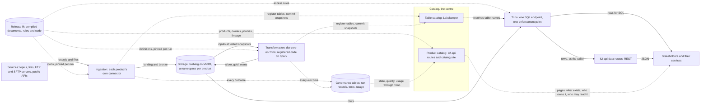
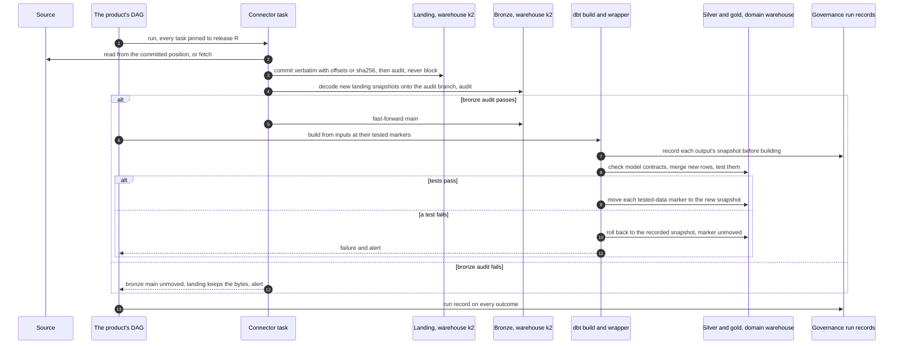
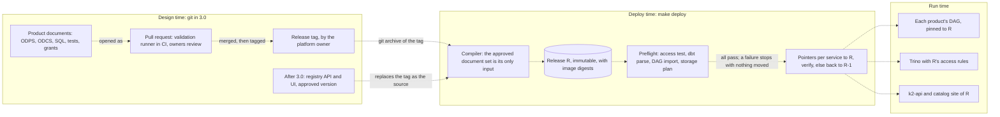

# ADR-056: A unified data product platform replaces the single pipeline

**Status:** Accepted
**Date:** 2026-11-26
**Author:** Platform
**Category:** Architecture (umbrella)
**Decided by:** the owner on 2026-11-26, after an architecture tournament, two adversarial reviews,
a plan review and three spikes, all kept with the research note,
[`2026-11-26-unified-platform-architecture.md`](../research/2026-11-26-unified-platform-architecture.md) (its inputs are cited below by file name)
**Supersedes:** the remaining phases, P4 to P7, of [ADR-031](ADR-031-governed-self-serve-platform.md);
the clauses of other ADRs listed under [Consequences](#consequences), as their phases land

---

## In plain words

K2 began as one pipeline built for crypto trades: a single scheduled job reads every exchange's feed
and writes every layer of the lake, so when one exchange's order-book feed was switched off on
2026-11-26, the next run of that shared job failed. We will rebuild it as a general data platform in
which each dataset is a data product, an owned and versioned unit described once in documents
written to two open standards, that brings its own data in, is stored in layers, appears in one
catalog and is read through one gatekeeper that applies the same permissions to SQL and to the web
API. Products from different subject areas (crypto trades, central-bank exchange rates, reference
lists) are built to be joined, because the owner's aim is the value of combining them, and each join
states which version of the reference data it used. Readers only ever see data that passed its
tests, and a change reaches the running system only as a sealed, versioned release that can be
rolled back. The costs: no live crypto data from the old pipeline's retirement until the Kraken
trades phase lands, a few seconds before newly built data is visible, and more services to run.
Two details are still open (how long landed data is kept, and how much foreign-exchange content ships
beyond rates and crosses); each is decided in the phase that needs it.

---

## Context

**What K2 is today.** Rust captures write each exchange ("venue") feed to Redpanda, a
Kafka-compatible broker. One Airflow job, `lake_ingest` (`docker/airflow/dags/lake.py`), runs one
Spark batch program every five minutes (`docker/lake/ingest.py`) that reads every venue's topic and
writes every [layer](glossary.md#raw-bronze-silver-gold) for every venue, from the shared archive
`raw.messages` to gold, in Apache Iceberg tables (an open table format in which each commit is a
[snapshot](glossary.md#snapshot)) catalogued by [Lakekeeper on MinIO](glossary.md#lakekeeper-and-minio).
Trino, a SQL server, builds dbt marts over it ([ADR-035](ADR-035-trino-and-dbt-for-marts.md)).
[ADR-031](ADR-031-governed-self-serve-platform.md)'s phases P0 to P3 added contracts
([ADR-032](ADR-032-odcs-contracts-and-k2gen.md)), domains ([ADR-033](ADR-033-data-mesh-four-domains.md))
and domain warehouses ([ADR-044](ADR-044-producer-lake-and-domain-mart-warehouses.md)); the contracts
describe the pipeline but do not drive it, and a new source means editing the ingest's code.

**The forces.** The owner's aim ([`BRIEF.md`](../research/2026-11-26-unified-platform-architecture/BRIEF.md), [`REQUIREMENTS-V2.md`](../research/2026-11-26-unified-platform-architecture/REQUIREMENTS-V2.md) D): "product and service
orientated with a unified ingestion layer, unified storage layers, a unified catalog, and a unified
service layer or query layer"; domain-agnostic, market data the first tenant, the value in joining
products across domains. The criteria, in order ([`JUDGING-CRITERIA.md`](../research/2026-11-26-unified-platform-architecture/JUDGING-CRITERIA.md)): robust, never publishing
unaudited data; easy to manage; easy for stakeholders to use; best practice; modern yet tried and
tested. Definitions are documents whose store is a seam: git now, a registry later
([`REQUIREMENTS-V2.md`](../research/2026-11-26-unified-platform-architecture/REQUIREMENTS-V2.md) B.3). A lab until the release gate, data disposable after a backup
([`ADDENDUM-5.md`](../research/2026-11-26-unified-platform-architecture/ADDENDUM-5.md)). One host, under [ADR-045](ADR-045-ceiling-25-cpu-48-gib.md)'s 25 CPU / 48 GiB.

**The evidence.**

- **One product's pause failed the shared job.** After
  [ADR-050](ADR-050-order-book-capture-paused-during-platform-build.md) switched off Binance's order
  book, the next `lake_ingest` run failed at its book step (an empty Spark map has no key type) until
  pull request #238: a step for a product nobody was feeding failed the run every venue depends on.
- **The job is near its slot:** over the 24 hours before 2026-11-26 11:08 UTC, a median of 189 s and
  a p90 of 253 s over 277 runs, against a 300 s slot and
  [ADR-034](ADR-034-airflow-3-replaces-prefect.md)'s 240 s line ([`SPIKE-RUNCOST.md`](../research/2026-11-26-unified-platform-architecture/SPIKE-RUNCOST.md)).
- **The reviews.** A tournament of three designs and a judge's synthesis ([`VERDICT.md`](../research/2026-11-26-unified-platform-architecture/VERDICT.md)); an
  adversarial review ([`REVIEW.md`](../research/2026-11-26-unified-platform-architecture/REVIEW.md)) found its contract-supplied Spark SQL could read the storage root
  password through `reflect`, its transform vocabulary a private language, any Trino reader able to
  roll back a mart today, services reading the working tree, and the Spark image's Python past end
  of life. The revised design drew 96 findings, none rejected ([`V2-CHANGELOG.md`](../research/2026-11-26-unified-platform-architecture/V2-CHANGELOG.md)); the plan review
  said "go, with changes", its 2 critical and 8 high findings accepted ([`FULL-PLAN-REVIEW.md`](../research/2026-11-26-unified-platform-architecture/FULL-PLAN-REVIEW.md)).
- **Side doors:** notebooks read MinIO with its root key (`notebooks/k2lake.py`); Lakekeeper is on a
  host port without authentication; the backup copies four fixed tables (`scripts/backup-lake.sh`);
  a checkout switch left Airflow no DAGs for 35 minutes on 2026-11-25 (`CLAUDE.md`).

---

## Decision

**We will rebuild K2 as one domain-agnostic data product platform, in which every dataset is a data
product defined once in open-standard documents, brought in by its own connector, stored in layers,
registered in one catalog and served through one enforcement point, because the single pipeline turns
one product's fault into a failure of all and has no place for a second domain, while the owner's
aim is value from governed joins across domains.** Scope: the whole platform on this host, to
`v3.0.0`. The pinned engines (Redpanda, Spark, Iceberg, Lakekeeper, Trino, dbt, Airflow 3), the
Rust captures, the CI and doc gates and the ADR and runbook discipline stay.

### 1. The product is the unit, and documents define it

A **data product** is an owned, versioned unit of data with one lifecycle state (`active`, `paused`,
`deprecated`, `retired`), one pipeline and one namespace (a folder of tables). A **data contract** is
the checkable promise about one table: columns and types, keys, quality checks, freshness, who may
read it. Both follow open standards of the Linux Foundation's Bitol project: one **ODPS** file per
product (Open Data Product Standard v1.1.0: identity, owner, state, and the input and output ports,
the tables it reads and publishes) and one **ODCS** contract per table (Open Data Contract Standard
v3.2.0, as in ADR-032), its columns the definition of record. Fields no standard has (connector,
schedule, licence terms, access policies) are K2 custom properties, each with its reason. A product
is one directory, `contracts/<domain>/<product>/`: ODPS file, contracts, SQL, tests and grants.

**Where documents are stored is a seam.** In 3.0 the store is git: a pull request reviewed by the
owners `CODEOWNERS` names, on which CI runs the validation runner (checks, a trial compile, dbt parse
and unit tests, the access test). After 3.0 a **registry** is the store: a database of versions, an
API that runs the same runner and records the approver, then a UI, exported to git for audit.
Unchanged by the move: the formats, the checks (pure functions of a document set, runnable in CI or
inside the registry), the compiler, the release (part 6) and the runtime.

### 2. Four layers, with the catalog at the centre

- **Ingestion:** each product's own connector (part 3), run by Airflow from one generated DAG (a
  scheduled pipeline of tasks) per product.
- **Storage**, in **medallion layers**: *landing* (exactly what the source sent), *bronze* (source
  shape, typed), *silver* (cleaned, keyed), *gold* (business grain), *mart* (consumer SQL); a product
  has only the layers that add a distinct guarantee. Warehouse `k2` holds landings and bronze, written
  only by connectors; each domain's warehouse holds its silver, gold, marts and code outputs.
- **Catalog**, where everyone starts: the table catalog, Lakekeeper (tables, schemas, snapshots), and
  the product catalog, `k2-api`'s routes plus a generated read-only site with search: per product its
  schema, owner, state, quality, **lineage** (what it was made from), readers, example queries and
  join keys, linked to the dbt docs. No off-the-shelf catalog tool. Metadata is open; rows governed.
- **Service:** Trino, the one SQL endpoint, and `k2-api`, the one new service, for REST.

*Reading guide.* Run time only: a solid arrow carries data or a request, a dashed one configuration
or metadata, a cylinder stored data. **Sources** feed **ingestion**, which writes landing and bronze;
**transformation** reads inputs at their tested snapshots and writes silver, gold and marts; both
register tables in **Lakekeeper** and record outcomes in the **governance tables**. The **release**
pins each run and feeds the **product catalog** and **Trino's** rules. Trino resolves names in
Lakekeeper and alone hands out rows, to SQL users and, as the same caller, to the **REST routes**.
**Stakeholders** start at the catalog's pages.

### 3. Each product owns its connector and its landing

A **connector** is the code that reads one kind of source, configured in the ODPS file: `kafka`,
`public-api`, `https-file`, `s3-file`, `sftp` and `ftp` (with TLS unless the data is anonymous and
public). There is **no shared raw archive**: a venue's trades product reads its own topic at its own
position, lands byte for byte the frames its filter keeps, with the offsets in the same commit
([ADR-022](ADR-022-exactly-once-via-snapshot-offsets.md)), and counts the rest. A paused product
consumes nothing and resumes from what the source still holds, the gap recorded; an active product
fallen below the topic's oldest record fails loudly until an operator records an accept-data-loss
run. File and API connectors run in a one-shot fetch container that connects only to declared hosts,
refuses private and loopback addresses, and parses there.

### 4. Write-audit-publish to bronze, dbt for the rest, readers see only tested data

Readers see an Iceberg table's `main` [branch](glossary.md#branch-and-main); **write-audit-publish**
writes a batch to a hidden branch, audits it there, and only on a pass moves `main` to it (a
[fast-forward](glossary.md#fast-forward)).

- **The landing commits first and audits after,** never blocking, as
  [ADR-047](ADR-047-ingest-batch-audit-after-publish.md) argues: holding a Kafka batch holds its
  offsets while retention deletes unread records. **Bronze is published by write-audit-publish**, in
  offset order per partition: a failed batch blocks later ones, so silver, which reads past the
  highest offset it has seen, never skips one.
- **Silver, gold and marts are dbt-core models on Trino.** dbt is the open-source SQL build tool, a
  model one `SELECT` in a file; dbt-core is its Apache-licensed engine, never the newer Fusion (no
  Trino adapter found, proprietary distribution). A build is one `dbt build` of the product's
  [selector](glossary.md#selector) in a one-shot container holding no secrets: model contract
  checked first, data tests on new rows after. A wrapper records each output's snapshot first, rolls
  a failed table back to it (`rollback_to_snapshot`) and expires the failed snapshot; the next run
  rolls back a run that was killed.
- **Readers see only tested data.** Each output has a **tested-data marker**, an Iceberg
  [tag](glossary.md#tag) (a named pointer to one snapshot) moved only after its tests pass. SQL, REST
  and other products read at the marker; a product reads another only through `k2_input()`, which
  pins the input's marked snapshot once per run.
- **Registered code for logic that is not SQL** (book replay, event bars): a named, versioned
  transform (`build: code: event_bars@1`) with fixtures and a reference implementation
  ([ADR-029](ADR-029-research-production-parity-contract.md)), run on Spark. No custom transform
  vocabulary; contracts hold no code.

*Reading guide.* A solid arrow is a request or write, a dashed one a reply. Step 1 pins every task to
one release. Steps 2 to 4: the **connector** reads, commits the **landing** verbatim, audits without
blocking, and decodes **bronze** on its audit branch. Steps 5 to 8: bronze is published; **dbt and its
wrapper** read inputs at their markers, record the outputs' snapshots, merge and test. Step 9: a pass
moves the markers. Steps 10 and 11: a failure rolls back, unseen. Step 12: a failed bronze audit
moves nothing and keeps the bytes. Step 13: every outcome is recorded. A derived product starts at 6.

### 5. One enforcement point for access

Trino alone allows or refuses a read, for SQL and REST alike; `k2-api` checks a key, queries Trino as
that key's principal, and never decides access.

- **Grants.** A principal is who calls (a service, or a person under a pseudonymous id). A contract
  offers roles (`full_reader`, `delayed_reader`, `public_reader`); a grant gives one principal one
  role on one product, approved by its owner, at most one role per principal per product.
- **Named access policies,** never free-form filters: `delay` (rows older than N minutes only),
  `mask` (named columns as typed nulls), `rowScope` (listed values of a column only). They compile to
  Trino row filters and column masks, and being comparable, let the checks refuse an output whose
  policy for a role is weaker than an input's.
- **Reader and writer catalogs.** A Trino catalog is a named connection to one
  [warehouse](glossary.md#warehouse-catalog-and-schema). Consumers use **reader catalogs**, one per
  domain, read-only at the connector: every write and every
  [table procedure](glossary.md#table-procedure), rollback included, is refused. **Writer catalogs**
  (`<domain>_build`) serve builds: writer `dbt_<product>` writes only its namespace and selects only
  its declared inputs.
- **Side doors closed:** Iceberg metadata tables (`"t$files"` and kin) denied by exact name; outputs
  are tables, never [definer views](glossary.md#definer-view) (which read with their owner's rights);
  MinIO and Lakekeeper off the host's ports, a scoped storage key per engine, notebooks via Trino.
- **Identity: passwords over TLS,** built in the first spine phase since every client depends on it:
  Trino's password login on encrypted connections, API keys for REST (hashes kept). No single sign-on
  in 3.0. **Proof:** hand-written access expectations run through SQL and REST on a throwaway Trino
  before each deploy; a policy without an expectation is refused.

### 6. Deploy only from an immutable release

A **release** is an immutable, content-hashed directory compiled from an approved document set (in
3.0 the `git archive` of a tag, never the working tree): documents, rules, platform code, compose
file, image digests. Generated files leave git and live only in releases. `make deploy` runs a
preflight (access test, dbt parse, DAG import, a plan of every table and column it would create),
applies additive changes only, moves a pointer per service, verifies each part's release, and on a
mismatch points all back at the previous one and fails. It recreates only what changed (captures
never); runs stay pinned to their release; a rollback moves code, rules and images, never data.

*Reading guide.* Only configuration moves, so every arrow is dashed. **Design time:** a person writes
the **documents**, opens a **pull request** that CI validates, and the merge is **tagged**; after 3.0
the **registry** supplies the approved version. **Deploy time:** the **compiler** turns that set alone
into **release R**; a failed **preflight** moves nothing; else the **pointers** move and are verified,
a mismatch returning them to R-1. **Run time:** the **DAGs**, **Trino** and **k2-api** run R. All
twelve target diagrams are in [`20-target-data-product-platform.md`](../architecture/20-target-data-product-platform.md).

### 7. Metadata from every step, in open standards

Every step records descriptions, schemas, keys, units, provenance and terms (offsets or a hash per
landing, the source's licence), a run record (release, input snapshots, outputs, outcome), tests,
lineage (ports, dbt, and OpenLineage, an open lineage event format), grants, usage (Trino's query
events) and each lifecycle change with who and why. Standards where mature: ODPS, ODCS, Iceberg and
its REST catalog protocol, Parquet, Avro, SQL, OpenLineage, OpenMetrics, OpenAPI 3.1, Semantic
Versioning, ISO 4217, ISO 8601 in UTC. A later AI interface is not blocked: `/v1` is machine readable.

### 8. Conformed reference products and point-in-time joins

Reference products many domains join to (security master, currency master, calendars) are ordinary
products. A contract declares its keys as ODCS relationships to another product's column; a check
fails on an unresolved reference, and an enriched product is never less restricted than its inputs.
A join to history states its point in time: *valid time* (the row that applied when the fact
happened) or *knowledge time* (the row knowable then), with [ADR-030](ADR-030-scd2-security-master.md)'s
half-open intervals and `9999-12-31` sentinel. Each venue has a trades and an instruments product,
the latter from its public reference API; the security master has two levels, asset and instrument,
and maps each venue symbol to its instrument with history, by rule plus a reviewed exceptions list (a
venue writing `XBT` for `BTC`). A symbol that matches nothing is held and alerted on, never guessed.

### 9. The build order, and the demo as a tag

To the demo: clear the ground; the release and rules spine; the run spine through European Central
Bank (ECB) reference rates; serving and teaching; Kraken trades, instruments and the security master;
the enriched product; catalog, metadata, lineage and usage; the REST API, then the tag
`v3.0.0-beta.1`. Then: remaining connector kinds; widen crypto; controls, alerts and release
engineering; infrastructure as code for this host; hardening; the release gate and `v3.0.0`. The old
pipeline retires at the end of the first phase (backup, pause, drop, code to `legacy/`, its readers
moved). One interfaces pull request merges before parallel work. The demo is a tag, placed when four
moments run on the real system: a new domain onboarded live; find, trust, query by SQL and REST;
permissions with two roles; bad data stopped and an enriched product. No demo-only code. If late,
the date moves, never quality or order.

---

## Rationale

- **Per-product pipelines remove the coupling that failed** (a derived product runs on what its
  inputs published and shows `partial`), **and their cost fits** ([`SPIKE-RUNCOST.md`](../research/2026-11-26-unified-platform-architecture/SPIKE-RUNCOST.md), n = 5): a small
  run on Spark (session, branch, append, two audits, fast-forward) took a median 6.51 s, 10.54 s on a
  table of 200 snapshots; a dbt build of one model with two tests, 3.02 to 4.71 s (n = 6). By
  arithmetic, not measurement, one Spark slot fits about 46 small runs per five minutes.
- **dbt-core on Trino carries silver and gold** ([`SPIKE-DBT.md`](../research/2026-11-26-unified-platform-architecture/SPIKE-DBT.md), dbt-core 1.12.7, dbt-trino 1.12.0):
  merge on a key, schema change, an enforced contract failing before the table changes, type-2
  snapshots and publish-test-rollback all worked through Lakekeeper. It is the standard tool the
  owner wants to learn ([`REVIEW.md`](../research/2026-11-26-unified-platform-architecture/REVIEW.md) section 6). Trino 484 cannot write Iceberg branches, and
  rollback alone left bad rows visible for 2.6 s: the marker closes that.
- **Trino holds as the one gate on the spike's conditions** ([`SPIKE-ACCESS.md`](../research/2026-11-26-unified-platform-architecture/SPIKE-ACCESS.md)): masks and a delay
  filter held on direct reads, joins and `SELECT *`, but vanished through a definer view (so, tables);
  `"t$files"` exposed hidden rows' timestamps and masked columns' bounds (so, denied); a read-only
  catalog refused the table procedures a plain reader ran on a writable one (so, reader catalogs);
  changed rules went live in 12 s with a 5 s refresh period, and only on restart without one.
- **Releases and a rebuild:** an immutable release ends the working-tree deploy and rolls back images
  too ([`FULL-PLAN-REVIEW.md`](../research/2026-11-26-unified-platform-architecture/FULL-PLAN-REVIEW.md) F5); a live old pipeline would have to be carried through the new
  compiler and deploy (F1), so it retires, and fixtures, a DuckDB recomputation of silver and
  re-pinned candle and bar parity replace old-against-new parity.

---

## Alternatives Considered

| Option | Why not |
|--------|---------|
| An always-on metadata registry as the control plane now (tournament entry B) | Trino's rules would hang on a live service, so a registry failure at night could stop all SQL; it scored 2 of 5 on easy to manage ([`VERDICT.md`](../research/2026-11-26-unified-platform-architecture/VERDICT.md) 7.1). Kept for after 3.0, behind the seam, with the runtime still reading only a release |
| A custom, config-driven transform vocabulary compiled to Spark (the verdict's spine) | Eleven operations, four incremental modes and a compiler are a private language, and its Spark SQL fragments could read the storage root password ([`REVIEW.md`](../research/2026-11-26-unified-platform-architecture/REVIEW.md) finding 1); dbt-core on Trino was measured to carry the work |
| An off-the-shelf ingestion or catalog tool (Airbyte, dlt, Redpanda Connect, OpenMetadata) | Each adds a service or a maturity risk for what one connector per kind does: Redpanda Connect's Iceberg output needs an Enterprise licence, dlt was borderline on the two-year rule, and a catalog service is one more heavy service where a site generated from the release suffices |
| Keep the single pipeline, add per-component switches | ADR-050's book switch is one, and the shared job still failed; a switch gives no product an owner, lifecycle, permissions or catalog page |
| A trimmed, demo-first scope postponing the safety machinery | Withdrawn by the owner on 2026-11-26: "simple now, proper later" pairs (trusted user names, shared storage keys, no deploy pointers) get built twice. Full scope, the demo a tag on the way |

---

## Consequences

**Easier:** a product of a known connector kind is documents and a pull request; one product's fault
stops only it; a stakeholder finds a product, gets a grant and queries it by SQL or REST with the
same answer; cross-domain joins are declared and checked; a bad deploy rolls itself back.

**Harder, and the honest costs:** no live crypto data in the lake, and stale dashboards, from the old
pipeline's retirement until the Kraken phase lands; a few seconds before a build's rows reach
interactive readers, since the marker moves only after the tests; more services than today
(`k2-api`, a fetch container, dbt runners, Alertmanager, about twenty DAGs), the bootstrap peak
estimated to go from 21.30 CPU / 37.812 GiB to about 19.40 / 32.375 once ClickHouse is paused, under
25 / 48 ([`ARCHITECTURE-V2.md`](../research/2026-11-26-unified-platform-architecture/ARCHITECTURE-V2.md) section 6); every client changes to log in; `raw.messages`, the old
audit rows and the stored book data are let go after a backup.

**Committed to:** ODPS 1.1.0 and ODCS 3.2.0; dbt-core, never Fusion; Trino as the one gate; deploys
only from immutable releases; open standards where mature; both plans in full, each part built once.

**Risks:** Trino builds beside interactive users (a `pipeline` resource group, Trino's cap on a class
of users' queries and memory, limits them); twenty products sharing one Spark slot is unmeasured;
ODPS v1.0.0 shipped on 2025-09-24, under the two-year rule, kept for its Linux Foundation backing
with a K2 descriptor as fallback. Open: the FX content and landing retention, each by its phase.

**Clauses of earlier ADRs this will supersede or amend**, by status line or Outcome as each lands:

| ADR | What changes | When |
|---|---|---|
| [031](ADR-031-governed-self-serve-platform.md) | remaining phases P4 to P7 superseded; P0 to P3 stand | now |
| [035](ADR-035-trino-and-dbt-for-marts.md) | boundary row 1 (Spark writes raw to gold) shrinks to landings, bronze, code and maintenance; row 2 widens to silver, gold and marts on dbt; "Trino writes nothing else" goes; the delayed-candles view gives way to the `delay` policy | run spine |
| [044](ADR-044-producer-lake-and-domain-mart-warehouses.md) | the identity table (a writer per domain, all reading writable domain catalogs) becomes per-product writers and read-only reader catalogs; `k2` holds landings and bronze only; the table-procedure gap closes for readers | release and rules spine |
| [021](ADR-021-raw-first-archive-and-lineage.md), Proposed | the every-frame shared archive: each product lands what its filter keeps and counts the rest | first phase |
| [050](ADR-050-order-book-capture-paused-during-platform-build.md) | section 4, `gold.dim_venue.book_capture`, retires with the old gold layer; the paused book product's state carries the pause | first phase |
| [032](ADR-032-odcs-contracts-and-k2gen.md) | `product.yaml` becomes ODPS; generated files leave git; `lake.sql` stops being the DDL of record | release and rules spine |
| [034](ADR-034-airflow-3-replaces-prefect.md) | hand-written DAGs and [cosmos](glossary.md#airflow-dag-and-cosmos) give way to a generated DAG and one `dbt build` per product | run spine |
| [025](ADR-025-clickhouse-derived-hot-tier.md), [026](ADR-026-four-layer-lake-and-gold-served-from-clickhouse.md) | the ClickHouse hot tier paused behind a compose profile, volume kept, by its own ADR | first phase |
| [028](ADR-028-non-goals-and-honest-limits.md) | sections 4 (crypto only), 6 (no HTTP API), 8 (no access control) lifted, each by an Outcome | as each lands |

**What is not yet verified:** dbt-trino merge with `incremental_predicates`; Spark expiring a
Trino-written snapshot by id; rules refresh through an atomic link swap under load; moving the marker
through Lakekeeper every run; pinning runs through Airflow's XCom (its channel between tasks); the
contended chain and memory per run; masks on non-text columns and metadata tables beyond `$files`
and `$snapshots`; the ECB's and ISO 4217 publisher's terms; Binance's and Coinbase's instrument
endpoints. Each is a spike or an exit command of the phase that needs it.

**Revisit when:** the first phase measures a per-product chain p90 above 200 s (its first escape, one
Spark session for the venue connectors, enters before the Kraken phase); the marker spike fails
(readers seeing the current snapshot needs a new ADR); `scripts/check-budget.py` reports a bootstrap
peak above 25 CPU or 48 GiB; the `v3.0.0` tag (the registry project starts, its exit a product
entered in its UI compiling byte-identical to the same documents from git); or a principal outside
this host needs access (single sign-on becomes its own decision).

---

## References

- Plans: [`README.md`](../plans/2026-11-26-unified-product-platform/README.md) (to the demo tag) and
  [`README.md`](../plans/2026-11-26-unified-product-platform-to-release/README.md) (to `v3.0.0`)
- Research note: [`2026-11-26-unified-platform-architecture.md`](../research/2026-11-26-unified-platform-architecture.md); the inputs cited above
  are in [`2026-11-26-unified-platform-architecture`](../research/2026-11-26-unified-platform-architecture/), the owner's decisions in its
  [`DECISIONS-FINAL.md`](../research/2026-11-26-unified-platform-architecture/DECISIONS-FINAL.md)
- Target architecture, all twelve diagrams: [`20-target-data-product-platform.md`](../architecture/20-target-data-product-platform.md)

---

## Outcome (2026-11-26, definer views narrowed by ADR-061)

Part 5's rule that outputs "are tables, never [definer views](glossary.md#definer-view)" is narrowed by
[ADR-061](ADR-061-readers-see-dbt-outputs-through-a-view-over-the-tested-tag.md) to exactly one generated
view shape. Each dbt output is read only through `<domain>.<fence>.<table>`, a view whose SQL is
`SELECT <contract columns> FROM <domain>.<fence>__base.<table> FOR VERSION AS OF 'audited'` and nothing
else, owned by a publisher `pub_<fence>` that alone may pass on `SELECT` on its product's base, with every
reader policy a rule on the view's exact name. Every other definer view stays forbidden.

Why: part 4's tested-data marker cannot hold for interactive SQL readers any other way. Trino 484 writes
only a table's `main`, so a build's untested rows sit there until its tests pass, and a reader allowed
the table reads them; an invoker view over the marker needs the reader allowed the table too. The reason
for the rule, a base table's policies skipped through the owner's rights, does not hold when no reader
rule names the base and the policies sit on the view itself: the gate
[`2026-11-26-tested-data-view-gate.md`](../research/2026-11-26-tested-data-view-gate.md) refused every
base path to every reader (228 of 228) and returned only the tagged rows, policies applied, in a run of
54 PASS and 0 FAIL. What the narrowing costs (no SQL time travel for readers, countable policy-hidden
rows, the catalog fenced by network until it has authentication) is in ADR-061's Consequences. Part 4's
"other products read at the marker" holds through `k2_input` and a lint, not through Trino. The
narrowing was decided by the build's orchestrator under the owner's standing delegation and is flagged
to the owner for confirmation.

## Outcome (2026-11-26, the view shape gained a guard)

The view shape stated in the Outcome above, `SELECT <contract columns> FROM <domain>.<fence>__base.<table>
FOR VERSION AS OF 'audited'` and nothing else, gained a guard: a `WHERE EXISTS` over the base's `$refs`
metadata table, so a read fails unless the base is an Iceberg table carrying the tag. Without it a builder
could have replaced its base with a view that readers were served untested. The shape, the reason and the
cost are in [ADR-061](ADR-061-readers-see-dbt-outputs-through-a-view-over-the-tested-tag.md)'s Outcome of
this date; every other definer view stays forbidden.

**2026-11-28, a Kafka product lands every record.** The sentence above that a product "lands what its filter keeps and counts the rest" is narrowed by [ADR-063](ADR-063-kafka-product-landing-per-product-bronze-staged-by-offset.md), accepted by the owner on 2026-11-28: a Kafka product's landing holds every record of the range it read, and its filter is applied when bronze is staged, because the landing's frozen columns and the offset accounting need as many rows as offsets. Provenance: `scripts/verify/kafka-path.sh`, groups a, b and c on a throwaway lake.
