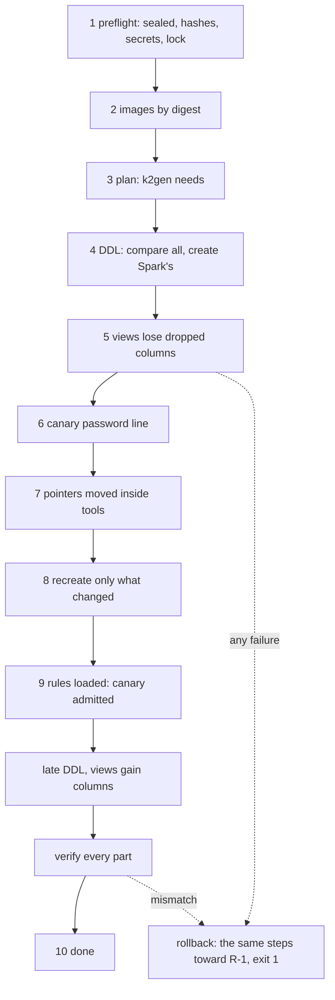

# ADR-058: Deploy sealed releases by moving a pointer, and recreate only what changed

**Status:** Accepted
**Date:** 2026-11-26
**Author:** Platform
**Category:** Release engineering / Operations
**Decided by:** the build's orchestrator on 2026-11-26 (UTC), under the owner's standing delegation for the
platform build, as phase 001 step S19, with an independent adversarial review after it. **Flagged to the
owner for confirmation**; the first revisit trigger is the owner reversing it
**Builds on:** [ADR-056](ADR-056-unified-data-product-platform.md) part 6 ("deploys only from immutable
releases"), [ADR-061](ADR-061-readers-see-dbt-outputs-through-a-view-over-the-tested-tag.md) (the reader
views a deploy must keep in step with the rules)
**Evidence:** experiment (c) of [`2026-11-26-release-spine-spikes.md`](../research/2026-11-26-release-spine-spikes.md);
the rehearsal `make deploy-rehearsal` ([`scripts/verify/deploy_rehearsal.py`](../../scripts/verify/deploy_rehearsal.py)),
run on 2026-11-26 with the results below; `tests/test_deploy.py`

---

## In plain words

Every change to what the platform runs arrives as a **release**: a read-only directory compiled from one
approved git tag, holding the compiled configuration, the compose file and every image by digest. A deploy
points the running services at a new release by moving one link per service, from inside a container
(a link moved on this host is never seen by the containers), then recreates only the services whose
definition or image changed, then asks every part which release it runs. If any answer is wrong, it moves
everything back to the previous release, images included, and exits non-zero. A change of access rules
alone restarts nothing: Trino rereads its rules every 5 seconds. The owner is asked to confirm; nothing else
is asked.

---

## Context

**What runs today, and why it has to change.** Services read their configuration from the live git
checkout through bind mounts, so whatever the checkout holds is live: an edit, a branch switch, a rebase.
On 2026-11-25 switching the checkout to a commit without `docker/airflow/dags/` left Airflow with an empty
DAG folder for 35 minutes (the bind-mount note in `CLAUDE.md`). ADR-056 part 6 decided that services run
only releases. This ADR decides how one is put live and taken back.

**Terms.**

- A **release** is `<releases root>/<id>/`, the root `${K2_RELEASES:-$HOME/k2-releases}`, compiled by
  `k2gen release` from a tag's [document set](glossary.md#document-set-and-provenance) and made read-only
  before it is renamed into place (phase 001 step S08). Its id is `<tag>-<sha12>`, the hash of its files and
  image references, so one tag and one image set give one id.
- Its **manifest** (`manifest.json`, `contracts/schema/manifest.schema.json`) lists every file's sha256,
  every service's image (a registry image as `repo@sha256:<digest>`, a local build as
  `<name>:<image id 12>`) and its **needs**: what deploying it over the previous release requires
  (`recreate`, the compose services whose definition differs; `trinoRestart`, a change under Trino's
  `etc`; `dagShapeChange`; `ddl`, tables to create). `k2gen.model.NEEDS_BY_PREFIX` classifies every path.
- A **pointer** is a symbolic link `<root>/pointers/<service>` to `../<id>`, one each for `trino`,
  `airflow`, `spark`, `prometheus` and `k2-api`. A service reads its configuration through its pointer,
  so moving the pointer changes what it reads without touching the service.
- The **release canary** is a Trino user, `k2_release_<setSha256[:12]>`, that only that release's rules
  admit, to run one statement, `SELECT 1` (S12's rules). Logging in as it is the one question Trino answers
  only with the rules it has loaded.

**What experiment (c) measured on this host** (Docker Desktop on Linux, 2026-11-26): a link renamed on the
host was never seen inside a container (5 of 5, still unseen after 600 s); renamed from inside a container
that mounts the root read-write, with a fresh temporary name and a relative target, it was seen in 0.1 to
0.2 s, and Trino applied the new rules within its 5 s refresh (0.1 to 4.7 s). A pointer mounted on its own
stays on the old release; a deleted and recreated mount reads as missing. Hence the layout rule: mount the
root once, read-only, never recreate it; swap from a container; a reader resolves the pointer once per run.

**What this step found on top.** Three things the design had to absorb, each met in the rehearsal:

1. A `chmod` made inside a container is kept in Docker Desktop's own metadata, so a release sealed by the
   compiler inside the tools container was still writable from the host (`stat` printed 755 on the host,
   555 inside). Deploy seals it on the host too and refuses an unsealed release.
2. Images built from two tags of identical content got different ids: `git archive` stamps each tag's
   commit time on every file, and BuildKit's provenance attestation records the build. Every release would
   have recreated every local build. With file times set to 0, `SOURCE_DATE_EPOCH=0` and
   `--provenance=false`, one tree builds one id (checked by building one tree twice).
3. Python 3.13, which the deploy script runs under, refuses a CA certificate that has no keyUsage
   extension (`CA cert does not include key usage extension`); the rehearsal's fixture CA had to carry it.
   Step S13's `make tls` must write one.

**The ordering constraint of ADR-061.** Reader policies are Trino rules on a view's name; the view's SQL
selects the contract's columns. A release that drops a masked column changes both. If the rules change
first, there is an instant when the view still has the column and no rule masks it (independent review
finding H2). Rules reload on their own 5 s timer and groups on another, so a deploy cannot change both at
one instant: it has to order them.

---

## Decision

**We will deploy only sealed releases, by moving every pointer to the new release from inside the `tools`
container, recreating only the services whose definition or image changed, verifying every part, and
rolling everything back to the previous release, images included, on any failure after the views begin to
move, because that is the only arrangement measured to take effect on this host, it restarts nothing a
change does not need, and its rollback is the same operation in reverse.**

1. **Releases are compiled from a tag by `make release TAG=<tag>`**, in the tools image built from that
   tag (so a release is compiled by its own tag's k2gen), every local image built from the tag's tree
   reproducibly and tagged `<name>:<image id 12>`, every registry image pinned by digest. An image a kept
   release names is never pruned.
2. **The releases root is created once by the host user and mounted, whole, read-only at `/k2/releases`
   in every service; the tools one-shot alone mounts it read-write.** Pointers are relative and are moved
   only inside tools: `ln -s ../<id> pointers/.<svc>.<uuid4>` then a rename over `pointers/<svc>`.
3. **`make deploy RELEASE=<id or tag>` runs one sequence, each step idempotent and recorded** as one line
   of `<root>/deploy-log.jsonl` (`deploy-record.schema.json`; secret files only by sha256): preflight,
   images, plan, DDL, narrow views, canary, swap, recreate, rules loaded, late DDL, widen views, verify, done
   (the diagram). An exclusive lock on the root refuses a second deploy at once.
4. **Only what changed is recreated.** The plan is k2gen's own `needs` from the live release, and from any
   attempt since it that did not finish, to the target. Each service is recreated alone with
   `docker compose up -d --no-deps`, on the release's compose file with an override pinning every image to
   the manifest's digest, and waited healthy. Never a bare `up`, never a capture, Redpanda, MinIO, Postgres
   or Lakekeeper unless the release changes it and `ALLOW_STATEFUL=<service>` names it; a profiled service
   that is not running is never started. A release that changes only rules recreates nothing.
5. **Tables are only ever added.** A table of `needs.ddl` is created when missing, satisfied when the
   catalog's columns and partitioning equal its DDL, and refused, naming the difference, when they differ;
   every table is compared before any is created. Spark's tables (warehouse `k2`) are created before the
   swap when Spark already runs; Trino's after the target's rules are loaded, since they grant `svc.platform`
   its rights.
6. **Views move around the rules in two steps** (ADR-061 part 5's rule, against the tagged snapshot): before
   the swap a view loses each column the new contract drops; once the canary proves the new rules loaded,
   and one more refresh period has passed for the groups, it gains each column the new contract adds that
   the tag holds. A column the contract has and the tag does not stays out of the view, failing closed,
   until the product republishes. The statements are the lake emitter's, made at run time and run as the
   view's publisher only where the stored SQL differs by token; preflight refuses when the deploying
   checkout's emitter would not write the release's own view SQL.
7. **Verification asks every part**: the pointers as the VM and each mounting container see them, the
   files under the pointer against the manifest, the canary admitted and the previous one refused, each
   container's image id against the manifest's, each health check, then the access suite and the catalog
   drift check of step S20 through their entry points (a visible SKIP until S20 lands).
8. **Any failure from the views step on rolls back automatically**: the same sequence toward the previous
   good release from the failed one, recorded as `rollback-<step>`, images included; exit 1, or 3 if the
   rollback fails too. Exit 2 is a refusal before anything changed. `make rollback` runs the same on demand.

---

## Rationale

- **It is what works on this host.** A host-side swap is never seen (experiment c); recreating every
  service per deploy would work but restarts Trino, Airflow and the rest for a rules change. A swap from a
  container is seen at once and costs one short-lived container.
- **The rollback is not a second mechanism.** Going back is a deploy of the previous release from the
  failed one, through the same steps, so it is exercised by every rehearsal of a forward deploy and by its
  own kill tests.
- **The plan is the compiler's.** Deploy does not re-derive what changed: it calls `k2gen.release.needs`,
  the function CI's `k2gen diff` prints, so the plan reviewed in a pull request is the plan deployed.
- **Restarts only when needed.** In the rehearsal a rules-only release restarted no container (every
  `State.StartedAt` unchanged), took 9.1 to 13.4 s, and its rules were loaded 0.19 to 4.25 s after the
  swap; a tightened delay reached a reader polling every 50 ms 3.84 s after it. A release changing one
  service's image recreated that service alone (10.8 s).
- **Pinned images make the rollback whole.** Configuration alone would leave a rolled-back service on the
  failed release's image; with every image in the override by digest, a forced verification failure put
  the stand-in back on its previous image id in 19.0 s and exited 1.
- **The ordering holds under failure.** A release dropping a masked column was deployed while a reader
  polled every 50 ms: 161 polls, the view going from five columns to four, no error and no masked value
  seen. The same reader polled through a deploy killed after each of its 13 steps and rerun, alternately
  forward and back: 3,401 polls, none saw the value, and every rerun converged and verified. Two deploys
  started together: the second was refused at the lock. The rehearsal is 20 checks in 7 min 15 s
  (`make deploy-rehearsal`, 2026-11-26, all passed); `tests/test_deploy.py` fails if the view steps move
  to the wrong side of the swap (checked by moving them).

---

## Alternatives Considered

| Option | Why not |
|--------|---------|
| Swap the pointers on the host (`mv -T` in the deploy script) | Never seen by a container on this host (experiment c: 5 of 5, 600 s). Would work on a Linux engine without file sharing; this host is Docker Desktop |
| Mount each service's pointer directly, recreate every service on every deploy | Works (a direct mount is resolved at create), but every deploy restarts every reader, Trino's 11 s start included, and a rules change no longer needs none |
| One pointer for the whole release | Equivalent today (every pointer moves together); per-service pointers keep the frozen A1 layout and leave room for staged moves. Plan 001 leaves this to the owner; the default is kept |
| Deploy straight from the git checkout (`git checkout <tag>` then `docker compose up`) | The incident of 2026-11-25: whatever the checkout holds is live, nothing records what ran, and a rollback is another checkout |
| A blue-green second stack | Twice the 16.80 CPU / 28.750 GiB budget at the bootstrap peak on one host (ADR-045's 25 CPU / 48 GiB ceiling) |
| Alter an existing table to match changed DDL | A silent schema change at deploy; ADR-056 makes a column drop or retype a major version. Refused instead, with `make drop` as the way forward |
| Change rules and views in one step | Rules and groups reload on their own 5 s timers; no single instant changes both, and the wrong order shows a masked value (review H2) |

---

## Consequences

**Easier:** a change of rules or grants is a deploy with no restart; every deploy and rollback leaves a
record of who, what, from where and which secret files (by hash); a failed deploy undoes itself; the plan
is printed before anything moves (`PLAN=1`).
**Harder:** every change goes through a tag and `make release`, even one line; the releases root is a new
thing to back up (the backup set's `releases` entry) and must never be recreated; local images are rebuilt
per release (cached, reproducible) and accumulate until pruning exists.
**Committed to:** the tools image as the one read-write holder of the root; the canary convention, with its
password line in `${K2_SECRETS}/trino/password.db` written in place under the file's lock; deploying from a
checkout whose k2gen matches the release's (preflight refuses otherwise); `make` reports any failure as its
own exit 2, so the script prints its own code as its last line (`deploy: exit 1: ...`).
**Risks:** a deploy killed mid-way leaves a mixed state until it is rerun or rolled back (the rehearsal
killed one after each step and every rerun converged); a first deploy has no previous release to go back
to and exits 3; the drain before a Trino restart or a DAG change is a visible SKIP until phase 002 has DAGs
to drain.
**What is not yet verified:** the live cutover (step S22 makes the stack read through the pointers);
Airflow's DAG folder through its pointer under the 30 s refresh (measured in experiment c, not by this
deploy); a real `make access-verify` and drift check (S20); the image-pruning rule (no pruning exists yet);
a dropped landing prefix proven empty through MinIO (unit-tested against a fake, not rehearsed); a deploy on
a Linux engine without Docker Desktop.

**Revisit when:** the owner reverses it; a deploy is measured to take longer than 10 minutes, or a
rules-only deploy to restart a container; the platform moves to more than one host (the pointer and the
lock are one host's); the host stops being Docker Desktop (a host-side swap may then be enough); or the
release gate `v3.0.0` (phase N11), whichever comes first.

---

## References

- Plan [001, the release and rules spine](../plans/2026-11-26-unified-product-platform/001-release-and-rules-spine.md); the frozen interfaces
  [`docs/development/phase-001-interfaces.md`](../development/phase-001-interfaces.md) (A1, A13, the secrets table) and
  [`platform/k2gen/INTERFACES.md`](../../platform/k2gen/INTERFACES.md).
- Runbooks: [deploy a release](../runbooks/deploy-a-release.md), [roll back a release](../runbooks/roll-back-a-release.md).
- Code: [`scripts/deploy.py`](../../scripts/deploy.py), [`docker/tools/`](../../docker/tools/Dockerfile), [`mk/release.mk`](../../mk/release.mk).
- A proposed ADR-042 (one platform version with recorded rollouts) is on an unmerged branch; it is not
  part of this decision, and reconciling the two is the owner's.

---

## Outcome (2026-11-27, step S19b: integrated with identity, the rules, the access suite and the guarded view)

The decision stands; integrating it with steps S12, S13 and S20 and with the fix of the review of
S12 (the reader view now fails closed unless its base is a tagged Iceberg table, by a `WHERE EXISTS`
over `<base>$refs` that only the new rules let the publisher read) changed five things in the
sequence, each proven on the rehearsal (`make deploy-rehearsal`, 2026-11-27, and the cutover from today's shape and back with `CUTOVER=1`).

1. **Release-time suites in preflight.** Before anything moves, one throwaway lake started from the
   release (`scripts/lib/throwaway-lake.sh`) runs S20's 63 access rows and the tested-data marker; a
   failure refuses the deploy (exit 2). A sealed release's pass is kept by its id under
   `<releases root>/verify/`, so each release pays once (63 of 63 rows and 11 marker checks; a rules-only deploy of a new release took 49 s with them, a rerun of one already passed 27 s).
2. **Each release writes its views with its own emitter**, in its own tools image, not the deploying
   checkout's k2gen: a view shape is readable only under the rules of the release that made it. The
   order per case: (a) columns dropped: narrowed before the rules move, in the target's shape when the
   source's rules admit it, else (Trino answers PERMISSION_DENIED) in the source's shape; (b) the shape
   or the publisher's grants changed with no column change: rewritten after the target's rules are
   loaded (the widen step); (c) both: (a), then (b). Readers saw no error and no masked value across
   the old shape to the guarded one, a `make rollback` back and a deploy forward (897 polls at 50 ms, no error, no masked value; 9,441 more through a kill after each step). The
   one window left is stated: were a target's rules to refuse the source's shape AND the source's
   rules the target's, the view's readers would get access errors, failing closed, from the rules
   switch until the widen step, at most `RULES_WAIT_S` plus one refresh (25 s); no release pair here
   does both. The preflight check that the checkout's emitter matches the release is gone with it.
3. **A retired product's views are not synced** (a visible line): its rules are gone, so no reader
   reaches them and its publisher holds nothing to write them with; dropping them is `make drop`'s.
   The lake emitter still lists them in `views.json`; it should not (or should mark them retired), so
   that the drift check and deploy agree on what a release holds.
4. **Verification calls S20's and S13's entry points**: the drift check inside the tools one-shot on
   the catalog's network (`catalog_drift.py --release`, exit 0 clean, 1 drift, 2 unreachable), then
   `make access-verify LIVE=1` once the drift check finds every product published (a product not yet
   published is a visible SKIP: its rows ran at release time), and, in `make release-verify`,
   `scripts/verify/identity.sh` on the live Trino. Every failed step's record carries its `reason`
   (`deploy-record.schema.json`, an additive field), and a secret file is recorded by its mode and size,
   no longer by its sha256 (part 3 above; the review of identity). Preflight refuses first when
   `scripts/check-env.py --mode-only` or `make principals-status` fails, and the canary's line is
   written by principal-secret.py's own slot writer (fixed 128-byte lines, the whole file checked).
5. **`make release` pins what deploy never recreates by what runs**: captures, Redpanda, MinIO,
   Postgres and Lakekeeper keep the running container's image (a warning names a tag that differs),
   so the one-time cutover needs no capture restart (`docs/runbooks/first-cutover-to-releases.md`).

Found on the way, and fixed where they live: the drift and marker checks compared Trino's stored view
SQL with the generator's by token, and Trino parenthesises every comparison, AND and EXISTS, so the
guarded view never compared equal (`catalog_drift.tokens` now drops exactly the pairs whose removal
cannot change a meaning); `identity.sh` read only `--etc-dir <path>`, not A1's `--etc-dir=<path>`; the
access suite did not read people's passwords where the throwaway lake now files them (handled in
deploy's own call path, its owner fixing the reader).
