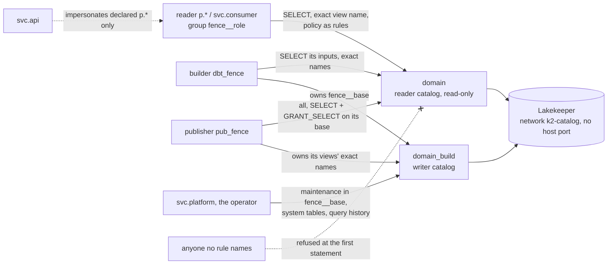

# ADR-059: Access rules compiled per release, default deny, over two catalogs per domain

**Status:** Accepted, decided 2026-11-26 by the build's orchestrator under the owner's standing delegation,
on the same footing as [ADR-061](ADR-061-readers-see-dbt-outputs-through-a-view-over-the-tested-tag.md);
**flagged to the owner for confirmation**. The rules are compiled and tested from phase 001 step S12; they and
the `k2-catalog` network go live with step S22
**Date:** 2026-11-26
**Author:** Platform
**Category:** Access / Storage layout
**Supersedes:** [ADR-044](ADR-044-producer-lake-and-domain-mart-warehouses.md) (one writable catalog and one
writer per domain, rules generated by `make generate`), when S22 makes this live; ADR-044's producer lake,
warehouse per domain and naming stand
**Evidence:** the rules test, `make test-trino` ([`scripts/trino-rules-test.sh`](../../scripts/trino-rules-test.sh));
spike (e) of [`2026-11-26-release-spine-spikes.md`](../research/2026-11-26-release-spine-spikes.md); the gate
[`2026-11-26-tested-data-view-gate.md`](../research/2026-11-26-tested-data-view-gate.md) (rows `h1.02` and so on)

---

## In plain words

Trino decides who may read and change what from one rules file, and today's is hand-generated, open by
default and one writer per domain: anyone may read anything, query history included, and a writer can roll
back another product's table. We will compile the rules from each release's documents so that everything is
refused unless a rule names it, every name in a rule is exact, and each domain has a read-only catalog for
readers and a writable one that only that domain's builders and publishers reach. The catalog service, which
has no login, moves onto a network of its own. The costs are a rules file that grows with every product and
principal, a release for every grant, and a fence that is a network, not a password, until the release gate.
The owner is asked to confirm a decision the build's orchestrator took.

---

## Context

- **How Trino decides.** Trino's file-based access control reads one JSON
  [rules file](glossary.md#access-rules-and-the-file-group-provider): one ordered list per kind of thing
  (catalogs, schemas, tables, session properties, queries, impersonation, system information, procedures,
  functions, authorization), where the first rule whose user or group matches decides. Every name in a rule
  is a Java regular expression matched against the whole name, so an unescaped `.` matches any character:
  `svc.platform` also admits a user called `svcXplatform`, and `station_readings.*` also matches the base
  namespace `station_readings__base` and a product called `station-readings-twin`.
- **Trino's defaults are open.** With a section absent, every user may set every session property, view and
  kill every other user's query, and run only built-in functions and procedures; every user reaches the
  `system` catalog unless a rule says otherwise (Trino 484 documentation). The live, hand-generated
  [`docker/trino/etc/rules.json`](../../platform/k2gen/k2gen/emit/trino_rules.py) gives `all` on every catalog and ends with
  a catch-all `SELECT`, which opens `system.runtime.queries`, the query history holding every statement's text,
  to every user (the gate's "Surprises").
- **`SELECT` in a writable catalog is the right to change a table.** Trino 484 checks a
  [table procedure](glossary.md#table-procedure) (`ALTER TABLE ... EXECUTE optimize`, `expire_snapshots`,
  `rollback_to_snapshot`) as `SELECT` on that table. Spike (e) measured it: a writer given `SELECT` on another
  writer's table in their shared writable catalog ran six procedures on it, and its `rollback_to_snapshot`
  moved the table; with no privilege on it, 40 of 40 statements were refused. Only a
  [read-only connector](glossary.md#read-only-connector) refuses a procedure to someone allowed `SELECT`.
  ADR-044's one writable catalog per domain gives every domain writer the whole domain, and its rules let any
  user run procedures there (its stated gap).
- **The tested-data design needs exact names and two catalogs.** [ADR-061](ADR-061-readers-see-dbt-outputs-through-a-view-over-the-tested-tag.md)
  serves each dbt output through a [definer view](glossary.md#definer-view) owned by a publisher. Trino lets
  that view read its base only if the owner holds catalog access `all` on the base's catalog and
  `GRANT_SELECT` on the base (gate h1.13, h1.14); the read-only connector still refused that owner all 9 writes
  tried (h1.02). Readers must reach the view and never the base, its metadata tables (`t$files` carries column
  bounds, [`SPIKE-ACCESS.md`](../research/2026-11-26-unified-platform-architecture/SPIKE-ACCESS.md)) or the
  statistics session property (h1.23, h1.24).
- **The catalog has no login.** Lakekeeper stores a view's owner as a property any REST client can set; from
  any container on `k2-net` the gate forged a view and grafted an untested snapshot, each read by a reader
  (h3.04, h3.07). Trino's rules cannot stop a client that bypasses Trino.

---

## Decision

**We will compile Trino's rules and groups from each release's documents (`emit/trino_rules.py`),
refusing everything no rule names, with every name exact and escaped, over a read-only reader catalog and a
writable build catalog per domain, and put Lakekeeper on its own network, because spike (e) and the gate
measured that only exact, per-product privileges keep one writer off another's tables and every reader off
the bases, and Trino cannot fence a client that talks to the catalog directly.** Scope: who may do what
through Trino, and who may reach the catalog. Storage keys per identity are phase 002's.

*Reading guide.* Solid arrows are what the rules allow; the crossed arrow is a refusal. `fence` stands for a
product's name as an identifier, `domain` for its domain's.

1. **Catalogs** (compiled by S11's `emit/trino_etc.py`): `lake`, read-only over warehouse `k2`; per domain a
   [reader catalog](glossary.md#reader-and-writer-catalogs) `<domain>` (`iceberg.security=read_only`, table
   statistics off) and a writer catalog `<domain>_build`. `<domain>_build` is reached by that domain's
   builders and publishers, by `svc.runs` (governance's only, for the run records) and by `svc.platform`;
   never by a reader, whose catalog access is read-only and only to catalogs holding something it is granted.
   `all` on a reader catalog goes to that domain's publishers alone.
2. **[Default deny](glossary.md#default-deny-and-exact-name-rules).** No section ends in a rule that matches everyone, except one refusal: `system` is `none`
   for anyone not named before it, since Trino grants `system` to all otherwise. A user no rule names is refused
   its first statement, `SELECT 1` included (`queries` lists every known principal for `execute`). There are no
   `functions` rules, so only `system.builtin` functions run and `table_changes` and every catalog function are
   refused; no `authorization` rules, so `SET AUTHORIZATION` is refused; one procedure rule, the operator's
   `system.runtime.kill_query`.
3. **[Exact names](glossary.md#default-deny-and-exact-name-rules).** Every user, group, catalog, schema, table, property and impersonation name is an
   alternation of exact names, each through `re.escape`. A rule leaves the table out only where names are not
   the documents' to give: a builder in its own base namespace (dbt's temporary tables), the operator's base
   maintenance, and the operator's `system`. So `t` never matches `t$files`, and no rule a product earns
   matches a product whose name extends it.
4. **Who holds what.**

   | Principal | Holds |
   |---|---|
   | Reader (a `<fence>__<role>` group member, from `grants.yaml`: [principal, role and grant](glossary.md#principal-role-and-grant)) | `SELECT` on each exact reader relation offering its role, its [policy](glossary.md#named-access-policy) as rules there: `rowScope` and `delay` as one row filter, masks as typed nulls; `system.jdbc` and `system.metadata` tables by name, which list only what it may see |
   | Builder `dbt_<fence>` | owner of `<fence>__base` in its `_build` with `SELECT INSERT DELETE UPDATE OWNERSHIP`, never `GRANT_SELECT`; `SELECT` on its own bronze and its declared inputs by exact name, through `lake` or a reader catalog only; `system.metadata` |
   | [Publisher](glossary.md#tested-data-view-base-namespace-and-publisher) `pub_<fence>` | owner of `<fence>` in its `_build`, `SELECT OWNERSHIP` on its views' exact names there; `SELECT GRANT_SELECT` on its own base tables through the reader catalog; nothing else. No other principal holds `GRANT_SELECT` |
   | `svc.platform`, the [operator](glossary.md#operator-principal) | `all` on every `_build`; `SELECT` in base namespaces there (table maintenance); the run-record table's DDL; all of `system`, viewing and killing any query, system information, every session property; nothing in a reader namespace (gate h1.33) |
   | `svc.runs`, `svc.catalog`, `svc.api` | `SELECT` on exactly `<table>$refs` of each lake table; `svc.runs` writes, `svc.catalog` reads the run records |
   | `svc.api` | [impersonates](glossary.md#impersonation) each declared `p.*` principal by name, nobody else, so REST runs as its caller under the caller's rules |
   | [Release canary](glossary.md#release-canary) `k2_release_<setSha256[:12]>` | may execute and reach nothing, so `SELECT 1` as it succeeds exactly while this release's rules are loaded |

5. **Session properties.** Catalog properties: `svc.platform` any; the other pipeline principals (builders,
   publishers, `svc.runs`, `svc.catalog`) `statistics_enabled` only, so retention floors, encrypted-table
   plaintext reads and every other Iceberg property stay the operator's; everyone else none, by statement and
   by header. System properties: pipeline principals only.
6. **Fail closed at compile.** The compiler runs no check first, so the emitter refuses what would make a rule
   ambiguous or wider: two roles for one principal on one product, a grant to a builder, publisher, platform
   service or canary, a policy naming a role the table does not offer or a column it lacks, an input no product
   offers.
7. **The catalog fence.** Lakekeeper joins network `k2-catalog` with only the platform's own services
   (`lakekeeper`, its migrate job, Postgres, MinIO, Trino, Spark, `lake-init`, `tools`, `dbt-runner`), on no
   other network and with no host port; `fetch` and third-party images never join ([catalog fence](glossary.md#catalog-fence-and-drift-check)). The drift check (S20) runs at
   every `release-verify` and reconcile, as ADR-061 part 6 states.

---

## Rationale

The rules test runs a compiled release's own etc, rules and groups on Trino 484 over a throwaway lake and
attacks them as a table of named rows. Its run of 2026-11-26 (`make test-trino`, 143 s with the images present)
printed 58 rows, 55 PASS, 0 FAIL, 3 INFO (the set's probe and drift rows, which S20 and S22 run), then its
negative control and experiment (e)'s control, and exited 0:

- writer against writer in one `_build` catalog, and a writer from another domain through it: 40 of 40
  statements refused, the target's refs, snapshots, rows, columns and comment unchanged; the same builder on its
  own table ran all 40 but the two `CALL`s and the 0 s retention floor, so the refusals are the fence;
- through the read-only reader catalog, an input's builder selected and ran no write or procedure;
- every base path (19 kinds, both catalogs, every reader, four strangers and `svc.api`): 1,023 of 1,023 refused;
- each role read exactly its policy's rows and masks, never the untested row, and `svc.api` impersonating a
  person got that person's rows; a view planted by REST under an undeclared name, its owner set to the real
  publisher and its SQL over `main`, was refused to every reader;
- the negative control widened one reader rule's schema to `station_readings.*` in place: the fence matrix
  (12 base paths opened), the twin product's view row and the listing row failed, so the suite can fail;
- with a mask naming a column the view lacks, Trino 484 ignored the mask (rows as without it); with a row
  filter naming one, the read failed (`COLUMN_NOT_FOUND ... Invalid row filter`): neither shows more.

Exact names cost a longer file and buy what the matrix proves.

---

## Alternatives Considered

| Option | Why not |
|--------|---------|
| Keep ADR-044: one writable catalog and one writer per domain, everyone reads everything | A writer can roll back any table of its domain, readers would reach bases and untested `main`, and query history is open (spike (e), the gate) |
| One writer catalog per product (spike (e) R2) | Also fences writers, but catalogs multiply and need a restart, or Trino's dynamic catalogs, whose writable store cannot live in a sealed release; exact names give the same fence in one catalog |
| Pattern rules (`dbt_.*`, `pub_.*`, `svc\..*`) | A shorter file, but any new principal or product whose name fits a pattern gets its privileges before anyone approves it; with exact names a grant is a reviewed release |
| Open Policy Agent access control | Checks table procedures per table natively, but adds a policy engine and its language to run and test; the file rules already fence what spike (e) measured |
| Authentication on Lakekeeper now, instead of a network | Closes forgeries at the source, but needs an identity provider and the catalog's authorizer on every client; deferred to the release gate (ADR-061) |

---

## Consequences

**Easier:** a policy or grant change is a rules-only deploy read through the pointer within 5 s; every rule is
explained by one document; a reviewer can check a grant by reading one exact name.
**Harder:** each new principal, grant or product needs a release; the rules file grows with products times
roles; JDBC clients see `system.jdbc` only for readers, and consumers can set no session property, which a
future k2-api timeout setting would need.
**Committed to:** the build and reader catalog split, exact names, default deny, the operator as `svc.platform`
(a person operates through the `tools` container as it), and `svc.api` acting only as declared people.
**Risks:**
- A publisher can still drop its own view and create a table at the same exact name, which readers would read;
  the drift check, not the rules, catches it.
- When a release drops a masked column, the rules stop masking it while the old view still projects it: the
  test's record row shows the value appearing. Deploy (S19) must sync views before it moves the rules pointer.
- `svc.api` may not impersonate a consumer service (`svc.<name>`), though `compiled/api/principals.json` (S14)
  lists them as k2-api callers; until one side changes, such a caller is refused at Trino, which fails closed.
- ADR-044's stated gap, table procedures open inside domain catalogs, closes with this ADR, and its
  `make test-trino` assertion of the gap goes with the old test.

**What is not yet verified:** the rules on the live stack (S22); dbt-trino building and testing as a builder
under them, which reads `system.metadata` (phase 002); the drift check (S20); Spark, which bypasses Trino and
is fenced by storage keys only (phase 002); resource-group placement under load; impersonation through k2-api
itself (phase 003); a Lakekeeper forgery from a third-party container on `k2-catalog`, which the network rule
forbids rather than prevents.

**Revisit when:** (1) the owner reverses it; (2) Lakekeeper gains authentication at the release gate, which
retires the network fence's role as the only control; (3) the rules file passes 1 MiB or Trino's reload of it
is measured over 1 s, the point to group rules by catalog or move to OPA; (4) a consumer service needs REST, or a
consumer needs a session property, which reopens the impersonation and session rules; (5) Trino gains per-table
procedure privileges in file rules, which would let builders hold `SELECT` through writable catalogs again.

---

## Outcome (2026-11-26, after the independent review of step S12)

An adversarial review of the compiled rules found that a builder could swap its base table for a view
that readers were then served (critical), and three high findings. What changed in the rules, each
tested in `make test-k2gen` and, where Trino decides, by a row of
[`scripts/trino_rules_c1_test.py`](../../scripts/trino_rules_c1_test.py) on a throwaway lake:

- **The publisher reads its bases' refs.** Each reader view now guards on `<table>$refs`, the Iceberg
  metadata table of a base's branches and tags, so it fails when the base is not a tagged Iceberg table
  ([ADR-061](ADR-061-readers-see-dbt-outputs-through-a-view-over-the-tested-tag.md)'s Outcome of this
  date). Trino's definer-view owner check asks `GRANT_SELECT` of every relation a view reads, so
  `pub_<fence>`'s rule on its bases through the reader catalog names `<table>` and `<table>$refs`, by exact
  name, with `SELECT` and `GRANT_SELECT`; with `SELECT` alone every read failed (`View owner does not have
  sufficient privileges`). It learns nothing it does not write: it moves the tag itself.
- **A delay's column is `timestamp(6) with time zone`.** On any other time type the delay moved with the
  reader's session time zone (`h1.delay-zone`); the emitter raises, and `access.delay-type` reports it first.
- **A connector (bronze) table offers no role.** `SELECT` on an Iceberg table reads every ref and snapshot
  of it, the write-audit-publish branch's unaudited rows included, and the interfaces define no reader view
  over bronze (a connector table's reader relation is `lake.<fence>.<table>` itself), so readers reach
  bronze through a dbt output; the emitter raises, and `access.connector-role` reports it. A consequence
  not yet met: a product that reads another product's bronze as an input port can then offer no role
  (`access.inherit-role` reads no role as no access).
- **Product status is honoured** (ADR-055 part 4, least privilege). `active` and `deprecated` get every
  rule; `deprecated`'s "no new reader" is `access.grant-new-on-deprecated`, against the previous release.
  `paused` keeps its readers and its publisher, whose rights keep the definer views readable and let a
  release re-sync them, and loses every builder rule, the right to run a query included. `retired` gets no
  rule at all, and an input port on one fails closed; the platform reads its rows through Spark.
- **Risk 3 closed.** `compiled/api/principals.json` now lists exactly whom the rules let `svc.api` become
  (the declared `p.*` people, one function for both emitters), so k2-api serves no key Trino would refuse.

Risks to add: a publisher can alias a column past its mask (`"note" AS "note_2"`), which Trino leaves
unmasked; the drift check compares view SQL token for token (step S20). A builder can create a view named
`<table>$refs` in its base namespace while the base is absent, which Trino never reads as refs and cannot
drop (`c1.refs-litter`); the drift check's REST listing names it. Trino 484 refuses branch DDL to every
principal through an internal error in the file access control, not through a rule (`c1.branch-ddl`).

The policies leak more than counts: a delayed or scoped reader can binary-search the processed-row count
for the bounds of hidden rows' visible columns, though never a masked value or an untested row; a row
scope on an identity partition field closes it for the scope (`access.row-scope-unpartitioned`), and
nothing closes it for a delay (ADR-061's Outcome). The rules therefore suit readers the owner trusts not
to probe.

**Revisit when**, besides the triggers above: (6) Trino is upgraded, which may make branch DDL reachable
(rerun `c1.branch-ddl`); (7) a product is licensed to a principal outside the owner's team, whose delayed or
scoped data must then be physically separate; (8) a product needs another product's bronze as an input
and must offer a role.

## Outcome (2026-11-27, after the independent review of the phase and the live cutover)

Part 7 went live on 2026-11-27: Lakekeeper is on `k2-catalog` alone with no host port, and
`scripts/verify/catalog-fence.sh` (`make catalog-fence`, and every `release-verify`) checks the running
stack: Lakekeeper publishes no port, sits on that network only, and the network holds only the services
listed in `tests/access/catalog-fence-allow.txt`; a test holds `docker-compose.yml` to the same list on
every pull request. Until this review nothing ran the fence's probes at all.

The fence is narrower than part 7 reads. A network fence stops a service that can only open connections.
It does not stop a service that holds the Docker socket, because whoever holds the socket can start a
container on any network, `k2-catalog` included, and read any container's environment. Two services hold
it: `airflow-scheduler`, by design (from phase 002 it starts the fetch, load and dbt one-shots), and
`cadvisor`, a third-party image, to name containers in its metrics. Both are therefore inside the
catalog's trust boundary, whatever network they are on. What limits this today: Airflow runs only DAGs
generated from a release and no product code (parsers run in `fetch`, models in `dbt-runner`, neither with
the socket), and both images are pinned by digest.

**Revisit when**, besides the triggers above: (9) the hardening sprint after phase 005 puts `cadvisor`
behind a socket proxy that allows only read calls, or replaces it; (10) any service that runs code a
product supplies would need the socket; (11) Lakekeeper gains authentication the engines can use, which
makes the fence a second line instead of the only one.

## Outcome (2026-11-27, phases 002 and 003: one-shots, storage and the host)

The rules are unchanged in kind. What phases 002 and 003 changed around them:

- **The scheduler starts one-shots from allow-lists.** `docker/airflow/dags/oneshot.py` starts each
  container kind with exactly what the run's release lists in `compiled/oneshots.json` and never more
  than its kind may have: `fetch` the network `k2-egress`, the release id and no secret; `dbt-runner` the
  network `k2-catalog`, its seven environment names, the builder's, publisher's and `svc.runs`'s password
  files and the CA; `tools` `k2-net` and `k2-catalog`, the release id and the CA. So the scheduler's own
  variables (its database URL, its JWT secret) and the other secret files (`tls/ca.key`, `password.db`,
  `principals/`) never reach a one-shot, whatever a release says. Every one-shot runs `--rm`, `--pull
  never`, with a read-only root, a 64 MiB `noexec` `/tmp`, every capability dropped, no new privileges
  and at most 256 processes, never privileged and never with the socket; a kind with a secret runs as the
  host user who owns the mode-600 files. `docker/airflow/tests/test_oneshot.py` holds the lists equal to
  k2gen's compiled kinds. `scripts/verify/oneshot-slots.sh` measured the slots on a throwaway Airflow
  (0 FAIL, 2026-11-27): four LocalExecutor slots and the pools `lake_spark` 1, `fetch` 1 and `dbt` 2 held;
  a task marked failed left no container within about 5 s; after a scheduler crash a running task was
  reset only by Airflow's orphan check, every 300 s by default, which the stack sets to 30 s
  (`AIRFLOW__SCHEDULER__ORPHANED_TASKS_CHECK_INTERVAL`).
- **fetch is off `k2-net`.** It joins `k2-egress` alone, a network no other service joins; the fence
  rows `fetch -> lakekeeper:8181` and `fetch -> minio:9000` expect `refused`
  ([ADR-036](ADR-036-connectors-land-verbatim-then-publish-bronze-after-audit.md)'s Outcome).
- **No path around Trino from the host.** MinIO publishes no host port: its S3 API (9000) and its
  console (9001, a root-pair login) are reached only from a container on `k2-net` or `k2-catalog`, and
  the rows `host -> 127.0.0.1:9000` and `host -> 127.0.0.1:9001` expect `refused`. With remote signing off
  and a storage key per engine ([ADR-054](ADR-054-a-storage-key-per-engine-with-catalog-signing-off.md)),
  Spark and Trino each hold only their own part of the lake; Spark still bypasses Trino's rules inside
  its part, and the scheduler's socket is still inside the catalog's boundary (the Outcome above).
- **What the tools steps hold.** The `tools` service holds no storage key, so swap, pointers and the
  catalog site generator never hold one; the site step holds `svc.catalog`'s password and the CA. The live
  access suite, run in `tools` at every verify, holds each engine's storage pair (by name, for that run),
  the passwords the platform holds under `principals/`, the CA and the readers' API key files.
  `scripts/backup-lake.sh` starts its own container with the backup pair alone. `make drop` still uses the
  root pair.
- **`k2-api` reaches Trino only.** It sits on `k2-net`, never `k2-catalog`, and has one Trino identity,
  `svc.api`, which impersonates exactly the principals of `compiled/api/principals.json`.

**Still open:** compose configures no authentication for Redpanda or Alertmanager, so every service on
`k2-net` can reach both; only fetch, which runs product code, was moved off that network.
