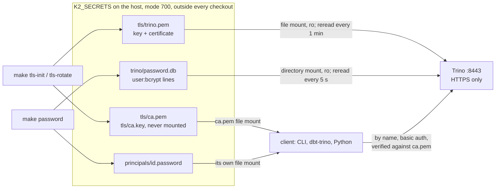

# ADR-060: Trino logins by password over TLS, under a local CA

**Status:** Accepted. The identity model is the owner's decision O3 of 2026-11-26
([`DECISIONS-FINAL.md`](../research/2026-11-26-unified-platform-architecture/DECISIONS-FINAL.md)); its mechanisms
here were decided 2026-11-26 by the build's orchestrator under the owner's standing delegation, on the same
footing as [ADR-061](ADR-061-readers-see-dbt-outputs-through-a-view-over-the-tested-tag.md), and are
**flagged to the owner for confirmation**. Built and tested from phase 001 step S13; live with step S22
**Date:** 2026-11-26
**Author:** Platform
**Category:** Access / Identity
**Implements:** [ADR-056](ADR-056-unified-data-product-platform.md) part 5, "Identity: passwords over TLS"; closes
[ADR-044](ADR-044-producer-lake-and-domain-mart-warehouses.md)'s stated limit, "identity is the unauthenticated
`X-Trino-User` header", when S22 makes it live
**Evidence:** `make test-trino` ([`scripts/trino-rules-test.sh`](../../scripts/trino-rules-test.sh)), which ends with
[`scripts/verify/identity.sh`](../../scripts/verify/identity.sh) (rows `I01` to `I18`, cited below); `make test-python`
([`tests/test_tls.py`](../../tests/test_tls.py)); the runbook [`tls-and-passwords.md`](../runbooks/tls-and-passwords.md)

---

## In plain words

Today Trino believes whatever user name a client sends, so the access rules of
[ADR-059](ADR-059-access-rules-compiled-default-deny-over-two-catalogs-per-domain.md) stop mistakes but not a
liar. Every client will log in with a password of its own, and only over an encrypted connection whose
certificate it checks against a certificate authority the platform makes on this host. Passwords and keys
live in files outside every checkout and release; a password changes within 5 seconds and a certificate within a
minute, neither with a restart. The costs: a CA and a 90-day certificate to look after, a minute of refused
connections when the CA itself is replaced, longer client commands, and secrets that exist on one host only.
Single sign-on, client certificates and a secrets manager are not built; the owner is asked to confirm the
mechanisms.

---

## Context

- **Identity today is a header.** The live Trino listens on plain HTTP (host port 8088, loopback only) with no
  authentication: the user is whatever the client puts in the `X-Trino-User` header. Any process on the host or
  on the Docker network `k2-net` can be `svc.platform`, the [operator](glossary.md#operator-principal), and read
  the query history. ADR-059's rules, compiled and tested in step S12, assume the user is who it says it is.
- **The owner's decision.** O3: Trino's password login over encrypted connections, built early because every
  client depends on it; the REST API authenticates its callers with keys and queries Trino as the caller
  ([impersonation](glossary.md#impersonation)); no single sign-on for 3.0.
- **How Trino 484 takes a password.** With `http-server.authentication.type=PASSWORD`, Trino accepts a password
  only over HTTPS, as HTTP basic authentication (the user and password in one header). The
  [file password authenticator](glossary.md#password-file-and-bcrypt) reads one `<user>:<hash>` line per user,
  the hash bcrypt with cost at least 8 and the `$2y$` prefix, and rereads the file every `file.refresh-period`
  (Trino 484 documentation). Step S14 writes those lines (`scripts/principal-secret.py`, cost 10).
- **HTTPS needs a certificate the clients can check.** A [TLS](glossary.md#tls-certificate-and-certificate-authority)
  client checks that the server's certificate was signed by an authority it trusts, is within its dates, and
  names the host it asked for. Trino's names here are `trino` (its service name on the Docker network) and
  `localhost` (from the host, and inside the container); neither is a public DNS name, so no public authority
  will sign for them.
- **With plain HTTP off, Trino talks to itself over HTTPS too.** It then needs
  `internal-communication.shared-secret` and makes an internal certificate from that secret, for its own IP
  addresses (step S11, `internalUri is null` without it). It picks which certificate to show by the name the
  client asks for ([SNI](glossary.md#tls-certificate-and-certificate-authority)): a client that connects by IP
  address, or asks for a name the certificate lacks, is shown the internal certificate (measured: subject `CN=k2`,
  names `172-23-0-6.ip`, `127.0.0.1` and kin). So the shared secret is key material, and clients must connect by
  name.
- **Files change under running containers.** Through Docker Desktop's file sharing, a container keeps reading the
  old file after a file is renamed over it, and sees an in-place write at once (S09, S14,
  [`CLAUDE.md`](../../CLAUDE.md)'s bind-mount note). Editors and `mv` rename; a rotation must not.
- **Trino rereads its own certificate.** Its HTTP server reloads its keystore (the file holding its key and
  certificate) on a timer,
  `http-server.https.ssl-context.refresh-time`, default `1.00m` (Trino 484's start-up log).

---

## Decision

**We will make every Trino login a password over HTTPS, checked by the client against a local certificate
authority by name, with every secret in files under `${K2_SECRETS}` rewritten in place, because the owner chose
passwords over TLS and this is the smallest set of moving parts that makes ADR-059's rules hold against a client
that lies, on one host.** Scope: Trino and its clients. k2-api's keys are S14's and phase 003's; Lakekeeper stays
fenced by network, not authenticated (ADR-059, ADR-061).

*Reading guide.* Boxes in the frame are files on the host; arrows into Trino and the client are read-only
mounts; the arrow between client and Trino is the only network path, and it is encrypted.

1. **HTTPS only, password login.** Trino listens on 8443 with HTTPS and no plain HTTP listener; authentication
   type `PASSWORD` (S11's `config.properties`); the file authenticator reads
   `/run/k2-secrets/trino/password.db` every 5 s (`compiled/trino/etc/password-authenticator.properties`, S13's
   `emit/trino_identity.py`). No password, no hash and no principal name is compiled into a release.
2. **A local CA** (`scripts/tls.sh`, `make tls-init`). ECDSA P-256 keys (elliptic-curve signature keys on the
   NIST P-256 curve). The CA lives 1826 days, may sign no other
   CA (`pathlen:0`) and carries a critical **name constraint**: it may sign only `trino` and `localhost`, so its
   key, if stolen, signs nothing else a client would accept. Trino's certificate lives 90 days and names exactly
   `trino` and `localhost`; no IP address, since Trino can never show it to a client that connects by one. A
   rerun changes nothing; an existing CA is replaced only with `FORCE=1`.
3. **Where secrets live.** Under `${K2_SECRETS:-$HOME/k2-secrets}`, refused inside a git checkout, every directory
   mode 700 and every key or password file mode 600, laid out by `model.SECRET_FILES`: `tls/ca.pem`, `tls/ca.key`,
   `tls/trino.pem`, `trino/password.db`, `principals/<id>.password`, and the release canary's
   `canary/<canary>.password` (S19). A container mounts only what it reads, read-only: Trino the file
   `tls/trino.pem` and the directory `trino/`; a client the file `tls/ca.pem` and its own password file at
   `model.password_mount`. **Nothing mounts `tls/` as a directory**, since `ca.key` is in it. The internal shared
   secret is `K2_TRINO_SHARED_SECRET` in `.env` (`openssl rand -hex 32`), read by Trino as
   `${ENV:K2_TRINO_SHARED_SECRET}`, never written to a file of a release.
4. **Rotation without a restart.** Every writer rewrites in place under an exclusive lock on the file, never by a
   rename. A password made, rotated or removed takes effect at Trino's next 5 s refresh; Trino's certificate,
   reissued by `make tls-rotate` under the same CA, at its next keystore refresh, within a minute. Replacing the CA
   (`make tls-init FORCE=1`) changes every client's `ca.pem` at once and Trino's certificate within that minute,
   so clients are refused for up to a minute. `make tls-status` prints each certificate's names, expiry and days
   left, never a key, and exits non-zero within `MIN_DAYS` (30) of an expiry: until an alert rule lands in a later
   step, that exit code is the alert.
5. **Every client by name, verified, with its own password.** The Trino CLI with `--truststore-path ca.pem` and
   `--password` (the password from `TRINO_PASSWORD`, read from its file inside the client's container);
   dbt-trino with `method: ldap` (dbt-trino's name for basic authentication over HTTPS), `cert: ca.pem` and the
   password from `DBT_ENV_SECRET_K2_TRINO_PASSWORD`, a name dbt scrubs from its logs; Python with
   `ssl.create_default_context(cafile=ca.pem)`. No client turns verification off. Every password is 32 random
   bytes made by `make password`, never chosen by a person.
6. **Deliberately not done**, each with its trigger below: single sign-on (OAuth2 or OpenID Connect against an
   identity provider); mutual TLS, where each client proves itself with a certificate of its own; a secrets
   manager (HashiCorp Vault, SOPS, a cloud key store); authentication on Lakekeeper; password expiry or lockout,
   which a 256-bit random password does not need.

---

## Rationale

`make test-trino` now runs the whole access suite of ADR-059 on this path: a throwaway CA and certificate by
`scripts/tls.sh`, nineteen users each with its own password (a service's written by `principal-secret.py`'s own
code to `principals/<id>.password`), every statement over HTTPS by name. Its run of 2026-11-26 took 197 s (153 s
without the identity rows, on the phase branch the same day): the suite's 58 rows gave 55 PASS, 0 FAIL, 3 INFO, as before, and then
`scripts/verify/identity.sh` gave 18 of 18 PASS on the same throwaway Trino:

- no password and a wrong one were answered 401 (`I01`, `I02`); plain HTTP got a TLS alert on 8443 and a refused
  connection on 8080 (`I03`); `svc.catalog` logged in and `current_user` was `svc.catalog` (`I04`);
- `X-Trino-User` naming another user was refused for a principal no impersonation rule names: `Access Denied:
  User svc.catalog cannot impersonate user svc.platform` (`I05`);
- a client connecting by address, or asking for a name the certificate lacks, refused the internal certificate
  (`self-signed certificate`, `I06`, `I07`); a server with a valid certificate for `trino` from another CA was
  refused (`unable to get local issuer certificate`), an expired one and one for another name refused by a client
  trusting their CA (`certificate has expired`, `Hostname mismatch`), and the control connected (`I08` to `I10`);
- a password line written in place was taken after 4.95 s, its rotation (old refused, new taken) after 5.05 s, and
  a removal by `principal-secret.py remove` refused after 4.98 s, each within one 5 s refresh (`I11`, `I12`);
- the Trino CLI and dbt-trino (`dbt debug`, `Connection test: OK`) logged in by name, verified against `ca.pem`
  (`I15`, `I16`); `make tls-rotate` was served after 41.1 s (`I17`); Trino was never restarted (`I18`).

A CA replaced with `FORCE=1` was refused to clients holding the new `ca.pem` for 59.5 s, then served
(`docs/runbooks/tls-and-passwords.md`, section 4). A local CA costs one script and a 90-day habit; it decouples a
certificate rotation from every client, which pinning one certificate would not.

---

## Alternatives Considered

| Option | Why not |
|--------|---------|
| Keep the header, fence Trino by network only | Anyone on `k2-net` or the host is anyone; ADR-059's rules would stop mistakes, not a liar |
| Single sign-on (OAuth2 or OpenID Connect) | Needs an identity provider running beside the platform and browser flows for the CLI; the owner ruled it out for 3.0 |
| Mutual TLS, a client certificate per principal | Strong, and dbt-trino supports it, but every principal then needs a certificate issued, rotated and revoked: a key per principal to distribute instead of a password file, for the same one host |
| LDAP or Kerberos | A directory or key distribution server to run and back up, for a handful of principals |
| A self-signed certificate pinned by every client, no CA | Each rotation would mean giving every client the new certificate at the same moment; a CA lets the server certificate change under clients that never notice |
| A secrets manager (Vault, SOPS) | A service to unseal and back up, or a key to keep, to protect files that already sit mode 600 on one host outside git; Docker's own secrets are file mounts like these |
| RSA keys | Work as well; P-256 keys are smaller and faster and every client here (Java's TLS in the Trino CLI, OpenSSL in Python and curl) logged in with them |

---

## Consequences

**Easier:** ADR-059's rules now hold against a lying client; a password or certificate rotation needs no restart
and no release; one file per secret, each with one writer, makes a lost secret a rotation, not an incident.
**Harder:** every client needs `ca.pem`, its password file and a name to connect by, so CLI commands grow (the
runbook gives them); the server certificate must be reissued every 90 days; a CA replacement refuses clients for
up to a minute; `${K2_SECRETS}` is in no backup, so a lost host means `make tls-init` and a new password for every
principal (the runbook's first-time setup, which is the recovery).
**Committed to:** HTTPS only on 8443; the file authenticator; the local CA and its two names; files under
`${K2_SECRETS}` written in place; clients by name; no verification ever turned off.
**Risks:**
- A hand edit or `mv` of `password.db` or `trino.pem` renames the file and Trino keeps the old one
  ([`create-or-rotate-a-principal.md`](../runbooks/create-or-rotate-a-principal.md) section 4); only the two
  scripts write them.
- `tls/` mounted as a directory would hand `ca.key` to that container; S22's compose must mount the two files.
- The files are mode 600 for the host user, so Trino must run as that user's uid: the image's uid 1000 is this
  host's; elsewhere (a CI runner) Trino runs as the invoking user, as the throwaway lake does.
- Trino's `/v1/info` answers without a login, so its version and uptime are visible to anyone who reaches the port.
- The internal shared secret seeds the internal certificate; a leaked `.env` lets its holder pose as the node.

**What is not yet verified:** the live stack (S22 mounts the files and turns HTTPS on); the dbt wrapper reading
password files in `dbt-runner` (phase 002); k2-api's keys and impersonation (phase 003); Airflow tasks as clients
(phase 002); the throwaway path on a CI runner whose uid is not 1000, where Trino as the invoking user was started
here but read no mode-600 file of another uid; a certificate expiry alert (a later step).

**Revisit when:** (1) the owner reverses the mechanisms; (2) a second host, or a second person with shell access to
this one, needs the secrets: a secrets manager, and ADR-044's own trigger; (3) more than five people log in to
Trino or one needs its web UI daily: single sign-on; (4) a client must connect by a name other than `trino` or
`localhost`, which needs a new CA under the name constraint; (5) a credential leaks: rotate per the runbook, then
reopen mutual TLS; (6) Lakekeeper gains authentication at the release gate (ADR-061's trigger), which brings its
clients into this scheme.

---

## References

- [ADR-056](ADR-056-unified-data-product-platform.md) part 5; [ADR-059](ADR-059-access-rules-compiled-default-deny-over-two-catalogs-per-domain.md);
  [ADR-061](ADR-061-readers-see-dbt-outputs-through-a-view-over-the-tested-tag.md)
- [`docs/development/phase-001-interfaces.md`](../development/phase-001-interfaces.md), the secrets table
- Runbooks: [`tls-and-passwords.md`](../runbooks/tls-and-passwords.md),
  [`create-or-rotate-a-principal.md`](../runbooks/create-or-rotate-a-principal.md)
- Trino 484 documentation: password file authentication, TLS and HTTPS
