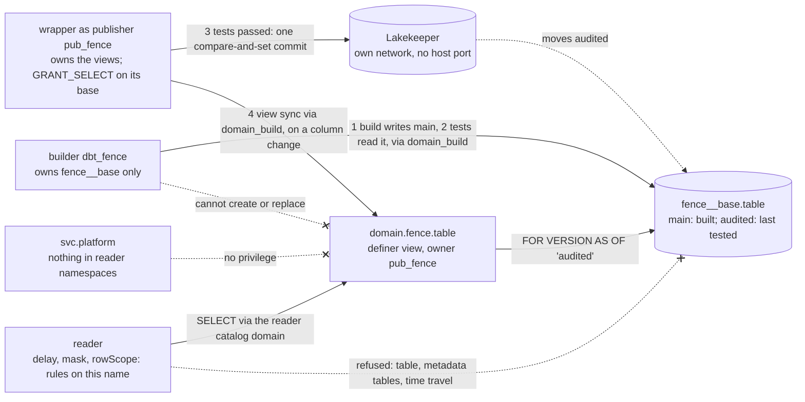

# ADR-061: Readers see dbt outputs only through a view over the tested tag

**Status:** Accepted
**Date:** 2026-11-26
**Author:** Platform
**Category:** Access / Storage
**Decided by:** the build's orchestrator on 2026-11-26 (UTC), under the owner's standing delegation for
the platform build, after an independent adversarial review of phase 001's interfaces and a gate
experiment. **Flagged to the owner for confirmation**; the first revisit trigger is the owner reversing it
**Amends:** [ADR-056](ADR-056-unified-data-product-platform.md) part 5, "outputs are tables, never definer
views", narrowed to the one view shape below (ADR-056's Outcome of 2026-11-26)
**Evidence:** the gate [`2026-11-26-tested-data-view-gate.md`](../research/2026-11-26-tested-data-view-gate.md)
(its rows, `h1.08` and so on, are cited below; output in
[`run.txt`](../../scripts/spikes/2026-11-26/spine-h-tested-data-view/results-2026-11-26/run.txt)); spikes (e),
(f) and (g) of [`2026-11-26-release-spine-spikes.md`](../research/2026-11-26-release-spine-spikes.md)

---

## In plain words

The owner decided that readers see only data that passed its tests, always (decision O8). dbt builds on
Trino, which writes only a table's current version, so for seconds in every build that version holds
untested rows. We will put a view, a stored query, between readers and each built table: it reads the
table at a marker moved only after the tests pass, runs with a publishing identity's rights, and carries
every reader policy as an access rule on its own name. The costs: no time travel for readers, countable
policy-hidden rows, a query overlapping a publish seeing two outputs one publish apart, and a catalog
with no login that must stay off every network but the platform's. The owner is asked to confirm a
choice ADR-056 forbade.

---

## Context

- **Built tables hold untested rows.** Each Iceberg commit makes a [snapshot](glossary.md#snapshot), one
  version of the table; readers follow `main`; a [tag](glossary.md#tag) names one snapshot, moves only
  when someone moves it, and keeps it from expiry. Trino 484 writes only `main` and can neither create
  a branch nor move a tag; Lakekeeper's REST API and Spark can (spike g). So a build's rows sit in
  `main` before its tests finish (2.6 s, ADR-056's Rationale), and dbt's replace of a model whose
  columns changed leaves it empty for 0.3 s (spike f). Whoever may `SELECT` the table reads `main`.
- **Views.** A **definer view** checks the tables it reads as its owner, an
  **[invoker view](glossary.md#invoker-view)** as the reader. Through a definer view a base table's masks
  and filters do not apply, but a rule on the view does
  ([`SPIKE-ACCESS.md`](../research/2026-11-26-unified-platform-architecture/SPIKE-ACCESS.md)); that is
  why ADR-056 forbade them. An invoker view over the tag needs its reader allowed the base, who then
  reads `main` (spike g).
- **Rules.** Trino's access is one JSON [rules file](glossary.md#access-rules-and-the-file-group-provider)
  of ordered rules for catalogs, schemas, tables and session properties, the first match deciding; a
  table rule grants privileges to a user or group and may add a row filter and column masks. The
  **file group provider** reads group members from a file; a group is `<fence>__<role>`. Both reload in 5 s.
- **The review found** (it is not in the repository; the gate re-ran B2 to B5 as h3.04, h3.07, h1.25,
  h1.17 and h1.29) that a builder owning the reader namespace could replace the view and serve an
  untested row (B1); that Lakekeeper, with no authentication, stores a view's owner as a property,
  `trino.run-as-owner`, any REST client can set, so a forged view or grafted snapshot from any container
  on `k2-net` served another product's untested rows (B2); that `SHOW STATS` showed hidden rows' bounds
  (B3); that a product can copy an input's `main` (B4); and that readers see view SQL (B5).

## Decision

**We will serve every dbt output to readers only through one generated definer view per table, reading
the table at its `audited` tag and owned by a publisher that alone may pass that table on, because it is
the only design measured to keep untested rows from every reader while policies stay Trino rules.**
Scope: dbt outputs; bronze is published by Spark write-audit-publish and needs no tag.

1. **Names.** `<fence>` is a product's namespace; `<domain>` is its domain's reader catalog and
   `<domain>_build` the writer catalog, over one warehouse
   ([reader and writer catalogs](glossary.md#reader-and-writer-catalogs)). The builder writes
   `<domain>_build.<fence>__base.<table>`. The publisher creates the view through the build catalog entry
   in the reader namespace, `<domain>_build.<fence>.<table>`, and readers read `<domain>.<fence>.<table>`
   (h1.01). Its SQL is exactly `SELECT <contract columns> FROM <domain>.<fence>__base.<table> FOR VERSION
   AS OF 'audited'`, the base named through the reader catalog, with no predicate. It appears at the first
   tag. Reader catalogs set `iceberg.security=read_only` (read-only at the connector) and
   `iceberg.table-statistics-enabled=false`, so no plan shows a hidden bound (h1.20).
2. **Identities.** The builder `dbt_<fence>` owns only `<fence>__base`. The publisher `pub_<fence>` owns
   only the views and alone holds `GRANT_SELECT` (the right to pass `SELECT` on) on its base, which Trino
   requires of a definer view's owner (h1.13, h1.14). Trino's owner check also demands catalog access
   `all` on the base's catalog, so the rules give `pub_.*` `all` on reader catalogs; the connector still
   refused the publisher all 9 writes there, `DROP` and `rollback_to_snapshot` included (h1.02).
   `svc.platform` holds no privilege in reader namespaces (with one it replaced a view, h1.33).
3. **Policies.** Every reader policy (`delay`, `mask`, `rowScope`) is a rule on the view's exact name,
   never view SQL; no reader rule names a base (228 of 228 base paths refused, h1.08). No other view or
   materialized view may exist where readers can select (h1.16, h1.31). Owner transfer is denied: no
   `authorization` rules exist, so `SET AUTHORIZATION` fails (h1.19). Readers are denied the
   `statistics_enabled` session property, by statement and by header (h1.23, h1.24).
4. **Publish.** Only after the build's tests pass does the wrapper (the program around each dbt build,
   ADR-056 part 4), as the publisher, move `audited`, in one
   [compare-and-set](glossary.md#compare-and-set-commit) commit for all of a product's outputs: each
   write names the value it expects to replace (`main` at the tested snapshot, `audited` at the previous
   one) and one stale expectation gets 409 and moves nothing (h2.05). Median 13.2 ms, p95 18.0 ms,
   n=23, two tables (h2.06). A 409 pages.
5. **Schema changes.** With C the contract's columns, old and new the tagged and tested snapshots'
   columns: replace the view with C ∩ old ∩ new, commit the tag, replace it with C ∩ new. The reconcile,
   the wrapper's first step, reruns it idempotently (h2.04); the other order breaks reads (h2.14).
6. **Catalog fence.** Lakekeeper sits on its own network, shared only with the platform's own services
   and never a third-party image, with no host port, because it stores a view's owner as a property any
   client can set and has no authentication. A [drift check](glossary.md#catalog-fence-and-drift-check)
   at `release-verify` (the check after every deploy) and every reconcile fails on a view, owner or SQL
   the release does not hold, or a tag the publish did not record (h3.05, h3.08).
7. **Products** are held to tested inputs by the `k2_input` macro, which pins each input at its tagged
   snapshot, and a lint in `k2gen check`, not by Trino: a builder allowed an input base can copy its
   `main` (h1.17), though no reader can read the copy (h1.18).



*Reading guide.* `fence` and `domain` stand for `<fence>` and `<domain>`. The builder writes and tests
`main` (1, 2); the tag moves only on a pass, in one commit (3); the view changes only with columns (4).
Readers reach the view alone; a crossed line is a refusal.

## Rationale

The gate printed 61 rows, 54 PASS, 0 FAIL, 7 INFO, exit 0. Across 23 publishes, a failing build, an added
and a dropped column and a killed publisher, 122 polls saw no untested, empty or partly loaded result and
no error (h2.07 to h2.10). Policies as rules keep one enforcement point for SQL and REST and make a
policy change a rules-only deploy. A publish is one commit of about 13 ms and copies no data.

## Alternatives Considered

| Option | Why not |
|--------|---------|
| Copy each tested build into a reader table | Keeps time travel, but rewrites every output each build: a Spark job (a small run's median is 6.51 s, ADR-056's Rationale) per publish in `lake_spark`, Airflow's one-slot Spark pool, on a five-minute chain. The runner-up |
| Metadata-only publish into a second table | A graft works (h3.07 is one), but both tables share files, so either's expiry deletes the other's; `register` is refused, 409 (spike g) |
| Build on an Iceberg branch | Trino 484 cannot write branches (spike g), and dbt builds through Trino |
| Invoker views, base denied | The reader is refused at the base (h1.15) |
| A row filter on file time | MERGE deletes still apply at `main`, compaction resets file times, and each build would need a release |
| Accept a short window, roll back fast | Rollback alone left bad rows visible for 2.6 s; rejected by the owner in O8 ([`DECISIONS-FINAL.md`](../research/2026-11-26-unified-platform-architecture/DECISIONS-FINAL.md)) |

## Consequences

- **No SQL time travel for readers.** Views refuse a version by id or timestamp (h1.09); a string version
  is silently ignored and returns the tag's rows (h1.10). REST `as_of` is not offered until the owner
  decides in phase 007, since it would make `k2-api` decide which snapshots were tested.
- **Hidden rows are countable, untested ones are not.** The full reader counted 3 rows and the delayed 2,
  but the client protocol's processed-row count was 4 for both, as was `EXPLAIN ANALYZE`'s
  `Input: 4 rows`; the untested row was never counted (h1.22, h1.22q).
- **A query can straddle a publish.** The commit is all or nothing, but Trino loads tables one by one:
  2 of 122 polls saw two outputs one publish apart, both overlapping a commit (h2.11).
- **View SQL is visible** in `information_schema.views` (h1.29), which is why it carries no policy.
- **The fence is a network, not a login,** until catalog authentication at the release gate. From
  `k2-net` the API was unreachable (h3.02, h3.03); inside its network both forgeries succeeded (h3.04,
  h3.07), so the drift check bounds a forgery to one reconcile interval and does not prevent it.
- Per product: two namespaces, two principals, a tag per output. Interactive plans run without statistics.

**What is not yet verified:** password login over TLS; the drift check against run records (phase 002);
the fence on the real stack (the gate used a throwaway catalog); `k2gen check` refusing other views and
unpinned inputs; Spark reading the views; restore time on a large table; resource groups; the Docker
socket holder as attacker; a policy needing two rules on one view; input resolution straddling a publish.

**Revisit when:** (1) the owner reverses it; (2) Trino and dbt-trino can write an Iceberg branch, so a
build can stay off `main`; (3) Lakekeeper gains authentication at the release gate; (4) a product is
licensed to a principal outside the owner's team, so hidden-row counts matter; (5) on the five-minute
chain a consumer sees two outputs of one product one publish apart.

## References

- [Phase 001](../plans/2026-11-26-unified-product-platform/001-release-and-rules-spine.md); the gate script
  [`run.sh`](../../scripts/spikes/2026-11-26/spine-h-tested-data-view/run.sh);
  [ADR-056](ADR-056-unified-data-product-platform.md) parts 4 and 5

---

## Outcome (2026-11-26, the view guards on its base's refs; what hidden rows give away)

**The view shape changed.** Part 1's "exactly `SELECT <contract columns> FROM <base> FOR VERSION AS OF
'audited'`, with no predicate" did not hold readers to tested data. The builder `dbt_<fence>` owns every
name in `<fence>__base`, so it may drop its base table and create a view at the same name, and Trino 484
ignores `FOR VERSION AS OF '<string>'` when the relation is a view (Consequences, h1.10): readers were
served whatever that view returned, untested. An independent review of step S12 found it; the rows
`c1.base-invoker-view` and `c1.base-definer-view` of
[`scripts/trino_rules_c1_test.py`](../../scripts/trino_rules_c1_test.py) reproduce it on the code before
this change (the reader got the builder's constant `zz-forged` row). File rules cannot tell a table from a
view: one `OWNERSHIP` privilege on a name is the right to create either. The view SQL is now exactly

```sql
SELECT <contract columns> FROM <domain>.<fence>__base.<table> FOR VERSION AS OF 'audited'
WHERE EXISTS (SELECT 1 FROM <domain>.<fence>__base."<table>$refs" WHERE "name" = 'audited' AND "type" = 'TAG')
```

on one line, every name quoted, and nothing else; still no policy (part 3). `<table>$refs` is the Iceberg
metadata table that lists a table's branches and tags. It exists only while the base is an Iceberg table:
with a view, or nothing, at the base's name, the reader's query fails at analysis
(`Table '...silver_readings$refs' does not exist`); with an untagged table there, the version clause
fails (`Cannot find snapshot with reference name: audited`). Trino resolves `<table>$refs` as the metadata
table of `<table>` and never as a view, even one the builder created under that name while the base was
absent (`c1.refs-forgery`). The `"type" = 'TAG'` term matters only if a branch named `audited` ever exists:
Trino 484 refuses branch DDL to every principal, but by an internal error rather than a rule
(`c1.branch-ddl`), so an upgrade could lift it, and the guard then gives readers no rows rather than the
branch's. Every variant fails with an error and serves no row (`c1.base-*`). An input read pinned by
snapshot id, `k2_input`'s form, fails over a view anyway (`Views do not support versioning`,
`c1.pin-by-id`).

What it costs: the publisher holds `SELECT` and `GRANT_SELECT` on exactly `<table>$refs` of its own bases,
since Trino's definer-view owner check asks `GRANT_SELECT` of every relation a view reads (ADR-059's
Outcome); a reader's query reads that table too, Trino's elapsed time for one small read going from a
median of 28 ms to 38 ms in one run (n=15 each, row `c1.guard-cost`). Unchanged, with the guard: a reader
polling through dbt's `CREATE OR REPLACE TABLE` saw only the tagged rows, then only the new ones after the
tag commit (`c1.rebuild-publish`); part 5's two statements served old rows, new rows, then new columns,
with no error (`c1.schema-change`); and the rules suite's 58 rows, masks, filters and the base-path fence
among them, passed on the new views (55 PASS, 0 FAIL, 3 INFO, `make test-trino`; every one of the
`h1.matrix` base paths refused). The drift check (step S20) compares the stored SQL with this emitter's,
so it holds the guard too; it also names a view at a base's name, but a reconcile interval later, where
the guard refuses the read at once.

Rejected: pinning each view by snapshot id, which also fails closed over a view, but makes every publish
one view replace per output after the one tag commit, so a product's outputs would change one by one
rather than together, and the drift check would need each output's last tested id; a third catalog per
domain with Trino's view endpoints switched off (`iceberg.rest-catalog.view-endpoints-enabled=false`
exists in 484) for reading bases, one more catalog per domain than ADR-059 decided; and a guard that only
names `$refs` without reading it, which Trino plans away and which checks no tag type.

**What hidden rows give away: values, not only counts.** Consequences said the full and delayed readers
saw processed-row counts that count policy-hidden rows. The review showed more: Trino skips a data file
whose column minimum and maximum cannot match a query's predicate ([pruning](glossary.md#pruning)), and
the client protocol's processed-row count (and, the review found, `EXPLAIN ANALYZE`) shows how many rows
the files it did not skip hold. A delayed or scoped reader can therefore binary-search a predicate on any column it can see
and learn each file's minimum and maximum of that column over the rows the policy hides from it, and
whether a given key value exists among them. What it cannot learn: a masked column's values (masks apply
before the reader's predicate), any untested row (the view reads the tag), or any row of a product it
holds no role on. A row scope's column must now be an identity partition field of its table
(`access.row-scope-unpartitioned` in `k2gen check`): the files of out-of-scope rows are then skipped by
the scope alone, whatever the reader asks. Measured: unpartitioned, a scoped reader's probes moved the
count between 3 and 8 rows and found a hidden row's value and key; partitioned by the scope column, every
probe counted 3, the guard's own rows (`h2.row-scope-partition`). A delay has no such fix: a row inside
its delay shares files with older visible rows, so a delayed reader still learns the bounds of the newest
rows' visible columns.

**A delay's column must be `timestamp(6) with time zone`** (`access.delay-type`; the rules emitter refuses
the rest). Over `timestamp(6)` or `date` the filter compares in the reader's own session time zone, which
a reader sets (`SET TIME ZONE`, or the client's time zone header), so a reader in `Pacific/Kiritimati`
read the row still inside its delay; over `time(6)` every read fails (`h1.delay-zone`).

So the `delay` and `rowScope` policies suit readers the owner trusts not to probe; they are a convenience
and a guard against accidents, not a barrier against a determined reader. **Revisit when** a product is
licensed to a principal outside the owner's team: that product's delayed or scoped data must then be
physically separate (a table or tag per policy, written by the pipeline), since no rule closes the leak.
This tightens revisit trigger 4 above from counts to values.

## Outcome (2026-11-26, the review is now in the repository)

Context says the independent review of design (a) "is not in the repository". It now is: the review, the
interfaces proposal it reviewed and the interfaces review are kept, dated and unchanged, in
[`docs/research/2026-11-26-phase-001-interfaces/`](../research/2026-11-26-phase-001-interfaces.md)
(`phase001-o8-review.md` is the review Context cites).

## Outcome (2026-11-27, phase 002: the wrapper that moves the tag)

Part 4's wrapper is built (`docker/dbt-runner/k2_dbt.py`; the whole run in
[ADR-062](ADR-062-dbt-builds-silver-and-gold-per-product-through-one-wrapper.md)). As built, and measured
by `scripts/verify/dbt-wrapper.sh` on a throwaway lake (21 PASS, 0 FAIL, 2026-11-27):

- **The publish order.** After every test passes, as the publisher: each view whose columns change is
  narrowed to part 5's C ∩ old ∩ new, then one compare-and-set commit moves `audited` for all of the
  product's outputs, requiring `main` at the tested snapshot and `audited` where the run found it (null on
  a first publish), then the views are widened to C ∩ new, then each output's `audited` run record is
  written. A crash between any two statements leaves narrowed views over the old tag, or narrowed or
  widened views over the new one; the next run's reconcile finishes from what the tag holds. A real 409,
  from a tag moved by another publisher just before the commit, exited 3 and left the view narrowed and
  never widened. A published view with no column common to both snapshots publishes and pages: its
  readers get an error from the commit to the widen.
- **The query-id tie, by a client tag per run.** Before the commit, each output's `main` must be this
  dbt invocation's own commit: the snapshot summary's `trino_query_id` must be a query that carried this
  run's Trino client tag or one dbt reported in `run_results.json`. Each run of the wrapper sets a fresh
  tag, `k2-dbt-<128-bit nonce>`, which `dbt/profiles.yml` puts on every statement of the invocation, and
  before it publishes lists the builder's queries (`GET /v1/query`) and keeps those that carry it. The
  tag is needed because dbt-trino 1.12.0 builds a contract-enforced table in two statements, `CREATE OR
  REPLACE TABLE`, which commits an empty snapshot, then `INSERT`, and reports only the `INSERT`; an
  insert of no rows commits nothing, so a table that builds empty has the `CREATE`'s snapshot as `main`,
  a query dbt never named. The first tie, by reported ids alone, refused such a clean build: first seen on
  the live stack on 2026-11-27 for `governance/quality-results`, then measured on a throwaway lake by
  `scripts/verify/run-path.sh` claim 9 (every dbt product of the release built through the wrapper,
  `currency-master`'s bronze empty there; `9 PASS, 0 FAIL in 263 s`) and pinned by
  `test_an_empty_table_published_by_its_create_which_dbt_never_reports_is_its_own_commit` in
  `docker/dbt-runner/test_k2_dbt.py`. Still refused: an earlier run's leftover query, a retry of the same
  run id included, since it carries an earlier tag
  (`test_each_run_has_its_own_client_tag_so_an_earlier_runs_orphan_is_refused`), and any write that
  carries no tag of this run and that dbt did not report. When the snapshot names no query, or neither
  side gives an id, only the commit time decides, as before, and the log says so. Its stated limit, in
  `k2_dbt.py`: "Trino lists a finished query for query.min-expire-age (15 min) and after that only while
  it lists fewer than query.max-history (100), so a build whose untagged-by-dbt commit is older than that
  at publish is refused, never passed; raise min-expire-age (trino_etc.py) when a build is measured near
  15 min."
- **Cancel first.** A build killed mid-statement leaves its query running in Trino: an `INSERT` whose
  client left after 2 s still committed about 25 s later, and Trino reported it failed only after about
  300 s, its `query.client.timeout`. Had it committed after a later run's tests, part 4's commit would have
  tagged an untested snapshot. So the wrapper's first step cancels every query the builder still runs,
  through Trino's REST API as the builder, and waits up to 60 s for none to remain before reading any
  state; in the script, the next run cancelled the orphan and no snapshot of it ever existed.
- **Reads at the tag use the tag's schema.** 200 polls each of the base read by tag name, by snapshot id
  and through the reader view, across four rounds of dbt's create-or-replace that dropped and retyped
  columns on `main`, always returned the tagged snapshot's columns. Two columns swapped by renames on
  `main` left every reader seeing the tagged names and values: no data moved under a masked or filtered
  name.
- **Restores keep partitioning.** A restore by create-or-replace (a rollback across a column change) must
  restate the contract's partitioning and sort: Trino 484 made the replaced table unpartitioned without
  them, which would undo the row-scope fix of the Outcome above.
- The drift check now holds tags to the run records (a tag no `audited` row records is drift), at every
  reconcile for the product's own namespaces and at `release-verify` for the whole release; input
  resolution reads every input's tag twice and retries a straddled publish.

**An open observation.** In one run of the tested-data marker's schema-change check
(`scripts/verify/tested-data-marker.sh`), a reader's poll failed once with `INVALID_VIEW` during the
view sync. It was an error, never a wrong row, and it did not reproduce on rerun; its cause is not
known. Trino analyses a view before it checks the caller's permission, so a view over a base with no tag
yet fails as `INVALID_VIEW` even for a caller the rules deny, measured through `k2-api` by the access
suite's REST rows on a throwaway lake: such a caller gets 404 `not_published` rather than 403, so it
learns that the output is not yet published and nothing more.

**Revisit when**, besides the triggers above: `INVALID_VIEW` appears in a reader's poll again, which
reopens the view sync's order.

## Outcome (2026-11-28, phase 004: compaction after the tests)

The decision stands, with one write added on top of the tested snapshot. Built on branch `phase/004-005-kraken-and-enriched`; **not yet in a deployed release**. A merge-heavy
incremental output leaves delete files every build, and a compaction by maintenance after the tag
moved would put `main` past `audited`, which the next build's reconcile restores. So the wrapper
compacts an incremental output inside the build, after its tests and before the tag commit: once
its `main` holds 12 delete files or 48 small files beyond one per partition, one `ALTER TABLE ...
EXECUTE optimize` as the builder under the run's client tag, and the tag then moves onto the
compaction by the same compare-and-set commit. A `table` model is never compacted. The only snapshot
accepted on top of the tested one is a `replace` whose parent is the tested snapshot, committed by
this run's own optimize statement (its query id), reading as many rows (`total-records` less
`total-position-deletes`; a snapshot with equality deletes is refused as uncountable). Anything else
is rolled back to the tested snapshot and refused, exit 3; a failed or empty optimize publishes the
tested snapshot (`docker/dbt-runner/k2_dbt.py`, `compact` and `compaction_guard`). Provenance:
`docker/dbt-runner/test_k2_dbt.py`; `scripts/verify/dbt-patterns.sh` claim 12 (compaction to zero
delete files, a reconcile that changes nothing, an INSERT after the optimize refused) is written and
its run pending.

## Outcome (2026-11-28, phase 004: the publish waits after narrowing a view)

The open observation of 2026-11-27 came back: in the full deploy rehearsal of 2026-11-28 one of 22
reader polls failed during the marker's schema change with `INVALID_VIEW: ... Column 'currency' cannot
be resolved`, which was this ADR's revisit trigger. The cause that fits is in the design, not in the
order of its statements. Part 5's invariant holds for the catalog's state at every instant, but a
reader's query reads two objects at two instants: the view's definition, then its base at the tag. A
query that read the view before it was narrowed and loaded the base after the tag commit selects a
column the new snapshot no longer holds. The narrow and the commit were consecutive calls, a few
milliseconds apart, so the window was as long as a query's own gap between the two reads. The catalog
has no commit that spans a view and a table, so the window cannot be closed, only made far longer than
that gap: the publish now waits `VIEW_SETTLE_S` (2 s, `docker/dbt-runner/k2_dbt.py`) after it narrows
any view and before the tag commit, and the marker's own publish does the same. The failure stays what
it was, an error and never a wrong or untested row, and it needs a schema change to an output that
already has readers.

Measured after the change: `scripts/verify/tested-data-marker.sh` run ten times on one throwaway lake
(a scratch release of the phase 004 branch), 20 publishes, 551 polls at 50 ms, 0 errors. That is
evidence for the cause, not proof of it: before the change the error appeared about once in several
runs.

**Revisit when** `INVALID_VIEW` appears in a reader's poll again with the wait in place: the cause
above is then wrong or incomplete, and a reader's query slower than the wait between its two reads is
the first thing to measure.
