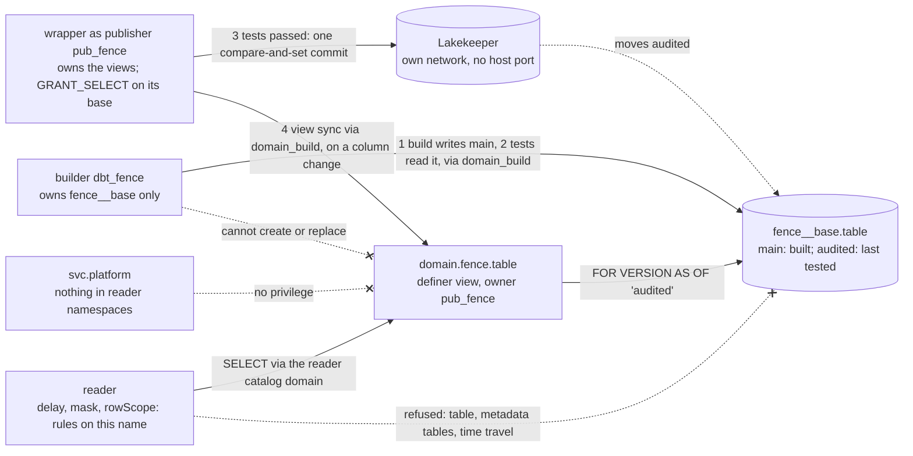

# ADR-061: Readers see dbt outputs only through a view over the tested tag

**Status:** Accepted
**Date:** 2026-11-26
**Author:** Platform
**Category:** Access / Storage
**Decided by:** the build's orchestrator on 2026-11-26 (UTC), under the owner's standing delegation for
the platform build, after an independent adversarial review of phase 001's interfaces and a gate
experiment. **Flagged to the owner for confirmation**; the first revisit trigger is the owner reversing it
**Amends:** [ADR-056](ADR-056-unified-data-product-platform.md) part 5, "outputs are tables, never definer
views", narrowed to the one view shape below (ADR-056's Outcome of 2026-11-26)
**Evidence:** the gate [`2026-11-26-tested-data-view-gate.md`](../research/2026-11-26-tested-data-view-gate.md)
(its rows, `h1.08` and so on, are cited below; output in
[`run.txt`](../../scripts/spikes/2026-11-26/spine-h-tested-data-view/results-2026-11-26/run.txt)); spikes (e),
(f) and (g) of [`2026-11-26-release-spine-spikes.md`](../research/2026-11-26-release-spine-spikes.md)

---

## In plain words

The owner decided that readers see only data that passed its tests, always (decision O8). dbt builds on
Trino, which writes only a table's current version, so for seconds in every build that version holds
untested rows. We will put a view, a stored query, between readers and each built table: it reads the
table at a marker moved only after the tests pass, runs with a publishing identity's rights, and carries
every reader policy as an access rule on its own name. The costs: no time travel for readers, countable
policy-hidden rows, a query overlapping a publish seeing two outputs one publish apart, and a catalog
with no login that must stay off every network but the platform's. The owner is asked to confirm a
choice ADR-056 forbade.

---

## Context

- **Built tables hold untested rows.** Each Iceberg commit makes a [snapshot](glossary.md#snapshot), one
  version of the table; readers follow `main`; a [tag](glossary.md#tag) names one snapshot, moves only
  when someone moves it, and keeps it from expiry. Trino 484 writes only `main` and can neither create
  a branch nor move a tag; Lakekeeper's REST API and Spark can (spike g). So a build's rows sit in
  `main` before its tests finish (2.6 s, ADR-056's Rationale), and dbt's replace of a model whose
  columns changed leaves it empty for 0.3 s (spike f). Whoever may `SELECT` the table reads `main`.
- **Views.** A **definer view** checks the tables it reads as its owner, an
  **[invoker view](glossary.md#invoker-view)** as the reader. Through a definer view a base table's masks
  and filters do not apply, but a rule on the view does
  ([`SPIKE-ACCESS.md`](../research/2026-11-26-unified-platform-architecture/SPIKE-ACCESS.md)); that is
  why ADR-056 forbade them. An invoker view over the tag needs its reader allowed the base, who then
  reads `main` (spike g).
- **Rules.** Trino's access is one JSON [rules file](glossary.md#access-rules-and-the-file-group-provider)
  of ordered rules for catalogs, schemas, tables and session properties, the first match deciding; a
  table rule grants privileges to a user or group and may add a row filter and column masks. The
  **file group provider** reads group members from a file; a group is `<fence>__<role>`. Both reload in 5 s.
- **The review found** (it is not in the repository; the gate re-ran B2 to B5 as h3.04, h3.07, h1.25,
  h1.17 and h1.29) that a builder owning the reader namespace could replace the view and serve an
  untested row (B1); that Lakekeeper, with no authentication, stores a view's owner as a property,
  `trino.run-as-owner`, any REST client can set, so a forged view or grafted snapshot from any container
  on `k2-net` served another product's untested rows (B2); that `SHOW STATS` showed hidden rows' bounds
  (B3); that a product can copy an input's `main` (B4); and that readers see view SQL (B5).

## Decision

**We will serve every dbt output to readers only through one generated definer view per table, reading
the table at its `audited` tag and owned by a publisher that alone may pass that table on, because it is
the only design measured to keep untested rows from every reader while policies stay Trino rules.**
Scope: dbt outputs; bronze is published by Spark write-audit-publish and needs no tag.

1. **Names.** `<fence>` is a product's namespace; `<domain>` is its domain's reader catalog and
   `<domain>_build` the writer catalog, over one warehouse
   ([reader and writer catalogs](glossary.md#reader-and-writer-catalogs)). The builder writes
   `<domain>_build.<fence>__base.<table>`. The publisher creates the view through the build catalog entry
   in the reader namespace, `<domain>_build.<fence>.<table>`, and readers read `<domain>.<fence>.<table>`
   (h1.01). Its SQL is exactly `SELECT <contract columns> FROM <domain>.<fence>__base.<table> FOR VERSION
   AS OF 'audited'`, the base named through the reader catalog, with no predicate. It appears at the first
   tag. Reader catalogs set `iceberg.security=read_only` (read-only at the connector) and
   `iceberg.table-statistics-enabled=false`, so no plan shows a hidden bound (h1.20).
2. **Identities.** The builder `dbt_<fence>` owns only `<fence>__base`. The publisher `pub_<fence>` owns
   only the views and alone holds `GRANT_SELECT` (the right to pass `SELECT` on) on its base, which Trino
   requires of a definer view's owner (h1.13, h1.14). Trino's owner check also demands catalog access
   `all` on the base's catalog, so the rules give `pub_.*` `all` on reader catalogs; the connector still
   refused the publisher all 9 writes there, `DROP` and `rollback_to_snapshot` included (h1.02).
   `svc.platform` holds no privilege in reader namespaces (with one it replaced a view, h1.33).
3. **Policies.** Every reader policy (`delay`, `mask`, `rowScope`) is a rule on the view's exact name,
   never view SQL; no reader rule names a base (228 of 228 base paths refused, h1.08). No other view or
   materialized view may exist where readers can select (h1.16, h1.31). Owner transfer is denied: no
   `authorization` rules exist, so `SET AUTHORIZATION` fails (h1.19). Readers are denied the
   `statistics_enabled` session property, by statement and by header (h1.23, h1.24).
4. **Publish.** Only after the build's tests pass does the wrapper (the program around each dbt build,
   ADR-056 part 4), as the publisher, move `audited`, in one
   [compare-and-set](glossary.md#compare-and-set-commit) commit for all of a product's outputs: each
   write names the value it expects to replace (`main` at the tested snapshot, `audited` at the previous
   one) and one stale expectation gets 409 and moves nothing (h2.05). Median 13.2 ms, p95 18.0 ms,
   n=23, two tables (h2.06). A 409 pages.
5. **Schema changes.** With C the contract's columns, old and new the tagged and tested snapshots'
   columns: replace the view with C ∩ old ∩ new, commit the tag, replace it with C ∩ new. The reconcile,
   the wrapper's first step, reruns it idempotently (h2.04); the other order breaks reads (h2.14).
6. **Catalog fence.** Lakekeeper sits on its own network, shared only with the platform's own services
   and never a third-party image, with no host port, because it stores a view's owner as a property any
   client can set and has no authentication. A [drift check](glossary.md#catalog-fence-and-drift-check)
   at `release-verify` (the check after every deploy) and every reconcile fails on a view, owner or SQL
   the release does not hold, or a tag the publish did not record (h3.05, h3.08).
7. **Products** are held to tested inputs by the `k2_input` macro, which pins each input at its tagged
   snapshot, and a lint in `k2gen check`, not by Trino: a builder allowed an input base can copy its
   `main` (h1.17), though no reader can read the copy (h1.18).

*Reading guide.* `fence` and `domain` stand for `<fence>` and `<domain>`. The builder writes and tests
`main` (1, 2); the tag moves only on a pass, in one commit (3); the view changes only with columns (4).
Readers reach the view alone; a crossed line is a refusal.

## Rationale

The gate printed 61 rows, 54 PASS, 0 FAIL, 7 INFO, exit 0. Across 23 publishes, a failing build, an added
and a dropped column and a killed publisher, 122 polls saw no untested, empty or partly loaded result and
no error (h2.07 to h2.10). Policies as rules keep one enforcement point for SQL and REST and make a
policy change a rules-only deploy. A publish is one commit of about 13 ms and copies no data.

## Alternatives Considered

| Option | Why not |
|--------|---------|
| Copy each tested build into a reader table | Keeps time travel, but rewrites every output each build: a Spark job (a small run's median is 6.51 s, ADR-056's Rationale) per publish in `lake_spark`, Airflow's one-slot Spark pool, on a five-minute chain. The runner-up |
| Metadata-only publish into a second table | A graft works (h3.07 is one), but both tables share files, so either's expiry deletes the other's; `register` is refused, 409 (spike g) |
| Build on an Iceberg branch | Trino 484 cannot write branches (spike g), and dbt builds through Trino |
| Invoker views, base denied | The reader is refused at the base (h1.15) |
| A row filter on file time | MERGE deletes still apply at `main`, compaction resets file times, and each build would need a release |
| Accept a short window, roll back fast | Rollback alone left bad rows visible for 2.6 s; rejected by the owner in O8 ([`DECISIONS-FINAL.md`](../research/2026-11-26-unified-platform-architecture/DECISIONS-FINAL.md)) |

## Consequences

- **No SQL time travel for readers.** Views refuse a version by id or timestamp (h1.09); a string version
  is silently ignored and returns the tag's rows (h1.10). REST `as_of` is not offered until the owner
  decides in phase 007, since it would make `k2-api` decide which snapshots were tested.
- **Hidden rows are countable, untested ones are not.** The full reader counted 3 rows and the delayed 2,
  but the client protocol's processed-row count was 4 for both, as was `EXPLAIN ANALYZE`'s
  `Input: 4 rows`; the untested row was never counted (h1.22, h1.22q).
- **A query can straddle a publish.** The commit is all or nothing, but Trino loads tables one by one:
  2 of 122 polls saw two outputs one publish apart, both overlapping a commit (h2.11).
- **View SQL is visible** in `information_schema.views` (h1.29), which is why it carries no policy.
- **The fence is a network, not a login,** until catalog authentication at the release gate. From
  `k2-net` the API was unreachable (h3.02, h3.03); inside its network both forgeries succeeded (h3.04,
  h3.07), so the drift check bounds a forgery to one reconcile interval and does not prevent it.
- Per product: two namespaces, two principals, a tag per output. Interactive plans run without statistics.

**What is not yet verified:** password login over TLS; the drift check against run records (phase 002);
the fence on the real stack (the gate used a throwaway catalog); `k2gen check` refusing other views and
unpinned inputs; Spark reading the views; restore time on a large table; resource groups; the Docker
socket holder as attacker; a policy needing two rules on one view; input resolution straddling a publish.

**Revisit when:** (1) the owner reverses it; (2) Trino and dbt-trino can write an Iceberg branch, so a
build can stay off `main`; (3) Lakekeeper gains authentication at the release gate; (4) a product is
licensed to a principal outside the owner's team, so hidden-row counts matter; (5) on the five-minute
chain a consumer sees two outputs of one product one publish apart.

## References

- [Phase 001](../plans/2026-11-26-unified-product-platform/001-release-and-rules-spine.md); the gate script
  [`run.sh`](../../scripts/spikes/2026-11-26/spine-h-tested-data-view/run.sh);
  [ADR-056](ADR-056-unified-data-product-platform.md) parts 4 and 5
