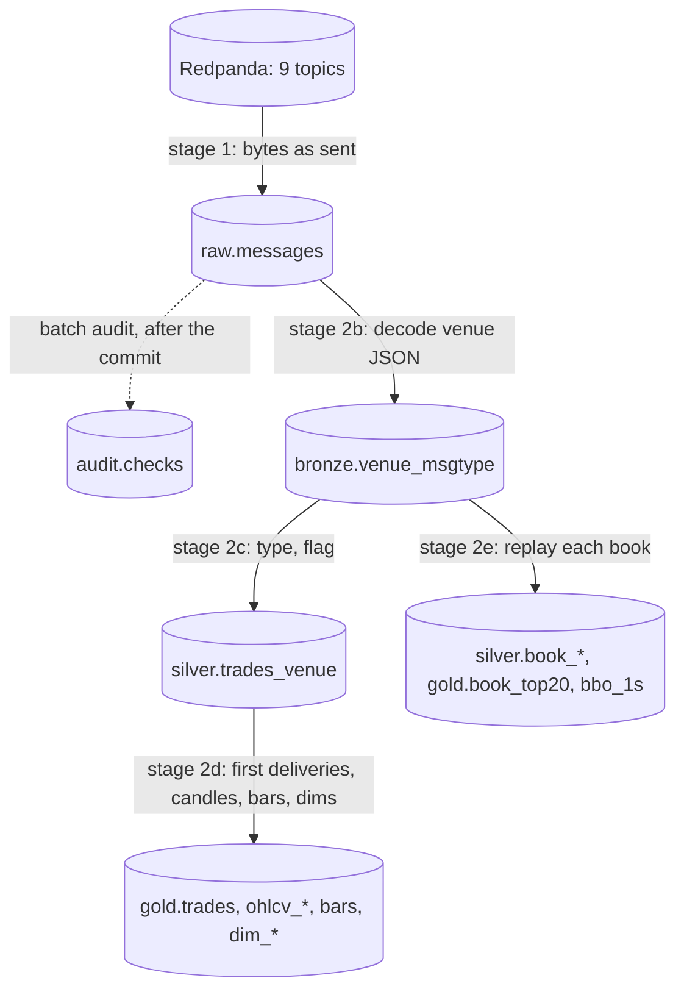

# ADR glossary

The ADRs from [ADR-018](ADR-018-v3-lake-first-rust-capture.md) onward use internal labels
("stage 2d", "exit 75", "the ceiling") and tool concepts (snapshot, selector, definer view)
that their bodies do not stop to explain. Accepted ADRs are immutable, so their text cannot be
fixed; this page is where those words are explained instead. Read an ADR written before
2026-11-26 with this page open. A new ADR explains each term where it first appears or links
here, and a term it adds goes into this page in the same pull request
([conventions](README.md#conventions)).

Each entry says what the thing is, why it matters on this platform, and where it lives. The
architecture book teaches the same ground at length: [chapter 03](../architecture/03-data-engineering-concepts.md)
for the data engineering concepts, [chapter 08](../../legacy/v3-lake-ingest/docs/architecture/08-lake-ingest.md) for the
retired ingest and [chapter 19](../architecture/19-lakehouse-and-domain-warehouses.md) for catalogs,
warehouses and access.

The lake ingest, its layers, the marts, the nightly audits and the parity gates that the older
ADRs describe are retired: phase 000 of the unified platform plan dropped
their tables and archived their code in [`legacy/v3-lake-ingest/`](../../legacy/v3-lake-ingest/)
([ADR-056](ADR-056-unified-data-product-platform.md)). Their entries below describe them as they ran, and their pointers lead into the
archive.

**Areas:** [capture](#capture-connections-streams-and-the-book) ·
[the lake ingest](#the-lake-ingest-stage-by-stage) ·
[layers and what they hold](#layers-and-what-they-hold) ·
[Iceberg versions and housekeeping](#iceberg-versions-commits-and-housekeeping) ·
[catalogs and access](#catalogs-warehouses-and-who-may-write) ·
[dbt and the marts](#dbt-and-the-marts) · [quality and parity](#quality-and-parity) ·
[Spark query mechanics](#spark-query-mechanics) ·
[resources](#resources-memory-cpu-and-the-ceiling) · [tools](#tools) ·
[the data product platform](#the-data-product-platform) · [plan labels](#plan-and-phase-labels)

---

## Capture: connections, streams and the book

### Order book and L2

An order book is the list of resting buy orders (bids) and sell orders (asks) at each price. L2
("level 2") is the book aggregated per price level, a price and the total quantity resting there,
without the individual orders (that would be L3, which K2 does not capture). Each venue publishes
it on its own channel: Binance `depth20` (a whole top-20 book every 100 ms), Kraken `book` (a
snapshot then deltas), Coinbase `level2` (a full-depth snapshot then deltas). K2's queryable book
product was the top 20 levels per side at the end of every second, `gold.book_top20`, with the best
bid and offer projected from it in `gold.bbo_1s`, until the old lake ingest retired.
Where: [ADR-027](ADR-027-book-snapshot-and-sequencing.md); `services/capture-rust/src/exchanges/`.

### Connection and conn_id

Each capture process holds one WebSocket connection to its venue and gives every connection a
fresh UUID, `conn_id`, stamped on every record with `conn_msg_seq`, the frame's position on that
connection. A reconnect or a container restart starts a new `conn_id`, and the venue's book and
sequence numbers start again with it, so every book replay and sequence check is scoped to one
connection. Frames the venue sent while no connection was open are never received.
Where: `session` in `services/capture-rust/src/main.rs`;
[lineage columns](#lineage-columns).

### Continuous stream and session watchdog

A continuous stream is a channel that keeps delivering while its subscription is healthy, as
opposed to a one-off subscribe acknowledgement. The capture holds one table of them, `CONTINUOUS`
in `main.rs`, with a silence bound each: 60 s for book and heartbeat channels, 300 s for trade
channels, where a quiet market is not a fault. Three things read that table: the session
watchdog, which closes and reopens the connection when a stream passes its bound; the container
health check (`k2-capture healthcheck`); and the `CaptureFeedStale` alert. A stream in the table
that the venue was never asked for would trip all three.
Where: `CONTINUOUS`, `stale_after` and `healthcheck` in `services/capture-rust/src/main.rs`.

### Seeded series

A seeded series is a metric the capture creates at zero when it starts, rather than at its first
event. Prometheus cannot see a change in a series that does not exist yet, so an alert on "this
counter went up" or "this gauge is low" could never fire for the first event, or for a feed that
never delivered. The capture seeds what an alert reads (`zero` in `metrics.rs`), and seeds only
what the venue can produce: Binance and Coinbase get no checksum counters, because they publish no
checksum.
Where: `zero` in [`services/capture-rust/src/metrics.rs`](../../services/capture-rust/src/metrics.rs).

### Book switch

Proposed in [ADR-050](ADR-050-order-book-capture-paused-during-platform-build.md), not built:
`book_capture.<venue>` in `config/instruments.yaml`, `true` or `false`, required for every venue
(a capture without it refuses to start). Each capture reports what it read as the gauge
`k2_capture_book_capture{exchange}`, so a capture never recreated after a change, or a stale file
mount, shows as a difference between file and gauge. A capture with `false` does not subscribe to
its venue's book channel, does not watch or seed the book stream, and skips the once-a-second book
sample; it still decodes any frame exactly as before, so replay and the fixture tests do not depend
on it. The lake reads the same switch to skip the book audits and to record it in
`gold.dim_venue`. Binance, which has no heartbeat channel, also sends a WebSocket Ping every 15 s
and watches the Pong as a 60 s stream, so a dead connection is still noticed within a minute.
Where: `config/instruments.yaml`, `services/capture-rust/src/config.rs` once built.

---

## The lake ingest, stage by stage

Retired in phase 000 ([ADR-056](ADR-056-unified-data-product-platform.md)); nothing below runs now. One ingest run was one call of
`legacy/v3-lake-ingest/lake/ingest.py`, started every 5 minutes by Airflow. It ran these steps
in order, in one Spark session, under one lock:

### Stage 1

Stage 1 copies Kafka records from Redpanda into the table `raw.messages`, byte for byte, for
all nine topics (raw, trades and book, per venue). Before it reads anything it fixes the range
for every partition: from the offset the previous run committed, to the broker's newest offset
or the [per-run cap](#per-run-cap), whichever is lower. It writes the rows and the new end
offsets in one Iceberg commit ([exactly-once](#exactly-once-via-snapshot-offsets)), then runs
the [batch audit](#batch-audit). Nothing is parsed or validated on the way in, which is what
makes `raw.messages` the record of what arrived.
Where: `stage_raw` in [`legacy/v3-lake-ingest/lake/ingest.py`](../../legacy/v3-lake-ingest/lake/ingest.py);
[chapter 08](../../legacy/v3-lake-ingest/docs/architecture/08-lake-ingest.md#stage-1-offsets-in-the-snapshot).

### Batch audit

The batch audit checks, right after stage 1 commits, that the commit holds exactly the range
the run planned: per topic and partition, rows equal `end - start`, the first offset is
`start` and the last is `end - 1`. It reads only the files that one commit added, three narrow
columns, so it adds about half a second to a run (the first scheduled runs logged 0.5 s). A
mismatch writes a `batch_offsets` row into [`audit.checks`](#auditchecks-and-the-nightly-audits) and fires `LakeIngestBatchAuditFailed`;
a clean batch writes nothing, and the audit never blocks, fails or undoes the commit
([ADR-047](ADR-047-ingest-batch-audit-after-publish.md)).
Where: `audit_batch` in [`legacy/v3-lake-ingest/lake/ingest.py`](../../legacy/v3-lake-ingest/lake/ingest.py),
`batch_audit` in `docker/lake/offsets.py`.

### Stage 2 and stage 2b

Stage 2b turns `raw.messages` into the per-venue bronze tables (`bronze.binance_trade`,
`bronze.kraken_book` and the rest): it reads the raw snapshots added since its last run,
unwraps the Avro envelope, and parses the venue's own JSON into columns named as the venue
named them. A frame that does not parse still lands, with NULL venue columns, and a nightly
audit fails on it, so one bad frame cannot block every later run. The two names are one step:
`ingest.py` calls it "stage 2" in its comments, `bronze.py` prints "stage 2b". The original
stage 2, which decoded the capture's Avro topics into unified bronze tables, was dropped at
the Phase E cutover ([ADR-026](ADR-026-four-layer-lake-and-gold-served-from-clickhouse.md)).
Where: [`legacy/v3-lake-ingest/lake/bronze.py`](../../legacy/v3-lake-ingest/lake/bronze.py);
[`legacy/v3-lake-ingest/lake/README.md`](../../legacy/v3-lake-ingest/lake/README.md), "Bronze per venue".

### Stage 2c

Stage 2c turns each venue's bronze trade frames into `silver.trades_<venue>`: one typed row per
trade, exact decimals, UTC timestamps, and the [canonical symbol](#canonical-symbol) from
`config/instruments.yaml`. It adds three flags that record what the venue did without dropping
anything: `venue_replay` (an earlier delivery of the same trade exists), `seq_gap` with
`missing_before` (trade ids the archive never received) and `precision_loss` (more than 8
decimals). The flags need history, so each batch is scored against the last day of silver.
Where: [`legacy/v3-lake-ingest/lake/silver.py`](../../legacy/v3-lake-ingest/lake/silver.py);
[`legacy/v3-lake-ingest/lake/README.md`](../../legacy/v3-lake-ingest/lake/README.md), "Silver per venue: trades".

### Stage 2d

Stage 2d builds gold from silver, in four steps. It appends silver's
[first deliveries](#first-delivery-and-venue-replay) of every venue to `gold.trades`, one
schema in [fixed point](#fixed-point-and-_e8-columns); it reloads the
[SCD2](#scd2-security-master) dimensions `gold.dim_instrument` and `gold.dim_venue` from the
registry; it recomputes every candle (`gold.ohlcv_1m`, `5m`, `1h`, `1d`) whose bucket holds a
[touched minute](#touched-minutes), over all of that bucket's trades, and MERGEs it in; and it
recomputes the [event bars](#event-bars) of every touched [symbol-day](#symbol-day). The bars
step reads the whole UTC day's trades however small the batch, so its work grows from midnight
to midnight; that is what made the ingest run out of [driver heap](#driver-heap) on
2026-11-25.
Where: `stage` in [`legacy/v3-lake-ingest/lake/gold.py`](../../legacy/v3-lake-ingest/lake/gold.py); the heap story in
`docker/lake/spark_conf.py`, above `DRIVER_MEMORY`.

### Stage 2e

Stage 2e handles order books. It walks each WebSocket connection's book frames once, in order,
replaying the book (Binance's frames are already whole top-20 books and need no replay): from
that one pass it writes `silver.book_<venue>` (with Kraken's own checksum verified
per frame as `checksum_ok`), `gold.book_top20` (the top 20 levels per side at the end of every
second) and `gold.bbo_1s` (best bid and offer per second, projected from it). The book left
after a run's last frame is saved in `gold.book_state`, so the next run resumes the replay.
Where: [`docker/lake/books.py`](../../docker/lake/books.py), the pure core in
`docker/lake/book.py`; [`legacy/v3-lake-ingest/lake/README.md`](../../legacy/v3-lake-ingest/lake/README.md), "Books".

### Writer lock and exit 75

The writer lock is one exclusive file lock (`flock` on `/tmp/k2-lake-ingest.lock`) that every
Spark job writing the lake takes, so only one runs at a time. It exists because Iceberg does
not stop two concurrent appends: the loser retries on top of the winner and both commit, and
the second one's offsets overwrite the first's, which duplicates a batch. The ingest asks for
the lock without waiting and, if another writer holds it, exits with code 75 (`EX_TEMPFAIL`,
"try again later"), which the Airflow DAG records as skipped rather than failed; maintenance
waits for the lock instead.
Where: [`legacy/v3-lake-ingest/lake/lock.py`](../../legacy/v3-lake-ingest/lake/lock.py), `EXIT_LOCK_HELD` in `ingest.py`,
`AirflowSkipException` in `legacy/v3-lake-ingest/airflow/dags/lake.py`.

### Per-run cap

The per-run cap is the most offsets stage 1 may read past its start on any one partition in one
run: `--max-offsets-per-partition`, default 600,000 (`K2_LAKE_MAX_OFFSETS_PER_PARTITION`). It
bounds how long a run takes and how much it writes, so a large [backlog](#backlog) drains over
several predictable runs instead of one that cannot finish. It must stay above what the busiest
partition receives between two runs, or that partition falls further behind every cycle; 0
removes the cap, which is only right with a person watching.
Where: `MAX_OFFSETS_PER_PARTITION` in [`legacy/v3-lake-ingest/lake/ingest.py`](../../legacy/v3-lake-ingest/lake/ingest.py);
[`legacy/v3-lake-ingest/lake/README.md`](../../legacy/v3-lake-ingest/lake/README.md), "Why the default is 600,000".

### Backlog

The backlog is, per topic, how many offsets on the broker a run left unread because of the
[per-run cap](#per-run-cap) or `--end-timestamp`. It rides on the commit as `k2.kafka-backlog`
and is exported as the gauge `k2_lake_ingest_backlog_offsets`; on a caught-up cycle it is 0.
It matters because unread records are the ones [raw retention](#raw-retention-and-eviction)
will delete first: `LakeIngestBacklogSustained` fires when a topic's backlog stays above 0 for
30 minutes.
Where: `bounded_offsets` in `docker/lake/offsets.py`; `docker/prometheus/rules/lake-alerts.yml`,
removed with the ingest.

### Raw retention and eviction

Redpanda keeps each raw topic for 48 hours or 2 GiB per partition, whichever comes first, then
deletes the oldest records (eviction). A record evicted before stage 1 read it is gone for good,
because the public feeds do not replay. Stage 1 checks for this before reading and refuses to
run (`failOnDataLoss`) until a person types `--accept-data-loss`, which first records each hole
as an `offset_gap` row in `audit.checks` and only then skips it. This deadline is why the
[batch audit](#batch-audit) must not hold up the commit.
Where: `evicted` and `_accept_data_loss` in `docker/lake/offsets.py` and `ingest.py`;
[`legacy/v3-lake-ingest/docs/runbooks/lake-ingest-lag.md`](../../legacy/v3-lake-ingest/docs/runbooks/lake-ingest-lag.md) section 3.

### Incremental read

An incremental read asks Iceberg for only the rows that snapshots between two ids added
(`start-snapshot-id` exclusive, `end-snapshot-id` inclusive). Every layer reads its parent this
way: it starts from the parent snapshot id it recorded on its own last commit
(`k2.src-snapshot-id`) and ends at the parent's current snapshot. The batch audit uses the same
read over a single commit, its parent to itself.
Where: `bronze.py`, `silver.py`, `gold.py`, `_batch_offsets` in `ingest.py`;
[chapter 08](../../legacy/v3-lake-ingest/docs/architecture/08-lake-ingest.md#stages-22e-incremental-by-parent-snapshot).

### Gold step position

Proposed in [ADR-048](ADR-048-gold-step-reads-touched-data-writes-bars-once.md), never built (superseded by ADR-056): the
`gold.trades` snapshot id the gold candle and bar step (stage 2d) last finished from, recorded as
`k2.src-snapshot-id.trades`, beside `k2.job=decode`, on the `gold.bars` commit that ends the step
and on every bars rebuild. The next run takes its [touched minutes](#touched-minutes) from what
`gold.trades` gained since then, and runs whenever there is any, so a run that stopped part way is
redone in full. A missing or expired position stops only that step, with an `audit.checks` row;
an `overwrite` or `delete` on `gold.trades` since it makes those days fully recomputed. Until the ingest
retired, the touched minutes came from the run's own silver batch instead.
Where: `latest_summary` in [`docker/lake/offsets.py`](../../docker/lake/offsets.py).

---

## Layers and what they hold

Most entries here are the retired ingest's; the target platform's layers are under
[medallion layers of a product](#medallion-layers-of-a-product).

### Raw, bronze, silver, gold

These were the four layers of the lake until the old ingest retired, each built only from the one above it. **Raw**
(`raw.messages`) is every Kafka record byte for byte, never expired: the system of record, the
one table that cannot be rebuilt. **Bronze** is per venue, in the venue's own field names;
**silver** is per venue, typed and flagged, every delivery kept; **gold** is canonical across
venues, one row per logical trade, plus candles, bars, books and dimensions. Because every layer
below raw is a function of raw, a bug in bronze, silver or gold was a rebuild
(`make lake-rebuild LAYER=...`, archived with it), not a loss.
Where: [chapter 09](../../legacy/v3-lake-ingest/docs/architecture/09-lake-layers.md);
[ADR-026](ADR-026-four-layer-lake-and-gold-served-from-clickhouse.md).

### Hot tier

The hot tier is ClickHouse's `gold` database: gold data fed straight from Redpanda, for fast
queries and dashboards, paused behind the compose profile `hot-gold` since phase 000
([ADR-057](ADR-057-clickhouse-hot-tier-paused-during-platform-build.md)). It originates nothing;
its reload from the lake's gold tables went with those tables, so a resume more than 7 days
after the stop leaves a hole. The v2 `k2.*` medallion that once
lived in ClickHouse is gone; `SHOW DATABASES` lists `gold` only.
Where: [ADR-025](ADR-025-clickhouse-derived-hot-tier.md),
[chapter 10](../architecture/10-clickhouse-gold.md).

### Landing zone

A landing zone is where a fetched source file is kept exactly as downloaded, before anything
loads it, so every load can be re-run and audited from the same bytes. For the Redpanda feeds
that role was played by `raw.messages` until the old ingest retired. In the target each product
owns its landing: a file or API response lands at
`k2-landing/<domain>/<product>/<YYYY-MM-DD>/<sha256>.<ext>` by a [conditional write](#conditional-write),
with a row in the product's `landing_files` table, and a topic product lands the records it keeps
in its own landing table. The P4 plan's versioned, locked bucket was tested and does not stop an
overwrite, so the conditional write is the guarantee. Decided, not built yet.
Where: [ADR-036](ADR-036-connectors-land-verbatim-then-publish-bronze-after-audit.md) part 4.

### Conditional write

An S3 `PUT` carrying the header `If-None-Match: *` asks the object store to write only if no
object of that name exists, and to answer 412 Precondition Failed otherwise. Since a landed
object is named by the sha256 of its bytes, an existing name means the same bytes already landed,
so the refusal is a harmless no-op, and no write through that path can replace a landed file.
MinIO at the pinned `RELEASE.2025-09-07T16-13-09Z` was tested to honour it on 2026-11-26.
Where: [ADR-036](ADR-036-connectors-land-verbatim-then-publish-bronze-after-audit.md) part 4.

### Lineage columns

Lineage columns are the pointers every derived row carries back to the record it came from:
`src_topic`, `src_partition`, `src_offset` to the raw row, `recv_ts_ns` (when the capture
received the frame, in nanoseconds, taken before parsing), and `(conn_id, conn_msg_seq)`, the
WebSocket connection and the frame's position on it, which is the archive-wide frame key. Below
gold they are the only identifier that is honestly unique, because venues re-send trades.
Where: [chapter 03](../architecture/03-data-engineering-concepts.md#lineage-and-identifiers);
the column comments in `legacy/v3-lake-ingest/lake/ddl/lake.sql`.

### Fixed point and _e8 columns

Gold stores prices and quantities as 64-bit integers scaled by 10^8: a column named `price_e8`
holds the price times 100,000,000. Integers add and compare exactly in every engine, which is
what lets parity run at tolerance zero; a float or an engine-specific decimal rule would not.
Silver's `precision_loss` flag guards the assumption that 8 decimals are enough.
Where: [ADR-020](ADR-020-avro-fixed-point-contracts.md);
[chapter 02](../architecture/02-market-data-concepts.md).

### Canonical symbol

A canonical symbol is K2's one name for an instrument across venues, for example `BTC/USD`,
mapped from each venue's native spelling in `config/instruments.yaml`. Silver adds it and gold
joins on it; an unknown native symbol stops the run rather than inventing a name.
Where: `docker/lake/instruments.py`, `config/instruments.yaml`.

### First delivery and venue replay

A venue sometimes sends the same trade twice, after a reconnect or within one connection.
Silver keeps every delivery and flags all but the earliest as `venue_replay`; the earliest is
the first delivery. Gold keeps first deliveries only, which is how
`(exchange, canonical_symbol, trade_id)` becomes unique in `gold.trades` and nowhere below it.
Where: [`legacy/v3-lake-ingest/lake/README.md`](../../legacy/v3-lake-ingest/lake/README.md), "Silver per venue" and "Gold".

### Touched minutes

The touched minutes of a stage 2d batch are the distinct `(exchange, canonical_symbol,
minute)` of the trades it adds to `gold.trades`. Stage 2d recomputes only the candles whose
bucket contains one (a 5-minute, 1-hour or 1-day bucket is derived from its minutes) and only
the bars of the [symbol-days](#symbol-day) that contain one. That is what keeps the candle work
proportional to the batch; a recompute is over every trade in the bucket, so a late trade
replaces its candle instead of adding a second partial row.
Where: `stage_trades` and `stage_ohlcv` in [`legacy/v3-lake-ingest/lake/gold.py`](../../legacy/v3-lake-ingest/lake/gold.py).

### Symbol-day

A symbol-day is one `(exchange, canonical_symbol, UTC day)`. It is the unit `gold.bars` is
recomputed in: bars restart at UTC midnight, and a late trade moves every later bar boundary in
its day, so stage 2d deletes the whole symbol-day's bars and appends them again. Its cost grows
with how many trades that day already holds, not with the batch.
Where: `stage_bars` in [`legacy/v3-lake-ingest/lake/gold.py`](../../legacy/v3-lake-ingest/lake/gold.py).

### Event bars

Event bars (`gold.bars`) close after a fixed amount of activity rather than a fixed time: a tick
bar after N trades, a volume bar after a quantity, a dollar bar after a notional, with one
threshold per symbol in `config/bars.yaml`. K2 defines a bar as a cumulative bucket inside the
UTC day (a trade is in bar k when k times the threshold is at most the day's running total
before it, and that total is below k+1 times the threshold), because that is one window
expression in Spark, DuckDB and Python, and the three must agree exactly.
Where: [`docker/lake/bars.py`](../../docker/lake/bars.py);
[ADR-029](ADR-029-research-production-parity-contract.md).

### In-order batch, units before and fold

Terms of [ADR-049](ADR-049-event-bars-extended-not-recomputed.md), withdrawn (superseded by ADR-056), never built. A
trade's *units before* is the count, quantity or dollar value of its symbol-day's earlier trades;
its bar is that divided by the threshold, rounded down. A run's new trades for one symbol-day are
an *in-order batch* when the earliest has an `exchange_ts` strictly later than the latest already
stored. Such a batch can be *folded*: given the day's stored totals, its trades extend the open
bar and add bars after it, without rereading the day. Anything else (a late or tied trade, a
changed threshold, a repair of `gold.trades`) is recomputed for the whole day.
Where: [`docker/lake/bars.py`](../../docker/lake/bars.py).

### SCD2 security master

The security master is the pair of gold dimensions `gold.dim_instrument` and `gold.dim_venue`.
SCD2 (slowly changing dimension, type 2) keeps one row per validity interval instead of
overwriting: a change closes the old row (`valid_to`) and opens a new one, so a query can ask
what an instrument looked like at any past time. Open rows end at `9999-12-31` rather than NULL,
because a range join with `ts < NULL` drops the current row.
Where: [ADR-030](ADR-030-scd2-security-master.md), `legacy/v3-lake-ingest/lake/scd2.py`.

---

## Iceberg: versions, commits and housekeeping

### Snapshot

A snapshot is one version of an Iceberg table: the complete list of its data files at one
commit. Old files stay in place until expired, so a reader can name a snapshot id and read the
table exactly as it was then (time travel, `FOR VERSION AS OF <id>`). K2 uses this to resume
jobs, to read only new rows ([incremental read](#incremental-read)) and to pin comparisons
([parity](#parity-three-way-and-pinned)).
Where: [chapter 03](../architecture/03-data-engineering-concepts.md#iceberg-snapshots),
[chapter 19](../architecture/19-lakehouse-and-domain-warehouses.md#first-principles).

### Commit

A commit is the step that publishes a new snapshot: the catalog (Lakekeeper) swaps the table's
pointer to new metadata in one atomic step, so a reader sees the old version or the new one,
never half of each. Two writers that start from the same version are handled optimistically:
the first commit wins and the second retries on top of it. For plain rows that is fine; for an
ingest whose commit also records where it stopped reading, it is a duplicate, hence the
[writer lock](#writer-lock-and-exit-75).
Where: [chapter 19](../architecture/19-lakehouse-and-domain-warehouses.md#first-principles).

### Empty commit

An empty commit is an append that adds no rows but still publishes a new snapshot, carrying its
`k2.*` properties. Stage 2b makes one on every bronze table of a venue each run, rows or not, so
the venue's tables always record the same raw snapshot as their resume point; a quiet table such
as `bronze.kraken_instrument` takes one most runs. Two consequences: a table's last-commit time
(`k2_lake_last_commit_ts_seconds`) says it committed, not that it gained data; and a step must keep
committing, because a resume point older than the 7-day [snapshot expiry](#snapshot-expiry-and-the-retention-floor)
can no longer be read from.
Where: `decode` in [`legacy/v3-lake-ingest/lake/bronze.py`](../../legacy/v3-lake-ingest/lake/bronze.py);
[ADR-050](ADR-050-order-book-capture-paused-during-platform-build.md).

### Snapshot summary and k2 properties

Every snapshot carries a summary: a map of string properties written in the same atomic commit
as the rows. K2's jobs add their own keys there, all prefixed `k2.`: `k2.job` (`ingest`,
`decode` or `maintenance`), `k2.kafka-offsets` (the end offset per topic and partition),
`k2.kafka-backlog`, `k2.max-kafka-ts`, `k2.src-snapshot-id` (the parent snapshot a layer read
up to, per venue on `gold.trades`), and finding counts such as `k2.offset-gaps` and
`k2.batch-audit-failures` that the `lake-metrics` exporter turned into gauges until it retired. Jobs resume from
"the newest snapshot on `main` whose `k2.job` is mine", so compaction and expiry snapshots,
which carry no `k2.job`, and Trino's commits, which carry no `k2.*` key at all, are skipped.
Where: the constants at the top of [`docker/lake/offsets.py`](../../docker/lake/offsets.py);
[`legacy/v3-lake-ingest/lake/README.md`](../../legacy/v3-lake-ingest/lake/README.md), "The exactly-once contract".

### Exactly-once via snapshot offsets

Exactly-once means every Kafka record lands in `raw.messages` once, however a run dies. K2 gets
it by storing the consumed end offsets in `k2.kafka-offsets` on the same commit that writes the
rows, and starting the next run from them: rows and position land together or not at all, so
there is no crash window between them. v2 kept its position in a separate PostgreSQL table and
had exactly that window. It holds for a sequence of runs, not two at once, which is the
[writer lock's](#writer-lock-and-exit-75) job.
Where: [ADR-022](ADR-022-exactly-once-via-snapshot-offsets.md);
[chapter 08](../../legacy/v3-lake-ingest/docs/architecture/08-lake-ingest.md).

### Branch and main

An Iceberg table has named references to snapshots. `main` is the default one, the version
every reader sees; a branch is another named line of snapshots whose commits stay invisible to
`main` readers until published. K2's jobs resume by walking `main`'s lineage only, because the
table's snapshot list also holds a branch's unpublished commits and those of dropped branches.
Branches are the mechanism for [write-audit-publish](#write-audit-publish).
Where: `main_lineage` in [`docker/lake/offsets.py`](../../docker/lake/offsets.py).

### Tag

A tag is a named reference to one snapshot that no commit moves (unlike a
[branch](#branch-and-main)), kept for a set age (`RETAIN 180 DAYS`, counted from the snapshot's
own commit time, not from tagging). [Expiry](#snapshot-expiry-and-the-retention-floor) keeps every
snapshot a tag points at and its files, but removes the untagged snapshots around it, so a walk
from `main` along parent links stops short of an old tagged snapshot that is still readable.
K2 tags each [parity](#parity-three-way-and-pinned) pin `parity_<day>` (`parity_<day>_dbt` for
the dbt side), and the parity scripts accept a pin only if it is on `main`'s lineage or its own
tag names it; any other tag validates nothing. The tag is what keeps an old pin valid, and since
nothing records after expiry whether a tagged snapshot was ever on `main`, a pin is tagged only
after checking it is.
Readers find tags in the catalog's `loadTable` answer (`refs`, `type: tag`) or in Trino's
`"<table>$refs"`.
Where: `tags` in [`legacy/v3-lake-ingest/notebooks/k2lake.py`](../../legacy/v3-lake-ingest/notebooks/k2lake.py);
[`legacy/v3-lake-ingest/tests/parity/README.md`](../../legacy/v3-lake-ingest/tests/parity/README.md#keeping-the-pinned-snapshots-alive).

### Fast-forward

To fast-forward is to publish a branch by moving `main` to point at the branch's newest
snapshot, so `main` gains the branch's own snapshots unchanged. The alternative, a
cherry-pick, writes a new copy on `main` that drops the source's `k2.*` properties; the ingest
would then not recognise the copy and would read that batch again. So K2's rule is: a branch
reaches `main` by fast-forward only.
Where: `main_lineage` and `latest_summary` in `docker/lake/offsets.py`;
`tests/test_lake_offsets.py`.

### Write-audit-publish

Write-audit-publish (WAP) is a pattern for keeping bad data from readers: write a batch where
readers cannot see it (a branch), audit it there, and publish it (fast-forward `main`) only if
the audit passes. It fits a source that keeps its data, such as a downloaded file, because a
failed audit can simply wait. It does not fit the Redpanda ingest, where holding a batch holds
the offsets while retention keeps deleting unread records; that is why stage 1 audits after
publishing ([ADR-047](ADR-047-ingest-batch-audit-after-publish.md)), and WAP is reserved for
file sources (ADR-036). In the target platform of
[ADR-056](ADR-056-unified-data-product-platform.md) every product's bronze is published this way,
while its [landing](#medallion-layers-of-a-product) still commits first and audits after.
Where: [plan P4](../plans/2026-11-24-governed-self-serve-platform/004-fx-data-product.md).

### Copy-on-write MERGE

A MERGE updates rows that match a key and inserts the rest. Copy-on-write means Iceberg
rewrites each data file that holds a changed row, rather than writing separate delete files
that readers must apply (merge-on-read). K2 uses copy-on-write everywhere because DuckDB and
ClickHouse's `iceberg()` reader have not been shown to handle delete files on this stack.
Where: [`legacy/v3-lake-ingest/lake/README.md`](../../legacy/v3-lake-ingest/lake/README.md), "Design notes".

### Pruning

Pruning is Iceberg skipping partitions and data files that cannot hold a matching row, using
the partition values and the per-file minimum and maximum of each column it keeps metrics for.
It works only for a filter Spark can hand to Iceberg when planning: a column compared with
constants (`exchange_ts >= <timestamp>`). A function of the column compared with another table's
values, as in a join on `CAST(exchange_ts AS DATE) = day`, is applied after every file is read;
that is why stage 2d read the whole of `gold.trades` ten times a run on 2026-11-25.
Where: `gold.candles()` and `gold._bars()`;
[ADR-048](ADR-048-gold-step-reads-touched-data-writes-bars-once.md).

### all_entries

`<table>.all_entries` is an Iceberg metadata table, queried like a table, with one row per data
file per snapshot still in the metadata and a status: added, existing or deleted by that
snapshot. It is how a job finds which partitions an `overwrite` or `delete` commit changed, which
an incremental read cannot show (incremental reads return `append` commits only).
Where: [ADR-048](ADR-048-gold-step-reads-touched-data-writes-bars-once.md), change 1.

### Compaction

Compaction rewrites many small data files into fewer large ones; it changes files, never rows.
Each 5-minute commit added small files, and query time grows with file count, so the old
nightly maintenance job binpacked `raw.messages` toward 256 MB files and sort-rewrote the recent
partitions of the derived tables toward 128 MB. A compaction is itself a commit with no
`k2.job`, which is why jobs resume by that property and not by "newest snapshot".
Where: `compact` in [`legacy/v3-lake-ingest/lake/maintenance.py`](../../legacy/v3-lake-ingest/lake/maintenance.py);
[chapter 03](../architecture/03-data-engineering-concepts.md#files-and-compaction).

### Snapshot expiry and the retention floor

Snapshot expiry deletes old snapshots, and the files only they referenced; it never removes a
row the current snapshot holds. The old lake maintenance expired snapshots older than 7 days, keeping
at least 10, and refused a shorter setting, because each layer resumed from the parent snapshot
id it last read and expiring that id breaks its next run. Marts were expired by their own writer
through Trino at the same 7 days; the retention floor is Trino's minimum, and the two session
properties that would lower it are denied to every user in `rules.json`.
Where: `expire` in `legacy/v3-lake-ingest/lake/maintenance.py`; `legacy/v3-lake-ingest/dbt/macros/expire_mart_snapshots.sql`;
[ADR-044](ADR-044-producer-lake-and-domain-mart-warehouses.md).

### Orphan files

An orphan file is a data file in storage that no snapshot references, typically left by a
write that uploaded Parquet and died before committing. Orphans are invisible to readers and
cost only disk; `remove_orphan_files` deletes them. The old lake's nightly run used a 24-hour floor,
because a newer "unreferenced" file may belong to a write still in progress; marts used 7 days.
Where: `remove_orphans` in [`legacy/v3-lake-ingest/lake/maintenance.py`](../../legacy/v3-lake-ingest/lake/maintenance.py).

---

## Catalogs, warehouses and who may write

### Warehouse, catalog and schema

Three words that nest. A **warehouse** is an area in Lakekeeper (the catalog service) with its
own storage prefix and its own tables: `k2` is the [producer lake](#producer-lake), and each
[domain](#data-domain-and-data-product) has one. A **Trino catalog** is Trino's named
connection to one warehouse, one file under `docker/trino/etc/catalog/`: catalog `lake` opens
warehouse `k2`, catalog `market_analytics` opens warehouse `market_analytics`. A **schema**
(Iceberg says namespace) is a folder of tables inside one, so a full name is
`<catalog>.<schema>.<table>`, as in `lake.gold.trades`; `k2.gold.trades` fails.
Where: [chapter 19](../architecture/19-lakehouse-and-domain-warehouses.md).

### Producer lake

The producer lake is warehouse `k2`, written by Spark jobs only and read by Trino through a
[read-only connector](#read-only-connector). It held `raw` to `gold` and `audit` until phase 000
dropped them with the old ingest, and holds no namespace now. It gets the strongest
fence because losing it can be permanent: `raw.messages` held the only copy once Redpanda had
evicted a record. Marts live outside it, in domain warehouses, because a mart can always be
rebuilt from the lake.
Where: [ADR-044](ADR-044-producer-lake-and-domain-mart-warehouses.md).

### Data domain and data product

A data domain is a body of data one team owns and answers for; `contracts/domains.yaml` lists
five (`market-capture`, `reference-data`, `fx-reference`, `market-analytics`, `governance`). A
data product is one owned unit inside a domain, such as `candles`, described by a contract
under `contracts/<domain>/<product>/`. Each domain gets its own warehouse, Trino catalog and
writer from `make generate`, and inside its catalog each product gets its own schema.
Where: [ADR-033](ADR-033-data-mesh-four-domains.md),
[chapter 18](../architecture/18-data-mesh.md).

### Domain writer

A domain writer is the Trino user `dbt_<domain>` (for example `dbt_market_analytics`), the only
identity that `docker/trino/etc/rules.json` lets create, drop, insert, update or delete in that
domain's catalog; everyone reads everything. dbt runs as it by setting `K2_TRINO_USER`. The
identity is the unauthenticated `X-Trino-User` header on a loopback port, so the fences stop
mistakes, not someone who lies about who they are.
Where: [ADR-044](ADR-044-producer-lake-and-domain-mart-warehouses.md);
[`legacy/v3-lake-ingest/dbt/README.md`](../../legacy/v3-lake-ingest/dbt/README.md), "Identity and catalogs".

### Read-only connector

`iceberg.security=read_only` on Trino's `lake` catalog makes the connector itself refuse every
statement that would commit and every [table procedure](#table-procedure), for every user.
It is the producer lake's fence, chosen because Trino's file-based rules cannot fence table
procedures, and a stray `rollback_to_snapshot` on `raw.messages` would have made the ingest skip
offsets for good.
Where: `docker/trino/etc/catalog/lake.properties`;
[ADR-044](ADR-044-producer-lake-and-domain-mart-warehouses.md).

### Table procedure

A table procedure is a maintenance command Trino runs on one table as
`ALTER TABLE ... EXECUTE <name>`: `optimize` (compaction), `expire_snapshots`,
`remove_orphan_files`, `rollback_to_snapshot`. In Trino 484 no built-in access control limits
them per user on a writable catalog, so inside the domain catalogs any user can run them (at or
above the retention floor). That is ADR-044's stated gap, asserted by `make test-trino` so a
release that closes it is noticed.
Where: [ADR-044](ADR-044-producer-lake-and-domain-mart-warehouses.md), "The honest limits".

### Definer view

A view is a stored query; reading it runs the query. A definer view checks the reader's access
to its base tables as the view's owner, not as the reader, which is dbt-trino's default and is
stated in `dbt/dbt_project.yml`. It let the governance view (`dq_results`, dropped with the marts in phase 000) read every
domain's results table through its owner, `dbt_governance`, and it is why `rules.json` grants every catalog `all` and
puts the fences in its schema and table rules: Trino requires a view owner to have `all` on
each base table's catalog. Views are readable through Trino only.
Where: [chapter 19](../architecture/19-lakehouse-and-domain-warehouses.md#views).

### Invoker view

A view whose base tables are checked as the reader, not as the owner: the reader needs `SELECT` on
each base, and the base's own row filters and masks apply. An invoker view over a table's tested
[tag](#tag) does not keep untested rows from a reader, because a reader allowed the base can read its
`main` directly; with the base denied, the reader is refused at the base. That is why
[ADR-061](ADR-061-readers-see-dbt-outputs-through-a-view-over-the-tested-tag.md) uses a
[definer view](#definer-view) instead.
Where: [ADR-061](ADR-061-readers-see-dbt-outputs-through-a-view-over-the-tested-tag.md), spike (g) of
[`2026-11-26-release-spine-spikes.md`](../research/2026-11-26-release-spine-spikes.md).

---

## dbt and the marts

The marts, their tests and their schedule retired with the lake ingest in phase 000 and are
archived in `legacy/v3-lake-ingest/dbt/`; dbt itself stays, with no model until phase 002.

### Mart

A mart is a table (or view) built for consumers by a dbt model, stored in its owning domain's
warehouse in its product's schema, for example `market_analytics.candles.ohlcv_1m`. It is
always a `SELECT` over lake tables and other marts, so a damaged mart is rebuilt, not repaired.
The `dbt_marts` DAG rebuilt every mart each hour, each domain as its own writer, until it retired.
Where: [`legacy/v3-lake-ingest/dbt/README.md`](../../legacy/v3-lake-ingest/dbt/README.md); [ADR-035](ADR-035-trino-and-dbt-for-marts.md).

### Grain

A mart's grain is the set of columns that identifies one row, declared with the mart in its
`product.yaml` (the 1-minute candles: `[exchange, canonical_symbol, window_start]`). The build
requires a uniqueness test on exactly the grain that fails on any duplicate, checked by
`scripts/dbt_manifest_check.py`. A lake table's equivalent was its identifier fields in
the archived `lake.sql`, such as `(exchange, canonical_symbol, trade_id)` for `gold.trades`.
Where: `legacy/v3-lake-ingest/contracts/market-analytics/candles/product.yaml`; [`legacy/v3-lake-ingest/dbt/README.md`](../../legacy/v3-lake-ingest/dbt/README.md).

### Selector

A selector is a named set of dbt nodes, defined in `dbt/selectors.yml`, which `make generate`
writes from the contracts: one per domain, holding its models plus the source tests of every
lake table its marts read. `dbt build --selector market_analytics`, run as
`dbt_market_analytics`, therefore builds and tests exactly what that writer may write, and
Airflow rendered one task group per selector in the retired `dbt_marts` DAG. There are none
today (`selectors: []`).
Where: [`dbt/selectors.yml`](../../dbt/selectors.yml); [`dbt/README.md`](../../dbt/README.md).

### Data test

A data test is a query over the rows a build actually produced that must find nothing wrong:
`unique`, `not_null`, or a uniqueness test on a mart's grain. It tests the data, so it can fail
on a correct model if the input is bad. dbt records each one's status as pass, fail, warn,
error or skipped.
Where: the model YAML files under `dbt/models/`.

### Source test

A source test is a [data test](#data-test) on a dbt source, a lake table that marts read. K2
generates them into `dbt/models/_sources.yml`, beside each source's freshness rule from its
contract (checked by `dbt source freshness`): uniqueness on the table's identifier fields over
the newest 6 hours only (`_RECENT` in `platform/k2gen/k2gen/generate.py`), because the
whole-table version exceeded [Trino's per-node query memory](#trino-per-node-query-memory). The whole-table check stayed with
Spark's nightly `duplicate_identifiers` audit, retired with the ingest.
Where: [ADR-035](ADR-035-trino-and-dbt-for-marts.md) Outcome; [`legacy/v3-lake-ingest/dbt/README.md`](../../legacy/v3-lake-ingest/dbt/README.md),
"Generated, do not edit".

### Unit test

A dbt unit test runs one model's SQL over made-up input rows written in YAML and compares the
result with expected rows: it tests the logic, not the data. `dbt build` runs a model's unit
tests before building it, and a failing one skips the model. In K2 the unit test creates a
temporary `<name>__dbt_tmp` table in the model's own schema, as the domain writer.
Where: [`legacy/v3-lake-ingest/dbt/README.md`](../../legacy/v3-lake-ingest/dbt/README.md), "The first mart".

### On-run-end hook

An on-run-end hook is SQL that dbt runs once at the end of an invocation of `dbt build`, `dbt
test` or `dbt source freshness` (not `dbt compile`), after every node, whatever each one's
status, with dbt's in-memory `results`. K2's hook, `record_test_results`, writes one row per data
test and unit test into `<catalog>.dq.dbt_test_results` as the domain writer. A test whose
Airflow task never started is in no invocation, so it leaves no row.
Where: `dbt/dbt_project.yml`, `dbt/macros/record_test_results.sql`;
[ADR-046](ADR-046-governance-domain-and-quality-results.md).

### dbt_marts DAG

`dbt_marts` was the Airflow DAG that built the marts, hourly at minute 10, until it retired in
phase 000. The astronomer-cosmos library turned each selector into a task group: one task per
model (its unit tests, the model, its data tests) and per lake table it read (freshness and
source tests), each run as that domain's writer; governance ran after all the others,
however they ended, so its view saw that run's results. Once a day it also expired the marts'
snapshots.
Where: [`legacy/v3-lake-ingest/airflow/dags/dbt_marts.py`](../../legacy/v3-lake-ingest/airflow/dags/dbt_marts.py);
[`legacy/v3-lake-ingest/docs/runbooks/dbt-marts.md`](../../legacy/v3-lake-ingest/docs/runbooks/dbt-marts.md).

### k2gen, make generate and the drift gate

`k2gen` is K2's contract tool. `k2gen validate` checks every product descriptor and ODCS v3
table contract under `contracts/` against the standard; `make generate`
writes the files the contracts imply (the domain catalogs, `rules.json`, `warehouses.txt`,
`selectors.yml`, `_sources.yml`, `contract_schemas.json`, the product pages). The drift gate is CI running
`make generate` and failing on any difference, so a generated file cannot be edited by hand or
left stale.
Where: [`platform/k2gen/`](../../platform/k2gen/); [ADR-032](ADR-032-odcs-contracts-and-k2gen.md).

### Paused table

Proposed in [ADR-050](ADR-050-order-book-capture-paused-during-platform-build.md), not built: a
table whose contract carries the custom property `paused: {since, adr}`. It receives no new data
by decision and its rows stay readable. k2gen refuses a freshness target on it and prints the
pause on its product page; a product's `lifecycle` (its maturity) is left as it was. The property
is removed when the table is fed again.
Where: `contracts/schema/k2.schema.json` once built.

---

## Quality and parity

### audit.checks and the nightly audits

`lake.audit.checks` was the old lake's one table of check results, dropped with it in phase 000:
one row per check per run, with `run_ts`, `job`, `check_name`, `scope`, `passed`, `observed` and
`detail`. The nightly maintenance job (03:00 UTC) wrote its audits there, such as
[`contract_schema`](#contract-schema-audit), `offset_continuity` (every partition's offsets in
`raw.messages` contiguous, except holes already recorded as `offset_gap`) and
`duplicate_identifiers`; the ingest wrote its own findings there too. A
failed nightly audit exited non-zero and fired `LakeAuditFailed`.
Where: `AUDITS` in [`legacy/v3-lake-ingest/lake/maintenance.py`](../../legacy/v3-lake-ingest/lake/maintenance.py);
[chapter 08](../../legacy/v3-lake-ingest/docs/architecture/08-lake-ingest.md#proof).

### Operator row

An operator row was a row in `audit.checks` with `job = 'operator'`: a person's record of a
decision or an event, such as an outage window (`capture_outage`) or an acknowledged run of
checksum failures, written with `docker/lake/record_check.py --job operator`. It is a record, not
a check: the nightly audits read only the ones they are told to net out, and the venue quality
mart ignores them.
Where: [`legacy/v3-lake-ingest/lake/record_check.py`](../../legacy/v3-lake-ingest/lake/record_check.py);
[`docs/runbooks/failure-recovery.md`](../runbooks/failure-recovery.md).

### Kraken book checksum

Kraken attaches to every book frame a CRC32 over the top 10 levels of each side, each price and
quantity written at the pair's published precision. Recomputing it from our own copy of the book
and comparing is a proof, frame by frame, that the book was applied exactly as the venue holds it;
a mismatch means a lost or misapplied update. The capture checks it live
(`k2_capture_checksum_failures_total`), and the old lake checked it again by replay (`checksum_ok` in
`silver.book_kraken`, the nightly `kraken_checksum` audit) until it retired. Binance and Coinbase publish no
checksum, so their `checksum_ok` is NULL, meaning "not measurable".
Where: [ADR-027](ADR-027-book-snapshot-and-sequencing.md); `docker/lake/book.py`.
### Contract schema audit

`contract_schema` was the nightly audit, retired with the ingest, that held each live lake table to its data contract,
where `k2gen validate` holds the contract only to the DDL file. It compares the table's columns
(names, Spark SQL types with nested fields, `NOT NULL`, order), its partition spec, sort order
and identifier fields, as the Iceberg catalog holds them, with what `k2gen generate` wrote to
`docker/lake/generated/contract_schemas.json`, and files one `audit.checks` row per table. A
table with no contract fails too, in any namespace but a `scratch_` one, which is not read. It finds a drifted table up to a day after the drift; nothing refuses a bad write when
it is made.
Where: [`legacy/v3-lake-ingest/lake/contract_schema.py`](../../legacy/v3-lake-ingest/lake/contract_schema.py);
[runbook](../../legacy/v3-lake-ingest/docs/runbooks/lake-audit-failed.md#15-contract_schema-a-live-table-is-not-what-its-contract-states) section 15;
[chapter 18](../architecture/18-data-mesh.md#where-a-contract-is-enforced-and-when).

### Parity, three-way and pinned

Parity is computing a product again, independently, and requiring the answers to be identical
(tolerance zero). The parity gates below read the old lake's tables, so they are stood down
(`make parity-ohlcv` and `make parity-bars` print a SKIP) and their scripts are archived until
phase 004 re-pins them. Three-way OHLCV parity compares ClickHouse's candles computed on read, the
lake's stored `gold.ohlcv_1m`, and DuckDB's candles computed from silver; bars parity compares
Spark, DuckDB and a Python reference. Each run reads the snapshot ids pinned in
`legacy/v3-lake-ingest/tests/parity/pinned.json`, never the latest, which moved every 5 minutes, so a rerun reads the
same data and a difference is a bug, not timing. A pinned id is used only if it is on `main`'s
lineage or its own [tag](#tag), `parity_<day>`, names it; any other stops the run, with no
fallback to the current snapshot. Marts are held to dbt tests instead of three engines
([ADR-035](ADR-035-trino-and-dbt-for-marts.md)).
Where: [ADR-029](ADR-029-research-production-parity-contract.md); `legacy/v3-lake-ingest/scripts/parity-ohlcv.sh`,
`legacy/v3-lake-ingest/scripts/parity-bars.sh`.

### Known gap

A known gap is one window of the pinned day, at most 60 minutes, that the candle parity leaves
out of ClickHouse against the lake, because a capture outage left the two stores with
different trades there and they cannot be made equal without deleting some. It is allowed only
inside an outage already recorded as a row in `audit.checks`, which its `audit_ref` names and
the run reads before comparing anything (a missing row, or a lake it cannot read, stops it); at
most one may be listed, it is printed on every run, a run with it ends `PARITY: ok`, not
`PARITY: PASS`, and a gap with no difference left in its window fails the run. Every other
minute is still compared three ways at tolerance zero. It was built for minute 22:33 UTC of
2026-11-25, when the host killed the Docker VM.
Where: `known_gaps` in `legacy/v3-lake-ingest/tests/parity/pinned.json`, explained in
[`legacy/v3-lake-ingest/tests/parity/README.md`](../../legacy/v3-lake-ingest/tests/parity/README.md); `load_gaps` in
`legacy/v3-lake-ingest/scripts/parity_ohlcv.py`; [ADR-029](ADR-029-research-production-parity-contract.md)'s
2026-11-26 Outcome.

### Conservation check and shadow run

Proposed in [ADR-049](ADR-049-event-bars-extended-not-recomputed.md), withdrawn with it (superseded by ADR-056), never built. A conservation
check compares, before each write, the sums of a symbol-day's stored bars (trade count, quantity,
exact dollar value) with the same sums over its trades in `gold.trades`: one hash aggregate, no
sort. A shadow run computes a new method beside the current one and compares the two without
letting the new one write; in ADR-049 it is `bars_mode=shadow`, distinct from `bars_mode=full`,
which forces the old method and computes nothing new.
Where: nowhere; it was never built.

---

## Spark query mechanics

### Lazy evaluation, cache and checkpoint

A Spark DataFrame is a recipe, not data: each action on it (a `count()`, a write) runs the whole
recipe from its source tables again. `cache()` asks Spark to keep the result of the first action
and substitute it into later recipes with the same steps, which Spark does by matching plans, and
on 2026-11-25 did not do for the `gold.bars` append. An eager `localCheckpoint()` instead runs the
recipe once, keeps the result in the Spark process's block store (memory, then local disk) and
returns a DataFrame that reads only that, so nothing later can recompute it. K2 never caches a
payload-bearing DataFrame (`docker/lake/README.md`, "What one run may read").
Where: `stage_bars` in [`legacy/v3-lake-ingest/lake/gold.py`](../../legacy/v3-lake-ingest/lake/gold.py).

### Join strategies: sort-merge and broadcast

A sort-merge join shuffles both inputs by the join key, sorts them and merges; it is Spark's
default for two large inputs. A broadcast hash join copies a small input whole to every task as a
hash table, so the large input is neither shuffled nor sorted. Spark broadcasts on its own only
when its statistics say a side is small (10 MB by default); a DataFrame built from Python rows has
no statistics, so it is never broadcast without a hint.
Where: `_thresholds_view` in `legacy/v3-lake-ingest/lake/gold.py`.

### Hash and sort aggregate

A hash aggregate keeps one fixed-size record per group in a hash table and updates it per row:
little memory, no sort. It needs every value in that record to be fixed-width (numbers,
timestamps, decimals). An aggregate whose state holds something else, such as `min_by` over a
`struct`, makes Spark fall back to a sort aggregate, which sorts every input row by group first.
Where: `bars.DIALECT` in [`docker/lake/bars.py`](../../docker/lake/bars.py).

### ANSI mode

`spark.sql.ansi.enabled` switches Spark SQL to standard SQL semantics: an arithmetic overflow or
an invalid cast is an error instead of a `NULL`. It is off by default in Spark 3.5 and K2 does not
turn it on (`docker/lake/spark_conf.py`), so a `DECIMAL` sum that overflows yields `NULL`.
Where: [ADR-049](ADR-049-event-bars-extended-not-recomputed.md), tests.

### Window function

A window function computes a value for every row from the rows around it in a set order, such as
a running total: `sum(qty_e8) OVER (PARTITION BY exchange, canonical_symbol, day ORDER BY ...)`.
Spark shuffles by the partition columns and sorts each partition, so its cost grows with the
largest partition: for event bars, the busiest symbol-day so far.
Where: `bars.bars_sql()`.

---

## Resources: memory, CPU and the ceiling

### Driver heap

A Spark job's driver is the JVM process that plans the job, coordinates its tasks and receives
what `collect()` returns; its heap is the memory it may use for Java objects. The ingest's is
1536m (`K2_LAKE_DRIVER_MEMORY`, raised from 768m on 2026-11-25 after stage 2d's bars sort ran
out) and maintenance's is 2g, both inside the 3 CPU / 8 GiB `spark-iceberg` container. A full
heap is `java.lang.OutOfMemoryError` and a failed run; caching payload rows is the known way to
cause one.
Where: `DRIVER_MEMORY` in [`docker/lake/spark_conf.py`](../../docker/lake/spark_conf.py).

### Shuffle

A shuffle is Spark moving rows between tasks so that all rows with the same key meet in one
place, which every group-by, join, window and global sort needs. It is written to and read from
local disk between stages, and the History Server reports its size as shuffle read and write. A
shuffle's size follows its input, so a step whose input grows (stage 2d's bars read the whole
day) has a shuffle that grows with it.
Where: the sizing comment above `DRIVER_MEMORY` in `docker/lake/spark_conf.py`.

### Spill

Spilling is what a Spark sort or aggregation does when its buffer outgrows the memory it may
use: it writes sorted runs to local disk and merges them back later. It keeps a job alive past
its memory at the cost of disk I/O, but it is not unlimited; the 2026-11-25 failure was in
reading spilled data back (`UnsafeSorterSpillReader`). `persist(DISK_ONLY)` is not a spill: it
builds an in-memory batch first, which is how the first cold start died.
Where: `docker/lake/spark_conf.py`; [`legacy/v3-lake-ingest/lake/README.md`](../../legacy/v3-lake-ingest/lake/README.md),
"What one run may read".

### Trino per-node query memory

`query.max-memory-per-node` is the most memory one query may use on one Trino node; K2 leaves it
at Trino's default, 30% of the heap, which is 844.80MB at the 2816M heap. K2 runs a single node,
so it is the limit for any one query. Exceeding it fails the query with
`EXCEEDED_LOCAL_MEMORY_LIMIT` ("Query exceeded per-node memory limit of 844.80MB"), which is
what the whole-table uniqueness test on `gold.trades` did.
Where: `docker/trino/etc/jvm.config` (the heap); [ADR-035](ADR-035-trino-and-dbt-for-marts.md) Outcome.

### Container memory: limit, anon and RSS

Each container's memory limit (`deploy.resources.limits` in `docker-compose.yml`) is enforced
by its cgroup: past it, the kernel kills the process (an OOM kill, counted in `memory.events`).
`anon` in the cgroup's `memory.stat` is the memory the processes allocated themselves, the part
that cannot be dropped like file cache, so it is the line to compare with the limit; RSS is
what one process holds resident. A JVM uses more than its heap: metaspace, thread stacks and
direct buffers sit beside it.
Where: [ADR-035](ADR-035-trino-and-dbt-for-marts.md) Outcome, which reads both for Trino.

### The ceiling

The ceiling is the cap on the sum of every default-profile service's declared CPU and memory
limits, one-shots included: 25 CPU / 48 GiB since [ADR-045](ADR-045-ceiling-25-cpu-48-gib.md)
(20 / 36 under ADR-034, 16 / 40 under ADR-010). It is a sum of limits, not of use; measured use
is a fraction of it, and the gap is the safety margin if every limit were reached at once. It is
measured inside the Docker VM and says nothing about the host's own memory (see
[Docker VM and its memory setting](#docker-vm-and-its-memory-setting)). CI
enforces it with `python3 scripts/check-budget.py`, which printed 21.30 CPU / 37.812 GiB for the
bootstrap default early on 2026-11-26 and 16.70 / 28.688 after phase 000 paused ClickHouse and
retired the v3 lake ingest the same day, and every limit change also updates the ADR-010 Outcome and the
summary comment in `docker-compose.yml`.
Where: [`scripts/check-budget.py`](../../scripts/check-budget.py).

### Bootstrap peak

The bootstrap peak is the moment during `docker compose up` when the one-shot services run
beside the long-running ones, so the most limits are declared at once (21 services against 17
in the steady state, `python3 scripts/check-budget.py`). The ceiling is gated there, at its highest point. A one-shot is a service
with `restart: "no"` that sets something up and exits, such as `redpanda-init` (topics) or
`lake-init` (bucket, catalog, warehouses).
Where: `scripts/check-budget.py`; [`docs/operations/docker-resources.md`](../operations/docker-resources.md).

### Docker VM and its memory setting

On Docker Desktop for Linux the containers do not run on the host's kernel: they run inside one
virtual machine, a `qemu-system-x86` process on the host, given a fixed memory setting (51,712
MiB on the reference host; Docker Desktop, Settings, Resources, Memory). `docker info` reports
what the VM's kernel offers the containers (49.5 GiB there), and every container, cAdvisor and
Prometheus included, sees only that, never the host. The VM's kernel fills the memory the
containers leave free with file cache and QEMU does not return it, so from the host's side the
VM grows to its full setting within hours and stays there. Hence the rule: host RAM must exceed
the VM setting plus everything else the host runs, with a margin, and the ceiling, which is
measured inside the VM, does not answer that question.
Where: [ADR-045](ADR-045-ceiling-25-cpu-48-gib.md)'s 2026-11-26 Outcome;
[`docs/runbooks/docker-vm-oom-kill.md`](../runbooks/docker-vm-oom-kill.md), section 2.

### Host out-of-memory kill

When the host runs out of memory and swap, the host kernel's out-of-memory killer ends a process
to free memory, usually the largest, which on a Docker Desktop host is the VM. Every container
stops at once, Docker Desktop's systemd unit ends `Result: oom-kill` and is not restarted, and
capture stops until someone starts it again; the market data of that window is lost for good.
It is not the per-container kill at a memory limit (see container memory above), which happens
inside the VM. No alert can see it coming, because nothing inside the VM sees host memory.
Where: [`docs/runbooks/docker-vm-oom-kill.md`](../runbooks/docker-vm-oom-kill.md); the
2026-11-25 incident in [ADR-045](ADR-045-ceiling-25-cpu-48-gib.md)'s Outcome.

### Run duration p90

The 90th percentile of `lake_ingest` run durations over a window: the duration that nine runs in
ten finish within. The ingest ran every 5 minutes, so a run had a 300 s slot; ADR-034's standing
trigger is a p90 above 240 s over a day, and it fired on 2026-11-25 at 253 s, as the day's gold
candle and bar step (stage 2d) grew. ADR-048 was the proposed response; retiring `lake_ingest`
in phase 000 resolved it instead.
Where: [ADR-034](ADR-034-airflow-3-replaces-prefect.md)'s 2026-11-26 Outcome, which carries the
command.

---

## Tools

### Engines

Spark runs every job that writes the lake, in batch only; none has run since the old ingest
retired in phase 000. Trino 484 is a SQL
server, one node, that reads every warehouse and writes only the domain warehouses, as each
domain's writer. DuckDB was a library inside the notebooks and parity scripts that read the
lake, archived with the ingest. ClickHouse holds the [hot tier](#hot-tier), paused.
Where: [ADR-035](ADR-035-trino-and-dbt-for-marts.md) (the boundary between Spark and Trino);
[`docs/architecture/A1-technology-stack.md`](../architecture/A1-technology-stack.md).

### dbt and models

dbt builds tables from SQL: a model is one `SELECT` in a file under `dbt/models/`, which dbt
wraps in `CREATE TABLE ... AS` (or a view) and sends to Trino. Models in a domain's
`staging` folder are views over the lake tables it reads; `marts` models become its marts.
Where: [`dbt/README.md`](../../dbt/README.md).

### Airflow, DAG and cosmos

Airflow 3 is the scheduler; a DAG is one scheduled job made of tasks. K2's DAGs were
`lake_ingest` (every 5 minutes), `lake_maintenance` (nightly), `lake_rebuild` and `dbt_marts`,
all retired in phase 000; the lake DAGs ran their Spark script with `docker exec`.
astronomer-cosmos is the library that turned the dbt project into Airflow tasks. Prefect, its
predecessor, is archived in `legacy/prefect/`.
Where: [ADR-034](ADR-034-airflow-3-replaces-prefect.md), `legacy/v3-lake-ingest/airflow/dags/`.

### Lakekeeper and MinIO

MinIO is the object store holding the bucket `k2-lake`, with the same API as Amazon S3.
Lakekeeper is the Iceberg REST catalog service: it holds each table's pointer to its current
metadata (in PostgreSQL) and its warehouses; it never holds data. Every engine asks Lakekeeper
where a table's files are, then reads or writes them in MinIO itself.
Where: [ADR-023](ADR-023-lakekeeper-rest-catalog.md),
[chapter 19](../architecture/19-lakehouse-and-domain-warehouses.md#the-picture).

---

## The data product platform

The terms of the target platform decided in [ADR-056](ADR-056-unified-data-product-platform.md).
None of it runs yet; its phases build it. The target chapter,
[`20-target-data-product-platform.md`](../architecture/20-target-data-product-platform.md), draws each one.

### Data contract

A data contract is the checkable promise about one table: its columns and types, keys, quality
checks, freshness target and the roles that may read it. In K2 it is one ODCS file per table, and
in the target its columns are the table's definition of record. A
[data product](#data-domain-and-data-product) is the owned unit that publishes such tables.
Where: [ADR-032](ADR-032-odcs-contracts-and-k2gen.md), [ADR-056](ADR-056-unified-data-product-platform.md).

### ODCS and ODPS

Two open standards of the Bitol project of the Linux Foundation, written as YAML and checked
against their published JSON Schemas. ODCS, the Open Data Contract Standard (v3.2.0), describes one
table; ODPS, the Open Data Product Standard (v1.1.0), describes one product: identity, owner, state,
and its input and output ports, the tables it reads and publishes. A field neither standard has is a
K2 custom property, with its reason.
Where: `contracts/schema/` (ODCS today; ODPS from the release and rules spine).

### Connector

A connector is the code that reads one kind of source for one product: `kafka`, `public-api`,
`https-file`, `s3-file`, `sftp` or `ftp`. It is configured in the product's ODPS file, lands what
it read verbatim in the product's own landing, and never shares a landing with another product.
File and API kinds run in a one-shot fetch container limited to the product's declared hosts.
Where: [ADR-056](ADR-056-unified-data-product-platform.md) part 3,
[ADR-036](ADR-036-connectors-land-verbatim-then-publish-bronze-after-audit.md).

### Fetch container and host allow-list

The fetch container is a one-shot container that runs one fetch for one product: it downloads a
file or an API response, writes the bytes and a fetch record (URL, final URL, sha256, size, time)
to the run's spool directory before anything parses them, then parses them with the product's
registered parser. It holds no storage key and cannot reach MinIO or Lakekeeper. Its **host
allow-list** is the product's `allowHosts`: it connects only to addresses resolved from those
names and checked to be public, and follows a redirect only over `https` to a host on the list.
That stops a **server-side request forgery** (SSRF), where a server is made to request an address
an outsider chose, such as an internal service behind a redirect. Nothing a source sends is ever
executed.
Where: [ADR-036](ADR-036-connectors-land-verbatim-then-publish-bronze-after-audit.md) parts 2
and 3.

### Medallion layers of a product

The layers a product's data passes through in the target: **landing** (exactly what the source
sent, with its offsets or content hash), **bronze** (the source's shape, typed), **silver**
(cleaned and keyed), **gold** (business grain) and **mart** (a consumer's SQL). A product has only
the layers that add a distinct guarantee. They replace today's shared
[raw, bronze, silver and gold](#raw-bronze-silver-gold) namespaces.
Where: [ADR-056](ADR-056-unified-data-product-platform.md) part 2.

### Tested-data marker

An Iceberg [tag](#tag) on each table that dbt builds, moved by the build's wrapper only after the
table's data tests pass. Interactive SQL readers, the REST API and other products read at the
marker, so none of them sees a row that failed, or has not yet passed, its tests; the cost is a
few seconds between a build and its rows becoming visible.
Where: [ADR-056](ADR-056-unified-data-product-platform.md) part 4.

### Registered code transform

Logic that SQL cannot express, such as order-book replay or event bars, written as named,
versioned code (`event_bars@1`) with fixtures and a reference implementation, and named by a
contract instead of a dbt model. It runs on Spark into its domain's warehouse. Contracts hold no
code of their own.
Where: [ADR-056](ADR-056-unified-data-product-platform.md) part 4.

### Release

An immutable, content-hashed directory compiled from an approved set of product documents (in 3.0
the `git archive` of a tag), holding the compiled documents, access rules, platform code, the
compose file and pinned image digests. Services run only a release, never the working tree;
`make deploy` moves one pointer per service to it and moves all of them back to the previous
release if any part reports another.
Where: [ADR-056](ADR-056-unified-data-product-platform.md) part 6.

### Document set and provenance

A document set is the exact set of product documents a release is compiled from: in 3.0 the
`git archive` of a release tag's `contracts/` and `domains/`, byte-identical however often it is
taken. Its **provenance record** says where the set came from: the source (git, or later the
registry), the tag, commit and tagger, a hash of the whole set and of each document, and each
document's last commit and pull request. The compiler reads nothing else.
Where: [ADR-055](ADR-055-products-defined-once-in-odps-and-odcs-documents.md) part 6.

### Lifecycle state and operator hold

A product's lifecycle state is the one value of its ODPS `status`: `active` (scheduled,
consuming), `paused` (released, consuming nothing, rows still readable), `deprecated` (still
running, readers told the sunset date and successor) or `retired` (not built, rows kept). Every
state but `active` records since when, why and by what decision, and the checks refuse a change the
previous release does not allow, such as retiring a product another declares as an input. An
**operator hold** is not a state: it stops a product's runs for an incident, without a release, and
is recorded.
Where: [ADR-055](ADR-055-products-defined-once-in-odps-and-odcs-documents.md) part 4.

### Registry and the seam

The seam is the rule that where product documents are stored may change without changing what
runs. In 3.0 the store is git and approval is a reviewed pull request. After 3.0 the registry, a
database of every document version behind an API (and then a UI) that runs the same checks and
records who approved, becomes the store. The formats, checks, compiler, release and runtime stay.
Where: [ADR-056](ADR-056-unified-data-product-platform.md) part 1.

### Reader and writer catalogs

In the target each domain has two Trino catalogs over its warehouse. Consumers query the **reader
catalog**, read-only at the connector, so no statement or [table procedure](#table-procedure) can
change a table through it. Builds use the **writer catalog** (`<domain>_build`), where each
product's writer `dbt_<product>` may write only its own namespace and read only its declared
inputs. They replace today's one writable catalog and one [writer per domain](#domain-writer).
Where: [ADR-056](ADR-056-unified-data-product-platform.md) part 5.

### Principal, role and grant

A principal is whoever calls: a service, or a person under a pseudonymous id. A role is an access
level a table's contract offers (`full_reader`, `delayed_reader`, `public_reader`). A grant gives
one principal one role on one product, approved by that product's owner; a principal holds at most
one role per product.
Where: [ADR-056](ADR-056-unified-data-product-platform.md) part 5.

### Named access policy

One of three comparable rules that narrow a role, compiled into Trino row filters and column masks:
`delay` (only rows older than so many minutes on a named column), `mask` (named columns returned as
typed nulls) and `rowScope` (only rows whose column holds listed values). Because they compare, a
check can refuse a product whose policy for a role is weaker than any of its inputs'. Free-form
filters are not allowed.
Where: [ADR-056](ADR-056-unified-data-product-platform.md) part 5.

### Lineage

Lineage is the record of what each table was made from. The target keeps it at product level (the
input and output ports), at model level (the dbt manifest) and as OpenLineage events, an open
standard event format that Airflow and dbt emit, including which snapshot of a reference product an
enriched run read.
Where: [ADR-056](ADR-056-unified-data-product-platform.md) part 7.

### Conformed reference product

A product many domains join to, such as a security master, a currency master or a calendar. It is
an ordinary product; what makes it conformed is that other contracts declare their keys as ODCS
relationships to its columns, so a check fails when a reference does not resolve.
Where: [ADR-056](ADR-056-unified-data-product-platform.md) part 8.

### Valid time and knowledge time

The two points in time a join to history can use. Valid time takes the reference row that applied
when the fact happened; knowledge time takes the row that could have been known then, which avoids
using a rate published after the fact. Both use [ADR-030](ADR-030-scd2-security-master.md)'s
half-open intervals and `9999-12-31` sentinel.
Where: [ADR-056](ADR-056-unified-data-product-platform.md) part 8.

### Tested-data view, base namespace and publisher

The target's way of holding SQL readers to tested data. dbt writes each output into the product's
**base namespace**, `<fence>__base`, which no reader rule names. Readers query a
[definer view](#definer-view) of the same name in the product's namespace, `<domain>.<fence>.<table>`,
whose generated SQL selects the contract's columns from the base at its `audited`
[tag](#tested-data-marker). The view is owned by the **publisher** `pub_<fence>`, the only identity that
may pass on `SELECT` on that base (`GRANT_SELECT`), and every reader policy is an
[access rule](#access-rules-and-the-file-group-provider) on the view's exact name.
Where: [ADR-061](ADR-061-readers-see-dbt-outputs-through-a-view-over-the-tested-tag.md).

### Compare-and-set commit

A write that names the value it expects to replace and is applied only if that is still the value.
The publish of a product's tested data is one such commit to Lakekeeper's REST API covering every
output: each requires `main` at the tested snapshot and `audited` at the previous one, and if any
requirement is stale the catalog answers 409 and moves no tag, so a publisher working from stale
values cannot overwrite another's move.
Where: [ADR-061](ADR-061-readers-see-dbt-outputs-through-a-view-over-the-tested-tag.md) point 4.

### Access rules and the file group provider

Trino's file-based access control reads one JSON rules file: ordered lists of rules for catalogs,
schemas, tables, session properties and queries, where the first rule matching the user or group
decides. A table rule grants privileges (`SELECT`, `OWNERSHIP`, `GRANT_SELECT` and so on) and may add a
row filter and column masks, which is how [named access policies](#named-access-policy) are enforced.
The file group provider reads group membership from a second file; the target names groups
`<fence>__<role>`, so a grant is a membership. Trino reloads both within its 5 s refresh period.
Where: `docker/trino/etc/rules.json` today;
[ADR-061](ADR-061-readers-see-dbt-outputs-through-a-view-over-the-tested-tag.md) for the target.

### Catalog fence and drift check

Lakekeeper has no authentication and stores a view's owner as a property, `trino.run-as-owner`, that
any client of its REST API can set, so a client that reaches it can forge a view or graft a snapshot.
The **catalog fence** puts Lakekeeper on its own Docker network with only the platform's services and
no host port. The **drift check** compares the catalog with the release at `release-verify` and at
every reconcile: reader namespaces hold exactly the generated views, each with its generated SQL and
its publisher as owner, and every `audited` tag is at the snapshot the publish recorded; anything else
exits non-zero and names the object. The check detects a forgery; the fence keeps other clients
from making one.
Where: [ADR-061](ADR-061-readers-see-dbt-outputs-through-a-view-over-the-tested-tag.md) point 6.

---

## Plan and phase labels

### Phases A to G

The v3 rebuild's phases, from the
[v3 plan](../plans/2026-08-26-v3-quant-research-platform/README.md): A ship v2 public, B
foundations, C Rust capture, D the lake tier, E four lake layers and gold served from
ClickHouse, F notebooks and numbers, G replay and the parity contract. "The Phase E
cutover" is 2026-08-27, when the v2 ClickHouse medallion was dropped and the lake's four
layers took over.
Where: the phase files in that plan directory.

### P0 to P7

The phases of the [governed self-serve platform plan](../plans/2026-11-24-governed-self-serve-platform/README.md):
P0 prerequisites, P1 contracts and domains, P2 Airflow, P3 Trino, dbt marts and quality results,
P4 file sources and the FX product, P5 access, entitlements, lineage and the catalog, P6
controls and SLOs, P7 the release gate. "P3's second pull request" in an ADR is a pull request
of that phase.
Where: the `00N-*.md` files in that plan directory.

### The unified platform's phases

The phases of the two plans that build [ADR-056](ADR-056-unified-data-product-platform.md), which
replace P4 to P7. To the demo tag `v3.0.0-beta.1`: clear the ground (pause ClickHouse, retire the
old pipeline), the release and rules spine (releases, deploy, catalogs, policies, identity), the run
spine (connector, landing, bronze, the dbt wrapper and marker, through the ECB rates), serving and
teaching, Kraken trades and the security master, the enriched product, catalog and lineage, and the
REST API. Then to `v3.0.0`: remaining connectors, wider crypto, controls, infrastructure as code,
hardening and the release gate.
Where: [`README.md`](../plans/2026-11-26-unified-product-platform/README.md) and
[`README.md`](../plans/2026-11-26-unified-product-platform-to-release/README.md).

### Scratch namespace and the P4 spike

`lake.scratch_p4` was a namespace in the producer lake for spikes, dropped in phase 000: tables
made by hand to test an Iceberg or Spark behaviour, which no job read. The P4 spike is the first task of
[plan P4](../plans/2026-11-24-governed-self-serve-platform/004-fx-data-product.md), run there on
2026-11-25 on `lake.scratch_p4.wap_bronze`: a branch write published by fast-forward kept its
`k2.job` property, while a cherry-pick dropped it, which is where K2's "fast-forward only" rule
comes from.
Where: `main_lineage` in [`docker/lake/offsets.py`](../../docker/lake/offsets.py).
