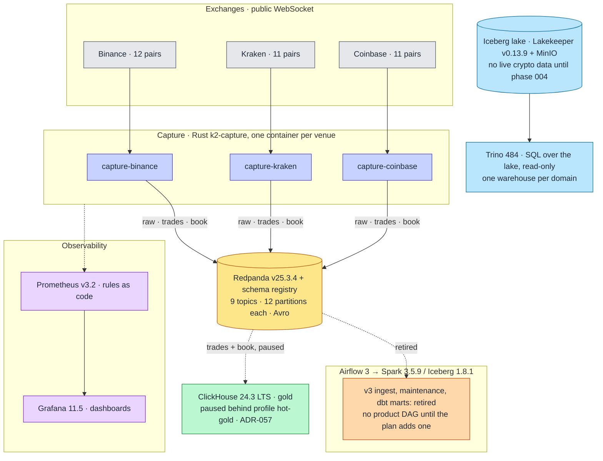

# 04. System overview

> **You will learn** the whole system on one diagram, its three invariants, and the data path end to end.
> **Read this if** you need the shape before the detail.
> **Before this** chapter 01.

The target the platform is being rebuilt toward is in [chapter 20](20-target-data-product-platform.md); this chapter describes what runs today.

**Retired, 2026-11-26.** The v3 lake ingest is retired ([ADR-056](../adr/ADR-056-unified-data-product-platform.md),
phase 000 of the [platform plan](../plans/2026-11-26-unified-product-platform/README.md)): its DAGs, its raw,
bronze, silver, gold and audit tables and the dbt marts read from them were backed up and dropped, and its code,
tests, notebooks and chapters 08 and 09 are archived in [`legacy/v3-lake-ingest/`](../../legacy/v3-lake-ingest/).
Today the captures publish to Redpanda and nothing consumes the topics: no live crypto data lands in the lake until
phase 004, and ClickHouse is paused ([ADR-057](../adr/ADR-057-clickhouse-hot-tier-paused-during-platform-build.md)).
The diagram below is the running system; steps 4 to 8 of the data path are the retired path, kept as its record.

## Problem

A research platform for crypto market data has to do four things end to end, on one host, inside a
fixed budget (16 CPU / 40 GB when v3 was designed; 25 CPU / 48 GiB at the bootstrap peak since
[ADR-045](../adr/ADR-045-ceiling-25-cpu-48-gib.md)): receive every frame three public venues send and know when it did not; keep an
archive still trustworthy after the code that wrote it has been rewritten twice; derive research
products from it and recompute them on demand; and serve queries fast. The hard part is that the fast
tier and the durable tier want opposite things, and whichever is the record silently caps the other.

v1 was a complete Python lakehouse, Kafka and five always-on Spark Structured Streaming jobs into
Iceberg, and it worked at 35 to 40 CPU and 45 to 50 GB across 18 to 20 containers, more than 2x over
the mandate on both axes ([MIGRATION-JOURNEY.md](../MIGRATION-JOURNEY.md)). v2 was rebuilt greenfield
around Redpanda and a ClickHouse medallion, hit the budget, and made the serving database the record:
its Iceberg tier was a JDBC copy of ClickHouse and inherited that database's TTL, normalisation and
dropped columns. v3 inverts the ownership ([ADR-018](../adr/ADR-018-v3-lake-first-rust-capture.md)):
capture is Rust, the lake is the record, ClickHouse is derived and disposable.

Versions are the image tags in [`docker-compose.yml`](../../docker-compose.yml); decisions live in
[`../adr/`](../adr/README.md), numbers in [`../benchmarks/`](../benchmarks/README.md).

## System

Trino ([ADR-035](../adr/ADR-035-trino-and-dbt-for-marts.md)) reads the lake through a catalog
that is read-only at the connector, and writes only dbt marts, each in its data domain's own
Lakekeeper warehouse, generated from `contracts/domains.yaml`
([ADR-044](../adr/ADR-044-producer-lake-and-domain-mart-warehouses.md),
[chapter 19](19-lakehouse-and-domain-warehouses.md)). A mart is a table built for consumers
from lake tables; the marts that ran were retired with the ingest, and the warehouses wait for
the target's products. Airflow 3 is the one scheduler ([ADR-034](../adr/ADR-034-airflow-3-replaces-prefect.md));
the Spark ingest and maintenance DAGs and the hourly dbt marts DAG it started are archived with
the ingest. The scheduler it replaced is archived in [`legacy/prefect/`](../../legacy/prefect/README.md).

Three invariants hold the shape together:

1. **The lake is the record; everything else is derived.** Until the retirement, ClickHouse, the
   notebooks and every product table could be dropped and rebuilt from the lake's raw table
   ([ADR-018](../adr/ADR-018-v3-lake-first-rust-capture.md)); the target keeps the rule with a
   verbatim landing per product ([chapter 20](20-target-data-product-platform.md)).
2. **One wire format.** Avro with the registry, `int64` at 1e-8, `recv_ts_ns` in the body
   ([ADR-020](../adr/ADR-020-avro-fixed-point-contracts.md)). Nothing parses JSON downstream of capture.
3. **Correctness is measured, not asserted.** Sequence and checksum counters at capture and chaos
   scripts with timed recovery run today. The per-layer audits in the lake, the check of every ingest
   batch and the OHLCV parity at a pinned snapshot retired with the ingest; the parity and lake-verify
   gates print a SKIP naming phase 004.

## The data path

One trade, from the venue's socket to a row in lake gold and a candle in the marts. Steps 1 to 3 and 9
run today; steps 4 to 8 are the path as it ran until the retirement above, and are kept as its record
(the stage code is in `legacy/v3-lake-ingest/`). ClickHouse, step 7, is paused while the platform is
built ([ADR-057](../adr/ADR-057-clickhouse-hot-tier-paused-during-platform-build.md)).

1. **The frame arrives.** `k2-capture` holds one WebSocket per venue carrying trades and L2 book
   together, and stamps `recv_ts_ns` as the first statement after the frame leaves the socket, before
   anything is parsed ([capture.md](05-capture.md)). The L2 book is paused on every venue while the
   platform is built, so today the socket carries trades only ([ADR-050](../adr/ADR-050-order-book-capture-paused-during-platform-build.md)).
2. **Continuity is checked in the venue's own terms.** Binance's `lastUpdateId`, Kraken's CRC32,
   Coinbase's connection-wide `sequence_num`; a broken signal drops that book and resubscribes rather
   than publishing a stale one ([capture-venues.md](06-capture-venues.md)).
3. **Three records leave capture,** Avro against the registry, keyed by canonical symbol: the frame
   verbatim to `raw.<venue>`, the trade to `trades.<venue>` as fixed-point `int64` at 1e-8, the
   symbol's top-20 book at the next 1 Hz tick to `book.<venue>` ([wire-contracts.md](07-wire-contracts.md)).
4. **Every 5 minutes the lake read by offset range (retired),** from the offsets in the last ingest
   snapshot's summary to the broker's latest, appending each record verbatim to the raw table with the
   consumed offsets in the same commit, so a killed run resumed rather than duplicated. It then checked
   the batch it committed against the offset range it read, and recorded a mismatch without
   undoing the commit ([lake-ingest.md](08-lake-ingest.md),
   [ADR-047](../adr/ADR-047-ingest-batch-audit-after-publish.md)).
5. **Bronze decoded it per venue** into the venue's own field names with lineage to the raw row;
   **silver** typed and flagged it (UTC, canonical symbol, `venue_replay` / `seq_gap` /
   `precision_loss` / `checksum_ok`), keeping every delivery ([lake-layers.md](09-lake-layers.md)).
6. **Gold made it one trade:** first delivery per `(exchange, canonical_symbol, trade_id)` won;
   OHLCV buckets were `MERGE`d under the total order `(exchange_ts, recv_ts_ns, trade_seq)`, so a
   late delivery re-opened its candle ([lake-layers.md](09-lake-layers.md)).
7. **ClickHouse served it within seconds, until the pause** ([ADR-057](../adr/ADR-057-clickhouse-hot-tier-paused-during-platform-build.md)) (Kafka engine flush every 5 s) ([clickhouse-gold.md](10-clickhouse-gold.md)): the trade
   reached ClickHouse's own `gold.trades` from the topic as a `ReplacingMergeTree` row, earliest delivery
   winning, and `ohlcv_live(bucket)` computes the candle on read over `FINAL`. Lake history arrived by
   `iceberg()`.
8. **Every hour it reached the marts (retired).** Airflow's hourly dbt DAG ran dbt through Trino as each
   domain's writer: the market-analytics candles mart recomputed the candle from the lake's gold trades,
   and every dbt test's result landed in that domain's `dq` namespace, read beside the lake's own checks
   through the governance quality-results mart ([chapter 19](19-lakehouse-and-domain-warehouses.md)).
9. **What still runs is measured.** Capture and Airflow metrics feed the Prometheus rules as code in
   `docker/prometheus/rules/`, every one carrying a runbook annotation, and the chaos scripts in
   `scripts/chaos/` fire the ones that can be induced on a single host ([observability.md](11-observability.md)).
   The lake gauges, the lake alerts and the lake chaos scripts retired with the ingest.

Research read the lake, not the database: the `notebooks/` uv project, where DuckDB queried the
Parquet under MinIO directly over gold for research and silver for forensics, is archived in
`legacy/v3-lake-ingest/notebooks/`, and its gate prints a SKIP naming phase 004.

## Decisions that shaped it

| ADR | Decision | Why |
|---|---|---|
| [018](../adr/ADR-018-v3-lake-first-rust-capture.md) | Lake is the system of record; everything else derived | v2's lake was a JDBC copy of the serving DB, it inherited its TTL, normalisation and dropped columns |
| [019](../adr/ADR-019-rust-capture-tier.md) | Rust capture replaces three JVM handlers | One connection per venue carrying trades *and* book; `recv_ts` before parse; retired on a measured parity gate |
| [020](../adr/ADR-020-avro-fixed-point-contracts.md) | Avro + registry, `int64` @1e-8, `BACKWARD_TRANSITIVE` | v2 stored prices as strings and its registry proved nothing |
| [022](../adr/ADR-022-exactly-once-via-snapshot-offsets.md) | Kafka offsets committed inside the Iceberg snapshot | One atomic commit replaces a watermark table and its failure modes |
| [026](../adr/ADR-026-four-layer-lake-and-gold-served-from-clickhouse.md) | raw / bronze-per-venue / silver-per-venue / gold-canonical; ClickHouse serves gold with no TTL | Typed venue fields survive; OHLCV on read fixes v2's `SummingMergeTree` candles resolving open/close arbitrarily |
| [027](../adr/ADR-027-book-snapshot-and-sequencing.md) | Top-20 snapshots at 1 Hz; per-venue sequencing and resync policy | Raw holds the deltas; the product is what research joins against |
| [008](../adr/ADR-008-eliminate-prefect-orchestration.md) | Remove the orchestrator, **reversed**, then replaced by Airflow ([034](../adr/ADR-034-airflow-3-replaces-prefect.md)) | Wrong call, kept on the record with its Outcome |
| [034](../adr/ADR-034-airflow-3-replaces-prefect.md) | Airflow 3 becomes the scheduler | One scheduler for the Spark jobs and the dbt marts; the one before it archived in [`legacy/prefect/`](../../legacy/prefect/README.md) |
| [035](../adr/ADR-035-trino-and-dbt-for-marts.md) | Trino serves SQL; dbt on Trino builds the marts; Spark keeps every job that writes the lake | Consumer marts need a shared engine outside the ingest's container |
| [044](../adr/ADR-044-producer-lake-and-domain-mart-warehouses.md) | One producer lake, read-only to Trino; one mart warehouse and writer per domain | The lake can lose data for good, a mart can always be rebuilt, and every product has an owner |

## Resource footprint

The long-running services, the one-shot init containers and their limits are what
`python3 scripts/check-budget.py` prints; the per-service table and the command that produces it are in
[operations/docker-resources.md](../operations/docker-resources.md). Budget and reasoning per limit:
[ADR-010](../adr/ADR-010-resource-budget.md).

## Not built

No HTTP query API (SQL is served by Trino); no replication or failover; no Alertmanager routing; no load test above 1×. Designed
and deferred: pcap sidecar with kernel timestamps
([ADR-026](../adr/ADR-026-four-layer-lake-and-gold-served-from-clickhouse.md), `raw.pcap`,
deferred) and a cross-venue security
master ([data-strategy.md](12-data-strategy.md)). The cloud mapping in
[scale-out-path.md](17-scale-out-path.md) is designed, not exercised.

## Key points

- One ownership decision sets the shape: the lake holds the record, every other tier is a cache that
  can be dropped and recomputed, and none can quietly become authoritative.
- A trade is written verbatim before it is understood, then understood in steps, each layer derived
  only from the one above it and rebuildable on demand: the retired ingest did it for every venue in
  one job, and the target does it per product.
- Position and data commit in one snapshot, so exactly-once is a property of the storage format, not
  of a checkpoint store somebody has to operate. ClickHouse buys freshness, not truth.

## Further reading

| Page | What it holds |
|---|---|
| [12-data-strategy.md](12-data-strategy.md) | why four layers, what ClickHouse holds and for how long, retention vs disk |
| [13-schema-design.md](13-schema-design.md) | every column in every layer and the wire contracts |
| [14-partitioning-strategy.md](14-partitioning-strategy.md) | partition specs, sort orders, file sizes, ClickHouse keys |
| [15-capacity-model.md](15-capacity-model.md) | predicted vs measured bytes/day, CPU, disk runway |
| [16-failure-modes.md](16-failure-modes.md) | FMEA: detection, blast radius, recovery, proof per failure |
| [17-scale-out-path.md](17-scale-out-path.md) | the AWS mapping at TB/PB scale, designed, not exercised |
| [A1-technology-stack.md](A1-technology-stack.md) | every version and the ADR behind each |
