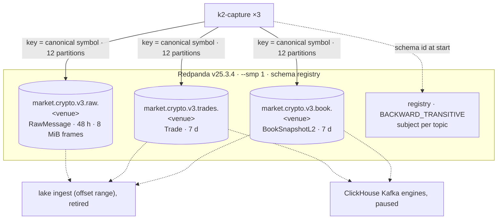

# 07. Redpanda and the wire contracts

> **You will learn** the nine topics, the three Avro records, keying, retention and registry compatibility.
> **Read this if** you produce to or consume from the topics, or you are changing a schema.
> **Before this** chapters 04 and 05.

**Retired, 2026-11-26.** Both readers this chapter names are stood down: the v3 lake ingest is retired
([ADR-056](../adr/ADR-056-unified-data-product-platform.md); its code and chapters 08 and 09 are archived in
[`legacy/v3-lake-ingest/`](../../legacy/v3-lake-ingest/)) and ClickHouse is paused
([ADR-057](../adr/ADR-057-clickhouse-hot-tier-paused-during-platform-build.md)). The captures still produce
to every topic and the contract is unchanged; nothing consumes the topics until the target's Kafka connector
in phase 004 of the [platform plan](../plans/2026-11-26-unified-product-platform/README.md)
([chapter 20](20-target-data-product-platform.md)).

## Problem

Rust capture writes the bytes, ClickHouse 24.3 decoded them for the hot tier until its pause, Spark read
them by bounded offset range into Iceberg until the v3 ingest retired
([batch vs streaming](03-data-engineering-concepts.md#batch-vs-streaming)). A
contract between a capture process, a serving DB and a lake owes those readers four guarantees:

1. One decimal decodes to the same number everywhere, with no per-consumer parser.
2. One instrument's records stay ordered, which is the key's job
   ([partitioning](03-data-engineering-concepts.md#partitioning-and-pruning) orders within a partition,
   never across them).
3. Today's bytes stay readable by a 2028 reader, since the Iceberg archive is never rewritten
   ([schema evolution](03-data-engineering-concepts.md#schema-evolution) governs which changes stay
   resolvable).
4. A stalled broker loses records loudly, not silently
   ([backpressure](03-data-engineering-concepts.md#backpressure-and-loss)).

v2 missed all four. Price, quantity and quote volume travelled as JSON strings
([`normalized-trade.avsc:36`](../../schemas/avro/normalized-trade.avsc)). The Avro schema meant to fix that
was registered and unread (every ClickHouse Kafka table was `JSONAsString` over a parallel `.raw` topic) and
was itself broken: `logicalType` sat as a sibling of `type`, where Avro silently ignores it. Raw topics were
keyed by exchange name rather than instrument (`legacy/v2-kotlin/.../KafkaProducerService.kt:155`), so a
20-partition topic used one partition and ordering was luck. And no receive timestamp reached the wire.

## Options

| Option | Why it lost | Reference |
|---|---|---|
| Kafka + a separate Confluent registry | Two services, 2.0 CPU / 2.77 GB for the broker layer alone; Redpanda carries a Kafka-compatible registry in the same binary | [ADR-001](../adr/ADR-001-replace-kafka-with-redpanda.md) |
| JSON on the wire, JSON Schema | Keeps every payload greppable, the one thing this gives up; loses binary compactness on the highest-volume topic, loses schema-id resolution for an immutable archive, and re-introduces per-consumer number parsing | [ADR-020](../adr/ADR-020-avro-fixed-point-contracts.md) |
| Protobuf | The registry supports it, but it buys nothing Avro does not here and costs a codegen step in three toolchains; never reached an ADR's alternatives table | none ([ADR-001](../adr/ADR-001-replace-kafka-with-redpanda.md) lists it only as a registry-supported format) |
| **Avro, fixed-point `int64` @1e-8** | **Chosen.** One binary format on the one path, exact integer arithmetic in Rust, ClickHouse and Spark | [ADR-020](../adr/ADR-020-avro-fixed-point-contracts.md) |

## Decision

**We carry every v3 record as Avro registered under TopicNameStrategy (subject = `<topic>-value`) at a global `BACKWARD_TRANSITIVE`
level, with prices and quantities as `int64` scaled by 1e-8 and `recv_ts_ns` in the body as well as a Kafka
header, because three runtimes have to decode the same bytes to the same value without negotiating, and an
integer is the only numeric type all three agree on exactly.**

A single Redpanda broker with the registry built in carries nine topics and three Avro records. It is a
buffer with retention, not storage: a lake consumer reads it by offset range and keeps the record (the
retired v3 ingest did; the target's Kafka connector will), and ClickHouse read it for freshness until its pause. The cost: a topic is no longer readable by eye, and the registry now gates every produce.

## How it works

### Topics

- **Created, not auto-created.** `redpanda-init` runs `rpk topic create` for the nine
  `market.crypto.v3.{raw,trades,book}.<venue>` topics at 12 partitions each, then applies retention
  explicitly so a topic that already exists with the wrong value is corrected. 108 partitions on one broker;
  partition counts are deterministic across clones.
- **Keyed by canonical symbol**, `BASE/QUOTE` uppercase, the venue-independent name for an instrument
  ([symbols and venues](02-market-data-concepts.md#symbols-and-venues)). One symbol's records stay ordered
  within a partition, and three venues' BTC/USD land on the same key. Twelve partitions because at most 12
  instruments per venue and the ClickHouse feeds ran 2 consumers.
- **Retention is a per-partition budget.** `retention.ms` 48 h and `retention.bytes` 2 GiB per partition
  on `raw.*` (raised from 512 MiB on 2026-11-25, arithmetic in `init.sh`), 7 d on the derived topics.
  Symbol-keyed partitions are uneven, so the busiest partition hits its byte cap first: measured 7 h on
  Kraken partition 0 at the old 512 MiB cap (not yet measured at 2 GiB) and accepted, because the bus was a buffer for a 5-minute ingest, not the archive.
- **Frame cap.** `max.message.bytes` 8 MiB on `raw.*` to fit Coinbase's ~5 MB `level2`
  subscribe snapshot; the capture's own cap matches.

### Records

| Record | Carries | Notes |
|---|---|---|
| `RawMessage` | `exchange`, `stream`, `symbol?`, `recv_ts_ns`, `conn_id`, `conn_msg_seq`, `payload` bytes | every frame, verbatim; the retired lake raw table stored the whole Kafka value including the 5-byte Confluent header |
| `Trade` | venue + canonical symbol, `trade_id`, `price`, `qty`, `side`, `exchange_ts` (`timestamp-micros`), `recv_ts_ns`, `seq`, lineage | fixed-point `long` at 1e-8; no strings for numbers |
| `BookSnapshotL2` | top-20 as parallel arrays `bid_px[]`, `bid_qty[]`, `ask_px[]`, `ask_qty[]`, `depth`, `checksum_ok`, `seq`, timestamps | 1 Hz per symbol; arrays decode natively in ClickHouse `AvroConfluent` |

Prices and quantities are [fixed point](02-market-data-concepts.md#fixed-point-numbers), the decimal scaled
to a whole number by `round(value * 1e8)`, so 45285.2 is `4528520000000`. Two clocks ride along
([timestamps and clocks](02-market-data-concepts.md#timestamps-and-clocks)): `exchange_ts` is the venue's,
subject to its skew; `recv_ts_ns` is the only one K2 controls, stamped before parse, and duplicated as a
Kafka header, readable without decoding the value. Schemas live in [`schemas/avro/`](../../schemas/avro/)
and are compiled into the capture binary (`include_str!`), so the producer cannot drift from the registry.

## Practices

| Practice | Where it is enforced |
|---|---|
| Explicit topic provisioning | `docker/redpanda/init.sh` one-shot; `rpk topic list` in the release check |
| Schema compatibility gated | registry level `BACKWARD_TRANSITIVE`; `init.sh` documents the `/compatibility` probe that rejects an incompatible record |
| One wire format, tested | `tests/test_wire_format.py` decodes fixtures against the `.avsc` files; CI `python` job |
| Producer-side durability | `enable.idempotence`, `acks=all` in `sink.rs`; drops are counted, never silent |
| Retention budgeted, then measured | `init.sh`: 20 GB slice arithmetic plus the 2026-08-26 measurement; `15-capacity-model.md` scores it |
| Broker health alerted from the producer side | `CaptureProduceErrors`; the consumer-side alerts (lake ingest lag, ClickHouse feed staleness) were removed with their consumers, and a consumer's alerts return in phase 004 |

## Trade-offs

- **Single broker.** No replication; recovery is restart, measured in `make chaos` (`redpanda-stop`). A
  second node would double the CPU budget of the tier.
- **`--smp 1`.** One core holds 108 partitions at the measured ~900 frames/s
  ([benchmarks](../benchmarks/2026-08-27.md#ingestion--capture-tier)); CPU-bound, not throughput.
- **Retention as deadline.** An ingest outage past 48 h loses raw frames; the retired lake recorded the hole
  rather than pretending ([lake-ingest.md](08-lake-ingest.md)). With no consumer until phase 004, the first
  connector starts at the log start, and nothing older is recovered.
- **A field is forever.** `BACKWARD_TRANSITIVE` means no field is ever removed or renamed.

## Key points

- Nine topics, three records, one format, registry on the only path: a schema mistake fails the capture at
  boot (`warm_up` resolves every subject before the first frame); `redpanda-init` only warns.
- `int64` at 1e-8 is the numeric contract; >8 decimal places is rejected and counted at capture.
- The canonical-symbol key makes ordering a property, not a coincidence; it also makes partitions uneven.
- Redpanda is a 48 h / 7 d buffer, not the archive. The lake's raw table was the archive until the v3
  ingest retired; in the target, each product's landing is.
