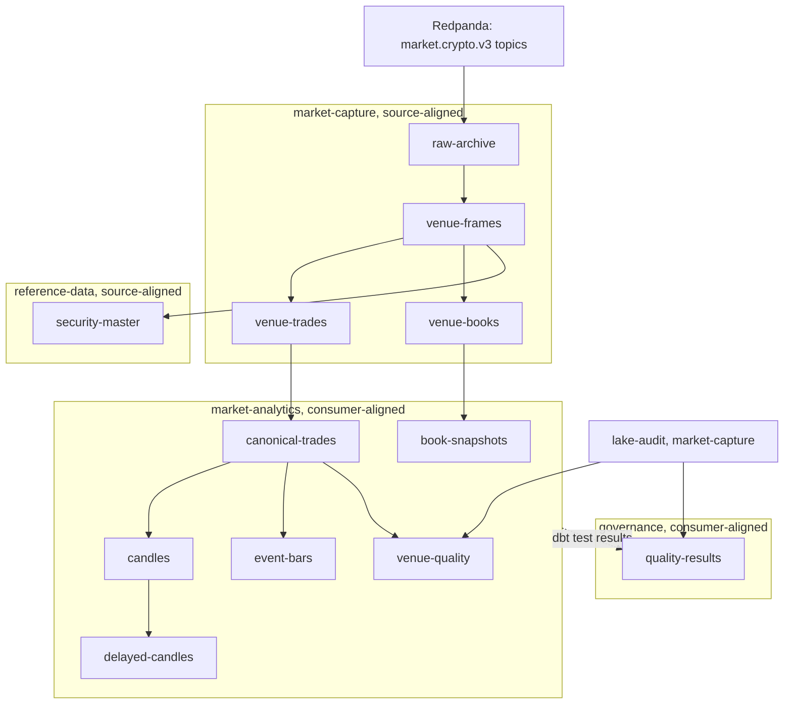

# 18. Data mesh: domains, products and contracts

> **You will learn** how the lake's tables are grouped into owned data products, what a contract declares, and what `k2gen` checks and compiles.
> **Read this if** you own a product, are adding one, or are reviewing a change under `contracts/`.
> **Before this** chapters 09, 13, 14.

**Retired, 2026-11-26.** The thirteen products this chapter was written around, and their
twenty-six contracts, retired with the v3 lake ingest ([ADR-056](../adr/ADR-056-unified-data-product-platform.md);
archived in [`legacy/v3-lake-ingest/contracts/`](../../legacy/v3-lake-ingest/contracts/)), and their tables and marts were
dropped after a backup. The five domains stay declared in `contracts/domains.yaml`. The
[platform plan](../plans/2026-11-26-unified-product-platform/README.md)'s phases add products in the
target's format ([chapter 20](20-target-data-product-platform.md)); phase 001 added the first two,
`governance/access-canary`, synthetic rows that prove access control on every release, and the paused
`market-analytics/hot-gold` ([ADR-057](../adr/ADR-057-clickhouse-hot-tier-paused-during-platform-build.md)).
The comparison against the old DDL, `lake.sql`, retired with the ingest, and so did the nightly audit
of a live table against its contract. Until 2026-11-27 a generator wrote files from the contracts that
were committed beside them; since then a tag's documents are checked and compiled by `k2gen` into a
sealed release, which deploy runs ([chapter 21](21-releases-and-deploy.md)). The design reasoning below
is kept; where it names a product, a table, that audit or the generator, it is the record of what ran.

## Problem

Chapters 09 to 14 describe the lake by layer: what raw, bronze, silver and gold hold, their
columns, their partitions. That answers how a table is built. It does not answer who owns it,
what it reads, how it is classified, or how long its snapshots live, and before phase P1 of
the [governed self-serve platform plan](../plans/2026-11-24-governed-self-serve-platform/README.md)
nothing in the repository did. The facts that did exist lived in several places that could
disagree: columns and partitioning in `lake.sql`, retention as one CLI default in
`maintenance.py`, schedules in the orchestrator's deployment script, descriptions in the hand-kept
[data catalog, archived](../../legacy/v3-lake-ingest/docs/operations/data-catalog.md).

## Options

| Option | Why it lost | Reference |
|---|---|---|
| Group by layer: raw, bronze, silver, gold | A storage convention, not an owner. The security master and the candles are both gold and share nothing else | [ADR-033](../adr/ADR-033-data-mesh-four-domains.md) |
| A K2-only descriptor format | A second schema to design that nobody else's tooling reads; ODCS v3 has a published JSON Schema and an extension point | [ADR-032](../adr/ADR-032-odcs-contracts-and-k2gen.md) |
| Generate `lake.sql` from the contracts | Loses the reasoning its comments carry and rewrites the DDL of record for no new capability | [ADR-032](../adr/ADR-032-odcs-contracts-and-k2gen.md) |

## Domains and products

Five domains, each owned by one named team ([ADR-033](../adr/ADR-033-data-mesh-four-domains.md);
the fifth, `governance`, [ADR-046](../adr/ADR-046-governance-domain-and-quality-results.md)),
registered in [`contracts/domains.yaml`](../../contracts/domains.yaml) and routed for review
by `.github/CODEOWNERS`. Every team maps to the repository's one account today, so the
boundaries are declared and checked, not yet exercised by a second team.

A **product** is a directory, `contracts/<domain>/<product>/`: its Open Data Product Standard
file, `product.odps.yaml` (owner, purpose, kind, lifecycle, input and output ports), one Open Data
Contract Standard v3 contract per table beside it (`<table>.odcs.yaml`), its `grants.yaml`, and
its dbt SQL and seeds when it builds with dbt. Until the retirement the old validator reported 13
products and 26 contracts in the old format (a `product.yaml` descriptor), one for every table in
`lake.sql`, the audit table included. A product could build only marts, as the retired
`delayed-candles`, `venue-quality` and `quality-results` did, with `outputs: []`. The thirteen, as
they stood:

Product to product, from each descriptor's `inputs`. The two configuration files a product
declares as external inputs (`config/instruments.yaml`, `config/bars.yaml`) are left off.
`fx-reference` was declared with its owner and no product; its first, `ecb-fx-rates`, is phase
002 of the platform plan. The dotted edge was not a contract input: every domain's dbt runs
recorded their tests in their own catalog, and `quality-results` read those tables as platform
plumbing (below). A release carries one catalog document per product and an index (the `catalog`
emitter, [chapter 21](21-releases-and-deploy.md#the-compiler-and-its-emitters)); the catalog site that
shows them comes in phase 003.

## The governance domain

`governance` is a domain like any other, owned by `platform-team`
([ADR-046](../adr/ADR-046-governance-domain-and-quality-results.md)). The platform team owns the
road, and this one domain: its products are records about the other domains' data, which no
domain reads back. Its first product, `quality-results`, retired with the ingest, was one view,
the governance `dq_results`: the lake jobs' checks from the lake's audit table and every test
each domain's dbt runs recorded in its own `dq.dbt_test_results`, with status pass, fail, warn
or error. No writer wrote outside its own catalog for it: each domain recorded its own results,
and the view only read ([the dbt README, archived](../../legacy/v3-lake-ingest/dbt/README.md)). `lake-audit` was a
`market-capture` product, because the lake's jobs wrote it about that domain's tables.

## What a contract declares

Each contract places K2's fields where the standard has a place for them, and the rest in
`customProperties`, validated by `contracts/schema/k2-v2.schema.json`. The field map is
[`contracts/schema/README.md`](../../contracts/schema/README.md). A contract carries its columns
inline (`schema[0].properties`, each with a physical type and a description); the `lake` emitter
compiles its DDL into the release. The old form, which referenced `docker/lake/ddl/lake.sql` instead
of restating its columns, retired with that DDL.

`retention` is snapshot expiry in days, not deletion of data
([ADR-028](../adr/ADR-028-non-goals-and-honest-limits.md) §12); the retirement's drop, after a
backup, is the plan's stated exception for a lab whose data is disposable.

## What `k2gen` checks, and what a release holds

`k2gen check` runs four modules over a tag's document set, `docs`, `versions`, `access` and `sql`,
each finding a code such as `docs.retention-below-floor`; `k2gen release` runs the same checks
first, refuses on any error, then compiles the set into a sealed, read-only release: Trino's etc and
rules, the lake DDL, the storage plan with one mart warehouse per domain, the dbt project, the
pipeline files and the catalog documents. What each check refuses, each emitter and who reads its
output, the manifest and the deploy are [chapter 21](21-releases-and-deploy.md); who may see what is
[chapter 22](22-access-and-identity.md). Nothing a release holds is committed: the repository keeps
the documents, and the release is built from a tag.

Two rules this chapter's design rests on are now `docs` checks: a table another product reads keeps
at least the seven-day snapshot floor (`docs.retention-below-floor`), and a product or table cannot
take a name the platform uses (`docs.name-reserved-word`, `docs.table-name-reserved`).

## Where a contract is enforced, and when

| Check | When | Holds the contract to | Catches |
|---|---|---|---|
| `k2gen check`, which `k2gen release` runs first (`make release TAG=<tag>`) | every release | the tag's document set, and the previous release's | a document its schema rejects, a column a partitioning, sort or policy names that the contract does not declare, a breaking change without a major version, and the rest of [chapter 21](21-releases-and-deploy.md#the-checks) |
| `make test-k2gen` (CI job `contracts`) | every pull request | each check against its passing and failing fixtures; the repository's own documents against their schemas (`test_repository_documents.py`) | a check that stops refusing what it should; a document under `contracts/` its schema rejects |
| `contract_schema` in `maintenance.py`, retired with the ingest ([runbook, archived](../../legacy/v3-lake-ingest/docs/runbooks/lake-audit-failed.md#15-contract_schema-a-live-table-is-not-what-its-contract-states) section 15) | nightly, 03:00 UTC, under the writer lock, until 2026-11-26 | the live Iceberg table: columns, types, nullability, order, partition spec, sort order, identifier fields | an `ALTER` run by hand, DDL applied only in part, a contract merged and never applied, a table with no contract outside a `scratch_` namespace |

CI fails a pull request; `k2gen release` refuses to compile, so nothing deploys. Until it retired the
nightly audit filed a failed row in the lake's audit table and fired `LakeAuditFailed`, up to a day
after the table moved. **Nothing refuses a bad write at write time.** Iceberg and Spark refuse a
write that does not fit the live table's schema, but that is the live table, which may already
differ from its contract; no writer compares what it writes with the contract. Until the target's
audits run ([chapter 20](20-target-data-product-platform.md)), no check compares a live table with
its contract.

## Practices

| Practice | Where it is enforced |
|---|---|
| Every finding code has a failing fixture, and the good fixture set passes | `make test-k2gen`; `platform/k2gen/tests/fixtures/v2/` |
| One document set compiles to one release on any machine, and a set with an error compiles nothing | `test_two_machines_compile_one_set_to_one_tree`, `test_cli_release_refuses_a_set_with_an_error_finding_and_writes_nothing`; each emitter against its goldens under `platform/k2gen/tests/golden/` |
| The compiler is typed | mypy, strict, pinned in `platform/k2gen/uv.lock`; `make lint` and CI job `contracts` |

The tests are in [`platform/k2gen/tests/`](../../platform/k2gen/tests/); `make test-k2gen` runs
them and `make test` includes it.

## Trade-offs

- **The retired contracts carried no columns.** A product page took its column descriptions
  from `lake.sql`'s `COMMENT` clauses, and a column with none had an empty cell; a contract now
  declares its columns inline, descriptions included.
- **Consistency, not truth.** An `upstreams` list that is wrong but self-consistent passes. A job
  that starts reading a table without its contract saying so is invisible until lineage is
  captured in phase P5.
- **Five teams that are one person.** CODEOWNERS routes no review while every line names the
  same account; the trigger to change that is a second contributor
  ([ADR-033](../adr/ADR-033-data-mesh-four-domains.md), Revisit when).
- **The live check was nightly, not at the write,** and it retired with the ingest. A table that
  drifted from its contract was found up to a day later, after rows had been written to it; a
  write-time refusal would mean every writer reading the contract before each commit.

## Key points

- The unit of ownership is the product, not the table or the layer: five domains, one owner each; the 13 products of the v3 lake retired with it.
- Every contract declares its columns inline; `lake.sql`, the DDL of record for the v3 tables, retired with them.
- Nothing generated is committed: `k2gen release` checks a tag's documents and compiles them into a sealed release ([chapter 21](21-releases-and-deploy.md)).

## Related

- [ADR-032](../adr/ADR-032-odcs-contracts-and-k2gen.md), the contracts and the generator, its generated files superseded by [ADR-058](../adr/ADR-058-deploy-sealed-releases-by-pointer-swap.md)
- [ADR-033](../adr/ADR-033-data-mesh-four-domains.md), the four domains and their owners;
  [ADR-046](../adr/ADR-046-governance-domain-and-quality-results.md), the fifth, governance
- [Chapter 21](21-releases-and-deploy.md), the checks, the compiler and the release
- [Golden path](../development/golden-path.md), adding a product
- [`contracts/schema/README.md`](../../contracts/schema/README.md), where each K2 field sits in an ODCS contract
- [09-lake-layers.md](09-lake-layers.md), [13-schema-design.md](13-schema-design.md), [14-partitioning-strategy.md](14-partitioning-strategy.md), the tables the retired products were made of
