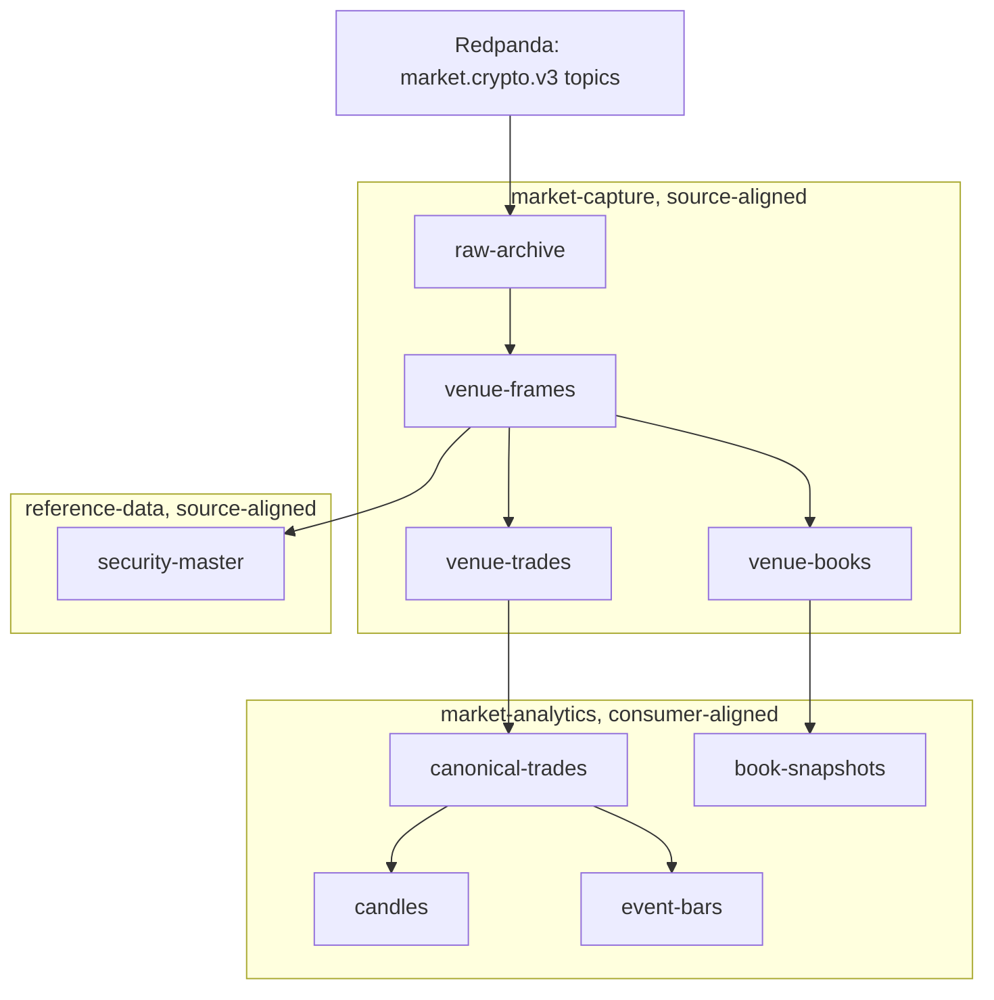

# 18. Data mesh: domains, products and contracts

> **You will learn** how the lake's tables are grouped into owned data products, what a contract declares, and what `k2gen` checks and writes.
> **Read this if** you own a product, are adding one, or are reviewing a change under `contracts/`.
> **Before this** chapters 09, 13, 14.

## Problem

Chapters 09 to 14 describe the lake by layer: what raw, bronze, silver and gold hold, their
columns, their partitions. That answers how a table is built. It does not answer who owns it,
what it reads, how it is classified, or how long its snapshots live, and before phase P1 of
the [governed self-serve platform plan](../plans/2026-11-24-governed-self-serve-platform/README.md)
nothing in the repository did. The facts that did exist lived in several places that could
disagree: columns and partitioning in `lake.sql`, retention as one CLI default in
`maintenance.py`, schedules in the Prefect deployment, descriptions in the hand-kept
[data catalog](../operations/data-catalog.md).

## Options

| Option | Why it lost | Reference |
|---|---|---|
| Group by layer: raw, bronze, silver, gold | A storage convention, not an owner. The security master and the candles are both gold and share nothing else | [ADR-033](../adr/ADR-033-data-mesh-four-domains.md) |
| A K2-only descriptor format | A second schema to design that nobody else's tooling reads; ODCS v3 has a published JSON Schema and an extension point | [ADR-032](../adr/ADR-032-odcs-contracts-and-k2gen.md) |
| Generate `lake.sql` from the contracts | Loses the reasoning its comments carry and rewrites the DDL of record for no new capability | [ADR-032](../adr/ADR-032-odcs-contracts-and-k2gen.md) |

## Domains and products

Four domains, each owned by one named team ([ADR-033](../adr/ADR-033-data-mesh-four-domains.md)),
registered in [`contracts/domains.yaml`](../../contracts/domains.yaml) and routed for review
by `.github/CODEOWNERS`. Every team maps to the repository's one account today, so the
boundaries are declared and checked, not yet exercised by a second team.

A **product** is a directory, `contracts/<domain>/<product>/`: a descriptor, `product.yaml`
(owner, purpose, kind, lifecycle, inputs, outputs, known consumers), and one Open Data
Contract Standard v3 contract per output table beside it. `k2gen validate` reports nine
products and 25 contracts, one for every table in `lake.sql` outside `audit`.

Product to product, from each descriptor's `inputs`. The two configuration files a product
declares as external inputs (`config/instruments.yaml`, `config/bars.yaml`) are left off.
`fx-reference` is declared with its owner and has no product until phase P4. The generated
[product index](../products/README.md) has a page per product, with the same flow drawn table
by table.

## What a contract declares

Each contract places K2's fields where the standard has a place for them, and the rest in
`customProperties`, validated by `contracts/schema/k2.schema.json`. The field map is
[`contracts/schema/README.md`](../../contracts/schema/README.md). Two forms:

- **A table `lake.sql` creates** references it (`authoritativeDefinitions`, url
  `docker/lake/ddl/lake.sql`) and does not restate its columns. `lake.sql` stays the DDL of
  record: its comments carry reasons no generated file would keep.
- **A new table** carries its columns inline (`schema[0].properties`, each with a Spark SQL
  `physicalType` and a description), and `k2gen generate` writes its DDL. No contract has this
  form today; `make new-product` scaffolds one.

`retention` is snapshot expiry in days, not deletion of data: no row in the lake is deleted
([ADR-028](../adr/ADR-028-non-goals-and-honest-limits.md) §12 stays in force).

## What `k2gen validate` checks

In order. A problem in step 1 ends the run, because the later steps assume well-formed files;
steps 2 to 4 report together.

1. Every file against its schema: the vendored ODCS v3.2.0 JSON Schema, then K2's profile.
2. Each product against its place: its directory, its domain's owner and kind, its outputs
   against the contracts beside it.
3. Each contract against `lake.sql`: the table exists and its partitioning and sort order are
   the declared ones; or, with inline columns, the table is one `lake.sql` does not create and
   its partitioning and sort name its own columns. Every table outside `audit` has one contract.
4. Across products: a table another table reads keeps snapshots for the seven-day floor
   `maintenance.py` enforces; a table is at least as restricted as anything it reads; every
   input resolves to another product's output or a declared external source.

## What `k2gen generate` writes

`generate` runs `validate` first and writes nothing on a problem. It renders every output in
memory, deletes the directories it owns, and writes them again in sorted order, so two runs
are byte-identical and a deleted contract leaves nothing behind.

| Output | Path | Read by |
|---|---|---|
| Iceberg DDL for contracts with inline columns | `docker/lake/ddl/generated/` (owned) | `docker/lake/apply_ddl.py`, after `lake.sql` |
| Snapshot expiry per table, in days | `docker/lake/generated/retention.json` | nothing yet: `maintenance.py` reads it from phase P5 |
| A page per product, and the index by domain | `docs/products/` (owned) | people; check-docs gate (a) checks every link on them |
| One mart warehouse per domain | `docker/lake/generated/warehouses.txt` | `docker/lake/init-lake.sh`, after the lake's own bootstrap |
| A writable Trino catalog per domain, and its local twin | `docker/trino/etc/catalog/<domain>.properties`, `docker/trino/test/local/<domain>.properties` (the generated ones; `lake.properties` beside them is hand-written) | Trino; `make test-trino` |
| Trino's access rules: each domain's writer writes only its own catalog | `docker/trino/etc/rules.json` | Trino ([ADR-044](../adr/ADR-044-producer-lake-and-domain-mart-warehouses.md)) |

How those warehouses, catalogs and rules work together, and who may read or write each, is
[chapter 19](19-lakehouse-and-domain-warehouses.md).

With no inline-column contract, the DDL directory holds only the `README.md` that `generate`
writes there, which says so. Later phases add outputs (Airflow DAG config, dbt sources,
catalog payloads, SLO rules) at the paths the
[phase P1 output map](../plans/2026-11-24-governed-self-serve-platform/001-contracts-generator-mesh.md)
fixes. How a team adds a product, step by step: [the golden path](../development/golden-path.md).

## Practices

| Practice | Where it is enforced |
|---|---|
| Every lake table outside `audit` has exactly one contract | `k2gen validate` step 3; `test_every_table_outside_audit_has_exactly_one_contract` |
| A contract and `lake.sql` agree on partitioning and sort | `k2gen validate` step 3; `test_a_wrong_partition_spec_fails`, `test_a_wrong_sort_order_fails` |
| A table another reads keeps the seven-day snapshot floor | `k2gen validate` step 4; `test_a_parent_with_expiry_under_the_floor_fails` |
| A table is at least as restricted as its inputs | `k2gen validate` step 4; `test_a_table_less_restricted_than_its_input_fails` |
| Generated files are never edited by hand | CI job `contracts`: `make generate`, then no diff and no untracked file |
| Generation is repeatable and removes what a deleted contract wrote | `test_a_second_generate_changes_nothing`, `test_a_deleted_contract_removes_its_outputs` |
| A scaffolded product is valid as written | `test_a_scaffolded_product_validates` |
| A new domain gets its fence; a removed one takes it; a reserved or malformed domain id is refused | `test_a_new_domain_gets_its_fence`, `test_a_removed_domain_takes_its_catalog_and_leaves_lake_properties`, `test_a_domain_whose_fence_name_is_taken_is_rejected`, `test_a_domain_id_that_is_not_a_slug_is_rejected` |
| The generator is typed | mypy, strict, pinned in `platform/k2gen/uv.lock`; `make lint` and CI job `contracts` |

The tests are in [`platform/k2gen/tests/`](../../platform/k2gen/tests/); `make test-k2gen` runs
them and `make test` includes it.

## Trade-offs

- **The contracts of existing tables carry no columns.** A product page takes its column
  descriptions from `lake.sql`'s `COMMENT` clauses, and a column with none has an empty cell.
- **Consistency, not truth.** An `upstreams` list that is wrong but self-consistent passes. A job
  that starts reading a table without its contract saying so is invisible until lineage is
  captured in phase P5.
- **Four teams that are one person.** CODEOWNERS routes no review while every line names the
  same account; the trigger to change that is a second contributor
  ([ADR-033](../adr/ADR-033-data-mesh-four-domains.md), Revisit when).
- **`retention.json` is read by nothing yet.** It is written and kept current now so phase P5
  can switch `maintenance.py` to it with values equal to today's.

## Key points

- The unit of ownership is the product, not the table or the layer: four domains, nine products, one owner each.
- `lake.sql` stays the DDL of record for every table it creates; contracts are checked against it, never the reverse.
- Generated files are committed, owned by `k2gen generate`, and CI fails on any drift.

## Related

- [ADR-032](../adr/ADR-032-odcs-contracts-and-k2gen.md), the contracts and the generator
- [ADR-033](../adr/ADR-033-data-mesh-four-domains.md), the four domains and their owners
- [Product index](../products/README.md), generated: a page per product
- [Golden path](../development/golden-path.md), adding a product
- [`contracts/schema/README.md`](../../contracts/schema/README.md), where each K2 field sits in an ODCS contract
- [09-lake-layers.md](09-lake-layers.md), [13-schema-design.md](13-schema-design.md), [14-partitioning-strategy.md](14-partitioning-strategy.md), the tables the products are made of
