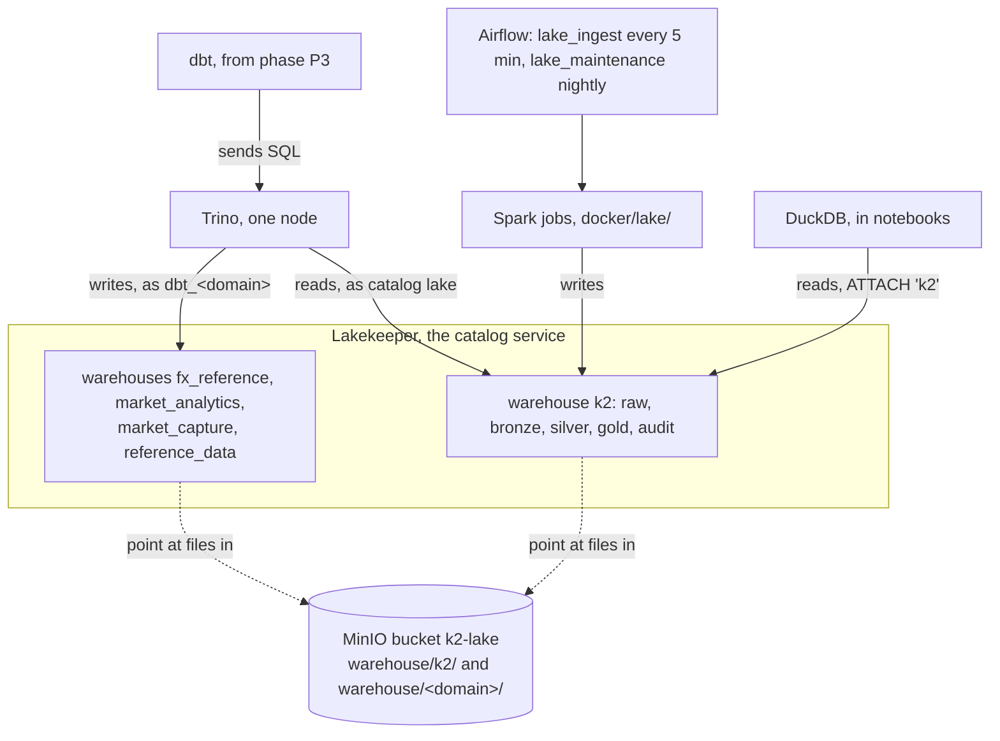
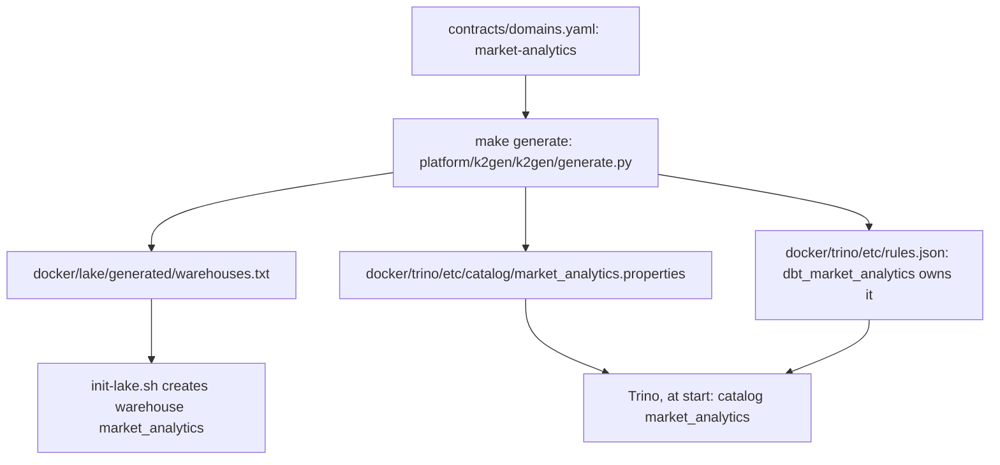

# 19. The lakehouse and its domain warehouses

> **You will learn** what a lakehouse table, a catalog and a warehouse are, why K2 keeps one producer lake beside one mart warehouse per domain, and who may read or write each.
> **Read this if** you are new to Iceberg or Trino, you will query through Trino, or you will build a mart.
> **Before this** chapter 09; chapter 18 helps.

## The picture

K2 keeps its data as files in one bucket, `k2-lake`, on MinIO. MinIO is object storage: a flat
store of files addressed by key, with the same API as Amazon S3. Lakekeeper, the catalog
service, records which files make up each table. It holds five warehouses, separate areas
each with its own tables: `k2`, the producer lake, and one per data domain, a team's area of
data, for that domain's marts. A mart is a table built for consumers out of lake tables. Three
engines, the programs that run queries, use the catalog. Spark runs the batch jobs that write the
lake, and Airflow, the scheduler, starts them. Trino is a SQL server: it reads every
warehouse and writes only the domain warehouses. DuckDB is a library inside the notebooks, and it
reads the lake. dbt, a tool that turns SQL `SELECT` files into tables, will build the marts
through Trino from the next pull request of
[phase P3](../plans/2026-11-24-governed-self-serve-platform/003-trino-dbt-marts.md).



The catalog never holds data. An engine asks it where a table's files are, then reads or writes
those files in MinIO itself, with the MinIO keys from `.env`
([`spark_conf.py`](../../docker/lake/spark_conf.py), [`lake.properties`](../../docker/trino/etc/catalog/lake.properties)).

## First principles

**A table is files plus metadata.** In a lakehouse, a table is data files plus metadata files in
object storage. The data files are Parquet, a column-oriented format. The metadata files say
which data files are the table right now. They can carry statistics per column; K2 keeps them
only for the columns that range filters use ([chapter 09](09-lake-layers.md)). Apache Iceberg is the
table format that defines the metadata. `lake.gold.ohlcv_1m` is 19 Parquet files under
`s3://k2-lake/warehouse/k2/<uuid>/data/`, with its metadata beside them under `metadata/`.

**A snapshot is one version of the table.** Every write that succeeds adds a snapshot: the
complete list of the table's files at that moment. The old files stay in place.
`lake.gold.ohlcv_1m` had 196 snapshots when this was written. A snapshot also carries a summary of
properties. Each ingest into `raw.messages` stores there the bus positions it read up to (Kafka
offsets), as `k2.kafka-offsets` ([chapter 08](08-lake-ingest.md)).

**The catalog holds the pointer.** A table has many metadata files, one per version. The catalog
says which one is current. Lakekeeper keeps that pointer per table in PostgreSQL
(`LAKEKEEPER__PG_DATABASE_URL_WRITE` in `docker-compose.yml`). A commit, the step that publishes
a new version, swaps the pointer. A reader sees the old version or the new one, never half of
each. Two writers need this. Both start from the same version, and the catalog accepts only the
first swap. The second retries on top of the new version: this is optimistic concurrency
([ADR-022](../adr/ADR-022-exactly-once-via-snapshot-offsets.md)). The retry re-applies the losing
append. That is fine for plain rows, and wrong for K2's ingest, whose append also records where
it stopped reading. So the Spark jobs also take one writer lock, a `flock` in
[`lock.py`](../../docker/lake/lock.py). Lakekeeper speaks the Iceberg REST protocol, which every
engine here speaks ([ADR-023](../adr/ADR-023-lakekeeper-rest-catalog.md)).

**A warehouse is a fenced area of storage with its own table list.** Each Lakekeeper warehouse
has a storage location, a bucket plus a key prefix, and its own namespaces and tables.
[`init-lake.sh`](../../docker/lake/init-lake.sh) creates `k2` at `warehouse/k2`, then one warehouse
per line of [`warehouses.txt`](../../docker/lake/generated/warehouses.txt) at `warehouse/<name>`.
A connection opens one warehouse; a name in one does not resolve in another. Lakekeeper also
chooses where a new table's files go, under its warehouse's prefix. A Trino table placed inside
`warehouse/k2/` from a writable catalog was refused with `Failed to create transaction`
([ADR-044](../adr/ADR-044-producer-lake-and-domain-mart-warehouses.md)).

**A namespace is a folder of tables; SQL calls it a schema.** Warehouse `k2` has five: `raw`,
`bronze`, `silver`, `gold` and `audit`. **A Trino catalog is a named connection to one
warehouse**, one file under `docker/trino/etc/catalog/` ([README](../../docker/trino/README.md)).
The file names a connector, the Trino plugin for one kind of storage: here always
`connector.name=iceberg`. Catalog `lake` opens warehouse `k2`; catalog `market_analytics` opens
warehouse `market_analytics`. A full name is `<catalog>.<schema>.<table>`, so the table the
Lakekeeper UI shows under `k2` and `gold` is `lake.gold.trades`. Spark and DuckDB also call `k2`
by the name `lake`.

**Time travel reads an older snapshot.** Old snapshots stay until they are expired, so a query can
read the table as it was: `FOR VERSION AS OF <snapshot id>` or `FOR TIMESTAMP AS OF <time>`.
The nightly Spark job `maintenance.py` expires snapshots older than seven days, keeping at least
ten. K2's parity
checks, which compare engines' answers, pin a snapshot id
([chapter 03](03-data-engineering-concepts.md#iceberg-snapshots)).

## Two zones, and why the fence sits between them

| | Producer lake | Domain warehouses |
|---|---|---|
| Warehouse | `k2` | one per domain, for example `market_analytics` |
| Holds | the layers `raw` to `gold`, and `audit` ([chapter 09](09-lake-layers.md)) | marts, one schema per data product |
| Written by | Spark jobs only | that domain's writer, `dbt_<domain>`, through Trino |
| Rebuildable | bronze to gold from `raw.messages`; `raw.messages` itself, no | always, from the lake |
| Fence | Trino's `lake` catalog is read-only at the connector | `rules.json`, one writer per domain |

A fence is a boundary software enforces, not one people promise to respect. `rules.json` is
Trino's file of access rules.

**The lake can lose data for good.** Redpanda, the message bus, keeps raw frames for 48 hours or
2 GiB per partition ([chapter 07](07-wire-contracts.md)). After that, `raw.messages` holds the
only copy. The ingest reads its start from the newest ingest snapshot (ADR-022). So a stray
`rollback_to_snapshot`, which sets a table back to an older snapshot, would hide rows while the
ingest resumes after them. Once the bus has expired those frames, they are lost (ADR-044).

**A mart cannot.** A mart is a `SELECT` over lake tables and other marts. If one is damaged, dbt
builds it again from the lake. The cost of a lost mart is a rebuild.

So the lake gets the strongest fence: Trino's connector refuses every commit to it. The domain
warehouses get a fence per writer, which is weaker, as [the limits](#the-honest-limits) show. The
lake stays one warehouse because one pipeline builds all its layers. Splitting it by domain would
move every table and re-base every audit, for fences nobody stands behind (ADR-044).

## Domains: one entry, one fence

A data domain is a body of data that one team owns and answers for
([ADR-033](../adr/ADR-033-data-mesh-four-domains.md)). A data product is one owned unit inside it,
such as `candles`. [`contracts/domains.yaml`](../../contracts/domains.yaml) lists four domains:
`market-capture`, `reference-data`, `fx-reference` and `market-analytics`. The lake's tables
belong to these domains as owners and still live in `k2` ([chapter 18](18-data-mesh.md)). Every
domain warehouse is empty until its first mart.

One entry in `domains.yaml` gives a domain its whole fence. `make generate` runs
[`generate.py`](../../platform/k2gen/k2gen/generate.py), which turns the id `market-analytics`
into the name `market_analytics` and writes:



It also writes the catalog's twin for `make test-trino`, under `docker/trino/test/local/`.
`lake.properties`, the rest of `docker/trino/etc/` and `init-lake.sh` are hand-written. CI runs
`make generate` and fails on any difference. `k2gen validate` refuses a domain whose name would
be `lake`, `system` or `k2`: those names are taken.

Inside a domain catalog there is one schema per data product, for example
`market_analytics.delayed_candles.ohlcv_1m_delayed_20m`. A product rebuild can then drop one
schema without touching its siblings. A mart that joins two domains belongs to the domain that
consumes it, and lives in that domain's warehouse; nobody writes into a producer's warehouse.
Governance data, such as quality results and lineage, will be a domain like any other, owned by
the platform team. It joins `domains.yaml` with its first product, not before (ADR-044, and the
Outcome of ADR-033).

## Who can do what

| Who | Lake, warehouse `k2` | Its own domain warehouse | Another domain's warehouse |
|---|---|---|---|
| Spark jobs in `docker/lake/` | **write**, the only writer. One job at a time: the `flock` in `lock.py`, and one run at a time per Airflow job | none today: `spark_conf.py` opens `k2` only | none today |
| `dbt_<domain>`, through Trino | **read**. Write **denied**: `rules.json` grants only `SELECT` there, and the connector is read-only (`iceberg.security=read_only`) | **write**: create and drop schemas, tables and views; insert, delete, update. `rules.json` makes it the owner | **read**. Write **denied** by `rules.json` |
| Any other Trino user, `trino` included | **read**. Write **denied**, as above | none: no rule names it | **read**. Write **denied** by `rules.json` |
| DuckDB, in notebooks and parity scripts | **read**, through `ATTACH 'k2' AS lake`. No Trino rule applies; the code only reads | not attached today | not attached today |

In [`rules.json`](../../docker/trino/etc/rules.json) the first matching rule wins. A writer's own
rule comes first; everyone else falls through to the last, `SELECT` and `GRANT_SELECT` only. Two
cells are weaker than they look: any identity can be claimed, and table procedures (maintenance
commands such as `optimize`) inside the domain warehouses are open to every user. Both are in
[the honest limits](#the-honest-limits).

## How a query travels

**A read.** Say `market_analytics` holds a mart `candle_counts`, candles per exchange, in the
scratch schema this chapter used. A user joins it to the venue dimension in the lake:

```sql
SELECT c.exchange, v.subscribed
FROM market_analytics.chapter_check.candle_counts c
JOIN lake.gold.dim_venue v ON v.exchange = c.exchange AND v.is_current
```

1. The CLI sends the SQL to Trino over HTTP with the header `X-Trino-User: trino`, its default
   user inside the container.
2. Trino reads the first part of each name as a catalog, and each catalog file names one
   warehouse. `rules.json` gives user `trino` `SELECT` on both tables.
3. For each table, the catalog's Iceberg connector asks Lakekeeper to load it. Lakekeeper
   answers with the current metadata and the location of its file.
4. From the current snapshot, Trino reads the table's manifests, the files listing its data
   files. Partition values and column statistics let it skip files the query cannot need.
5. Trino reads the remaining Parquet files from MinIO, joins them in memory and returns rows.
   `EXPLAIN (TYPE IO, FORMAT JSON)` lists the two inputs: catalog `market_analytics` and `lake`.

**A write.** A dbt model is one `SELECT` in a file. dbt wraps it in a statement such as
`CREATE TABLE ... AS` and sends it to Trino as the domain's writer. The same statement by hand:

```sql
CREATE TABLE market_analytics.chapter_check.candle_counts AS
SELECT exchange, count(*) AS candles FROM lake.gold.ohlcv_1m GROUP BY exchange
```

1. The header says `X-Trino-User: dbt_market_analytics`. `rules.json` makes that user the owner
   of every schema in `market_analytics`. Trino reads `lake.gold.ohlcv_1m` as in the read above.
2. Trino asks Lakekeeper to create the table in warehouse `market_analytics`. Lakekeeper picks
   the location, `s3://k2-lake/warehouse/market_analytics/<uuid>`, because the catalog file sets
   `iceberg.rest-catalog.server-assigned-table-location-enabled=true`.
3. Trino writes the Parquet files, then new metadata, then commits: Lakekeeper swaps the
   pointer. The snapshot summary records `engine-name` `trino` and `trino_user`
   `dbt_market_analytics`.
4. Warehouse `k2` is untouched: `lake.gold.ohlcv_1m` has no snapshot written by Trino.

To rebuild a mart, drop it and build it again. A `DROP TABLE` through Trino is a purge drop:
Lakekeeper's `tabular_purge` task deletes the files within seconds (ADR-044).

## Views

A view is a stored query, not stored data; reading it runs the query. Trino saves a view in the
catalog as an Iceberg view whose SQL is in Trino's dialect
([ADR-035](../adr/ADR-035-trino-and-dbt-for-marts.md)). That is why the delayed product, candles
held back by 20 minutes, can be a view. A view over `lake.gold` with a 20-minute predicate is
always current and needs no schedule:

```sql
CREATE VIEW market_analytics.chapter_check.candles_delayed AS
SELECT exchange, canonical_symbol, window_start FROM lake.gold.ohlcv_1m
WHERE window_start < current_timestamp - INTERVAL '20' MINUTE
```

Trino checks a view's base tables against the view's owner, not its reader: a definer view. Across
domains, that needs the owner to have `all` on each base table's catalog. A read-only catalog
rule broke it with `Access Denied: View owner does not have sufficient privileges`. So
`rules.json` keeps every catalog `all` and fences in the schema and table rules (ADR-044).

The limit: views are readable through Trino only. DuckDB 1.4.4 lists a domain's tables but not its
views. Spark 3.5.5 reads a view only when its SQL is also valid Spark SQL (ADR-035). So consumers
read marts through Trino (ADR-044). One who needs the rows in another engine reads the gold
table, or a scheduled table if one is ever declared.

## The honest limits

1. **Identity is a claim, not a proof.** Trino takes the user from the `X-Trino-User` header and
   does not check it. Anyone on the host can say `--user dbt_market_analytics`. The port listens
   on `127.0.0.1` only (`K2_TRINO_PORT`, default 8088). The fences stop mistakes, not a liar
   (ADR-044; [ADR-028](../adr/ADR-028-non-goals-and-honest-limits.md) section 8 and its Outcome).
   The trigger for authentication is a second person with access to the host.
2. **Table procedures are not fenced between domain catalogs.** They run as `ALTER TABLE ...
   EXECUTE`: `optimize`, `rollback_to_snapshot`, `expire_snapshots` and others. No built-in
   access control in Trino 484 restricts one per user on a writable catalog. As
   `dbt_market_analytics`, `EXPLAIN ALTER TABLE reference_data.scratch_check.candles EXECUTE
   optimize` planned ([`docker/trino/README.md`](../../docker/trino/README.md)). That is
   acceptable for now: the lake is not exposed, and a mart is rebuilt from the lake. `make
   test-trino` asserts the gap, so a Trino release that closes it fails there first (ADR-044).
3. **One set of storage keys.** Trino, Spark and DuckDB all hold the MinIO root keys, and
   Lakekeeper is unauthenticated. Spark and DuckDB reach both directly, so Trino's rules bind
   only Trino clients. A MinIO key per identity, scoped to its own prefix, comes with the
   entitlements phase, P5 ([ADR-031](../adr/ADR-031-governed-self-serve-platform.md), ADR-044).

## On a cloud

[Chapter 17](17-scale-out-path.md) maps MinIO to S3 and Lakekeeper to tasks on ECS with a
Multi-AZ PostgreSQL. A warehouse is a bucket plus a key prefix, so each domain's warehouse would
move as a prefix. Chapter 17 predates Trino and the domain warehouses and does not place them.
One gap to know: the Trino catalog files hard-code the Lakekeeper URL, the MinIO endpoint and
region `local-01` (`lake.properties`, `generate.py`), where `docker/lake/` reads each from the
environment.

## See it yourself

Read-only, against the running stack, on 2026-11-25. Counts grow with every commit.

```bash
docker exec k2-trino trino --execute 'SHOW CATALOGS'
#   "fx_reference" "lake" "market_analytics" "market_capture" "reference_data" "system"
docker exec k2-trino trino --execute 'SHOW SCHEMAS FROM lake'
#   "audit" "bronze" "gold" "information_schema" "raw" "silver" "system"
docker exec k2-trino trino --execute 'SHOW SCHEMAS FROM market_analytics'
#   "information_schema" "system"                     no marts yet
docker exec k2-trino trino --execute \
  'SELECT (SELECT count(*) FROM lake.gold."ohlcv_1m$files"), (SELECT count(*) FROM lake.gold."ohlcv_1m$snapshots")'
#   "19","196"                                        data files, snapshots
docker exec k2-trino trino --execute 'SELECT file_path FROM lake.gold."ohlcv_1m$files" LIMIT 1'
#   "s3://k2-lake/warehouse/k2/<uuid>/data/exchange=<exchange>/window_start_month=2026-11/<file>.parquet"
docker exec k2-trino trino --execute \
  "SELECT summary['engine-name'] FROM lake.raw.\"messages\$snapshots\" ORDER BY committed_at DESC LIMIT 1"
#   "spark"
docker exec k2-trino trino --execute \
  "SELECT count(*) > 0 FROM lake.gold.ohlcv_1m FOR TIMESTAMP AS OF current_timestamp - INTERVAL '1' HOUR"
#   "true"                                            time travel
curl -s 'http://localhost:18181/management/v1/warehouse?project-id=00000000-0000-0000-0000-000000000000' \
  | jq -r '.warehouses[] | [.name, ."storage-profile"."key-prefix"] | @tsv'
#   k2  warehouse/k2, then one line per domain warehouse              the catalog's five
p=$(curl -s 'http://localhost:18181/catalog/v1/config?warehouse=k2' | jq -r .defaults.prefix)
curl -s "http://localhost:18181/catalog/v1/$p/namespaces/gold/tables/ohlcv_1m" | jq -r '."metadata-location"'
#   s3://k2-lake/warehouse/k2/<uuid>/metadata/00399-<uuid>.metadata.json   higher after each commit
```

The read, the write and the view above were run for this chapter as `dbt_market_analytics` in
`market_analytics.chapter_check`, then dropped. No objects remain under any domain prefix.

## Common mistakes and what you will see

Each line below was printed by `k2-trino`, or by DuckDB 1.4.4, on 2026-11-25.

- **Naming the warehouse, or no catalog.** `SELECT count(*) FROM k2.gold.trades` gives `Catalog
  'k2' not found`. `FROM gold.trades` gives `Catalog must be specified when session catalog is
  not set`. The warehouse is `k2`; the catalog is `lake`. Write `lake.gold.trades`, or pass
  `--catalog lake`.
- **Writing to the lake.** `CREATE TABLE lake.gold.chapter_check (x integer)` gives `Access
  Denied: Cannot create table lake.gold.chapter_check`, for every user. A table procedure gives
  `Access Denied: Cannot execute table procedure OPTIMIZE on gold.ohlcv_1m`. That message has no
  catalog prefix: the read-only connector refused it, since `rules.json` cannot govern procedures.
- **Forgetting `--user`.** Inside the container the CLI's user is `trino`, and no rule lets it
  write. `CREATE SCHEMA market_analytics.chapter_check` gives `Access Denied: Cannot create
  schema market_analytics.chapter_check`.
- **Writing to another domain.** As `dbt_market_analytics`, `CREATE TABLE
  reference_data.chapter_check.intruder (x integer)` gives `Access Denied: Cannot create table
  reference_data.chapter_check.intruder`. As `dbt_reference_data`, an insert into a
  `market_analytics` table gives `Access Denied: Cannot insert into table ...`.
- **Asking for DDL you do not own.** `SHOW CREATE TABLE lake.gold.ohlcv_1m` gives `Access Denied:
  Cannot show create table for lake.gold.ohlcv_1m`. Trino shows DDL only to a table's owner, and
  nobody owns a lake table. Use `DESCRIBE lake.gold.ohlcv_1m`.
- **Reading a view from DuckDB.** With warehouse `market_analytics` attached, the view above
  gave `Catalog Error: Table with name candles_delayed does not exist!`, while the table beside
  it was listed. Read views through Trino.

## Glossary

| Term | Meaning |
|---|---|
| Object storage, bucket, key prefix | a flat store of files by key (MinIO, S3); its top-level container; a key's start, like a folder |
| Parquet | the column-oriented file format of every lake data file |
| Apache Iceberg | the table format: metadata files that turn a set of Parquet files into a table |
| Lakehouse | tables made of files in object storage plus a table format, queried like a database |
| Metadata file, manifest | Iceberg's description of one table version; the files listing its data files |
| Snapshot, snapshot summary | one version of a table; properties stored on it, such as `k2.kafka-offsets` |
| Commit | the step that publishes a new version: the atomic swap of the table's pointer |
| Catalog service | the server holding each table's pointer: Lakekeeper, speaking Iceberg REST |
| Optimistic concurrency | writers start freely; the catalog accepts the first commit and the second retries |
| Writer lock | the `flock` in `docker/lake/lock.py` that runs Spark jobs one at a time |
| Warehouse | a fenced area in the catalog: its own storage prefix and its own tables |
| Namespace, schema | a group of tables in a warehouse; Iceberg's word and SQL's word for one thing |
| Trino catalog | a named connection in Trino to one warehouse; one file in `docker/trino/etc/catalog/` |
| Engine | a program that runs queries over the tables: Spark, Trino, DuckDB |
| Time travel, snapshot expiry | reading an older snapshot; dropping snapshots past seven days, ten kept at least |
| Producer lake | warehouse `k2`: `raw` to `gold`, written by Spark only |
| Mart | a table for consumers, built from lake tables, in a domain warehouse |
| Data domain, data product | a body of data one team owns; one owned unit in it, one schema per mart product |
| Writer identity, `X-Trino-User` | `dbt_<domain>`, the only user that writes its catalog; the unchecked header naming a user |
| Fence | a boundary software enforces, not one people promise to respect |
| Read-only connector | `iceberg.security=read_only` on catalog `lake`: no commit of any kind |
| File-based access control | Trino's rules in `rules.json`: lists of rules, first match wins |
| Connector, table procedure | the Trino plugin a catalog uses; maintenance run as `ALTER TABLE ... EXECUTE` |
| View, definer view | a stored query; one whose base tables Trino checks against the view's owner |
| dbt, model | a tool that builds tables from SQL; one `SELECT` in a file, which becomes one table |
| Airflow | the scheduler; its jobs (DAGs) here are `lake_ingest`, `lake_maintenance`, `lake_rebuild` |
| Purge drop | a `DROP TABLE` that deletes the files too, as Trino's do |
| Entitlements phase | phase P5 of the platform plan, which brings a storage key per identity |

## Key points

- A lakehouse table is files plus metadata. The catalog holds the pointer to the current
  metadata, and a commit swaps it.
- One producer lake, written by Spark alone and read-only to Trino at the connector, because
  losing it can be permanent.
- One warehouse, catalog and writer per domain, generated from `contracts/domains.yaml`, because
  a mart has an owner and can always be rebuilt from the lake.
- Three limits, recorded in ADR-044: identity is an unchecked header, table procedures are open
  between domain catalogs, and every engine holds the root storage keys.
