# 20. The target: a data product platform

> **This chapter is the TARGET, not what runs today.** It describes the platform the owner decided on
> 2026-11-26 UTC, recorded in ADR-056 ([`ADR-056-unified-data-product-platform.md`](../adr/ADR-056-unified-data-product-platform.md)). Chapters
> 04 to 19, 21 and 22 describe the system that runs today, and they stay true to it. Each phase of the plan moves
> one piece from this chapter into those chapters, in the same pull request that makes the piece real.
> Where this chapter and chapters 04 to 22 disagree, those chapters say what runs and this one says
> where it is going.

> **You will learn** what the platform is being rebuilt into, the rules it is built by, the twelve
> pictures of it, three worked examples, and how far today's system is from it.
> **Read this if** you are joining, you own the platform, or you will use its data.
> **Before this** chapter 04; chapters 18 and 19 help.

## 1. What the platform is and what it is for

K2 becomes a **data product platform** on one host. A **data product** (product, for short) is an owned, versioned
unit of data: one or more tables, one owner, one lifecycle state, one pipeline. A team describes a product once, in a
few standard documents; the platform fetches the data, stores it in layers, tests it, records everything about it in a
catalog, decides who may read it, and serves it through SQL and a REST API (a web interface that returns JSON).

The platform is **domain-agnostic**. A **domain** is a body of data one team owns. Market data is the first tenant,
not the definition: crypto trades and the European Central Bank's (ECB) daily reference rates come first; economic,
financial reference and static data follow on the same mechanics. **The value is in joining products**: a trade valued
in euros, an instrument tagged with its asset class, a series aligned to a business calendar. So joins are governed,
not left to two tables that happen to share a column name.

| Reader | Asks | Read |
|---|---|---|
| A principal engineer | Is it sound, standard and honest about its limits? | sections 2, 4.4, 4.6, 4.9, 4.12, 6 |
| The platform owner | Can I run it, govern it and change it safely? | sections 4.3, 4.5, 4.9, 6 |
| A stakeholder who builds on the data | Can I find, trust, get and combine data within a day? | sections 4.1, 4.2, 4.11, 5 |

## 2. The design ethos

Eight principles. Each later choice follows from one, and each stays true when product definitions move from git to a
registry after release 3.0 (the tag `v3.0.0`, the end of the plan).

1. **A product is a set of standard documents, defined once:** a product file, a contract per table, its SQL models,
   tests and grants, in one directory. Where they are stored is a seam: git for 3.0, a registry database after.
2. **What runs is only an immutable release:** a content-hashed directory compiled from an approved document set, with
   the platform code that runs it; never a git checkout, never a registry directly.
3. **The platform starts at the topic, the file or the API.** Each product owns its connector and its own verbatim
   copy of what arrived. Nothing is shared, so one product's fault stops only it.
4. **Keep what arrived, publish what passed, and readers see only tested data, always.** The verbatim copy is
   committed first and never blocks; the first typed table is published only after its audit; later tables are tested
   after each build and rolled back on failure. Every reader (a person's SQL, the REST API, another product) reads at
   a marker that moves only after tests pass.
5. **SQL first, registered code second, no private language.** A transformation is a dbt-core model (one SQL `SELECT`
   in a file, built by the open-source tool dbt-core) run on Trino, the SQL engine; other logic is named, tested,
   registered code.
6. **Products are independent, degrade visibly, and carry only the layers that add a guarantee.** One built from
   others runs on what its inputs published and says what it lacks; a layer that only copies its parent is left out.
7. **One enforcement point per rule, and an identity it can trust.** Trino decides every read, for SQL and REST alike,
   after checking a password over an encrypted connection (TLS); the REST API checks a key and asks Trino as the
   caller. Definition checks are one library: in CI (continuous integration) now, in the registry later.
8. **The core is domain-agnostic; value comes from governed joins; metadata is an output of every step.** The core
   gives connectors, layers, contracts, keys, lifecycle, permissions, catalog and serving; domains give the rest. Open
   standards wherever mature; nothing in 3.0 blocks a later AI interface.

## 3. How to read the diagrams

| Term | Meaning in this chapter |
|---|---|
| ODPS, ODCS | Open Data Product Standard v1.1.0 (one file per product) and Open Data Contract Standard v3.2.0 (one contract per table), both from the Bitol project at the Linux Foundation |
| Iceberg, MinIO, warehouse, namespace | Apache Iceberg is the table format: Parquet files plus metadata. MinIO is the object store holding the files. A warehouse is a fenced area of tables in the catalog; a namespace is a folder of tables in it, a schema in SQL ([chapter 19](19-lakehouse-and-domain-warehouses.md)) |
| Trino, Spark, Redpanda, Airflow | The SQL engine every reader and dbt build uses; the engine for code that is not SQL; the Kafka-compatible message bus the capture writes to; the scheduler, one pipeline (a DAG) per product |
| Connector, landing | The code that reads one kind of source (a Kafka topic, a public API, an HTTPS or S3 file, an FTP or SFTP server); the verbatim copy of what it received, committed before any check, owned by its product |
| Bronze, silver, gold, mart | Layers: the source's shape, typed; cleaned and keyed; at the business grain; shaped for one use. A product has only the layers it needs |
| Snapshot, audit branch, write-audit-publish | An Iceberg table version; a named pointer to a snapshot that readers do not see; writing to the audit branch, checking it, then moving the branch readers see |
| Tested-data marker | A named reference on each published table that the build moves to a new snapshot only after its tests pass. Readers read at the marker. As built: the Iceberg tag `audited`, read through a view (ADR-061) |
| Run record, release | One governance row per run and outcome (release, inputs and their snapshots, outputs, counts, result); an immutable directory compiled from approved documents: rules, platform code, compose file, image digests |
| Principal, role, grant, policy | Who calls, a person or a service; an access level a table offers; one principal given at most one role on one product, approved by its owner; what a role sees (a delay, a masked column, a row scope) |
| Table catalog, product catalog | Lakekeeper, which records every table, schema and snapshot; a generated catalog site for people and k2-api's metadata routes for programs |
| Trino catalog, reader, writer | A named connection in Trino to one warehouse: consumers use reader catalogs, read-only at the connector; each product's writer may write only its own namespace |
| Reference product | A product other domains join to: the security master, the currency master, calendars |
| Valid time, knowledge time | When a fact held; when it could have been known. A type-2 table keeps one row per version, with `valid_from` and `valid_to` |
| k2-api, k2gen | The one new service, a read-only REST API; the platform's compiler and checks library (`platform/k2gen/`) |

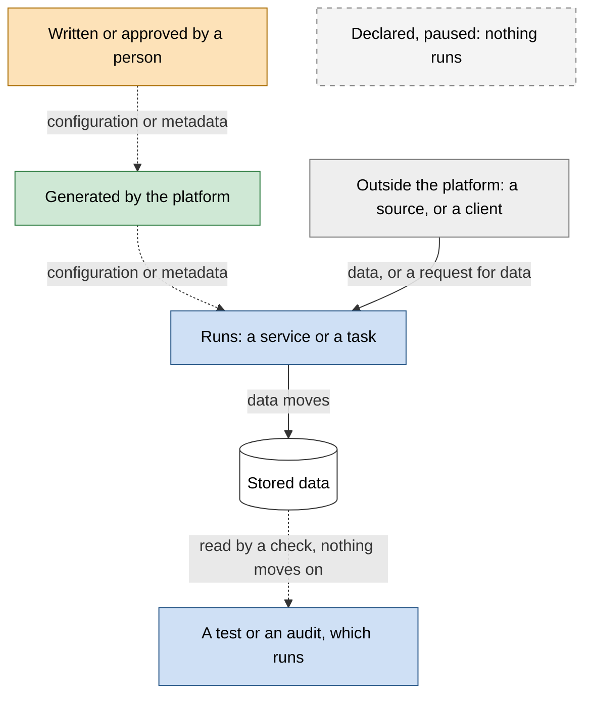

**Reading guide, the legend of section 3.** Orange is **written or approved by a person**; green is **generated by the
platform**; blue **runs**, a service or a task, and a **test or audit** is one of those; grey is **outside the
platform**; a dashed border is **declared, paused**, and no arrow reaches it; a cylinder is **stored data**. In a
flowchart a **solid arrow** carries data or a request for data; a **dashed arrow** carries configuration or metadata,
or is a check reading data it does not move (a test looking up codes in a reference table is dashed, never solid); in
diagram 9 the dashed arrows are the deploy's steps, in order. In the sequence diagrams (2 and 4) a solid arrow is a
request, write or hand-over and a dashed one its reply; coloured boxes group participants. Design, deploy and run time
sit in labelled boxes when a diagram holds more than one.

## 4. The target in twelve diagrams

Each diagram is one idea in its own section, and its reading guide names every node and arrow. Phases of the plan are
named in plain words; section 6.2 lists them in order. Field-by-field tables, connector settings and the full list of
checks are in the architecture this chapter summarises:
[`ARCHITECTURE-V2.md`](../research/2026-11-26-unified-platform-architecture/ARCHITECTURE-V2.md).

### 4.1 The platform on one page, with the catalog at the centre

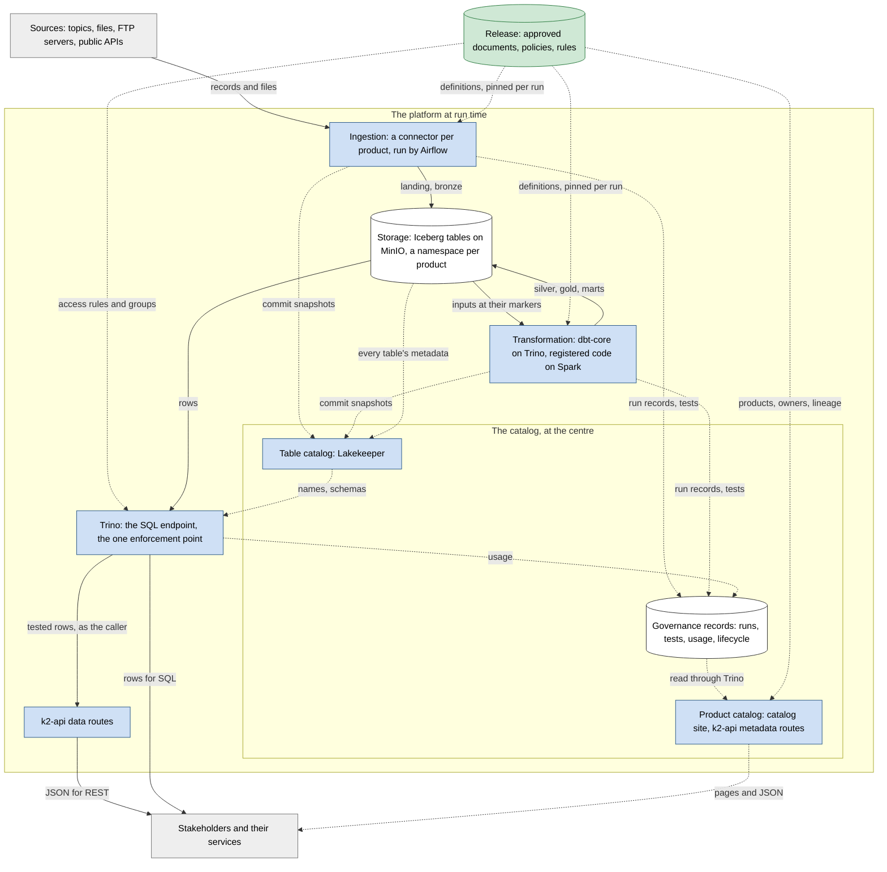

**Reading guide, section 4.1.** Run time only (a **release** is made in diagram 3, deployed in diagram 9). **Sources**
send records and files to **Ingestion**, which writes landings and bronze to **Storage**; **Transformation** reads its
inputs at their tested-data markers and writes silver, gold and marts back. Everything registers into **the catalog**:
Ingestion and Transformation commit their snapshots to the **table catalog**, which indexes the metadata of every
table in Storage; both write run records and tests to the **governance records**; **Trino**, the query layer, writes
its usage there. The **product catalog** reads those records through Trino and takes products, owners and lineage from
the release, which also pins each run's definitions and gives Trino its access rules and groups. Trino takes names and
schemas from the table catalog, reads rows from Storage and serves SQL to **stakeholders** and to the **k2-api data
routes**, which return the same tested rows as JSON; the product catalog serves them pages and JSON.

The product catalog is a generated, read-only static **catalog site** with search and a page per product (schema,
owner, state, quality, lineage diagram, who can read what, example queries, join keys, a link to the dbt docs site);
k2-api serves the same facts as JSON. Discovery needs no grant; rows are governed. Landings and bronze live in
warehouse `k2`, the rest in a warehouse per domain, one namespace per product in both (today's layout: [chapter
19](19-lakehouse-and-domain-warehouses.md)).

### 4.2 A stakeholder's journey: discover, get access, query by SQL and by REST

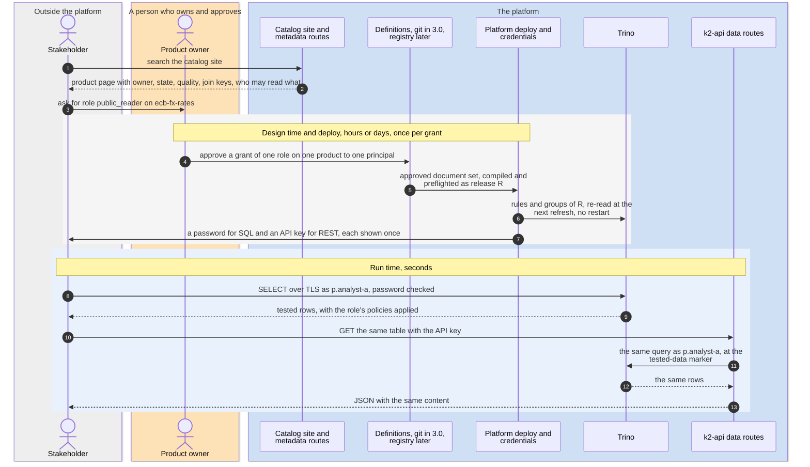

**Reading guide, section 4.2.** Steps 1 and 2: the **stakeholder** searches the **catalog site** and reads a product
page, which says in words what each role sees. Step 3: they ask the **product owner**, a person. Steps 4 to 7, design
time and deploy: the owner approves a grant in the **definitions** (in 3.0, a pull request), **platform deploy**
compiles and releases it, **Trino** re-reads its rules without a restart, and the principal receives its credentials
once (only hashes are kept). Steps 8 and 9: SQL over TLS, password checked, returns tested rows under the role's
policies. Steps 10 to 13: a REST call to the **k2-api data routes** becomes the same query, principal and marker.

One engine, principal, rule set and snapshot give the same rows, and the access test (section 4.6) proves it through
both. Reader catalogs refuse every write and table procedure (a maintenance or rollback command run as SQL); today any
user can roll back a mart and Trino believes any user name ([chapter 19](19-lakehouse-and-domain-warehouses.md)).
k2-api logs in as itself and, by a rule naming only it, queries as the caller; it never writes, decides access or
reads storage.

### 4.3 Defining a product: documents, checks, release

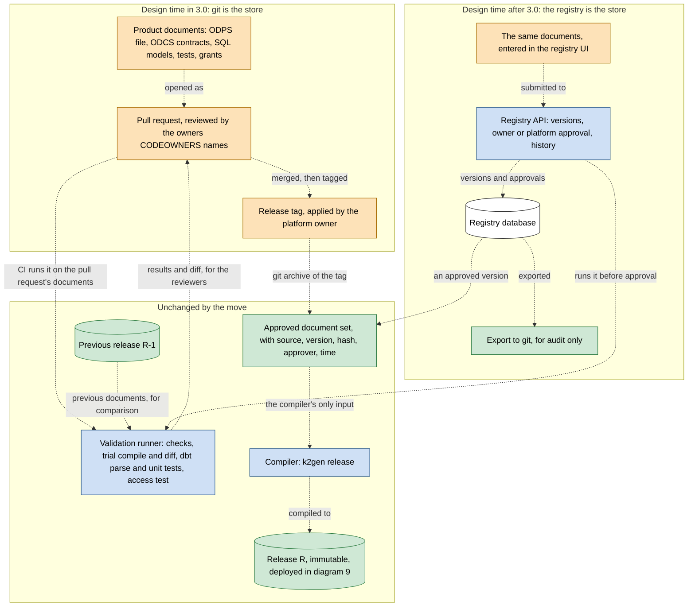

**Reading guide, section 4.3.** All design time; every arrow moves documents or results, or starts a check. In the box
**"in 3.0"** a person writes the **product documents** and opens a **pull request**, reviewed by the owners that
**CODEOWNERS** (a GitHub file) names; CI runs the **validation runner** on them, compared with the **previous
release**, and posts results and the difference; the merge and the **release tag** become an **approved document set**
by `git archive`. In the box **"after 3.0"** the **registry UI** submits the same documents to the **registry API**,
which runs the same runner before approval, keeps versions in the **registry database**, hands an approved version to
the same document set and **exports to git** for audit. In the box **"Unchanged"** the approved document set is the
**compiler's** only input, and it writes **release R**.

A product is one directory, `contracts/<domain>/<product>/`: `product.odps.yaml`, a `<table>.odcs.yaml` per table,
`models/*.sql` with unit tests, `grants.yaml`. `k2gen check` enforces both standards and the platform's rules
(references resolve, no output policy weaker than an input's, a dropped column is a major version, every column
described, every policy covered by an expectation) as pure functions of the documents, so the registry runs them
unchanged. Generated files, committed today ([chapter 18](18-data-mesh.md)), exist only inside a release.

### 4.4 What runs for one product

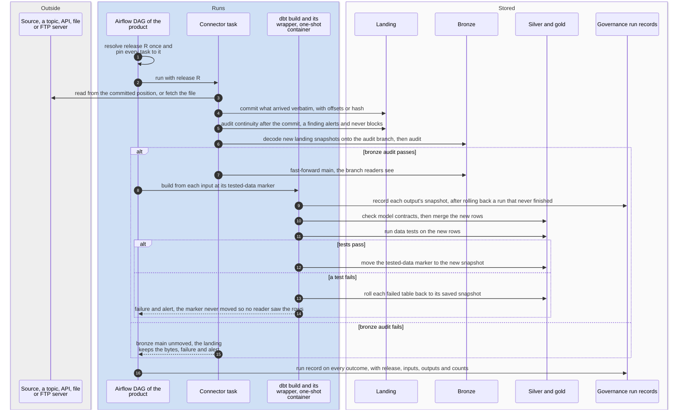

**Reading guide, section 4.4.** Step 1: the **Airflow DAG** pins every task to one release. Steps 2 to 5: the
**connector task** reads the **source** from its own committed position (a Kafka offset) or fetches a file, commits
what arrived verbatim to the **landing**, then audits continuity without blocking. Steps 6 and 7: **bronze** is
decoded onto a hidden audit branch and published by a fast-forward only if its audit passes. Steps 8 to 12: **dbt and
its wrapper** read each input at its tested-data marker, record each output's snapshot in the **run records** (first
rolling back any earlier run that never finished), merge into **silver and gold**, test the new rows and, on a pass,
move the marker. Steps 13 and 14: a failed test rolls each failed table back; the marker never moved, so no reader saw
the rows. Step 15: a failed bronze audit leaves bronze unmoved and the bytes kept. Step 16: every outcome writes a run
record. A product built only from other products starts at step 8.

How a reader resolves a plain `SELECT` to the marker was settled in the release and rules spine: a definer view per
output, owned by the product's publisher, over its `audited` tag and guarded on the base's refs
([ADR-061](../adr/ADR-061-readers-see-dbt-outputs-through-a-view-over-the-tested-tag.md), [chapter
22](22-access-and-identity.md)). The
landing never blocks ([ADR-047](../adr/ADR-047-ingest-batch-audit-after-publish.md) stays), because a topic keeps only
48 hours or 2 GiB per partition ([chapter 07](07-wire-contracts.md)); a product that falls off the topic fails loudly
until an operator records an accept-data-loss run. dbt runs in a one-shot container with an allow-listed environment;
each writer writes only its own namespace and reads only its declared inputs; fetches reach only declared hosts.

### 4.5 Lifecycle states

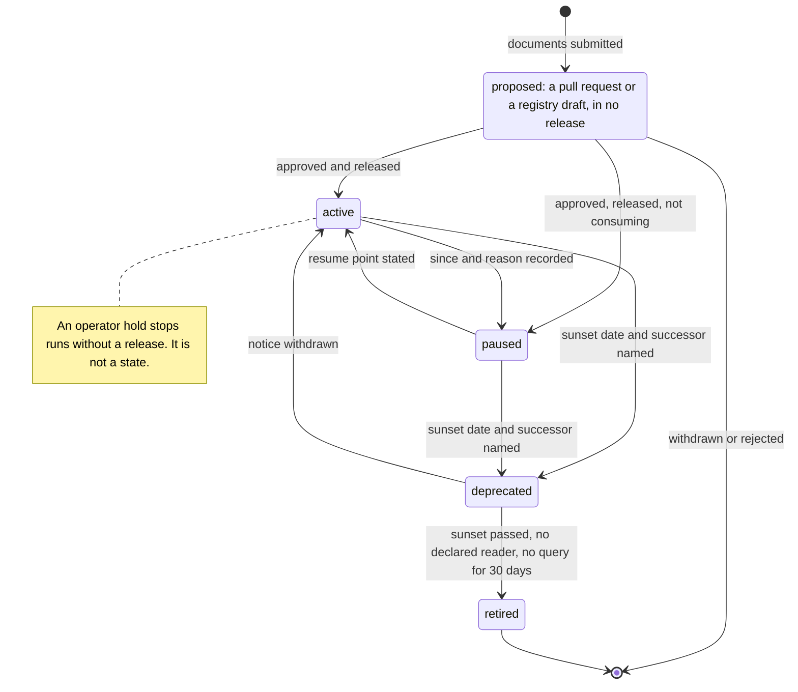

**Reading guide, section 4.5.** **Proposed** is a submission (a pull request or registry draft) held in no release, so
not a stored state; it is withdrawn, rejected or approved. A release makes a product **active**, or **paused** if
declared but not consuming (today's order-book products will be). Active and paused move both ways, each move with a
date and a reason. Either can become **deprecated**, naming a sunset date and a successor, which can be withdrawn.
**Retired** is final and follows only deprecation: after the sunset, with no declared reader and no query for 30 days
in the usage records. The **operator hold** in the note needs no release.

A paused product consumes nothing and, on resume, starts from what the source still retains, the gap shown on its
page. A retired one answers REST with 410 Gone and keeps its rows. An operator hold (`make hold PRODUCT=...
REASON=...`) pauses the DAG for an incident and is recorded; no deploy overrides it.

### 4.6 Permissions: one enforcement point, both endpoints

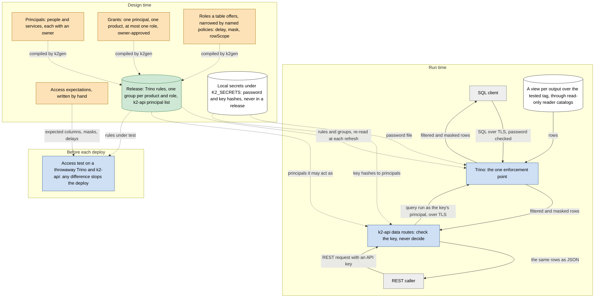

**Reading guide, section 4.6.** At **run time** a **SQL client** logs in to **Trino** with a password over TLS; a
**REST caller** sends an API key to the **k2-api data routes**, which run the query on Trino as the key's principal.
Trino alone applies the rules over the **tables**, each read through a publisher-owned view at its tested tag in a
read-only reader catalog, and returns the same filtered, masked rows to both; k2-api hands them back as JSON. At **design time** **principals**,
**grants** and **roles with their policies** compile into the **release's** Trino rules, one group per product and
role, and the list of principals k2-api may act as. Password and key hashes are generated on the host into the
**local secrets** and never enter git or a release; Trino reads its password file and k2-api its key map from there.
A person separately writes the **access expectations**. **Before
each deploy** the **access test** runs the release's rules against the expectations through both endpoints; a
difference stops the deploy.

Policies are named and comparable, never free-form: `delay` hides rows younger than so many minutes, `mask` reads
columns as null, `rowScope` keeps rows whose column is in a list. One role per principal per product keeps rules from
overlapping; no matching rule means no access; a product built from others offers no role weaker than an input's.
Expectations are not generated from the rules they test, and include probes that must fail, such as the metadata table
`t$files`, whose column bounds a spike on 2026-11-26 showed would reveal hidden values. Nothing goes around Trino:
notebooks query it as a named principal, Lakekeeper sits on a network of its own with a drift check and MinIO is no
longer published on the host, and each engine has its own storage key. Phase 001 built the SQL half: [chapter
22](22-access-and-identity.md).

### 4.7 Crypto as products

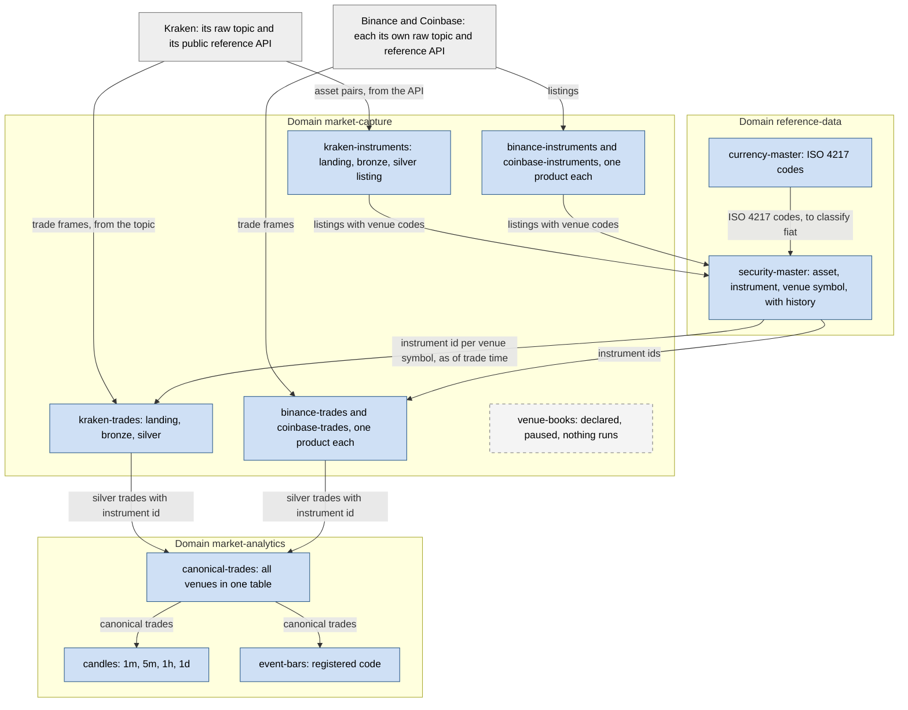

**Reading guide, section 4.7.** Domain boxes make every cross-domain arrow visible. Each outside arrow reaches one
product: **Kraken's** topic feeds only **kraken-trades** and its reference API only **kraken-instruments**; **Binance
and Coinbase** have the same two products each (**their trades** and **their instruments**). Every venue's listings
and the **currency master's** codes flow into the **security master**, which gives each trades product the instrument
id for its venue symbol as of the trade's time (section 4.11). The venue silvers feed **canonical-trades**, which
feeds **candles** and **event-bars**. **venue-books** is paused, so no arrow reaches it. No archive is shared: the v3
lake's single raw table, retired in the first phase, gives way to one landing per product.

The security master has two levels, an **asset** (Bitcoin) and an **instrument** (BTC/USD, BTC/USDT and BTC/USDC are
three instruments of one asset), each venue's spelling mapped to its instrument with history, from the venue's public
reference API, not a hand-kept file. Matching is by rule plus a reviewed exceptions list (Kraken's reference API
writes `XBT` where its trade feed writes `BTC`), never a guess: an unmatched symbol's trades are held and an audit
fails loudly while other symbols publish. Versions follow [ADR-030](../adr/ADR-030-scd2-security-master.md): half-open
intervals, the first opening at 1970-01-01.

### 4.8 ECB FX as products: the dbt worked example

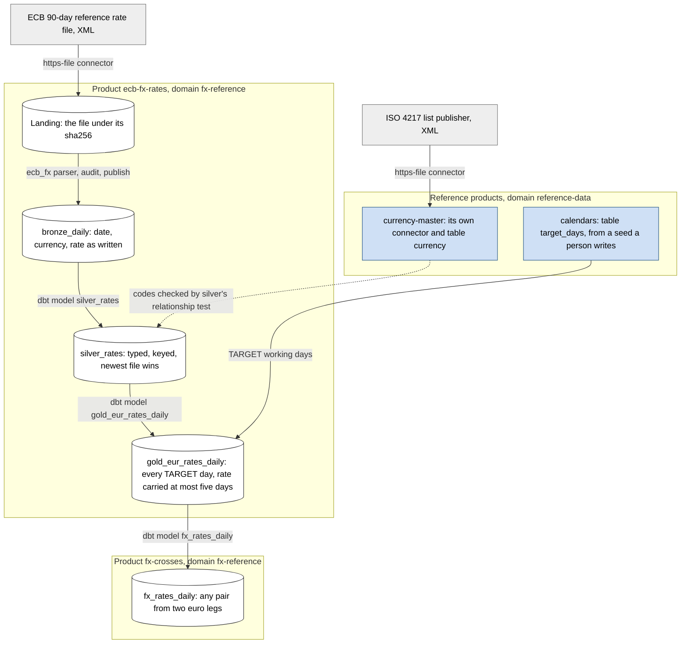

**Reading guide, section 4.8.** The boxes show which tables belong to which product. The **ECB file** lands under its
hash in the **landing**; the `ecb_fx` parser makes **bronze_daily**, published after its audit. Each later solid arrow
is a dbt model: **silver_rates** types and keys the rates, newest file winning; **gold_eur_rates_daily** builds a row
per TARGET working day (TARGET is the euro payment system, whose working days are the ECB's publication days) and
currency from the **calendars** product, carrying a missing rate at most five days and recording when each was known;
**fx_rates_daily** in **fx-crosses** builds any pair. The **ISO 4217 publisher** feeds **currency-master**. The dashed
arrow is a check, not data: silver's relationship test reads the currency codes, and a quote that is not a code fails
the build and rolls it back. Both reference products are declared inputs.

The file is small enough to check by hand, and its models teach a source, an incremental merge, windows that ignore
nulls, a seed (a CSV a person writes), an input from another product, unit tests and a rollback. dbt-core (never the
Fusion engine) builds it, with guided labs, an owner's guide to reviewing dbt work, the dbt docs site linked from each
catalog page, and a "what this does and why" section in each dbt pull request. The rate is a reference fixing
published about 16:00 Frankfurt time, not a market close.

### 4.9 Deploy and rollback

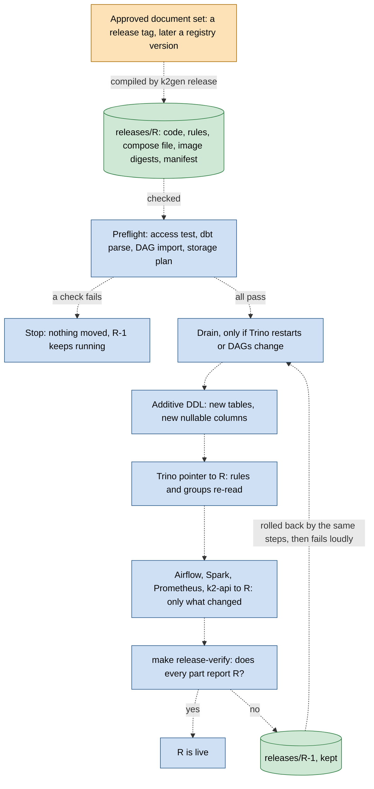

**Reading guide, section 4.9.** All deploy time, run by `make deploy`: only configuration moves, so every arrow is a
dashed step, in order. The **approved document set** (a `git archive` of a tag, never the working tree, or later a
registry version) is compiled into a **release directory** that pins every image by digest. **Preflight** runs the
access test (by password over TLS and by API key, against one group per product and role), a dbt parse, a DAG import
and a storage plan (a dry run of every table and bucket change); a failed check **stops** with nothing moved.
Otherwise it **drains** (pauses DAGs, lets tasks finish) only if Trino must restart or DAGs change shape, applies
**additive DDL**, moves **Trino's pointer** (rules re-read without a restart; a restart only for a catalog change),
then those of **Airflow, Spark, Prometheus and k2-api**, recreating only what changed and never a capture.
**release-verify** asks each part its release: all R, and **R is live**; otherwise `make deploy` points everything
back at the kept **R-1** by the same steps and exits non-zero.

As built in the release and rules spine ([chapter 21](21-releases-and-deploy.md),
[ADR-058](../adr/ADR-058-deploy-sealed-releases-by-pointer-swap.md)): the pointers move from inside the `tools`
container, reader views narrow before the swap and widen after the new rules load, and the access test runs as part
of `release-verify` after the swap, on a throwaway lake at release time.

Today services bind-mount the working tree; one checkout emptied the DAG folder for 35 minutes on 2026-11-25
(`CLAUDE.md`). In the target a run is pinned to its release, a release in use is never deleted, a rollback moves code,
rules and images but never data, and secrets are named by environment variable, never held. Each release lists its
backup set, generated from the contracts; other tables are rebuilt from their landings. The first restore drill ends
the Kraken phase.

### 4.10 Today beside the target

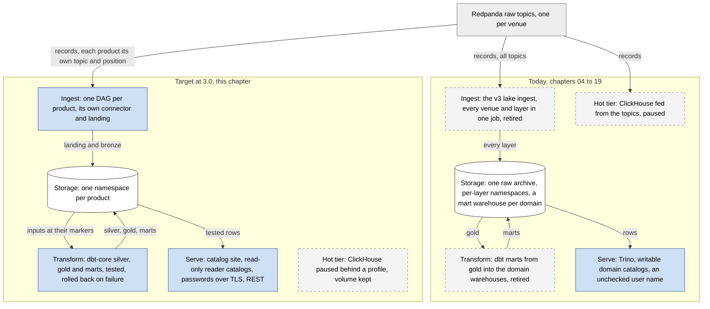

**Reading guide, section 4.10.** Two boxes, the same five rows. **Today**, the dashed rows are what the first phase
stood down: the v3 lake ingest, retired, read every **topic** and wrote every layer into **storage**, the raw archive
first, so one fault stopped every venue ([chapter 08](08-lake-ingest.md)); **dbt marts**, retired with it, read gold and
wrote the domain warehouses; **ClickHouse**, paused, served from the topics ([chapter 10](10-clickhouse-gold.md)).
Consumers query **Trino** through domain catalogs where any user can run a table procedure and any user name is
believed ([chapter 19](19-lakehouse-and-domain-warehouses.md)). In the **target**, each product's **DAG** reads its own topic into **its own namespace**;
**dbt-core** builds silver, gold and marts from inputs at their markers, tests them and rolls back a failure;
consumers start at the **catalog site** and read tested rows through read-only catalogs or REST, logged in by password
over TLS; **ClickHouse** is paused, so no arrow reaches it. No arrow joins the boxes: the target is built fresh,
proved by tests and re-pinned parity checks, and the old part retired to `legacy/`.

### 4.11 Joining across domains: an enriched product

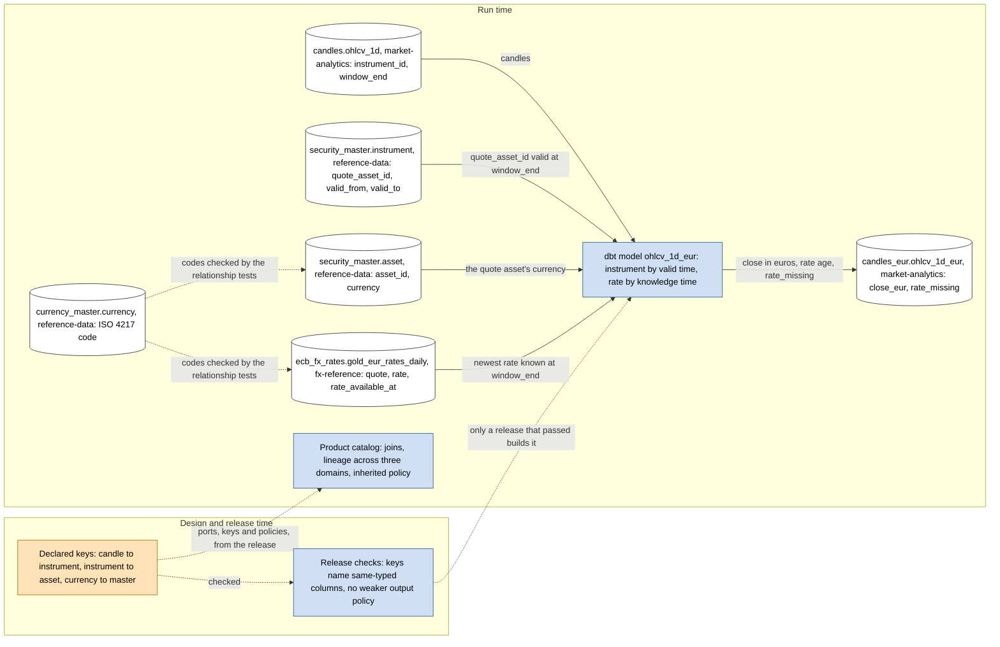

**Reading guide, section 4.11.** The goal is a daily candle valued in euros. At **run time** **candles**,
**instruments**, **assets** and **ECB rates**, from three domains, feed one **dbt model**: a candle finds its
instrument as at `window_end` (valid time), then the quote asset's ISO 4217 currency, then the newest rate published
by `window_end` (knowledge time), and writes **candles_eur**. The **currency master** is not read by the model: it is
the dictionary both sides point at, and the dashed arrow is the relationship tests of **asset** and of the ECB product
checking their codes against it. At **design and release time** the **declared keys** pass the **release checks**
before any build, and the **product catalog**, which already knows each input, adds this product's joins and lineage.

A joinable product carries shared identifiers (`instrument_id` or `asset_id`, ISO 4217 codes, calendar-named dates,
UTC timestamps), each declared as a reference to a reference product's key, so the catalog shows what joins to what
and a check fails when one does not resolve. Knowledge time prevents look-ahead: a candle closing at 10:00 UTC gets
the previous day's fixing, as that day's is published later. A stablecoin or crypto quote has no ISO currency, so its
rows say `rate_missing`, a stated limitation; a paused ECB product makes this one `partial`.

### 4.12 Metadata, open standards and readiness for AI

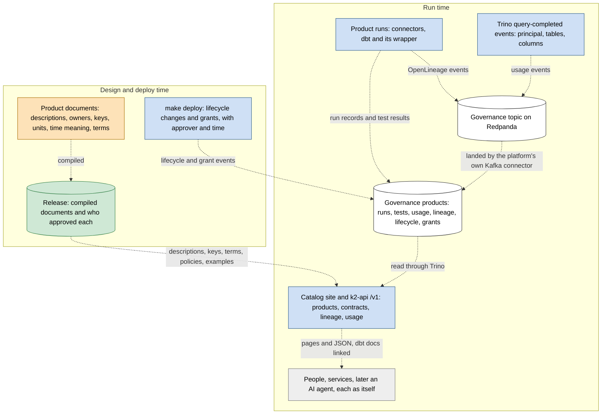

**Reading guide, section 4.12.** All metadata, so every arrow is dashed. A person writes the **product documents**;
the **release** keeps them with each approver; **make deploy** records lifecycle changes and grants in the
**governance products**. **Product runs** write run records and test results there and emit OpenLineage events, and
**Trino** emits a usage event per query, both into a **governance topic** that the platform's own Kafka connector
lands like any product. The **catalog site and k2-api** serve the release and the governance products, read through
Trino, to **people, services and, later, AI agents**, each under its own identity.

Eight kinds of metadata each get a capture point, a format and a home: descriptive, structural, provenance and terms
(licence, redistribution, attribution), operational, quality, lineage, access and usage, lifecycle. Today's repository
keeps descriptions, contracts, offsets, test results, audits and the dbt manifest; the rest arrive in the spine,
Kraken and catalog phases (the architecture copy has the table). Every custom field sits in a standard's extension
point.

| Concern | Standard, version | Steward | Where K2 uses it |
|---|---|---|---|
| Product and table definitions | ODPS 1.1.0; ODCS 3.2.0 | Bitol project, Linux Foundation | every product's documents |
| Document schemas | JSON Schema 2019-09, ODCS's dialect | JSON Schema project | the checks |
| Table format; catalog protocol | Apache Iceberg format v2, library 1.8.1; Iceberg REST catalog | Apache Software Foundation | storage; Lakekeeper |
| Data files; wire records | Apache Parquet; Apache Avro with Confluent wire framing | Apache Software Foundation; the framing is a de facto standard | every data file; the capture topics |
| Query language | SQL, ISO/IEC 9075, as Trino 484 implements it | ISO; Trino Software Foundation | the SQL endpoint, dbt models |
| Lineage events | OpenLineage, event spec 2-0-2, Python client 1.53.0 | LF AI and Data Foundation | Airflow and dbt runs |
| Metrics | OpenMetrics 1.0 | Prometheus project, CNCF | every service's `/metrics` |
| REST description | OpenAPI 3.1, as FastAPI generates it | OpenAPI Initiative, Linux Foundation | `/v1/openapi.json` |
| Identity in transit | TLS 1.2 and 1.3 (RFC 5246, RFC 8446); HTTP Basic login (RFC 7617) | IETF | Trino's password login |
| Versions; codes; time | Semantic Versioning 2.0.0; ISO 4217; ISO 8601, in UTC | semver.org; ISO | versions; currency master; timestamps |
| After 3.0 | Model Context Protocol, specification 2026-07-28; W3C DCAT 3 | Agentic AI Foundation, Linux Foundation; W3C | the AI interface; a catalog export |
| Not adopted | CloudEvents 1.0 (no event leaves the platform); OpenID Connect 1.0 (no single sign-on in 3.0) | CNCF; OpenID Foundation | revisited when an outside subscriber or single sign-on is asked for |

**Readiness for AI**, not built for 3.0 and not blocked by it: every catalog fact is machine readable through k2-api,
every column described, example queries and join keys on every product, stable identifiers, usage logged. After 3.0 a
Model Context Protocol server offers catalog search and governed queries as the calling identity, through k2-api and
Trino.

## 5. Three worked examples, in short

Full files and proofs: the first plan, [`README.md`](../plans/2026-11-26-unified-product-platform/README.md).

**One venue's trades, with instruments and the security master.** *A person writes*
`contracts/market-capture/kraken-trades/`: a product file naming a Kafka connector (the venue's raw topic, the
capture's envelope contract, `trade` frames only, every five minutes); bronze and silver contracts, `instrument_id` a
declared reference to the security master; one dbt model that unnests each frame and looks up the instrument as at
trade time; unit tests (a re-sent trade, a skipped id, an unknown symbol); a grant of a delayed role to one service
(the newest 20 minutes hidden, two columns masked). Beside it, `kraken-instruments` (a public-API connector) and the
security master. *The platform* generates the DAG, tests, Trino group, alerts, backup entries, catalog page and REST
route; each run lands records with offsets, publishes bronze after its audit, builds and tests silver, then moves the
marker or rolls back.

**ECB end-of-day FX reference rates.** *A person writes* `contracts/fx-reference/ecb-fx-rates/`: a product file naming
an https-file connector to the ECB's 90-day file, its allowed host, the `ecb_fx` parser, the TARGET calendar, the
licence and terms (redistribution, attribution); three contracts; two dbt models with unit tests (a fixing carried
five TARGET days then null, a later file replacing an earlier one, publication time in winter and summer); a sample
and a corrupted copy as fixtures. *The platform* fetches in the isolated container, lands the file under its hash,
publishes bronze after its audit, builds silver and gold. The same bytes again write nothing; the corrupt fixture
fails the audit; a failing test rolls silver back. A minimal REST route ships in this slice.

**The enriched product: daily candles valued in euros.** *A person writes* `contracts/market-analytics/candles-eur/`:
a product file whose inputs (candles, instruments, assets, ECB gold) are not required, so a paused one makes it
`partial`; a contract referring to the security master by valid time and to the ECB product by knowledge time, with a
delayed role no weaker than any input's; one dbt model using the point-in-time macro twice; boundary unit tests. *The
platform* refuses a key naming a missing or differently typed column, or a weaker policy; each run reads inputs at
their markers, records the reference snapshots it used, and writes `close_eur` or `rate_missing`, with lineage across
three domains. Still open: how much FX content ships in 3.0 (needed by the enriched-product phase), and how long
landings are kept (needed by the Kraken phase).

## 6. How far today is from the target

### 6.1 By layer

| Layer | Today, as chapters 04 to 19, 21 and 22 describe it | Target, in this chapter | Moves in phase |
|---|---|---|---|
| Sources and landing | Kafka only: one job read every venue's topic into one shared raw archive until it retired in the first phase ([08](08-lake-ingest.md)) | a connector and a verbatim landing per product, five kinds (4.4) | files in the run spine; Kafka and public API in the Kraken phase; FTP, SFTP, S3 in remaining connector kinds |
| Layers and storage | Spark stage code, one run for every venue and layer; warehouse `k2` by layer ([09](09-lake-layers.md)) | bronze by its connector, silver and gold as dbt models, only the layers that add a guarantee; a namespace per product (4.1, 4.4) | run spine; Kraken phase; widen crypto |
| Marts and tested reads | dbt marts rebuilt whole every hour from lake gold; readers see each newest snapshot ([19](19-lakehouse-and-domain-warehouses.md)) | merged, tested, rolled back on failure; every reader at the marker (4.4) | run spine |
| Security master | a hand-kept file, `config/instruments.yaml`, as type-2 dimensions, no asset level ([12](12-data-strategy.md)) | two levels from venue reference APIs, exceptions list, held rows (4.7) | Kraken phase; widen crypto |
| Catalog | generated product pages in `docs/products/`, Lakekeeper ([18](18-data-mesh.md)) | catalog site, k2-api metadata routes, Lakekeeper, governance records (4.1) | first version in serving and teaching; complete in the catalog phase |
| SQL serving and identity | a read-only reader catalog and a build catalog per domain, passwords over TLS ([22](22-access-and-identity.md)) | read-only reader catalogs, a writer per product, passwords over TLS (4.6) | release and rules spine |
| REST | none ([04](04-system-overview.md)) | k2-api data routes, the same answer as SQL (4.2) | a minimal route in the run spine; complete in the REST API phase |
| Permissions | compiled default-deny rules, grants per product, named policies, hand-written expectations; every engine on the root key ([22](22-access-and-identity.md)) | grants per product, named policies, hand-written expectations, scoped keys (4.6) | release and rules spine; run spine |
| Deploy | sealed releases, a pointer per service, automatic rollback ([21](21-releases-and-deploy.md)) | immutable releases, a pointer per service, automatic rollback (4.9) | release and rules spine |
| Lifecycle | a field in `product.yaml` and `git log` ([18](18-data-mesh.md)) | four states, holds, history from release manifests (4.5) | spine phases; holds in the Kraken phase |
| Metadata, lineage, usage | dbt test results, lake audits, the dbt manifest; no usage ([18](18-data-mesh.md)) | governance products, OpenLineage, usage events (4.12) | catalog phase |
| Hot tier | ClickHouse gold, fed from the topics ([10](10-clickhouse-gold.md)) | paused behind a profile, volume kept (4.10) | clear the ground |
| Alerts | rules as code in `docker/prometheus/rules/`, delivered to Slack by Alertmanager ([11](11-observability.md)) | delivered to a Slack channel through an incoming webhook kept as a local secret | controls, alerts and release engineering |
| Backup | `scripts/backup-lake.sh`, whose four fixed tables retired in the first phase; it prints a SKIP naming the run spine | a set generated from the contracts, restore and rebuild, an early drill (4.9); the copy stays on this host until the release gate | run spine; first drill in the Kraken phase |
| Infrastructure | compose files and hand-run setup | this host declared and checkable: one command shows drift, one converges | infrastructure as code |

**The cost, stated plainly.** The old pipeline was retired in the first phase (`lake_ingest`, its `raw`, `bronze`,
`silver` and `gold` namespaces and stage code): Spark image rebased and proven, backup taken, namespaces dropped, code
archived to `legacy/v3-lake-ingest/` with a README, every reader of the old tables moved or retired. Until the Kraken
phase lands the lake gets no live crypto data and the dashboards are stale. The platform is a lab until the release
gate (data disposable, backed up first); from the `v3.0.0` tag production rules apply.

### 6.2 The order of the phases

Each phase ends with commands that prove what it built, an audit fixing every critical and high finding, a pre-release
tag, its runbooks, and the chapters it moves from target to today.

| Plan | Phases, in order |
|---|---|
| To the demo tag `v3.0.0-beta.1` | 1 clear the ground (ClickHouse paused, Spark rebased, old pipeline retired); 2 the release and rules spine (immutable releases, checks, catalogs, policies, passwords over TLS); 3 the run spine through ECB FX (connector, landing, dbt wrapper, tested-data marker, scoped keys); 4 serving and teaching (REST, catalog site, dbt labs, the owner's guide); 5 Kraken trades, instruments and the security master; 6 the enriched product; 7 catalog, metadata, lineage and usage; 8 the REST API complete, then demo readiness (`make demo`) |
| To the release `v3.0.0` | 9 remaining connector kinds (SFTP, FTP over TLS, S3); 10 widen crypto (Coinbase, Binance, every timeframe, event bars); 11 controls, alerts and release engineering; 12 infrastructure as code on this host; 13 hardening; 14 the release gate (a fresh clone rebuilt from empty, the restore drill again) |

The demo tag needs four moments on the real system, with no demo-only code: a new domain's product onboarded live; SQL
and REST giving the same answer; two roles seeing different rows and columns; bad data stopped beside the enriched
product. If a phase runs late the date moves, never quality or order. After 3.0: the definition registry and the AI
interface.

## 7. Where to read more

| Document | What it holds |
|---|---|
| ADR-056, [`ADR-056-unified-data-product-platform.md`](../adr/ADR-056-unified-data-product-platform.md) | the decision, the options weighed, its consequences |
| The plan to the demo tag, [`README.md`](../plans/2026-11-26-unified-product-platform/README.md) | phases 1 to 8, each with its exit commands |
| The plan to the release, [`README.md`](../plans/2026-11-26-unified-product-platform-to-release/README.md) | phases 9 to 14 and the `v3.0.0` gate |
| The research note, [`2026-11-26-unified-platform-architecture.md`](../research/2026-11-26-unified-platform-architecture.md) | how the architecture was chosen, the reviews, the spikes and their figures |
| The full architecture, [`ARCHITECTURE-V2.md`](../research/2026-11-26-unified-platform-architecture/ARCHITECTURE-V2.md) | field tables, connector settings, the checks, the worked examples' files |
| [Chapters 04](04-system-overview.md), [18](18-data-mesh.md), [19](19-lakehouse-and-domain-warehouses.md); [ADR-044](../adr/ADR-044-producer-lake-and-domain-mart-warehouses.md), [ADR-047](../adr/ADR-047-ingest-batch-audit-after-publish.md), [ADR-030](../adr/ADR-030-scd2-security-master.md) | today's system, products and storage; the storage layout being replaced, the landing rule kept, the history convention reused |

## Key points

- A product is defined once in standard documents, runs only from an immutable release, and is found through the
  catalog.
- Readers see only tested data, always; Trino alone enforces access for SQL and REST, behind passwords over TLS.
- Value comes from governed joins across domains; section 6 says honestly how far today is from this.
