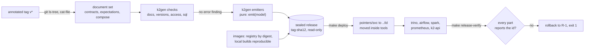
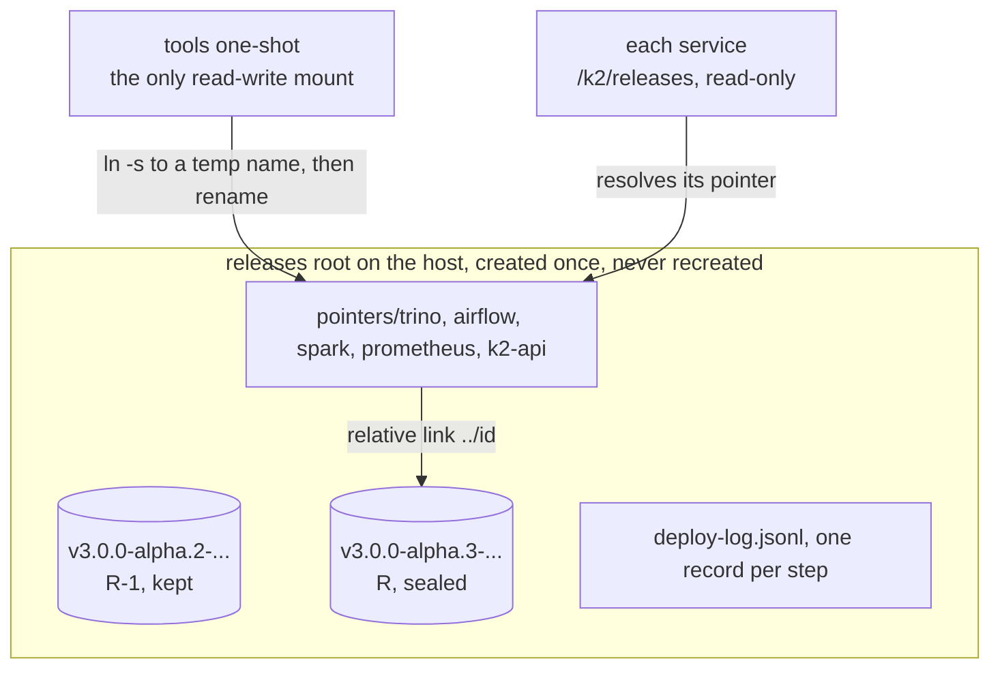

# 21. Releases and deploy

> **Describes the platform from release `v3.0.0-alpha.3`.**

> **You will learn** how a product's documents become what the platform runs: the document set of a
> tag, the checks, the compiler and its emitters, the sealed release and its manifest, the pointer
> swap, recreating only what changed, verification and rollback.
> **Read this if** you will change a product, a grant or the compose file, or you operate the stack.
> **Before this** chapter 20 (the target this phase builds toward); chapter 22 covers who may see what.

The decisions are [ADR-055](../adr/ADR-055-products-defined-once-in-odps-and-odcs-documents.md) (a
product is defined once, in documents) and
[ADR-058](../adr/ADR-058-deploy-sealed-releases-by-pointer-swap.md) (deploy by pointer swap). The
frozen shapes are in [`platform/k2gen/INTERFACES.md`](../../platform/k2gen/INTERFACES.md) and
[`docs/development/phase-001-interfaces.md`](../development/phase-001-interfaces.md). The procedures
are the runbooks [deploy a release](../runbooks/deploy-a-release.md) and
[roll back a release](../runbooks/roll-back-a-release.md).

## The picture

Nothing the platform runs is read from a git checkout. An approved, annotated tag is compiled into a
**release**: a read-only directory holding the tag's documents, everything compiled from them, the
tag's compose file and every image by digest. Services read their configuration through a
**pointer**, a symbolic link per service, and a deploy moves the pointers.



*Reading guide.* Left to right is one change's path. The checks refuse before anything is made; the
release is made whole or not at all; only the pointers move at deploy, and verification decides
whether the release stays.

## The document set of a tag

A **document set** is what a tag holds under four roots (`model.DOCUMENT_ROOTS`): `contracts/` (every
product's ODPS file, its ODCS contracts, SQL, tests and `grants.yaml`, plus `contracts/access/` for
principals and roles), `domains/`, `tests/access/expectations.yaml` and `docker-compose.yml`. k2gen
reads each blob as the tag holds it (`git ls-tree`, `git cat-file`), never the working tree and never
through `git archive`, whose output can follow the checkout's line-ending settings. Its
`provenance.json` records the tag, its commit and `taggedAt`, and `setSha256`, the hash of the set.
Every document is parsed by one strict loader, `model.parse`: one document per file, no duplicate
key, no anchor or alias, so a second `mask:` cannot silently win.

No document holds a credential or a hash of one. Passwords and keys are generated on the host into
`${K2_SECRETS}` (chapter 22).

## The checks

`k2gen check` runs four modules as pure functions of the set and, when given, the previous release's
set. Each finding has a code (`<module>.<kebab-case>`) and a pointer into the document.

| Check | Refuses, for example |
|---|---|
| `docs` | a document its schema rejects (`docs.schema-invalid`); an output port named twice; an incremental key without the partition column; a quality rule no dbt test expresses (`docs.quality-unsupported`) |
| `versions` | a lifecycle move ADR-055 does not allow (`versions.transition-not-allowed`); a breaking change without a major version (`versions.major-bump-missing`), against the previous release |
| `access` | a role with a policy and no expectation row; two roles for one principal on one product; a delay on a column that is not `timestamp(6) with time zone`; a role on a bronze table; a row scope on a column that is not an identity partition field |
| `sql` | a product's own definer or materialized view; `env_var`; a read of another product outside its declared inputs; `incremental_predicates`; time travel in model SQL |

`k2gen release` runs the same checks first and refuses on any error, so a release never depends on
someone having run `k2gen check`. `make test-k2gen`, a CI job, holds every check to a passing fixture
set and one failing fixture per finding.

## The compiler and its emitters

An **emitter** is one module in `platform/k2gen/k2gen/emit/` with one signature,
`emit(model) -> {path: text}`, every path under `compiled/`. It reads no clock, git, network, secret
or previous release, so one set compiles to one tree on any machine.

| Emitter | Writes | Read by |
|---|---|---|
| `trino_etc` | `compiled/trino/etc/`: HTTPS only, the Web UI off, a read-only reader catalog without statistics and a writable `<domain>_build` per domain | Trino, at start |
| `trino_rules` | `compiled/trino/rules.json`, `groups.txt`: default deny, exact names (chapter 22) | Trino, every 5 s |
| `trino_identity` | `password-authenticator.properties`, pointing at the password file | Trino, at start |
| `api` | `compiled/api/principals.json`, the principals k2-api may act as | k2-api (phase 003) |
| `lake` | DDL per table, each reader view's SQL, retention, the storage plan, the backup set | deploy; the dbt wrapper (phase 002) |
| `pipeline` | one `pipeline.json` per product, the DAG list, the one-shots | Airflow (phase 002) |
| `dbt` | one compiled dbt project of every dbt product | the dbt wrapper (phase 002) |
| `catalog` | one catalog JSON per product and an index | the catalog site and REST (phases 003, 007) |

## The sealed release and its manifest

The compiler builds every file in memory, validates each against its schema, writes
`<root>/.<id>.tmp/`, makes it read-only and renames it to `<root>/<id>/` in one step. Deploy seals it
on the host as well, because a `chmod` made inside a container is not seen on the host under Docker
Desktop, and refuses a release that is not sealed.

- The **id** is `<tag>-<sha12>`, the first twelve hex digits of the hash of its files and image
  references (`model.release_id`): one tag and one image set give one id, and compiling a tag twice
  writes nothing the second time.
- `manifest.json` lists every file's sha256, every service's image (a registry image as
  `repo@sha256:<digest>`, a local build as `<name>:<image id 12>`) and the release's **needs** against
  the release live when it was compiled: `recreate` (the compose services whose definition differs),
  `trinoRestart` (a change under Trino's `etc`), `dagShapeChange` and `ddl` (tables to create).
  `model.NEEDS_BY_PREFIX` classifies every path; a path it does not know is an error, so a new kind of
  file is classified before it ships.
- `compose/docker-compose.yml` is the tag's compose file byte for byte: a release runs the compose its
  tag approved.
- Local images are built from the tag's tree with file times set to 0, `SOURCE_DATE_EPOCH=0` and no
  build provenance, so one tree gives one image id and an unchanged service is not recreated.

## The releases root and the pointer swap



*Reading guide.* The whole root is one mount in every container, read-only except in `tools`.
Moving a pointer changes what a service reads without touching the service.

The root is `${K2_RELEASES:-$HOME/k2-releases}`, mounted at `/k2/releases`. A pointer moved on the host
is never seen inside a container on this host (experiment (c) of the release spine spikes: 5 of 5,
still unseen after 600 s); moved from inside a container that mounts the root read-write, with a fresh
temporary name and a relative target, it is seen in 0.1 to 0.2 s. So the swap runs inside the `tools`
one-shot, and a reader resolves its pointer once per run.

## The deploy

`make deploy RELEASE=<id or tag>` is one sequence, each step idempotent and recorded as one line of
`deploy-log.jsonl` (who, what, from where, and each secret file by presence, mode and size, never by content or digest). A lock on the root
refuses a second deploy at once.

```mermaid
sequenceDiagram
  participant D as make deploy
  participant T as tools one-shot
  participant S as services
  participant Q as Trino
  D->>D: preflight: sealed, hashes, secrets, lock; images; plan from k2gen needs
  D->>Q: DDL: compare every table, create Spark's missing ones
  D->>Q: views lose the columns the new contracts drop
  D->>D: canary password line for this release
  D->>T: move every pointer to R
  D->>S: recreate only what needs.recreate names, one at a time, --no-deps
  Q-->>D: canary admitted: the new rules are loaded
  D->>Q: late DDL; views gain the new columns
  D->>D: verify every part
  alt any failure from the views step on
    D->>T: the same steps toward R-1, images included
    D->>D: exit 1, or 3 if the rollback fails too
  end
```

*Reading guide.* Top to bottom is the order of `scripts/deploy.py`. Exit 2 is a refusal before
anything changed.

**Only what changed is recreated.** The plan is k2gen's own `needs`, the same function CI's
`k2gen diff` prints, so the plan reviewed in a pull request is the plan deployed (`PLAN=1` prints it
and stops). Each service named is recreated alone with `docker compose up -d --no-deps` on the
release's compose file, with an override pinning every image to the manifest's digest. A capture,
Redpanda, MinIO, Postgres or Lakekeeper is never recreated unless the release changes it and
`ALLOW_STATEFUL` names it; a service whose profile is off is never started. A release that changes
only rules or grants recreates nothing: Trino rereads its rules every 5 s.

**Tables are only added.** A table is created when missing, accepted when its columns and partitioning
equal the DDL, and refused, naming the difference, when they differ. A column drop or retype is a
major version, never an `ALTER` at deploy.

**Views move around the rules.** A reader policy is a Trino rule on a view's name (chapter 22), so a
release that drops a masked column changes both the view and the rule, and the rules reload on their
own timer. Deploy therefore narrows views before the swap and widens them only after the canary proves
the new rules loaded and one more refresh has passed: at no instant does a view show a column its rule
no longer masks.

**The release canary** is a Trino user, `k2_release_<setSha256[:12]>`, that only this release's rules
admit, to run `SELECT 1`. Logging in as it is the one question Trino answers only with the rules it has
loaded. Its password is written per release into the password file and kept, never mounted, under
`${K2_SECRETS}/canary/`.

## Verification and rollback

`make release-verify` asks every part which release it runs: the pointers as the Docker VM and each
mounting container see them, the files under each pointer against the manifest, this release's canary
admitted and the previous one refused, each container's image id against the manifest, each health
check, then the hand-written access suite and the catalog drift check (chapter 22). It runs at the end
of every deploy and on demand.

Before a release is deployed, `make spine-e2e` proves the compile, the rules and the deploy chain together on throwaway containers ([how and when](../development/spine-e2e.md)).

A rollback is not a second mechanism: it is a deploy of the previous good release from the failed one,
through the same steps, recorded as `rollback-<step>`, images included. `make rollback` runs it on
purpose. The rehearsal (`make deploy-rehearsal`, a throwaway compose project, 2026-11-27) measured it:
a forced verification failure put a service back on its previous image in 19.0 s and exited 1; a deploy
killed after each of its 13 steps and rerun always converged; a reader polling every 50 ms through a
release that dropped a masked column never saw the value. A first deploy has nothing to go back to and
exits 3.

## The limits, today

- One host: the pointers and the lock are this host's. A second host, or a Linux engine without
  Docker Desktop's file sharing, is a revisit trigger of ADR-058.
- The drain before a Trino restart or a DAG change prints a visible SKIP: no DAG runs until phase 002
  brings the product pipelines, the `fetch` and `dbt-runner` images and the dbt wrapper. k2-api arrives
  in phase 003; its pointer exists and nothing reads it.
- Images that kept releases name are never pruned, and no pruning exists yet; the releases root is in
  the backup set and must never be recreated.
- Every change, one line included, goes through a tag and `make release`.

## See it yourself

```bash
set -a && . ./.env && set +a
make release-status                 # the good release, pointers, canary names, the last records
make release-diff RELEASE=<id>      # k2gen's diff from the good release, as Markdown
make deploy RELEASE=<id> PLAN=1     # preflight, images and plan, then stop
make release-verify                 # every part, the access suite and the drift check
```

## Key points

- A release is compiled from one tag's documents, checked first, sealed read-only, and named by the
  hash of its files and images.
- A deploy moves one pointer per service from inside `tools`, recreates only what k2gen's needs name,
  and a rules-only change restarts nothing.
- Views narrow before and widen after the rules change, so no masked value shows in between.
- Verification asks every part; any failure from the views step on rolls everything back, images
  included, by the same steps.
