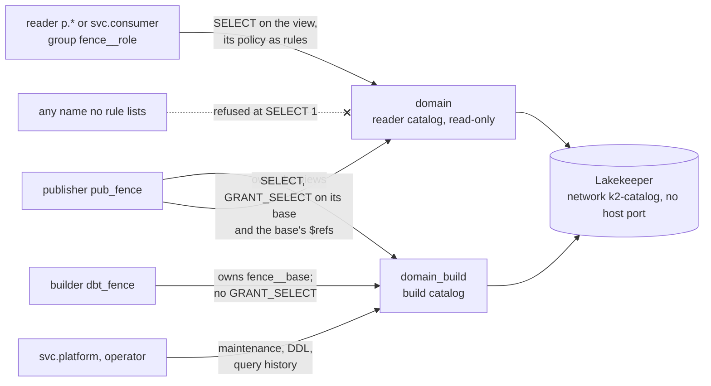
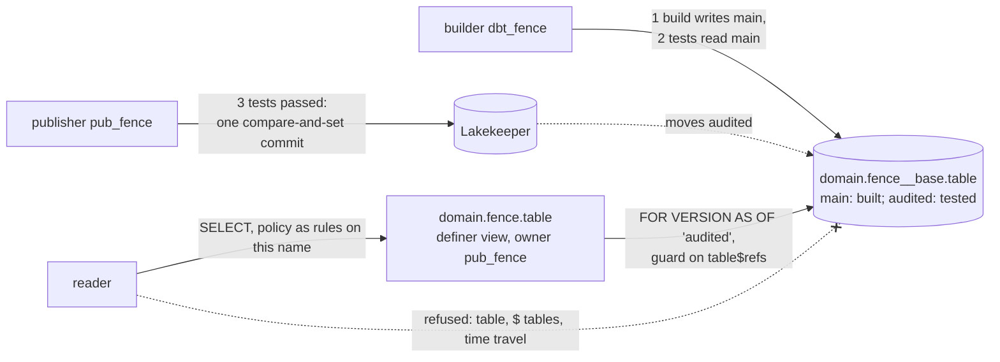

# 22. Access and identity

> **Describes the platform from release `v3.0.0-alpha.3`.**

> **You will learn** who can see what through Trino and why it holds: the identities, passwords over
> TLS under a local CA, default-deny rules compiled from documents, one role per principal per
> product, named policies, the reader view over the tested tag and its guard, the catalog fence and
> drift check, the hand-written access suite, and the limits that remain.
> **Read this if** you will grant access, write a policy, add a principal, or rely on what a reader
> cannot see.
> **Before this** chapter 21 (how a release reaches the stack).

The decisions are
[ADR-059](../adr/ADR-059-access-rules-compiled-default-deny-over-two-catalogs-per-domain.md) (the
rules and the two catalogs per domain),
[ADR-060](../adr/ADR-060-trino-logins-by-password-over-tls-under-a-local-ca.md) (passwords over TLS)
and [ADR-061](../adr/ADR-061-readers-see-dbt-outputs-through-a-view-over-the-tested-tag.md) (the
reader view over the tested tag), each with an Outcome that changed it after review. The evidence is
the gate [`2026-11-26-tested-data-view-gate.md`](../research/2026-11-26-tested-data-view-gate.md) and
the design inputs in [`2026-11-26-phase-001-interfaces/`](../research/2026-11-26-phase-001-interfaces.md).
The procedures are the runbooks [TLS and passwords](../runbooks/tls-and-passwords.md),
[create or rotate a principal](../runbooks/create-or-rotate-a-principal.md) and
[verify access after a release](../runbooks/verify-access-after-a-release.md).

## The picture

Trino is the one enforcement point. Every client logs in with a password over HTTPS, and Trino decides
what that principal may do from rules compiled out of the release's documents. Each domain has two
Trino catalogs over one Lakekeeper warehouse: a **reader catalog** `<domain>`, read-only at the
connector, and a **build catalog** `<domain>_build`, which only that domain's builders and publishers,
`svc.runs` and the operator reach. `fence` below stands for a product's name as an identifier.



*Reading guide.* Solid arrows are what the rules allow; the crossed arrow is a refusal. Readers never
reach a build catalog, a base table or a metadata table of one.

## Identities

Every principal is declared in [`contracts/access/principals.yaml`](../../contracts/access/principals.yaml)
with an owner; people go by pseudonymous ids (`p.<name>`). The roles a table offers are in its ODCS
contract; `grants.yaml` gives a principal a role on a product.

| Principal | What it is | Holds |
|---|---|---|
| Builder `dbt_<fence>` | the identity dbt builds and tests as | ownership of `<fence>__base` in its build catalog; `SELECT` on its declared inputs by exact name; never `GRANT_SELECT` |
| Publisher `pub_<fence>` | the identity that moves the tested tag and owns the reader views | ownership of `<fence>` in its build catalog; `SELECT, GRANT_SELECT` on exactly its bases and their `<table>$refs` through the reader catalog, which Trino demands of a definer view's owner; catalog access `all` on reader catalogs, every write still refused by the read-only connector |
| Reader, a member of `<fence>__<role>` | a person, or a consumer service | `SELECT` on the exact view names offering its role, with that role's policy |
| `svc.platform` | the operator; a person operates through the `tools` container as it | `all` on every build catalog, deploy DDL, table maintenance, `system`, query history; nothing in a reader namespace |
| `svc.runs`, `svc.catalog`, `svc.api` | the run-record writer, its reader, and k2-api's one Trino identity | `<table>$refs` of lake tables by exact name; `svc.api` may impersonate declared `p.*` people and nobody else |
| Release canary `k2_release_<setSha256[:12]>` | one per release, not declared | may execute `SELECT 1` and reach nothing (chapter 21) |

The release `v3.0.0-alpha.3` carries two products: `governance.access-canary`, active, whose three
made-up readers (`p.canary-full`, `p.canary-delayed`, `p.canary-scoped`) hold one role each so every
policy is exercised on the live stack; and `market-analytics.hot-gold`, the paused ClickHouse serving
product (ADR-057), which has no lake table and so no rule.

## Passwords over TLS, under a local CA

Trino listens only on HTTPS, port 8443 inside the network and `127.0.0.1:${K2_TRINO_PORT}` on the
host, with password authentication by its file authenticator. Its Web UI is off: its form login gave
a session cookie that outlived a removed password by up to a day (ADR-060's Outcome).

- **The CA** (`make tls-init`, `scripts/tls.sh`) is an ECDSA P-256 key valid 1826 days that may sign no
  other CA and carries name constraints: it permits `trino` and `localhost`, and excludes their
  subdomains and every IPv4 and IPv6 address. Trino's certificate lives 90 days and names exactly
  `trino` and `localhost`, so every client connects by name and verifies against `ca.pem`; none turns
  verification off. `make tls-rotate` reissues it without a restart (Trino rereads its keystore within
  a minute); `make tls-status` exits non-zero within 30 days of an expiry.
- **Passwords** are 32 random bytes made by `make password PRINCIPAL=<id>`, never chosen by a person,
  shown once or written to the principal's own file. Trino's `password.db` holds one bcrypt line per
  principal in a fixed 128-byte slot, 32 slots to a 4 KiB page; every change is one aligned write of
  one slot in place under an exclusive lock, so Trino, rereading every 5 s, sees each line old or new
  and never torn. A rename would not do: through Docker Desktop's file sharing a container keeps
  reading the old file.
- **Where secrets live.** Under `${K2_SECRETS:-$HOME/k2-secrets}`, outside every checkout and release,
  directories mode 700 and keys mode 600, laid out by `model.SECRET_FILES`. A container mounts only
  what it reads, read-only, under `/run/k2-secrets/`; nothing mounts `tls/`, which holds the CA key.
  No document, release or manifest has a field for a credential or its hash.

## Rules compiled from documents, default deny

`emit/trino_rules.py` compiles `rules.json` and `groups.txt` from the release; Trino rereads both
every 5 s, so a grant is a rules-only deploy that restarts nothing.

- **Default deny.** No section ends in a rule that matches everyone, except the refusal of `system`
  to anyone not named. A user no rule names is refused its first statement. There are no `functions`
  rules (catalog functions such as `table_changes` are refused), no `authorization` rules
  (`SET AUTHORIZATION` is refused) and one procedure rule, the operator's `kill_query`.
- **Exact names.** Every user, group, catalog, schema, table and property in a rule is an alternation
  of exact, escaped names, so `t` never matches `t$files` and no product's rule matches a product whose
  name extends it.
- **One role per principal per product.** A grant gives one principal at most one role on one
  product; the compiler refuses two, refuses a grant to a builder, publisher, platform service or
  canary, and refuses a policy naming a column the table lacks. A product built from others offers no
  role weaker than its inputs' (the `access.inherit-*` checks).
- **Session properties** are the pipeline principals' only; readers cannot turn statistics on, by
  statement or by header. Reader catalogs have table statistics off, so no plan shows a hidden bound.
- **Product status counts.** `paused` keeps its readers and publisher and loses every builder rule;
  `retired` gets no rule at all.

## Named policies

A policy is named and comparable, never free SQL, and is always a Trino rule on the view's exact name,
never part of the view's SQL: one enforcement point, and a policy change touches no view.

| Policy | Reader sees | Constraint the checks enforce |
|---|---|---|
| `delay` | no row younger than N minutes by the delay column | the column is `timestamp(6) with time zone`; over other time types the filter moved with the reader's own session time zone |
| `mask` | the column as a typed null in every row | the column exists in the contract |
| `rowScope` | only rows whose column is in a list | the column is an identity partition field, so out-of-scope files are skipped by the scope alone |

## The tested-data reader view and its guard

The owner's rule is that readers see only data that passed its tests, always. dbt builds on Trino,
which writes a table's current version (`main`), so for seconds in every build `main` holds untested
rows. Readers therefore never read a dbt output's table. They read one generated **definer view** per
output, owned by the publisher, over the base at the Iceberg tag `audited`, which the publisher moves
only after the tests pass, in one compare-and-set commit for all of a product's outputs.



*Reading guide.* Numbers are the build's order; the tag moves only on a pass. A crossed line is a
refusal.

The view's SQL is exactly this, on one line in the release, every name quoted:

```sql
SELECT <contract columns> FROM <domain>.<fence>__base.<table> FOR VERSION AS OF 'audited'
WHERE EXISTS (SELECT 1 FROM <domain>.<fence>__base."<table>$refs" WHERE "name" = 'audited' AND "type" = 'TAG')
```

**Why the guard.** The builder owns every name in `<fence>__base`, so it could replace its base table
with a view, and Trino 484 silently ignores a string version on a view: readers would be served the
builder's view, untested. `<table>$refs` exists only while the base is an Iceberg table, so with a view
or nothing at the base's name the reader's query fails at analysis, and with an untagged table the
version clause fails. Every variant fails with an error and serves no row. It costs the reader one
small extra read (a median of 28 ms to 38 ms in one run, n=15 each).

**A column change** moves the view in two statements around the tag commit, rendered by
`emit/lake.view_update(view, old, new)`: first the contract's columns common to the tagged and the
tested snapshot with one type, then those of the tested one. A published view with no column in
common raises `NoCommonColumns` rather than guess.

## The catalog fence and the drift check

Lakekeeper has no login, and it stores a view's owner as a property any client may set, so a client
that reaches it could forge a view or move a tag. It therefore sits on network `k2-catalog`, shared
only with the platform's own services (Lakekeeper and its migration job, Postgres, MinIO, Trino,
Spark, `lake-init` and `tools`; `dbt-runner` in phase 002), with no host port; `fetch` and third-party
images never join. Inside that network a forgery still works, so the **drift check**
(`scripts/verify/catalog_drift.py`) runs at every `release-verify` and fails on any view, owner or
view SQL the release does not hold, token for token; against run records, a tag no publish recorded,
once phase 002 writes them. It bounds a forgery to one check interval; it does not prevent one.

## The access verification suite, and what "non-circular" means

The rules are generated from the documents by k2gen. A test generated from the same documents by the
same code would repeat whatever the generator got wrong, and pass. So the rows of
[`tests/access/expectations.yaml`](../../tests/access/expectations.yaml) are written by hand, each from
what a product's owner promised ("the delayed reader never sees a row younger than 20 minutes"), and
`make access-verify` asks a running Trino, as the principal each row names, whether it keeps the
promise. When rules and rows disagree, a person decides which is wrong. k2gen only checks that a row
exists for every role with a policy, every base and every seed; it never says what a row must contain.

A row is a read (visible columns, masked nulls, a minimum row age, rows that must and must not
appear), a denial, a statement with an expected outcome, a network probe, or the drift row. It passes
only on the outcome it names: a syntax error, a missing table or a refused login never counts as a
denial. At release time the whole suite runs on a throwaway lake started from the release; on the live
stack (`make access-verify LIVE=1`, part of `release-verify`) only the rows whose principal's password
the platform holds and that name nothing but the canary run, and the rest print a SKIP naming where
they ran.

## Known limits

Taken from the Outcomes of ADR-059, ADR-060 and ADR-061; each has a revisit trigger there.

- **No SQL time travel for readers.** A view refuses a version by id or timestamp, and ignores a string
  version. REST `as_of` waits for an owner decision in phase 007.
- **A delayed or scoped reader can learn value ranges of hidden rows.** Trino skips data files whose
  column bounds cannot match a predicate, and the processed-row count shows what the files it did read
  hold, so a reader can binary-search a predicate on any column it can see and learn the minimum and
  maximum of that column over rows its policy hides, and whether a key exists among them. It never
  learns a masked value, an untested row, or anything of a product it holds no role on. A row scope on
  an identity partition field closes this for the scope; nothing closes it for a delay. `delay` and
  `rowScope` therefore suit readers the owner trusts not to probe, until delayed data is physically
  separated (a table or tag per policy) for any principal outside the owner's team.
- **Hidden rows are countable.** The processed-row count and `EXPLAIN ANALYZE` count policy-hidden
  rows; untested rows are never counted.
- **A query overlapping a publish can see two outputs one publish apart.** The tag commit is all or
  nothing, but Trino loads tables one by one (2 of 122 polls in the gate).
- **The catalog is fenced by network, not authentication.** Catalog authentication is deferred to the
  release gate; until then the fence is `k2-catalog` plus the drift check.
- **Trino is not the only door yet.** Spark bypasses Trino, and every engine still holds the MinIO root
  key; a storage key per identity comes in phase 002. A publisher could alias a column past its mask;
  the drift check, which compares view SQL token for token, catches it. Loopback ports keep other
  machines out, not other users of this host ([`SECURITY.md`](../../SECURITY.md)).
- **Not built:** single sign-on, mutual TLS, a secrets manager, password expiry. `make api-key`
  writes a key's hash under `${K2_SECRETS}` today; k2-api, which reads those keys and runs each
  request as its caller, arrives in phase 003.

## See it yourself

```bash
set -a && . ./.env && set +a
make tls-status                     # each certificate's names and days left, never a key
make principals-status              # who has a password line, file or key; STALE ones; names only
make access-verify LIVE=1           # the canary and platform rows on the running stack
```

## Key points

- Every Trino login is a password over HTTPS, verified against a local, name-constrained CA; no
  credential or hash is in git or in a release.
- Rules are compiled per release, default deny, every name exact; one role per principal per product;
  policies are rules on a view's name.
- Readers of a dbt output read a publisher-owned view over the `audited` tag, guarded on the base's
  `$refs`, so an untested row or a forged base serves nothing.
- The catalog is fenced by network and checked for drift; delay and row scope are for trusted readers;
  Spark and storage keys are phase 002's to close.
