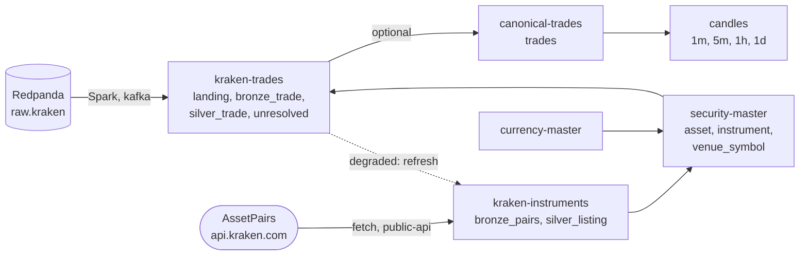

# 23. What runs, and crypto as products

> **Target text: describes phase 004 as built on branch `phase/004-005-kraken-and-enriched`, for the
> release that will carry it (`v3.0.0-alpha.6`, not yet tagged).** None of it runs on the live stack
> yet: the stack runs `3.0.0-alpha.5.1`, whose only products are the three file products of phase 002
> and the platform's own. When that release is deployed, this banner goes and the chapter describes
> the running system.

> **You will learn** how live crypto data reaches readers again, as five products that chain: one per
> venue's trades, one per venue's listing, a security master, canonical trades and candles; where each
> engine and storage key acts; what each reader role sees; what `complete`, `partial` and `degraded`
> mean; and what an operator hold does.
> **Read this if** you will add a venue, read the candles, or run the chain.
> **Before this** chapter 21 (how a release reaches the stack) and chapter 22 (who may see what).

The decisions are [ADR-063](../adr/ADR-063-kafka-product-landing-per-product-bronze-staged-by-offset.md)
(Proposed: the Kafka landing and bronze), [ADR-036](../adr/ADR-036-connectors-land-verbatim-then-publish-bronze-after-audit.md)
(the fetch kinds), [ADR-062](../adr/ADR-062-dbt-builds-silver-and-gold-per-product-through-one-wrapper.md)
(dbt through the wrapper) and [ADR-030](../adr/ADR-030-scd2-security-master.md) (type-2 history), with the
2026-11-28 Outcomes of ADR-058, 059, 061 and 062. The plan is
[004](../plans/2026-11-26-unified-product-platform/004-kraken-trades-instruments-security-master.md); the
frozen interfaces are [`phase-001-interfaces.md`](../development/phase-001-interfaces.md)'s 2026-11-28
sections.

## The chain

Each box is a product: its own documents under `contracts/<domain>/<product>/`, its own DAG, its own
tables, its own run records and catalog page. An arrow is an input port: the reader pins the input's
tested snapshot (its `audited` tag) at the start of the build and reads nothing newer.

| Product | Domain | Source | Schedule | Tables (owner: no role offered) |
|---------|--------|--------|----------|------|
| `kraken-trades` | `market-capture` | topic `market.crypto.v3.raw.kraken` | every 5 min | `landing`, `bronze_trade` (owner); `silver_trade`; `silver_trade_unresolved` (owner) |
| `kraken-instruments` | `market-capture` | `https://api.kraken.com/0/public/AssetPairs` | hourly, minute 17 | `bronze_pairs` (owner); `silver_listing` |
| `security-master` | `reference-data` | `silver_listing`, `currency`, two seeds | hourly, minute 37 | `instrument`, `venue_symbol` (type-2); `asset`, `venue_symbol_claim`, `venue_symbol_held` (owner) |
| `canonical-trades` | `market-analytics` | `silver_trade`, optional | minutes 2, 7, 12 ... | `trades` |
| `candles` | `market-analytics` | `trades` | minutes 4, 9, 14 ... | `ohlcv_1m`, `ohlcv_5m`, `ohlcv_1h`, `ohlcv_1d` |

The staggered minutes let each build read its input's newest tested snapshot most of the time; one
that has not published yet is read on the next run.

## How a trade travels

1. **Land.** Every five minutes `kraken-trades`' `load` plans the next offset range per partition from
   its landing's newest connector snapshot and commits every record of it, trade and control frames,
   byte for byte, with the end offsets in the same commit, made `main` only if `main` is unmoved.
2. **Stage and audit.** The same task stages bronze from the landing by offset, keeps `stream = trade`,
   counts the rest, and writes the decoded envelope; `audit` checks accounting, parses and unique keys
   on the `audit` branch, and `publish` moves `main`. A batch that fails blocks bronze while the
   landing keeps committing ([kafka-batch-blocked.md](../runbooks/kafka-batch-blocked.md)).
3. **Silver.** dbt types each frame's trades into one row per trade and delivery, `UNNEST ... WITH
   ORDINALITY` in place of Spark's `posexplode`, every delivery kept and a repeat flagged
   `is_duplicate`. Each trade's symbol is resolved through the `venue_symbol` version valid at the
   trade's time; the first version opens at `1970-01-01`, so a trade earlier than its symbol's first
   fetch still resolves. A trade whose symbol resolves to nothing waits in `silver_trade_unresolved`
   and moves into `silver_trade` once the master resolves it.
4. **Canonical and candles.** `canonical-trades` unions its venue input ports (Kraken the only one) into
   one incremental table; `candles` recomputes each touched bucket at four timeframes, in the order the
   archived `ohlcv_1m.sql` used.

## Where each engine and key acts

| Step | Runs in | Identity | Writes |
|------|---------|----------|--------|
| `load`, `audit`, `publish` of `kraken-trades` | the Spark container, `docker exec` from Airflow | the Spark storage key | warehouse `k2`: the landing, `bronze_trade`, `audit_checks` |
| `fetch` of `kraken-instruments` | the fetch one-shot on `k2-egress` | no key at all | the spool only |
| its `load`, `audit`, `publish` | Spark | the Spark key | `bronze_pairs`, `landing_files`, the landing prefix |
| `build` of each dbt product | a dbt-runner one-shot | Trino logins `dbt_<fence>` and `pub_<fence>`, `svc.runs` to resolve | its own `<domain>_build.<fence>__base` tables, then the `audited` tag |
| `maintain` | Spark | the maintenance key (reads and deletes, writes nothing) | snapshot expiry, orphan cleanup, continuity checks |
| `compact` of a Kafka product, daily | Spark | the Spark key | one `replace` of the landing and of bronze, skipped while `audit` holds a batch |
| `make hold`, `make unhold` | the host | `svc.operator` | `governance_build.run_records.holds`, INSERT only |

The landing is never expired; snapshot expiry keeps the newest connector snapshot of the landing and
of bronze, each table's resume point. A dbt output is compacted inside the wrapper after its tests, so
`audited` moves onto the compaction and no reconcile undoes it.

## What each reader role sees

No phase 004 product grants anyone yet: Kraken's terms of reuse are not recorded, and k2gen refuses a
grant outside the owning team until they are, on the product and every product upstream of it
(`docs.terms-missing`). What a grant would give is already compiled and in the access suite:

| Table | `full_reader` | `delayed_reader` |
|-------|---------------|------------------|
| `silver_trade` | every row and column | rows whose `trade_ts` is at least 20 minutes old; `conn_id`, `conn_msg_seq`, `kafka_offset`, `received_at` null |
| `canonical-trades.trades` | every row and column | `trade_ts` delayed 20 minutes; `kafka_offset` and the delivery counter `load_seq` null |
| `candles.ohlcv_*` | every row and column | a candle once its `window_end` is 20 minutes old; `through_load_seq` masked |
| `bronze_trade`, `silver_trade_unresolved`, the landing | denied | denied |

The delay hides a row by its trade time, not by when it was delivered, so every column that counts or
dates deliveries is masked: otherwise an old row delivered late would show the last 20 minutes'
activity. `delayed_reader` is declared `within` `full_reader` (`contracts/access/roles.yaml`), which lets
`silver_trade` offer it over the security master, which offers `full_reader` only. The planned reader
is `svc.partner-dashboard`, declared with no role until the grant.

## State: complete, partial, degraded

Each product's catalog page shows its state, read from the newest build's run records
(`platform/runs/k2runs.py`, `state`):

- **`degraded`**: the build passed but a `warn`-severity test failed, such as `unresolved_rows_zero` on
  `kraken-trades`. The build still publishes. A degraded `kraken-trades` build also starts one
  `kraken-instruments` run (its `refresh` property), so a newly listed pair can resolve within the hour.
- **`partial: <inputs>`**: an optional input was paused in the release or never tested, read as zero
  rows (`whenAbsent: empty`). `canonical-trades` shows it when its Kraken port is absent, and keeps what
  it has. A `table` model is never fed an absent input: its port says `whenAbsent: fail`, and the build
  fails, keeping the last tested tag.
- **`complete`**: neither.

These states are on the page only: no Prometheus series carries them, so no alert fires on them yet.
The page also lists every offset range an accept-data-loss run gave up, with its reason
([accept-data-loss.md](../runbooks/accept-data-loss.md)). The compiled per-product alerts are
`ProductRunFailed`, `ProductStale` and `ProductRunSlow` per DAG.

## Holds

An operator hold stops one product's runs for an incident without a release
([hold-a-product.md](../runbooks/hold-a-product.md)). `make hold` writes an append-only row as
`svc.operator`, then pauses the DAG; `resolve` refuses any run that starts while it is open; no
deploy unpauses the DAG; `make unhold` writes the release row and unpauses it. A hold is not a
lifecycle state: downstream products keep reading the held product's last tested snapshot and stay
`complete`. Every DAG a release adds is created paused, so a new product never starts under its own
deploy: the operator unpauses the five above in their input order after `make release-verify`
([onboard-a-kafka-product.md](../runbooks/onboard-a-kafka-product.md) section 4).

## Known limits

- The chain has run on throwaway lakes in parts: the Kafka path on a fixture product
  (`scripts/verify/kafka-path.sh`), the five products built in order on empty bronze (`make test-dbt
  SELECTOR=candles`). It has not run with rows end to end, through Airflow, or for 48 hours; its run
  times and the landing's growth on disk are unmeasured.
- Kraken is the only venue; `canonical-trades` gains a port per venue.
- `make product-verify`, `make rebuild`, `make restore` and the parity checks on the new tables are not
  built yet.
