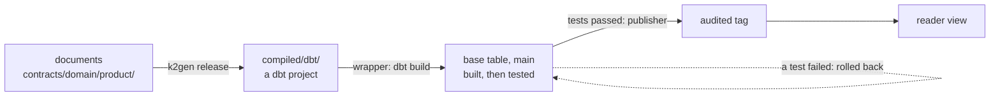

# dbt labs

Three labs on the ECB products (`contracts/fx-reference/ecb-fx-rates/`), for someone who knows SQL
and data engineering and is learning dbt on this platform. Each takes about 30 minutes at a
keyboard. They teach what you need to review a dbt pull request here: what a model is, what the
platform generates around it, and what happens when its tests fail. The review checklist those
labs lead to is [reviewing-dbt-work.md](../reviewing-dbt-work.md).

**dbt** (data build tool) runs SQL `SELECT` statements, called **models**, against a warehouse and
writes each result as a table or view; it runs **tests** on the results, and it works out the order
from the references between models. The version here is dbt-core 1.12.7 with the dbt-trino 1.12.0
adapter, pinned in [`dbt/uv.lock`](../../../dbt/uv.lock). Everything these labs say about how dbt
behaves points at a file in this repository that shows it.

## The labs

| Lab | What you do | What it proves | Needs a container? |
|---|---|---|---|
| [1. A source and a model](lab-1-a-source-and-a-model.md) | read `silver_rates` from its input to its tests; compile it; add a column and watch the contract and the version rules catch the half-done change | a model's columns are its contract's, and a change the contract does not carry is refused | no; the build step is named for a merge point |
| [2. An incremental merge with a unit test](lab-2-an-incremental-merge-with-a-unit-test.md) | compile `silver_rates` both ways, read why its key holds the partition column, write a unit test | the merge cannot insert a key twice, and a unit test pins the logic on synthetic rows | no; running the unit test is named for a merge point |
| [3. A failing test that rolls back](lab-3-a-failing-test-that-rolls-back.md) | follow the wrapper through a failed build; run its unit tests; read the planted failure in its end-to-end proof | readers never see rows whose tests failed | no; the end-to-end proof is named for a merge point |

Do them in order: lab 2 uses the compiled tree from lab 1, and lab 3 assumes both.

**"Run at a merge point"** marks a command that starts containers (a throwaway Trino and lake).
The labs never ask you to start one; what such a command prints is quoted from the script that
prints it, so you know what to look for when it runs at the next merge point
([CLAUDE.md](../../../CLAUDE.md), "Verification habits").

## Before you start

- A checkout of this repository, and [`uv`](https://docs.astral.sh/uv/). Every command runs from
  the repository root unless a step says `cd`. The shell lines work in bash and zsh.
- Nothing else: no stack, no Docker. dbt runs from [`dbt/`](../../../dbt/)'s own uv project, and
  k2gen (the compiler that turns a product's documents into a release) from
  [`platform/k2gen/`](../../../platform/k2gen/)'s.
- Scratch output goes under `build/`, which git ignores. A compiled release is sealed read-only, so
  give each compile its own directory, and clear them at the end with
  `chmod -R u+w build && rm -rf build`.

## From documents to a tested tag

A product is written once, as documents: the product file, one contract per table, a SQL file per
model, the unit tests. k2gen compiles them into a sealed release, which holds a complete dbt
project. At run time the dbt wrapper builds that project as the product's builder, and only when
every test passed does the publisher move the `audited` tag that readers read through.

*Reading guide.* Lab 1 is the first arrow, lab 2 what the build writes into `main`, lab 3 the two
arrows out of `main`.

## Terms used in every lab

| Term | Meaning here |
|---|---|
| product | one data product: a directory under `contracts/<domain>/<product>/`, its `product.odps.yaml` and one `<table>.odcs.yaml` contract per table |
| fence | the product's name with `-` turned to `_` (`ecb_fx_rates`): its namespace, its dbt selector, its builder `dbt_<fence>` |
| contract | an ODCS document (Open Data Contract Standard) for one table: columns, types, key, partitioning, quality rules |
| release | the sealed directory `k2gen release` writes: the documents plus everything compiled from them, including `compiled/dbt/` |
| base table | where the builder writes: `<domain>_build.<fence>__base.<table>`, for example `fx_reference_build.ecb_fx_rates__base.silver_rates` |
| reader view | what readers query: `<domain>.<fence>.<table>`, which reads the base at its `audited` tag ([ADR-061](../../adr/ADR-061-readers-see-dbt-outputs-through-a-view-over-the-tested-tag.md)) |
| snapshot, `main`, tag | an Iceberg table keeps every committed version as a snapshot; `main` is the newest, which writes move; a tag names one snapshot and moves only when someone moves it ([glossary](../../adr/glossary.md#snapshot)) |
| the wrapper | `k2-dbt` ([`docker/dbt-runner/k2_dbt.py`](../../../docker/dbt-runner/k2_dbt.py)), the program around every dbt build on the platform |
