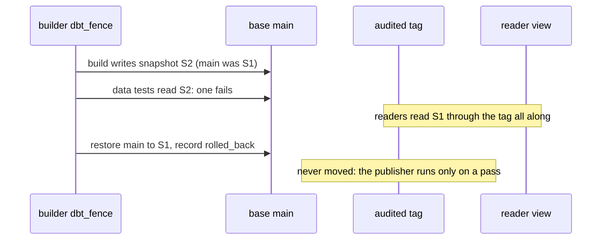

# Lab 3. A failing test that rolls back

**Goal.** Follow one dbt build on the platform whose test fails, from the first statement to the
last, and see why a reader is never shown a row of it.

**You will learn**

- why a plain `dbt build` would show readers untested rows, and what the platform puts around it;
- the wrapper's steps in order, and what a reader sees at each;
- the run records `rolled_back` and `reconciled`, and where test results go;
- how the platform's end-to-end proof plants a failing test and watches as a reader.

## Steps

### 1. The problem a plain dbt build has

`dbt build` runs, for each model in order: its unit tests, the model, then its data tests. On
Iceberg through Trino the model's write is a commit: a new snapshot on the table's `main`. Its
data tests read that snapshot. So between the write and the tests' verdict, `main` holds rows
nobody has tested, and anyone who reads `main` reads them: the platform's spikes saw bad rows
visible for 2.6 s before a rollback
([ADR-061](../../adr/ADR-061-readers-see-dbt-outputs-through-a-view-over-the-tested-tag.md),
Context). The owner's rule is that readers see only tested data, always. A test that runs after
the write cannot keep that rule on its own.

### 2. The platform's answer: readers read a tag

Readers never read the base table. Each dbt output has a reader view, compiled into the release.
Look at silver's, in lab 1's release:

```bash
cat $(ls -d build/ci/pr/releases/*)/compiled/trino/views/fx_reference.ecb_fx_rates.silver_rates.sql
```

```text
SELECT "rate_date", "currency", "rate", "source_file_sha256" FROM "fx_reference"."ecb_fx_rates__base"."silver_rates" FOR VERSION AS OF 'audited' WHERE EXISTS (SELECT 1 FROM "fx_reference"."ecb_fx_rates__base"."silver_rates$refs" WHERE "name" = 'audited' AND "type" = 'TAG')
```

`FOR VERSION AS OF 'audited'` reads the snapshot the `audited` tag names, whatever `main` holds.
The `WHERE EXISTS` on the table's `$refs` (the metadata table listing its branches and tags) makes
the read fail, rather than serve rows, if anything but a tagged Iceberg table ever sits at that name
(ADR-061, its first Outcome). The builder `dbt_ecb_fx_rates` writes the base and cannot touch the
view; the publisher `pub_ecb_fx_rates` owns the view. So the question "can a reader see a failed
build?" becomes "can the tag ever move onto one?", and the wrapper is the one program meant to move
it. Lakekeeper does not enforce that: its REST API has no authentication, so any member of network
`k2-catalog` could move the tag; the network fence (ADR-059 part 7) keeps every container but the
platform's own off that network.

### 3. The wrapper's steps, in order

[`docker/dbt-runner/k2_dbt.py`](../../../docker/dbt-runner/k2_dbt.py) runs every dbt build on
the platform, as `k2-dbt build --release <id> --product <domain>.<product> --run-id <dag>/<run>`.
Its docstring lists the steps; the reader's view at each:

| Step | What the wrapper does | What a reader sees |
|---|---|---|
| 1 reconcile | an output whose `main` is not its tag (an earlier run died) is restored to the tag, run record `reconciled`; each view is put back to the tagged columns; the catalog drift check must find nothing | the tag's rows |
| 2 resolve | reads each input's tested snapshot from its `$refs`, twice, and compares; a required input never tested exits 4 | the tag's rows |
| 3 started | one run record `started` per output, with `snapshot_before`, its `main` now | the tag's rows |
| 4 build | one `dbt build --selector <fence>` as the builder, unit tests inside it, inputs pinned by `k2_inputs` | the tag's rows, while `main` takes the new, untested snapshot |
| 5 on a failure | every output whose `main` moved is restored, as the builder; run record `rolled_back` | the tag's rows |
| 6 on a pass | as the publisher: views narrowed if columns change, one compare-and-set commit moves every output's tag, views widened, run record `audited` | the new, tested rows, from the commit on |

A **compare-and-set** commit names the value it expects to replace: here, `main` at the snapshot
the tests read and the tag where step 3 found it. If anything moved in between, the catalog
answers 409 and nothing moves (`tag_change` and `publish` in `k2_dbt.py`).



*Reading guide.* `S1` is the snapshot the tag names before the run; the failed build's `S2` is on
`main` only between the write and the restore, and no reader query names `main`.

### 4. The restore, and the exits

On a failed build the wrapper logs `dbt build failed its tests (exit 1); restoring the outputs`
and, per output, `rollback <table>: main <S2> back to <S1>`. How it restores
(`restore_statement`):

- same columns and types as before: `ALTER TABLE ... EXECUTE rollback_to_snapshot(<S1>)`;
- columns changed by the failed build: `CREATE OR REPLACE TABLE ... AS SELECT * FROM ... FOR
  VERSION AS OF <S1>`, with the contract's partitioning and sort, because a rollback restores rows
  but not the schema (spike (f));
- no earlier snapshot (a failed first build): `DROP TABLE`, never on a table that carries a tag.

The failed build's snapshot ids go out on the last stdout line, `{"exit": 1, "expire": [...]}`,
for the Spark `expire` task to remove. Exits: 0 passed and published; 1 a test failed, outputs
restored; 2 a build error (a model that did not build, a contract refused), outputs restored; 3 a
restore, the tag commit, the view sync, the reconcile or the drift check failed, which pages; 4 a
required input never tested.

### 5. The records it leaves

**Run records**, one row per event, in `governance_build.run_records.run_record`
([`platform/runs/k2runs.py`](../../../platform/runs/k2runs.py)), written as `svc.runs`:

- `rolled_back`: this run's build failed; `snapshot_before` is `main` before the build,
  `snapshot_after` is `main` after the restore. A failed run leaves `started` then `rolled_back`.
- `reconciled`: written at the start of a later run, for a run that died after `started`, killed
  or crashed, with no terminal row. Its outputs are put back to their tag first. A run that dies
  between the tag commit and its `audited` row gets that `audited` row instead, since its tag move
  was a tested publish.
- `audited`: a pass; `snapshot_after` is the snapshot the tag now names.

**Test results**, one row per data test and unit test, pass or fail, written by the project's
`on-run-end` hook `k2_results` ([`dbt/macros/k2_results.sql`](../../../dbt/macros/k2_results.sql))
as the builder, into its own `<domain>_build.<fence>__base.dq_test_results`: for this product,
`fx_reference_build.ecb_fx_rates__base.dq_test_results`. Each row carries `run_id` (the same as
the run records'), `status` (dbt's: pass, fail, warn, error, skipped), `failures` and `message`
(a failed unit test's is dbt's diff). The product `governance.quality-results` unions every
builder's table into one, read at `governance.quality_results.test_results`
([`contracts/governance/quality-results/`](../../../contracts/governance/quality-results/)).

### 6. Run the wrapper's decisions yourself

The wrapper's logic is tested against an in-memory lake that checks, after every change, that no
view reads an untested snapshot ([`docker/dbt-runner/test_k2_dbt.py`](../../../docker/dbt-runner/test_k2_dbt.py)).
No container is needed:

```bash
uv run --project platform/k2gen --locked -q --with trino==0.340.0 pytest -q docker/dbt-runner/test_k2_dbt.py
```

```text
67 passed
```

(`trino==0.340.0` is the client `dbt/uv.lock` pins.) Read the one for this lab,
`test_a_failed_test_with_the_schema_unchanged_rolls_back_and_names_the_snapshot_to_expire`: the
fake dbt exits 1 with a failed test; the test asserts exit 1, `main` and the tag both back at the
seeded snapshot, the `rollback_to_snapshot` statement run as the builder, the failed snapshot
named for expiry, one `rolled_back` record, and `fake.violations == []`, the leak check.
`test_a_crash_at_each_point_of_the_publish_never_exposes_untested_data` kills the publish at each
statement in turn.

## Exercise: the planted failure in the end-to-end proof

[`scripts/verify/dbt-wrapper.sh`](../../../scripts/verify/dbt-wrapper.sh) runs the wrapper in its
real image on a throwaway lake, against the access canary product
(`contracts/governance/access-canary/`: five synthetic rows from a seed, key `(id, region)`). It
starts containers, so it is **run at a merge point**:

```bash
bash scripts/verify/dbt-wrapper.sh
```

Before it runs, read it to find these lines.

**Where the failure is planted.** It compiles four releases of the tree; release `R1f` adds one
seed row whose key `(1, north)` is already taken:

```bash
patch_failing() { echo "1,north,w118-failed,1440" >> contracts/governance/access-canary/seeds/event_offsets.csv; }
```

That row is legal for every column, so the model builds; only the `k2_unique_key` test, from the
contract's key, fails. Run 2 builds `R1f` with a reader polling:

```bash
run "$ID1F" run2 poll;      probe drift "$ID1F" run2
```

**The reader.** `run ... poll` starts `probe poll` in the background three seconds before the
wrapper and stops it after; the poll (the `elif cmd == "poll"` branch of the Python probe) queries
the reader view as `p.canary-full` every 50 ms and counts any answer that is not exactly the five
tested rows, or that holds the note `w118-failed`:

```python
        elif len(a.rows) != 5 or any(r[2] == "w118-failed" or r[0] not in range(1, 6) for r in a.rows):
            bad.append(a.rows)
        time.sleep(0.05)
```

**What to expect.** Each claim prints `PASS <claim>: <detail>` or `FAIL <claim>: <detail>`. The
one for this lab, from the script's `claim(...)` call:

```text
PASS a failed test leaves main at the tag, and a reader polling every 50 ms never sees its rows: exit 1, tag <S1> (was <S1>), main <S1>; <n> polls, 0 with an untested row, 0 errors []
```

It passes only with the wrapper's exit 1, `main` equal to the tag and to run 1's tag, at least 20
polls, none bad and none an error. Two more claims follow the same failure: run 6 fails after a
schema change and must be restored by create-or-replace (`PASS a failed build after a schema
change is restored by create-or-replace: the tag's rows and schema: ...`), and run 3 is killed
after its `started` row and must be reconciled by run 4 (`PASS a run killed after started is
reconciled by the next, which passes: ...`). The script's last line is
`dbt-wrapper: <n> PASS, <m> FAIL in <s> s`, and it exits 0 only with no FAIL.

## Why it works

Readers name the tag, never `main`, and the wrapper moves the tag only after a passing build, in a
commit that fails if `main` moved since the tests read it. Lakekeeper checks no identity on that
commit, so what keeps any other program from moving the tag is the network fence: only the
platform's own services join `k2-catalog`. A failed build changes `main`
alone, and the wrapper puts `main` back before the run ends; a run that dies before that is put
back by the next run's reconcile, before it builds anything.

## Check yourself

1. During step 4 of a failing run, a reader's query and the builder's data test both read
   `silver_rates`. Which snapshot does each read, and why?
2. Run 2's planted row breaks no column's type and no `not_null`. Which document produced the test
   that catches it?
