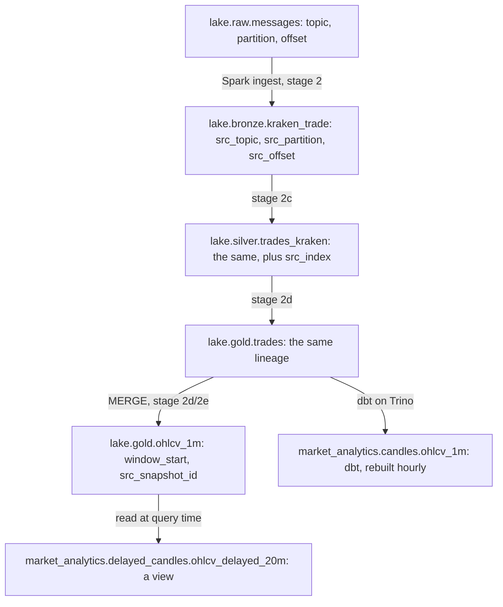
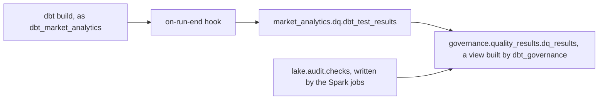

# Lakehouse labs

Five guided labs for [chapter 19](../architecture/19-lakehouse-and-domain-warehouses.md), the
lakehouse and its domain warehouses. The chapter explains the design. These labs make you do
it: look at the catalog, trace a record, hit the fence, add a domain, and break a test.

Each lab has a goal, what you will learn, the steps, what you should see, why it works, and a
question to check yourself. Every command below was run on 2026-11-25 (UTC), and its output is
pasted, trimmed. Your snapshot ids, offsets, times and counts will differ: they grow with every
commit. Prices, quantities and trade ids are shown as `<price>`, `<qty>` and `<trade_id>`,
because this repository publishes no market data.

## Before you start

| Lab | Runs on | Changes anything? |
|---|---|---|
| 1. Explore the catalog | the live stack | no: `SHOW`, `DESCRIBE` and `SELECT` only |
| 2. Follow one record from raw to mart | the live stack | no |
| 3. The fence | the live stack for the refused writes, a throwaway Trino for the allowed ones | live: no, every statement is refused. The throwaway is deleted |
| 4. Add a domain end to end | a separate checkout, and the throwaway Trinos that `make test-trino` and `make test-dbt` start and remove | that checkout, until you back the domain out |
| 5. Break it and fix it | a throwaway Trino, then the live stack read-only | the throwaway only |

You need the stack running (`make up`, then `make health`; [setup](setup.md)), Docker,
[`uv`](https://docs.astral.sh/uv/) and `jq`. Run every command from the repository root unless
a step says `cd`. The shell lines work in bash and zsh.

Two rules keep the live stack safe:

- On the live Trino, container `k2-trino`, run only `SHOW`, `DESCRIBE`, `SELECT`, and the
  statements Lab 3 expects to be refused. A refused statement fails while Trino plans it, so
  nothing is written. Every refused write in Lab 3 was first tried on a throwaway with the same
  `rules.json`.
- Call your throwaway `k2-labs-trino` and delete it at the end of the lab. `make test-trino` and
  `make test-dbt` start their own, `k2-trino-rules-test` and `k2-dbt-test`. Run one at a time.

Terms used below. The rest are in [chapter 19's glossary](../architecture/19-lakehouse-and-domain-warehouses.md#glossary).

| Term | Meaning |
|---|---|
| Live stack | the containers `make up` started |
| Trino CLI | the `trino` command inside container `k2-trino`. It sends SQL to the Trino server |
| Throwaway Trino | a Trino container you start for a lab and delete after. It has the real `rules.json`, but no MinIO and no Lakekeeper: its catalogs keep their tables in a file metastore, a folder inside the container, and every catalog shares that one folder |
| Writer | `dbt_<domain>`, the only user whose SQL may change that domain's catalog |
| Lineage columns | `src_topic`, `src_partition`, `src_offset`: the Kafka position of the raw record a row came from |
| Metadata table | a table Trino derives from a table's Iceberg metadata, such as `"ohlcv_1m$snapshots"`. It reads no rows of the table itself |

## Lab 1. Explore the catalog

**Goal.** Find every catalog, schema and table, then read one table's history and files.

**You will learn**

- how a Trino catalog maps to a Lakekeeper warehouse;
- that a table is data files plus snapshots, and how to read both;
- who may read and who may write each catalog, from the two files that decide it.

### Steps

**1. Open the Trino CLI.** It shows a `trino>` prompt. End each statement with `;`. Leave with
`quit;`.

```bash
docker exec -it k2-trino trino
```

**2. List the catalogs.**

```sql
SHOW CATALOGS;
```

```
     Catalog
------------------
 fx_reference
 governance
 lake
 market_analytics
 market_capture
 reference_data
 system
(7 rows)
```

`lake` is the producer lake: Lakekeeper warehouse `k2`. `system` is Trino's own. The other five
are the domain catalogs, one per domain in `contracts/domains.yaml`, each opening a warehouse of
the same name.

**3. List schemas and tables.**

```sql
SHOW SCHEMAS FROM lake;
SHOW TABLES FROM lake.gold;
SHOW SCHEMAS FROM market_analytics;
```

```
       Schema
--------------------
 audit
 bronze
 gold
 information_schema
 raw
 silver
 system
(7 rows)

     Table
----------------
 bars
 bbo_1s
 ...
 ohlcv_1m
 ohlcv_5m
 trades
(11 rows)

       Schema
--------------------
 candles
 delayed_candles
 dq
 information_schema
 staging
 system
 venue_quality
(7 rows)
```

In `market_analytics`, `candles`, `delayed_candles` and `venue_quality` are one schema per data
product. `staging` holds dbt's views over the lake. `dq` holds the domain's test results (Lab 5).

**4. Read a table's columns.**

```sql
DESCRIBE lake.gold.ohlcv_1m;
```

```
      Column      |            Type             | Extra |                    Comment
------------------+-----------------------------+-------+------------------------------------------------
 exchange         | varchar                     |       |
 canonical_symbol | varchar                     |       |
 window_start     | timestamp(6) with time zone |       | Bucket start, UTC. The bucket is the table (1m, 5m, 1h, 1d)
 open_e8          | bigint                      |       | First trade by (exchange_ts, recv_ts_ns), fixed point 1e-8
 ...
 src_snapshot_id  | bigint                      |       | The gold.trades snapshot this bucket was computed from. ...
 computed_at      | timestamp(6) with time zone |       |
(14 rows)
```

**5. Read its snapshots.** A snapshot is one version of the table. Quote the name: `$` is part
of it.

```sql
SELECT snapshot_id, parent_id, committed_at, operation, summary['engine-name'] AS engine
FROM lake.gold."ohlcv_1m$snapshots"
ORDER BY committed_at DESC LIMIT 3;
```

```
     snapshot_id     |      parent_id      |        committed_at         | operation | engine
---------------------+---------------------+-----------------------------+-----------+--------
 7040422774437288021 | 2892167622813746595 | 2026-11-25 20:42:25.772 UTC | overwrite | spark
 2892167622813746595 | 3846179136506878098 | 2026-11-25 20:37:28.106 UTC | overwrite | spark
 3846179136506878098 | 1855971122196165914 | 2026-11-25 20:32:28.749 UTC | overwrite | spark
(3 rows)
```

Each row's `parent_id` is the row below it: the history is a chain. One commit lands every five
minutes, one per ingest run.

**6. Read its files.**

```sql
SELECT file_path, partition FROM lake.gold."ohlcv_1m$files" LIMIT 2;
SELECT (SELECT count(*) FROM lake.gold."ohlcv_1m$files") AS data_files,
       (SELECT count(*) FROM lake.gold."ohlcv_1m$snapshots") AS snapshots;
```

```
                                   file_path                                                    |                 partition
------------------------------------------------------------------------------------------------+-------------------------------------------
 s3://k2-lake/warehouse/k2/01a04789-.../data/exchange=kraken/window_start_month=2026-11/00000-801-....parquet | {exchange=kraken, window_start_month=682}
 s3://k2-lake/warehouse/k2/01a04789-.../data/exchange=kraken/window_start_month=2026-11/00000-856-....parquet | {exchange=kraken, window_start_month=682}
(2 rows)

 data_files | snapshots
------------+-----------
         19 |       298
(1 row)
```

The path is bucket `k2-lake`, the warehouse prefix `warehouse/k2/`, the table's own folder, then
one folder per partition value. `window_start_month=682` is months since January 1970: November
2026.

**7. Read what the ingest stored on a snapshot.** Each ingest into `raw.messages` records the
Kafka offsets it read up to.

```sql
SELECT committed_at, summary['k2.job'] AS job,
       substr(element_at(summary, 'k2.kafka-offsets'), 1, 60) AS offsets
FROM lake.raw."messages$snapshots"
ORDER BY committed_at DESC LIMIT 1;
```

```
        committed_at         |  job   |                           offsets
-----------------------------+--------+--------------------------------------------------------------
 2026-11-25 20:56:24.467 UTC | ingest | {"market.crypto.v3.book.binance":{"0":342232,"1":342232,"2":
(1 row)
```

Use `element_at`, not `summary['k2.kafka-offsets']`. Not every snapshot has the key, and the
bracket form fails on the first one without it: `Key not present in map: k2.kafka-offsets`.

**8. See who may read and who may write.** Leave the CLI (`quit;`). Two files decide it. The
lake's catalog file, as the running Trino has it:

```bash
docker exec k2-trino cat /etc/trino/catalog/lake.properties | grep -E '^iceberg\.(security|rest-catalog\.warehouse)'
```

```
iceberg.rest-catalog.warehouse=k2
iceberg.security=read_only
```

And the access rules, generated into `docker/trino/etc/rules.json`:

```bash
jq -c '.schemas[]' docker/trino/etc/rules.json
jq -c '.tables[] | [.user // "(anyone)", .catalog // "(any)", .privileges]' docker/trino/etc/rules.json
```

```
{"user":"dbt_fx_reference","catalog":"fx_reference","owner":true}
...
{"user":"dbt_market_analytics","catalog":"market_analytics","owner":true}
...
{"owner":false}
["dbt_fx_reference","fx_reference",["SELECT","INSERT","DELETE","UPDATE","OWNERSHIP","GRANT_SELECT"]]
...
["dbt_market_analytics","market_analytics",["SELECT","INSERT","DELETE","UPDATE","OWNERSHIP","GRANT_SELECT"]]
...
["(anyone)","(any)",["SELECT","GRANT_SELECT"]]
```

The snapshots agree. Every commit to the lake table is Spark's, and every build of the mart is
its writer's:

```bash
docker exec k2-trino trino --execute "SELECT summary['engine-name'], count(*) FROM lake.gold.\"ohlcv_1m\$snapshots\" GROUP BY 1"
#   "spark","299"                one more than in step 6: an ingest committed in between
docker exec k2-trino trino --execute "SELECT committed_at, summary['trino_user'] FROM market_analytics.candles.\"ohlcv_1m\$snapshots\" ORDER BY committed_at DESC LIMIT 1"
#   "2026-11-25 20:10:55.545 UTC","dbt_market_analytics"
```

### Why it works

A Trino catalog is one file under `docker/trino/etc/catalog/` that names one Lakekeeper
warehouse. Catalog `lake` also sets `iceberg.security=read_only`, so its connector refuses every
commit, whoever asks. For the domain catalogs, `rules.json` decides, and the first matching
rule wins: each writer's own rule comes first, and everyone else falls through to the last
rule, `SELECT` only ([chapter 19, who can do what](../architecture/19-lakehouse-and-domain-warehouses.md#who-can-do-what),
[ADR-044](../adr/ADR-044-producer-lake-and-domain-mart-warehouses.md)). The `$snapshots` and
`$files` tables read Iceberg's metadata, so they are cheap on any table size.

### Check yourself

`lake.gold.ohlcv_1m` has 19 data files but 298 snapshots. How can a table have more versions
than files?

> A snapshot lists the files that make up the table at that moment. Most commits replace a few
> files, so older snapshots point at files that are no longer current. Those stay until the
> nightly maintenance expires snapshots older than seven days. `$files` shows only the current
> snapshot's files.

## Lab 2. Follow one record from raw to mart

**Goal.** Take one Kafka record and find it in every layer, in its candle, in the mart and in
the delayed view.

**You will learn**

- how the lineage columns tie every row to the raw record it came from;
- how a candle records which `gold.trades` snapshot it was computed from;
- why the mart and the delayed view lag the lake, and by how much.



### Steps

Run the SQL at the `trino>` prompt (`docker exec -it k2-trino trino`). Every query after step 1
uses my record. Put yours in its place: the partition, the offset, and a time range a minute
either side of its `kafka_ts`. The time range lets Trino read one day's partition instead of
every day's.

**1. Pick a trade frame from 70 to 75 minutes ago.** At that age it is in the mart's last
hourly build and old enough for the delayed view.

```sql
SELECT topic, partition, offset, kafka_ts
FROM lake.raw.messages
WHERE topic = 'market.crypto.v3.raw.kraken'
  AND kafka_ts BETWEEN current_timestamp - INTERVAL '75' MINUTE
                   AND current_timestamp - INTERVAL '70' MINUTE
  AND strpos(from_utf8(payload), '"channel":"trade"') > 0
ORDER BY kafka_ts
LIMIT 1;
```

```
            topic            | partition |  offset  |            kafka_ts
-----------------------------+-----------+----------+--------------------------------
 market.crypto.v3.raw.kraken |         3 | 24654327 | 2026-11-25 19:30:03.423000 UTC
(1 row)
```

**2. Read the raw record.** The payload is the Kafka value byte for byte: a 5-byte header, then
an Avro record with the venue's text frame inside. `strpos(..., '{')` cuts to the frame.

```sql
SELECT substr(from_utf8(payload), strpos(from_utf8(payload), '{')) AS frame,
       from_utf8(headers['recv_ts_ns']) AS recv_ts_ns, ingest_ts
FROM lake.raw.messages
WHERE topic = 'market.crypto.v3.raw.kraken' AND partition = 3 AND offset = 24654327  -- counts-ok: a Kafka offset, a position
  AND kafka_ts BETWEEN TIMESTAMP '2026-11-25 19:29:03 UTC' AND TIMESTAMP '2026-11-25 19:31:04 UTC';
```

```
 frame                                                                                  | recv_ts_ns          | ingest_ts
----------------------------------------------------------------------------------------+---------------------+-------------------------------
 {"channel":"trade","type":"update","data":[{"symbol":"BTC/USD","side":"sell","price":<price>,"qty":<qty>,"ord_type":"limit","trade_id":<trade_id>,"timestamp":"2026-11-25T19:30:03.245435Z"}, ...]} | 1795635003423227404 | 2026-11-25 19:31:01.257080 UTC
(1 row)
```

`ingest_ts` is when the ingest run that archived it started.

**3. Find the frame in bronze.** Bronze has one row per frame, decoded, with the raw record's
position in the lineage columns.

```sql
SELECT symbol, recv_ts, src_offset, ingest_ts
FROM lake.bronze.kraken_trade
WHERE src_topic = 'market.crypto.v3.raw.kraken' AND src_partition = 3 AND src_offset = 24654327
  AND recv_ts BETWEEN TIMESTAMP '2026-11-25 19:29:03 UTC' AND TIMESTAMP '2026-11-25 19:31:04 UTC';
```

```
 symbol  |            recv_ts             | src_offset |           ingest_ts
---------+--------------------------------+------------+--------------------------------
 BTC/USD | 2026-11-25 19:30:03.423227 UTC |   24654327 | 2026-11-25 19:31:01.257080 UTC
(1 row)
```

**4. Find the trade in silver.** One frame can carry several trades. Silver has one row per
trade, and `src_index` says which element of the frame's `data` array it was. Take the first.

```sql
SELECT canonical_symbol, trade_id, exchange_ts, price, qty, side, src_offset, src_index, ingest_ts
FROM lake.silver.trades_kraken
WHERE src_topic = 'market.crypto.v3.raw.kraken' AND src_partition = 3 AND src_offset = 24654327
  AND src_index = 0
  AND exchange_ts BETWEEN TIMESTAMP '2026-11-25 19:29:03 UTC' AND TIMESTAMP '2026-11-25 19:31:04 UTC';
```

```
 canonical_symbol | trade_id   |          exchange_ts           |  price  |  qty  | side | src_offset | src_index |           ingest_ts
------------------+------------+--------------------------------+---------+-------+------+------------+-----------+--------------------------------
 BTC/USD          | <trade_id> | 2026-11-25 19:30:03.245435 UTC | <price> | <qty> | sell |   24654327 |         0 | 2026-11-25 19:31:01.257080 UTC
(1 row)
```

`exchange_ts` is the venue's own time from the frame. It is a little earlier than `recv_ts`,
when the capture received it.

**5. Find it in `gold.trades`.** Gold holds every venue in one table, with prices as fixed-point
integers (`price_e8` is the price times 10^8).

```sql
SELECT exchange, canonical_symbol, trade_id, exchange_ts, price_e8, qty_e8, src_offset, src_index, ingest_ts
FROM lake.gold.trades
WHERE exchange = 'kraken'
  AND src_topic = 'market.crypto.v3.raw.kraken' AND src_partition = 3 AND src_offset = 24654327
  AND src_index = 0
  AND exchange_ts BETWEEN TIMESTAMP '2026-11-25 19:29:03 UTC' AND TIMESTAMP '2026-11-25 19:31:04 UTC';
```

```
 exchange | canonical_symbol | trade_id   |          exchange_ts           |  price_e8  |  qty_e8  | src_offset | src_index |           ingest_ts
----------+------------------+------------+--------------------------------+------------+----------+------------+-----------+--------------------------------
 kraken   | BTC/USD          | <trade_id> | 2026-11-25 19:30:03.245435 UTC | <price_e8> | <qty_e8> |   24654327 |         0 | 2026-11-25 19:31:01.257080 UTC
(1 row)
```

**6. Find its candle.** The trade's minute is `date_trunc('minute', exchange_ts)`, here 19:30.

```sql
SELECT window_start, open_time, close_time, src_snapshot_id, computed_at
FROM lake.gold.ohlcv_1m
WHERE exchange = 'kraken' AND canonical_symbol = 'BTC/USD'
  AND window_start = TIMESTAMP '2026-11-25 19:30:00 UTC';
```

```
          window_start          |           open_time            |           close_time           |   src_snapshot_id   |          computed_at
--------------------------------+--------------------------------+--------------------------------+---------------------+--------------------------------
 2026-11-25 19:30:00.000000 UTC | 2026-11-25 19:30:00.309856 UTC | 2026-11-25 19:30:59.854103 UTC | 8707394284955886094 | 2026-11-25 19:31:01.257080 UTC
(1 row)
```

Check that the trade belongs in it, and which `gold.trades` snapshot the candle was computed
from, without printing a price:

```sql
SELECT t.exchange_ts BETWEEN c.open_time AND c.close_time AS inside_the_minute,
       t.price_e8 BETWEEN c.low_e8 AND c.high_e8 AS inside_low_high,
       s.committed_at AS computed_from_snapshot_committed_at
FROM lake.gold.trades t
JOIN lake.gold.ohlcv_1m c
  ON c.exchange = t.exchange AND c.canonical_symbol = t.canonical_symbol
 AND c.window_start = date_trunc('minute', t.exchange_ts)
JOIN lake.gold."trades$snapshots" s ON s.snapshot_id = c.src_snapshot_id
WHERE t.exchange = 'kraken'
  AND t.src_topic = 'market.crypto.v3.raw.kraken' AND t.src_partition = 3 AND t.src_offset = 24654327
  AND t.src_index = 0
  AND t.exchange_ts BETWEEN TIMESTAMP '2026-11-25 19:29:03 UTC' AND TIMESTAMP '2026-11-25 19:31:04 UTC';
```

```
 inside_the_minute | inside_low_high | computed_from_snapshot_committed_at
-------------------+-----------------+-------------------------------------
 true              | true            | 2026-11-25 19:32:18.921 UTC
(1 row)
```

**7. Find the same candle in the mart.** dbt builds `market_analytics.candles.ohlcv_1m` from
`lake.gold.trades` every hour at minute 10. Compare it with the lake's candle, column for column:

```sql
SELECT window_start, m.open_time, m.close_time,
       (m.open_e8, m.high_e8, m.low_e8, m.close_e8, m.volume, m.quote_volume, m.trade_count)
     = (l.open_e8, l.high_e8, l.low_e8, l.close_e8, l.volume, l.quote_volume, l.trade_count) AS same_as_lake
FROM market_analytics.candles.ohlcv_1m m
JOIN lake.gold.ohlcv_1m l USING (exchange, canonical_symbol, window_start)
WHERE exchange = 'kraken' AND canonical_symbol = 'BTC/USD'
  AND window_start = TIMESTAMP '2026-11-25 19:30:00 UTC';
```

```
          window_start          |           open_time            |           close_time           | same_as_lake
--------------------------------+--------------------------------+--------------------------------+--------------
 2026-11-25 19:30:00.000000 UTC | 2026-11-25 19:30:00.309856 UTC | 2026-11-25 19:30:59.854103 UTC | true
(1 row)
```

With `USING`, the join columns have no table prefix: `m.window_start` fails with `Column
'm.window_start' cannot be resolved`.

**8. Find it in the delayed view, and see the delay.**

```sql
SELECT window_start, open_time, close_time
FROM market_analytics.delayed_candles.ohlcv_delayed_20m
WHERE exchange = 'kraken' AND canonical_symbol = 'BTC/USD'
  AND window_start = TIMESTAMP '2026-11-25 19:30:00 UTC';

SELECT (SELECT max(window_start) FROM lake.gold.ohlcv_1m WHERE exchange = 'kraken') AS lake_newest,
       (SELECT max(window_start) FROM market_analytics.delayed_candles.ohlcv_delayed_20m WHERE exchange = 'kraken') AS delayed_newest,
       current_timestamp AS now;
```

```
          window_start          |           open_time            |           close_time
--------------------------------+--------------------------------+--------------------------------
 2026-11-25 19:30:00.000000 UTC | 2026-11-25 19:30:00.309856 UTC | 2026-11-25 19:30:59.854103 UTC
(1 row)

          lake_newest           |         delayed_newest         |             now
--------------------------------+--------------------------------+-----------------------------
 2026-11-25 20:41:00.000000 UTC | 2026-11-25 20:25:00.000000 UTC | 2026-11-25 20:46:09.651 UTC
(1 row)
```

At 20:46:09 the view's newest minute is 20:25: the last minute that ended at least 20 minutes
before the query.

### Why it works

The ingest's first stage stores each Kafka record unchanged in `raw.messages`, keyed by its
topic, partition and offset. Every later layer is decoded from it and keeps that position in
the lineage columns, plus `src_index` once a frame is split into trades
([ADR-021](../adr/ADR-021-raw-first-archive-and-lineage.md),
[chapter 08](../architecture/08-lake-ingest.md), [chapter 09](../architecture/09-lake-layers.md)).
A candle stores `src_snapshot_id`, the `gold.trades` snapshot it was computed from. The mart is
dbt's port of the same candle SQL, rebuilt whole every hour; the delayed view filters the lake's
own candles when you query it ([`dbt/README.md`](../../dbt/README.md)).

### Check yourself

You trace a trade from 10 minutes ago. It is in `lake.gold.ohlcv_1m`, but not in the mart and
not in the delayed view. Is something broken?

> No. The mart holds the lake as it was at its last build, at minute 10 of the hour. The delayed
> view shows a minute only once it ended 20 minutes before the query, and only once the venue
> has a newer minute in the lake. A 10-minute-old trade passes neither test yet.

## Lab 3. The fence

**Goal.** Watch the fences refuse writes on the live stack, then make an allowed write on a
throwaway Trino.

**You will learn**

- the exact `Access Denied` message for each kind of refused write;
- which layer refuses it: the read-only connector or `rules.json`;
- the one write the fence does not stop: a table procedure in another domain's catalog.

### Steps

**1. Try to write on the live stack.** `--user` sets the user Trino believes. Nothing checks it
(the `X-Trino-User` header), so these fences stop mistakes, not a liar.

```bash
docker exec k2-trino trino --user someone --execute "CREATE TABLE lake.gold.lab_check (x integer)"
#   Query <id> failed: Access Denied: Cannot create table lake.gold.lab_check
docker exec k2-trino trino --user dbt_market_analytics --execute "CREATE TABLE lake.gold.lab_check AS SELECT 1 AS x"
#   Query <id> failed: Access Denied: Cannot create table lake.gold.lab_check
docker exec k2-trino trino --user dbt_market_analytics --execute "ALTER TABLE lake.gold.ohlcv_1m EXECUTE optimize"
#   Query <id> failed: Access Denied: Cannot execute table procedure OPTIMIZE on gold.ohlcv_1m
docker exec k2-trino trino --user someone --execute "CREATE SCHEMA market_analytics.lab_check"
#   Query <id> failed: Access Denied: Cannot create schema market_analytics.lab_check
docker exec k2-trino trino --user dbt_reference_data --execute "CREATE TABLE market_analytics.candles.lab_intruder (x integer)"
#   Query <id> failed: Access Denied: Cannot create table market_analytics.candles.lab_intruder
docker exec k2-trino trino --user dbt_reference_data --execute "INSERT INTO market_analytics.candles.ohlcv_1m (exchange) VALUES ('lab')"
#   Query <id> failed: Access Denied: Cannot insert into table market_analytics.candles.ohlcv_1m
docker exec k2-trino trino --user dbt_market_analytics \
  --session market_analytics.expire_snapshots_min_retention=0s --execute "SELECT 1"
#   Query <id> failed: Access Denied: Cannot set catalog session property expire_snapshots_min_retention
docker exec k2-trino trino --user someone --execute "SHOW CREATE TABLE lake.gold.ohlcv_1m"
#   Query <id> failed: Access Denied: Cannot show create table for lake.gold.ohlcv_1m
```

The first three are refused in `lake`, even for a writer. The optimize message names no catalog
because the read-only connector refused it, not `rules.json`. The next three are `rules.json`:
`someone` owns nothing, and `dbt_reference_data` owns only `reference_data`. The session
property is the 7-day retention floor, which nobody may lower. The last is not a write: Trino
shows a table's DDL to its owner only, and nobody owns a lake table. Use `DESCRIBE`.

**2. Check that nothing changed.**

```bash
docker exec k2-trino trino --execute "SHOW SCHEMAS FROM market_analytics LIKE 'lab%'"
#   (prints nothing: no such schema)
docker exec k2-trino trino --execute "SELECT committed_at, summary['trino_user'] FROM market_analytics.candles.\"ohlcv_1m\$snapshots\" ORDER BY committed_at DESC LIMIT 1"
#   "2026-11-25 20:10:55.545 UTC","dbt_market_analytics"          the last hourly build, nothing since
docker exec k2-trino trino --execute "SELECT count(*) FROM lake.gold.\"ohlcv_1m\$snapshots\" WHERE summary['engine-name'] = 'trino'"
#   "0"
```

**3. Start a throwaway Trino.** It uses the same image as the stack (`grep trinodb
docker-compose.yml`), the real `docker/trino/etc` with `rules.json`, and the local catalogs
`make generate` writes under `docker/trino/test/local/`. It has no network to the stack.

```bash
docker run -d --name k2-labs-trino --cpus 2 --memory 4g -p 127.0.0.1:18090:8080 \
  -v "$PWD/docker/trino/etc":/etc/trino:ro \
  -v "$PWD/docker/trino/test/local":/etc/trino/catalog:ro \
  trinodb/trino:484
timeout 180 sh -c 'until docker exec k2-labs-trino trino --execute "SELECT 1" >/dev/null 2>&1; do sleep 3; done'
echo $?
#   0          (it took 10 s)
```

**4. Write as the owner, and be refused as anyone else.** A shell function saves typing:

```bash
lab() { docker exec k2-labs-trino trino --user "$1" --output-format ALIGNED --execute "$2"; }
lab dbt_market_analytics "CREATE SCHEMA market_analytics.lab_fence"
#   CREATE SCHEMA
lab dbt_market_analytics "CREATE TABLE market_analytics.lab_fence.t AS SELECT 1 AS x"
#   CREATE TABLE: 1 row
lab dbt_market_analytics "INSERT INTO market_analytics.lab_fence.t VALUES 2"
#   INSERT: 1 row
lab someone "SELECT x FROM market_analytics.lab_fence.t ORDER BY x"
#    x
#   ---
#    1
#    2
lab dbt_reference_data "INSERT INTO market_analytics.lab_fence.t VALUES 3"
#   Query <id> failed: Access Denied: Cannot insert into table market_analytics.lab_fence.t
lab dbt_reference_data "DROP TABLE market_analytics.lab_fence.t"
#   Query <id> failed: Access Denied: Cannot drop table market_analytics.lab_fence.t
lab someone "SELECT x FROM lake.lab_fence.t ORDER BY x"
#    1
#    2            the catalogs share one metastore here, so lake sees the table too
lab someone "INSERT INTO lake.lab_fence.t VALUES 4"
#   Query <id> failed: Access Denied: Cannot insert into table lake.lab_fence.t
```

**5. See the gap.** Another domain's writer runs a table procedure on this table.

```bash
lab dbt_reference_data "ALTER TABLE market_analytics.lab_fence.t EXECUTE optimize"
#   ALTER TABLE EXECUTE
#           metric_name         | metric_value
#   ----------------------------+--------------
#    rewritten_data_files_count |            2
#    removed_delete_files_count |            0
#    added_data_files_count     |            1
lab dbt_reference_data "ALTER TABLE market_analytics.lab_fence.t EXECUTE expire_snapshots(retention_threshold => '1d')"
#   Query <id> failed: Retention specified (1.00d) is shorter than the minimum retention configured in the system (7.00d). ...
lab someone "SELECT operation, summary['trino_user'] AS trino_user FROM market_analytics.lab_fence.\"t\$snapshots\" ORDER BY committed_at"
#    operation |      trino_user
#   -----------+----------------------
#    append    | dbt_market_analytics
#    append    | dbt_market_analytics
#    replace   | dbt_reference_data
```

The optimize ran and committed a snapshot as `dbt_reference_data`. The expiry was stopped by the
7-day floor, not by the fence.

**6. Clean up.**

```bash
lab dbt_market_analytics "DROP TABLE market_analytics.lab_fence.t"
#   DROP TABLE
lab dbt_market_analytics "DROP SCHEMA market_analytics.lab_fence"
#   DROP SCHEMA
docker rm -f k2-labs-trino
#   k2-labs-trino
```

### Why it works

Two layers fence the writes. Catalog `lake` is read-only at the connector, so it refuses every
statement that would commit and every table procedure. The domain catalogs are writable, and
`rules.json` makes only `dbt_<domain>` an owner there, so every other user's create, insert,
delete or drop is refused. Trino 484's file-based access control does not check table
procedures (`ALTER TABLE ... EXECUTE`) per user, so any user may run one in any domain catalog,
at or above the 7-day floors. [ADR-044](../adr/ADR-044-producer-lake-and-domain-mart-warehouses.md)
records this limit, and `make test-trino` asserts it, so a Trino release that closes it fails
there first ([chapter 19, the honest limits](../architecture/19-lakehouse-and-domain-warehouses.md#the-honest-limits)).

### Check yourself

Why is the lake fenced at the connector, when `rules.json` already fences the domain catalogs?

> Because `rules.json` cannot stop a table procedure. Through a writable catalog, a stray
> `rollback_to_snapshot` on `raw.messages` would hide rows while the ingest resumes after them,
> and once Redpanda has expired those records they are lost for good. A mart can always be
> rebuilt from the lake, so the weaker fence is acceptable there.

## Lab 4. Add a domain end to end

**Goal.** Give a new domain its fence and a one-model mart, prove both with the test
harnesses, then remove every trace.

**You will learn**

- that one entry in `contracts/domains.yaml` makes a warehouse, a catalog, a writer and its rules;
- what `make test-trino` and `make test-dbt` prove about a new domain;
- how to back a domain out so that `make generate` leaves no difference.

### Steps

**1. Work in a separate checkout.** The live stack bind-mounts the checkout it runs from. A
Trino restart there would load the scratch domain's catalog. Never commit the scratch domain.

```bash
git worktree add ../k2-labs -b lab/scratch-domain origin/main
cd ../k2-labs
```

**2. Declare the domain.** `domains:` is the last key in the file, so appending works.

```bash
cat >> contracts/domains.yaml <<'EOF'
  lab-scratch:
    owner: lab-team
    kind: consumer-aligned
    description: >-
      A scratch domain for the hands-on labs. Never committed.
EOF
```

**3. Forget to generate, on purpose.** `make test-trino` reads the domain list straight from
`contracts/domains.yaml`, so it catches a stale generate first.

```bash
make test-trino
#   FAIL: catalogs are [fx_reference governance lake market_analytics market_capture reference_data system ],
#   contracts/domains.yaml says [fx_reference governance lab_scratch lake market_analytics market_capture reference_data system ]: run make generate
#   trino-rules-test: FAIL (trinodb/trino:484): the configuration, before any fence
echo $?
#   2
```

**4. Generate.**

```bash
make generate
git status --short
```

```
cd platform/k2gen && uv run --locked -q k2gen generate
k2gen generate: 33 files: docker/lake/generated/retention.json, docker/lake/generated/warehouses.txt, docker/trino/etc/rules.json, ...
 M contracts/domains.yaml
 M docker/lake/generated/warehouses.txt
 M docker/trino/etc/rules.json
 M docs/products/README.md
?? docker/trino/etc/catalog/lab_scratch.properties
?? docker/trino/test/local/lab_scratch.properties
```

**5. Read what it wrote.** The domain id `lab-scratch` becomes the name `lab_scratch` everywhere.

```bash
git diff docker/lake/generated/warehouses.txt | grep '^+[a-z]'
#   +lab_scratch                       the warehouse lake-init would create
grep -E '^iceberg\.rest-catalog\.warehouse' docker/trino/etc/catalog/lab_scratch.properties
#   iceberg.rest-catalog.warehouse=lab_scratch
git diff docker/trino/etc/rules.json | grep -E '^\+ +"(user|catalog)'
#   +      "catalog": "lake|fx_reference|governance|lab_scratch|market_analytics|market_capture|reference_data",
#   +      "user": "dbt_lab_scratch",
#   +      "catalog": "lab_scratch",
#   +      "user": "dbt_lab_scratch",
#   +      "catalog": "lab_scratch",
git diff docs/products/README.md | grep '^+[^+]'
#   +## lab-scratch
#   +Owner `lab-team`, consumer-aligned. A scratch domain for the hands-on labs. Never committed.
#   +No product yet.
```

**6. Prove the fence.** `make test-k2gen` runs the generator's own tests. `make test-trino`
starts a throwaway Trino twice: once with the real configuration, once with the local catalogs
to try every fence.

```bash
make test-k2gen
#   56 passed in 3.82s
make test-trino
#   ok config: etc/ starts; catalogs fx_reference governance lab_scratch lake market_analytics market_capture reference_data system match contracts/domains.yaml; only lake is on k2, read-only
#   ...
#   ok denied  (dbt_governance): INSERT INTO lab_scratch.s_governance.t VALUES 3
#   ok allowed (dbt_lab_scratch): CREATE TABLE lab_scratch.s_lab_scratch.t AS SELECT 1 AS x
#   ok denied  (dbt_lab_scratch): CREATE TABLE market_analytics.s_lab_scratch.t2 AS SELECT 1 AS x
#   ok denied  (dbt_lab_scratch): CREATE TABLE lake.s_lab_scratch.t3 AS SELECT 1 AS x
#   ...
#   ok denied  (someone): DROP TABLE lab_scratch.s_lab_scratch.t
#   ...
#   trino-rules-test: PASS (trinodb/trino:484, 6 domains)
```

**7. Add a product with one mart.** `make new-product` scaffolds a product that writes a new
lake table. This one builds only a mart, so delete the contract and say `outputs: []`.

```bash
make new-product DOMAIN=lab-scratch NAME=hello
#   k2gen new: wrote contracts/lab-scratch/hello/product.yaml
#   k2gen new: wrote contracts/lab-scratch/hello/gold.hello.odcs.yaml
#   k2gen new: edit both, then `make generate` and commit what it writes
rm contracts/lab-scratch/hello/gold.hello.odcs.yaml
cat > contracts/lab-scratch/hello/product.yaml <<'EOF'
name: hello
domain: lab-scratch
owner: lab-team
purpose: >-
  A lab product: how many 1-minute candles each venue has in the lake.
kind: consumer-aligned
lifecycle: draft
inputs:
  - table: gold.ohlcv_1m
outputs: []
consumers: []
marts:
  - table: lab_scratch.hello.candles_per_venue
    grain: [exchange]
    reads: [gold.ohlcv_1m]
EOF
```

Then the dbt model. A model's folder decides its catalog and schema. Only a staging model may
read a lake table, and every model name is unique in the project, so this staging view gets its
own name.

```bash
mkdir -p dbt/models/lab_scratch/staging dbt/models/lab_scratch/marts/hello
cat > dbt/models/lab_scratch/staging/stg_lab__ohlcv_1m.sql <<'EOF'
-- lake.gold.ohlcv_1m as lab_scratch reads it.
select
    exchange,
    window_start
from {{ source('gold', 'ohlcv_1m') }}
EOF
cat > dbt/models/lab_scratch/marts/hello/candles_per_venue.sql <<'EOF'
select
    exchange,
    count(*) as candles
from {{ ref('stg_lab__ohlcv_1m') }}
group by 1
EOF
cat > dbt/models/lab_scratch/marts/hello/_hello__models.yml <<'EOF'
models:
  - name: candles_per_venue
    columns:
      - name: exchange
        data_tests: [unique, not_null]
EOF
```

The `unique` test on `exchange` is required: the manifest check fails a mart without a
uniqueness test on its declared grain. Last, make the domain's marts tables. In
`dbt/dbt_project.yml`, under `models:` and `k2:`, add the `lab_scratch` block beside
`market_analytics`:

```bash
git diff dbt/dbt_project.yml | grep '^[+-] '
#   +    lab_scratch:
#   +      marts:
#   +        +materialized: table
```

**8. Generate again.**

```bash
make generate
git diff dbt/selectors.yml | grep '^+[^+]'
#   +- name: lab_scratch
#   +  description: 'Domain lab_scratch: run as dbt_lab_scratch, the only user that writes catalog lab_scratch.'
#   +  definition:
#   +    union:
#   +    - method: fqn
#   +      value: lab_scratch
#   +    - method: source
#   +      value: gold.ohlcv_1m
git status --short | grep '^??'
#   ?? contracts/lab-scratch/
#   ?? dbt/models/lab_scratch/
#   ?? docker/trino/etc/catalog/lab_scratch.properties
#   ?? docker/trino/test/local/lab_scratch.properties
#   ?? docs/products/lab-scratch/
```

The selector runs the domain's models as `dbt_lab_scratch`. The product page is
`docs/products/lab-scratch/hello.md`, with its owner and a diagram of its input.

**9. Run the generator's tests again, and read why three fail.**

```bash
make test-k2gen
#   FAILED tests/test_generate.py::test_dbt_sources_carry_trino_types_the_identifier_check_and_freshness
#   FAILED tests/test_generate.py::test_one_dbt_selector_per_domain_with_marts - ...
#   FAILED tests/test_generate.py::test_a_removed_mart_takes_its_sources_and_selector_with_it
#   3 failed, 53 passed in 3.77s
echo $?
#   2
```

These three tests pin today's marts: the readers of `gold.ohlcv_1m`, the list of selectors, and
the marts a removal test deletes. A real new mart updates them in the same pull request. Here,
read them and move on.

**10. Build the mart on a throwaway Trino.** `make test-dbt` lints the models, starts
`k2-dbt-test` with empty lake tables, then builds every selector as its writer, checks each
test result is recorded, runs the domain's snapshot maintenance, and runs the models as another
user to see them refused. It took 2 minutes.

```bash
make test-dbt
#   ok lint: sqlfluff, dbt/.sqlfluff
#   dbt manifest check: PASS, 11 models, 5 contract marts, 0 problem(s)
#   ...  OK created sql view model staging.stg_lab__ohlcv_1m ..................... [CREATE VIEW in 0.12s]
#   ...  OK created sql table model hello.candles_per_venue ...................... [CREATE TABLE (0 rows) in 0.24s]
#   ...  PASS unique_candles_per_venue_exchange .................................. [PASS in 0.10s]
#   ...  record_test_results: 3 test result(s) into lab_scratch.dq.dbt_test_results
#   ok results: all 3 tests and unit tests of dbt build --selector lab_scratch recorded, passed, in lab_scratch.dq.dbt_test_results as dbt_lab_scratch
#   ok maintenance: "lab_scratch"."hello"."candles_per_venue", expire_snapshots and remove_orphan_files at 7d as dbt_lab_scratch
#   ok fence: dbt run --selector lab_scratch as dbt_someone_else: Access Denied: Cannot create view lab_scratch.staging.stg_lab__ohlcv_1m
#   ...
#   dbt-test: PASS (trinodb/trino:484)
```

The three results are the mart's two tests and the source test on `gold.ohlcv_1m` that the
domain's selector includes.

**11. Back it out.**

```bash
git checkout -- contracts/domains.yaml dbt/dbt_project.yml
rm -r contracts/lab-scratch dbt/models/lab_scratch
make generate
git status --short
#   (nothing)
cd -
git worktree remove ../k2-labs
git branch -D lab/scratch-domain
```

`make generate` deletes what it owns and writes it again, so the catalog files, rules, selector
and product page go with the domain.

### Why it works

`make generate` reads `contracts/domains.yaml` and the products under `contracts/`, and writes
every fence from them: the warehouse list `docker/lake/init-lake.sh` creates, a catalog file
per domain, the writer's rules in `rules.json`, and the dbt selector
([chapter 18](../architecture/18-data-mesh.md#what-k2gen-generate-writes),
[chapter 19](../architecture/19-lakehouse-and-domain-warehouses.md#domains-one-entry-one-fence)).
Nothing reaches a running stack by itself: Trino reads its catalog files only when it starts,
and a warehouse exists only after `lake-init` runs. CI runs `make generate` and fails on any
difference, so a fence cannot drift from its domain.

### Check yourself

Suppose the domain had reached the live stack: `lake-init` had created its warehouse, and Trino
had restarted with its catalog. After the back-out in step 11 and a Trino restart, what is left?

> The Lakekeeper warehouse `lab_scratch`, with any tables in it. `init-lake.sh` only creates,
> and re-adding the same domain id would bring the old tables back. To remove it for good,
> confirm the warehouse is empty, then delete it through Lakekeeper's management API, as
> ADR-044's "Removing a domain" describes.

## Lab 5. Break it and fix it

**Goal.** Make a dbt test fail on a throwaway Trino, find the failure where the platform records
it, fix it, then read the same records on the live stack.

**You will learn**

- that every test a dbt run ran is a row in `<catalog>.dq.dbt_test_results`, failed and skipped
  ones included;
- that `governance.quality_results.dq_results` shows every domain's tests and the lake's checks
  in one shape;
- the two live queries: what has failed, and which test has stopped reporting.



### Steps

**1. Start the throwaway Trino** with the same two commands as Lab 3, step 3.

**2. Create the lake tables the marts read, empty.** `lake` is read-only, so create them through
a domain catalog. On the throwaway all catalogs share one metastore, so `lake.gold.trades` then
resolves too. The column types come from the generated `dbt/models/_sources.yml`.

```bash
cd dbt
uv sync --locked -q
fixtures=$(mktemp)
uv run --locked python - > "$fixtures" <<'EOF'
import yaml
for src in yaml.safe_load(open("models/_sources.yml"))["sources"]:
    print(f"CREATE SCHEMA IF NOT EXISTS market_analytics.{src['schema']}")
    for t in src["tables"]:
        cols = ", ".join(f"{c['name']} {c['data_type']}" for c in t["columns"])
        print(f"CREATE TABLE market_analytics.{src['schema']}.{t['name']} ({cols})")
EOF
while IFS= read -r stmt; do
  docker exec k2-labs-trino trino --user dbt_market_analytics --execute "$stmt"
done < "$fixtures"
rm "$fixtures"
#   CREATE SCHEMA
#   CREATE TABLE
#   CREATE SCHEMA
#   CREATE TABLE
#   CREATE TABLE
```

**3. A green build.** Point dbt at the throwaway, then build the domain as its writer.

```bash
export K2_TRINO_HOST=127.0.0.1 K2_TRINO_PORT=18090
uv run --locked dbt deps -q
K2_TRINO_USER=dbt_market_analytics uv run --locked dbt build --selector market_analytics
#   ... record_test_results: 24 test result(s) into market_analytics.dq.dbt_test_results
#   ... Done. PASS=31 WARN=0 ERROR=0 SKIP=0 NO-OP=0 REUSED=0 TOTAL=31
echo $?
#   0
```

**4. Break it.** Two trades with one identifier. The source test on `gold.trades` checks that
`(exchange, canonical_symbol, trade_id, exchange_ts)` is unique over the last 6 hours.

```bash
docker exec k2-labs-trino trino --user dbt_market_analytics --execute "
INSERT INTO market_analytics.gold.trades (exchange, canonical_symbol, trade_id, exchange_ts)
VALUES ('alpha', 'AAA/BBB', 'dup', current_timestamp),
       ('alpha', 'AAA/BBB', 'dup', current_timestamp)"
#   INSERT: 2 rows
K2_TRINO_USER=dbt_market_analytics uv run --locked dbt build --selector market_analytics
#   ... 3 of 30 FAIL 1 dbt_expectations_source_expect_compound_columns_to_be_unique_gold_trades_exchange__canonical_symbol__trade_id__exchange_ts_current_timestamp_interval_6_hour  [FAIL 1 in 0.43s]
#   ... 6 of 30 SKIP relation staging.stg_gold__trades ................................. [SKIP]
#   ... 11 of 30 SKIP relation candles.ohlcv_1m ........................................ [SKIP]
#   ... 18 of 30 SKIP relation venue_quality.venue_quality_scorecard ................... [SKIP]
#   ... record_test_results: 24 test result(s) into market_analytics.dq.dbt_test_results
#   ...   Got 1 result, configured to fail if != 0
#   ... Done. PASS=13 WARN=0 ERROR=1 SKIP=17 NO-OP=0 REUSED=0 TOTAL=31
echo $?
#   1
```

The failed source test stops everything that reads `gold.trades`: its staging view, two marts
and their tests are skipped. The hook still recorded all 24 tests.

**5. Find the failure in the domain's results.** Filter on `writer`: on the throwaway, every
catalog's `dq.dbt_test_results` is the same table.

```bash
lab() { docker exec k2-labs-trino trino --user "$1" --output-format ALIGNED --execute "$2"; }
lab someone "SELECT run_started_at, status, count(*) AS tests FROM market_analytics.dq.dbt_test_results
  WHERE writer = 'dbt_market_analytics' GROUP BY 1, 2 ORDER BY 1, 2"
#            run_started_at         | status  | tests
#   --------------------------------+---------+-------
#    2026-11-25 21:10:21.216932 UTC | pass    |    24
#    2026-11-25 21:10:37.944844 UTC | fail    |     1
#    2026-11-25 21:10:37.944844 UTC | pass    |     9
#    2026-11-25 21:10:37.944844 UTC | skipped |    14
lab someone "SELECT tested, status, failures, substr(message, 1, 60) AS message
  FROM market_analytics.dq.dbt_test_results WHERE status = 'fail'"
#         tested      | status | failures |                 message
#   ------------------+--------+----------+------------------------------------------
#    lake.gold.trades | fail   |        1 | Got 1 result, configured to fail if != 0
```

**6. Find it in the governance view.** Build the governance domain as its writer, then read the
view as a user who owns none of it.

```bash
K2_TRINO_USER=dbt_governance uv run --locked dbt build --selector governance
#   ... Done. PASS=13 WARN=0 ERROR=0 SKIP=0 NO-OP=0 REUSED=0 TOTAL=13
lab someone "SELECT checked_at, domain, subject, status, count(*) AS tests
  FROM governance.quality_results.dq_results WHERE status <> 'pass' GROUP BY 1, 2, 3, 4 ORDER BY 1, 3, 4"
#              checked_at           |      domain      |                         subject                          | status | tests
#   --------------------------------+------------------+----------------------------------------------------------+--------+-------
#    2026-11-25 21:10:37.944844 UTC | market-analytics | lake.gold.trades                                         | fail   |     1
#    2026-11-25 21:10:37.944844 UTC | market-analytics | market_analytics.candles.ohlcv_1m                        | error  |     5
#    2026-11-25 21:10:37.944844 UTC | market-analytics | market_analytics.venue_quality.venue_quality_scorecard   | error  |     4
#    2026-11-25 21:10:37.944844 UTC | market-analytics | unit_test.k2.ohlcv_1m.ohlcv_1m_buckets_by_the_utc_minute | error  |     1
#    ...                                                                                                       (8 rows)
```

The view shows a skipped test as `error`, so a skip is never read as a pass.

**7. Fix it, and build green again.**

```bash
docker exec k2-labs-trino trino --user dbt_market_analytics --execute "DELETE FROM market_analytics.gold.trades WHERE trade_id = 'dup'"
#   DELETE: 2 rows
K2_TRINO_USER=dbt_market_analytics uv run --locked dbt build --selector market_analytics
#   ... Done. PASS=31 WARN=0 ERROR=0 SKIP=0 NO-OP=0 REUSED=0 TOTAL=31
K2_TRINO_USER=dbt_governance uv run --locked dbt build --selector governance
lab someone "SELECT checked_at, status FROM governance.quality_results.dq_results
  WHERE subject = 'lake.gold.trades' ORDER BY checked_at"
#              checked_at           | status
#   --------------------------------+--------
#    2026-11-25 21:10:21.216932 UTC | pass
#    2026-11-25 21:10:37.944844 UTC | fail
#    2026-11-25 21:10:54.935836 UTC | pass
```

Rows are never deleted: the failure stays in the record, followed by the pass that fixed it.

**8. Ask for each test's latest status, the right way.** Group by `domain` and `check_name`, not
by `subject`. A skipped unit test is recorded with no `tested` relation, so the view files it
under the test's own id, while the same test's passes are under its model:

```bash
lab someone "SELECT status, subject FROM governance.quality_results.dq_results
  WHERE check_name = 'ohlcv_1m_buckets_by_the_utc_minute' ORDER BY checked_at"
#    status |                         subject
#   --------+----------------------------------------------------------
#    pass   | market_analytics.candles.ohlcv_1m
#    error  | unit_test.k2.ohlcv_1m.ohlcv_1m_buckets_by_the_utc_minute
#    pass   | market_analytics.candles.ohlcv_1m
lab someone "SELECT domain, check_name, max_by(status, checked_at) AS latest
  FROM governance.quality_results.dq_results WHERE source_system = 'dbt'
  GROUP BY 1, 2 HAVING max_by(status, checked_at) <> 'pass'"
#   (0 rows)
```

Grouped by `subject` instead, the same query lists five unit tests as still in `error`.

**9. Stop the throwaway.**

```bash
docker rm -f k2-labs-trino
cd ..
```

**10. Read the live record, read-only.** First, every result that was not a pass in the last
24 hours:

```bash
docker exec k2-trino trino --user reviewer --output-format ALIGNED --execute "
SELECT checked_at, source_system, domain, subject, check_name, status
FROM governance.quality_results.dq_results
WHERE status <> 'pass' AND checked_at > current_timestamp - INTERVAL '24' HOUR
ORDER BY checked_at DESC"
#              checked_at           | source_system |     domain     |            subject            | check_name | status
#   --------------------------------+---------------+----------------+-------------------------------+------------+--------
#    2026-11-24 22:58:21.215335 UTC | lake_audit    | market-capture | market.crypto.v3.raw.kraken/0 | offset_gap | fail
```

Ask for a time window, not each check's latest status. The ingest files `offset_gap` only when
Redpanda evicted records before the lake read them, so that check has no passing rows: its
latest row is always a fail ([ADR-047](../adr/ADR-047-ingest-batch-audit-after-publish.md) does
the same for `batch_offsets`).

Then every dbt test whose last row is more than two hours old. An hourly run that never started
a test's task leaves no row at all, so silence is the signal:

```bash
docker exec k2-trino trino --user reviewer --output-format ALIGNED --execute "
SELECT domain, subject, check_name, max(checked_at) AS last_run
FROM governance.quality_results.dq_results WHERE source_system = 'dbt' GROUP BY 1, 2, 3
HAVING max(checked_at) < current_timestamp - INTERVAL '2' HOUR ORDER BY last_run"
#    domain | subject | check_name | last_run
#   --------+---------+------------+----------
#   (0 rows)
docker exec k2-trino trino --user reviewer --output-format ALIGNED --execute "
SELECT domain, max(checked_at) AS last_run, count(DISTINCT check_name) AS tests
FROM governance.quality_results.dq_results WHERE source_system = 'dbt' GROUP BY 1 ORDER BY 1"
#         domain      |            last_run            | tests
#   ------------------+--------------------------------+-------
#    governance       | 2026-11-25 21:10:58.608188 UTC |     9
#    market-analytics | 2026-11-25 21:10:31.107971 UTC |    24
```

At 21:11 UTC both domains had just reported, from the 21:10 hourly run, and nothing was stale.

### Why it works

`dbt_project.yml`'s `on-run-end` hook (`dbt/macros/record_test_results.sql`) runs after every
node, whatever its result. It writes one row per test the invocation ran into the writer's own
catalog, so no writer ever writes outside its catalog. The governance view only reads: it is a
definer view, so any reader sees the base tables through its owner, `dbt_governance`
([ADR-046](../adr/ADR-046-governance-domain-and-quality-results.md),
[`dbt/README.md`](../../dbt/README.md#test-results-every-domains-then-one-view)). Under Airflow,
a task downstream of a failure is never started and records nothing, which is why the second
live query looks for silence ([runbook](../runbooks/dbt-marts.md)).

### Check yourself

An hourly `dbt_marts` run fails on the source freshness of `gold.trades`, and Airflow marks the
marts' tasks `upstream_failed`. What do the marts' tests leave in
`market_analytics.dq.dbt_test_results` for that run, and how do you notice?

> Nothing: Airflow started no dbt for them, so no hook ran. The second live query lists them
> once their last row is more than two hours old. The source freshness task's own failure is
> in the Airflow log; the runbook's first section reads it.

## Where next

- [`docs/runbooks/dbt-marts.md`](../runbooks/dbt-marts.md), when the marts stop rebuilding.
- [`dbt/README.md`](../../dbt/README.md), every mart and how its tests were made to fail.
- [The golden path](golden-path.md), adding a real data product.
- [Testing](testing.md), every suite and what it covers.
