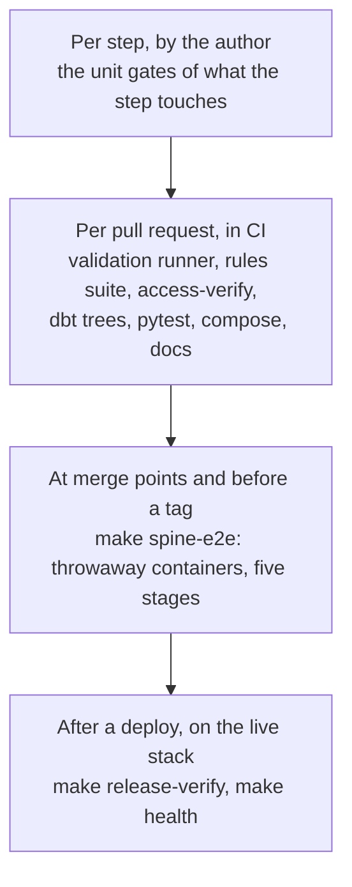

# The spine end to end (`make spine-e2e`)

This is a page of its own, linked from [testing.md](testing.md), because it is a practice
of the project and not one more suite: after every merge into a phase branch and before
every tag, one command proves that the release and rules spine works together.

## What it is

`make spine-e2e` is one command that runs the whole release and rules spine, from the tree
as it is on disk, and prints one line per stage. It starts throwaway containers only (their
names carry a prefix of their own) and never touches the running stack. It exits 0 when
every stage passed. The script is [`scripts/verify/spine-e2e.sh`](../../scripts/verify/spine-e2e.sh).

Terms used below:

- **The spine**: the path a product's definition takes to a deployed, access-controlled
  service: `k2gen` (the contract compiler, `platform/k2gen/`) compiles a git tag into a
  sealed *release* (a directory of generated configuration, rules and SQL); the deploy
  ([ADR-058](../adr/ADR-058-deploy-sealed-releases-by-pointer-swap.md), chapter
  [21](../architecture/21-releases-and-deploy.md)) puts a release on the stack; Trino's
  access rules in it decide who reads what.
- **A throwaway lake**: Postgres, MinIO, Lakekeeper and Trino started for one test on a
  Docker network of their own, from a compiled release, and removed afterwards
  ([`scripts/lib/throwaway-lake.sh`](../../scripts/lib/throwaway-lake.sh)).
- **A merge point**: a merge into a phase branch (for example
  `phase/001-release-and-rules-spine`), or the moment before a tag.

## How it works

The script copies every tracked and untracked, non-ignored file of the current tree into a
scratch git repository under `$HOME` (`k2-spine-e2e.*`; Docker Desktop shares only the home
directory), commits it, and tags it `v0.0.0-e2e.1`. That scratch tag is compiled with
placeholder image digests, so the release it makes can be tested and can never be deployed.
Every later stage reads that one release. Nothing is committed or tagged in your checkout.

| Stage | What it starts | What it proves | A failure means |
|-------|----------------|----------------|-----------------|
| `release` | nothing (k2gen runs in `uv`) | `k2gen docset` and `k2gen release` compile the tree's contracts at the scratch tag | the tree does not compile; every later stage is meaningless |
| `access-verify` | a throwaway lake, prefix `spine-e2e-av` | every row of [`tests/access/expectations.yaml`](../../tests/access/expectations.yaml) holds on that release | a role sees what it should not, or cannot see what it should |
| `test-access` | a throwaway lake, prefix `access-test` | the proofs behind that suite ([`tests/access/prove.sh`](../../tests/access/prove.sh)): a loosened rule fails exactly its row, the drift and marker checks catch their plants, a rules-only release takes effect without a restart, each principal lands in its resource group, and a builder that replaces its base with a view of constants is caught | the verifier itself can no longer fail when it should, which is worse than a failing row |
| `rules` | one throwaway lake, prefix `spine-e2e` | in order, [`trino_rules_test.py`](../../scripts/trino_rules_test.py) `suite` and `negative`, [`trino_rules_c1_test.py`](../../scripts/trino_rules_c1_test.py) (a builder tampering with its base), `control` (destructive, so after C1), then [`identity.sh --throwaway`](../../scripts/verify/identity.sh) (HTTPS, passwords, certificates, rotations) | a rule, a mask, the fence or the login path is wrong on Trino 484 |
| `rehearsal` | compose project `k2-rehearsal` ([`deploy_rehearsal.py`](../../scripts/verify/deploy_rehearsal.py)) | the deploy chain: a first deploy that fails verification then succeeds, a planted view the drift check names, a rules-only release that restarts nothing, a forced mismatch that restores the previous release, `make rollback`, a dropped masked column polled every 50 ms, a kill after each of the deploy's steps then a rerun, two deploys at once, the backup-set refusal | a deploy claim of ADR-058 does not hold |

Times, from the one recorded run (2026-11-27), whose output was `PASS rules 261s`,
`PASS rehearsal 1347s` and a total of `1609 s` for the release, those two and the other two
stages together: the rehearsal is most of it. No file in the repository records the other
stages' times, so none is given. Memory: each throwaway lake refuses to start under 6 GiB
available (`MIN_GIB` in `throwaway-lake.sh`), and the rehearsal under 10 GiB
(`deploy_rehearsal.py`).

## How to use it

```bash
make spine-e2e                      # all five stages
ONLY="rules" make spine-e2e         # one stage again (several: ONLY="rules rehearsal")
KEEP=1 make spine-e2e               # keep the logs
```

`ONLY` works through `make` because make passes its environment to the recipe, which is
`bash scripts/verify/spine-e2e.sh`; the bash form `ONLY="rules" bash scripts/verify/spine-e2e.sh`
is the same run. The release is always rebuilt first, since the other stages read it.

Each stage's output goes to `<log dir>/<stage>.log`, where the log dir is a `k2-spine-e2e.*`
directory under `$HOME`. **The directory is removed when the run ends unless `KEEP=1`** (the
run then prints `spine-e2e: logs in <dir>`). So a run that printed a `FAIL` line is read like
this: the line shows only the last line of that stage's log; rerun the one stage with
`KEEP=1 ONLY="<stage>" make spine-e2e`, open `<log dir>/<stage>.log` and read from the first
`FAIL` line, not the last. The suites' own rows are named (`h1.*`, `c1.*`, `I01` to `I17`), and
the name says which claim broke.

If a run is killed (a closed terminal, `kill -9`), the cleanup trap does not run. Remove what
it left:

```bash
bash scripts/lib/throwaway-lake.sh down spine-e2e        # also spine-e2e-av and access-test
docker compose -p k2-rehearsal down -v                    # the rehearsal's project
docker ps -a --filter name=k2-rehearsal --filter name=spine-e2e   # what is still there
```

then delete the stale `k2-spine-e2e.*` and `s19-rehearsal-*` directories under `$HOME`.

## When to run it

The rule of this project, also in [`CLAUDE.md`](../../CLAUDE.md):

- **Run it** after every merge into a phase branch, and before every tag.
- **Do not run it per step.** For a step, run the tests of what the step touches.
- **It is not in CI.** CI runs the half that is fast enough for every pull request: the
  validation runner (`scripts/verify/ci-validate.sh`: docset, check, trial compile), the rules
  suite (`scripts/trino-rules-test.sh`), `make access-verify` on that release, the dbt trees,
  and the pytest run, which includes the compose fence test
  ([`tests/test_catalog_fence_compose.py`](../../tests/test_catalog_fence_compose.py)).
  `make test-access` and the deploy rehearsal run only here (a comment in
  [`ci.yml`](../../.github/workflows/ci.yml) says so).

The test pyramid of this repository as it is:



## Why it is the practice

On 2026-11-27, with every unit suite green, it caught three integration faults before they
reached the live stack:

1. The destructive control step ran before the C1 rows, so the schema C1 reads was gone: a
   stage-order fault, fixed by the order the `rules` stage now has
   ([`spine-e2e.sh`](../../scripts/verify/spine-e2e.sh), the comment on C1).
2. Three new network-probe rows in [`tests/access/expectations.yaml`](../../tests/access/expectations.yaml)
   made `tests/access/prove.sh` stop at its second step.
3. A catalog fence check ([`scripts/verify/catalog-fence.sh`](../../scripts/verify/catalog-fence.sh))
   failed every deploy's verify.

And the first live deploy ([first-cutover-to-releases.md](../runbooks/first-cutover-to-releases.md):
144 s from the command to verified) worked at the first attempt, after the same path had run
on the rehearsal.

## Alternatives considered

| Alternative | Why not |
|-------------|---------|
| Unit tests and CI only | Cheap, and what runs per step, but each suite sees one piece; all three faults above passed them |
| Testing on the live stack | Finds the fault where it costs most: it can lock out readers or leave a half-deployed release |
| A permanent staging environment | Another stack to keep alive and in step with the first on a single host with a stated 25 CPU / 48 GiB ceiling ([ADR-045](../adr/ADR-045-ceiling-25-cpu-48-gib.md)) |
| All of it in CI on every pull request | The rehearsal alone is most of a 27-minute run, too slow for every pull request; so the cheap half is there and this is the rest |
| A container test framework | One more dependency to pin and learn over what a short shell script and the suites' own named rows already give |

## Known limits

- It takes about 27 minutes (1609 s on 2026-11-27), and the rehearsal is most of it.
- Nothing runs it automatically: a person or the build orchestrator types it.
- It does not cover a fresh install from an empty host (that is the
  `/release-check` skill's fresh-clone gate), and it deploys nothing real: images are placeholders.

Revisit when: the rehearsal alone passes 30 minutes (split or trim it), a second engineer joins
(a required pre-merge check, then), or a nightly runner exists on the host (run it there
instead of by hand).
