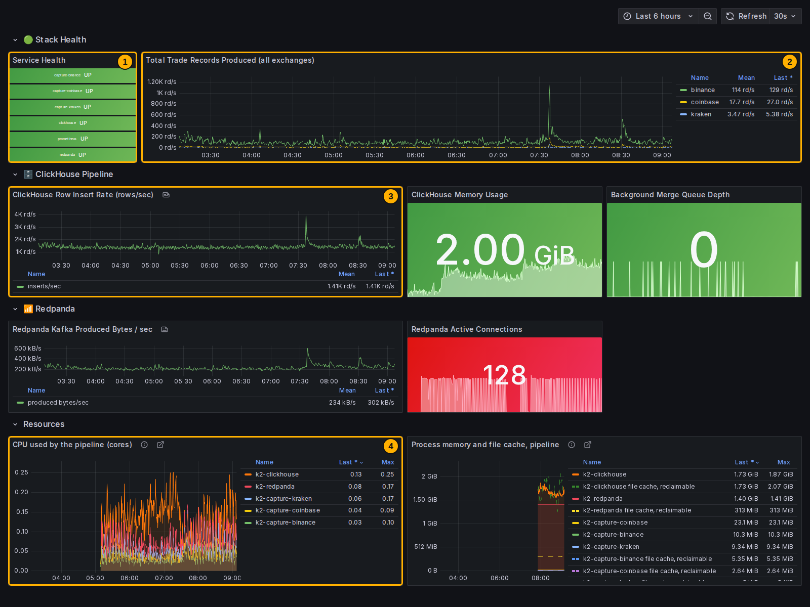
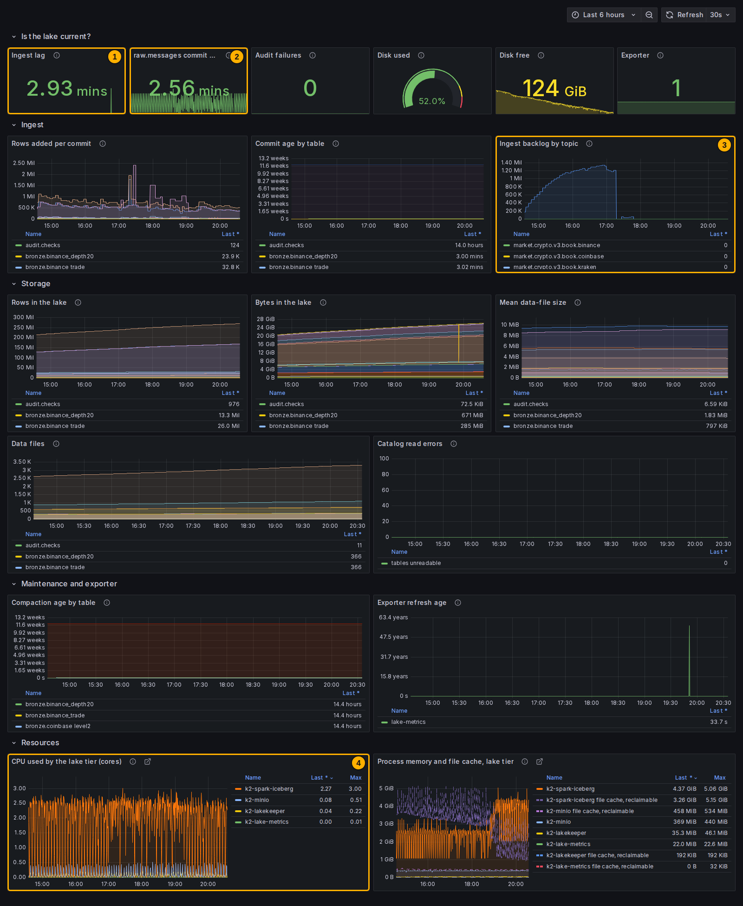
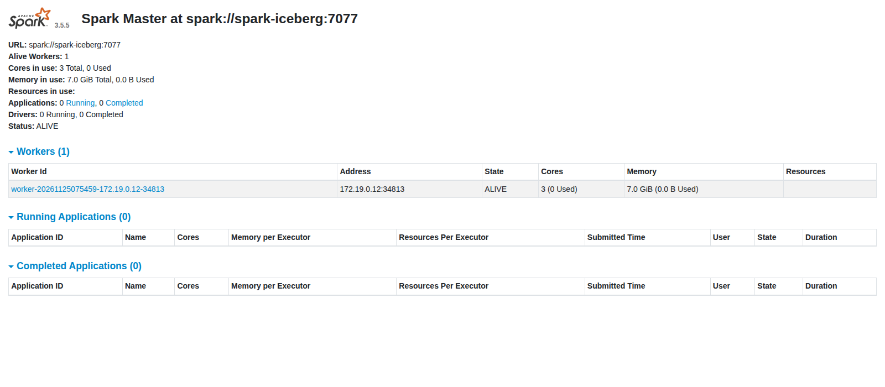
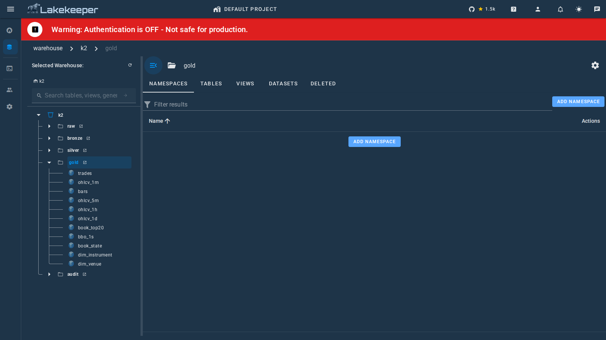
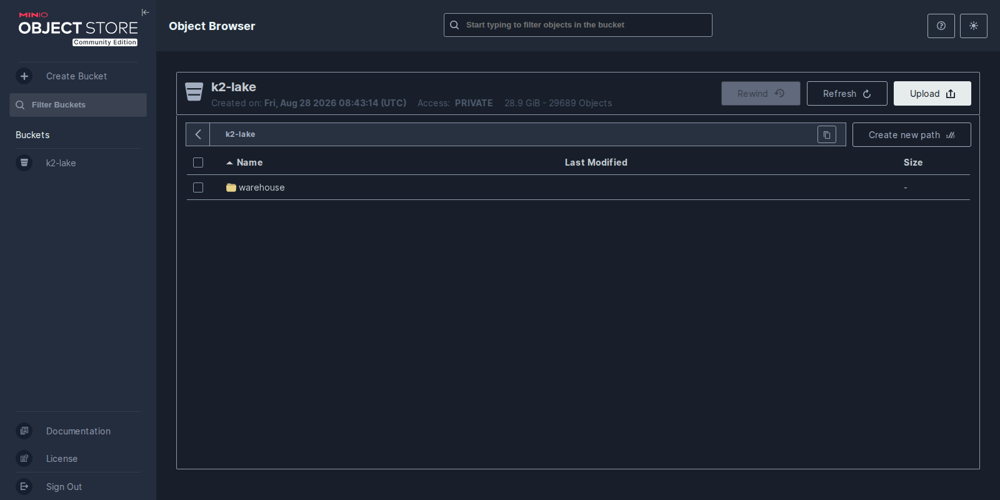
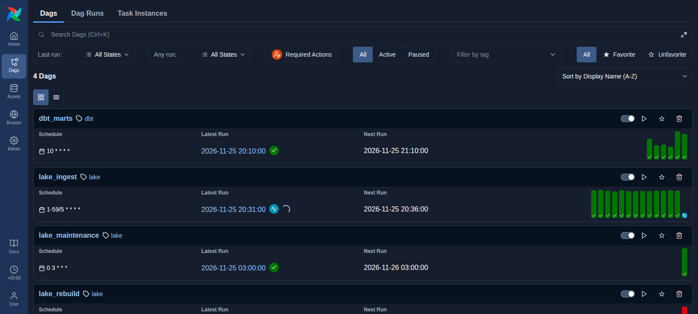
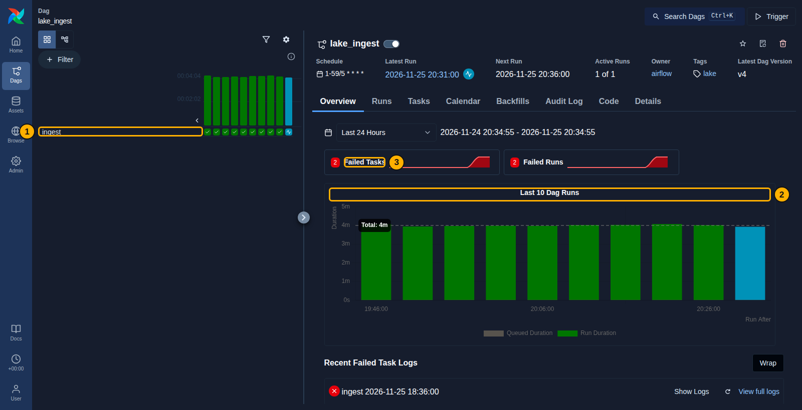
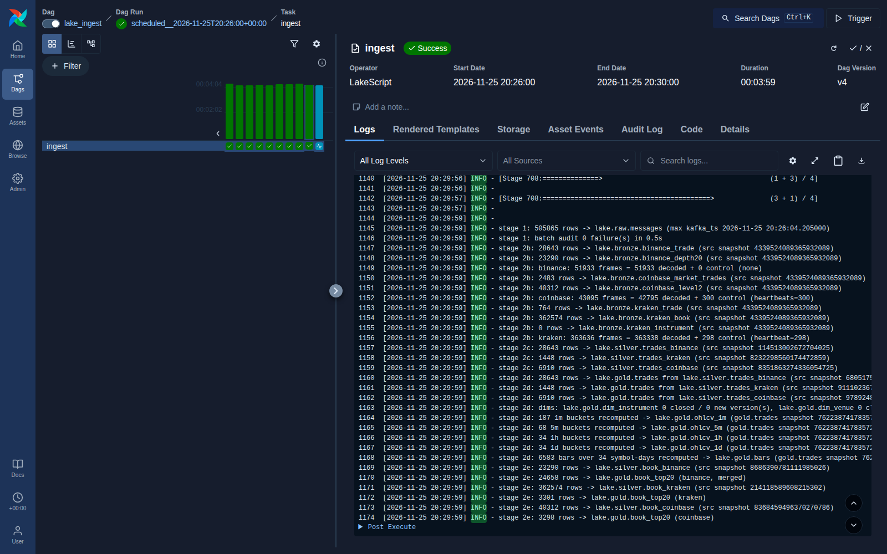
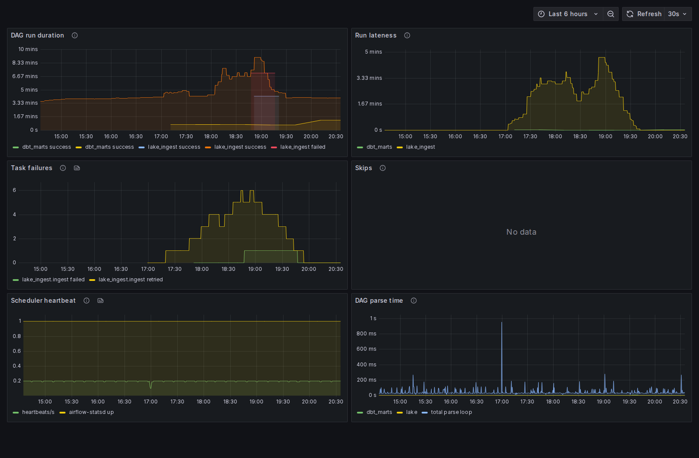
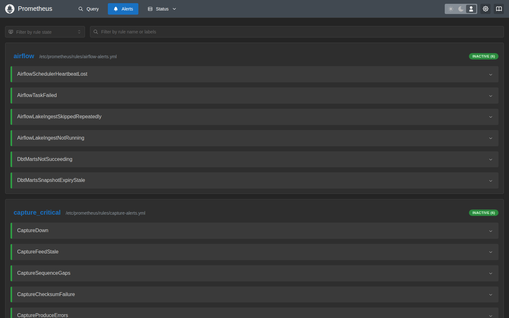

# Dashboards and consoles

<!-- Generated by `make screenshots` from scripts/screenshots/shots.py. Edit there. -->

What each screen of a running K2 stack shows, in the order the data moves: capture, the bus,
the lake, scheduling, alerting, resources. Every image is a picture of a live
run at the date in its caption; the figures in it are venue-derived, true at that moment, and
for illustration only ([data terms](../../README.md#what-this-is-and-data-terms)). Numbered
markers are named under each image.

`make screenshots` recaptures every image and rewrites this page, with the stack up;
`make screenshots ONLY=04-lake` redoes one. Before a release,
`python3 scripts/screenshots/check.py --since <date>` fails on any image missing or older.

## Start here

### K2 Pipeline Overview

*Captured 2026-11-25 at `v3-phase-e-69-g27eb1c5`.* **1** every scrape target, up or down. **2** trade records each venue's capture produced per second. **3** rows the hot tier inserts from Redpanda. **4** CPU each pipeline container uses, from cAdvisor.

The page to open first. All tiles green and three moving lines say capture, the bus and the hot tier are live; the Resources row says what that costs. A line gone flat says which of the pages below to open next.

Open: <http://localhost:3000/d/k2-pipeline-overview>. Leads to: [failure-recovery.md](../runbooks/failure-recovery.md).

## Capture

While order-book capture is paused ([ADR-050](../adr/ADR-050-order-book-capture-paused-during-platform-build.md)), the Book row of the capture
dashboard shows no depth or level data for a venue that is off; its "Book Capture" panel says
which venues those are.

### K2 Capture (v3)

*Captured 2026-11-25 at `v3-phase-e-69-g27eb1c5`.*

Per venue: is the process up, seconds since its last frame, and any reconnects, sequence gaps, checksum failures or resyncs in the last hour. Below, frames and bytes per second, and records produced against records the broker acknowledged: a gap between those two lines is records that never reached Redpanda.

Open: <http://localhost:3000/d/k2-l2-capture>. Leads to: [capture-feed-stale.md](../runbooks/capture-feed-stale.md).

## Bus

### Redpanda Console: topics

*Captured 2026-11-25 at `v3-phase-e-69-g27eb1c5`.*

Every v3 topic, raw, trades and book for each venue, with its partitions and the bytes it holds. Raw is what the lake ingests. Console has no dark theme, so this one is light.

Open: <http://localhost:8080/topics>. Leads to: [redpanda.md](../runbooks/redpanda.md).

## Lake ingest and tables

### K2 Lake (v3)

*Captured 2026-11-25 at `v3-phase-e-69-g27eb1c5`.* **1** age of the newest Kafka record in raw.messages. **2** time since the archive last committed. **3** records the last run left unread, zero when caught up. **4** Spark, MinIO, Lakekeeper and the exporter.

Is the lake current: ingest lag and commit age saw-tooth under the 5-minute schedule, the backlog sits at zero, audit failures at 0. In the Resources row, each ingest is a Spark CPU spike every five minutes.

Open: <http://localhost:3000/d/k2-lake>. Leads to: [lake-ingest-lag.md](../runbooks/lake-ingest-lag.md).

### Spark master

*Captured 2026-11-25 at `v3-phase-e-69-g27eb1c5`.*

The batch engine is up: one worker, its cores and memory. It lists no applications: the lake jobs start their own local-mode driver in this container with `docker exec`, and show up on the Airflow pages instead. Spark's UI has no dark theme.

Open: <http://localhost:18080>. Leads to: [lake-recovery.md](../runbooks/lake-recovery.md).

### Lakekeeper: the gold namespace

*Captured 2026-11-25 at `v3-phase-e-69-g27eb1c5`.*

The Iceberg REST catalog: warehouse k2, its five namespaces (raw, bronze, silver, gold, audit) and the gold tables. The red banner is accurate: the catalog runs without authentication, published on loopback only.

Open: <http://localhost:18181/ui>. Leads to: [lake-recovery.md](../runbooks/lake-recovery.md).

### MinIO: the k2-lake bucket

*Captured 2026-11-25 at `v3-phase-e-69-g27eb1c5`.*

The object store under the lake: bucket k2-lake, its size and object count. Every Iceberg data and metadata file sits under warehouse/; the archive is kept forever, so this size only grows.

Open: <http://localhost:9001/browser/k2-lake>. Leads to: [lake-disk-usage-high.md](../runbooks/lake-disk-usage-high.md).

## Scheduling

### Airflow: DAGs

*Captured 2026-11-25 at `v3-phase-e-69-g27eb1c5`.*

The three lake DAGs: lake_ingest every 5 minutes, lake_maintenance daily at 03:00, lake_rebuild on demand only. Each shows its last run and a strip of recent run states.

Open: <http://localhost:8090/dags>. Leads to: [airflow-scheduling.md](../runbooks/airflow-scheduling.md).

### Airflow: lake_ingest

*Captured 2026-11-25 at `v3-phase-e-69-g27eb1c5`.* **1** the grid: one column per run, coloured by state. **2** run duration of the last ten runs. **3** failed tasks in the last 24 hours.

Each 5-minute ingest run as a column in the grid, beside the duration of the last ten. A run that finds maintenance holding the writer lock exits 75 and shows as skipped, not failed.

Open: <http://localhost:8090/dags/lake_ingest>. Leads to: [airflow-scheduling.md](../runbooks/airflow-scheduling.md).

### Airflow: one ingest run's log

*Captured 2026-11-25 at `v3-phase-e-69-g27eb1c5`.*

The log of the latest successful ingest run: Spark's stage progress, then the topics it read with their schema ids. The first place to look when AirflowTaskFailed fires.

Open: <http://localhost:8090/dags/lake_ingest/runs>. Leads to: [airflow-scheduling.md](../runbooks/airflow-scheduling.md).

### K2 Airflow

*Captured 2026-11-25 at `v3-phase-e-69-g27eb1c5`.*

Run duration and lateness per DAG, task failures and skips, scheduler heartbeat and DAG parse time, from Airflow's statsd metrics. The three Airflow alerts read these series. Skips and failures read "No data" when there were none.

Open: <http://localhost:3000/d/k2-airflow>. Leads to: [airflow-scheduling.md](../runbooks/airflow-scheduling.md).

## Alerting

### Prometheus: alerts

*Captured 2026-11-25 at `v3-phase-e-69-g27eb1c5`.*

Every alert rule, grouped by file, with its state. There is no Alertmanager: this page and Grafana are where a firing alert is seen, and each rule's annotations name its runbook.

Open: <http://localhost:9090/alerts>. Leads to: [README.md](../runbooks/README.md).

### Prometheus: targets

*Captured 2026-11-25 at `v3-phase-e-69-g27eb1c5`.*

Every scrape job and whether its last scrape succeeded. A target down here is the input CaptureDown and LakeExporterDown fire on.

Open: <http://localhost:9090/targets>. Leads to: [failure-recovery.md](../runbooks/failure-recovery.md).

## Resources

### K2 Resources

*Captured 2026-11-25 at `v3-phase-e-69-g27eb1c5`.* **1** declared CPU limits of the running containers, against ADR-045's ceiling. **2** each container's CPU and memory against the limit read from its cgroup. **3** containers their CPU limit is holding back.

What the stack uses against what it declares. Limits are read from each container's cgroup by cAdvisor, so the table follows docker-compose.yml with no edit here. Sustained throttling, or memory near its limit, is a limit to raise, inside the budget that `python3 scripts/check-budget.py` gates.

Open: <http://localhost:3000/d/k2-resources>. Leads to: [docker-resources.md](docker-resources.md).
