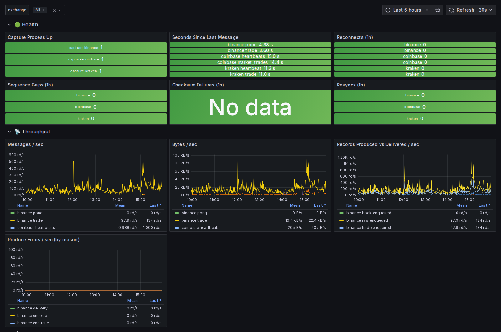
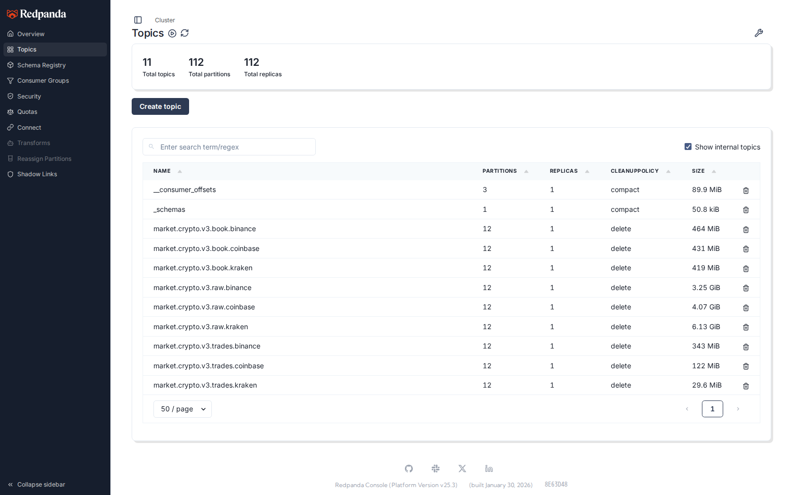
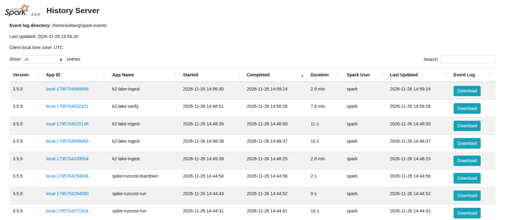
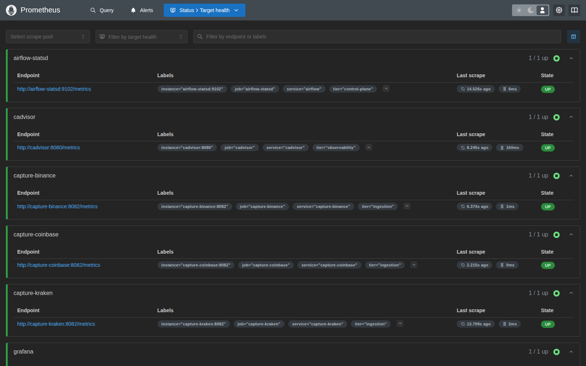
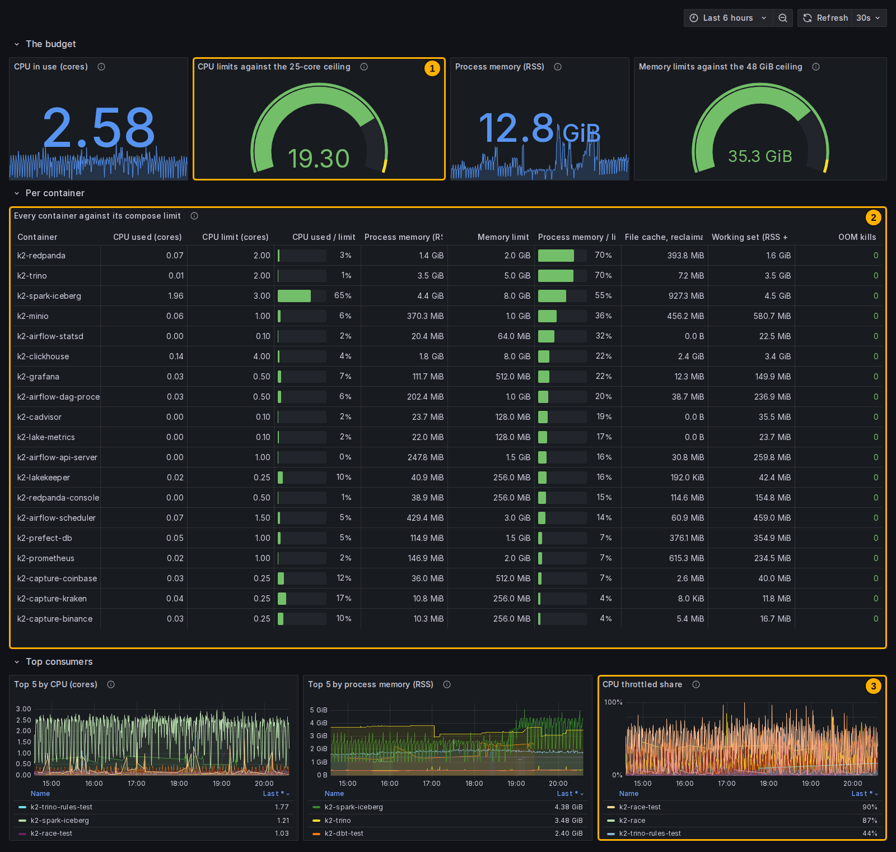

# Dashboards and consoles

<!-- Generated by `make screenshots` from scripts/screenshots/shots.py. Edit there. -->

What each screen of a running K2 stack shows, in the order the data moves: capture, the bus,
the lake, scheduling, alerting, resources. Every image is a picture of a live
run at the date in its caption; the figures in it are venue-derived, true at that moment, and
for illustration only ([data terms](../../README.md#what-this-is-and-data-terms)). Numbered
markers are named under each image.

`make screenshots` recaptures every image and rewrites this page, with the stack up;
`make screenshots ONLY=02-capture` redoes one. Before a release,
`python3 scripts/screenshots/check.py --since <date>` fails on any image missing or older.

## Start here

### K2 Pipeline Overview

*Captured 2026-11-26 at `v3.0.0-alpha.1-58-g3d8495b`.* **1** every scrape target, up or down. **2** trade records each venue's capture produced per second. **3** bytes per second Redpanda accepts from the captures. **4** CPU each pipeline container uses, from cAdvisor.

The page to open first. All tiles green and moving lines say capture and the bus are live; the Resources row says what that costs. A line gone flat says which of the pages below to open next.

Open: <http://localhost:3000/d/k2-pipeline-overview>. Leads to: [failure-recovery.md](../runbooks/failure-recovery.md).

## Capture

While order-book capture is paused ([ADR-050](../adr/ADR-050-order-book-capture-paused-during-platform-build.md)), the Book row of the capture
dashboard shows no depth or level data for a venue that is off; its "Book Capture" panel says
which venues those are.

### K2 Capture (v3)

*Captured 2026-11-26 at `v3.0.0-alpha.1-58-g3d8495b-dirty`.*

Per venue: is the process up, seconds since its last frame, and any reconnects, sequence gaps, checksum failures or resyncs in the last hour. Below, frames and bytes per second, and records produced against records the broker acknowledged: a gap between those two lines is records that never reached Redpanda.

Open: <http://localhost:3000/d/k2-l2-capture>. Leads to: [capture-feed-stale.md](../runbooks/capture-feed-stale.md).

## Bus

### Redpanda Console: topics

*Captured 2026-11-26 at `v3.0.0-alpha.1-58-g3d8495b`.*

Every v3 topic, raw, trades and book for each venue, with its partitions and the bytes it holds. Nothing consumes them while the old lake ingest is retired and ClickHouse is paused; phase 004's connector reads raw again. Console has no dark theme, so this one is light.

Open: <http://localhost:8080/topics>. Leads to: [redpanda.md](../runbooks/redpanda.md).

## Lake

### Spark History Server

*Captured 2026-11-26 at `v3.0.0-alpha.1-58-g3d8495b`.*

The Spark container's finished jobs, newest first, each a local-mode driver started in it by `docker exec`. Open one for its stages, which is where a failed one is read after the fact. Its event-log cleaner keeps two days. No job runs while the old lake ingest is retired. Spark's UI has no dark theme.

Open: <http://localhost:18080>. Leads to: [upgrade-a-pinned-component.md](../runbooks/upgrade-a-pinned-component.md).

### MinIO: the k2-lake bucket

*Captured 2026-11-26 at `v3.0.0-alpha.1-58-g3d8495b-dirty`.*

The object store under the lake: bucket k2-lake, its size and object count. Every Iceberg data and metadata file of every warehouse sits in it. The old pipeline's tables were dropped after a verified copy (`make drop`): no live crypto data lands here until phase 004.

Open: <http://localhost:9001/browser/k2-lake>. Leads to: [lake-backup-and-restore.md](../runbooks/lake-backup-and-restore.md).

## Scheduling

### K2 Airflow

*Captured 2026-11-26 at `v3.0.0-alpha.1-58-g3d8495b`.*

Run duration and lateness per DAG, task failures and skips, scheduler heartbeat and DAG parse time, from Airflow's statsd metrics. The two Airflow alerts read these series. Until phase 002 adds the first product DAG only the heartbeat and the parse loop move; the other panels read "No data".

Open: <http://localhost:3000/d/k2-airflow>. Leads to: [airflow-scheduling.md](../runbooks/airflow-scheduling.md).

## Alerting

### Prometheus: alerts

*Captured 2026-11-26 at `v3.0.0-alpha.1-58-g3d8495b`.*

Every alert rule, grouped by file, with its state. A firing alert also goes to Slack through Alertmanager; each rule's annotations name its runbook.

Open: <http://localhost:9090/alerts>. Leads to: [README.md](../runbooks/README.md).

### Prometheus: targets

*Captured 2026-11-26 at `v3.0.0-alpha.1-58-g3d8495b`.*

Every scrape job and whether its last scrape succeeded. A capture target down here is the input CaptureDown fires on.

Open: <http://localhost:9090/targets>. Leads to: [failure-recovery.md](../runbooks/failure-recovery.md).

## Resources

### K2 Resources

*Captured 2026-11-26 at `v3.0.0-alpha.1-58-g3d8495b`.* **1** declared CPU limits of the running containers, against ADR-045's ceiling. **2** each container's CPU and memory against the limit read from its cgroup. **3** containers their CPU limit is holding back.

What the stack uses against what it declares. Limits are read from each container's cgroup by cAdvisor, so the table follows docker-compose.yml with no edit here. Sustained throttling, or memory near its limit, is a limit to raise, inside the budget that `python3 scripts/check-budget.py` gates.

Open: <http://localhost:3000/d/k2-resources>. Leads to: [docker-resources.md](docker-resources.md).
