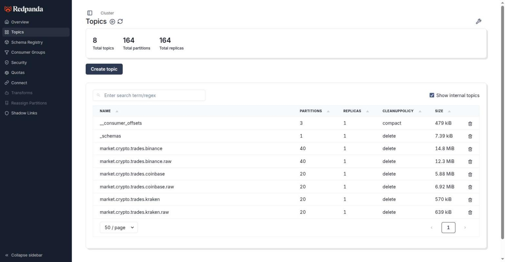

# Observability

Prometheus scrapes the stack, Grafana renders it, and 12 alert rules (10 capture + 2 Airflow)
cover the things that actually break: capture goes down or silent, sequence gaps and book
checksum failures, and the scheduler stops or a task fails.

**The lake is not observed while it receives no live data.** The old lake ingest retired to
[`legacy/v3-lake-ingest/`](../../legacy/v3-lake-ingest/) ([ADR-056](../adr/ADR-056-unified-data-product-platform.md)),
and with it the `lake-metrics` exporter and its scrape job, the 14 rules of `lake-alerts.yml`
and their promtool tests, the K2 Lake dashboard, and the four Airflow rules and two recording
rules that watched the old DAGs: with nothing committing, each would fire for ever or never.
Lake metrics and alerts return in phase `004`, with the first live product.

**ClickHouse is not observed while its hot tier is paused**
([ADR-057](../adr/ADR-057-clickhouse-hot-tier-paused-during-platform-build.md)): its scrape
job, its six alert rules and their promtool tests, the ClickHouse Overview dashboard and the
ClickHouse panels of the pipeline overview were removed, because each would read a server the
pause stops: `ClickHouseDown` would fire for ever and the other five would never fire, having no
series. `scripts/health.sh` step (2) prints one `SKIP` line naming the ADR in place of its
ClickHouse query, and judges each venue from its capture instead (below). They return with the
tier, as the serving copy of a product of the new platform, under that platform's alerts.

- Prometheus, http://localhost:9090 (`/targets`, `/alerts`)
- Grafana, http://localhost:3000, `admin` / `$GRAFANA_PASSWORD`

Config lives in [`docker/prometheus/prometheus.yml`](../../docker/prometheus/prometheus.yml),
[`docker/prometheus/rules/`](../../docker/prometheus/rules/) and
[`docker/grafana/dashboards/`](../../docker/grafana/dashboards/), all provisioned at
container start, no click-ops.

## Scrape targets

| Job | Target | Interval | Source |
|-----|--------|----------|--------|
| `prometheus` | `localhost:9090` | 15s | self |
| `redpanda` | `redpanda:9644` | 10s | Redpanda admin API |
| `grafana` | `grafana:3000` | 15s | Grafana internal metrics |
| `capture-{binance,kraken,coinbase}` | `capture-<x>:8082` | 15s | `k2-capture`, see below |
| `airflow-statsd` | `airflow-statsd:9102` | 15s | Airflow's statsd, through the exporter |
| `cadvisor` | `cadvisor:8080` | 15s | cAdvisor v0.61.1, per-container CPU and memory and each container's cgroup limits, see below |

Port 8082 is **not published to the host**, and the capture image is distroless, no curl,
no shell. Read the series through Prometheus:

```bash
curl -sG localhost:9090/api/v1/query \
  --data-urlencode 'query=sum by (exchange, kind) (rate(k2_capture_records_produced_total[5m]))' | jq
curl -s localhost:9090/api/v1/targets | jq '.data.activeTargets[] | {job: .labels.job, health}'

# Liveness without Prometheus: the binary reads its own /metrics over loopback
docker exec k2-capture-binance /k2-capture healthcheck
```

## Capture metrics

Emitted by [`metrics.rs`](../../services/capture-rust/src/metrics.rs) on `:8082/metrics`,
overridable with `K2_METRICS_PORT`. Every family is `k2_capture_*`; every series an alert
reads is seeded at zero on startup, so a counter's *first* event is detectable.

| Metric | Type | Labels | Meaning |
|--------|------|--------|---------|
| `messages_total`, `bytes_total` | counter | `exchange`, `stream` | Frames and bytes off the WebSocket, per venue subscription |
| `records_produced_total` | counter | `exchange`, `kind=raw\|trade\|book` | Records enqueued into librdkafka's queue |
| `records_delivered_total` | counter | `exchange` | Records the broker actually acknowledged, the one that goes flat in an outage. `make health` step (2) fails a venue with none in the last 2 minutes (`increase(...[2m])`, through Prometheus). Kraken's and Coinbase's heartbeat frames are archived and so delivered, so a quiet market there still counts; Binance archives trade frames only. From 2026-11-24, the oldest sample Prometheus held, to 2026-11-26, the one 2-minute window with nothing delivered was a network outage that cut all three venues (2026-11-26, 14:00 to 14:03 UTC) |
| `produce_errors_total` | counter | `exchange`, `reason` | Records that failed to produce. There is no spill-to-disk, so these are lost |
| `gaps_total`, `resyncs_total` | counter | `exchange` | Sequence continuity broke; book rebuilt |
| `checksum_failures_total` | counter | `exchange`, `symbol` | Kraken CRC32 mismatch. Kraken only, the other two publish no checksum |
| `book_updates_ignored_total` | counter | `exchange`, `symbol` | Kraken `update` frames dropped because the local book is empty — before the first snapshot, or between a mismatch and the resync landing. The width of that dark window |
| `reconnects_total` | counter | `exchange`, `reason=scheduled\|involuntary` | `scheduled` is Binance's 23 h pre-emptive recycle |
| `precision_loss_total` | counter | `exchange`, `reason` | A venue quoted finer than the fixed-point 1e-8 scale |
| `unknown_frames_total` | counter | `exchange`, `stream` | Frames the adapter did not recognise (still archived verbatim) |
| `last_message_ts_seconds` | gauge | `exchange`, `stream` | Per-stream liveness. What `CaptureFeedStale` and `healthcheck` both read; `make health` step (2) runs that `healthcheck` in each capture and fails the venue on a stale stream |
| `exchange_to_recv_seconds` | histogram | `exchange` | Venue stamp → our receive. **Trades only.** Transit + clock skew, not a platform SLO |
| `book_depth` | gauge | `exchange`, `symbol` | Resting levels for one symbol, across **both** sides. `CaptureBookDepthDegraded`'s input |
| `book_levels_total` | gauge | `exchange` | Resting levels summed over every book on that venue |
| `build_info` | gauge | `version`, `git_sha` | `K2_GIT_SHA` at image build; `unknown` if unset |

Metric names are the family above prefixed with `k2_capture_`. There are no
recording rules for this tier.

## Dashboards

Each one as a screenshot of a live run, with numbered callouts, beside the consoles of every
other service: [dashboards.md](./dashboards.md).

| Dashboard | UID | What it shows |
|-----------|-----|---------------|
| K2 Pipeline Overview | `k2-pipeline-overview` | The one to open first. Three rows: stack health (service up/down, trade records produced per exchange), Redpanda (throughput, connections), and the resources of the captures and Redpanda from cAdvisor |
| K2 Capture (v3) | `k2-l2-capture` | The Rust capture tier, now the only ingestion tier: health (up, staleness, reconnects, gaps, checksum failures, resyncs), throughput (messages/bytes/records/produce errors), exchange→recv latency p50/p95/p99, book depth/levels/precision loss. `exchange` template variable filters all panels |
| K2 Airflow | `k2-airflow` | Airflow's statsd series: run duration and lateness per DAG, task failures and skips, scheduler heartbeat and DAG parse time. Until phase `002` adds the first product DAG only the heartbeat and the parse loop move |
| K2 Resources | `k2-resources` | Every running container against its compose limit: CPU and process memory in use against the 25 CPU / 48 GiB ceiling, a table of each container's use, limit and share of it (with file cache, working set and OOM kills columns), the top five consumers, and the share of time each was CPU-throttled. Limits come from the cgroups, not from the dashboard |



## Alert rules

12 alert rules across two files, and no recording rules. **Prometheus loads rule files at start and on SIGHUP only**, after editing anything under `docker/prometheus/rules/`, `docker kill -s HUP k2-prometheus` (or a restart); the rules dir is a mount and the file changing is not enough. Found 2026-08-27 when a ClickHouse rule (since removed, ADR-057) could not fire because its group had never been loaded (`curl -s localhost:9090/api/v1/rules | grep -c <AlertName>` is the check). Every annotation carries the diagnostic commands and a
`runbook:` annotation — enforced by `scripts/check-docs.sh` gate (d2), added
2026-09-03 after the 6 ClickHouse rules were found carrying none while gate (d),
which only checks that the paths present resolve, passed them. The tables below are the index. The three `FeedHandler*` rules retired with
the Kotlin handlers ([ADR-019](../adr/ADR-019-rust-capture-tier.md)); their file is
archived at [`legacy/v2-kotlin/runbooks/feed-handler-alerts.yml`](../../legacy/v2-kotlin/runbooks/feed-handler-alerts.yml)
and `capture-alerts.yml` below is what replaced them. The nine `IcebergOffload*` rules were
deleted outright with the v2 offload path they watched, they described a component that no
longer exists ([ADR-019](../adr/ADR-019-rust-capture-tier.md) Outcome said they would go
with it, and they did). Its six runbooks are archived at
[`legacy/v2-offload/runbooks/`](../../legacy/v2-offload/runbooks/).

### `capture-alerts.yml`: v3 capture tier, the live ingestion path (10)

| Alert | Severity | Fires when |
|-------|----------|-----------|
| `CaptureDown` | critical | Metrics endpoint unreachable for 2m |
| `CaptureFeedStale` | critical | No frames on a *continuous* stream for its own bound, sustained `for: 2m`, 60s for `book`/`depth20`/`l2_data`/`heartbeat(s)`, 300s for `trade`/`market_trades`, the same two numbers `CONTINUOUS` in `main.rs` gives the watchdog and the healthcheck. No `up` guard: a dead target's series are stale-marked, so this alert has no input to fire on and the incident is `CaptureDown`'s by construction |
| `CaptureSequenceGaps` | critical | Any sequence gap in 10m, sustained 5m |
| `CaptureChecksumFailure` | critical | Kraken CRC32 book mismatch in 10m, sustained 5m. Kraken only, Binance and Coinbase publish no checksum and have no series |
| `CaptureProduceErrors` | critical | `increase(k2_capture_produce_errors_total[10m]) > 0` for 5m, any produce error at all; there is no spill-to-disk, so a rate floor would tolerate permanent loss |
| `CaptureProduceStalled` | critical | Enqueueing records but zero **delivered** for 1m, early warning before `CaptureProduceErrors`. `records_produced_total` counts the local enqueue and climbs right through a broker outage; `records_delivered_total` is the one that goes flat |
| `CaptureResyncStorm` | warning | More than 3 book resyncs in 15m, sustained 5m |
| `CaptureIngressLatencyHigh` | warning | Exchange→receive p99 above 2s for 10m, a "something changed" signal, not a latency SLO. **Trades only**, on every venue; no book frame enters the histogram |
| `CaptureBookDepthDegraded` | warning | `max_over_time(k2_capture_book_depth[10m]) < 20` for 10m, the gauge is total levels across **both** sides, so 20 is 10 a side |
| `CapturePrecisionLoss` | warning | A venue quoted finer than the fixed-point 1e-8 scale in the last hour |

These are evaluated against live series. **Two of the ten have been shown to fire on the
fault they name**: `make chaos` ran for the first time on 2026-08-26 and `CaptureDown`
(119–165 s) and `CaptureProduceErrors` (256 s) both fired, with recovery 0–14 s
([`scripts/chaos/results/2026-08-26.tsv`](../../scripts/chaos/results/2026-08-26.tsv)). The
other eight are unproven against a real fault; thresholds move when a run says so, not
before.
`CaptureFeedStale`, `CaptureProduceStalled`, `CaptureBookDepthDegraded` and
`CaptureChecksumFailure` additionally carry `promtool` unit tests in
[`docker/prometheus/tests/capture-alerts.test.yml`](../../docker/prometheus/tests/capture-alerts.test.yml)
(`make check-alerts`); those pin the expression, never the recovery time.

The three `capture-*` scrape jobs set no `exchange` target label, unlike the retired
`feed-handler-*` jobs did: the capture binary emits its own `exchange` on every series,
and a target label of the same name would win and rename the sample's to
`exported_exchange`.
Alerts on capture series get `exchange` from the binary; alerts on `up` name the venue
through `job` (`capture-<exchange>`).

### `airflow-alerts.yml`: the scheduler (2)

From Airflow's statsd metrics through `airflow-statsd` (job `airflow-statsd`), each with
promtool cases in `docker/prometheus/rules/tests/airflow-alerts_test.yml`.

| Alert | Severity | Fires when |
|-------|----------|-----------|
| `AirflowSchedulerHeartbeatLost` | warning | no scheduler heartbeat for 2m, held 3m, or none at all |
| `AirflowTaskFailed` | warning | a task of any DAG ended `failed`, its retries spent, a 15-minute pulse |

### Tested rules

Six of the twelve carry promtool unit tests, run by `make check-alerts` and by
`make check-docs` gate (c2): the four `Capture*` rules above and both Airflow rules.

```bash
grep -rhoE 'alertname: [A-Za-z]+' docker/prometheus/tests/*.test.yml \
  docker/prometheus/rules/tests/*_test.yml | sort -u | wc -l   # 6 on 2026-11-26, after the lake and old-DAG rules retired (24 before)
```

Each case is either "must fire on a synthetic series" or "must not fire on healthy
input": an alert that cannot fire and an alert that always fires are the same bug.

### Container metrics: cAdvisor

The **`cadvisor`** service (`k2-cadvisor`, no published port) reads every container's
cgroup, names it from the Docker API, and serves the result to Prometheus job `cadvisor`.
Three choices keep it cheap: `--enable_metrics=cpu,memory,oom_event`, one housekeeping pass every
15 s instead of every second, and a `metric_relabel_configs` keep-list in
[`prometheus.yml`](../../docker/prometheus/prometheus.yml) that stores ten series names
for the `k2-*` containers and drops the rest, about 200 series in all.

| Metric | Type | What it is |
|--------|------|------------|
| `container_cpu_usage_seconds_total` | counter | CPU time used; `rate()` of it is cores in use |
| `container_cpu_cfs_periods_total`, `container_cpu_cfs_throttled_periods_total` | counter | Scheduler periods, and those in which the CPU limit held the container back |
| `container_memory_working_set_bytes` | gauge | Memory the kernel counts against the limit |
| `container_memory_rss` | gauge | Process memory (anonymous pages): what an out-of-memory kill is about |
| `container_memory_cache` | gauge | Page cache, including files the kernel reclaims under pressure |
| `container_oom_events_total` | counter | Out-of-memory kills cAdvisor saw; see the note below the table |
| `container_spec_cpu_quota`, `container_spec_cpu_period` | gauge | The CPU limit: quota ÷ period is cores, `cpus: '2.0'` reads 200000 / 100000 |
| `container_spec_memory_limit_bytes` | gauge | The memory limit |

Every series carries `name` (the container name, `k2-redpanda`), `image` and `id`. Labels
and names were read from a running v0.61.1 on 2026-11-25, not from the docs. CPU against its
limit, per container:

```bash
curl -sG localhost:9090/api/v1/query --data-urlencode 'query=
  sum by (name) (rate(container_cpu_usage_seconds_total{job="cadvisor"}[2m]))
    / on (name) max by (name) (container_spec_cpu_quota{job="cadvisor"} / container_spec_cpu_period{job="cadvisor"})' \
  | jq -r '.data.result[] | "\(.metric.name)\t\(.value[1])"'
```

It is not privileged and has no `/dev/kmsg`, so `container_oom_events_total` is exposed
(`oom_event` is enabled) but stays 0 even after a kill: the authoritative check is
`docker inspect -f '{{.State.OOMKilled}}' <container>` or the cgroup's `memory.events`.
Every capability is dropped and its root filesystem is read-only. It does hold the Docker
and containerd sockets, which is how a cgroup becomes `k2-redpanda`, and a socket is not
narrowed by `:ro`: that is the same engine-level privilege `airflow-scheduler` holds.

### Reading the memory panels

The resource panels plot **process memory** (`container_memory_rss`) against the limit, and
show **file cache** (`container_memory_cache`, "file cache, reclaimable") as its own series
or column. `container_memory_working_set_bytes` is usage minus inactive file cache, so it
counts active page cache the kernel reclaims under pressure; it stays in the table as
"Working set" but is not the headline percentage. Observed 2026-11-25:

- **MinIO** showed 95 to 97 percent of its 1 GiB limit by working set. Its cgroup
  `memory.stat` had `anon` 371 MiB and `file` 582 MiB (558 MiB of it `active_file`), and
  `memory.events` had `oom 0`, `oom_kill 0`; the container had not restarted. An object store
  that reads and writes files fills whatever cache its cgroup allows. Not a problem.
- **Redpanda** at about 80 percent was real: `anon` 1,439 MiB of 2,048, because it starts
  with `--memory 1500M` and reserves that up front. That is the process memory the limit has
  to hold.

Worry when process memory / limit stays above 90 percent or climbs without levelling, or a
container restarts with exit 137; ignore a large file cache.

## SLOs

| Signal | Target | SLO | Measured |
|--------|--------|-----|----------|
| Exchange → silver latency (p99) | <200 ms | <500 ms | 170–197 ms (2026-02-19, v2 Kotlin path, now frozen), see [latency-budgets.md](./latency-budgets.md) |
| Failure-mode MTTR | <2 min | <5 min | ≤32 s across all 6 modes tested 2026-02-19 on the v2 stack, see [../runbooks/failure-recovery.md](../runbooks/failure-recovery.md). **Capture tier, 2026-08-26**: recovery 0–14 s across five injected faults ([`scripts/chaos/results/2026-08-26.tsv`](../../scripts/chaos/results/2026-08-26.tsv)). The lake tier's four chaos scripts ran on 2026-08-27 ([`scripts/chaos/results/2026-08-27.tsv`](../../scripts/chaos/results/2026-08-27.tsv)) and retired with the old ingest |

## Not wired up

Honest gaps, in priority order:

1. **No Alertmanager.** `alerting.alertmanagers.targets` is empty, alerts are visible in
   the Prometheus UI and Grafana but nothing routes to a pager or Slack.
2. **No exporters for MinIO, PostgreSQL or Spark.** Their health is only observable via
   `docker compose ps` and container logs; cAdvisor gives their CPU and memory, not whether
   they answer.

## Related

- [quick-reference.md](./quick-reference.md), health-check one-liners
- [../runbooks/failure-recovery.md](../runbooks/failure-recovery.md), what to do when one of these fires
- [latency-budgets.md](./latency-budgets.md), the latency targets behind the SLO table
