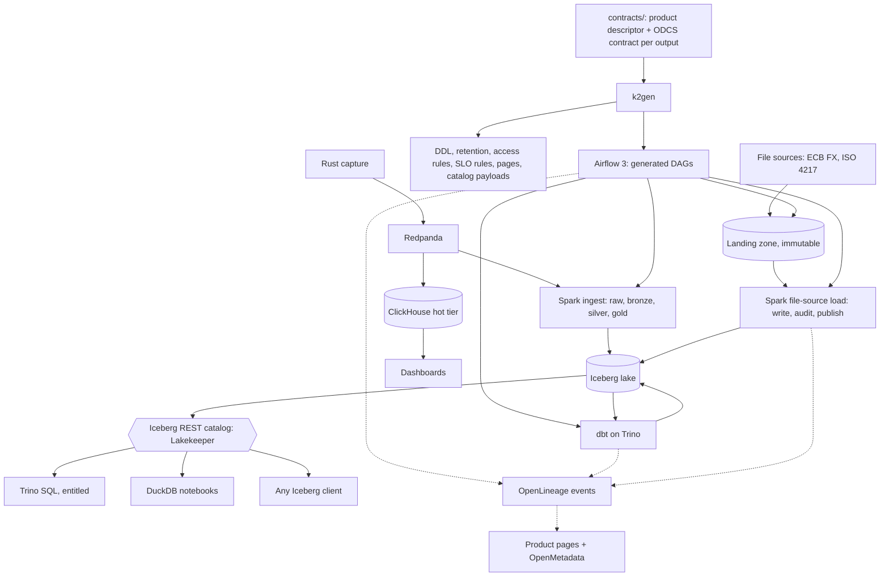

# Plan: K2 as a governed, self-serve platform

> Design document and phase gates. Status lives in ADRs, git tags and CI, not here.

## Context

K2 is a single-team platform that works: Rust capture, Redpanda, a Spark batch ingest into an
Iceberg lake on MinIO under Prefect, a Lakekeeper catalog, and ClickHouse serving gold. What it
does not show is the layer above that: a platform other teams build on. The wire has a contract
(`schemas/avro/`, `tests/test_contracts.py`); a data product does not. There is no paved road
for a new product, no ownership model, no catalog, no compliance evidence, and access control
stops at one read-only ClickHouse profile.

This plan extends K2 in place, crypto domain only, to add that layer: Airflow 3 replacing
Prefect, Trino and dbt marts beside the Spark ingest, a contract-driven generator, four data
mesh domains, lineage and a catalog, layered data quality, entitlements, a controls catalogue,
SLOs, release engineering and a governance document pack. The bar is unchanged: it runs from a
fresh clone, and every claim has a command behind it.

Umbrella decision: [ADR-031](../../adr/ADR-031-governed-self-serve-platform.md).

**Out of scope, and where it goes**

- AWS infrastructure code and the AWS document set: a separate plan, written after this one
  starts. [17-scale-out-path.md](../../architecture/17-scale-out-path.md) remains the cloud
  design until then, and [ADR-028](../../adr/ADR-028-non-goals-and-honest-limits.md) §9
  stays in force.
- Access control at the catalog (an identity provider, Lakekeeper authorisation, short-lived
  storage credentials per table): a separate plan. This plan declares every access point,
  enforces entitlements on Trino, gives consumers a read-only storage key, and says plainly
  what is not yet enforced. ADR-039 records the target.
- Venue-published daily bars as an independent product and a reconciliation of captured
  bars against them: [a follow-on plan](../2026-11-24-venue-reference-bars/README.md),
  started after P6.
- A REST data product API. ADR-028 §6 stays in force for an API; this plan lifts it only for
  SQL serving through Trino.

## Decisions

**Decisions (user-confirmed, 2026-11-24):**

- Airflow 3 replaces Prefect entirely. Cutover is a schedule shadow (Airflow runs the ingest
  in its write-nothing probe mode on the real cron), then a direct switch behind the existing
  writer lock, with Prefect kept as a rollback until the gates hold. A data shadow on an
  Iceberg branch was considered and rejected (Ground truth, "Branches").
- dbt on Trino over the same Iceberg tables. Spark keeps raw to gold, backfill and compaction;
  dbt owns new consumer-aligned marts. One gold aggregate is ported as a parity example.
- Four domains: `market-capture`, `reference-data`, `fx-reference` (new, ECB XML),
  `market-analytics`. The platform team owns the generator, Airflow, Trino, the catalog and
  the controls.
- **The product is the unit.** Each data product has a descriptor (owner, purpose, inputs,
  outputs, lifecycle stage, consumers) and one contract per output in the Open Data Contract
  Standard v3, with K2-only fields as custom properties. A generator (`k2gen`) emits the
  governed artefacts; outputs are committed and CI fails on drift.
- **Existing products at contract depth, FX at full depth.** Every existing table gets a
  descriptor, a contract and a generated page. FX also gets the ingestion pattern, SLOs,
  lineage to the file, a catalog entry and a readiness scorecard.
- **Ingestion is a pattern, not a script.** A file source is declared in its contract and
  runs as a generated Airflow DAG: fetch to an immutable landing zone, load, audit, publish.
  It has two users from the start, ECB FX rates and the ISO 4217 currency list.
- **One catalog, many access points.** The Iceberg REST catalog is the unifying layer. A
  product declares how it is reached: Trino SQL, DuckDB through the notebook helper, the
  ClickHouse hot tier where it is loaded there, and the open catalog endpoint for any
  Iceberg client, so consumers can bring their own engine. Each declared access point is
  smoke-tested.
- **A product is published only when it is ready.** A generated scorecard gates the
  `published` lifecycle stage in CI.
- Layered quality: CI, an audit at ingest, dbt tests on models, reconciliation.
  Write-audit-publish on a branch applies to the FX ingest and fails closed. The
  `raw.messages` ingest gets a per-batch audit that always publishes, records the finding and
  alerts: the system of record must not stall behind its own audit.
- The FX domain is the worked example of the platform improving a product. The source team
  lands ECB reference rates exactly as published. A dbt product built on them adds a
  cross-rate matrix, returns and volatility, an implied stablecoin basis and daily bars
  valued in reporting currencies, behind one reusable conversion macro. Conventions are in
  the phase file and ADR-037.
- OpenLineage for lineage, captured to file in the default stack, dataset level from the
  source file to each access point. Cataloguing has two forms, both must-have: generated
  product pages in the repository, and OpenMetadata behind the `governance` compose profile.
- Classification and entitlement (realtime or delayed) drive access rules on the Trino path.
  A design-only document covers personal data.
- A controls catalogue as code, with daily evidence and a generated report.
- **Resource budget.** The default profile's ceiling is 20 CPU / 36 GiB, counted at the
  bootstrap peak and enforced in CI. The `governance` profile is outside that ceiling and
  needs a Docker engine of 50 GB. The 16 CPU clause of
  [ADR-010](../../adr/ADR-010-resource-budget.md) is superseded by ADR-034.
- **ADR sequencing:** ADR-031 is the Proposed umbrella and reserves 032 to 042. Each decision
  ADR lands Accepted in the pull request that builds it, as
  [the ADR conventions](../../adr/README.md) require.
- **What the repository is, said up front.** K2 is a platform a person runs on their own
  machine for research and quant workflows. The repository ships code, contracts and method.
  Market data is fetched by the user's own stack from each provider's public endpoints, stays
  on that stack, and is subject to that provider's terms. The README says so near the top.
- **The repository ships no real venue market data.** Existing capture fixtures are replaced
  by synthetic frames in each venue's format. New sample files are synthetic and labelled,
  except where a provider's terms allow reuse with attribution (the ECB file). A `NOTICE`
  lists every third-party data file and states that the MIT licence covers the code.
- **Market-derived numbers live on the platform.** Documents and ADRs describe the method and
  give the exact query or script; quality results, reconciliation results and statistics
  computed from market data are read from platform tables, a Grafana dashboard in the default
  stack, and the catalog. Numbers about the platform's own behaviour (throughput, latency,
  gap counts) stay in dated benchmarks as before.
- **A verification index** at `docs/verification-index.md`: one row per component, each with
  its evidence and the command that shows it.
- **Documents for people who run or adopt the platform**, not an organisational pack: a
  solution design, a design review checklist, an adoption guide, and a guide to which tool
  does what.
- New text carries no em-dashes. New ADRs use the status `Accepted` and the landed line uses a
  comma. Existing documents are not swept: Accepted ADRs are immutable.

## Ground truth

Verified against `main` at `abdc804`.

**Orchestration**

- Two Prefect flows exist: `lake-ingest` (`docker/lake/flows/lake_flows.py:108`, cron
  `1-59/5 * * * *`, `deploy_lake.py:47`) and `lake-maintenance` (`lake_flows.py:113`, cron
  `0 3 * * *`, `deploy_lake.py:73`). Both are a `docker exec` into `k2-spark-iceberg`
  (`lake_flows.py:63`). Audits, including the nightly candle and bar parity
  (`docker/lake/maintenance.py:560`, `:594`), run inside maintenance. Metrics is an exporter;
  rebuild is a script (`Makefile:89-90`).
- Mutual exclusion is a `flock`, not the orchestrator (`docker/lake/lock.py:17-31`). An ingest
  that finds the lock held exits 2 (`ingest.py:498-507`). Exit 2 is also what Python returns
  for a missing script and what argparse returns for a bad flag, so 2 cannot be mapped to
  "skipped" safely.
- `ingest.py --probe` reads the topics, writes nothing and does not take the lock
  (`ingest.py:492-499`).
- Exactly-once state is in the Iceberg snapshot summary (`docker/lake/offsets.py:34-53`,
  commit at `ingest.py:325-332`). Nothing about data position lives in Prefect.
- `prefect-db` also hosts the Lakekeeper catalog database (`docker-compose.yml:592-593`,
  `docker/postgres/ddl/10-lakekeeper-db.sql:24`). The role and database inside existing
  volumes are named `prefect` (`.env.example:23-25`).
- `lake-metrics` runs on the Prefect worker image (`docker-compose.yml:760-778`), reads only
  REST metadata, and has a 128M limit (`docker/lake/metrics.py:16-27`).
- Schedule pause and resume is scripted against the Prefect CLI
  (`scripts/chaos/lib.sh:169-240`), used by `scripts/lake-verify.sh` and four chaos scripts.
  `scripts/health.sh:109-138` reads Prefect run history over an unauthenticated REST call.
- `git grep -li prefect` outside `legacy/` and the dated document surfaces returns 52 files.

**Branches**

- Resume reads every snapshot of the table, on any ref, and takes the newest with
  `k2.job == ingest` (`docker/lake/catalog.py:23-28`, `offsets.py:274-277`). A commit to any
  branch of `raw.messages` would therefore move where `main` resumes, and `main` would skip
  offsets. The exporter (`metrics.py:249-252`), `scripts/lake-verify.sh:123`,
  `notebooks/k2lake.py:84` and `scripts/parity_ohlcv.py:66-69` use the same newest-snapshot
  rule.
- No branch is written anywhere today. The only ref read is `main` (`catalog.py:32-43`).
- Consequence for this plan: no branch is ever written on a table the ingest resumes from.
  Branches are used only on the new FX tables, and `k2lake.pin()` is fixed to follow `main`
  before the first one is written.

**Budget**

- Declared steady state is 14.60 CPU / 25.625 GiB across 15 services; bootstrap peak 16.10 CPU
  / 27.125 GiB across 19 (`docker compose --env-file .env.example config`, matching the latest
  Outcome in ADR-010). Limits are in GiB (`docs/operations/docker-resources.md:46-49`).
- The Docker engine on the reference host reports 42,051,227,648 bytes, which is 39.16 GiB,
  and 28 CPUs (`docker info`).
- CI fails a service with no limits but does not check the sum, and does not see services
  behind a profile (`.github/workflows/ci.yml:141-156`).
- Host port 8080 is published by `redpanda-console` (`docker-compose.yml:127`).
  `scripts/dev-up.sh:31-46` remaps a port only when it is busy before `up`, so it cannot
  resolve a clash inside the compose file.
- Stale today: the compose summary lists `spark-iceberg` at 4G (`docker-compose.yml:1008`,
  limit is 8G at `:555`); required engine memory is 28 GB in `docs/development/setup.md:10`
  and 24 GB in `docs/runbooks/fresh-install.md:18`; `README.md:86` says 27 ADRs.

**Lake and contracts**

- `docker/lake/ddl/lake.sql` declares columns, comments, partitioning and sort order.
  Identifier fields are also held in Python (`bronze.py:86`, `silver.py:153`, `gold.py:68`,
  `books.py:126`). Namespaces: `raw`, `bronze`, `silver`, `gold`, `audit`
  (`docker/lake/init-lake.sh:122`).
- Only `lake.sql` is ever applied (`docker/lake/apply_ddl.py:24`), and the Spark container
  mounts only `./docker/lake` (`docker-compose.yml:528`). Generated files the lake jobs read
  must live under that directory.
- Two near-identical DDL column parsers exist in tests (`tests/test_wire_format.py:33`,
  `tests/test_lake_scd2.py:205`).
- `gold.ohlcv_1m` is one SQL `GROUP BY` (`docker/lake/gold.py:316`). Its three-way parity
  check compares open, high, low, close, trade count and volume (`scripts/parity_ohlcv.py:149`).
- Audits write `lake.audit.checks` (`maintenance.py:685-760`). The offset-continuity audit is
  a whole-table scan, run nightly only (`offsets.py:296-299`).
- Retention values are CLI defaults (`maintenance.py:765-772`) with floors (`:775-778`).
  Expiry and orphan removal loop over hard-coded table lists (`:169`, `:249`). The seven-day
  floor exists because a child layer resumes from its parent's snapshot id (`:163-166`).
- Lakekeeper is `v0.13.3`, unauthenticated, no credential vending
  (`docker-compose.yml:621-639`, `init-lake.sh:89`). MinIO has root keys only. DuckDB, Spark
  and ClickHouse all read the lake with those keys.
- Spark 3.5.5, Iceberg 1.8.1, base image pinned by digest (`docker/spark/Dockerfile:18`).
  Jars are baked and sha256-pinned (`:49-61`). The image has no pip layer.
- Python has no root project. `notebooks/` is the pattern for a self-contained package.

**Drift between the places a product is described**, the problem ADR-031 starts from:

| Place | Says | Actually |
|---|---|---|
| `docs/operations/data-catalog.md:191-193` | candle ordering at `gold.py:310,313` | it is at `gold.py:328,331` |
| `docker/lake/gold.py:93-94` | `test_wire_format` checks the dimension columns | the check is `tests/test_lake_scd2.py:227` |
| `lake.sql:1312` and `data-catalog.md:288` | a short list of audit check names | `maintenance.AUDITS` emits more |
| `docker/lake/README.md:18` | the unified bronze pair exists | dropped (`lake.sql:107-109`) |
| `docker-compose.yml:1008` | `spark-iceberg` limit 4G | 8G (`:555`) |
| `docs/architecture/A1-technology-stack.md:75` | no query engine beyond ClickHouse and Spark SQL | notebooks use DuckDB |

**Documents and gates**

- `scripts/check-docs.sh` has eight failing gates. Gate (a) resolves every relative markdown
  link. Gate (b) rejects four words (`:60`). Gate (c) runs `promtool check rules` over
  `rules/*.yml`; rule tests are globbed from `rules/tests/*_test.yml` (`:70-99`).
- CI runs `pytest tests` with no stack (`ci.yml:68-69`); `tests/test_contracts.py:21` states
  that as the rule for that suite.
- The highest ADR is 030. Architecture chapters run 00 to 17 plus A1.
- [ADR-008](../../adr/ADR-008-eliminate-prefect-orchestration.md) rejected Airflow as heavier
  than Prefect (`:100-104`). [ADR-006](../../adr/ADR-006-spark-batch-only.md) rejected Trino
  as a replacement for Spark in batch ETL (`:202-207`).
- [ADR-029](../../adr/ADR-029-research-production-parity-contract.md) requires a second and
  third computation for every materialised product (`:61-62`).
- ADR-028 non-goals this plan touches: FX (§4), a serving layer beyond ClickHouse SQL (§6),
  auth (§8), error budgets, whose trigger is a recorded window of 24 h or more (§10), schema
  automation (§11), a retention policy (§12). A lifted limit needs a new ADR and an appended
  Outcome there (`:285`).
- The `release-check` skill still queries the dropped `k2.silver_trades`
  (`.claude/skills/release-check/SKILL.md:44-50`).

## Target architecture



Principles the diagram encodes:

- **The contract is the interface.** A product author writes a descriptor and its contracts. Everything
  governed about the product is generated from it, committed, and checked for drift.
- **One writer path per layer.** Spark writes raw to gold, FX and `governance`. Trino writes
  tables only in `marts`, and views in `governance`. Neither writes the other's namespaces.
- **The orchestrator holds no data state.** Offsets stay in the Iceberg snapshot
  ([ADR-022](../../adr/ADR-022-exactly-once-via-snapshot-offsets.md)); Airflow schedules and
  observes.
- **Existing DDL stays the record.** Contracts for existing tables reference `lake.sql` and
  are validated against it. The generator emits DDL only for new products.
- **One catalog, many engines.** Tables are open Iceberg behind one REST catalog. Serving is
  not a service in front of the data; it is the set of declared, tested ways to reach it.
- **The default stack proves the claim.** Product pages, lineage capture, entitlements and
  controls work without the `governance` profile; the interactive catalog needs it.

## The onboarding path, with FX as the example

The plan's through-line is what a team does to publish a new product, shown once for real.

| Step | What the team does | What the platform does | Phase |
|---|---|---|---|
| Declare | Writes a descriptor and contracts: schema, owner, classification, SLOs, source URL, access points | Validates against the standard and against upstream classifications; scaffolds from `make new-product` | P1 |
| Ingest | Adds a parser of a few dozen lines | Generates the DAG; fetches to the landing zone by hash; loads behind write-audit-publish | P4 |
| Process | Writes dbt models and tests | Supplies generated sources, the conversion macro, the calendar, CI lint and unit-test runs | P3, P4 |
| Assure | Declares quality rules | Runs them, records results in one place, alerts with a runbook | P3, P4 |
| Trace | Nothing | Emits lineage at every hop; each row carries its source file hash; one command walks a value back to the file | P5 |
| Serve | Declares access points | Generates access rules; smoke-tests every access point; documents bring-your-own-engine | P5 |
| Catalogue | Nothing | Generates the product page; loads domain, product, owner, lineage and quality into the catalog | P1, P5 |
| Publish | Sets the lifecycle stage to `published` | Blocks it in CI until the readiness scorecard passes | P6 |

## Engineering standards

Each standard names what enforces it. A standard with no check is a preference.

| Standard | Enforced by |
|---|---|
| Generated files are never edited by hand | CI drift check: regenerate, then no diff and no untracked file |
| Ingestion is idempotent and replayable | Landing objects keyed by content hash; merges keyed on natural keys; a re-run test per source asserts zero new rows (P4) |
| The system of record never stalls behind a check | Batch audit records and alerts; only late-tolerant sources fail closed |
| dbt is layered: staging, intermediate, marts; marts never read sources | SQL lint with layer rules and `dbt parse` in the CI `dbt` job (P3) |
| Every model has a declared grain and a uniqueness test | A check in the CI `dbt` job that fails a mart with no uniqueness test (P3) |
| Derived numbers have a second computation or a hand-computed unit test | `make parity-ohlcv`, `make parity-bars`, `make parity-fx`; dbt unit tests |
| Python in the generator is typed and tested | ruff, a type checker and pytest in CI |
| A contract change is versioned | `k2gen check-compat` fails a breaking change without a major bump |
| A product has one accountable owner | `CODEOWNERS` per `contracts/<domain>/`; readiness scorecard |
| Least privilege by default | Consumers get a read-only storage key; Trino roles from contracts; no root key in any consumer recipe |
| Every image and package is pinned; every service declares limits | The CI limits check extended to the budget sum, and a check that fails an image with no tag or a dependency with no version (P0) |
| Every alert has a runbook that was run | Existing docs gates (d) and (d2) |
| Every published number has a command behind it | `/benchmark-report`, which records the command per row |
| The repository ships no market data | Sample files are synthetic or attributed in `NOTICE`; a CI check fails a data file under a samples directory that is neither (P0) |
| Market-derived figures live on the platform, not in documents | Documents give the method and the query; review, and the P0 sweep of existing documents |

## Phases

| File | Phase | Scope | Exit |
|---|---|---|---|
| `000-prerequisites-guardrails.md` | P0 | Stack up, README scope and data terms, synthetic fixtures, `make gates`, budget gate, lock exit code, Lakekeeper patch, stale facts | `make gates` green on the live stack; CI budget gate live |
| `001-contracts-generator-mesh.md` | P1 | Product descriptors and ODCS contracts for every existing product, `k2gen`, generated product pages, four domains | drift check clean in CI |
| `002-airflow-replaces-prefect.md` | P2 | Airflow 3, schedule shadow, cutover, Prefect archived | `make gates` green under Airflow; Prefect only where listed |
| `003-trino-dbt-marts.md` | P3 | Trino, dbt project and first marts, ingest batch audit, quality results | dbt and Spark `ohlcv_1m` agree on the compared columns |
| `004-fx-data-product.md` | P4 | File-source ingestion pattern with two users (ECB rates, ISO 4217); dbt FX product: crosses, returns, volatility, stablecoin basis, bars in reporting currencies | `make parity-fx` passes; a bad FX file never reaches `main` |
| `005-access-lineage-catalog.md` | P5 | Access points and bring-your-own-engine, access rules, retention as code, lineage, catalog | `delayed_reader` denied on `gold.trades` through Trino; lineage events asserted |
| `006-controls-slos-release.md` | P6 | Controls catalogue, readiness scorecard, SLO rules, release engineering, drills | `make compliance-report` renders from real evidence |
| `007-governance-pack-release-gate.md` | P7 | Design and adoption documents, verification index, fresh-clone gate | `/release-check` passes from a fresh clone |

Order is dependency, then risk. P0 exists because three later phases would otherwise each
discover the same broken guardrail. Each phase file lists its pull requests; an ADR lands in
the pull request that builds its decision.

**Must-have and stretch.** Everything in the phase files is must-have except three items, cut
in this order if time runs out: blue/green dbt deploys, the DR drill benchmark,
the chaos extensions. A control whose evidence
source was cut reports "not applicable" with the reason, never a pass. Never cut: the
failure-mode tests, the runbooks, the provenance of a published number.

**Estimate.** Twelve to thirteen working days for the must-have path, live-stack gates included.
This is a judgement, not a measurement.

**Resource budget.** Limits to declare, estimated; each phase measures and records the real
figures in its ADR.

| Change | CPU | GiB | Phase |
|---|---|---|---|
| Today, steady state | 14.60 | 25.625 | |
| Prefect server and worker removed | -1.50 | -1.500 | P2 |
| Airflow api-server | +1.00 | +1.500 | P2 |
| Airflow scheduler (LocalExecutor, parallelism 4) | +1.50 | +3.000 | P2 |
| Airflow dag-processor | +0.50 | +1.000 | P2 |
| statsd exporter | +0.10 | +0.064 | P2 |
| Postgres, more connections | 0 | +0.500 | P2 |
| Trino, single node, heap capped | +2.00 | +4.000 | P3 |
| **Default profile, steady** | **18.20** | **34.189** | |
| One-shots: the four existing and an Airflow migrate | +2.00 | +2.500 | |
| **Default profile, bootstrap peak** | **20.20** | **36.689** | |
| `governance`: OpenMetadata server, search engine, ingestion, Postgres | +2.50 | +5.500 | P5 |
| `governance` one-shot: migrate | +0.50 | +1.500 | P5 |
| **With governance, bootstrap peak** | **23.20** | **43.689** | |

The default bootstrap estimate is 0.20 CPU and 0.7 GiB over the ceiling. P2 and P3 must trim
to fit (the existing one-shots are the first place to look) or the pull request fails its own
gate. No Airflow triggerer: nothing in this plan is deferrable.

## Verification (end-to-end)

```bash
make up && make health
make gates            # test, lake-verify, parity-ohlcv, parity-bars, check-alerts, check-docs
make generate && test -z "$(git status --porcelain)"
make lint
docker exec k2-airflow-scheduler airflow dags list
docker exec k2-airflow-scheduler airflow dags test dbt_marts
bash scripts/entitlements-verify.sh
make compliance-report
```

Then `/release-check` on a fresh clone. With a 50 GB engine:
`docker compose --profile governance up -d`.

## Risks / verify-first

| Unknown | Spike | Escape hatch |
|---|---|---|
| Lakekeeper 0.13.3 is behind its own patch line, which carries ref-handling fixes | P0: move to the newest 0.13.x, run `make gates` | Stay on 0.13.3; FX write-audit-publish becomes a staging table swapped by rename |
| Branch write and fast-forward from Spark 3.5.5 with Iceberg 1.8.1, on a scratch table; readers see only `main` | First task of P4 | The staging-table swap above |
| Trino Iceberg REST connector against Lakekeeper: warehouse name, views, DuckDB reading a Trino-written table | First task of P3 | Delayed product as a scheduled dbt table; pin an older Trino |
| MinIO object locking on the landing bucket behaves as the S3 feature it stands in for | P4: create the bucket locked, try to overwrite | Versioning without a lock, with the hash in the object key as the guard |
| An existing validator covers the ODCS v3 schema, so `k2gen` need not carry its own | P1: validate one contract with the standard's published JSON Schema | `k2gen` vendors that schema file and validates with it directly |
| The close-ratio basis estimator holds on the lake's own bars as it did on public candles (median error about one basis point) | P4: compare with a directly traded USDT/USD over the lake's history | Restrict to the most liquid assets; fall back to the flagged peg |
| Decimal typing differs across Trino versions: division and multiplication scales | P3: pin the version, `typeof` on a cross and a product | Cast explicitly at every arithmetic step |
| The newest Airflow 3 release is weeks old; cosmos and the OpenLineage provider may trail it | P2: pin the newest release cosmos supports outside beta | Pin one minor back |
| dbt and Airflow dependencies clash in one image | P3 | Run dbt in its own container through `docker exec`, as Spark is |
| `quote_volume` precision differs between Spark and Trino decimals | P3: `typeof` on both sides | Leave it out of the compared columns and say so |
| OpenLineage Spark listener memory in a 2g driver that has hit OOM before | P5: measure peak RSS with it on | Dataset lineage from dbt and Airflow only; Spark at job level |
| One Spark write and one dbt model produce one lineage edge in OpenMetadata | P5, before the service is added to compose | Marquez for the lineage graph, with the generated product pages as the catalog; ADR-038 records it |
| Each engine reaches the catalog with a read-only storage key: PyIceberg, DuckDB, Spark | P5: one read per engine with the consumer key | Drop the engine from the supported list and say so |
| One Postgres at 1 CPU serves Lakekeeper, Airflow and later the catalog | P2: cap connections per role, measure | A second Postgres for the governance profile |
| A `docker exec` timeout kills the client, not the Spark driver, which keeps the lock | P2 | Timeout handler kills the recorded driver PID inside the container |
| Fresh-clone time grows well past the measured 15 minutes ([fresh-install](../../runbooks/fresh-install.md)) | P7 | Publish the measured time |
