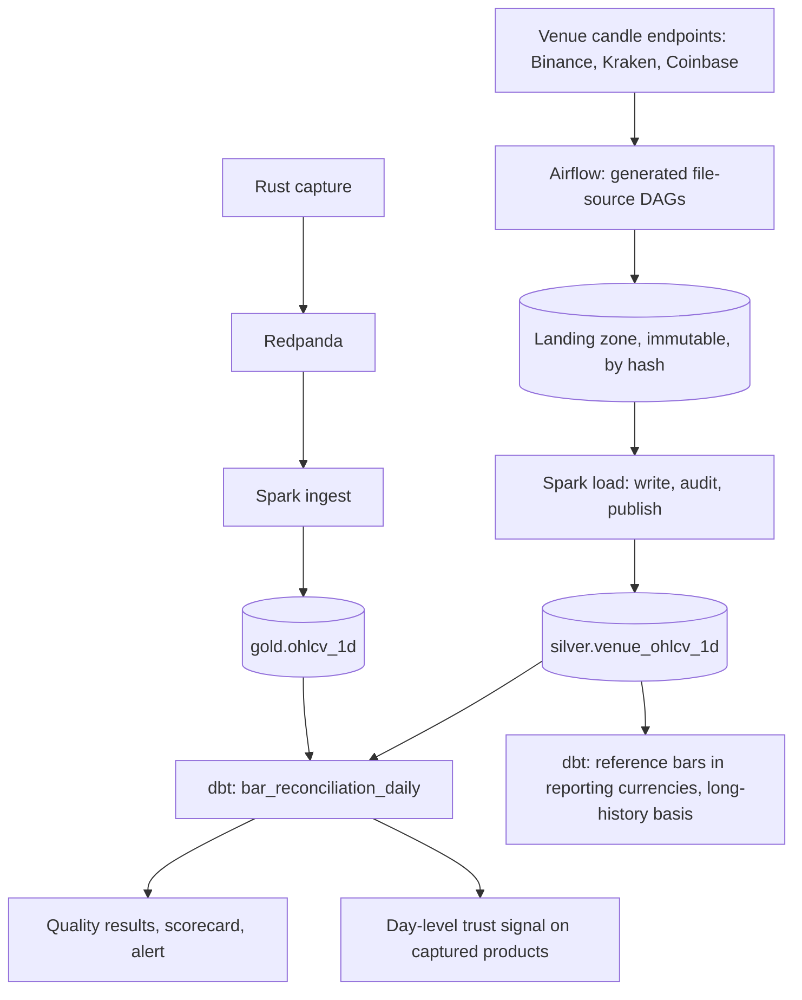

# Plan: venue-published daily bars as an independent product and a validation source

> Design document and phase gates. Status lives in ADRs, git tags and CI, not here.

## Context

K2 builds its bars from the trades it captures. Every check it has today compares K2 with
itself: three engines computing the same candle from the same captured trades
([ADR-029](../../adr/ADR-029-research-production-parity-contract.md)). That proves the
arithmetic. It cannot prove the capture was complete, because a trade that never arrived is
missing from all three sides.

Each venue also publishes its own daily candles, computed from its own record. Fetched by a
separate pipeline, they are an independent pricing source: a product in their own right for
anyone who wants daily bars and no tick data, and a reference to hold K2's captured bars
against. A researcher pulling trades or minute bars for a symbol and day can then check one
flag first: did that day reconcile to the venue's own figures.

This plan follows
[the governed self-serve platform plan](../2026-11-24-governed-self-serve-platform/README.md)
and starts after its P4, whose file-source ingestion pattern, dbt project and quality results
it reuses. It adds no service and no budget.

## Decisions

**Decisions (user-confirmed, 2026-11-24):**

- A separate pipeline. Its own DAGs, landing paths and tables. It shares no code path with
  streaming capture, so a fault in one cannot hide in the other.
- An independent pricing source: each venue's published daily candles, not K2's trades.
- Two roles, both first-class: a standalone product, and a validation dataset.
- Daily grain only.
- On a mismatch: record it, score it, alert on it. Captured data is never edited from the
  reference, and the reference is never merged into `gold`.
- **Reconciliation is published, not kept as an operations detail.** It is a data product
  in the catalog like any other: owner, contract, lineage, page. Every captured product's
  page shows its reconciliation record, good and bad. Where the platform's data disagrees
  with a venue, or cannot be compared, the catalog says so.
- Venue history from before capture began is loaded as part of the reference product,
  labelled as venue-published, and gives the FX analytics years of history.
- [ADR-028](../../adr/ADR-028-non-goals-and-honest-limits.md) §5 is lifted only this far. Its
  stated reason for refusing venue REST data is that it would plant rows in `raw.messages`
  that look captured and are not (`:126-135`). Reference bars live in their own tables. The
  captured history still starts when capture started, and gaps stay gaps. A new ADR,
  numbered when written, records this with an appended Outcome on ADR-028.

## Ground truth

Repository facts verified against `main` at `abdc804`. Venue facts fetched 2026-11-24 with no
key and a generic client; each names its URL.

**What K2 has to compare**

- `gold.ohlcv_1d` carries open, high, low and close as fixed-point integers at 1e-8, exact
  base `volume` and `quote_volume`, `trade_count`, and the first and last trade times
  (`docker/lake/ddl/lake.sql:921-935`). Buckets are UTC days from the venue's own trade
  timestamp, not the receive time (`docker/lake/gold.py:316-336`).
- Capture subscribes to individual trades on all three venues: Binance `@trade`
  (`services/capture-rust/src/exchanges/binance.rs:1`), Kraken `trade` (`kraken.rs:164`),
  Coinbase `market_trades` (`coinbase.rs:118`). Gold keeps one row per venue trade id
  (`docker/lake/gold.py:68`). So trade count is comparable, not only price.
- Binance pairs are quoted in USDT; Kraken and Coinbase pairs in USD
  (`config/instruments.yaml`).

**What the venues publish**

| | Binance | Kraken | Coinbase |
|---|---|---|---|
| Endpoint | `data-api.binance.vision/api/v3/klines`, interval `1d` | `api.kraken.com/0/public/OHLC`, interval `1440` | `api.exchange.coinbase.com/products/<id>/candles`, granularity `86400` |
| Day boundary | 00:00 UTC | 00:00 UTC | 00:00 UTC |
| Per request | 1,000 days | 720 committed days plus the day in progress; `since` cannot reach further back | 300 days |
| History for BTC | from 2017-08-17 | 720 days by this endpoint | from 2015-07-20 |
| Open, high, low, close | yes | yes | yes |
| Base volume | yes | yes | yes |
| Quote volume | yes | no (a volume-weighted price instead) | no |
| Trade count | yes | yes | no |
| Number format | strings, 8 decimals | strings | JSON numbers, not strings |
| Quirks | bulk files exist too, with checksums, under a non-commercial share-alike licence | response key differs from the request (`XBTUSD` returns `XXBTZUSD`; `DOGE` is `XDG`); last row is uncommitted | a `User-Agent` header is required; responses cached five minutes; "may be incomplete" per its own documentation |

- Binance's endpoint and its bulk file for 2026-11-22 agree on every field (open 60215.78,
  close 61271.08, 4,694,484 trades). The endpoint is used for both the daily run and the
  history load, which keeps the bulk dataset's licence out of the question.
- Kraken's endpoint and its quarterly archive agree for 2026-09-29. The full archive is five
  parts of about 2 GB each on `assets.kraken.com`.
- Terms: Binance's bulk dataset terms are quoted above. Kraken's general terms restrict
  automation against its content in broad words while it publishes this API for the purpose.
  Coinbase's terms pages refused a scripted fetch and are unread. No venue's terms were found
  to grant redistribution.

Consequences taken from the terms: requests are few and slow (one per symbol per day);
nothing fetched from a venue is committed to the repository; the product is classified
`internal`; sample files for tests and fresh clones are synthetic and say so.

## Target architecture



Principles:

- **Two paths that meet only at the comparison.** The left path never reads captured data;
  the right path never reads venue candles. They join in one dbt model and nowhere else.
- **A reference is evidence, not a repair.** It can say a captured day is short. It cannot
  fill it.
- **Open about quality.** A consumer finds a product's known gaps in the same place they
  find its schema, before they query it, not after.
- **Tolerances are measured, then set.** The first run compares every captured day and
  publishes the distribution of differences. Thresholds come from that, not from a guess.

## Phases

| File | Phase | Scope | Exit |
|---|---|---|---|
| `000-venue-bars-product.md` | V0 | The ingestion pattern extended to paged JSON sources; three venue sources; the `venue_bars` product | Each venue's bar for a completed day lands and equals a direct fetch of the same day |
| `001-reconciliation-and-trust-signal.md` | V1 | Reconciliation as a catalogued product, measured baseline, tolerances, alert, day-level trust signal | A day with deliberately removed trades is flagged; the baseline is published |
| `002-history-and-reference-analytics.md` | V2 | History load; reference bars valued in reporting currencies; long-history stablecoin basis | History loads through the audits; the long-history basis agrees with the captured-bar basis on overlapping days |

Estimate: three to four working days. A judgement, not a measurement.

## Verification (end-to-end)

```bash
docker exec k2-airflow-scheduler airflow dags test venue_bars_binance
docker exec k2-airflow-scheduler airflow dags test venue_bars_kraken
docker exec k2-airflow-scheduler airflow dags test venue_bars_coinbase
docker exec k2-airflow-scheduler airflow dags test dbt_marts
make reconcile-bars
make access-verify
make generate && test -z "$(git status --porcelain)"
make gates
```

## Risks / verify-first

| Unknown | Spike | Escape hatch |
|---|---|---|
| A bar rebuilt from the public trade stream differs from the venue's candle even with nothing missed (trade types a candle includes, prints at the day boundary) | V1, first task: reconcile every captured day and read the differences before setting any threshold | Per-venue, per-field tolerances; a field that never agrees is reported as not comparable, with the reason |
| A venue's terms forbid this use on a closer reading | Before V0 merges: read each venue's terms in a browser and record the wording in the ADR | Drop that venue from the product; the others stand |
| A venue blocks the host's region or a scripted client | V0: fetch from the stack itself, not a laptop | Binance's alternate host; otherwise drop the venue and say so |
| Kraken history beyond 720 days needs a 10 GB archive | V2 | Kraken reference history stays at 720 days and the product page says so |
| Coinbase candles are "incomplete" by its own description and carry no trade count | V1: measure how often its volume differs | Coinbase reconciles on price only |
| The ingestion pattern needs paged, per-symbol requests it was not built for | V0, first task | A venue-specific fetch task behind the same landing, audit and publish steps |
