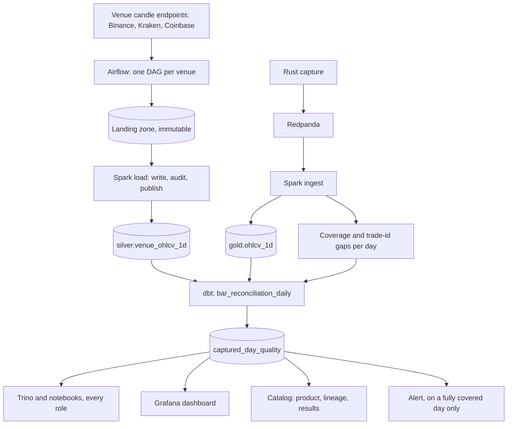

# Plan: venue-published daily bars as an independent product and a validation source

> Design document and phase gates. Status lives in ADRs, git tags and CI, not here.

## Context

K2 builds its bars from the trades it captures. Every check it has today compares K2 with
itself: three engines computing the same candle from the same captured trades
([ADR-029](../../adr/ADR-029-research-production-parity-contract.md)). That proves the
arithmetic. It cannot prove the capture was complete, because a trade that never arrived is
missing from all three sides.

Each venue also publishes its own daily candles, computed from its own record. Fetched by a
separate pipeline, they are an independent pricing source: a product in their own right for
anyone who wants daily bars and no tick data, and a reference to hold K2's captured bars
against. A researcher pulling trades or minute bars for a symbol and day can then check
first whether that day reconciled.

This plan follows
[the governed self-serve platform plan](../2026-11-24-governed-self-serve-platform/README.md)
and starts after its P6: it reuses the file-source ingestion pattern (P4), access points
(P5) and the scorecard and quality results (P6). It adds no service and no budget.

## Decisions

**Decisions (user-confirmed, 2026-11-24):**

- A separate pipeline. Its own DAGs, landing paths and tables. It shares no code path with
  streaming capture, so a fault in one cannot hide in the other.
- An independent pricing source: each venue's published daily candles, not K2's trades.
- Two roles, both first-class: a standalone product, and a validation dataset.
- Daily grain only.
- On a mismatch: record it, score it, alert on it. Captured data is never edited from the
  reference, and the reference is never merged into `gold`.
- **Reconciliation is published on the platform, as a product.** It is in the catalog like
  any other: owner, contract, lineage. Its data and results live in platform tables, are
  readable by every role, and are shown on a dashboard in the default stack. They are never
  written into the repository. Where captured data disagrees with a venue, or cannot be
  compared, the platform says so, with the size of the difference.
- **Everything here runs on the user's own stack.** The repository ships the pipeline, the
  contracts and the method. Venue data is fetched by the user from public endpoints under
  that venue's terms, stays local, and no venue value or venue-derived figure is committed.
- Venue history from before capture began is loaded as part of the reference product,
  labelled as venue-published.
- The decision is recorded as ADR-043, written in V0.
  [ADR-028](../../adr/ADR-028-non-goals-and-honest-limits.md) §5 refuses venue REST backfill
  for two reasons (`:126-135`): keys, which do not arise with public endpoints, and that a
  REST record planted in `raw.messages` would look captured and is not. ADR-043 lifts the
  clause for reference tables only, by the owner's decision rather than by §5's own trigger.
  Captured history still starts when capture started, and gaps stay gaps.
- This is a reconciliation against an external source, not a second computation in the sense
  of ADR-029 §3, which is unchanged.

## Ground truth

Repository facts verified against `main` at `abdc804`.

**What K2 has to compare**

- `gold.ohlcv_1d` carries open, high, low and close as fixed-point integers at 1e-8, exact
  base `volume` and `quote_volume`, `trade_count`, and the first and last trade times
  (`docker/lake/ddl/lake.sql:921-935`). Buckets are UTC days from the venue's own trade
  timestamp (`docker/lake/gold.py:316-336`). Buckets are recomputed when late trades land.
- Capture subscribes to individual trades on all three venues: Binance `@trade`
  (`services/capture-rust/src/exchanges/binance.rs:1`), Kraken `trade` (`kraken.rs:164`),
  Coinbase `market_trades` (`coinbase.rs:118`). Gold keeps one row per venue trade id
  (`docker/lake/gold.py:68`).
- The lake already measures completeness from inside: `k2lake.completeness()` returns
  sequence gaps and trade ids never received (`notebooks/k2lake.py:216-268`).
- Captured history is intermittent by nature on a single host: the lake was rebuilt on
  2026-08-28 and capture has been stopped for long stretches
  (`docs/audits/2026-09-03-ux-end-to-end.md:68`, `:196-201`). Most captured days are
  partial days. A comparison that ignores that would flag nearly all of them.
- The ingest runs every five minutes and maintenance at 03:00 UTC
  (`docker/lake/flows/deploy_lake.py:47`, `:73`).

**What the venues publish.** Working notes from fetches made on 2026-11-24 while planning.
V0 opens by recording the command behind each fact in a research note; until then these are
not citable.

| | Binance | Kraken | Coinbase |
|---|---|---|---|
| Endpoint | `data-api.binance.vision/api/v3/klines`, interval `1d` | `api.kraken.com/0/public/OHLC`, interval `1440` | `api.exchange.coinbase.com/products/<id>/candles`, granularity `86400` |
| Day boundary | 00:00 UTC | 00:00 UTC | 00:00 UTC |
| Request shape | start and end times; 1,000 days a request | `since` only, no end; at most 720 committed days plus the day in progress | start and end; 300 days a request; a `User-Agent` is required |
| Stable on re-fetch | yes, for a closed day | no: every response includes the moving in-progress row | yes, for a closed day |
| Fields beyond open, high, low, close, base volume | quote volume, trade count | trade count, volume-weighted price | none |
| Numbers | strings | strings | JSON numbers |
| Symbols | as in the registry | the registry's native names are accepted and echoed as the result key | as in the registry |

- For one completed day, a bar rebuilt from the venue's own public trades equalled the
  venue's candle on every published field for Binance and for Kraken, trade count included.
- For Coinbase it did not. On the day checked, the candle's open, close and volume could not
  be reproduced from Coinbase's own trade list by any window; high and low agreed. Its own
  documentation calls the candles possibly incomplete. So a perfect capture would still
  disagree with a Coinbase candle on open, close and volume.
- Venue terms differ and change (two of the three were revised in the last three months).
  They are read at the start of V0 and recorded in ADR-043.

## Target architecture



Principles:

- **Two paths that meet only at the comparison.** The left path never reads captured data;
  the right path never reads venue candles. They join in one dbt model and nowhere else.
- **A reference is evidence, not a repair.** It can say a captured day is short. It cannot
  fill it.
- **Exact where exact is possible.** Where a venue's candle is the sum of its trades, the
  tolerance is zero. Where it is not, the field is reported as not comparable rather than
  given a tolerance wide enough to hide a hole.
- **Say what kind of day it was.** A day the stack was off is a partial day, not a breach.
  The comparison knows the difference, and only a fully covered day can alert.
- **Open on the platform.** Every comparison, its status and its size is readable by every
  role. The repository holds how it is computed, not what it found.

## Phases

| File | Phase | Scope | Exit |
|---|---|---|---|
| `000-venue-bars-product.md` | V0 | Terms read and ADR-043; three venue sources on the ingestion pattern; the `venue_bars` product | Each venue's bar for a completed day lands and equals a direct fetch of the same day |
| `001-reconciliation-and-trust-signal.md` | V1 | Reconciliation as a catalogued product; day states and coverage; alert; dashboard; trust signal in the notebook helper | Removing one trade from a fully covered day is detected; a day the stack was off is reported as partial, not as a breach |
| `002-history-and-reference-analytics.md` | V2 | History load; stretch: a long-history stablecoin basis | History loads through the audits with each symbol's first day and gaps recorded |

Must-have: V0, V1 and the history load. Stretch: the long-history basis.

Estimate: four working days. A judgement, not a measurement.

## Verification (end-to-end)

```bash
docker exec k2-airflow-scheduler airflow dags test venue_bars_binance
docker exec k2-airflow-scheduler airflow dags test venue_bars_kraken
docker exec k2-airflow-scheduler airflow dags test venue_bars_coinbase
docker exec k2-airflow-scheduler airflow dags test dbt_marts
make reconcile-bars
make access-verify
make generate && test -z "$(git status --porcelain)"
make gates
```

## Risks / verify-first

| Unknown | Spike | Escape hatch |
|---|---|---|
| A venue's terms do not allow this local use on a careful reading | V0, first task: read each venue's terms and quote them in ADR-043 | Drop that venue from the product; the others stand |
| The exact match seen for Binance and Kraken on one day holds across symbols and days | V1, first task: compare every fully covered captured day before fixing any rule | A field that does not hold exactly is reported as not comparable, with the reason; no tolerance is introduced to make it pass |
| Coinbase candles are unusable for open, close and volume, as one day suggests | V1, same task | Already the design: one-sided high and low only, and trade-id gaps as the evidence |
| A venue restates a closed day's candle | V0: store the first value, count later differences | The count is shown per venue; if common, the comparison waits a day |
| Per-day capture coverage can be derived from what the lake already stores | V1, first task: connection spans in bronze and gap rows in `audit.checks` | Coverage from trade-id continuity alone, stated as weaker |
| A venue blocks the host's region or a scripted client | V0: fetch from the stack itself | Binance's alternate host; otherwise drop the venue and say so |
| Three third-party endpoints change shape over time | V0: a parse failure alerts with a runbook | The venue's DAG is paused and its days show as reference unavailable |
