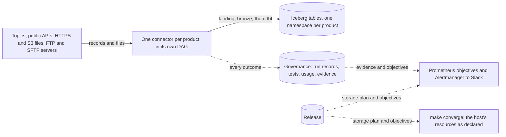

# Plan: the unified data product platform, from the demo tag to release

> Design document and phase gates. Status lives in ADRs, git tags and CI, not here.

## Context

This plan starts where [the plan to the demo tag](../2026-11-26-unified-product-platform/README.md)
ends, at `v3.0.0-beta.1`: releases and deploy, the rules and identity, the run path, ECB FX,
Kraken with the security master, an enriched product across three domains, the catalog site,
lineage, usage and the complete REST API all exist and are shown live. What remains for `v3.0.0`
is breadth and assurance: the connector kinds not yet built, the other two crypto venues,
alerting on objectives and the controls catalogue, the host's infrastructure declared as code,
the hardening the phase audits deferred, and a release gate from a fresh clone.

It implements the same decision, [`ADR-056-unified-data-product-platform.md`](../../adr/ADR-056-unified-data-product-platform.md), toward the
target in [`20-target-data-product-platform.md`](../../architecture/20-target-data-product-platform.md); the reasoning is in
[`2026-11-26-unified-platform-architecture.md`](../../research/2026-11-26-unified-platform-architecture.md). Together with the plan to the demo
tag it supersedes phases P4 to P7 of the
[governed self-serve platform plan](../2026-11-24-governed-self-serve-platform/README.md).
Review findings cited as F*n* are from
[`FULL-PLAN-REVIEW.md`](../../research/2026-11-26-unified-platform-architecture/FULL-PLAN-REVIEW.md). Terms are defined in
the first plan's README and the [ADR glossary](../../adr/glossary.md).

**After 3.0, not in this plan.** The definition registry comes first: versions, approvals and
history in the existing Postgres; an API that runs the validation runner and records the
approver; a UI; the document-set adapter reading an approved version; an export to git. Its exit
is a product entered in the UI compiling byte-identical to the same documents from git. Beside
it, the readiness for AI agents that 3.0 leaves unblocked: a Model Context Protocol server
querying as the caller through k2-api and Trino, and a W3C DCAT export. A cloud deployment is
its own plan.

## Decisions

**Decisions (owner-confirmed, 2026-11-26).** Every decision in
[the first plan](../2026-11-26-unified-product-platform/README.md#decisions) holds here. Those
this plan acts on:

- Order after the demo tag: remaining connector kinds; wider crypto; controls, alerts and release
  engineering; infrastructure as code for this host; hardening; the release gate and `v3.0.0`.
  All four connector kinds are proven before the crypto venues widen.
- Infrastructure as code covers this host only, fully proven: declared, checkable, one command
  shows drift, one converges. A cloud deployment is its own plan after 3.0.
- Alerts go to a Slack channel through an incoming webhook (wired in the first plan's release
  spine). The backup copy stays on this host for the lab; the owner revisits it at the release
  gate.
- The platform is a lab until the release gate; production rules apply from the `v3.0.0` tag,
  and `make drop` refuses in production.
- At the release gate the owner is asked about the `legacy/` layout and the lakehouse mode.
- If late, the date moves; quality and order do not.

**Open, and the phase that needs each answer:**

| Decision | Options | Needed by |
|---|---|---|
| The off-host backup destination | A second disk or an object store; the backup copy stays on the host for the lab | `004` builds the copy and timer against a destination setting; `005` lists a copy at the destination the owner names |
| The `legacy/` layout and the lakehouse mode | Asked of the owner, as the open-items ledger records | `005` |

The open decisions of the first plan (FX content, landing retention, the demo reset and the
others in its table) are all needed before the demo tag, so none is open when this plan starts.

## Ground truth

Verified against `main` at `64a07c2`, 2026-11-26. The first plan's ground truth holds; these
facts are this plan's own.

- `main` is already protected: 13 required checks, administrators included
  (`gh api repos/{owner}/{repo}/branches/main/protection`), so the release gate checks
  protection rather than turning it on (F23).
- Prometheus runs `prom/prometheus:v3.2.0` (`docker-compose.yml:327`).
- The Postgres service is still named `prefect-db` (`docker-compose.yml:482`) and hosts the
  Lakekeeper and Airflow databases.
- Drafts this plan resolves: ADR-042 versioning and ADR-051 telemetry (#225); ADR-052 backup and
  ADR-053 recoverable deletes and guards (#227).
- [ADR-049](../../adr/ADR-049-event-bars-extended-not-recomputed.md) is Proposed.
- The 2026-11-26 research on the order-book pause found `bronze.binance_trade` unreadable through
  Trino, because its fields differ only by case
  ([research note](../../research/2026-11-26-order-book-capture-pause.md)).
- [ADR-028](../../adr/ADR-028-non-goals-and-honest-limits.md) section 10 (no error budgets) has a
  trigger of a recorded window of 24 hours or more; the controls phase lifts it with an Outcome.

## Target architecture

The target is the first plan's diagram and principles, unchanged. This plan adds no new box to
it: the remaining connector kinds run in the same fetch container, the other venues are
documents on the same connectors, and alerting, controls and infrastructure code read what the
release and the governance tables already hold.



## Phases

| File | Phase | Scope | Exit | Tag |
|---|---|---|---|---|
| [`000-remaining-connector-kinds.md`](000-remaining-connector-kinds.md) | Remaining connector kinds | `sftp`, `ftp` with TLS, `s3-file`; test servers under a `test` profile; a short SFTP CSV product to silver | each kind's DAG runs; an unknown host key fails; no network needed by `make test-connectors` | `v3.0.0-beta.2` |
| [`001-widen-crypto.md`](001-widen-crypto.md) | Widen crypto | Coinbase, then Binance, trades and instruments; `canonical-trades` and candles over three venues; `event-bars`; `venue-books` paused; `venue-quality` on run records; new parity pins | parity and `product-verify` per venue; no file names an old venue table outside the archive | `v3.0.0-beta.3` |
| [`002-controls-alerts-release-engineering.md`](002-controls-alerts-release-engineering.md) | Controls, alerts, release engineering | Objective and burn-rate alerts; a duration alert; the controls catalogue and compliance report; the version in `make health`; the Prometheus image upgraded | a generated alert reaches Slack; `make compliance-report` renders from evidence | `v3.0.0-beta.4` |
| [`003-infrastructure-as-code-this-host.md`](003-infrastructure-as-code-this-host.md) | Infrastructure as code, this host | The host's buckets, keys, warehouses, namespaces, topics, roles and catalogs declared; check and converge | the check is empty on a converged host and names one change after a hand edit | `v3.0.0-beta.5` |
| [`004-hardening.md`](004-hardening.md) | Hardening | Deferred findings; off-host backup copy and timer; Iceberg and Lakekeeper upgrades with dated triggers; recoverable deletes; telemetry; Lakekeeper off the superuser; `prefect-db` renamed | every finding resolved or given a dated trigger | `v3.0.0-beta.6` |
| [`005-release-gate.md`](005-release-gate.md) | Release gate | Fresh clone from empty; the restore drill again; production mode; the governance pack, traceability, compliance report, golden paths, README tour; `/benchmark-report` | `/release-check` passes from a fresh clone | `v3.0.0` |

Order is dependency, then risk: the connector kinds and the venues reuse the run path unchanged,
so they come first and surface any gap in it; the controls need every product to collect
evidence from; the infrastructure code needs the final set of resources; hardening takes what
the phase audits deferred; the gate proves the whole from nothing. The phases map to the
architecture's codes in [the first plan's mapping table](../2026-11-26-unified-product-platform/README.md#phases).

**Days.** The architecture's judgement, not a measurement: connector kinds 3, wider crypto 6,
controls and alerts 4, infrastructure as code 2, hardening 6, the release gate 5. Alert delivery,
image digests and the compatibility check moved into the first plan, and the controls catalogue
moved here, after that judgement was made. No calendar date is promised; the first plan's
release and rules spine gives the measured pace these figures are re-judged from, in place.

**Budget.** Only the telemetry of ADR-051, if the hardening phase accepts it, adds long-running
services; that pull request records their limits in an ADR-010 Outcome line. The SFTP and FTPS
test servers run under the `test` profile, outside the default budget and counted by
`python3 scripts/check-budget.py` when that profile is active. Every figure stays under the
25 CPU / 48 GiB ceiling of [ADR-045](../../adr/ADR-045-ceiling-25-cpu-48-gib.md).

## Verification (end-to-end)

First `/release-check`, the skill that clones the repository to a temporary directory and brings
the stack up from nothing. Then on the live stack:

```bash
make deploy RELEASE=v3.0.0 && make release-verify
make test
make check-docs
make access-verify
make api-verify
make demo                                         # the release smoke test
make converge CHECK=1                             # no drift on the converged host
make restore-drill                                # stops the live stack, restores, product-verify passes
make drop TARGET=k2.scratch DRY_RUN=1             # refused: production mode
gh api repos/{owner}/{repo}/branches/main/protection --jq '.required_status_checks.contexts'
```

## Risks / verify-first

| Unknown | Spike | Escape hatch |
|---|---|---|
| SFTP and FTPS test servers from a Debian base, pinned by digest, behave like real servers for host keys and TLS | First pull request of `000` | A test server image used by the clients' own test suites, pinned by digest |
| Binance's and Coinbase's instruments endpoints carry the fields the security master needs (their field names are not yet confirmed) | First pull request of `001`, one call each, field names only | Their pairs mapped from the capture's instrument list through the reviewed exceptions seed, stated as a limitation on the page |
| Binance's case-only twin fields (`e` and `E`, `t` and `T`, `m` and `M`) read through Trino once bronze renames them | `001`, on a fixture frame | Bronze stores the payload as one JSON string and silver extracts the fields |
| An infrastructure-as-code tool's providers for MinIO, Redpanda, Lakekeeper and Trino are mature enough to check without changing | `003`, a check run against the converged host | The release's storage plan, which deploy already computes, extended to topics, keys and roles, with its own check mode |
| A restore drill that stops the live stack restores within the window the runbook states | `005`, rehearsed on a throwaway compose project first | Publish the measured time and the recovery point, whatever they are |
| A fresh clone takes much longer than the 15 minutes measured on 2026-08-28, before Airflow, Trino and the new services ([fresh install](../../runbooks/fresh-install.md), lines 71 and 91) | `005` | Publish the measured time |
