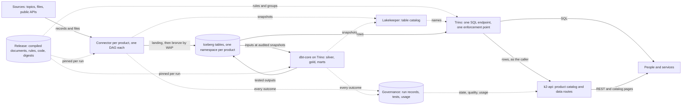

# Plan: the unified data product platform, to the demo tag

> Design document and phase gates. Status lives in ADRs, git tags and CI, not here.

## Context

K2 today is one pipeline. Rust capture writes to Redpanda; one Spark job, `lake_ingest`, reads
every venue's topic and writes every layer of the lake, from the shared `raw.messages` archive
to gold; dbt builds marts on Trino from gold; ClickHouse serves a hot tier straight from the
topics. Phases P0 to P3 of the
[governed self-serve platform plan](../2026-11-24-governed-self-serve-platform/README.md)
landed: contracts and a generator, Airflow 3, Trino and dbt marts. What it does not have is a
product as the unit: one fault stops every venue, consumers query catalogs they can write to,
the live stack reads the working tree, and nothing is catalogued, permissioned or served per
product.

The owner accepted [`ADR-056-unified-data-product-platform.md`](../../adr/ADR-056-unified-data-product-platform.md) on 2026-11-26: K2
becomes a domain-agnostic data product platform on one host. A team defines a product once, as
standard documents; the platform ingests it, stores it in layers, catalogues it, enforces who
may read it, and serves it through SQL and REST. Market data is the first tenant, not the
definition, and the value is in governed joins across domains. The target is
[`20-target-data-product-platform.md`](../../architecture/20-target-data-product-platform.md); the reasoning, the alternatives and the
spikes are in [`2026-11-26-unified-platform-architecture.md`](../../research/2026-11-26-unified-platform-architecture.md) and its directory.
This plan does not restate them. Review findings cited as F*n* are from the independent review
of this plan, [`FULL-PLAN-REVIEW.md`](../../research/2026-11-26-unified-platform-architecture/FULL-PLAN-REVIEW.md);
every critical and high finding is designed into the phases. The build breakdown of the first
three phases, step by step, is
[`IMPLEMENTATION-N0-N1.md`](../../research/2026-11-26-unified-platform-architecture/IMPLEMENTATION-N0-N1.md).

This plan builds the platform as far as the demo tag `v3.0.0-beta.1`. The
[follow-on plan](../2026-11-26-unified-product-platform-to-release/README.md) takes it to
`v3.0.0`. Together they supersede phases P4 to P7 of the governed self-serve platform plan,
whose files stay as dated records.

**Terms used below.** The [ADR glossary](../../adr/glossary.md) defines snapshot, branch and
`main`, write-audit-publish (WAP), table procedure, definer view, domain writer, selector and
unit test.

| Term | Meaning in this plan |
|---|---|
| Product | An owned, versioned unit of data with one lifecycle state, one pipeline and one namespace, defined by one Open Data Product Standard (ODPS) v1.1.0 file and one Open Data Contract Standard (ODCS) v3.2.0 contract per table |
| Connector | The code that reads one kind of source: a Kafka topic, a public API, a file over HTTPS or S3, an FTP or SFTP server |
| Landing | The verbatim copy of what one product's connector received, committed before any audit, owned by that product |
| Release | An immutable, content-hashed directory compiled from an approved document set (in 3.0, a git tag), holding the platform code it runs and the digest of every image |
| Pointer | The link that names which release a service runs |
| Audited snapshot | A table's newest snapshot whose run passed its audit or tests, as the run record states; what other products and REST read |
| Tested-data marker | The reference that interactive SQL readers are pointed at, moved only after a build's tests pass, so readers see only tested data |
| Reader catalog, writer catalog | A Trino catalog per domain that is read-only (`iceberg.security=read_only`), and its `<domain>_build` twin that only that domain's writers and platform services reach |
| Principal, role, grant, policy | Who calls (a person under a pseudonymous id, or a service); an access level a table offers; one role on one product for one principal, approved by that product's owner; what a role sees (`delay`, `mask`, `rowScope`) |
| Run record | One row per step of a product run in `governance.run_records`: release, inputs and their snapshots, outputs, counts, outcome |
| One-shot container | A container that runs one task and exits: the fetch container and the dbt runner |

**Out of scope, and where it goes.** Everything after the demo tag: the follow-on plan. After
3.0: the definition registry (database, API, then UI, as the source of truth with approvals and
history) and the interface for AI agents. A cloud deployment is its own plan after 3.0. Single
sign-on is not planned for 3.0. The
[venue reference bars plan](../2026-11-24-venue-reference-bars/README.md) is not scheduled by
either plan.

## Decisions

**Decisions (owner-confirmed, 2026-11-26):**

- The target architecture is accepted as ADR-056 states it, with the full scope of its plan:
  nothing cut, each thing built once and properly.
- Phase order: clear the ground; the release and rules spine; the run spine through ECB FX;
  serving and teaching; Kraken trades, instruments and the security master; the enriched
  product; catalog, metadata, lineage and usage; REST complete, demo readiness and the tag. The
  follow-on plan then takes remaining connector kinds, wider crypto, controls, infrastructure as
  code, hardening and the release gate.
- The old pipeline (`lake_ingest`, the `raw`, `bronze`, `silver`, `gold` and `audit`
  namespaces, its stage code and its marts) is retired at the end of the first phase, and its
  readers move or retire in the same phase.
- One interfaces pull request is merged before any parallel building of the platform.
- A deploy recreates only what changed; captures and unrelated services are never restarted by
  it.
- Image digests are pinned in the release from the release and rules spine, so a rollback
  restores images as well as configuration.
- Everything a phase builds has a command that proves it in that phase's exit.
- Roles: at most one role per principal per product, on any number of products.
- Catalog: a generated, read-only static catalog site at the demo tag and at 3.0, with search
  and, per product, schema, owner, state, quality, a lineage diagram, who can read, example
  queries and join keys, linking to the dbt docs site. No off-the-shelf catalog tool.
- Layers: a product has only the layers that add a distinct guarantee.
- Identity: Trino's password login over TLS for every SQL client; the REST API takes keys and
  queries Trino as the caller. Built in the release and rules spine, because every client
  depends on it.
- Alerts go to a Slack channel through an incoming webhook kept as a local secret, wired in the
  release and rules spine. The backup copy stays on this host for the lab; revisited at the
  release gate.
- Infrastructure as code covers this host only, fully proven: declared, checkable, one command
  shows drift, one converges.
- A minimal REST data route ships in the ECB slice.
- Readers see only tested data, always: interactive SQL readers are pointed at the tested-data
  marker. A small spike and about a day in the release and rules spine.
- dbt-core, never dbt Fusion, on Trino builds silver, gold and marts. ECB FX is the dbt worked
  example, taught by dbt labs, an owner's guide to reviewing dbt work and the dbt docs site.
  Every dbt pull request carries a "What this does and why" section.
- The security master: each venue has a trades product and an instruments product; instruments
  come from the venue's public reference API; two levels (asset, instrument) with venue symbols
  mapped by rule plus a reviewed exceptions list.
- Metadata is a first-class output of every step, in open standards wherever a mature one
  exists; nothing in 3.0 blocks a later AI interface.
- Each phase ships its runbooks (every command run before it is written), its architecture
  chapter with Mermaid diagrams, and the current-state documents, each in the pull request that
  makes the change real.
- One review round per pull request; merge only on green CI; a phase audit that fixes critical
  and high findings; a pre-release tag per phase.
- The platform is a lab until the release gate: data is disposable, backup first, then drop.
  Production rules apply from the `v3.0.0` tag.
- If late, the date moves; quality and order do not.
- The demo is only a tag, `v3.0.0-beta.1`, placed when four moments can be shown live on the
  real system (phase `007`). No demo-only code.

**Open, and the phase that needs each answer:**

| Decision | Options | Needed by |
|---|---|---|
| FX content at 3.0 | (a) `ecb-fx-rates`, `fx-crosses`, `candles-eur`; (b) also the old P4 content: returns, volatility, bars in reporting currencies, stablecoin basis and decomposition, and `make parity-fx`, judged in v2 at about 3 more days | `005` |
| Landing retention | (a) never expired, as `docker/lake/ddl/lake.sql:29` records for the archive today; (b) a rolling window per product in the lab, reviewed at the gate, which needs an ADR because it reverses a recorded requirement | `004` |
| Release candidate tags | Whether the orchestrator may push `-rc.N` tags for the deploys a phase needs before its own tag, with phase tags applied by the owner | `001` |
| Published files as fixtures | Committing the ECB 90-day file with attribution, which the governed plan allowed, and the ISO 4217 list only if its publisher's terms permit, else a synthetic list in the same format | `002` |
| Rotating the MinIO root credential | The owner rotates it in `.env`; workers never see the value | `002` |
| Lighter forms offered by the plan review, each kept unless the owner chooses the lighter one | One pointer for the whole release instead of one per service; the document-set adapter as a provenance record, not a class (`001`). A one-table recompute check (`make parity-silver`) versus accounting and unit tests; one maintenance DAG walking the products versus a task in each DAG (`004`). OpenLineage events from Airflow and dbt (`006`) | as listed |
| Where `LAKEKEEPER_ENCRYPTION_KEY` is kept | The restore drill needs it off the host, while the backup copy stays on the host | `004` |
| The reset for the live-onboarding moment | Revert the onboarding pull request on `main` for each rehearsal, or onboard the product once for real and use the recorded run for later audiences | `007` |

The owner also installs the nightly backup timer (`make backup-install`) before the first
restore drill in phase `004`.

## Ground truth

Verified against `main` at `64a07c2`, 2026-11-26.

**The old pipeline**

- `lake_ingest` runs every five minutes (`docker/airflow/dags/lake.py:128-132`) and
  `lake_maintenance` at 03:00 UTC (`:174-176`); `dbt_marts` at minute 10 of each hour
  (`docker/airflow/dags/dbt_marts.py:102-104`). One write lock serves the whole lake
  (`docker/lake/lock.py:1-8`).
- `raw.messages` is the system of record and is "Never expired" (`docker/lake/ddl/lake.sql:29`,
  table at `:47`). A position below the log start fails loudly and is repaired only by an
  operator's accept-data-loss run (`docker/lake/offsets.py:215-230`).
- The raw topics keep 48 hours or 2 GiB per partition (`docker/redpanda/init.sh:139-146`).
- Thirteen old-format products exist as `contracts/*/*/product.yaml`, globbed by
  `platform/k2gen/k2gen/cli.py:101,105`. The generator is one module of 633 lines
  (`platform/k2gen/k2gen/generate.py`). Generated files are committed and CI fails on drift
  (`.github/workflows/ci.yml:84-89`).
- 98 tracked files outside `legacy/` and the dated document surfaces name `raw.messages`
  (`git grep -l -E '\braw\.messages\b' -- ':!legacy' ':!docs/adr' ':!docs/audits' ':!docs/benchmarks' ':!docs/research' ':!docs/plans' | wc -l`).
- `make backup` copies four fixed tables (`scripts/backup-lake.sh:30`).

**The live stack reads the working tree**

- Airflow mounts `./docker/airflow/dags` and `./dbt` (`docker-compose.yml:640-641`,
  `:692-693`); Spark mounts `./docker/lake` read-write (`:783`); Trino mounts
  `./docker/trino/etc` (`:1082`); each capture mounts `./config` (`:1204`, `:1250`, `:1298`).
  The scheduler holds the Docker socket (`:642`). The compose file sets no project `name:`, so
  the project name comes from the directory it runs in.
- A checkout without `docker/airflow/dags/` left Airflow an empty DAG folder for 35 minutes on
  2026-11-25 (`CLAUDE.md`, bind-mount gotcha).

**Access today**

- Trino 484 (`docker-compose.yml:1072`) listens on `127.0.0.1:${K2_TRINO_PORT:-8088}` (`:1080`)
  with a 5G limit (`:1097`), over plain HTTP with no authenticator
  (`docker/trino/etc/config.properties:6`), so it trusts the user name a client sends. Its file
  rules have no refresh period (`docker/trino/etc/access-control.properties:1-2`). Its `lake`
  catalog uses the MinIO root key (`docker/trino/etc/catalog/lake.properties:16-17`). The
  generated rules let every user select everything (`generate.py:389-390`).
- Lakekeeper v0.13.9 (`docker-compose.yml:879`) is published on `127.0.0.1:18181` (`:885`);
  MinIO on `:9000` and `:9001` (`:290-291`). Notebooks read with DuckDB and the root key
  (`notebooks/k2lake.py:10-13,33-34,107`).
- dbt staging models are definer views (`dbt/dbt_project.yml:37-38`), which do not apply the
  reader's masks ([`SPIKE-ACCESS.md`](../../research/2026-11-26-unified-platform-architecture/SPIKE-ACCESS.md), below).
- Airflow runs four LocalExecutor slots (`docker-compose.yml:91-92`) in a scheduler limited to
  1.5 CPU and 3G (`:665-666`), whose environment holds the signing secrets (`:94`, `:99-100`).

**ClickHouse**

- `clickhouse` has no compose profile, so `make up` starts it (`docker-compose.yml:223-226`).
  It is 4.0 CPU and 8G of the budget (`:1328`). Six alert rules
  (`docker/prometheus/rules/clickhouse-alerts.yml`), a scrape job
  (`docker/prometheus/prometheus.yml:45-52`), a dashboard
  (`docker/grafana/dashboards/clickhouse-overview.json`), step (2) of `scripts/health.sh`
  (`:84-92`) and two chaos targets (`Makefile:222-223`) read it. `parity_ohlcv.py` already has
  `--skip-clickhouse` (`scripts/parity_ohlcv.py:480`). The full list is
  [`CLICKHOUSE-INVENTORY.md`](../../research/2026-11-26-unified-platform-architecture/CLICKHOUSE-INVENTORY.md).

**Budget and images**

- The ceiling is 25 CPU / 48 GiB at the bootstrap peak (`scripts/check-budget.py:50-52`,
  [ADR-045](../../adr/ADR-045-ceiling-25-cpu-48-gib.md)); the peak today is 21.30 CPU /
  37.812 GiB (`docker-compose.yml:1364`).
- The Spark base image is `tabulario/spark-iceberg:3.5.5_1.8.1` by digest
  (`docker/spark/Dockerfile:18`).
- `lake-alerts.yml` holds 14 rules (`grep -c -- '- alert:' docker/prometheus/rules/lake-alerts.yml`).

**Repository**

- `main` is protected: 13 required checks, administrators included
  (`gh api repos/{owner}/{repo}/branches/main/protection`).
- The tag `v3.0.0-alpha.1` exists (`CHANGELOG.md:95`).
- Open: #239 (the file-source pattern, ADR-036 Proposed) and #240 (ADR-055 Proposed, product
  definition). ADR numbers 042 and 051 to 055 are held by drafts (#225, #227, #240).
- [ADR-028](../../adr/ADR-028-non-goals-and-honest-limits.md) says a limit lifted means a new
  ADR and an appended Outcome there, never a silent edit (`:284-285`). This plan lifts section 8
  (auth, phase `001`), section 4 (crypto only, `002`), section 6 for REST (`003`) and section 12
  (retention, `004` or `006`); each phase that lifts one appends the Outcome.

**Already measured** ([`2026-11-26-unified-platform-architecture`](../../research/2026-11-26-unified-platform-architecture), files named):

- [`SPIKE-DBT.md`](../../research/2026-11-26-unified-platform-architecture/SPIKE-DBT.md): dbt-core 1.12.7 with dbt-trino 1.12.0 through Lakekeeper merges, adds
  columns, enforces a model contract, builds type-2 snapshots, and rolls back a failed test
  with `rollback_to_snapshot` as the writer. A contracted table is rebuilt as create-or-replace
  plus insert, two commits.
- [`SPIKE-ACCESS.md`](../../research/2026-11-26-unified-platform-architecture/SPIKE-ACCESS.md): Trino masks and row filters hold on Iceberg tables when readers use a
  read-only catalog, Iceberg metadata tables are denied to them, and no definer view sits over
  restricted data; `t$files` leaks column bounds; a read-only catalog refuses every table
  procedure; with `security.refresh-period=5s` a changed rule was live within 12 s.
- [`SPIKE-RUNCOST.md`](../../research/2026-11-26-unified-platform-architecture/SPIKE-RUNCOST.md): one small product run on Spark takes 6.5 s wall clock (10.5 s on a table
  with 200 snapshots); one dbt model with two tests builds in 3.0 to 4.7 s.

## Target architecture



*Reading guide.* Solid arrows carry data or a query; dashed arrows carry configuration or
metadata. Each product's **connector** lands what it reads and publishes bronze by WAP; **dbt**
reads inputs at audited snapshots and writes tested outputs; both record every outcome in the
**governance** tables. The **release** pins every run and gives Trino its rules. **Trino** is the
only way to the rows, for SQL and for **k2-api** alike.

Principles the diagram encodes, each stated in full in the target chapter:

- A product is a set of standard documents, defined once in one directory.
- Runtime reads only an immutable release, never a working tree.
- The platform starts at the topic, the file or the API; each product owns its connector and
  its landing.
- Keep what arrived, publish what passed, read what was audited.
- SQL first, as dbt models on Trino; other logic is a named, tested, registered transform.
- Products are independent and degrade visibly: a derived product says which input is missing.
- One enforcement point per rule: Trino for reads, the checks library for definitions.
- The core is domain-agnostic; the value comes from governed joins.

## Phases

| File | Phase | Scope | Exit | Tag |
|---|---|---|---|---|
| [`000-clear-the-ground.md`](000-clear-the-ground.md) | Clear the ground | ClickHouse paused; Spark image rebased and proven; `make drop`; spikes committed and run; the old pipeline backed up, retired and archived, with its readers | old namespaces gone, `make gates` green with visible skips, no reader of `raw.messages` outside the archive | `v3.0.0-alpha.2` |
| [`001-release-and-rules-spine.md`](001-release-and-rules-spine.md) | Release and rules spine | Interfaces pull request; releases and `make deploy`; document model and checks; reader and writer catalogs; identity; grants, policies and `make access-verify`; the tested-data marker; alerts to Slack | a forced mismatch rolls back to the previous release, images included; a rules-only deploy restarts nothing | `v3.0.0-alpha.3` |
| [`002-run-spine-through-ecb-fx.md`](002-run-spine-through-ecb-fx.md) | Run spine through ECB FX | Fetch container, `https-file` connector, landing, bronze by WAP; dbt runner and wrapper, run records, `k2_input`; a key per engine; backup set; currency master, calendars, ECB rates | a bad file never reaches bronze `main`; a failing test rolls back; a deploy mid-run leaves the run on its release | `v3.0.0-alpha.4` |
| [`003-serving-and-teaching.md`](003-serving-and-teaching.md) | Serving and teaching | k2-api product and data routes, API keys, the catalog site's first version, dbt docs, dbt labs 1 to 3, the owner's guide | every ECB expectation gives the same answer through SQL and REST | `v3.0.0-alpha.5` |
| [`004-kraken-trades-instruments-security-master.md`](004-kraken-trades-instruments-security-master.md) | Kraken trades, instruments, security master | Kafka and public-API connectors; `kraken-trades`, `kraken-instruments`, `security-master`; `canonical-trades` and `candles` at every timeframe; the first restore drill | exactly-once resume after a kill; the restore drill passes | `v3.0.0-alpha.6` |
| [`005-the-enriched-product.md`](005-the-enriched-product.md) | The enriched product | `candles-eur`, `k2_as_of`, relationship and inheritance checks, `fx-crosses`, FX content per the owner | a weaker-policy fixture fails the checks; a paused input gives `partial` | `v3.0.0-alpha.7` |
| [`006-catalog-metadata-lineage-usage.md`](006-catalog-metadata-lineage-usage.md) | Catalog, metadata, lineage, usage | Every grant; the full catalog site; usage events; OpenLineage; lineage across domains; the retirement rule; retention as code | lineage of `candles-eur` crosses three domains; a query appears in usage within one tick | `v3.0.0-alpha.8` |
| [`007-rest-complete-and-demo-tag.md`](007-rest-complete-and-demo-tag.md) | REST complete, demo readiness, the tag | Cursor, `as_of`, state headers, 410, key rotation; `make demo`, its reset, the walkthrough, the onboarding product, screenshots and a recorded run | `make api-verify`; `make demo` passes twice from its reset; the four moments shown live | `v3.0.0-beta.1` |

Order is dependency, then risk. The release and deploy come first because every later piece is
tested live through them, and because a branch cannot be run on the live stack until the stack
runs from releases. The enriched product, the catalog and REST come before Binance, Coinbase and
the remaining connector kinds, because the demo needs none of those (the plan review checked
that no demo moment depends on a later phase once five items moved earlier).

**Mapping to the architecture's plan.** The architecture's section 6 numbers phases N0 to N11;
this is the only place this plan uses those codes.

| This plan | v2 | Follow-on plan | v2 |
|---|---|---|---|
| `000` | N0 | `000` | N3 |
| `001`, `002`, `003` | N1, split in three | `001` | N4 |
| `004` | N2 | `002` | N8 |
| `005` | N5 | `003` | N9 |
| `006` | N6 | `004` | N10 |
| `007` | N7 and the demo gate | `005` | N11 |

**Days.** The architecture judged the work in working days. This is a judgement, not a
measurement: clearing the ground 4; the three spine phases 12 together; Kraken 10; the enriched
product 3; catalog and metadata 6; REST 3. The judgement predates the owner's decisions that
moved work into the spine (identity, the tested-data marker, alert delivery, image digests) and
the retirement into the first phase; v2 itself judged identity at about 3 days, the marker at
about a day and the catalog site at about 2. Demo readiness has no estimate (review finding
F10), and twelve phase audits across both plans were judged at 6 days. The 48-hour soak in phase
`004` is calendar time. **No calendar date is promised** until the release and rules spine
lands and gives a measured pace; this paragraph is then re-judged in place from that pace.

**Tags.** One pre-release tag per phase. The alpha series runs to `v3.0.0-alpha.8`; the demo is
`v3.0.0-beta.1`, and the follow-on plan continues the beta series to `v3.0.0`.

**Budget.** Limits to declare, from the architecture; each phase measures and records the real
figures in an ADR-010 Outcome line, and `python3 scripts/check-budget.py` enforces the ceiling.

| Change | CPU | GiB | Phase |
|---|---|---|---|
| Bootstrap peak today | 21.30 | 37.812 | |
| ClickHouse paused behind a profile | -4.00 | -8.000 | `000` |
| Alertmanager | +0.10 | +0.0625 | `001` |
| Fetch container, profile `fetch` | +0.50 | +0.500 | `002` |
| Two dbt runners, profile `build` | +1.00 | +1.500 | `002` |
| k2-api | +0.50 | +0.500 | `003` |
| **Bootstrap peak with both profiles** | **19.40** | **32.375** | under 25 / 48 |

More Trino memory than 5 GiB gets an ADR-010 Outcome line.

## Existing products and open items: where each goes

Every product under `contracts/*/*/` today, thirteen, and every item of the open-items ledger
(2026-11-26) is assigned. The old-format contracts are archived in phase `000`, so the new
compiler reads one format; "rebuilt" means a new product in ODPS and ODCS.

| Today, or open item | Becomes | Phase |
|---|---|---|
| `market-capture/raw-archive`, `lake-audit` | retired: no shared archive; run records replace `audit.checks` | `000` |
| `market-capture/venue-frames`, `venue-trades` | retired, then rebuilt as per-venue `-trades` and `-instruments` products | `000`; `004`, follow-on `001` |
| `market-capture/venue-books`, `market-analytics/book-snapshots` | book data let go; `venue-books` declared paused, `book-snapshots` retired | `000`; follow-on `001` |
| `reference-data/security-master`; `market-analytics/canonical-trades`, `candles` | rebuilt as dbt products | `004` |
| `market-analytics/event-bars`, `venue-quality` | rebuilt as a registered transform, and as a product on run records | follow-on `001` |
| `market-analytics/delayed-candles` | retired for the `delay` policy on `candles` | `000`; `004` |
| `governance/quality-results` | rebuilt as the first governance product | `002` |
| ClickHouse pause and its ADR; ADR-050 Outcome; scratch objects; ADR-034's fired trigger, resolved by retiring `lake_ingest`; ADR-048, never built | as listed | `000` |
| The trades-only measurement day and the owed `--with-paused` audit | dropped: the ingest they measure and the book data they audit are retired | `000` |
| `_lake_busy`; stale 2026-08-28 candles; the 2026-11-25 parity pin | let go with the old lock and gold; the pin is replaced | `000`; `004` |
| `hot-gold` declared paused with `serves` | in ODPS, not the old format | `001` |
| #239 and ADR-036; #240 and ADR-055 with its questions; MinIO default credential; allow-all catalog; parity files outside `CODEOWNERS`; quality results rolled back undetected; ADR-054 | revised, built, or closed as listed in the phase | `001`, `002` |
| Image digests and the deploy log (ADR-042, #225); alerts delivered nowhere | moved earlier by the plan review | `001` |
| P4's ECB product, currency master and bad-file chaos | built | `002` |
| Restore never drilled; Trino smoke test | the first drill; `make demo` is the smoke test | `004`; `007` |
| P4's FX marts and `make parity-fx` | per the owner's FX decision | `005` |
| The lineage route (P4's trace-product script); OpenLineage; the catalog; entitlements; retention; the privacy note | built | `006` |
| `bronze.binance_trade` unreadable through Trino; ADR-049 | follow-on plan | follow-on `001` |
| Duration alert; controls; Prometheus image vulnerabilities; infrastructure code | follow-on plan | follow-on `002`, `003` |
| ADR-051, ADR-053; Lakekeeper on the Postgres superuser; `prefect-db`; off-host copy and timer; #228 gate holes; stale README test count | follow-on plan | follow-on `004` |
| Governance pack, traceability, compliance report, golden paths, README tour, the `legacy/` and lakehouse questions | follow-on plan | follow-on `005` |
| The non-K2 listener on `0.0.0.0:5432` | not K2's: reported by the drift check, the owner's to act on | follow-on `003` |

## Verification (end-to-end)

At the demo tag, on the live stack:

```bash
make up && make health
make deploy RELEASE=v3.0.0-beta.1 && make release-verify
make test
make check-docs
make access-verify
make api-verify
make product-verify PRODUCT=kraken-trades
make backup && make backup-verify
make demo
```

`make demo` resets the stack to its recorded baseline and then runs the four moments with real
commands only; phase `007` lists what each step prints.

## Risks / verify-first

| Unknown | Spike | Escape hatch |
|---|---|---|
| A pointer swapped with `mv -T` inside a read-only directory mount reaches Trino's rules refresh and Airflow's DAG parse on this Docker Desktop host | Phase `000`, a throwaway Trino and dag-processor on one mounted releases root | Resolve the pointer at container start and recreate the service on each deploy, drained |
| A deploy run from a release directory recreates every container, captures included, since compose resolves `./` mounts against the compose file's directory | Phase `001`, a rules-only deploy on a throwaway compose project | One fixed project directory and name, `releases/` mounted once; `docker compose up -d --no-deps` with the services the manifest says changed |
| Writer A can run table procedures on writer B's table in one writer catalog under file rules | Phase `000` | One writer catalog per product, at a Trino restart per onboarding, drained |
| Readers can be pointed at a marker that moves only after tests pass | Phase `001` | Invoker views over each output, replaced by the wrapper after each passing build to name the audited snapshot id |
| Every client (dbt-trino, the `trino` Python client, the CLI, Airflow) works with password login over TLS and a local certificate | Phase `001`, one connection per client | A local certificate authority whose root is mounted into each client; a client that cannot send a password goes through k2-api |
| `k2_input`'s `FOR VERSION AS OF` beside a mocked source in one `dbt build` | Phase `000` | Unit tests in a first dbt invocation with no variables |
| Spark expires a Trino-written snapshot by id with a scoped key | Phase `000` | Trino `expire_snapshots` as `svc.platform`, with the retention floor lowered for that session only |
| A rollback restores a contracted table across its create-or-replace | Phase `000` | Contracted outputs are always incremental merges, never create-or-replace |
| A merge with `incremental_predicates` prunes to the partition | Phase `000` | Merge without it, which already worked ([`SPIKE-DBT.md`](../../research/2026-11-26-unified-platform-architecture/SPIKE-DBT.md)), at the measured cost |
| One MinIO key per engine while Lakekeeper vends no credentials | First pull request of phase `002` | An engine that needs a wider key is listed among the trusted paths with its reason |
| The fetch allow-list holds in-process: connect only to resolved public addresses, redirects only to `https://` on an allowed host | First pull requests of phase `002`, with no network | A forward proxy with its own allow-list in front of the fetch container |
| Airflow starts one-shot containers through the socket, with `on_kill`, inside four slots while a continuous consumer holds one | Phase `002` | Five-minute runs only, no continuous consumer, until the slots are raised within the budget |
| The five-minute chain of several products contends for one Spark slot | Phase `004`, the 48-hour soak through Airflow | One Spark session for the venue connectors, then Spark Connect, then derived products every 15 minutes |
| ODPS v1.1.0 is young (v1.0.0 shipped 2025-09-24) | Phase `001`, validation against its published JSON Schema | A K2 product descriptor in the same fields |
