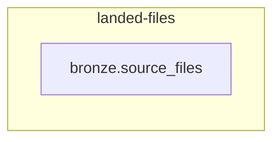

<!-- Generated by `k2gen generate` from contracts/. Do not edit: change the contract, then `make generate`. -->
# landed-files

The record of every file a file source landed (ADR-036): one row per landed file, for every source, naming its product, the URL it came from, when it was fetched, its sha256, where it lies in the landing zone and its size. The file itself stays in the landing zone, never in a row. Every row a file source writes carries the sha256 of its file, so a value traces back through this table to the bytes it was read from.

| | |
|---|---|
| Domain | [governance](../README.md#governance) |
| Owner | `platform-team` |
| Kind | consumer-aligned |
| Lifecycle | draft |
| Status | running |
| Descriptor | [`contracts/governance/landed-files/product.yaml`](../../../contracts/governance/landed-files/product.yaml) |

## Inputs and outputs

No inputs declared.

Known readers outside the contracts:

- docker/lake/file_source.py
- docs/runbooks/file-source-audit-failed.md

## bronze.source_files

One row per file a file source landed, append-only, written by the load step of docker/lake/file_source.py before it parses the file, so a file that fails to parse or to audit is recorded too. A file landed again on another day is another row. No upstream is declared: the rows describe the landing zone, which every file source writes, and a list of the URL of every source would say less than the code does.

| | |
|---|---|
| Status | running |
| Classification | internal |
| Entitlement | none |
| Retention | snapshots expire after 7 days; no row is deleted ([ADR-032](../../../docs/adr/ADR-032-odcs-contracts-and-k2gen.md)) |
| Partitioning | none |
| Sort | none |
| Schedule | none |
| Reads | none |
| Contract | [`bronze.source_files.odcs.yaml`](../../../contracts/governance/landed-files/bronze.source_files.odcs.yaml), version 1.0.0 |
| DDL | [`docker/lake/ddl/generated/bronze.source_files.sql`](../../../docker/lake/ddl/generated/bronze.source_files.sql) |

| Column | Type | Description |
|---|---|---|
| `domain` | `STRING NOT NULL` | The data domain of the source, as contracts/domains.yaml names it. |
| `product` | `STRING NOT NULL` | The data product of the source, as its product.yaml names it. |
| `url` | `STRING NOT NULL` | The URL the file was fetched from. |
| `fetched_at` | `TIMESTAMP NOT NULL` | When the fetch step downloaded the file, UTC, from the metadata of the landed object. |
| `sha256` | `STRING NOT NULL` | The sha256 of the bytes of the file, in hex, and the source_file_sha256 every row loaded from it carries. |
| `landing_path` | `STRING NOT NULL` | Where the file lies, s3://<bucket>/<domain>/<product>/<fetch date>/<sha256>.<ext>. |
| `byte_size` | `BIGINT NOT NULL` | The size of the file in bytes. |
