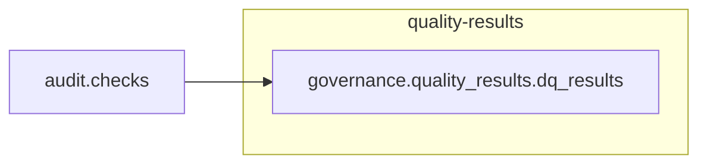

<!-- Generated by `k2gen generate` from contracts/. Do not edit: change the contract, then `make generate`. -->
# quality-results

Every quality result the platform records, in one shape: the lake jobs' checks from lake.audit.checks (maintenance audits and the ingest's findings), and every data test and unit test each domain's dbt run recorded in table dq.dbt_test_results of its own catalog. One row per check per run, with when it ran, which system and domain recorded it, what it checked, its status as pass, fail, warn or error, and the detail. A Trino view, rebuilt after the other domains in every dbt_marts run, readable through Trino only (ADR-046).

| | |
|---|---|
| Domain | [governance](../README.md#governance) |
| Owner | `platform-team` |
| Kind | consumer-aligned |
| Lifecycle | draft |
| Descriptor | [`contracts/governance/quality-results/product.yaml`](../../../contracts/governance/quality-results/product.yaml) |

## Inputs and outputs

| Input | What it is |
|---|---|
| `audit.checks` | an output of [market-capture/lake-audit](../market-capture/lake-audit.md) |

Known readers outside the contracts: none declared.

## Marts

Built by dbt on Trino as `dbt_governance`, in the domain's own catalog
([ADR-044](../../../docs/adr/ADR-044-producer-lake-and-domain-mart-warehouses.md), [`dbt/`](../../../dbt/README.md)). Read them through Trino.

| Mart | Built as | Grain | Reads | Model |
|---|---|---|---|---|
| `governance.quality_results.dq_results` | view | `source_system`, `checked_at`, `subject`, `check_name` | `audit.checks` | [`dbt/models/governance/marts/quality_results/dq_results.sql`](../../../dbt/models/governance/marts/quality_results/dq_results.sql) |
