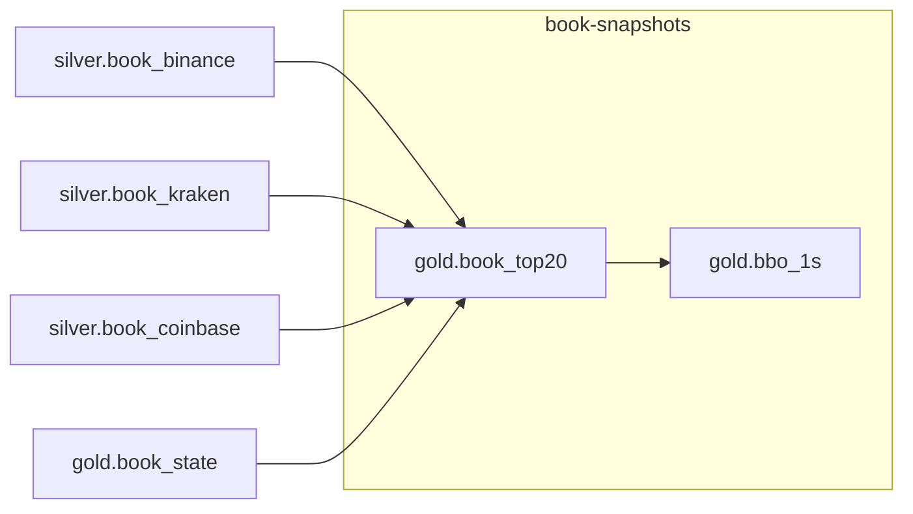

<!-- Generated by `k2gen generate` from contracts/. Do not edit: change the contract, then `make generate`. -->
# book-snapshots

The book at the end of each second, top 20 per side, every venue in one schema, and the best bid and offer with spread, imbalance and microprice projected from it (ADR-027).

| | |
|---|---|
| Domain | [market-analytics](../README.md#market-analytics) |
| Owner | `analytics-team` |
| Kind | consumer-aligned |
| Lifecycle | draft |
| Status | paused since 2026-11-26, [ADR-050](../../../docs/adr/ADR-050-order-book-capture-paused-during-platform-build.md): the data is readable, nothing new arrives |
| Descriptor | [`contracts/market-analytics/book-snapshots/product.yaml`](../../../contracts/market-analytics/book-snapshots/product.yaml) |

## Inputs and outputs

| Input | What it is |
|---|---|
| `silver.book_binance` | an output of [market-capture/venue-books](../market-capture/venue-books.md) |
| `silver.book_kraken` | an output of [market-capture/venue-books](../market-capture/venue-books.md) |
| `silver.book_coinbase` | an output of [market-capture/venue-books](../market-capture/venue-books.md) |
| `gold.book_state` | an output of [market-capture/venue-books](../market-capture/venue-books.md) |

Known readers outside the contracts:

- ClickHouse gold reload, paused (ADR-057), docs/runbooks/clickhouse-rebuild-from-lake.md
- notebooks/k2lake.py

## gold.book_top20

Book states at 1 Hz, top 20 per side as four parallel fixed-point arrays, replayed from the silver frames per connection. A second with no frame carries the previous state forward.

| | |
|---|---|
| Status | paused since 2026-11-26, [ADR-050](../../../docs/adr/ADR-050-order-book-capture-paused-during-platform-build.md): the data is readable, nothing new arrives |
| Classification | internal |
| Entitlement | realtime |
| Retention | snapshots expire after 7 days; no row is deleted ([ADR-032](../../../docs/adr/ADR-032-odcs-contracts-and-k2gen.md)) |
| Partitioning | `exchange`, `days(second)` |
| Sort | `canonical_symbol`, `second` |
| Schedule | `1-59/5 * * * *` |
| Reads | `silver.book_binance`, `silver.book_kraken`, `silver.book_coinbase`, `gold.book_state` |
| Contract | [`gold.book_top20.odcs.yaml`](../../../contracts/market-analytics/book-snapshots/gold.book_top20.odcs.yaml), version 1.0.0 |
| DDL | [`docker/lake/ddl/lake.sql`](../../../docker/lake/ddl/lake.sql) |

| Column | Type | Description |
|---|---|---|
| `exchange` | `STRING NOT NULL` |  |
| `canonical_symbol` | `STRING NOT NULL` |  |
| `symbol` | `STRING NOT NULL` |  |
| `second` | `TIMESTAMP NOT NULL` | The 1 Hz bucket. the state is as of its end |
| `depth` | `INT NOT NULL` | Levels per side present, at most 20 |
| `seq` | `BIGINT NOT NULL` | Venue sequence of the last frame folded in (Binance lastUpdateId, Coinbase sequence_num). 0 for Kraken |
| `checksum_ok` | `BOOLEAN` | Kraken: the last frame verdict. NULL elsewhere |
| `bid_px_e8` | `ARRAY<BIGINT> NOT NULL` | Best first, 1e-8 fixed point |
| `bid_qty_e8` | `ARRAY<BIGINT> NOT NULL` |  |
| `ask_px_e8` | `ARRAY<BIGINT> NOT NULL` |  |
| `ask_qty_e8` | `ARRAY<BIGINT> NOT NULL` |  |
| `recv_ts_ns` | `BIGINT NOT NULL` | Receive time of the last frame folded in |
| `conn_id` | `STRING NOT NULL` |  |
| `conn_msg_seq` | `BIGINT NOT NULL` |  |
| `src_topic` | `STRING NOT NULL` | Lineage: the last frame folded in |
| `src_partition` | `INT NOT NULL` |  |
| `src_offset` | `BIGINT NOT NULL` |  |
| `src_index` | `INT NOT NULL` |  |
| `ingest_ts` | `TIMESTAMP NOT NULL` |  |

## gold.bbo_1s

Best bid and offer per second with mid, spread, imbalance and microprice, a SQL projection of gold.book_top20.

| | |
|---|---|
| Status | paused since 2026-11-26, [ADR-050](../../../docs/adr/ADR-050-order-book-capture-paused-during-platform-build.md): the data is readable, nothing new arrives |
| Classification | internal |
| Entitlement | realtime |
| Retention | snapshots expire after 7 days; no row is deleted ([ADR-032](../../../docs/adr/ADR-032-odcs-contracts-and-k2gen.md)) |
| Partitioning | `exchange`, `days(second)` |
| Sort | `canonical_symbol`, `second` |
| Schedule | `1-59/5 * * * *` |
| Reads | `gold.book_top20` |
| Contract | [`gold.bbo_1s.odcs.yaml`](../../../contracts/market-analytics/book-snapshots/gold.bbo_1s.odcs.yaml), version 1.0.0 |
| DDL | [`docker/lake/ddl/lake.sql`](../../../docker/lake/ddl/lake.sql) |

| Column | Type | Description |
|---|---|---|
| `exchange` | `STRING NOT NULL` |  |
| `canonical_symbol` | `STRING NOT NULL` |  |
| `second` | `TIMESTAMP NOT NULL` |  |
| `bid_e8` | `BIGINT NOT NULL` |  |
| `bid_qty_e8` | `BIGINT NOT NULL` |  |
| `ask_e8` | `BIGINT NOT NULL` |  |
| `ask_qty_e8` | `BIGINT NOT NULL` |  |
| `mid` | `DOUBLE NOT NULL` | (bid + ask) / 2, quote currency |
| `spread_bps` | `DOUBLE NOT NULL` | (ask - bid) / mid x 1e4 |
| `imbalance` | `DOUBLE NOT NULL` | bid_qty / (bid_qty + ask_qty) |
| `microprice` | `DOUBLE NOT NULL` | (bid x ask_qty + ask x bid_qty) / (bid_qty + ask_qty) |
| `checksum_ok` | `BOOLEAN` |  |
| `src_snapshot_id` | `BIGINT NOT NULL` | The gold.book_top20 snapshot this row was projected from |
