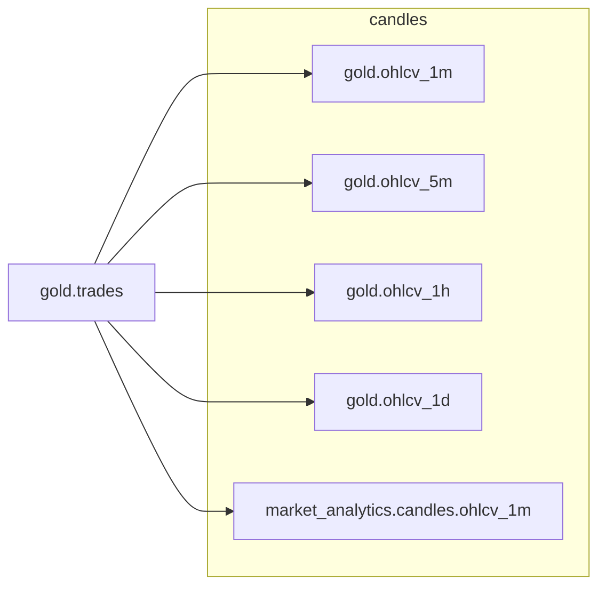

<!-- Generated by `k2gen generate` from contracts/. Do not edit: change the contract, then `make generate`. -->
# candles

OHLCV candles at 1m, 5m, 1h and 1d from gold.trades, recomputed and replaced when a late trade lands in a bucket. Open and close follow the total order (exchange_ts, recv_ts_ns, trade_seq).

| | |
|---|---|
| Domain | [market-analytics](../README.md#market-analytics) |
| Owner | `analytics-team` |
| Kind | consumer-aligned |
| Lifecycle | draft |
| Status | running |
| Descriptor | [`contracts/market-analytics/candles/product.yaml`](../../../contracts/market-analytics/candles/product.yaml) |

## Inputs and outputs

| Input | What it is |
|---|---|
| `gold.trades` | an output of [market-analytics/canonical-trades](../market-analytics/canonical-trades.md) |

Known readers outside the contracts:

- ClickHouse gold reload, paused (ADR-057), docs/runbooks/clickhouse-rebuild-from-lake.md
- scripts/parity_ohlcv.py

## Marts

Built by dbt on Trino as `dbt_market_analytics`, in the domain's own catalog
([ADR-044](../../../docs/adr/ADR-044-producer-lake-and-domain-mart-warehouses.md), [`dbt/`](../../../dbt/README.md)). Read them through Trino.

| Mart | Built as | Grain | Reads | Model |
|---|---|---|---|---|
| `market_analytics.candles.ohlcv_1m` | table | `exchange`, `canonical_symbol`, `window_start` | `gold.trades` | [`dbt/models/market_analytics/marts/candles/ohlcv_1m.sql`](../../../dbt/models/market_analytics/marts/candles/ohlcv_1m.sql) |

## gold.ohlcv_1m

OHLCV 1m candles from gold.trades, one row per (exchange, canonical_symbol, bucket), replaced when a late trade lands in the bucket.

| | |
|---|---|
| Status | running |
| Classification | internal |
| Entitlement | realtime |
| Retention | snapshots expire after 7 days; no row is deleted ([ADR-032](../../../docs/adr/ADR-032-odcs-contracts-and-k2gen.md)) |
| Partitioning | `exchange`, `months(window_start)` |
| Sort | none |
| Schedule | `1-59/5 * * * *` |
| Reads | `gold.trades` |
| Contract | [`gold.ohlcv_1m.odcs.yaml`](../../../contracts/market-analytics/candles/gold.ohlcv_1m.odcs.yaml), version 1.0.0 |
| DDL | [`docker/lake/ddl/lake.sql`](../../../docker/lake/ddl/lake.sql) |

| Column | Type | Description |
|---|---|---|
| `exchange` | `STRING NOT NULL` |  |
| `canonical_symbol` | `STRING NOT NULL` |  |
| `window_start` | `TIMESTAMP NOT NULL` | Bucket start, UTC. The bucket is the table (1m, 5m, 1h, 1d) |
| `open_e8` | `BIGINT NOT NULL` | First trade by (exchange_ts, recv_ts_ns), fixed point 1e-8 |
| `high_e8` | `BIGINT NOT NULL` |  |
| `low_e8` | `BIGINT NOT NULL` |  |
| `close_e8` | `BIGINT NOT NULL` | Last trade by (exchange_ts, recv_ts_ns) |
| `volume` | `DECIMAL(38,10) NOT NULL` | Sum of qty, base currency, exact |
| `quote_volume` | `DECIMAL(38,10) NOT NULL` | Sum of price x qty, quote currency; Spark decimal multiplication rounds each product to 6 decimal places, so the column holds 6 places in a DECIMAL(38,10) |
| `trade_count` | `BIGINT NOT NULL` |  |
| `open_time` | `TIMESTAMP NOT NULL` | exchange_ts of the first trade in the bucket |
| `close_time` | `TIMESTAMP NOT NULL` | exchange_ts of the last trade in the bucket |
| `src_snapshot_id` | `BIGINT NOT NULL` | The gold.trades snapshot this bucket was computed from. Rows for a bucket are replaced, never appended, when later trades land in it |
| `computed_at` | `TIMESTAMP NOT NULL` |  |

## gold.ohlcv_5m

OHLCV 5m candles from gold.trades, one row per (exchange, canonical_symbol, bucket), replaced when a late trade lands in the bucket.

| | |
|---|---|
| Status | running |
| Classification | internal |
| Entitlement | realtime |
| Retention | snapshots expire after 7 days; no row is deleted ([ADR-032](../../../docs/adr/ADR-032-odcs-contracts-and-k2gen.md)) |
| Partitioning | `exchange`, `months(window_start)` |
| Sort | none |
| Schedule | `1-59/5 * * * *` |
| Reads | `gold.trades` |
| Contract | [`gold.ohlcv_5m.odcs.yaml`](../../../contracts/market-analytics/candles/gold.ohlcv_5m.odcs.yaml), version 1.0.0 |
| DDL | [`docker/lake/ddl/lake.sql`](../../../docker/lake/ddl/lake.sql) |

| Column | Type | Description |
|---|---|---|
| `exchange` | `STRING NOT NULL` |  |
| `canonical_symbol` | `STRING NOT NULL` |  |
| `window_start` | `TIMESTAMP NOT NULL` | Bucket start, UTC. The bucket is the table (1m, 5m, 1h, 1d) |
| `open_e8` | `BIGINT NOT NULL` | First trade by (exchange_ts, recv_ts_ns), fixed point 1e-8 |
| `high_e8` | `BIGINT NOT NULL` |  |
| `low_e8` | `BIGINT NOT NULL` |  |
| `close_e8` | `BIGINT NOT NULL` | Last trade by (exchange_ts, recv_ts_ns) |
| `volume` | `DECIMAL(38,10) NOT NULL` | Sum of qty, base currency, exact |
| `quote_volume` | `DECIMAL(38,10) NOT NULL` | Sum of price x qty, quote currency; Spark decimal multiplication rounds each product to 6 decimal places, so the column holds 6 places in a DECIMAL(38,10) |
| `trade_count` | `BIGINT NOT NULL` |  |
| `open_time` | `TIMESTAMP NOT NULL` | exchange_ts of the first trade in the bucket |
| `close_time` | `TIMESTAMP NOT NULL` | exchange_ts of the last trade in the bucket |
| `src_snapshot_id` | `BIGINT NOT NULL` | The gold.trades snapshot this bucket was computed from. Rows for a bucket are replaced, never appended, when later trades land in it |
| `computed_at` | `TIMESTAMP NOT NULL` |  |

## gold.ohlcv_1h

OHLCV 1h candles from gold.trades, one row per (exchange, canonical_symbol, bucket), replaced when a late trade lands in the bucket.

| | |
|---|---|
| Status | running |
| Classification | internal |
| Entitlement | realtime |
| Retention | snapshots expire after 7 days; no row is deleted ([ADR-032](../../../docs/adr/ADR-032-odcs-contracts-and-k2gen.md)) |
| Partitioning | `exchange`, `months(window_start)` |
| Sort | none |
| Schedule | `1-59/5 * * * *` |
| Reads | `gold.trades` |
| Contract | [`gold.ohlcv_1h.odcs.yaml`](../../../contracts/market-analytics/candles/gold.ohlcv_1h.odcs.yaml), version 1.0.0 |
| DDL | [`docker/lake/ddl/lake.sql`](../../../docker/lake/ddl/lake.sql) |

| Column | Type | Description |
|---|---|---|
| `exchange` | `STRING NOT NULL` |  |
| `canonical_symbol` | `STRING NOT NULL` |  |
| `window_start` | `TIMESTAMP NOT NULL` | Bucket start, UTC. The bucket is the table (1m, 5m, 1h, 1d) |
| `open_e8` | `BIGINT NOT NULL` | First trade by (exchange_ts, recv_ts_ns), fixed point 1e-8 |
| `high_e8` | `BIGINT NOT NULL` |  |
| `low_e8` | `BIGINT NOT NULL` |  |
| `close_e8` | `BIGINT NOT NULL` | Last trade by (exchange_ts, recv_ts_ns) |
| `volume` | `DECIMAL(38,10) NOT NULL` | Sum of qty, base currency, exact |
| `quote_volume` | `DECIMAL(38,10) NOT NULL` | Sum of price x qty, quote currency; Spark decimal multiplication rounds each product to 6 decimal places, so the column holds 6 places in a DECIMAL(38,10) |
| `trade_count` | `BIGINT NOT NULL` |  |
| `open_time` | `TIMESTAMP NOT NULL` | exchange_ts of the first trade in the bucket |
| `close_time` | `TIMESTAMP NOT NULL` | exchange_ts of the last trade in the bucket |
| `src_snapshot_id` | `BIGINT NOT NULL` | The gold.trades snapshot this bucket was computed from. Rows for a bucket are replaced, never appended, when later trades land in it |
| `computed_at` | `TIMESTAMP NOT NULL` |  |

## gold.ohlcv_1d

OHLCV 1d candles from gold.trades, one row per (exchange, canonical_symbol, bucket), replaced when a late trade lands in the bucket.

| | |
|---|---|
| Status | running |
| Classification | internal |
| Entitlement | realtime |
| Retention | snapshots expire after 7 days; no row is deleted ([ADR-032](../../../docs/adr/ADR-032-odcs-contracts-and-k2gen.md)) |
| Partitioning | `exchange` |
| Sort | none |
| Schedule | `1-59/5 * * * *` |
| Reads | `gold.trades` |
| Contract | [`gold.ohlcv_1d.odcs.yaml`](../../../contracts/market-analytics/candles/gold.ohlcv_1d.odcs.yaml), version 1.0.0 |
| DDL | [`docker/lake/ddl/lake.sql`](../../../docker/lake/ddl/lake.sql) |

| Column | Type | Description |
|---|---|---|
| `exchange` | `STRING NOT NULL` |  |
| `canonical_symbol` | `STRING NOT NULL` |  |
| `window_start` | `TIMESTAMP NOT NULL` | Bucket start, UTC. The bucket is the table (1m, 5m, 1h, 1d) |
| `open_e8` | `BIGINT NOT NULL` | First trade by (exchange_ts, recv_ts_ns), fixed point 1e-8 |
| `high_e8` | `BIGINT NOT NULL` |  |
| `low_e8` | `BIGINT NOT NULL` |  |
| `close_e8` | `BIGINT NOT NULL` | Last trade by (exchange_ts, recv_ts_ns) |
| `volume` | `DECIMAL(38,10) NOT NULL` | Sum of qty, base currency, exact |
| `quote_volume` | `DECIMAL(38,10) NOT NULL` | Sum of price x qty, quote currency; Spark decimal multiplication rounds each product to 6 decimal places, so the column holds 6 places in a DECIMAL(38,10) |
| `trade_count` | `BIGINT NOT NULL` |  |
| `open_time` | `TIMESTAMP NOT NULL` | exchange_ts of the first trade in the bucket |
| `close_time` | `TIMESTAMP NOT NULL` | exchange_ts of the last trade in the bucket |
| `src_snapshot_id` | `BIGINT NOT NULL` | The gold.trades snapshot this bucket was computed from. Rows for a bucket are replaced, never appended, when later trades land in it |
| `computed_at` | `TIMESTAMP NOT NULL` |  |
