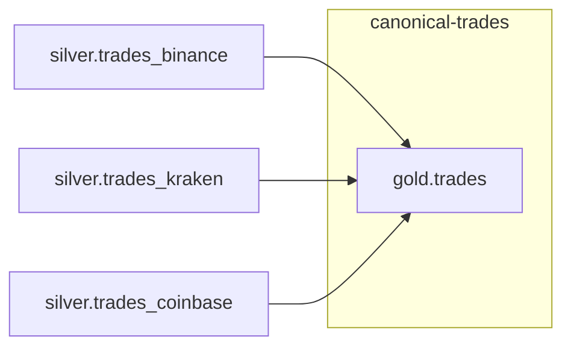

<!-- Generated by `k2gen generate` from contracts/. Do not edit: change the contract, then `make generate`. -->
# canonical-trades

One row per logical trade across every venue, the earliest delivery, in fixed point 1e-8 like the wire and ClickHouse gold.

| | |
|---|---|
| Domain | [market-analytics](../README.md#market-analytics) |
| Owner | `analytics-team` |
| Kind | consumer-aligned |
| Lifecycle | draft |
| Descriptor | [`contracts/market-analytics/canonical-trades/product.yaml`](../../../contracts/market-analytics/canonical-trades/product.yaml) |

## Inputs and outputs

| Input | What it is |
|---|---|
| `silver.trades_binance` | an output of [market-capture/venue-trades](../market-capture/venue-trades.md) |
| `silver.trades_kraken` | an output of [market-capture/venue-trades](../market-capture/venue-trades.md) |
| `silver.trades_coinbase` | an output of [market-capture/venue-trades](../market-capture/venue-trades.md) |

Known readers outside the contracts:

- ClickHouse gold reload, docs/runbooks/clickhouse-rebuild-from-lake.md
- notebooks/k2lake.py
- scripts/parity_ohlcv.py
- scripts/parity_bars.py

## gold.trades

Canonical trades: the venue_replay = false rows of silver, one to one, keyed by (exchange, canonical_symbol, trade_id).

| | |
|---|---|
| Classification | internal |
| Entitlement | realtime |
| Retention | snapshots expire after 7 days; no row is deleted ([ADR-032](../../../docs/adr/ADR-032-odcs-contracts-and-k2gen.md)) |
| Partitioning | `exchange`, `days(exchange_ts)` |
| Sort | `canonical_symbol`, `exchange_ts` |
| Schedule | `1-59/5 * * * *` |
| Reads | `silver.trades_binance`, `silver.trades_kraken`, `silver.trades_coinbase` |
| Contract | [`gold.trades.odcs.yaml`](../../../contracts/market-analytics/canonical-trades/gold.trades.odcs.yaml), version 1.0.0 |
| DDL | [`docker/lake/ddl/lake.sql`](../../../docker/lake/ddl/lake.sql) |

| Column | Type | Description |
|---|---|---|
| `exchange` | `STRING NOT NULL` | binance \| kraken \| coinbase |
| `canonical_symbol` | `STRING NOT NULL` | BASE/QUOTE from config/instruments.yaml |
| `symbol` | `STRING NOT NULL` | Venue-native symbol |
| `trade_id` | `STRING NOT NULL` | The venue trade id, as sent |
| `trade_seq` | `BIGINT NOT NULL` | trade_id as a number |
| `price_e8` | `BIGINT NOT NULL` | Price x 1e8, exact (silver DECIMAL(28,10) has no more than 8 decimals on any venue here. precision_loss in silver says when that stops being true) |
| `qty_e8` | `BIGINT NOT NULL` | Base quantity x 1e8 |
| `side` | `STRING NOT NULL` | Taker side: buy \| sell |
| `exchange_ts` | `TIMESTAMP NOT NULL` | Venue clock, UTC microseconds |
| `recv_ts_ns` | `BIGINT NOT NULL` | K2 receive clock of the winning delivery |
| `conn_id` | `STRING NOT NULL` |  |
| `conn_msg_seq` | `BIGINT NOT NULL` |  |
| `seq_gap` | `BOOLEAN` | From silver: trade ids missing before this one (NULL = unknowable) |
| `missing_before` | `BIGINT` |  |
| `src_topic` | `STRING NOT NULL` | Lineage to the silver row, which is the bronze row, which is the raw.messages row |
| `src_partition` | `INT NOT NULL` |  |
| `src_offset` | `BIGINT NOT NULL` |  |
| `src_index` | `INT NOT NULL` |  |
| `ingest_ts` | `TIMESTAMP NOT NULL` |  |
