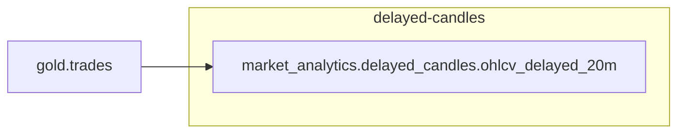

<!-- Generated by `k2gen generate` from contracts/. Do not edit: change the contract, then `make generate`. -->
# delayed-candles

The 1-minute candles of product candles without the newest 20 minutes: a candle is shown once its whole minute ended at least 20 minutes ago. The product a delayed-data entitlement will be limited to (plan phase P5). A Trino view over market_analytics.candles.ohlcv_1m (ADR-035), so it is as current as that mart's last build, and readable through Trino only.

| | |
|---|---|
| Domain | [market-analytics](../README.md#market-analytics) |
| Owner | `analytics-team` |
| Kind | consumer-aligned |
| Lifecycle | draft |
| Descriptor | [`contracts/market-analytics/delayed-candles/product.yaml`](../../../contracts/market-analytics/delayed-candles/product.yaml) |

## Inputs and outputs

| Input | What it is |
|---|---|
| `gold.trades` | an output of [market-analytics/canonical-trades](../market-analytics/canonical-trades.md) |

Known readers outside the contracts: none declared.

## Marts

Built by dbt on Trino as `dbt_market_analytics`, in the domain's own catalog
([ADR-044](../../../docs/adr/ADR-044-producer-lake-and-domain-mart-warehouses.md), [`dbt/`](../../../dbt/README.md)). Read them through Trino.

| Mart | Built as | Grain | Reads | Model |
|---|---|---|---|---|
| `market_analytics.delayed_candles.ohlcv_delayed_20m` | view | `exchange`, `canonical_symbol`, `window_start` | `gold.trades` | [`dbt/models/market_analytics/marts/delayed_candles/ohlcv_delayed_20m.sql`](../../../dbt/models/market_analytics/marts/delayed_candles/ohlcv_delayed_20m.sql) |
