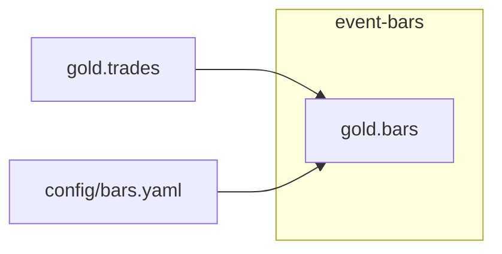

<!-- Generated by `k2gen generate` from contracts/. Do not edit: change the contract, then `make generate`. -->
# event-bars

Tick, volume and dollar bars at the one canonical threshold per symbol, restarting at each UTC day. Any other threshold is a query over gold.trades, not a second table (ADR-029).

| | |
|---|---|
| Domain | [market-analytics](../README.md#market-analytics) |
| Owner | `analytics-team` |
| Kind | consumer-aligned |
| Lifecycle | draft |
| Status | running |
| Descriptor | [`contracts/market-analytics/event-bars/product.yaml`](../../../contracts/market-analytics/event-bars/product.yaml) |

## Inputs and outputs

| Input | What it is |
|---|---|
| `gold.trades` | an output of [market-analytics/canonical-trades](../market-analytics/canonical-trades.md) |
| `config/bars.yaml` | external source, classified public. The canonical bar threshold per symbol and bar kind. |

Known readers outside the contracts:

- ClickHouse gold reload, paused (ADR-057), docs/runbooks/clickhouse-rebuild-from-lake.md
- scripts/parity_bars.py

## gold.bars

Event bars from gold.trades, one row per (exchange, canonical_symbol, bar_kind, day, bar_seq). A day a new trade touches is replaced whole.

| | |
|---|---|
| Status | running |
| Classification | internal |
| Entitlement | realtime |
| Retention | snapshots expire after 7 days; no row is deleted ([ADR-032](../../../docs/adr/ADR-032-odcs-contracts-and-k2gen.md)) |
| Partitioning | `exchange`, `months(open_time)` |
| Sort | none |
| Schedule | `1-59/5 * * * *` |
| Reads | `gold.trades`, `config/bars.yaml` |
| Contract | [`gold.bars.odcs.yaml`](../../../contracts/market-analytics/event-bars/gold.bars.odcs.yaml), version 1.0.0 |
| DDL | [`docker/lake/ddl/lake.sql`](../../../docker/lake/ddl/lake.sql) |

| Column | Type | Description |
|---|---|---|
| `exchange` | `STRING NOT NULL` |  |
| `canonical_symbol` | `STRING NOT NULL` |  |
| `bar_kind` | `STRING NOT NULL` | tick \| volume \| dollar |
| `threshold` | `DECIMAL(38,10) NOT NULL` | The bucket size the bar was built at: trades, base units or quote-currency notional. Carried on the row so a bar is self-describing when the config moves |
| `day` | `DATE NOT NULL` | UTC day of every trade in the bar; bars never span a day |
| `bar_seq` | `INT NOT NULL` | Bucket index within (exchange, symbol, kind, day), from 0 |
| `open_e8` | `BIGINT NOT NULL` | First trade by (exchange_ts, recv_ts_ns, trade_seq), fixed point 1e-8 |
| `high_e8` | `BIGINT NOT NULL` |  |
| `low_e8` | `BIGINT NOT NULL` |  |
| `close_e8` | `BIGINT NOT NULL` | Last trade by the same order |
| `volume_e8` | `BIGINT NOT NULL` | Sum of qty, base currency, fixed point 1e-8, exact |
| `quote_volume_e8` | `BIGINT NOT NULL` | Sum of price x qty, quote currency, fixed point 1e-8: the exact 1e-16 sum floor-divided by 1e8, the one rounding in the table and an integer rule every engine spells the same way |
| `trade_count` | `BIGINT NOT NULL` |  |
| `open_time` | `TIMESTAMP NOT NULL` | exchange_ts of the first trade |
| `close_time` | `TIMESTAMP NOT NULL` | exchange_ts of the last trade; the last bar of a day is open-ended until the day is |
| `src_snapshot_id` | `BIGINT NOT NULL` | The gold.trades snapshot this day was computed from |
| `computed_at` | `TIMESTAMP NOT NULL` |  |
