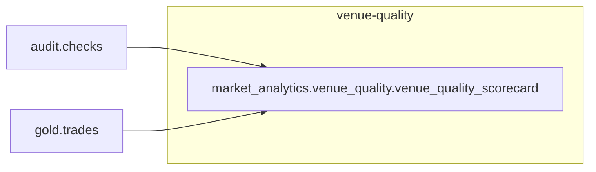

<!-- Generated by `k2gen generate` from contracts/. Do not edit: change the contract, then `make generate`. -->
# venue-quality

How complete the lake is for each venue, per venue and UTC day: its trades, the trades that revealed missing trade ids and how many ids, and the lake checks filed that day about the venue's tables and partitions, how many failed, and how many records an ingest skipped because Redpanda had evicted them. Read it before trusting a venue's day.

| | |
|---|---|
| Domain | [market-analytics](../README.md#market-analytics) |
| Owner | `analytics-team` |
| Kind | consumer-aligned |
| Lifecycle | draft |
| Descriptor | [`contracts/market-analytics/venue-quality/product.yaml`](../../../contracts/market-analytics/venue-quality/product.yaml) |

## Inputs and outputs

| Input | What it is |
|---|---|
| `audit.checks` | an output of [market-capture/lake-audit](../market-capture/lake-audit.md) |
| `gold.trades` | an output of [market-analytics/canonical-trades](../market-analytics/canonical-trades.md) |

Known readers outside the contracts: none declared.

## Marts

Built by dbt on Trino as `dbt_market_analytics`, in the domain's own catalog
([ADR-044](../../../docs/adr/ADR-044-producer-lake-and-domain-mart-warehouses.md), [`dbt/`](../../../dbt/README.md)). Read them through Trino.

| Mart | Built as | Grain | Reads | Model |
|---|---|---|---|---|
| `market_analytics.venue_quality.venue_quality_scorecard` | table | `exchange`, `utc_date` | `audit.checks`, `gold.trades` | [`dbt/models/market_analytics/marts/venue_quality/venue_quality_scorecard.sql`](../../../dbt/models/market_analytics/marts/venue_quality/venue_quality_scorecard.sql) |
