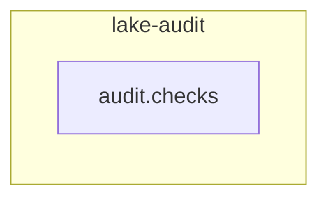

<!-- Generated by `k2gen generate` from contracts/. Do not edit: change the contract, then `make generate`. -->
# lake-audit

What the lake jobs found when they checked the lake: one row per check per run, filed by the nightly maintenance (offset continuity, duplicate identifiers, parse, drift and parity checks), by the ingest (the records Redpanda evicted before it read them), by an operator or by a replay. Most checks are about this domain's tables and partitions, so it is filed here; the governance domain reads it beside every domain's dbt test results (ADR-046).

| | |
|---|---|
| Domain | [market-capture](../README.md#market-capture) |
| Owner | `capture-team` |
| Kind | source-aligned |
| Lifecycle | draft |
| Descriptor | [`contracts/market-capture/lake-audit/product.yaml`](../../../contracts/market-capture/lake-audit/product.yaml) |

## Inputs and outputs

No inputs declared.

Known readers outside the contracts:

- docs/runbooks/lake-audit-failed.md
- docker/lake/maintenance.py

## audit.checks

One row per check per run of a lake job, append-only: a failed check is never edited out. The checks read every layer (docker/lake/maintenance.py AUDITS, the ingest's offset_gap rows), which is why no upstream is declared: a list of every lake table would say less than the code does.

| | |
|---|---|
| Classification | internal |
| Entitlement | none |
| Retention | snapshots expire after 7 days; no row is deleted ([ADR-032](../../../docs/adr/ADR-032-odcs-contracts-and-k2gen.md)) |
| Partitioning | `days(run_ts)` |
| Sort | none |
| Schedule | `0 3 * * *` |
| Reads | none |
| Contract | [`audit.checks.odcs.yaml`](../../../contracts/market-capture/lake-audit/audit.checks.odcs.yaml), version 1.0.0 |
| DDL | [`docker/lake/ddl/lake.sql`](../../../docker/lake/ddl/lake.sql) |

| Column | Type | Description |
|---|---|---|
| `run_ts` | `TIMESTAMP NOT NULL` | When the maintenance run that produced this row started |
| `job` | `STRING NOT NULL` | Who wrote it: maintenance \| ingest \| verify \| operator \| replay. replay is one row per `scripts/replay-lake.sh` run (docker/lake/record_check.py): the raw.messages snapshot, the conn_id and the crate sha in detail, the output hash in scope-free form, so a result is reproducible by re-running the same ids and comparing one digest. operator means a human filed it by hand at the moment of a decision: the two runbook rows that record a deliberate purge and a known offset gap. The column exists to answer "who asserted this", so a hand-filed row claiming maintenance would be the one lie that matters |
| `check_name` | `STRING NOT NULL` | job=maintenance writes the names in docker/lake/maintenance.py AUDITS: offset_continuity, duplicate_identifiers, bronze_unparseable, bronze_schema_drift, silver_parity, silver_flags (informational, no pass/fail), gold_parity, ohlcv_parity, bars_parity, kraken_checksum. job=ingest writes unresolvable_schema_id, bronze_parity, and offset_gap (a --accept-data-loss run recording records Redpanda evicted before the lake read them, one row per partition, written BEFORE the skip it licenses). job=operator writes manual_purge (a deletion, not a finding, kept distinct so a query over this table never reads a purge as a check result) and checksum_failure_acknowledged. job=replay writes replay (scripts/replay-lake.sh) |
| `scope` | `STRING NOT NULL` | What was checked: a table name, or topic/partition |
| `passed` | `BOOLEAN NOT NULL` | false here is what makes the maintenance run exit non-zero |
| `observed` | `BIGINT` | The number the check produced: gap count, duplicate count. NULL where the check has no count |
| `detail` | `STRING` | Human-readable specifics for a failure; empty on success |
