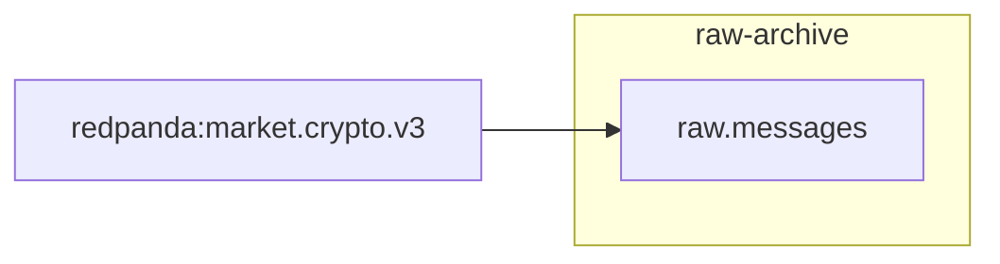

<!-- Generated by `k2gen generate` from contracts/. Do not edit: change the contract, then `make generate`. -->
# raw-archive

The system of record: every Kafka record from the nine v3 topics, byte for byte, with its topic, partition and offset. Every other lake table is a function of it, and no row is ever deleted (ADR-021).

| | |
|---|---|
| Domain | [market-capture](../README.md#market-capture) |
| Owner | `capture-team` |
| Kind | source-aligned |
| Lifecycle | draft |
| Status | running |
| Descriptor | [`contracts/market-capture/raw-archive/product.yaml`](../../../contracts/market-capture/raw-archive/product.yaml) |

## Inputs and outputs

| Input | What it is |
|---|---|
| `redpanda:market.crypto.v3` | external source, classified internal. The nine topics market.crypto.v3.{raw,trades,book}.{binance,kraken,coinbase}, written by services/capture-rust. |

Known readers outside the contracts:

- scripts/replay_export.py
- scripts/lake-verify.sh
- docker/lake/metrics.py

## raw.messages

Every Kafka record from the v3 topics, with the Kafka value byte for byte including its Confluent header. The exactly-once position is held in the snapshot summary (ADR-022).

| | |
|---|---|
| Status | running |
| Classification | internal |
| Entitlement | realtime |
| Retention | snapshots expire after 7 days; no row is deleted ([ADR-032](../../../docs/adr/ADR-032-odcs-contracts-and-k2gen.md)) |
| Partitioning | `days(kafka_ts)`, `topic` |
| Sort | `topic`, `partition`, `offset` |
| Schedule | `1-59/5 * * * *` |
| Reads | `redpanda:market.crypto.v3` |
| Contract | [`raw.messages.odcs.yaml`](../../../contracts/market-capture/raw-archive/raw.messages.odcs.yaml), version 1.0.0 |
| DDL | [`docker/lake/ddl/lake.sql`](../../../docker/lake/ddl/lake.sql) |

| Column | Type | Description |
|---|---|---|
| `topic` | `STRING NOT NULL` | Kafka topic, e.g. market.crypto.v3.raw.kraken |
| `partition` | `INT NOT NULL` | Kafka partition the record was read from |
| `offset` | `BIGINT NOT NULL` | Kafka offset within (topic, partition). Gapless by construction; the continuity audit proves it |
| `kafka_ts` | `TIMESTAMP NOT NULL` | Broker-assigned record timestamp (CreateTime from the producer) |
| `ingest_ts` | `TIMESTAMP NOT NULL` | When this ingest run started. Not per-row: it identifies the batch, and a per-row clock read would cost a call per record for no answerable question |
| `key` | `BINARY` | Kafka message key, verbatim. The canonical symbol as UTF-8 for trades/book; null where capture set none |
| `schema_id` | `INT` | Confluent schema id, decoded from payload bytes 2-5. NULL means the payload is not Confluent-framed: the bytes are still archived verbatim, stage 2 skips the row, and the audit counts it. Nullable so one foreign record cannot block every following ingest on the same offset |
| `payload` | `BINARY NOT NULL` | The Kafka value byte for byte, INCLUDING the 5-byte Confluent header |
| `headers` | `MAP<STRING, BINARY>` | Kafka record headers; carries recv_ts_ns as ASCII digits (services/capture-rust/src/sink.rs) |
