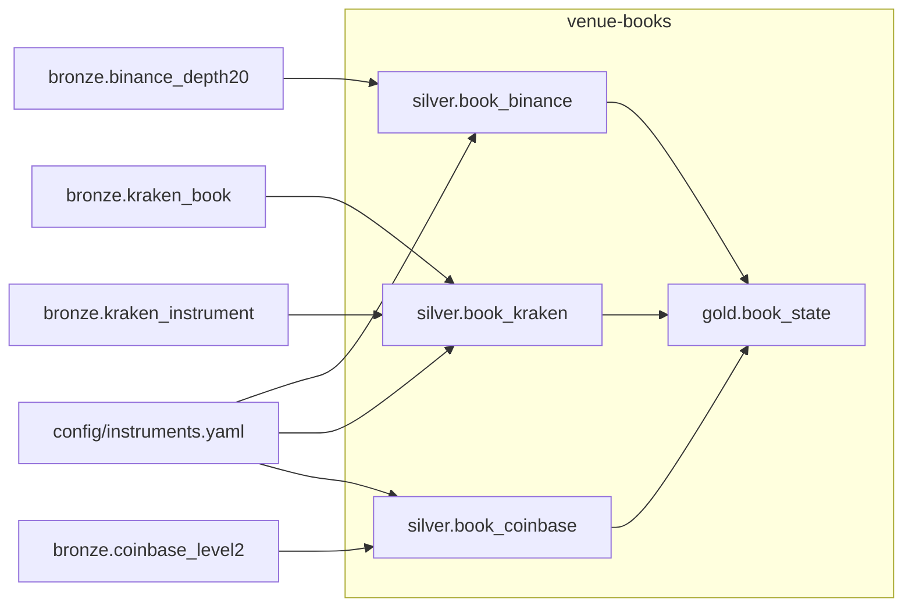

<!-- Generated by `k2gen generate` from contracts/. Do not edit: change the contract, then `make generate`. -->
# venue-books

Book frames per venue, typed, with Kraken's checksum verified by replay, and the replay's per-connection state carried between runs so a run reads only its new frames.

| | |
|---|---|
| Domain | [market-capture](../README.md#market-capture) |
| Owner | `capture-team` |
| Kind | source-aligned |
| Lifecycle | draft |
| Descriptor | [`contracts/market-capture/venue-books/product.yaml`](../../../contracts/market-capture/venue-books/product.yaml) |

## Inputs and outputs

| Input | What it is |
|---|---|
| `bronze.binance_depth20` | an output of [market-capture/venue-frames](../market-capture/venue-frames.md) |
| `bronze.kraken_book` | an output of [market-capture/venue-frames](../market-capture/venue-frames.md) |
| `bronze.kraken_instrument` | an output of [market-capture/venue-frames](../market-capture/venue-frames.md) |
| `bronze.coinbase_level2` | an output of [market-capture/venue-frames](../market-capture/venue-frames.md) |
| `config/instruments.yaml` | external source, classified public. The instrument registry: native to canonical symbol per venue. |

Known readers outside the contracts:

- notebooks/k2lake.py

## silver.book_binance

Binance depth20 frames typed. Each frame is a complete top-20 snapshot.

| | |
|---|---|
| Classification | internal |
| Entitlement | realtime |
| Retention | snapshots expire after 7 days; no row is deleted ([ADR-032](../../../docs/adr/ADR-032-odcs-contracts-and-k2gen.md)) |
| Partitioning | `days(recv_ts)` |
| Sort | `canonical_symbol`, `recv_ts_ns` |
| Schedule | `1-59/5 * * * *` |
| Reads | `bronze.binance_depth20`, `config/instruments.yaml` |
| Contract | [`silver.book_binance.odcs.yaml`](../../../contracts/market-capture/venue-books/silver.book_binance.odcs.yaml), version 1.0.0 |
| DDL | [`docker/lake/ddl/lake.sql`](../../../docker/lake/ddl/lake.sql) |

| Column | Type | Description |
|---|---|---|
| `symbol` | `STRING NOT NULL` |  |
| `canonical_symbol` | `STRING NOT NULL` |  |
| `last_update_id` | `BIGINT NOT NULL` | Binance lastUpdateId of this partial-book frame |
| `bids` | `ARRAY<STRUCT<px: DECIMAL(28,10), qty: DECIMAL(28,10)>> NOT NULL` | The frame IS the top-20 book: best first, typed from the [["px","qty"]] pairs |
| `asks` | `ARRAY<STRUCT<px: DECIMAL(28,10), qty: DECIMAL(28,10)>> NOT NULL` |  |
| `depth` | `INT NOT NULL` | Levels per side in the frame |
| `seq_gap` | `BOOLEAN` | true = last_update_id did not advance past the previous frame on this connection (a regression). NULL on the first frame of a connection in the lookback |
| `recv_ts_ns` | `BIGINT NOT NULL` |  |
| `recv_ts` | `TIMESTAMP NOT NULL` |  |
| `conn_id` | `STRING NOT NULL` |  |
| `conn_msg_seq` | `BIGINT NOT NULL` |  |
| `src_topic` | `STRING NOT NULL` | Lineage to the bronze row |
| `src_partition` | `INT NOT NULL` |  |
| `src_offset` | `BIGINT NOT NULL` |  |
| `src_index` | `INT NOT NULL` | Position within the frame (Coinbase events[i]). 0 where a frame is one event |
| `ingest_ts` | `TIMESTAMP NOT NULL` |  |

## silver.book_kraken

Kraken book frames typed, each carrying the verdict of the checksum replayed against the venue's.

| | |
|---|---|
| Classification | internal |
| Entitlement | realtime |
| Retention | snapshots expire after 7 days; no row is deleted ([ADR-032](../../../docs/adr/ADR-032-odcs-contracts-and-k2gen.md)) |
| Partitioning | `days(recv_ts)` |
| Sort | `canonical_symbol`, `recv_ts_ns` |
| Schedule | `1-59/5 * * * *` |
| Reads | `bronze.kraken_book`, `bronze.kraken_instrument`, `config/instruments.yaml` |
| Contract | [`silver.book_kraken.odcs.yaml`](../../../contracts/market-capture/venue-books/silver.book_kraken.odcs.yaml), version 1.0.0 |
| DDL | [`docker/lake/ddl/lake.sql`](../../../docker/lake/ddl/lake.sql) |

| Column | Type | Description |
|---|---|---|
| `symbol` | `STRING NOT NULL` |  |
| `canonical_symbol` | `STRING NOT NULL` |  |
| `frame_type` | `STRING NOT NULL` | snapshot \| update |
| `bids` | `ARRAY<STRUCT<px: DECIMAL(28,10), qty: DECIMAL(28,10)>> NOT NULL` | The levels the frame carries (a snapshot: the book. an update: the changed levels, qty 0 = removed) |
| `asks` | `ARRAY<STRUCT<px: DECIMAL(28,10), qty: DECIMAL(28,10)>> NOT NULL` |  |
| `checksum` | `BIGINT NOT NULL` | The CRC32 the venue attached, as sent |
| `checksum_ok` | `BOOLEAN` | true = the book replayed from this connection frames, truncated to the subscription depth, hashes to `checksum` at the pair precision (docker/lake/book.py). false = it does not: a missed or misapplied frame. NULL = precision unknown (no instrument frame yet) |
| `exchange_ts` | `TIMESTAMP` | The frame timestamp, typed |
| `recv_ts_ns` | `BIGINT NOT NULL` |  |
| `recv_ts` | `TIMESTAMP NOT NULL` |  |
| `conn_id` | `STRING NOT NULL` |  |
| `conn_msg_seq` | `BIGINT NOT NULL` |  |
| `src_topic` | `STRING NOT NULL` | Lineage to the bronze row |
| `src_partition` | `INT NOT NULL` |  |
| `src_offset` | `BIGINT NOT NULL` |  |
| `src_index` | `INT NOT NULL` | Position within the frame (Coinbase events[i]). 0 where a frame is one event |
| `ingest_ts` | `TIMESTAMP NOT NULL` |  |

## silver.book_coinbase

Coinbase level2 events typed, one row per event.

| | |
|---|---|
| Classification | internal |
| Entitlement | realtime |
| Retention | snapshots expire after 7 days; no row is deleted ([ADR-032](../../../docs/adr/ADR-032-odcs-contracts-and-k2gen.md)) |
| Partitioning | `days(recv_ts)` |
| Sort | `canonical_symbol`, `recv_ts_ns` |
| Schedule | `1-59/5 * * * *` |
| Reads | `bronze.coinbase_level2`, `config/instruments.yaml` |
| Contract | [`silver.book_coinbase.odcs.yaml`](../../../contracts/market-capture/venue-books/silver.book_coinbase.odcs.yaml), version 1.0.0 |
| DDL | [`docker/lake/ddl/lake.sql`](../../../docker/lake/ddl/lake.sql) |

| Column | Type | Description |
|---|---|---|
| `symbol` | `STRING NOT NULL` | events[i].product_id |
| `canonical_symbol` | `STRING NOT NULL` |  |
| `event_type` | `STRING NOT NULL` | snapshot (the whole book) \| update |
| `updates` | `ARRAY<STRUCT<side: STRING, side_native: STRING, px: DECIMAL(28,10), qty: DECIMAL(28,10), event_time: TIMESTAMP>> NOT NULL` | Absolute quantities per price level. side normalised to bid \| ask beside the venue bid \| offer. qty 0 = level removed |
| `sequence_num` | `BIGINT NOT NULL` | Connection-wide, across every channel |
| `envelope_ts` | `TIMESTAMP NOT NULL` |  |
| `seq_gap` | `BOOLEAN` | NULL: sequence_num continuity spans heartbeats and trades, which are not in this table. the capture counts gaps live (k2_capture_gaps_total) |
| `recv_ts_ns` | `BIGINT NOT NULL` |  |
| `recv_ts` | `TIMESTAMP NOT NULL` |  |
| `conn_id` | `STRING NOT NULL` |  |
| `conn_msg_seq` | `BIGINT NOT NULL` |  |
| `src_topic` | `STRING NOT NULL` | Lineage to the bronze row |
| `src_partition` | `INT NOT NULL` |  |
| `src_offset` | `BIGINT NOT NULL` |  |
| `src_index` | `INT NOT NULL` | Position within the frame (Coinbase events[i]). 0 where a frame is one event |
| `ingest_ts` | `TIMESTAMP NOT NULL` |  |

## gold.book_state

The book replay's carry-over per venue, symbol and connection: the book after the last frame processed and the last second emitted. Overwritten each run. Operational state, not a research product.

| | |
|---|---|
| Classification | internal |
| Entitlement | realtime |
| Retention | snapshots expire after 7 days; no row is deleted ([ADR-032](../../../docs/adr/ADR-032-odcs-contracts-and-k2gen.md)) |
| Partitioning | `exchange` |
| Sort | none |
| Schedule | `1-59/5 * * * *` |
| Reads | `silver.book_binance`, `silver.book_kraken`, `silver.book_coinbase` |
| Contract | [`gold.book_state.odcs.yaml`](../../../contracts/market-capture/venue-books/gold.book_state.odcs.yaml), version 1.0.0 |
| DDL | [`docker/lake/ddl/lake.sql`](../../../docker/lake/ddl/lake.sql) |

| Column | Type | Description |
|---|---|---|
| `exchange` | `STRING NOT NULL` |  |
| `symbol` | `STRING NOT NULL` |  |
| `conn_id` | `STRING NOT NULL` |  |
| `bid_px_e8` | `ARRAY<BIGINT> NOT NULL` |  |
| `bid_qty_e8` | `ARRAY<BIGINT> NOT NULL` |  |
| `ask_px_e8` | `ARRAY<BIGINT> NOT NULL` |  |
| `ask_qty_e8` | `ARRAY<BIGINT> NOT NULL` |  |
| `seq` | `BIGINT NOT NULL` |  |
| `checksum_ok` | `BOOLEAN` |  |
| `last_conn_msg_seq` | `BIGINT NOT NULL` |  |
| `last_recv_ts_ns` | `BIGINT NOT NULL` |  |
| `last_second` | `TIMESTAMP NOT NULL` | The last 1 Hz bucket emitted for this connection |
| `last_src_partition` | `INT NOT NULL` |  |
| `last_src_offset` | `BIGINT NOT NULL` |  |
| `last_src_index` | `INT NOT NULL` |  |
| `updated_at` | `TIMESTAMP NOT NULL` |  |
