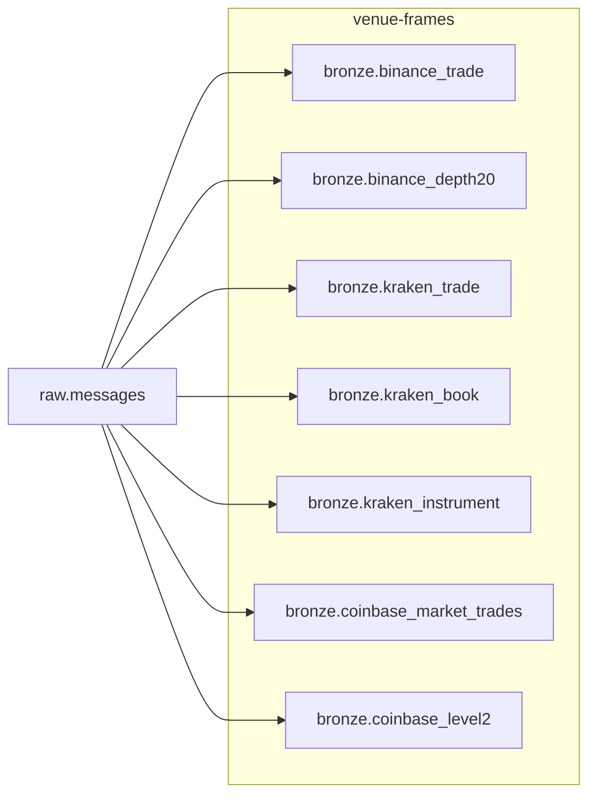

<!-- Generated by `k2gen generate` from contracts/. Do not edit: change the contract, then `make generate`. -->
# venue-frames

Each venue frame decoded from raw.messages into the venue's own field names, types and nesting: one table per venue and message type, one row per frame, no renames and no canonical symbol (ADR-026).

| | |
|---|---|
| Domain | [market-capture](../README.md#market-capture) |
| Owner | `capture-team` |
| Kind | source-aligned |
| Lifecycle | draft |
| Descriptor | [`contracts/market-capture/venue-frames/product.yaml`](../../../contracts/market-capture/venue-frames/product.yaml) |

## Inputs and outputs

| Input | What it is |
|---|---|
| `raw.messages` | an output of [market-capture/raw-archive](../market-capture/raw-archive.md) |

Known readers outside the contracts: none declared.

## bronze.binance_trade

Binance combined-stream trade frames, one row per frame, field names as sent.

| | |
|---|---|
| Classification | internal |
| Entitlement | realtime |
| Retention | snapshots expire after 7 days; no row is deleted ([ADR-032](../../../docs/adr/ADR-032-odcs-contracts-and-k2gen.md)) |
| Partitioning | `days(recv_ts)` |
| Sort | `symbol`, `recv_ts_ns` |
| Schedule | `1-59/5 * * * *` |
| Reads | `raw.messages` |
| Contract | [`bronze.binance_trade.odcs.yaml`](../../../contracts/market-capture/venue-frames/bronze.binance_trade.odcs.yaml), version 1.0.0 |
| DDL | [`docker/lake/ddl/lake.sql`](../../../docker/lake/ddl/lake.sql) |

| Column | Type | Description |
|---|---|---|
| `stream` | `STRING` | Combined-stream name as sent: btcusdt@trade |
| `data` | `STRUCT<e: STRING, E: BIGINT, s: STRING, t: BIGINT, p: STRING, q: STRING, T: BIGINT, m: BOOLEAN, M: BOOLEAN>` | The venue payload verbatim: e event type, E event time ms, s symbol, t trade id, p price, q qty (both strings as sent), T trade time ms, m buyer-is-maker, M ignore flag |
| `symbol` | `STRING` | RawMessage.symbol: the instrument the capture attributed the frame to, venue spelling. NULL = the frame concerns no single instrument |
| `recv_ts_ns` | `BIGINT NOT NULL` | K2 receive clock, nanoseconds, taken before parse. The only clock guaranteed present on every frame |
| `recv_ts` | `TIMESTAMP NOT NULL` | recv_ts_ns truncated to microseconds: the partition and range-scan column. recv_ts_ns stays authoritative |
| `conn_id` | `STRING NOT NULL` | WebSocket connection episode |
| `conn_msg_seq` | `BIGINT NOT NULL` | K2 frame counter on conn_id; (conn_id, conn_msg_seq) is the archive primary key |
| `src_topic` | `STRING NOT NULL` | Lineage: the raw.messages row this frame is |
| `src_partition` | `INT NOT NULL` | Lineage |
| `src_offset` | `BIGINT NOT NULL` | Lineage. (src_topic, src_partition, src_offset) is unique here AND in raw.messages: one row per archived frame |
| `ingest_ts` | `TIMESTAMP NOT NULL` | When the decode run that wrote this row started |

## bronze.binance_depth20

Binance top-20 partial-book frames, one row per frame, levels as the two-string arrays the venue sends.

| | |
|---|---|
| Classification | internal |
| Entitlement | realtime |
| Retention | snapshots expire after 7 days; no row is deleted ([ADR-032](../../../docs/adr/ADR-032-odcs-contracts-and-k2gen.md)) |
| Partitioning | `days(recv_ts)` |
| Sort | `symbol`, `recv_ts_ns` |
| Schedule | `1-59/5 * * * *` |
| Reads | `raw.messages` |
| Contract | [`bronze.binance_depth20.odcs.yaml`](../../../contracts/market-capture/venue-frames/bronze.binance_depth20.odcs.yaml), version 1.0.0 |
| DDL | [`docker/lake/ddl/lake.sql`](../../../docker/lake/ddl/lake.sql) |

| Column | Type | Description |
|---|---|---|
| `stream` | `STRING` | Combined-stream name as sent: btcusdt@depth20@100ms |
| `data` | `STRUCT<lastUpdateId: BIGINT, bids: ARRAY<ARRAY<STRING>>, asks: ARRAY<ARRAY<STRING>>>` | lastUpdateId, then bids/asks as [["price","qty"], ...] exactly as sent: the pairing is positional on the wire and stays positional here |
| `symbol` | `STRING` | RawMessage.symbol: the instrument the capture attributed the frame to, venue spelling. NULL = the frame concerns no single instrument |
| `recv_ts_ns` | `BIGINT NOT NULL` | K2 receive clock, nanoseconds, taken before parse. The only clock guaranteed present on every frame |
| `recv_ts` | `TIMESTAMP NOT NULL` | recv_ts_ns truncated to microseconds: the partition and range-scan column. recv_ts_ns stays authoritative |
| `conn_id` | `STRING NOT NULL` | WebSocket connection episode |
| `conn_msg_seq` | `BIGINT NOT NULL` | K2 frame counter on conn_id; (conn_id, conn_msg_seq) is the archive primary key |
| `src_topic` | `STRING NOT NULL` | Lineage: the raw.messages row this frame is |
| `src_partition` | `INT NOT NULL` | Lineage |
| `src_offset` | `BIGINT NOT NULL` | Lineage. (src_topic, src_partition, src_offset) is unique here AND in raw.messages: one row per archived frame |
| `ingest_ts` | `TIMESTAMP NOT NULL` | When the decode run that wrote this row started |

## bronze.kraken_trade

Kraken v2 trade channel frames, snapshot and update, one row per frame.

| | |
|---|---|
| Classification | internal |
| Entitlement | realtime |
| Retention | snapshots expire after 7 days; no row is deleted ([ADR-032](../../../docs/adr/ADR-032-odcs-contracts-and-k2gen.md)) |
| Partitioning | `days(recv_ts)` |
| Sort | `symbol`, `recv_ts_ns` |
| Schedule | `1-59/5 * * * *` |
| Reads | `raw.messages` |
| Contract | [`bronze.kraken_trade.odcs.yaml`](../../../contracts/market-capture/venue-frames/bronze.kraken_trade.odcs.yaml), version 1.0.0 |
| DDL | [`docker/lake/ddl/lake.sql`](../../../docker/lake/ddl/lake.sql) |

| Column | Type | Description |
|---|---|---|
| `channel` | `STRING` | trade |
| `type` | `STRING` | snapshot \| update |
| `data` | `ARRAY<STRUCT<symbol: STRING, side: STRING, price: DECIMAL(28,10), qty: DECIMAL(28,10), ord_type: STRING, trade_id: BIGINT, timestamp: STRING>>` | The trades in the frame, in the order sent. price/qty are JSON numbers on the wire; DECIMAL(28,10) stores their digits exactly: a DOUBLE would re-round them |
| `symbol` | `STRING` | RawMessage.symbol: the instrument the capture attributed the frame to, venue spelling. NULL = the frame concerns no single instrument |
| `recv_ts_ns` | `BIGINT NOT NULL` | K2 receive clock, nanoseconds, taken before parse. The only clock guaranteed present on every frame |
| `recv_ts` | `TIMESTAMP NOT NULL` | recv_ts_ns truncated to microseconds: the partition and range-scan column. recv_ts_ns stays authoritative |
| `conn_id` | `STRING NOT NULL` | WebSocket connection episode |
| `conn_msg_seq` | `BIGINT NOT NULL` | K2 frame counter on conn_id; (conn_id, conn_msg_seq) is the archive primary key |
| `src_topic` | `STRING NOT NULL` | Lineage: the raw.messages row this frame is |
| `src_partition` | `INT NOT NULL` | Lineage |
| `src_offset` | `BIGINT NOT NULL` | Lineage. (src_topic, src_partition, src_offset) is unique here AND in raw.messages: one row per archived frame |
| `ingest_ts` | `TIMESTAMP NOT NULL` | When the decode run that wrote this row started |

## bronze.kraken_book

Kraken v2 book channel frames, snapshot and update, one row per frame. The checksum is recorded as sent; silver verifies it.

| | |
|---|---|
| Classification | internal |
| Entitlement | realtime |
| Retention | snapshots expire after 7 days; no row is deleted ([ADR-032](../../../docs/adr/ADR-032-odcs-contracts-and-k2gen.md)) |
| Partitioning | `days(recv_ts)` |
| Sort | `symbol`, `recv_ts_ns` |
| Schedule | `1-59/5 * * * *` |
| Reads | `raw.messages` |
| Contract | [`bronze.kraken_book.odcs.yaml`](../../../contracts/market-capture/venue-frames/bronze.kraken_book.odcs.yaml), version 1.0.0 |
| DDL | [`docker/lake/ddl/lake.sql`](../../../docker/lake/ddl/lake.sql) |

| Column | Type | Description |
|---|---|---|
| `channel` | `STRING` | book |
| `type` | `STRING` | snapshot \| update |
| `data` | `ARRAY<STRUCT<symbol: STRING, bids: ARRAY<STRUCT<price: DECIMAL(28,10), qty: DECIMAL(28,10)>>, asks: ARRAY<STRUCT<price: DECIMAL(28,10), qty: DECIMAL(28,10)>>, checksum: BIGINT, timestamp: STRING>>` | One element per frame in practice. bids/asks are the levels the frame carries (a snapshot: 25 per side; an update: the changed ones). checksum is the venue CRC32 as sent: silver verifies it, bronze records it |
| `symbol` | `STRING` | RawMessage.symbol: the instrument the capture attributed the frame to, venue spelling. NULL = the frame concerns no single instrument |
| `recv_ts_ns` | `BIGINT NOT NULL` | K2 receive clock, nanoseconds, taken before parse. The only clock guaranteed present on every frame |
| `recv_ts` | `TIMESTAMP NOT NULL` | recv_ts_ns truncated to microseconds: the partition and range-scan column. recv_ts_ns stays authoritative |
| `conn_id` | `STRING NOT NULL` | WebSocket connection episode |
| `conn_msg_seq` | `BIGINT NOT NULL` | K2 frame counter on conn_id; (conn_id, conn_msg_seq) is the archive primary key |
| `src_topic` | `STRING NOT NULL` | Lineage: the raw.messages row this frame is |
| `src_partition` | `INT NOT NULL` | Lineage |
| `src_offset` | `BIGINT NOT NULL` | Lineage. (src_topic, src_partition, src_offset) is unique here AND in raw.messages: one row per archived frame |
| `ingest_ts` | `TIMESTAMP NOT NULL` | When the decode run that wrote this row started |

## bronze.kraken_instrument

Kraken instrument channel frames: the pair precisions the book checksum is defined over, and the attributes the security master carries.

| | |
|---|---|
| Classification | internal |
| Entitlement | realtime |
| Retention | snapshots expire after 7 days; no row is deleted ([ADR-032](../../../docs/adr/ADR-032-odcs-contracts-and-k2gen.md)) |
| Partitioning | `days(recv_ts)` |
| Sort | `symbol`, `recv_ts_ns` |
| Schedule | `1-59/5 * * * *` |
| Reads | `raw.messages` |
| Contract | [`bronze.kraken_instrument.odcs.yaml`](../../../contracts/market-capture/venue-frames/bronze.kraken_instrument.odcs.yaml), version 1.0.0 |
| DDL | [`docker/lake/ddl/lake.sql`](../../../docker/lake/ddl/lake.sql) |

| Column | Type | Description |
|---|---|---|
| `channel` | `STRING` | instrument |
| `type` | `STRING` | snapshot \| update |
| `data` | `STRUCT<assets: ARRAY<STRUCT<id: STRING, status: STRING, precision: INT, precision_display: INT, borrowable: BOOLEAN, collateral_value: DECIMAL(28,10), class: STRING, margin_rate: DECIMAL(28,10)>>, pairs: ARRAY<STRUCT<symbol: STRING, base: STRING, quote: STRING, status: STRING, qty_precision: INT, qty_increment: DECIMAL(28,10), price_precision: INT, cost_precision: INT, marginable: BOOLEAN, has_index: BOOLEAN, ws_display_price_precision: INT, cost_min: DECIMAL(28,10), margin_initial: DECIMAL(28,10), position_limit_long: BIGINT, position_limit_short: BIGINT, tick_size: DECIMAL(28,10), price_increment: DECIMAL(28,10), qty_min: DECIMAL(28,10)>>>` | assets[] and pairs[] as sent. price_precision and qty_precision on pairs[] are what silver.book_kraken verifies checksums with |
| `symbol` | `STRING` | RawMessage.symbol, venue spelling. NULL = no single instrument |
| `recv_ts_ns` | `BIGINT NOT NULL` |  |
| `recv_ts` | `TIMESTAMP NOT NULL` |  |
| `conn_id` | `STRING NOT NULL` |  |
| `conn_msg_seq` | `BIGINT NOT NULL` |  |
| `src_topic` | `STRING NOT NULL` |  |
| `src_partition` | `INT NOT NULL` |  |
| `src_offset` | `BIGINT NOT NULL` |  |
| `ingest_ts` | `TIMESTAMP NOT NULL` |  |

## bronze.coinbase_market_trades

Coinbase Advanced Trade market_trades channel frames, snapshot and update, one row per frame.

| | |
|---|---|
| Classification | internal |
| Entitlement | realtime |
| Retention | snapshots expire after 7 days; no row is deleted ([ADR-032](../../../docs/adr/ADR-032-odcs-contracts-and-k2gen.md)) |
| Partitioning | `days(recv_ts)` |
| Sort | `symbol`, `recv_ts_ns` |
| Schedule | `1-59/5 * * * *` |
| Reads | `raw.messages` |
| Contract | [`bronze.coinbase_market_trades.odcs.yaml`](../../../contracts/market-capture/venue-frames/bronze.coinbase_market_trades.odcs.yaml), version 1.0.0 |
| DDL | [`docker/lake/ddl/lake.sql`](../../../docker/lake/ddl/lake.sql) |

| Column | Type | Description |
|---|---|---|
| `channel` | `STRING` | market_trades |
| `timestamp` | `STRING` | Venue envelope time, RFC 3339 as sent |
| `sequence_num` | `BIGINT` | Connection-wide sequence across every channel on the connection, so +1 continuity only holds when heartbeats and level2 are counted too |
| `events` | `ARRAY<STRUCT<type: STRING, trades: ARRAY<STRUCT<product_id: STRING, trade_id: STRING, price: STRING, size: STRING, time: STRING, side: STRING>>>>` | events[].type is snapshot \| update; the trades nested under each, strings as sent (side is BUY \| SELL uppercase here) |
| `symbol` | `STRING` | RawMessage.symbol: the instrument the capture attributed the frame to, venue spelling. NULL = the frame concerns no single instrument |
| `recv_ts_ns` | `BIGINT NOT NULL` | K2 receive clock, nanoseconds, taken before parse. The only clock guaranteed present on every frame |
| `recv_ts` | `TIMESTAMP NOT NULL` | recv_ts_ns truncated to microseconds: the partition and range-scan column. recv_ts_ns stays authoritative |
| `conn_id` | `STRING NOT NULL` | WebSocket connection episode |
| `conn_msg_seq` | `BIGINT NOT NULL` | K2 frame counter on conn_id; (conn_id, conn_msg_seq) is the archive primary key |
| `src_topic` | `STRING NOT NULL` | Lineage: the raw.messages row this frame is |
| `src_partition` | `INT NOT NULL` | Lineage |
| `src_offset` | `BIGINT NOT NULL` | Lineage. (src_topic, src_partition, src_offset) is unique here AND in raw.messages: one row per archived frame |
| `ingest_ts` | `TIMESTAMP NOT NULL` | When the decode run that wrote this row started |

## bronze.coinbase_level2

Coinbase Advanced Trade level2 channel frames, snapshot and update, one row per frame.

| | |
|---|---|
| Classification | internal |
| Entitlement | realtime |
| Retention | snapshots expire after 7 days; no row is deleted ([ADR-032](../../../docs/adr/ADR-032-odcs-contracts-and-k2gen.md)) |
| Partitioning | `days(recv_ts)` |
| Sort | `symbol`, `recv_ts_ns` |
| Schedule | `1-59/5 * * * *` |
| Reads | `raw.messages` |
| Contract | [`bronze.coinbase_level2.odcs.yaml`](../../../contracts/market-capture/venue-frames/bronze.coinbase_level2.odcs.yaml), version 1.0.0 |
| DDL | [`docker/lake/ddl/lake.sql`](../../../docker/lake/ddl/lake.sql) |

| Column | Type | Description |
|---|---|---|
| `channel` | `STRING` | l2_data (the data channel name for a level2 subscription) |
| `timestamp` | `STRING` | Venue envelope time, RFC 3339 as sent |
| `sequence_num` | `BIGINT` | Connection-wide sequence; see coinbase_market_trades |
| `events` | `ARRAY<STRUCT<type: STRING, product_id: STRING, updates: ARRAY<STRUCT<side: STRING, event_time: STRING, price_level: STRING, new_quantity: STRING>>>>` | events[].type is snapshot \| update; updates[] carry absolute new_quantity per price_level, side is bid \| offer, all strings as sent |
| `symbol` | `STRING` | RawMessage.symbol: the instrument the capture attributed the frame to, venue spelling. NULL = the frame concerns no single instrument |
| `recv_ts_ns` | `BIGINT NOT NULL` | K2 receive clock, nanoseconds, taken before parse. The only clock guaranteed present on every frame |
| `recv_ts` | `TIMESTAMP NOT NULL` | recv_ts_ns truncated to microseconds: the partition and range-scan column. recv_ts_ns stays authoritative |
| `conn_id` | `STRING NOT NULL` | WebSocket connection episode |
| `conn_msg_seq` | `BIGINT NOT NULL` | K2 frame counter on conn_id; (conn_id, conn_msg_seq) is the archive primary key |
| `src_topic` | `STRING NOT NULL` | Lineage: the raw.messages row this frame is |
| `src_partition` | `INT NOT NULL` | Lineage |
| `src_offset` | `BIGINT NOT NULL` | Lineage. (src_topic, src_partition, src_offset) is unique here AND in raw.messages: one row per archived frame |
| `ingest_ts` | `TIMESTAMP NOT NULL` | When the decode run that wrote this row started |
