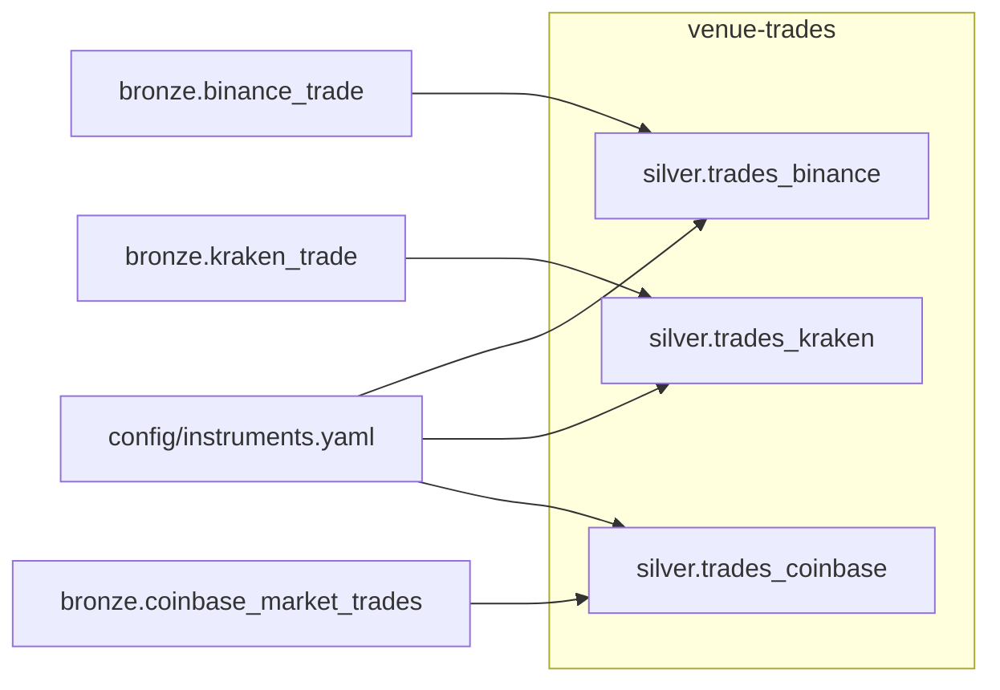

<!-- Generated by `k2gen generate` from contracts/. Do not edit: change the contract, then `make generate`. -->
# venue-trades

Trades per venue, typed and flagged for venue replay, sequence gaps and precision loss, with every delivery kept and the canonical symbol taken from the instrument registry.

| | |
|---|---|
| Domain | [market-capture](../README.md#market-capture) |
| Owner | `capture-team` |
| Kind | source-aligned |
| Lifecycle | draft |
| Descriptor | [`contracts/market-capture/venue-trades/product.yaml`](../../../contracts/market-capture/venue-trades/product.yaml) |

## Inputs and outputs

| Input | What it is |
|---|---|
| `bronze.binance_trade` | an output of [market-capture/venue-frames](../market-capture/venue-frames.md) |
| `bronze.kraken_trade` | an output of [market-capture/venue-frames](../market-capture/venue-frames.md) |
| `bronze.coinbase_market_trades` | an output of [market-capture/venue-frames](../market-capture/venue-frames.md) |
| `config/instruments.yaml` | external source, classified public. The instrument registry: native to canonical symbol per venue. |

Known readers outside the contracts:

- scripts/parity_ohlcv.py

## silver.trades_binance

Binance trades typed from bronze.binance_trade, one row per trade.

| | |
|---|---|
| Classification | internal |
| Entitlement | realtime |
| Retention | snapshots expire after 7 days; no row is deleted ([ADR-032](../../../docs/adr/ADR-032-odcs-contracts-and-k2gen.md)) |
| Partitioning | `days(exchange_ts)` |
| Sort | `canonical_symbol`, `exchange_ts` |
| Schedule | `1-59/5 * * * *` |
| Reads | `bronze.binance_trade`, `config/instruments.yaml` |
| Contract | [`silver.trades_binance.odcs.yaml`](../../../contracts/market-capture/venue-trades/silver.trades_binance.odcs.yaml), version 1.0.0 |
| DDL | [`docker/lake/ddl/lake.sql`](../../../docker/lake/ddl/lake.sql) |

| Column | Type | Description |
|---|---|---|
| `symbol` | `STRING NOT NULL` | Venue-native symbol, as sent (the bronze value) |
| `canonical_symbol` | `STRING NOT NULL` | BASE/QUOTE from config/instruments.yaml: silver derives it from the registry, never from the wire |
| `trade_id` | `STRING NOT NULL` | The trade id the venue assigned, as sent |
| `trade_seq` | `BIGINT NOT NULL` | trade_id as a number. All three venues number trades sequentially per symbol. seq_gap is computed on this |
| `price` | `DECIMAL(28,10) NOT NULL` | Typed from the bronze value, exact |
| `qty` | `DECIMAL(28,10) NOT NULL` | Base quantity, exact |
| `side` | `STRING NOT NULL` | Taker side normalised: buy \| sell |
| `side_native` | `STRING NOT NULL` | The side as the venue expresses it, as sent (Binance: the buyer-is-maker flag as true/false) |
| `exchange_ts` | `TIMESTAMP NOT NULL` | Venue trade time, typed UTC microseconds (Coinbase nanoseconds truncate to micros) |
| `recv_ts_ns` | `BIGINT NOT NULL` | K2 receive clock of the frame, nanoseconds |
| `recv_ts` | `TIMESTAMP NOT NULL` | recv_ts_ns to microseconds |
| `conn_id` | `STRING NOT NULL` |  |
| `conn_msg_seq` | `BIGINT NOT NULL` |  |
| `venue_replay` | `BOOLEAN NOT NULL` | true = an earlier delivery of the same (symbol, trade_id) exists in the archive (lower recv_ts_ns, or same and earlier lineage). Every delivery is kept. gold keeps the first |
| `seq_gap` | `BOOLEAN` | true = the previous trade_seq for this symbol is more than 1 below this one: trades the archive never received. NULL = no previous trade within the lookback (unknowable) |
| `missing_before` | `BIGINT` | How many trade ids are absent between the previous trade and this one. 0 when seq_gap is false, NULL with it |
| `precision_loss` | `BOOLEAN NOT NULL` | true = price or qty carries more than 8 decimal places, i.e. the 1e-8 fixed point of the wire and of gold cannot hold it exactly |
| `event_type` | `STRING` | Binance `e`, as sent |
| `event_time` | `TIMESTAMP` | Binance `E`, typed from epoch milliseconds |
| `buyer_is_maker` | `BOOLEAN` | Binance `m`, as sent. side above is derived from it |
| `ignore_flag` | `BOOLEAN` | Binance `M`, as sent |
| `stream` | `STRING` | The combined-stream name, as sent |
| `src_topic` | `STRING NOT NULL` | Lineage: the bronze row (= the raw.messages row) |
| `src_partition` | `INT NOT NULL` |  |
| `src_offset` | `BIGINT NOT NULL` |  |
| `src_index` | `INT NOT NULL` | Position of this trade within the frame, 0-based, in the order the venue sent: the last component of the identifier |
| `ingest_ts` | `TIMESTAMP NOT NULL` | When the silver run that wrote this row started |

## silver.trades_kraken

Kraken trades typed from bronze.kraken_trade, one row per trade in the frame.

| | |
|---|---|
| Classification | internal |
| Entitlement | realtime |
| Retention | snapshots expire after 7 days; no row is deleted ([ADR-032](../../../docs/adr/ADR-032-odcs-contracts-and-k2gen.md)) |
| Partitioning | `days(exchange_ts)` |
| Sort | `canonical_symbol`, `exchange_ts` |
| Schedule | `1-59/5 * * * *` |
| Reads | `bronze.kraken_trade`, `config/instruments.yaml` |
| Contract | [`silver.trades_kraken.odcs.yaml`](../../../contracts/market-capture/venue-trades/silver.trades_kraken.odcs.yaml), version 1.0.0 |
| DDL | [`docker/lake/ddl/lake.sql`](../../../docker/lake/ddl/lake.sql) |

| Column | Type | Description |
|---|---|---|
| `symbol` | `STRING NOT NULL` | Venue-native symbol, as sent (the bronze value) |
| `canonical_symbol` | `STRING NOT NULL` | BASE/QUOTE from config/instruments.yaml: silver derives it from the registry, never from the wire |
| `trade_id` | `STRING NOT NULL` | The trade id the venue assigned, as sent |
| `trade_seq` | `BIGINT NOT NULL` | trade_id as a number. All three venues number trades sequentially per symbol. seq_gap is computed on this |
| `price` | `DECIMAL(28,10) NOT NULL` | Typed from the bronze value, exact |
| `qty` | `DECIMAL(28,10) NOT NULL` | Base quantity, exact |
| `side` | `STRING NOT NULL` | Taker side normalised: buy \| sell |
| `side_native` | `STRING NOT NULL` | The side as the venue expresses it, as sent (Binance: the buyer-is-maker flag as true/false) |
| `exchange_ts` | `TIMESTAMP NOT NULL` | Venue trade time, typed UTC microseconds (Coinbase nanoseconds truncate to micros) |
| `recv_ts_ns` | `BIGINT NOT NULL` | K2 receive clock of the frame, nanoseconds |
| `recv_ts` | `TIMESTAMP NOT NULL` | recv_ts_ns to microseconds |
| `conn_id` | `STRING NOT NULL` |  |
| `conn_msg_seq` | `BIGINT NOT NULL` |  |
| `venue_replay` | `BOOLEAN NOT NULL` | true = an earlier delivery of the same (symbol, trade_id) exists in the archive (lower recv_ts_ns, or same and earlier lineage). Every delivery is kept. gold keeps the first |
| `seq_gap` | `BOOLEAN` | true = the previous trade_seq for this symbol is more than 1 below this one: trades the archive never received. NULL = no previous trade within the lookback (unknowable) |
| `missing_before` | `BIGINT` | How many trade ids are absent between the previous trade and this one. 0 when seq_gap is false, NULL with it |
| `precision_loss` | `BOOLEAN NOT NULL` | true = price or qty carries more than 8 decimal places, i.e. the 1e-8 fixed point of the wire and of gold cannot hold it exactly |
| `ord_type` | `STRING` | Kraken `ord_type`, as sent |
| `frame_type` | `STRING` | Kraken frame `type`: snapshot \| update |
| `src_topic` | `STRING NOT NULL` | Lineage: the bronze row (= the raw.messages row) |
| `src_partition` | `INT NOT NULL` |  |
| `src_offset` | `BIGINT NOT NULL` |  |
| `src_index` | `INT NOT NULL` | Position of this trade within the frame, 0-based, in the order the venue sent: the last component of the identifier |
| `ingest_ts` | `TIMESTAMP NOT NULL` | When the silver run that wrote this row started |

## silver.trades_coinbase

Coinbase trades typed from bronze.coinbase_market_trades, one row per trade in the frame.

| | |
|---|---|
| Classification | internal |
| Entitlement | realtime |
| Retention | snapshots expire after 7 days; no row is deleted ([ADR-032](../../../docs/adr/ADR-032-odcs-contracts-and-k2gen.md)) |
| Partitioning | `days(exchange_ts)` |
| Sort | `canonical_symbol`, `exchange_ts` |
| Schedule | `1-59/5 * * * *` |
| Reads | `bronze.coinbase_market_trades`, `config/instruments.yaml` |
| Contract | [`silver.trades_coinbase.odcs.yaml`](../../../contracts/market-capture/venue-trades/silver.trades_coinbase.odcs.yaml), version 1.0.0 |
| DDL | [`docker/lake/ddl/lake.sql`](../../../docker/lake/ddl/lake.sql) |

| Column | Type | Description |
|---|---|---|
| `symbol` | `STRING NOT NULL` | Venue-native symbol, as sent (the bronze value) |
| `canonical_symbol` | `STRING NOT NULL` | BASE/QUOTE from config/instruments.yaml: silver derives it from the registry, never from the wire |
| `trade_id` | `STRING NOT NULL` | The trade id the venue assigned, as sent |
| `trade_seq` | `BIGINT NOT NULL` | trade_id as a number. All three venues number trades sequentially per symbol. seq_gap is computed on this |
| `price` | `DECIMAL(28,10) NOT NULL` | Typed from the bronze value, exact |
| `qty` | `DECIMAL(28,10) NOT NULL` | Base quantity, exact |
| `side` | `STRING NOT NULL` | Taker side normalised: buy \| sell |
| `side_native` | `STRING NOT NULL` | The side as the venue expresses it, as sent (Binance: the buyer-is-maker flag as true/false) |
| `exchange_ts` | `TIMESTAMP NOT NULL` | Venue trade time, typed UTC microseconds (Coinbase nanoseconds truncate to micros) |
| `recv_ts_ns` | `BIGINT NOT NULL` | K2 receive clock of the frame, nanoseconds |
| `recv_ts` | `TIMESTAMP NOT NULL` | recv_ts_ns to microseconds |
| `conn_id` | `STRING NOT NULL` |  |
| `conn_msg_seq` | `BIGINT NOT NULL` |  |
| `venue_replay` | `BOOLEAN NOT NULL` | true = an earlier delivery of the same (symbol, trade_id) exists in the archive (lower recv_ts_ns, or same and earlier lineage). Every delivery is kept. gold keeps the first |
| `seq_gap` | `BOOLEAN` | true = the previous trade_seq for this symbol is more than 1 below this one: trades the archive never received. NULL = no previous trade within the lookback (unknowable) |
| `missing_before` | `BIGINT` | How many trade ids are absent between the previous trade and this one. 0 when seq_gap is false, NULL with it |
| `precision_loss` | `BOOLEAN NOT NULL` | true = price or qty carries more than 8 decimal places, i.e. the 1e-8 fixed point of the wire and of gold cannot hold it exactly |
| `envelope_ts` | `TIMESTAMP` | Coinbase envelope `timestamp`, typed (nanoseconds truncate to micros) |
| `sequence_num` | `BIGINT` | Coinbase connection-wide sequence of the envelope |
| `event_type` | `STRING` | Coinbase `events[].type`: snapshot (history replayed on subscribe) \| update |
| `src_topic` | `STRING NOT NULL` | Lineage: the bronze row (= the raw.messages row) |
| `src_partition` | `INT NOT NULL` |  |
| `src_offset` | `BIGINT NOT NULL` |  |
| `src_index` | `INT NOT NULL` | Position of this trade within the frame, 0-based, in the order the venue sent: the last component of the identifier |
| `ingest_ts` | `TIMESTAMP NOT NULL` | When the silver run that wrote this row started |
